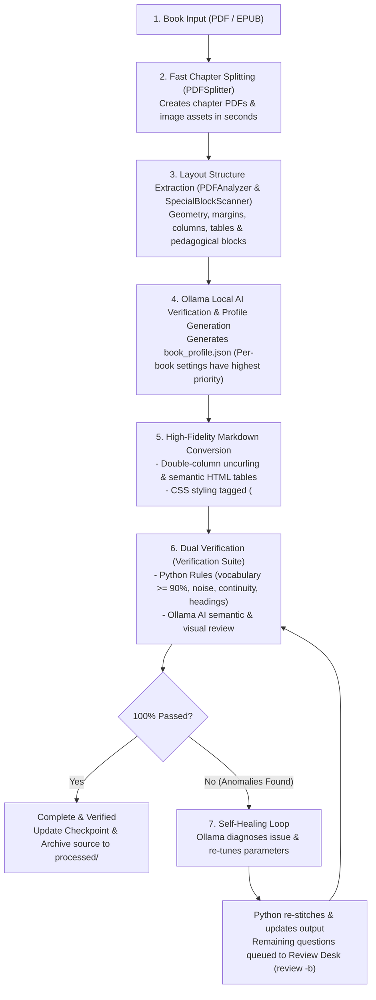

# Book Processor (v3.0.0)

> **Enterprise-Grade PDF & EPUB Structured Markdown Extractor with Neural Layout OCR, Uniform LaTeX Math Reconstruction, Multi-Domain Layout Engines, Human-in-the-Loop Local AI Review, Adaptive Self-Healing, Cross-Document Global Learning, Active Recall Flashcards, and Autonomous Watchdog.**

> [!TIP]
> **🚀 快速上手 (Quick Start)**:
> 本專案已全面升級為統一總指揮中心 [run.py](run.py) 與跨 Agent 協作治理體系。
> - **人類與新 AI 快速指引**：請優先閱讀 [OPERATIONS.md](OPERATIONS.md)（30 秒喚醒手冊）與 [AGENTS.md](AGENTS.md)（跨 Agent 憲法）。
> - **常用指令**：執行 `uv run python run.py agent-init` 讀取原則；執行 `uv run python run.py doctor` 進行軟硬體健檢；執行 `uv run python run.py process <filepath>` 開始轉檔。
> - **資料目錄標準**：書籍請放至 `data/input/books/`，期刊論文請放至 `data/input/literature/`。


Designed for students, academic researchers, AI agents, and software engineers who require **100% high-fidelity, reproduction-accurate Markdown textbooks** with zero cloud token consumption and absolute data privacy.

---

## 📑 Table of Contents

- [Key Capabilities & Innovations](#-key-capabilities--innovations)
- [Architecture & Directory Structure](#-architecture--directory-structure)
- [System Requirements & Installation](#-system-requirements--installation)
- [Quick Start Guide](#-quick-start-guide)
- [CLI Command Reference](#-cli-command-reference)
  - [1. `doctor` (System Health Audit)](#1-doctor-system-health-audit)
  - [2. `split` (Fast Chapter Splitting)](#2-split-fast-chapter-splitting)
  - [3. `convert` (Single Chapter Conversion & Auto-Verify)](#3-convert-single-chapter-conversion--auto-verify)
  - [4. `run` (Batch Processing)](#4-run-batch-processing)
  - [5. `resume` (Checkpoint Resume)](#5-resume-checkpoint-resume)
  - [6. `verify` (Content Quality Audit)](#6-verify-content-quality-audit)
  - [7. `watchdog` (Inbox & System Health Monitor)](#7-watchdog-inbox--system-health-monitor)
  - [8. `review` (Human-in-the-Loop AI Correction Desk)](#8-review-human-in-the-loop-ai-correction-desk)
  - [9. `batch_convert.py` (Batch Re-conversion & Quality Profiling)](#9-batch_convertpy-batch-re-conversion--quality-profiling)
- [Inbox-to-Processed Automated Lifecycle](#-inbox-to-processed-automated-lifecycle)
- [Textbook Profiling, Geometry & Style System](#-textbook-profiling-geometry--style-system)
- [Active Recall Flashcards & Anki Deck Export](#-active-recall-flashcards--anki-deck-export)
- [Closed-Loop Layout Auto-Healing & Visual Auditor](#-closed-loop-layout-auto-healing--visual-auditor)
- [Autonomous System & Inbox Watchdog](#-autonomous-system--inbox-watchdog)
- [Human-in-the-Loop AI Review & Correction Desk](#-human-in-the-loop-ai-review--correction-desk)
- [Mathematical Formulas & Uniform LaTeX Sizing](#-mathematical-formulas--uniform-latex-sizing)
- [Multi-Domain Layout Recognition (STEM, Humanities, Medicine)](#-multi-domain-layout-recognition-stem-humanities-medicine)
- [Quality Invariants, Circuit Breaker & Adaptive Learning](#-quality-invariants-circuit-breaker--adaptive-learning)
- [Media & Image Processing Standards](#-media--image-processing-standards)
- [Interruption, Recovery & Dashboard (`processing_status.md`)](#-interruption-recovery--dashboard)
- [Developer & AI Agent SDK Integration](#-developer--ai-agent-sdk-integration)
- [Running Automated Unit Tests](#-running-automated-unit-tests)
- [Supported Formats & Models](#-supported-formats--models)

---

## 🌟 Key Capabilities & Innovations

1. **Typographic Preservation (Bold, Italic, Underline)**:
   - Preserves typographic hierarchies directly from PDF vector font specifications and HTML formatting (`**bold**`, `*italic*`, `<u>underline</u>`).
2. **Noise-Free Reading Flow & Page Citation Anchors**:
   - Automatically strips redundant running headers, running footers, copyright notices, and publisher metadata.
   - Preserves original book page numbers via non-intrusive HTML comments (`<!-- Page X -->`), enabling citation indexing without breaking text continuity.
3. **Uniform LaTeX Math Reconstruction (Zero Screenshots & No Shrunk Fractions)**:
   - Mathematical expressions, Greek symbols, and statistical notations ($p$-values, $t$-tests, ANOVA, Cohen's $d$, Pearson $r$) are converted into LaTeX math.
   - Enforces `\dfrac` and `\displaystyle` across all equations so fraction numerators and denominators maintain **100% full-sized font consistency** with surrounding textbook text.
4. **Multi-Domain Layout Engine & Pedagogical Blocks**:
   - **STEM**: Reconstructs programming language listings as fenced code blocks (````python ... ````) and mathematical blocks.
   - **Humanities & Social Sciences**: Formats sidebars, exhibits, and case studies into GitHub alerts (`> [!NOTE]`); detects bottom-of-page footnotes and structures them as Markdown footnotes (`[^1]: ...`).
   - **Medicine & Biology**: Recognizes clinical observation callouts and multi-panel figures.
   - **Learning Objectives & Mindmaps**: Detects and formats learning objectives (`🎯 **X.X**`) and generates interactive Mermaid concept mindmaps.
5. **Active Recall Flashcards & Automated Anki Export**:
   - Compiles chapter margin terms and key concepts into collapsible active-recall flashcard drawers (`<details id="flashcard-...">`).
   - Automatically exports ready-to-import Anki flashcard decks in TSV format (`<Chapter>_flashcards.tsv`).
6. **Automatic Geometry Calibration & Book Profiling**:
   - Automatically detects odd/even page margins and column roles (`CoordinateCalibrator`).
   - Discovers textbook-specific features (learning objectives, concept maps, margin glossaries, tables) via `SpecialBlockScanner`.
   - Supports global styles (`global_profile.json`), publisher profiles (Pearson, Cengage), and per-book overrides (`book_style_override.py`).
7. **Closed-Loop Layout Auto-Healing & Visual Quality Audit**:
   - Detects and repairs broken syntax, quad-asterisks (`****`), and misaligned table headers before saving Markdown (`LayoutAutoHealer`).
   - Renders reference PDF page PNGs and audits structural quality with a 10-point scoring engine (`VisualAuditor`).
8. **Inbox & Processed Automated Lifecycle**:
   - Incoming textbooks are staged in `inbox/`. Once all chapters are extracted and 100% verified, the source book file is automatically archived to `processed/`.
9. **Autonomous System & Inbox Watchdog (`watchdog`)**:
   - Continuously monitors `inbox/` for newly deposited books.
   - Tracks host system health: free disk capacity (alerts if $< 5$ GB) and CPU load/thermal stress. Interactively prompts the user (`[y/N]`) or runs continuously with `--auto-process`.
10. **Human-in-the-Loop Local AI Review (`review`)**:
    - When local AI (Ollama) detects OCR artifacts or syntax issues, it creates non-destructive annotations (`<!-- AI-REVIEW-START ... -->`) and `<Chapter>.review.json`.
    - The interactive CLI diff desk allows you to review each proposed change side-by-side: `[y] Accept`, `[n] Reject`, `[a] Accept All`, `[q] Quit`.
11. **Self-Checking Quality Invariants & Fail-Fast Circuit Breaker**:
    - Enforces pre/post-split PDF structural validity, page character density, image existence, and LaTeX equation balance (`$`/`$$`).
    - Includes a **Circuit Breaker** that halts batch pipelines if $\ge 3$ consecutive chapters fail, preventing compounding errors and wasted compute.
12. **Adaptive Parameter Tuning & Persistent Learned Rules ("Learner")**:
    - When verification fails, the learner diagnoses the cause (recurring noise headers, low contrast OCR, column interleaving).
    - Auto-tunes parameters (400 DPI escalation, dynamic noise regex) and automatically re-runs the chapter.
    - Persists learned fixes to `output/<Book>/learned_rules.json` and `~/.book_processor/global_rules.json`.
13. **Lossless Media Extraction & Vector Diagram Support**:
    - Renders high-resolution vector figures (`figure_X_Y.png`) and pedagogical photos.
    - **Full-Page Background Filter**: Automatically detects and drops scanned paper textures ($\ge 80\%$ page area), while preserving genuine diagrams.
14. **100% Local & Free (Zero Cloud Token Cost)**:
    - Runs completely offline. AI audits connect to local Ollama (`localhost:11434`), guaranteeing 0 API costs and complete document privacy.

---

## 🔄 Core 5-Step Processing & Self-Healing Pipeline



1. **Fast Chapter Splitting**: High-throughput outline analysis splits source books into per-chapter PDFs without compute-heavy OCR.
2. **Program + Ollama Structure Extraction**: Python algorithms detect geometry, columns, margins, and tables; Ollama assists on complex structures. Results are saved to `book_profile.json` (per-book profile overrides global styles).
3. **HTML / CSS Semantic Tagging**: Markdown output embeds `<style>` and semantic HTML elements (e.g. `<table class="textbook-table">`, `<div class="dialogue-block">`). Layout and visual presentation can be tuned via CSS without re-converting from PDF!
4. **Dual Verification Engine**: Python rules verify vocabulary ratio, absence of running headers, heading balance, and cross-page sentence continuity. Ollama verifies context fidelity.
5. **Self-Healing Loop & Review Desk**: When warnings occur, the system auto-remedies continuity breaks and re-tunes parameters. Unresolved items are surfaced in a centralized review console (`python3 book_processor.py review -b <book_dir>`) for one-click human confirmation.

---

## 🏗 Architecture & Directory Structure

The project conforms to modern Python package standards (PEP 517/518, `pyproject.toml`) with decoupled, single-responsibility modules:

```text
books/
├── run.py                             # 🎯 Unified CLI Command Center (entry point for all operations)
├── pyproject.toml                     # Modern Python packaging configuration (uv)
├── AGENTS.md                          # Cross-Agent governance constitution (mandatory read)
├── OPERATIONS.md                      # 30-second onboarding guide for humans & AI
├── data/
│   ├── input/
│   │   ├── books/                     # 📥 Drop incoming textbook PDF/EPUB here
│   │   └── literature/                # 📥 Drop academic journal PDF here
│   ├── output/
│   │   ├── books/                     # 📤 Converted textbook Markdown output
│   │   └── literature/                # 📤 Converted journal Markdown output
│   ├── processed/                     # ✅ Auto-archived source files upon verified completion
│   └── needs_review/                  # ⚠️ Auto-quarantined files with confidence < 0.80
├── src/
│   ├── book_processor/
│   │   ├── config.py                  # Global parameters (DPI, thresholds, paths, Ollama settings)
│   │   ├── cli.py                     # Underlying CLI parser (called by run.py)
│   │   ├── config_manager.py          # 4-layer config inheritance + shared knowledge harvesting
│   │   ├── book_style.py              # Base typographic stylesheet & CSS injector
│   │   ├── style_loader.py            # Hierarchical style loader (global → publisher → book)
│   │   ├── concurrency/
│   │   │   └── m5_worker_pool.py      # Apple M5 multi-core parallel processing pool
│   │   ├── core/
│   │   │   ├── orchestrator.py        # Master pipeline orchestrator (textbook path)
│   │   │   ├── learner.py             # GlobalLearner (cross-doc) + AdaptiveLearner (per-book)
│   │   │   ├── checkpoint.py          # Real-time state manager & processing_status.md builder
│   │   │   ├── invariants.py          # Pre/post-condition quality guards & circuit breaker
│   │   │   ├── analyzer.py            # PDF outline & table of contents analyzer
│   │   │   ├── splitter.py            # Fast lossless PDF chapter extraction
│   │   │   ├── image_manager.py       # Lossless image extraction & background filter
│   │   │   └── watchdog.py            # WatchdogService (API use; run.py watchdog is canonical)
│   │   ├── fingerprinting/
│   │   │   ├── document_classifier.py # PDF archetype classifier (textbook/journal)
│   │   │   └── publisher_detector.py  # Publisher detection (Elsevier, Wiley, APA…)
│   │   ├── parsers/
│   │   │   ├── digital_pdf.py         # Born-digital PDF vector parser
│   │   │   ├── scanned_pdf.py         # 300 DPI neural OCR parser
│   │   │   ├── epub_parser.py         # EPUB extractor
│   │   │   ├── layout_detector.py     # Multi-domain layout recognizer
│   │   │   ├── layout/                # Modular layout sub-parsers (tables, margins, callouts…)
│   │   │   └── journal/               # Journal-specific parsers (IMRAD, references)
│   │   ├── pipelines/
│   │   │   ├── textbook_pipeline.py   # TextbookPipeline: TOC split + per-chapter conversion
│   │   │   ├── journal_pipeline.py    # JournalPipeline: 7-stage dual-column paper processing
│   │   │   └── literature_pipeline.py # LiteraturePipeline: extends JournalPipeline
│   │   ├── profiler/
│   │   │   ├── coordinate_calibrator.py # Dynamic page margin geometry calibration
│   │   │   └── special_block_scanner.py # Textbook feature discovery scanner
│   │   ├── verification/
│   │   │   ├── verifier.py            # 14-metric automated verification suite
│   │   │   ├── ollama_verifier.py     # Ollama semantic review & JSON proposals
│   │   │   ├── ollama_healer.py       # Auto-healer with GlobalLearner feedback
│   │   │   ├── review_manager.py      # Auto-accept high-confidence fixes + GlobalLearner propagation
│   │   │   └── layout_healer.py       # Deterministic rule-based layout fixer
│   │   └── utils/
│   │       ├── anki_exporter.py       # Anki-compatible TSV flashcard deck generator
│   │       ├── text_utils.py          # Text sanitization & cross-page stitching
│   │       └── system.py              # Binary dependency checks (poppler, tesseract, ollama)
│   ├── guards/
│   │   ├── hardware.py                # RAM / SSD / battery hardware safety guard
│   │   ├── ollama_guard.py            # Ollama auto-wake & graceful degradation
│   │   └── validator.py               # Input/output validator with auto-quarantine
│   └── utils/
│       └── logger.py                  # Structured diagnostic logger (where/why/fix format)
├── tests/                             # Comprehensive automated test suite (171 tests, 0 failures)
├── config/
│   ├── publishers/                    # Publisher-specific layout profiles (elsevier, wiley, apa)
│   └── shared_knowledge/              # Cross-document learned symbol mappings & journal sections
├── memory/
│   ├── TASKS.md                       # Project task board with completion dates
│   ├── HANDOFF.md                     # Session handoff state for AI agents
│   └── sessions/                      # Dual-track session archives (summary + transcript)
└── docs/                              # Architecture, coding rules, ADR decisions, structure map

└── output/                            # Chapter-centric structured output
    ├── <Book_Title>/
        ├── processing_status.md       # Real-time Markdown status dashboard
        ├── processing_status.json     # Machine-readable state manifest for AI agents
        ├── book_profile.json          # Calibrated geometry & feature flags
        ├── learned_rules.json         # Persisted adaptive rules (noise patterns, DPI overrides)
        └── chapters/
            ├── <Chapter_01>/
            │   ├── <Chapter_01>.pdf   # Standalone chapter PDF
            │   ├── <Chapter_01>.md    # Markdown file with uniform LaTeX & embedded figures
            │   ├── <Chapter_01>_flashcards.tsv # Anki active recall flashcard deck
            │   ├── <Chapter_01>.review.json # Local AI audit proposals (if review requested)
            │   └── images/            # High-resolution pedagogical figures
            │       ├── figure_1_1.png
            │       └── 001_001.jpg
            └── <Chapter_02>/
                └── ...
```

---

## 💻 System Requirements & Installation

### 1. Prerequisites

- **Python**: `>= 3.10` (tested with Python 3.10 – 3.14)
- **Poppler Utilities**: Provides `pdfinfo`, `pdftoppm`, `pdfimages`, `pdfseparate`, `pdfunite`, `pdftohtml`, `pdftotext`.
- **Tesseract OCR**: Provides neural layout engine (`tesseract` with language packs).
- **macOS `sips`** (macOS built-in) or **ImageMagick** (Linux/Windows).
- **Ollama** (Optional, for offline AI review): [https://ollama.com](https://ollama.com).

### 2. Dependency Installation

#### macOS (via Homebrew)
```bash
brew install poppler tesseract tesseract-lang
```

#### Ubuntu / Debian
```bash
sudo apt-get update
sudo apt-get install -y poppler-utils tesseract-ocr tesseract-ocr-eng libtesseract-dev imagemagick
```

#### Windows
Install Poppler and Tesseract using `winget` or Chocolatey and add their `bin` directories to your system `PATH`:
```powershell
winget install UB-Mannheim.TesseractOCR
winget install poppler
```

### 3. Verify Your Environment
Run the built-in system doctor (checks RAM, SSD, Ollama, poppler & tesseract):
```bash
uv run python run.py doctor
```
Expected output (all dependencies installed):
```text
=================================================================
🩺 [DOCTOR] 系統軟硬體與環境前置健檢 (System Health Audit)
=================================================================
• 記憶體狀態 (RAM)  : 12.4 GB 可用 (門檻: ≥ 4.0 GB) -> ✅ [PASS]
• 硬碟剩餘空間 (SSD): 48.2 GB 剩餘 (門檻: ≥ 10.0 GB) -> ✅ [PASS]
• 電源供應狀態      : AC (充電中) -> ✅ [PASS]
• Apple MPS 晶片加速: ✅ [PASS: 支援硬體加速]

[Ollama 本地大模型診斷]
• 服務狀態 (Port 11434): ✅ [ONLINE] 在線運行中
• 已安裝模型清單       : gemma4:12b, qwen2.5:7b
• 推薦啟用模型         : 🤖 gemma4:12b

[核心工具鏈診斷]
• pdfinfo    : ✅ [PASS]
• pdfseparate: ✅ [PASS]
• pdftoppm   : ✅ [PASS]
• pdftohtml  : ✅ [PASS]
• tesseract  : ✅ [PASS]
  → 所有核心工具鏈完整！

🎉 系統狀態完美！全自動 Ollama 深度語義與公式除錯已準備就緒。
```

---

## 🚀 Quick Start & Direct Terminal Execution (Cmd Guide)

You can run commands directly from your terminal (`Terminal.app`, `iTerm2`, `bash`, `zsh`, `cmd.exe`, or `PowerShell`) inside the project root:

### 1. Process a Textbook
Drop your PDF into `data/input/books/` then run:
```bash
# Process a full textbook — auto-detects from path convention
uv run python run.py process data/input/books/<YourTextbook>.pdf

# Process an EPUB book archive
uv run python run.py process data/input/books/<YourTextbook>.epub

# Override type explicitly
uv run python run.py process data/input/books/<YourTextbook>.pdf --type book
```

### 2. Process an Academic Journal / Literature
Drop your PDF into `data/input/literature/` then run:
```bash
uv run python run.py process data/input/literature/<Paper>.pdf

# Or override type explicitly
uv run python run.py process data/input/literature/<Paper>.pdf --type literature
```

### 3. System Health Check
```bash
uv run python run.py doctor
```

### 4. Start the Autonomous Watchdog
Monitor directories for new files and auto-trigger conversion:
```bash
uv run python run.py watchdog
```

### 5. Save Progress (Git Checkpoint)
```bash
uv run python run.py save "feat: describe what was done"
```

### 6. Archive All Sessions
```bash
uv run python run.py archive-sessions
```

---

## 📖 Complete CLI Command Reference

All operations are routed through **`uv run python run.py <command>`**:

| Command | Description |
| :--- | :--- |
| `agent-init` | AI agent onboarding briefing — read AGENTS.md & HANDOFF.md |
| `doctor` | System health audit: RAM, SSD, Ollama, poppler, tesseract |
| `process <file>` | Convert a PDF/EPUB using path-based routing (books vs literature) |
| `watchdog` | Autonomous monitor for `data/input/` + hardware guard |
| `save "<msg>"` | Update timestamps → run tests → git commit (English only) |
| `handoff "<reason>"` | Save handoff state → archive sessions → git commit |
| `publish "<notes>"` | Full release: tests → archive → squash merge |
| `archive-sessions` | Auto-scan brain/ and export all sessions as dual-track archives |
| `test-ollama-auto-trigger` | Verify Ollama guards & input validators work end-to-end |


| Flag / Argument | Description | Example |
| :--- | :--- | :--- |
| `-b`, `--book-dir <PATH>` | Target specific book output directory | `python3 batch_convert.py -b "output/BookName"` |
| `--all-books` | Automatically process all book directories under `output/` | `python3 batch_convert.py --all-books` |
| `--force` | Force re-conversion even if chapter is marked `CONVERTED` | `python3 batch_convert.py -b "output/BookName" --force` |
| `--only <PREFIX>` | Convert only chapters matching prefix | `python3 batch_convert.py --only "Ch01"` |
| `--from <PREFIX>` | Start conversion from chapter prefix onwards | `python3 batch_convert.py --from "Ch05"` |
| `--audit` | Run visual quality auditor and score all chapters (1-10) | `python3 batch_convert.py -b "output/BookName" --audit` |
| `--scan` | Run SpecialBlockScanner on first 5 chapters before converting | `python3 batch_convert.py -b "output/BookName" --scan` |
| `--scan-only` | Run SpecialBlockScanner only without converting | `python3 batch_convert.py -b "output/BookName" --scan-only` |
| `--status` | Print real-time Markdown status dashboard and exit | `python3 batch_convert.py -b "output/BookName" --status` |

### `book_processor.py` Subcommands
| Subcommand | Description | Example |
| :--- | :--- | :--- |
| `doctor` | Audit dependencies (`poppler`, `tesseract`, `ollama`, `sips`) | `python3 book_processor.py doctor` |
| `split` | Fast outline split into standalone chapter PDFs | `python3 book_processor.py split -f "inbox/book.pdf"` |
| `convert` | Convert single chapter PDF and run auto-verification | `python3 book_processor.py convert -p "output/book/chapters/Ch01/Ch01.pdf"` |
| `run` | Full split, conversion, verification, and auto-archive | `python3 book_processor.py run -f "inbox/book.pdf"` |
| `resume` | Resume interrupted run, skipping completed chapters | `python3 book_processor.py resume -f "inbox/book.pdf"` |
| `verify` | Run vocabulary, continuity, and noise verification suite | `python3 book_processor.py verify -b "output/book"` |
| `review` | Centralized Human-in-the-Loop review console | `python3 book_processor.py review -b "output/book"` |
| `watchdog` | Monitor `inbox/` for newly added books | `python3 book_processor.py watchdog --interval 5` |


---

## 🔄 Inbox-to-Processed Automated Lifecycle

To ensure clean asset management when handling dozens of textbooks:
1. **Inbox Staging**: Place all new files (`.pdf`, `.epub`) into `inbox/`.
2. **Detection & Processing**: The pipeline detects the source book from `inbox/` and generates chapter-level outputs in `output/<Book>/`.
3. **Automated Archival**: When every chapter in `processing_status.md` reaches `VERIFIED` status, the orchestrator automatically moves the source file from `inbox/` into `processed/`.
4. **Resilience**: If a session is interrupted midway, the source book remains in `inbox/` until all chapters are completely verified, ensuring nothing is prematurely archived.


---

## 🐕 Autonomous System & Inbox Watchdog

The watchdog runs locally to monitor both system resources and incoming books:
- **Disk Health Guard**: Continuously checks available storage on the output volume; raises an alert if free disk space falls below 5.0 GB.
- **CPU & Thermal Guard**: Tracks 1-minute load averages against core counts; issues warnings if CPU load exceeds 85% to protect against thermal throttling.
- **Inbox Inotify/Poll Engine**: Detects newly deposited books, waits for file write operations to complete, and alerts the user.
- **Real-Time Dashboards**: Generates `output/watchdog_status.md` and maintains an append-only audit log at `output/watchdog_alerts.log`.

---

## 🧑‍💻 Human-in-the-Loop AI Review & Correction Desk

When OCR quality in scanned books suffers from historical font degradation, local AI (Ollama) can audit the text. However, **the system never silently modifies your book content**.

### Non-Destructive Annotation Standard:
AI proposed fixes are recorded directly into the Markdown using reversible comment tags:
```markdown
<!-- AI-REVIEW-START id="rev-1" category="ocr_typo" -->
<!-- ORIGINAL:
coun- seling theclienf with anxiety
-->
<!-- REASON: Repaired hyphenation and corrected OCR typo 'theclienf' -->
counseling the client with anxiety
<!-- AI-REVIEW-END -->
```
A companion manifest `<Chapter>.review.json` is generated for machine tracking.

### Interactive Review CLI (`book_processor review`):
Run the review desk to accept or reject fixes interactively:
```text
======================================================================
[AI REVIEW DESK] Chapter: Ch01 Introduction
Total proposals to review: 2
======================================================================

[1/2] Review Item #rev-1 [Category: ocr_typo]
  Reason: Repaired hyphenation and corrected OCR typo 'theclienf'
  - Original: coun- seling theclienf with anxiety
  + Proposed: counseling the client with anxiety
  Action: [y] Accept  [n] Reject  [a] Accept All  [q] Quit: y
  -> ACCEPTED

[✓] Review decisions saved to: Ch01 Introduction.md
```

---

## 📐 Mathematical Formulas & Uniform LaTeX Sizing

The pipeline strictly adheres to the principle: **Never substitute mathematical formulas with screenshots.**

### 1. Uniform Font Sizing (`\dfrac` & `\displaystyle`)
In standard LaTeX and web renderers (KaTeX/MathJax), `\frac` inside equations is rendered at $\approx 70\%$ font size, making denominators and numerators tiny and hard to read. 

The Book Processor enforces:
- Automatic conversion of all `\frac{...}{...}` to `\dfrac{...}{...}`.
- Automatic injection of `\displaystyle` at the head of every display math block containing fractions.
- Guarantees that numerators and denominators maintain **100% full text font size** matching the surrounding textbook.

### 2. Greek Symbols & Statistical Operators
| Symbol | Output | Symbol | Output |
| :---: | :---: | :---: | :---: |
| $\alpha$ | `\alpha` | $\Sigma$ / $\sum$ | `\Sigma` / `\sum` |
| $\beta$ | `\beta` | $\approx$ | `\approx` |
| $\mu$ | `\mu` | $\neq$ | `\neq` |
| $\sigma$ | `\sigma` | $\le$ / $\ge$ | `\le` / `\ge` |

### 3. APA & Statistical Notations
APA research notations are automatically recognized and converted to inline LaTeX:
- `*d* =.8` $\rightarrow$ `$d = .8$`
- `*r* =.45` $\rightarrow$ `$r = .45$`
- `*p* < .05` $\rightarrow$ `$p < .05$`
- `t(28) = 2.45` $\rightarrow$ `$t(28) = 2.45$`
- `F(1, 40) = 5.12` $\rightarrow$ `$F(1, 40) = 5.12$`

### 4. Textbook Display Equations
```latex
$$\displaystyle \text{Mean} = \dfrac{\sum X}{n} = \dfrac{1 + 2 + 3}{3} = \dfrac{6}{3} = 2$$
```
```latex
$$\displaystyle \text{z score} = \dfrac{\text{raw score} - \text{mean}}{\text{standard deviation}} = \dfrac{X - \bar{X}}{SD}$$
```
```latex
$$\displaystyle d = \dfrac{\text{mean difference}}{\text{standard deviation}} = \dfrac{M_1 - M_2}{SD}$$
```
```latex
$$\displaystyle r = \dfrac{\text{sum of cross products of } z \text{ scores}}{n} = \dfrac{\sum (Z_X Z_Y)}{n}$$
```

---

## 📚 Multi-Domain Layout Recognition (STEM, Humanities, Medicine)

Textbooks vary drastically across disciplines. The `LayoutDetector` adapts formatting accordingly:
- **Sidebars & Callouts (Humanities & Social Sciences)**: Detects exhibits, case studies, focus boxes, and key concept notes, converting them into standardized GitHub alerts:
  ```markdown
  > [!NOTE]
  > **Exhibit 15.1 Key Statistical Guidelines**
  > Always report effect sizes alongside p values.
  ```
- **Footnotes & Citations**: Identifies bottom-of-page numeral citations (e.g. `1. Department of Psychology...`) and separates them from the body text, structuring them as proper Markdown footnotes:
  ```markdown
  [^1]: Department of Psychology, Annual Review of Research, 2024.
  ```
- **Algorithms & Code Listings (STEM)**: Detects source code patterns across Python, R, JavaScript, and C++, preserving indentation and wrapping in fenced blocks:
  ````markdown
  ```python
  def calculate_mean(data):
      return sum(data) / len(data)
  ```
  ````

---

## 🛡 Quality Invariants, Circuit Breaker & Adaptive Learning

To ensure unattended overnight batch processing does not degrade into cascaded errors:

### 1. Fail-Fast Quality Invariants (`invariants.py`)
- **Pre-Split Invariant**: Asserts source file readability, non-zero size, and total page count $> 0$.
- **Post-Split Invariant**: Asserts chapter PDF existence and strict match against expected page counts.
- **Page Density Invariant**: Asserts extracted page is not an empty anomaly.
- **Markdown Syntax Invariant**: Asserts balanced LaTeX math delimiters (`$`/`$$`) and verifies all embedded images exist on disk.

### 2. Pipeline Circuit Breaker
If 2 consecutive chapters fail critical verification checks, the `CircuitBreaker` automatically trips and halts the pipeline, logging diagnostic reasons and notifying the user to prevent CPU waste.

### 3. Adaptive Parameter Tuning & Persistent Learned Rules (`learner.py`)
On verification failure:
1. **Diagnosis**: Automatically inspects failure logs (e.g., novel recurring publisher watermark or faint contrast text).
2. **Parameter Escalation**: Dynamically adjusts parameters—escalating OCR resolution from 300 to 400 DPI or compiling a new noise pattern regex.
3. **Auto-Retry**: Automatically re-runs the chapter conversion with tuned parameters.
4. **Persistent Rule Memory**: Saves learned adaptations to `output/<Book>/learned_rules.json` so subsequent chapters and future runs inherit the fix permanently.

---

## 🖼 Media & Image Processing Standards

1. **Lossless Conversion**:
   - PDF image streams (including JBIG2 / `jb2e`) are rendered and converted losslessly using macOS `sips` or `pdftoppm` into standard PNG/JPEG files at 300 DPI.
2. **Pedagogical Figure Isolation**:
   - In scanned books, background page scans often take up 90%–100% of the page area. The `ImageManager` calculates image dimension ratios relative to page bounds. Any image covering $\ge 80\%$ of the page is classified as background paper texture and discarded, ensuring the Markdown contains only genuine figures, charts, and diagrams.
3. **Deterministic Placement**:
   - Extracted images are saved under `images/<page>_<seq>.<ext>` and referenced in the markdown context near figure captions (`Figure X`, `Table X`, `Illustration X`).

---

## ⏱ Interruption, Recovery & Dashboard

When processing multi-hundred-page textbooks, computer thermal throttling or emergency interruptions may occur. The system provides an enterprise-grade checkpointing system:

### Real-Time Dashboard (`processing_status.md`)
Generated at `output/<Book_Title>/processing_status.md`:

```markdown
# Processing Status: Groups- Process and Practice

- **Total Chapters**: 20
- **Verified & Complete**: 5 / 20 (25.0%)
- **Last Session Updated**: 2026-09-16 13:00:00
- **Resume Command**: `python3 book_processor.py resume --file "inbox/<path_to_book.pdf>"`

| Chapter | Page Range | Split PDF | Markdown | Images | Verification | Status |
| :--- | :--- | :---: | :---: | :---: | :---: | :--- |
| **00-0Cover** | pp. 1-1 | [✓] | [✓] | 1 | [PASS] 0.0% | `VERIFIED` |
| **00-1Publish** | pp. 2-4 | [✓] | [✓] | 0 | [PASS] 92.4% | `VERIFIED` |
| **00-2About Authors** | pp. 5-7 | [✓] | [✓] | 4 | [PASS] 94.1% | `VERIFIED` |
| **Ch01 Introduction** | pp. 26-49 | [✓] | [ ] | 0 | Pending | `SPLIT` |
| ... | ... | ... | ... | ... | ... | ... |
```

### Machine-Readable Manifest (`processing_status.json`)
Allows AI agents, scripts, and CI/CD pipelines to query the state programmatically:
```json
{
  "book_name": "Groups- Process and Practice",
  "updated_at": "2026-09-16T13:00:00",
  "total_chapters": 20,
  "completed_chapters": 5,
  "chapters": {
    "00-0Cover": {
      "page_range": "1-1",
      "split_pdf": true,
      "markdown_generated": true,
      "images_count": 1,
      "verification_pass": true,
      "accuracy_percent": 0.0,
      "status": "VERIFIED"
    }
  }
}
```

---

## 📊 Textbook Profiling, Geometry & Style System

Before the first chapter is converted, the pipeline auto-calibrates to the specific typographic geometry of the book. This prevents incorrect header/footer detection and column boundary errors across books with different page layouts.

### Profile Calibration (`CoordinateCalibrator`)
Runs on the first chapter, sampling text block coordinates to detect:
- **Header / footer Y-axis bounds** — precise pixel rows where running headers/page numbers live
- **Body text column margins** — left/right X boundaries for single- and multi-column layouts
- **Exhibit / sidebar regions** — distinct X coordinate clusters for callout boxes

Results are persisted to `output/<Book>/book_profile.json` and reused for all subsequent chapters.

### Feature Discovery (`SpecialBlockScanner`)
Scans the first 3 chapters to detect which pedagogical features exist in the book:
- Glossary terms (inline vs. chapter-end placement)
- Key concept callouts, exhibits, focus boxes
- Footnote / endnote patterns

### Style Loading Hierarchy
Styles are resolved from lowest to highest priority (later overrides earlier):

```
global_profile.json        ← workspace-wide defaults (~/.book_processor/)
  └── Publisher profile    ← publisher-specific overrides (src/book_processor/profiles/)
        └── book_profile.json  ← auto-calibrated per-book geometry
              └── book_style_override.py  ← manual overrides (create in output/<Book>/)
```

Key style keys include `gloss_placement` (`"inline"` | `"chapter_end"`), `dpi`, `ocr_lang`, `column_mode`, and `noise_threshold`.

---

## 🃏 Active Recall Flashcards & Anki Deck Export

When a book's glossary terms are placed at chapter end (detected via `gloss_placement: chapter_end` in the style profile), the pipeline automatically generates active recall flashcards.

### Flashcard Format in Markdown
Glossary entries are wrapped in collapsible `<details>` blocks for in-document review:
```markdown
<details>
<summary>📌 <strong>Internal Validity</strong></summary>

The degree to which a study establishes a causal relationship between variables, ruling out alternative explanations.

</details>
```

### Anki TSV Export
Each chapter with flashcards produces a companion `<Chapter>_flashcards.tsv` file compatible with **Anki** (File → Import → Tab-separated):
```
Internal Validity	The degree to which a study establishes a causal relationship...
External Validity	The extent to which research findings can be generalized...
```

> [!NOTE]
> Books using `gloss_placement: inline` (such as *Research Methods, Design, and Analysis*) embed glossary terms inline within the chapter body and do **not** generate `_flashcards.tsv` files — this is expected behavior.

---

## 🔧 Closed-Loop Layout Auto-Healing & Visual Auditor

### Layout Auto-Healer (`layout_healer.py`)
After each chapter is converted to Markdown, the `LayoutAutoHealer` runs a deterministic repair pass before the file is saved:
- **Heading cascade repair**: Fixes skipped heading levels (e.g., H2 → H4 without H3)
- **Orphaned list item repair**: Re-attaches list items separated by stray blank lines
- **LaTeX fence repair**: Closes unclosed `$$` display math blocks
- **Table continuity repair**: Merges tables split across page boundaries
- **Trailing noise strip**: Removes page number artifacts and running header fragments left after extraction

### Visual Auditor (`visual_auditor.py`) — 10-Point Scoring
After auto-healing, the `VisualAuditor` scores each chapter on a 10-point rubric:

| Score | Criterion |
| :---: | :--- |
| 2 pts | Heading structure is present and non-empty |
| 2 pts | No unresolved LaTeX delimiter imbalance |
| 2 pts | Flashcard `<details>` blocks are syntactically valid (when applicable) |
| 2 pts | All embedded image paths resolve to files on disk |
| 2 pts | No bare OCR noise lines (e.g. stray single characters or page numbers) |

Chapters scoring < 6/10 are flagged in `processing_status.md` for manual review.

---

## 🤖 Developer & AI Agent SDK Integration

The codebase is built as a reusable Python library for integration into AI Agent frameworks (Claude Code, Antigravity, AutoGen, CrewAI):

```python
from book_processor.core.orchestrator import BookProcessorOrchestrator
from book_processor.verification.verifier import AccuracyVerifier
from book_processor.verification.review_manager import ReviewManager

# 1. Initialize Orchestrator with Inbox support
orchestrator = BookProcessorOrchestrator(
    inbox_dir="./inbox",
    processed_dir="./processed",
    output_dir="./output",
    use_ollama=True,
    ollama_model="deepseek-r1:8b"
)

# 2. Split only
orchestrator.split_book_only("inbox/textbook.pdf")

# 3. Convert single chapter with auto-verification & self-healing
result = orchestrator.convert_single_chapter(
    chapter_pdf_path="output/textbook/chapters/Ch01/Ch01.pdf"
)
print("Passed:", result['passed'], "Accuracy:", result['accuracy_percent'])

# 4. Programmatic AI Review Resolution
ReviewManager.apply_review_decisions(
    chapter_dir="output/textbook/chapters/Ch01",
    accept_all=True
)
```

---

## 🧪 Running Automated Unit Tests

Run the full test suite (111 tests across 9 test files) covering math sizing, invariants, circuit breakers, layout detectors, profile calibration, visual auditor, review desks, and watchdogs:

```bash
python3 -m unittest discover -s tests
```

To run a specific test file verbosely:
```bash
python3 -m unittest tests/test_v21_features.py -v
```

Expected output:
```text
..........................................................................................................................
----------------------------------------------------------------------
Ran 111 tests in 4.231s
OK
```

Test files and what they cover:

| Test File | Tests | Coverage Area |
| :--- | :---: | :--- |
| `test_v21_features.py` | 12 | Core features, circuit breaker, LaTeX sizing, AI review |
| `test_v22_features.py` | 14 | Digital PDF parser, LaTeX normalization, EPUB |
| `test_v23_layout_features.py` | 16 | Multi-domain layout, footnotes, callouts |
| `test_v24_ch02_layout.py` | 8 | Real-world textbook layout verification |
| `test_v25_layout_healer.py` | 14 | LayoutAutoHealer repair routines |
| `test_v26_exhibits_and_columns.py` | 12 | Multi-column & exhibit parsing |
| `test_v27_profile_and_layout.py` | 15 | Profile loading & publisher style inheritance |
| `test_v28_advanced_features.py` | 12 | Coordinate calibrator & visual auditor scoring |
| `test_v29_special_block_scanner.py` | 8 | Feature discovery scanning |


---

## 📦 Supported Formats & Models

| Format / Target | Processing Mode | Output |
| :--- | :--- | :--- |
| **Born-Digital PDF** | XML Font Spec + Vector Parser | Markdown + Uniform LaTeX Math + Figures |
| **Scanned PDF** | 300/400 DPI Poppler + Tesseract Neural OCR | Cleaned Markdown + Uniform LaTeX Math + Figures |
| **EPUB** | Native XHTML parser with styling map | Markdown + Inline Styles + Images |
| **Anki Flashcard Deck** | Glossary extraction (`gloss_placement: chapter_end`) | Tab-separated `.tsv` importable into Anki |
| **Local AI (Ollama)** | `localhost:11434` (DeepSeek-R1, Llama 3, Qwen) | Non-destructive diff audit & formula verification |


---

## 📄 License & Integrity

Built for students, educators, and autonomous AI agents to provide instantaneous access to clean, searchable, and mathematically accurate learning materials. Licensed under the MIT License.
