📑 <b>Table of Contents</b>

- [Preface](#preface)
- [W](#w)
  - [Pedagogical Features](#pedagogical-features)
  - [New to the Thirteenth Edition](#new-to-the-thirteenth-edition)
  - [Acknowledgments](#acknowledgments)

<!-- Page 1 -->
## Preface

## W

```mermaid
graph LR
    Root["that provides an understanding of the research methods"]
    N1["how empirical data are obtained."] --> N4["Part II. Planning the Research Study (Chapters 3 and 4)"]
    N1["how empirical data are obtained."] --> N6["In this section, the focus of the book moves to some general"]
    N1["how empirical data are obtained."] --> N8["topics involved in all research studies. First, we explain how"]
    N1["how empirical data are obtained."] --> N10["to come up with a research idea, conduct a literature review,"]
    N1["how empirical data are obtained."] --> N12["and develop a research question and hypothesis. Second, we"]
    N1["how empirical data are obtained."] --> N14["explain the key ethical issues that must be considered when"]
    N1["how empirical data are obtained."] --> N16["planning and conducting a research study. We explain the"]
    N1["how empirical data are obtained."] --> N18["ethical guidelines sanctioned by the American Psychological"]
    N1["how empirical data are obtained."] --> N20["Association."]
    N1["how empirical data are obtained."] --> N23["Part III. Foundations of Research (Chapters 5–8)"]
    N1["how empirical data are obtained."] --> N25["In Part III, we cover some concepts that the researcher must"]
    N1["how empirical data are obtained."] --> N27["understand before critiquing or conducting a research study."]
    N1["how empirical data are obtained."] --> N29["We begin with a discussion of measurement. We define"]
    N1["how empirical data are obtained."] --> N31["measurement, and explain how measurement reliability"]
    N1["how empirical data are obtained."] --> N33["and validity are obtained. Next, we explain how research-"]
    N1["how empirical data are obtained."] --> N35["ers obtain samples of research participants from targeted"]
    N1["how empirical data are obtained."] --> N37["populations. We explain the different methods of random"]
    N1["how empirical data are obtained."] --> N39["and nonrandom sampling, and we show the important"]
    N1["how empirical data are obtained."] --> N41["distinction between random selection and random assign-"]
    N1["how empirical data are obtained."] --> N43["ment. We also briefly explain the sampling methods used in"]
    N1["how empirical data are obtained."] --> N45["qualitative research. Next we explain how research validity"]
    N1["how empirical data are obtained."] --> N47["(i.e., valid results) is obtained. This includes discussions of"]
    N1["how empirical data are obtained."] --> N49["the major kinds of research validity (internal, external, statis-"]
    N1["how empirical data are obtained."] --> N50["tical conclusion, and construct) that must be addressed and"]
    N1["how empirical data are obtained."] --> N52["maximized in empirical research. This section also includes"]
    N1["how empirical data are obtained."] --> N54["a chapter explaining the control techniques required to"]
    N1["how empirical data are obtained."] --> N56["obtain valid research results and a chapter explaining the"]
    N1["how empirical data are obtained."] --> N58["procedure and details of carrying out a research study."]
    N1["how empirical data are obtained."] --> N61["Part IV. Experimental Methods (Chapters 9–11)"]
    N1["how empirical data are obtained."] --> N63["Part IV is focused on, perhaps, the most prominent"]
    N1["how empirical data are obtained."] --> N64["approach to research in psychology and related disciplines"]
    N1["how empirical data are obtained."] --> N66["(i.e., experimental research). The section includes a chapter"]
    N1["how empirical data are obtained."] --> N68["explaining how to select and/or construct a strong experi-"]
    N1["how empirical data are obtained."] --> N70["mental research design, including the importance of factorial"]
    N1["how empirical data are obtained."] --> N72["designs and coverage of main effects and interaction effects."]
    N1["how empirical data are obtained."] --> N74["Next, is a chapter on quasi-experimental designs including"]
    N1["how empirical data are obtained."] --> N76["the nonequivalent comparison group design, the interrupted"]
    N1["how empirical data are obtained."] --> N78["time-series design, and the regression discontinuity design."]
    N2["used to investigate human thought and behavior. Research"] --> N3["methods tend to change slowly, but they do change. This"]
    N2["used to investigate human thought and behavior. Research"] --> N5["book provides coverage of the complete range of research"]
    N2["used to investigate human thought and behavior. Research"] --> N7["methods available today. Psychology tends to favor experi-"]
    N2["used to investigate human thought and behavior. Research"] --> N9["mental methods, so we devote more time to experimental"]
    N2["used to investigate human thought and behavior. Research"] --> N11["research methods. Because nonexperimental research also"]
    N2["used to investigate human thought and behavior. Research"] --> N13["is used in many areas of psychology, we carefully cover"]
    N2["used to investigate human thought and behavior. Research"] --> N15["this method, including how to write a proper question-"]
    N2["used to investigate human thought and behavior. Research"] --> N17["naire. Because of the rapid growth of qualitative and mixed"]
    N2["used to investigate human thought and behavior. Research"] --> N19["methods in psychology, we carefully cover these methods"]
    N2["used to investigate human thought and behavior. Research"] --> N21["to  complement the more traditional methods and to add to"]
    N2["used to investigate human thought and behavior. Research"] --> N22["each student’s repertoire of research skills."]
    N2["used to investigate human thought and behavior. Research"] --> N24["A second overarching goal that has been maintained"]
    N2["used to investigate human thought and behavior. Research"] --> N26["throughout all editions of the textbook is to present infor-"]
    N2["used to investigate human thought and behavior. Research"] --> N28["mation in a way that is understandable to students. We"]
    N2["used to investigate human thought and behavior. Research"] --> N30["have attempted to meet this goal by presenting material in"]
    N2["used to investigate human thought and behavior. Research"] --> N32["as simple and straightforward a manner as possible and by"]
    N2["used to investigate human thought and behavior. Research"] --> N34["accompanying complex material with illustrations taken"]
    N2["used to investigate human thought and behavior. Research"] --> N36["from the research literature. We believe that such illustra-"]
    N2["used to investigate human thought and behavior. Research"] --> N38["tions not only assist in clarifying the presented material, but"]
    N2["used to investigate human thought and behavior. Research"] --> N40["also bring the material to life when it is placed in the con-"]
    N2["used to investigate human thought and behavior. Research"] --> N42["text of actual research studies. This allows the student not"]
    N2["used to investigate human thought and behavior. Research"] --> N44["only to learn the material, but also to see how it is used in a"]
    N2["used to investigate human thought and behavior. Research"] --> N46["research study."]
    N2["used to investigate human thought and behavior. Research"] --> N48["Overview and Organization"]
    N2["used to investigate human thought and behavior. Research"] --> N51["of the Textbook"]
    N2["used to investigate human thought and behavior. Research"] --> N53["Research Methods, Design, and Analysis is written at the under-"]
    N2["used to investigate human thought and behavior. Research"] --> N55["graduate level and is intended for use in the undergradu-"]
    N2["used to investigate human thought and behavior. Research"] --> N57["ate methods course. The book provides an introduction to"]
    N2["used to investigate human thought and behavior. Research"] --> N59["all aspects of research methodology, and assumes no prior"]
    N2["used to investigate human thought and behavior. Research"] --> N60["knowledge. The chapters are divided into seven major parts,"]
    N2["used to investigate human thought and behavior. Research"] --> N62["as follows:"]
    N2["used to investigate human thought and behavior. Research"] --> N65["Part I. Introduction (Chapters 1 and 2)"]
    N2["used to investigate human thought and behavior. Research"] --> N67["This section begins with a discussion of knowledge and sci-"]
    N2["used to investigate human thought and behavior. Research"] --> N69["ence in an effort to provide students with an understand-"]
    N2["used to investigate human thought and behavior. Research"] --> N71["ing of the nature, goals, and outcomes of science. We believe"]
    N2["used to investigate human thought and behavior. Research"] --> N73["that most students have an incomplete understanding of"]
    N2["used to investigate human thought and behavior. Research"] --> N75["science and that they must understand its goals and limi-"]
    N2["used to investigate human thought and behavior. Research"] --> N77["tations in order to appreciate and understand the nature of"]
    Root["that provides an understanding of the research methods"] --> N2["used to investigate human thought and behavior. Research"]
    Root["that provides an understanding of the research methods"] --> N1["how empirical data are obtained."]
    N1["how empirical data are obtained."] --> N79["xi"]
```

elcome to *Research Methods, Design, and Analysis*. the research process. This is followed by a discussion of the You are embarking on a study that will help you major types of research used to investigate mind and behavto think systematically, critically, and creatively ior in an attempt to make sure that the students connect the in Psychology and other disciplines. We have two primary various research approaches with science. We also discuss goals for this text. First, we have focused on writing a book the major methods of data collection to help students see

<!-- Page 2 -->
The final chapter of this section covers single-case designs are spaced throughout each chapter to help students review including ABA, ABAB, combination, multiple-baseline, and the material after they have finished reading a section; this changing criterion designs.

**Part VII. Writing the Research Report (Chapter 17)**

In Part VII we explain the basics of writing a professional, informative, and accurate research manuscript that can be submitted for publication. The guidelines from the latest edition of the *Publication Manual of the American Psychological* *Association* are explained in this chapter.

### Pedagogical Features

The pedagogical features include concept maps and objeclights important terms and concepts and includes definitions are highlighted not only to point out to students that they **6.**Chapter
3. There is an increased focus on the central role are important, but also to increase the ease with which students can learn these terms and concepts. Study questions feedback system will assist students in learning the material and assessing whether they understand the material. Each chapter ends with several learning aids. First, a summary of the material, a list of the key terms, and a set of useful Internet sites are provided. Next, to help students assess their knowledge of the chapter material, a Practice Test is provided at the end of each chapter. These tests include several multiple choice questions that students can use to assess their knowledge of the chapter material. The Practice Test is followed by a set of Challenge Exercises; these are designed to provide students with exposure to and experiences with activities required in the conduct of a research study.

### New to the Thirteenth Edition

> Many minor changes have been made to the thirteenth edition to update references, clarify material, and improve the student learning process. The major changes are as follows:

> **1.**All chapters and references were updated to reflect the current state of methods in psychology.

> **2.**All chapters were carefully edited to increase clarity without sacrifice of rigor.

> **3.**Chapter objectives are now directly connected to the first-level chapter headings.

> **4.**Chapter
1. Historical coverage of science was slightly reduced. A new section on Science in the Twenty-First Century was added that stresses the empirical nature of psychological science and the concept of  producing evidence (not proof) of scientific claims. Two additional characteristics of scientific research were added: Empirical, and Evidence Not Proof. Definitions of randomized controlled trials (RCTs) and operationalizing a construct were added. A new table on how to evaluate theories was added.

> **5.**Chapter
2. Coverage of path analysis, natural manipulation research, and cross-sectional and longitudinal studies was removed because the book now has a full chapter on nonexperimental quantitative research A brief introduction to mixed methods research was added. A new section on advantages and disadvantages of nonexperimental quantitative research was added. Updated definitions were added for experimental research, manipulation, descriptive research, nonexperimental research, qualitative research, mixed methods research, field experiment, Internet experiment, correlational research, quantitatively driven mixed methods tives at the beginning of each chapter. Each chapter highresearch, qualitatively driven mixed methods research, and equal-status or integrative mixed methods research. of these in the chapter margins. These terms and concepts of research questions. The section Bias in Research Ideas was revised and renamed Breadth of Research Ideas.

<!-- Page 3 -->
The goal is to focus on the positive side of the issue and recognize the need for diversity of questions and ideas. There is a brief addition explaining the parts of a research article. The section on evaluating web pages was reduced and coverage of Internet search engines **12.**Chapter  10. A new table titled Summary of Quasiwas reduced.

**7.**Chapter
4. The section on dispensing with informed **13.**Chapter 11. A new table titled Summary of Single-Case consent was deleted. The example IRB proposal was deleted, and instead, there is an updated discussion on submitting IRB proposals. Definition of anonymity was clarified.

**8.**Chapter
6. Coverage of experimenter expectancies limitations of nonexperimental quantitative research and participant effects was simplified. A brief discussion of single and multiple-group designs was added to enhance the discussion of threats to internal validity. The discussion of accessible populations was tive research designs. deleted. The term “experimenter effects” was modified to “researcher effects” to increase the applicability of the concept. The same was done for “experimenter

Group Designs.

**9.**Chapter 7 on control techniques was revised so that it is applicable for both experimental and nonexperimenprovided for carryover effect, single-blind technique, is now called the double-blind technique.

**10.**Chapter  8 was previously Chapter
9. It was edited so that this chapter is now applicable for both experimen- As with all previous editions, we offer our sincere appreciatal and nonexperimental research. We added “type of tion and gratitude to our students. They inspire and motistatistical test” as an additional factor affecting statisti- vate us to create a book that respects their intelligence and cal power.

**11.**Chapter 9. A brief addition was made to the section on We also thank all of our external reviewers of the present factorial designs to indicate (a) at least one of the IVs and past editions of this book. Last, we thank the Pearson (but not all) must be manipulated, and (b) factorials production team. may (or may not) include pretests. These changes match the inferential statistics chapter. A marginal definition of rival hypothesis stating that it is a synonym for alternative explanation was added.

Experimental Designs was added.

> Designs was added. Removed definition of withdrawal. Renamed the interaction design the *combination design* for clarity.

> **14.**Chapter 12 is a new chapter. It includes the strengths and

> (NQR). NQR designs are discussed, including crosssectional and longitudinal designs and descriptive, explanatory, and predictive nonexperimental quantita-

> **15.**Chapter
13. Two additional kinds of scales were added to Exhibit 13.1 (agreement scale and evaluation scale).

> **16.**Chapter 14. A new table titled Summary of Qualitative expectancies” (changed to “researcher expectancies”)

> Methods was added. Interpretive validity is now called and “experimenter attributes” (changed to “researcher interpretive or *emic* validity. Idiographic causation is attributes”). A new table was added, titled Summary now idiographic or *local* causation. Inside-outside valid- of Threats to Internal Validity for Single and Multipleity in mixed methods research is now called emic–etic validity. Added two types of mixed methods validity: pragmatic validity and multiple-stakeholders validity.

> **17.**Chapter
16. Coverage of nonparametric statistics was tal research. Control techniques were reorganized, and added, including a table titled Popular Nonparametric statistical control was added. Coverage of researcher Statistical Procedures and Their Parametric Alternatives. and participant effects was reduced, and instead, the The section titled Chi-Square for Contingency Tables is focus is on techniques to reduce researcher and particinow Chi-Square Test for Independence. New marginal pant effects. New or revised/clarified definitions were definitions of parametric statistics and nonparametric statistics were added. partial-blind technique. Double-blind placebo method

### Acknowledgments

> invites them to be full participants in the research enterprise.

<!-- Page 4 -->
*This page intentionally left blank*

## 🗂️ Chapter Key Terms & Active Recall

> 💡 **Learning tip:** Try to recall the definition of each term *before* clicking to reveal it.
> This active retrieval practice strengthens long-term memory far more than re-reading.

📇 <b>Part V. Nonexperimental, Qualitative, and Mixed Methods Research (Chapters 12–14)</b> *(p. 2)*

> **Definition:** This section includes chapters on additional major research methods used in psychology and related disciplines. First, the student is introduced to the goals, design, and conduct of nonexperimental quantitative research. The student will also learn how to correctly construct a questionnaire and/ or interview protocol. Second, the book includes a full chapter on qualitative and mixed methods research. The relative strengths and weaknesses of quantitative, qualitative, and mixed methods research are discussed, the different qualitative and mixed methods approaches and designs are explained, and information is provided about how to conduct a defensible and rigorous qualitative or mixed methods study.

📇 <b>Part VI. Analyzing and Interpreting Data (Chapters 15 and 16)</b> *(p. 2)*

> **Definition:** This section explains descriptive and inferential statistics in a way that is both rigorous and fully accessible to students with no prior background in statistics. The descriptive statistics chapter explains the graphic representation of data, measures of central tendency, measures of variability, measures of relationship between variables, and effect size indicators. Chapter 16 explains how researchers obtain estimates of population characteristics based on sample data and how researchers conduct statistical hypothesis testing. In an effort to connect design and analysis, the appropriate statistical tests for the experimental and quasi-experimental research designs covered in earlier chapters are discussed. The student will also learn how to present the results of significance tests using APA style.

