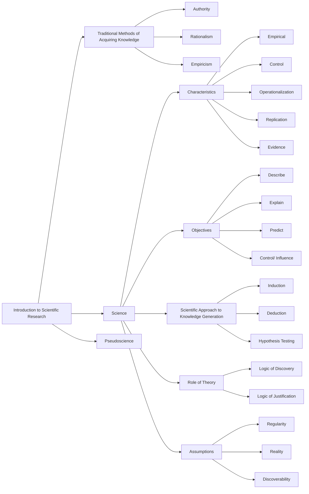
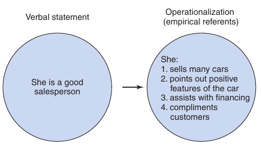
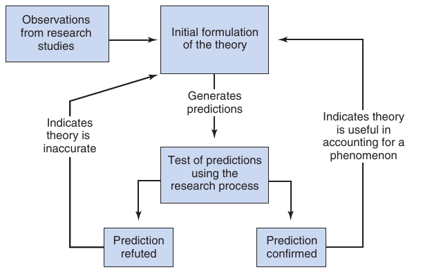

📑 <b>Table of Contents</b>

- [PART I Introduction](#part-i-introduction)
- [Chapter 1 Introduction to Scientific Research](#chapter-1-introduction-to-scientific-research)
  - [Learning Objectives](#learning-objectives)
- [Traditional Methods of Acquiring Knowledge](#traditional-methods-of-acquiring-knowledge)
  - [Authority](#authority)
  - [Rationalism](#rationalism)
  - [Empiricism](#empiricism)
- [The Scientific Approach to Knowledge Generation](#the-scientific-approach-to-knowledge-generation)
  - [Induction and Deduction](#induction-and-deduction)
  - [Hypothesis Testing](#hypothesis-testing)
  - [Science in the 21st Century](#science-in-the-21st-century)
- [Assumptions Underlying Scientific Research](#assumptions-underlying-scientific-research)
  - [Regularity in Nature](#regularity-in-nature)
  - [Reality in Nature](#reality-in-nature)
  - [Discoverability](#discoverability)
- [Characteristics of Scientific Research](#characteristics-of-scientific-research)
  - [Empirical](#empirical)
  - [Control](#control)
  - [Operationalization of Constructs](#operationalization-of-constructs)
  - [Replication](#replication)
  - [Evidence Not Proof](#evidence-not-proof)
- [The Role of Theory in Scientific Research](#the-role-of-theory-in-scientific-research)
- [Objectives of Psychological Research](#objectives-of-psychological-research)
  - [Description](#description)
  - [Explanation](#explanation)
  - [Prediction](#prediction)
  - [Control or Influence](#control-or-influence)
- [Pseudoscience](#pseudoscience)
  - [Summary](#summary)
  - [Key Terms and Concepts](#key-terms-and-concepts)
  - [Related Internet Sites](#related-internet-sites)
  - [Practice Test](#practice-test)
  - [Challenge Exercises](#challenge-exercises)

<!-- Page 1 -->
## PART I Introduction

## Chapter 1 Introduction to Scientific Research

### Learning Objectives

🎯 **1.1** Compare methods of knowledge acquisition in terms of their validity.
🎯 **1.2** Summarize the scientific approach to knowledge generation.
🎯 **1.3** Explain the importance of the basic assumptions that drive scientific research.
🎯 **1.4** Describe the characteristics of scientific research and explain why each of these is important.
🎯 **1.5** Summarize the relationship between empirical observation and theory in scientific research.
🎯 **1.6** Summarize the objectives of scientific research.
🎯 **1.7** Contrast the characteristics of pseudoscience with legitimate science.

<!-- Page 2 -->
In our daily lives, we continually encounter problems and questions about thoughts and behavior. For example, one person might have a tremendous fear of taking tests. Others might have problems with alcoholism or drug abuse or problems in their marriage. People who encounter such problems typically want to eliminate them, but often need help. Consequently, they seek out professionals, such as psychologists, for help. Likewise, business professionals might enlist the assistance of psychologists in understanding the thinking and behavior of employees or consumers. For example, salespeople differ greatly in their ability to understand customers and sell merchandise. One car salesperson might be capable of selling twice as many cars as another salesperson. If the sales manager could discover why such differences exist, he or she might be able to develop either better training programs or more effective criteria for selecting the sales force.

In an attempt to gain information about mental processes and behavior, people turn to the field of psychology. As you should know by now, a great deal of knowledge about thoughts and behavior has been accumulated. We have knowledge about treating problems such as test anxiety and depression. Similarly, we have identified many of the variables influencing persuasion and aggression. Although we know a great deal about mental processes and behavior, there is still much to be learned. In order to learn more about such psychological phenomena, we must engage in scientific  research.

The course in which you are now enrolled will provide you with important knowledge about scientific research. Some students might wonder why this information is necessary. But, as Table 1.1 reveals, there are many reasons students should take a research methods course. One reason identified in Table 1.1 is to help students become more informed and critical consumers of information. We are all bombarded by information and we all need tools to interpret what is being reported. For example, saccharin has been demonstrated to cause cancer in laboratory animals, yet there are many people who consume saccharin and do not contract cancer. You as a consumer must be able to resolve discrepancies like this and make informed decisions about your behavior.

**Table 1.1** *Reasons for Taking a Research Methods Course*

- Learn how to conduct psychological research.
- Provides a foundation for topic-specific courses such as abnormal, social, cognitive, biopsychology, and developmental psychology.
- Can be a more informed and critical consumer of information.
- Helps develop critical and analytical thinking.
- Provides information needed to critically read a research article.
- Necessary for admission into most graduate programs in psychology.

## Traditional Methods of Acquiring Knowledge

🎯 **1.1** Compare methods of knowledge acquisition in terms of their validity.

There are many ways we obtain information about the world. We acquire a great deal of information from the events we experience as we go through life. Experts also provide us with much information. We also use our cognitive skills to reason from current information and make inferences. In this chapter, we briefly discuss the traditional ways we acquire knowledge, and then we will discuss the scientific approach to acquiring knowledge. You will see that although the traditional approaches were incomplete, they are still used in the scientific process. The scientific approach is a very special approach to generating and justifying knowledge claims and to accumulating this knowledge over time.

<!-- Page 3 -->
### Authority

**Authority** as an approach to acquiring knowledge refers to the acceptance of information or facts stated by another person because that person is a highly respected source. A problem with the authority approach is that the information or facts stated by the authority might be inaccurate, especially if the person is not an expert in the particular area of inquiry.

If the authority approach is clearly fallible, how can this approach be used in science? In the beginning stages of the research process, when the problem is being identified and the hypothesis is being formed, a scientist might consult someone who is considered “the” authority in the area for advice about the hypothesis or research question. Virtually every scientific area has several leading researchers who are considered authorities or experts on a given topic.

Authority is also used in the design stage of a study. If you are unsure of how to design a study, you might contact someone who is considered an authority in the research area and get his or her input. Similarly, if you have collected data on a given topic and you are not sure how to interpret the data or how they fit with the other data in the field, you might consult with someone who is considered an authority in the area. As you can see, the authority approach is used in research. However, an authority is an expert whose facts and information are subject to testing using the scientific process.

### Rationalism

Reasoning is an integral approach to acquiring knowledge. One traditional school of thought that takes a rather strong interpretation of the word “reasoning” is known as **rationalism**. This approach claims that formal deductive reasoning can be used to arrive at new knowledge, and it assumes that valid knowledge is acquired only when the correct reasoning processes are used. During the 16th  century, rationalism was assumed to be the dominant mode by which one could arrive at truth. In fact, it was believed that knowledge derived from reason was just as valid as, and often superior to, knowledge gained from observation. Its leading advocate was the philosopher René Descartes (1596–1650). Descartes, who famously claimed, “I think, therefore I am,” argued that “clear and distinct ideas” must be true, and from those foundational ideas, one should deduce all other beliefs. One danger of relying solely on rationalism for acquiring knowledge is that it is not unusual for two well-meaning and honest individuals to use reasoning to reach different conclusions.

This does not mean that science does not use reasoning or rationalism. In fact, reasoning is a vital element in the scientific process. Scientists make use of reasoning both to derive hypotheses and to identify the outcomes that would be required if the hypotheses are true. Mathematics, which is a type of rationalism, is used extensively in many areas of science such as physics. There is also a well-developed line of research in mathematical psychology. In short, rationalism can be very important for science, but by itself it is insufficient.

### Empiricism

We all gain knowledge based on our experiences. **Empiricism** is the approach to knowledge that relies on experience as the source of knowledge. Empiricism as a systematic and well-developed philosophy is traced to John Locke (1632–1704) and David Hume (1711–1776). These philosophers argued that virtually all knowledge is based on experience. Locke put it well when he claimed that each person is born a *tabula rasa* (i.e., individuals’ minds are blank slates or tablets upon which the environment writes). The *origin* of all knowledge is from our senses (sight, hearing, touch, smell, and taste). Our senses take in information that our brains process.

<!-- Page 4 -->
Although the empirical approach is very appealing and has much to recommend it, several dangers exist if it is used alone. Our perceptions are affected by a number of variables. Research has demonstrated that such variables as past experiences and our motivations at the time of perceiving can drastically alter what we see. Research has also revealed that our memory for events does not remain constant. The fallibility of eyewitness testimony is evidence that we are not always accurate in reporting events we have observed. Not only do we tend to forget things, but at times an actual distortion of memory might take place (Loftus, 2017).

Empiricism is a vital element in science, but in science, empirical observations must be conducted under controlled conditions, and systematic strategies must be used to minimize researcher and participant bias and to maximize objectivity. The later chapters in this book will carefully explain how to carry out empirical research that is scientific and, therefore, reliable and trustworthy.

> [!TIP] **Study Question 1.1**
> Explain each of the approaches to acquiring knowledge and the strengths and weaknesses of each approach.

## The Scientific Approach to Knowledge Generation

🎯 **1.2** Summarize the scientific approach to knowledge generation.

The word *science* had its ancient origins in the Latin verb *scire*, meaning “to know.” However, the English word “science,” with its current meaning, was not coined until the 19th century by William Whewell (1794–1866). Before that time, scientists were called “natural philosophers” (Yeo, 2003). **Science** is the approach to producing knowledge used by researchers employing the methods of science. Although science incorporates the approaches to acquiring knowledge discussed earlier, it is superior in the sense that it is designed to systematically produce reliable and valid knowledge about the natural world.

One might think that there is only one method by which scientific knowledge is acquired. However, the enterprise of science relies on multiple logics, strategies, and methods to produce scientific knowledge. As discussed throughout this book, each of the approaches has its particular strengths and limitations and is usable in certain situations.

### Induction and Deduction

Two of the most important logics used in science are known as induction and deduction. As classically defined by Aristotle (384–322 BCE), **induction** is a reasoning process that involves going from the specific to the general.[^1] For example, if on a visit to a daycare center you see several children hitting and kicking other children, you might infer that many children in that center are aggressive or even infer that children in daycare centers across the country tend to be aggressive. This inference is an example of induction because you moved from the particular observations to a much broader and general claim.

<!-- Page 5 -->

[^1]: In the philosophy of logic, induction and deduction have slightly different meanings from what is presented here. In philosophy of logic, inductive reasoning refers to drawing of a conclusion that is probably true, and valid deductive reasoning refers to the drawing of a conclusion that is necessarily true if the premises are true (Copi, Cohen, &amp; Mcmahon, 2017).

For example, Latané (1981) observed that people do not exert as much effort when working in a group as they do when working alone and inferred that this represented the construct of social loafing. When Latané made this generalization of social loafing from the specific observation that less effort was expended in a group, he was engaged in inductive reasoning. Inductive reasoning is also seen in the use of statistical analysis in psychological research. When researchers rely on samples and generalize to populations, they are using inductive reasoning.

Induction is a probabilistic form of reasoning. It provides statements of what is *likely* to be true and/or occur in the future, based on current observations. Inductive reasoning is used very frequently in science. It is not, however, the only reasoning process used in science. Deductive reasoning is also important.

**Deduction**, as classically defined by Aristotle, refers to going from the general to the specific. For example, Levine (2000) predicted that a person who views the group’s task as important and does not expect others to contribute adequately to the group’s performance will work harder. Here, Levine was logically moving from the general proposition of social loafing and deducing a specific set of events that would reduce social loafing. Specifically, Levine deduced that viewing the group’s task as important and not expecting others to contribute adequately would cause a person to work harder or counter the social loafing effect. Today, when researchers develop hypotheses, they routinely deduce the observable consequences that must occur if they are going to claim (after collecting data) that the hypothesis is supported or not supported.

It is important to remember that science makes use of *both* inductive and deductive thinking. On the one hand, induction drives the exploratory or discovery arm of science. Scientists must continually discover the characteristics and patterns operating in the world. They observe and probe and study the world, or what scientists during the scientific revolution called reading “the book of nature.” On the other hand, deduction drives the knowledge testing arm of science. It is of utmost importance that scientists continually test their knowledge claims. In fact, this characteristic is perhaps more important than any other characteristic of science. We test our ideas and we let the data tell us the degree to which we are right or wrong. This testing arm of science produces justified or warranted knowledge—that is, knowledge that consumers of science can trust. In sum, it is easy to see that science needs both an exploratory/discovery arm and a knowledge testing arm to more fully advance and justify scientific knowledge.

### Hypothesis Testing

**Hypothesis testing** refers to formulating a hypothesis and then comparing the hypothesis with the facts. For example, Jeong, Biocca, and Bohil (2012) investigated the effect of video game realism on the video game player’s arousal. They hypothesized that increased game realism increases player arousal. They conducted an experiment, and the hypothesis was confirmed. As you can see, hypothesis testing relies on the logic of confirmation.

Classical hypothesis testing, where the researcher hopes to verify the hypothesis as true was criticized by the philosopher of science Karl Popper (1902–1994). Popper pointed out that the verification of hypotheses was based on a logical fallacy (known as affirming the consequent). To fix this “error,” Popper argued that science should <!-- Page 6 -->
rest on a deductively valid form of reasoning (1968). One can claim conclusively using deductive reasoning that a general law is falsified if any of the data do not support the hypothesis, and this deductively valid approach is what Popper advocated. Popper argued that science should focus on stating bold hypotheses followed by attempts to falsify them. Popper’s approach is known as **falsificationism**.

A major strength of Popper’s approach is that it helps eliminate false theories from science. However, Popper’s approach has also been criticized because it focused *only* on falsification and completely rejected induction and the logic of confirmation. You might say falsificationism “threw the baby out with the bath water.” Popper took a very strong form of falsificationism—he stated that “There is no induction [in good science]; we never argue from facts to theories, unless by way of refutation or ‘falsification’ ” (Popper, 1974, p. 68). Unfortunately for Popper, induction is required in order to claim what theories are best supported (i.e., confirmed), to what degree, and what theories we should believe.

Popper’s approach has also been criticized because even if the data appear to falsify a hypothesis, we still cannot conclude that the theory is necessarily false. That’s because you have to make many assumptions during the hypothesis testing process, and one of those assumptions, rather than the hypothesis, might have been false. This idea that a hypothesis can*not* be tested in isolation (i.e., without making additional assumptions) is called the **Duhem–Quine principle**.

A key point is that psychologists today rely on a hybrid (i.e., mixture) approach to hypothesis testing that includes probabilistic thinking, preponderance of evidence, and a mixture of classical hypothesis testing (i.e., where confirmation of a hypothesis provides evidence of its truth) *and* Popper’s falsification approach (where claims of scientific progress are given to hypotheses that survive multiple attempts to falsify them).

### Science in the 21st Century

The job of a scientist continues to be to produce reliable and valid knowledge about the natural world. The enterprise of today’s science relies on many approaches that have been shown to be useful in producing warranted and justified knowledge. Science uses both inductive and deductive approaches. Science attempts to discover patterns and test hypotheses about the patterns with new people in different places. Science also continues to look for new approaches to help the advancement of knowledge.

Scientists must be curious, skeptical, creative, *and* systematic. They must identify problems, question current solutions that are not working, creatively and systematically come up with new solutions, and, most importantly, subject these new solutions to empirical testing. Ideally, the scientist’s personal wishes and attitudes should not affect his or her observations. Although perfect objectivity usually cannot be obtained, objectivity can and should be approximated—**objectivity** is a normative or aspirational goal of science. When researchers subject important beliefs, observations, hypotheses, and claims to repeated empirical scientific testing, they will obtain the most reliable and valid knowledge possible.

In sum, science is defined as the approach to producing knowledge used by researchers employing the methods of science. Furthermore, science is the preferred way of acquiring reliable, valid, and practical knowledge (i.e., trustworthy knowledge) about the natural world. However, to continue to be successful, science must always conduct research ethically, must critically self-examine its practices to determine what is working and what is not working, and must engage in ongoing learning and improvement. If science does this, scientific knowledge also will continue to advance.

<!-- Page 7 -->
> [!TIP] **Study Questions 1.2**
> - What is the difference between induction and deduction?
>
> - Compare and contrast traditional hypothesis testing with falsificationism.
>
> - What is science?
>
> - What characteristics are important for a scientist?

## Assumptions Underlying Scientific Research

🎯 **1.3** Explain the importance of the basic assumptions that drive scientific

**research.**

In order for scientists to have confidence in the capacity of scientific research to achieve solutions to questions and problems, they make several working assumptions so that they can get on with the day-to-day practice of science. You may not have thought about it, but you probably make these assumptions too.

### Regularity in Nature

Science searches for regularities in nature. If there were no regularity, science would only amount to a historical description of endless unique and unrelated facts. B. F. Skinner (1904–1990) put it well when he stated that science is “a search for order, for uniformities, for lawful relations among the events in nature” (1953, p. 13). If there were no regularity in nature, there could be no understanding, explanation, or knowledge about nature. Without regularity, we could not develop theories or laws or generalizations.

Implicit in the assumption of regularity is the notion of a rather strong form of **determinism**—the belief that there are causes, or determinants, of mental processes and behavior. In our efforts to uncover the laws of psychology, we attempt to identify the variables that are linked together in causal chains. These causal chains describe **probabilistic causes** (i.e., causes that make outcomes more probable). But psychological researchers point out that most outcomes are influenced by multiple causal variables. The goal of science is to continue to investigate and increase understanding of these complex patterns.

### Reality in Nature

A related assumption is that there is **reality in nature**. For example, as you go through your daily lives you see, hear, feel, smell, and taste things that are real, and these experiences are real. We assume that other people, objects, or social events like marriage or divorce are not *just* constructions of our imagination, and we assume that many different types of “objects” can be studied scientifically. Stating that something is true or real “because we said it is real” does not work in science. In science, researchers check reality in many ways to obtain objective evidence that what is claimed is true. In short, researchers interact with a natural world (that includes social objects such as attitudes, beliefs, institutions), and, in science, this reality must have primary say in our scientific claims. This is why researchers collect and analyze data.

<!-- Page 8 -->
### Discoverability

Scientists believe not only that there is regularity and reality in nature, but also that there is **discoverability**—that is, it is possible to discover the regularities and reality. This does not mean that the task of discovering the regularities will be simple. Nature is very reluctant to reveal its secrets. Scientists have been working on discovering the cause and cure for cancer for decades. Although significant progress has been made, we still do not know the exact cause(s) of all forms of cancer. Similarly, a complete cure for cancer still does not exist. An intensive effort is also taking place within the scientific community to identify the causes of autism. However, scientists have yet to fully uncover nature’s secrets in this arena.

The intensive effort that has existed to uncover the cause of such diseases as cancer or, within the field of psychology, such disorders as schizophrenia and depression reveals one of the basic processes of research. The research process is similar to putting a puzzle together: You have all the pieces of the puzzle in front of you, which you try to put together to get the overall picture. Scientific research includes the difficult task of first discovering the pieces of the puzzle. Each study conducted on a given problem has the potential of uncovering a piece of the puzzle. Only when each of these pieces has been discovered is it possible for someone to put them together to enable us to see the total picture. Consequently, discoverability incorporates two components: The first is discovery of the pieces of the puzzle, and the second is putting the pieces together, or discovery of the nature of the total picture.

> [!TIP] **Study Question 1.3**
> List the basic assumptions of scientific research, and explain why these assumptions are needed.

## Characteristics of Scientific Research

🎯 **1.4** Describe the characteristics of scientific research and explain why each

**of these is important.**

We have argued that science is the preferred way to obtain reliable and valid knowledge about the natural world. In order to produce reliable and justified knowledge, the scientific process relies on several important characteristics.

### Empirical

Science is **empirical**. This means science relies on data collected using the tools of science such as experiments and systematic observations. Rather than basing conclusions on someone’s personal intuition or an authority’s claim of truth, scientists carefully collect the relevant data and they “listen to what the data say.” We cannot overstate the importance of answering your research questions using appropriately collected and analyzed data. In fact, we also say that our data are empirical as in “Science is based on empirical data.”

We need to make two more points. First, in scientific writing, the word *data* is usually used as the plural form of datum. This comes from its origin in Latin. When talking about research, you should notice, for example, that researchers usually say “the data were” rather than “the data was,” and they say “the data are” rather than “the data is.” That usage might take some practice, but that’s how it’s most <!-- Page 9 -->
often used by scientists. Second, science sometimes relies on deductive logics such as mathematics to provide answers to some of its questions. However, even when mathematical conclusions are made, these conclusions are then turned into predictions that are tested with new empirical data. In sum, data reign supreme in psychological research!

### Control

**Control** refers to holding constant or eliminating the influence of extraneous variables so that you can make an unambiguous claim about cause and effect. An  **extraneous** **variable** is a variable that might compete with the presumed causal variable in explaining the outcome. Is the outcome due to the variable you believe is causing it, or is it due to some other “extraneous” variable? One of the most important tasks of the psychological researcher is to identify causal relationships, and without control for extraneous variables, this is not possible. It is important that you remember this point: *experiments are the preferred research method when you need to address the issue of cause and* *effect*. Experiments are conducted in an attempt to answer important research questions, such as why forgetting occurs, what reduces the symptoms of schizophrenia, and what treatment is most effective for depression. In order to provide unambiguous answers to such questions, researchers must rely on control.

For example, when testing the effectiveness of a new drug on depressive symptomology, researchers must control for participants’ expectations that the drug will help their symptoms. That’s because in some cases, participants will experience improvement in symptoms as a result of thinking that they have received a useful treatment, even when the treatment condition has no value (e.g., placebo). This type of improvement is referred to as the **placebo effect**. Therefore, in welldesigned experiments testing the effectiveness of new drugs (sometimes called **randomized controlled trials or RCTs**), researchers randomly assign the participants to two groups: (a) an experimental group where the participants receive the real drug and (b) a control group where the participants receive a treatment in which the “drug” looks like the actual drug when, in fact, it does not have the active ingredient of the new drug. If participants receiving the real drug report more improvement than participants receiving the placebo, the researcher can be more confident that the new drug is the actual cause of the improvement. Without the control condition, the researcher would not know whether the cause of the improvement was the drug or the placebo effect.

### Operationalization of Constructs

In psychological research we study the relations among constructs (e.g., depression, types of therapy, types of personality, worker satisfaction, worker productivity). It is absolutely essential that we have good empirical measurement of the constructs in our research studies. Without good measurement, you cannot trust the results reported in a research study. In the language of research, we say, “We need to carefully ‘operationalize’ our constructs.” **Operationalizing a construct** refers to identifying a specific instrument (or set of instruments) to accurately measure the construct of interest. Consider the construct of “good car salesperson.” How would you operationalize a good car salesperson? What empirical referents would you use to characterize this construct? In Figure 1.1, we suggest that these empirical referents might consist of selling many cars, pointing out a car’s good features, helping the customer to find financing, and complimenting the customer on an excellent choice. This is referred to as the *operationalization* of the construct or, more traditionally, as the **operational definition**.

<!-- Page 10 -->

*Figure 1.1 Example of an operationalization of a good car salesperson.*

Once this construct has been operationalized, meaning can be communicated with minimal ambiguity and maximum precision. When you read published psychological research, you always need to look at how the researchers operationalized the constructs, making sure that you are completely satisfied with their measurement procedures.

### Replication

Scientific knowledge is incomplete without replication. **Replication** refers to the reproduction of the results obtained from one study in additional studies (with different people, places, times). Before you can trust the findings of research, you must determine whether the findings are reliable. It is important to remember this key point: You should always be cautious when interpreting findings from a *single* study in isolation from other research. To make a general claim, you must know whether the same results will be found if the study is repeated. If the findings are not repeatable, they were either due to chance or they operate differently in different contexts or with different people. If the variables of interest operate differently in different contexts, then contextual factors must be systematically examined in additional research.

Although the need for replication is a central characteristic of scientific research, few researchers devote their time and energy to *exact replication*, in part, because the academic and publishing systems do not support or reward exact replications (Pashler  &amp; Wagenmakers, 2012). However, recently 270 scientists came together through the Open Science Collaboration and systematically replicated 100 psychological studies. They stressed not only the need for replicating empirical findings, but also the need to fully investigate theoretical explanations of those empirical findings. They point out, “Innovation points out paths that are possible; replication points out paths that are likely; progress depends on both” (Open Science Collaboration, 2015, p. 950). There is a clear need for both new, innovative research and replication.

A more common form of replication, *partial replication*, is seen when the key variables of interest are included in multiple research studies that are slightly different. For example, in other research studies, a slightly different combination of variables might be studied, but they still include the original variables of interest to you. When there are multiple studies that report the relation between the same variables, those studies can be aggregated with the use of meta-analysis.

**Meta-analysis** is a quantitative technique that is used to combine, integrate, and describe the relationships between variables across multiple research studies. Earlier we noted that you should not place too much trust in the findings of a single research study. You *should*, however, place significant trust in the results of a meta-analysis because the finding is shown to apply across multiple related research studies. Whenever you review the research literature on a topic of interest, be sure to search for meta-analysis research studies!

### Evidence Not Proof

Although science is the strongest way to obtain knowledge about the natural world, you might be surprised to learn that researchers rarely use the words *prove* or *proof* in regard to their scientific claim. (You will hear advertisers claiming proof.) Although science does not provide full or final *proof* of psychological principles, it does provide evidence that varies from very weak to very strong. In empirical research, we leave open the possibility that future research could show that we have made a mistake <!-- Page 11 -->
when viewed from a new perspective or with new data. It’s also possible that some phenomena will change over a period of time.

Here is how the well-known research methodologist, Fred Kerlinger (1986), explained the proof versus evidence distinction:

> The interpretation of research data culminates in conditional probabilistic statements of the “If p, then q” kind. We enrich such statements by qualifying them in some such way as: If p, then q, under conditions r, s, and t. Let us flatly assert that nothing can be “proved” scientifically. All one can do is to bring evidence to bear that such-and-such a proposition is true. Proof is a deductive matter, and experimental methods of inquiry are not methods of proof. (p. 145)

The American Association for the Advancement of Science (1990) made the same point this way:

> Science is a process for producing knowledge. The process depends on making careful observations of phenomena and on inventing theories for making sense out of those observations. Change in knowledge is inevitable because new observations may challenge prevailing theories. No matter how well one theory explains a set of observations, it is possible that another theory may fit just as well or better, or may fit a still wider range of observations. In science, the testing and improving and occasional discarding of theories, whether new or old, go on all the time. (p. 2)

The key point is that when you read published scientific reports, you will not see researchers making claims of proof—you will see researchers providing and discussing the evidence for their probabilistic claims. Please keep this point in mind as you continue to learn about empirical research. In the future, when you discuss empirical research with others, you should remove the word “proof” from your discussion and replace it with the word “evidence.” You should then provide details of the available evidence for the scientific claim. Throughout this book we will be explaining how to determine the strength of evidence of scientific claims.

> [!TIP] **Study Question 1.4**
> List and define the characteristics of scientific research. Then, explain why each is a characteristic of the research process.

## The Role of Theory in Scientific Research

🎯 **1.5** Summarize the relationship between empirical observation and theory

**in scientific research.**

Scientific research can result in the accumulation of a highly reliable set of facts. Accumulating such a body of facts, however, is not sufficient to answer many of the riddles of human nature. For example, numerous studies (e.g., Mercer, Nellis, Martinez, &amp; Kirk, 2011) and meta-analyses (e.g., Robbins et al., 2004) have documented that students who have greater self-efficacy for academics also achieve more in the academic domain. Bandura (2012) integrates these findings in his theory of selfefficacy. A **theory** helps to explain how and why a phenomenon operates as it does.

Theories do more than explain and integrate existing data. A good theory will also suggest new hypotheses that are capable of being tested empirically. Consequently, a theory must have the capacity to guide research as well as to explain the results of previous research. This means that there is a constant interaction between theory and empirical observation, as illustrated in Figure 1.2.

<!-- Page 12 -->

*Figure 1.2 Illustration of the relationship between theory and research.*

From Figure 1.2 you can see that theory is originally based on observations and empirical research; this is called the **logic of discovery**; it’s the *inductive* part of science (or the “inductive scientific method”). Once a theory has been generated, it must direct future research; this is called the **logic of justification**; it’s the *deduc-* *tive* part of science (or the “deductive scientific method”) where predictions are derived and then empirically tested to determine the adequacy of the theoretical proposition. The outcome of the future research then feeds back into and determines the usefulness of the theory, and this process continues again and again. If the predictions of the theory are confirmed by subsequent research, evidence exists that the theory is useful in accounting for a given phenomenon. If the predictions are refuted by subsequent research, the theory has been demonstrated to be inaccurate and must either be revised to account for the new data or be thrown out. In short, Figure 1.2 shows that theory *generation* and theory *testing* are both valuable parts of the scientific enterprise.

Table 1.2 shows how you can start evaluating the quality of theories. For example, a good *theory* fits the data, is logical and parsimonious, and provides testable claims or propositions. A good theory is one that has been supported many times with empirical data. Applied psychologists also hope for theories that are usable— that is, theories that enable practitioners to bring about desired outcomes in the world (e.g., improvements in mental health, improvements in worker motivation and job satisfaction, improvements in long term memory, reduction in prejudice and discrimination). Kurt Lewin (the father of social psychology in the United States) put it well when he famously said, “There is nothing so practical as a good theory” (Lewin, 1951, p. 169).

**Table 1.2** *How to Evaluate the Quality of a Theory*

1. Does the theory/explanation fit the empirical data?
2. Is it logical and coherent?
3. Is it simple, clear, and parsimonious?
4. Does it provide testable claims (i.e., propositions that can be tested)?
5. Has it been tested and supported in multiple research studies?
6. Does it work better than alternative or rival theories?
7. Is it general enough to apply to multiple places, situations, and kinds of people?
8. Can practitioners use the theory to produce desired outcomes in the world?

<!-- Page 13 -->
> [!TIP] **Study Questions 1.5**
> - Explain the role theory plays in scientific research.
>
> - Compare and contrast the logics of discovery and justification.
>
> - Describe the characteristics of a good theory.

## Objectives of Psychological Research

🎯 **1.6** Summarize the objectives of scientific research.

Ultimately, the objective of scientific research is to increase our understanding of the world in which we live. Scientific research requires a careful and detailed examination of a phenomenon. Only when a phenomenon is accurately described and explained— and therefore probabilistically predictable and, in most cases, capable of being controlled to produce desired outcomes—will a scientist say that it is well understood. Consequently, strong scientific understanding requires four specific objectives: description, explanation, prediction, and control.

### Description

The first objective of psychological research, **description**, requires that the phenomenon be accurately portrayed. You must identify the characteristics of the phenomenon and then determine the degree to which they exist. Any new area of study usually begins with an exploratory descriptive process, because it identifies the variables that exist. Only after we have some knowledge of what variables exist can we begin to explain why and how they operate. For example, we would not be able to explain the existence of separation anxiety (an infant’s crying and visual searching behavior when the caretaker departs) if we had not first identified this behavior and the age at which it occurs. Scientific knowledge typically begins with description.

### Explanation

The second objective is the **explanation** of the phenomenon, and this requires knowledge of how and why a phenomenon operates, including its causes and the conditions under which the causes operate. We must be able to identify the antecedent conditions that result in the occurrence of the phenomenon. Assume that extraverted students post more on social media than introverted students. We would conclude that one of the antecedent conditions of social media posting was extraversion. Note that extraversion was only *one* of the antecedents. Scientists recognize that most phenomena are multidetermined and that new evidence might necessitate revising an explanation or expanding it to include new information including information about causal process. As the research process proceeds, our explanations become more accurate and complete. With this increasing knowledge comes the ability to predict and possibly control what happens.

### Prediction

The third objective of psychological research is prediction. **Prediction** refers to the ability to anticipate an event prior to its actual occurrence. We can, for example, predict very accurately when an eclipse will occur. Making this kind of accurate prediction requires knowledge of the antecedent conditions that produce such a phenomenon. It requires knowledge of the movement of the moon and the earth and of the fact that the earth, the moon, and the sun must be in a particular relationship <!-- Page 14 -->
for an eclipse to occur. If we knew the combination of variables that resulted in academic success, we could then predict accurately who would succeed academically. To the extent that we cannot accurately predict a phenomenon, we have a gap in our understanding of it.

### Control or Influence

The fourth objective of psychological research is control. **Control** refers to the manipulation of the *conditions that cause a phenomenon in order to bring about desired outcomes*. Control, in this sense, requires knowledge of the causes or antecedent conditions of a phenomenon. When the antecedent causal conditions are known, they can be manipulated to produce the desired phenomenon. Once psychologists understand the conditions that produce an outcome, the outcome can potentially be controlled by either allowing or not allowing the conditions to exist. Consider the hypothesis that frustration leads to aggression. If we knew that this hypothesis were correct, we could control aggression by allowing or not allowing people to become frustrated. Control, then, refers to the manipulation of conditions that produce a phenomenon.

At this point, you need to learn that the term “control” can be used in slightly different ways. In the discussion of the characteristics of scientific research, we used the word *control* to refer to holding constant or eliminating the influence of extraneous variables in an experiment so that the researcher can make a strong claim about cause and effect. We say we need to “control for” extraneous variables. We will show you how to control for extraneous variables in experimental and nonexperimental research later in this book.

The word control is also used in experimental research to refer to the group that does not receive the active ingredient being tested for its efficacy (i.e., the “control group”). It provides the primary comparison group. The results for the experimental group are compared to the results for the control group, and the difference is believed to be the causal effect. We are basically comparing participants who received the treatment to what we think they would have been like if they had not received the treatment.

> [!TIP] **Study Question 1.6**
> List and define the objectives of research. Then explain why each is an objective of the research process.

## Pseudoscience

🎯 **1.7** Contrast the characteristics of pseudoscience with legitimate science.

We have introduced you to science in this chapter. We pointed out that science is the approach to acquiring and establishing the type of knowledge that is relied upon in psychology. Scientific knowledge has a special status in our society because this type of knowledge claim is not made by scientists until a high degree of reliability and validity has been obtained. Now we will take another look at science by examining what it is not. Science is contrasted with pseudoscience.

**Pseudoscience** is an approach that claims to be scientific but is based on methods and practices that violate many tenets of science. Pseudoscientific claims often are made in an attempt to gain legitimacy. For example, commercials often claim that their products’ effectiveness has been “scientifically proven” when the claim is based on no credible evidence. Other examples of pseudoscience are found in astrology, ESP, fortune-telling, flat-earth claims, and superstitions. Table 1.3 lists several faulty strategies that are often used in pseudoscience.

<!-- Page 15 -->
**Table 1.3** *Strategies Used in Pseudoscience*

- Creating new (ad hoc) hypotheses in order to explain away negative findings.
- Exclusive use of confirmation and reinterpretation of negative findings as supporting the claim.
- Absence of self-correction through continual and rigorous testing of the claim.
- Reversed burden of proof (i.e., stating that the onus of proof is on the critics).
- Overreliance on testimonials and anecdotal evidence supporting a claim.
- Use of ambiguous or confusing language to make a claim sound as if it has survived scientific scrutiny.
- Absence of any connection to other disciplines that study issues related to the claim.

> [!TIP] **Study Questions 1.7**
> - What is pseudoscience?
>
> - What are the faulty strategies used in pseudoscience?

### Summary

This chapter provides an introduction to psychological research and science. The key ways that people acquire knowledge are authority (i.e., based on what authorities say), rationalism (i.e., based on reasoning processes), and empiricism (i.e., based on empirical data). Science is a very special mixture of the approaches just mentioned, and it is the most trustworthy way to acquire reliable and valid knowledge about the natural world. The scientific approach to knowledge generation, for example, uses inductive reasoning (going from the specific to the general) and deductive reasoning (going from the general to the specific). The scientific approach often uses hypothesis testing (i.e., formulating hypotheses and testing them with new empirical data). Hypotheses can be confirmed as well as falsified. In science in the 21st century, we recognize that there is no single, simple defi- nition of science because science uses *multiple* approaches. However, we offered a working definition: Science is a systematic approach to producing knowledge used by researchers employing the methods of science. The three primary assumptions of science are as follows: (1) there is regularity in nature; (2) nature is real, including our experiences of it; and (3) discoverability (i.e., it is possible to discover regularities in nature). The major characteristics of science include it is empirical (i.e., it’s based on data); control (i.e., researchers attempt to make specific claims about cause and effect and they “control for” extraneous or competing variables); operationalization of con- structs (i.e., identifying instruments to measure constructs), replication (i.e., reproduc- tion of results across multiple studies); and evidence, not proof (i.e., research provides evidence rather than final proof of scientific propositions). Theory is an important part of science. When relying on the logic of discovery, theories are generated, discovered, and developed. When relying on the logic of justi- fication, theories are systematically tested with new empirical data to determine how well they operate. Science continually moves back and forth between theory discovery and theory testing (or induction and deduction), as shown in Figure 1.2. See Table 1.2 for eight ways to evaluate the quality of a scientific theory. The four major objectives of psychological research are description (i.e., accu- rately portraying the phenomena we study), explanation (i.e., knowledge of how and why a phenomenon operates including its causes), prediction (i.e., use of re- search data and propositions from the data to make predictions about events in the <!-- Page 16 -->
future), and control. Control is used in at least three different ways: (1) manipulation of antecedent conditions to produce a change in mental processes and behavior (i.e., controlling the administration of the causal variable), (2) eliminating the influence of extraneous variables (i.e., “controlling for” extraneous variables), and (3) the group that does not receive the active ingredient believed to produce the effect (i.e., the control group).

## 🗂️ Chapter Key Terms & Active Recall

> 💡 **Learning tip:** Try to recall the definition of each term *before* clicking to reveal it.
> This active retrieval practice strengthens long-term memory far more than re-reading.

📇 <b>Authority</b> *(p. 3)*

> **Definition:** A basis for acceptance of information because it is acquired from a highly respected source

📇 <b>Rationalism</b> *(p. 3)*

> **Definition:** The acquisition of knowledge through reasoning

📇 <b>Empiricism</b> *(p. 3)*

> **Definition:** The acquisition of knowledge through experience

📇 <b>Science</b> *(p. 4)*

> **Definition:** The approach to producing knowledge used by researchers employing the methods of science

📇 <b>Induction</b> *(p. 4)*

> **Definition:** A reasoning process that involves going from the specific to the general

📇 <b>Deduction</b> *(p. 5)*

> **Definition:** A reasoning process that involves going from the general to the specific

📇 <b>Hypothesis testing</b> *(p. 5)*

> **Definition:** The process of testing a predicted relationship or hypothesis by making observations and then comparing the observed facts with the hypothesis or predicted relationship

📇 <b>Falsificationism</b> *(p. 6)*

> **Definition:** A deductive approach to science that focuses on falsifying hypotheses as the key criterion of science

📇 <b>Duhem–Quine principle</b> *(p. 6)*

> **Definition:** States that a hypothesis cannot be tested in isolation from other assumptions

📇 <b>Objectivity</b> *(p. 6)*

> **Definition:** Goal in science to eliminate or minimize opinion or bias in the conduct of research

📇 <b>Determinism</b> *(p. 7)*

> **Definition:** The belief that mental processes and behaviors are fully caused by prior natural factors

📇 <b>Probabilistic causes</b> *(p. 7)*

> **Definition:** A weaker form of determinism that indicates regularities that usually but not always occur

📇 <b>Reality in nature</b> *(p. 7)*

> **Definition:** The assumption that the things we see, hear, feel, smell, and taste are real

📇 <b>Discoverability</b> *(p. 8)*

> **Definition:** The assumption that it is possible to discover the regularities that exist in nature

📇 <b>Empirical</b> *(p. 8)*

> **Definition:** Research that is based on data

📇 <b>Extraneous variable</b> *(p. 9)*

> **Definition:** A variable that might compete with the presumed causal variable in explaining the outcome

📇 <b>Placebo effect</b> *(p. 9)*

> **Definition:** Improvement due to participants’ expectations for improvement rather than the actual treatment

📇 <b>Randomized controlled trial (RCTs)</b> *(p. 9)*

> **Definition:** An experiment where participants are randomly assigned to the groups

📇 <b>Operationalizing a construct</b> *(p. 9)*

> **Definition:** Identifying an instrument (or set of instruments) to accurately measure a construct

📇 <b>Operational definition</b> *(p. 9)*

> **Definition:** The result of operationalizing a construct

📇 <b>Replication</b> *(p. 10)*

> **Definition:** The reproduction of the results of a study in a new study

📇 <b>Meta-analysis</b> *(p. 10)*

> **Definition:** A quantitative technique for describing the relationship between variables across multiple research studies

📇 <b>Theory</b> *(p. 11)*

> **Definition:** An explanation of how and why something operates

📇 <b>Logic of discovery</b> *(p. 12)*

> **Definition:** The inductive or discovery part of the scientific process

📇 <b>Logic of justification</b> *(p. 12)*

> **Definition:** The deductive or theory-testing part of the scientific process

📇 <b>Description</b> *(p. 13)*

> **Definition:** The portrayal of a situation or phenomenon

📇 <b>Explanation</b> *(p. 13)*

> **Definition:** Knowledge of how and why a phenomenon operates, including its causes and the conditions under which the causes operate

📇 <b>Prediction</b> *(p. 13)*

> **Definition:** The ability to anticipate the occurrence of an event

📇 <b>Control</b> *(p. 14)*

> **Definition:** (1) Manipulation of antecedent conditions to produce a change in mental processes and behavior, (2) eliminating the influence of extraneous variables, or (3) the group that does not receive the active ingredient believed to produce the effect

📇 <b>Pseudoscience</b> *(p. 14)*

> **Definition:** Practices, beliefs, and procedures that claim to be scientific but are not.

### Key Terms and Concepts

| Term | Term | Term |
| --- | --- | --- |
| [Authority *p. 3*](#term-authority) | [Falsificationism *p. 6*](#term-falsificationism) | [Probabilistic causes *p. 7*](#term-probabilistic-causes) |
| [Control *p. 14*](#term-control) | [Hypothesis testing *p. 5*](#term-hypothesis-testing) | [Pseudoscience *p. 14*](#term-pseudoscience) |
| [Deduction *p. 5*](#term-deduction) | [Induction *p. 4*](#term-induction) | [Randomized controlled trial (RCTs) *p. 9*](#term-randomized-controlled-trial-rcts) |
| [Description *p. 13*](#term-description) | [Logic of discovery *p. 12*](#term-logic-of-discovery) | [Rationalism *p. 3*](#term-rationalism) |
| [Determinism *p. 7*](#term-determinism) | [Logic of justification *p. 12*](#term-logic-of-justification) | [Reality in nature *p. 7*](#term-reality-in-nature) |
| [Discoverability *p. 8*](#term-discoverability) | [Meta-analysis *p. 10*](#term-meta-analysis) | [Replication *p. 10*](#term-replication) |
| [Duhem–Quine principle *p. 6*](#term-duhem-quine-principle) | [Objectivity *p. 6*](#term-objectivity) | [Science *p. 4*](#term-science) |
| [Empirical *p. 8*](#term-empirical) | [Operational definition *p. 9*](#term-operational-definition) | [Theory *p. 11*](#term-theory) |
| [Empiricism *p. 3*](#term-empiricism) | [Operationalizing a construct *p. 9*](#term-operationalizing-a-construct) |  |
| [Explanation *p. 13*](#term-explanation) | [Placebo effect *p. 9*](#term-placebo-effect) |  |
| [Extraneous variable *p. 9*](#term-extraneous-variable) | [Prediction *p. 13*](#term-prediction) |  |

### Related Internet Sites

- <http://www.pbs.org/wgbh/aso/databank/humbeh.html>
  This Internet site gives a short summary of the training and scientific contributions made by 11 scientists who figure very prominently in the history of psychology. This site also gives a brief discussion of a number of discoveries made by scientists from the early 1900s to 1993 that have significantly impacted the field of psychology.

- <http://psychology.wadsworth.com/workshops/workshops.html>
  This Internet site gives a link to a workshop in statistics and research methods. For Chapter 1, visit this Internet site and click on the web page link corresponding to the workshop titled “Research Methods Workshops.” Then click on the “What Is Science?” link.

### Practice Test

Several multiple choice questions are included at the end of each  chapter to enable you to test your knowl- edge of the chapter material. Prior to taking these sample tests, you should study the chapter. When you think you know the material, take the practice test to get some feed- back regarding the extent to which you have mastered the material.
*The answers to these questions can be found in the Appendix.*

**1.** Empiricism is a vital element in scientific studies.
What does empiricism refer to?
a.  Acquiring knowledge through experience
b.  A person’s personal opinions about phenomena in
the world c.  Tenacious determination to hold onto one’s
current beliefs
d.  Accepting information because it comes from an
authority

**2.** Scientific activities have included
a.  Induction
b.  Hypothesis testing
c.  Deduction
d.  All of the above

**3.** Professor Albert was conducting an experiment in-
vestigating the influence of “status” on a person’s <!-- Page 17 -->
persuasive influence. In this study, he manipu- lated the variable of status by presenting different dress styles. In particular, a high-status person was dressed in an expensive business suit and car- ried a briefcase. The low-status person was dressed in faded jeans and torn shirt. The difference in dress styles of the high- and low-status person was used to
a.  Control for the influence of extraneous variables
b.  Operationalize the construct of status
c.  Control for the type of dress the participants wore

**4.** If you conducted a study in which you wanted to
determine why help is not given to people who obvi- ously need it, with which of the following objectives would you have conducted the study?

a.  Description
b.  Explanation
c.  Prediction
d.  Control

**5.** Scientists usually make several assumptions in order
to have confidence in the scientific research pro- cess. Which of the following is *not* one of these assumptions?
a.  There is an underlying reality in nature including
what we see, hear, feel, touch, and taste.
b.  It is possible to discover the regularities in nature.
c.  There is regularity in nature.
d.  Psychology studies only psychologically
constructed reality.

### Challenge Exercises

In addition to the review questions, each  chapter ends with challenge exercises. These exercises will encourage you to think about the concepts discussed in the chapter to give you an opportunity to apply what you have learned.

**1.** Psychology makes use of many concepts when ex-
plaining mental processes and behavior and when conducting research. Consider each of the following concepts, and identify a set of operations to define each concept.
a.  Depression
b.  Aggression
c.  Child abuse
d.  Attitude
e.  Leadership

**2.** The medical community has repeatedly expressed
concern about the fact that the average weight among Americans is increasing. The concern focuses on the health risks of people who are overweight. Think about each of the four major objectives of science, and apply each of these objectives to this concern of the medical community.

**3.** What would happen to the science of psychology if
none of the assumptions underlying science existed? What would happen in our daily lives if these as- sumptions did not exist?

<!-- OBSIDIAN_NAV_START -->
---

← [[appendix|Appendix]] &nbsp;&nbsp;|&nbsp;&nbsp; [[ch02_research_approaches_and_methods_of_data_collection|Ch02 Research Approaches and Methods of Data Collection]] →

<!-- OBSIDIAN_NAV_END -->
