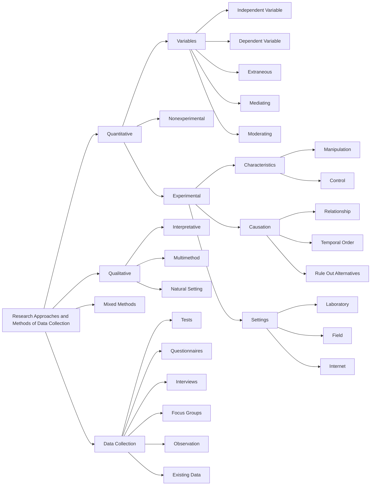
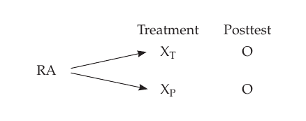
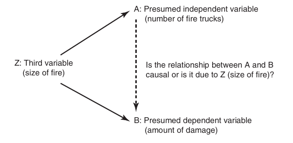

📑 <b>Table of Contents</b>

- [Chapter 2 Research Approaches and Methods of Data Collection](#chapter-2-research-approaches-and-methods-of-data-collection)
  - [Learning Objectives](#learning-objectives)
- [Variables in Quantitative Research](#variables-in-quantitative-research)
- [Experimental Research](#experimental-research)
- [Causation](#causation)
  - [Cause](#cause)
  - [Effect](#effect)
  - [Required Criteria for Making the Claim of Causation](#required-criteria-for-making-the-claim-of-causation)
- [The Psychological Experiment](#the-psychological-experiment)
  - [Example of an Experiment and Its Logic](#example-of-an-experiment-and-its-logic)
  - [Experimental Research Settings](#experimental-research-settings)
  - [
<!-- AI-REVIEW-START id="rev-1" category="ocr_typo" -->
<!-- ORIGINAL:
Advantages of Experimental Research
-->
<!-- REASON: The text is clearly cut off in the middle of the word 'Experimental' and likely incomplete in its final section heading. -->
Advantages of Experimental Research
<!-- AI-REVIEW-END -->
tal Research](#advantages-of-experimental-research)
  - [Disadvantages of Experimental Research](#disadvantages-of-experimental-research)
- [Nonexperimental Quantitative Research](#nonexperimental-quantitative-research)
  - [Advantages and Disadvantages of Nonexperimental](#advantages-and-disadvantages-of-nonexperimental)
  - [Quantitative Research](#quantitative-research)
- [Qualitative Research](#qualitative-research)
- [Mixed Methods Research](#mixed-methods-research)
- [Major Methods of Data Collection](#major-methods-of-data-collection)
  - [Tests](#tests)
  - [Questionnaires](#questionnaires)
  - [Interviews](#interviews)
  - [Focus Groups](#focus-groups)
  - [Observation](#observation)
  - [Existing or Secondary Data](#existing-or-secondary-data)
  - [Summary](#summary)
  - [Key Terms and Concepts](#key-terms-and-concepts)
  - [Related Internet Sites](#related-internet-sites)
  - [Practice Test](#practice-test)
  - [Challenge Exercises](#challenge-exercises)

<!-- Page 1 -->
## Chapter 2 Research Approaches and Methods of Data Collection

### Learning Objectives

🎯 **2.1** Differentiate among the types of variables used in quantitative research.
🎯 **2.2** Outline the features of the experimental research approach.
🎯 **2.3** Summarize the criteria for establishing a cause-and-effect relationship.
🎯 **2.4** Describe the advantages and limitations of the psychological experiment.
🎯 **2.5** Summarize how nonexperimental quantitative research can demonstrate relationships among variables.
🎯 **2.6** Describe the components, strengths, and limitations of qualitative research.
🎯 **2.7** Explain the different major forms of mixed methods research.
🎯 **2.8** Compare and contrast the six major methods of data collection.

<!-- Page 2 -->
The various approaches to conducting psychological research traditionally have been categorized as experimental or nonexperimental. **Experimental research** is based on manipulation of presumed causal variables in controlled psychological experiments in the attempt to demonstrate cause-and-effect relationships. **Manipulation** means that the researcher actively “intervenes” in the world by introducing a condition that is expected to produce changes in research participants. **Nonexperimental research** lacks manipulation and studies the world as it naturally occurs. Please remember this important point: Experimental research always focuses on cause and effect, and it is the strongest approach for this purpose. Nonexperimental research is broader and focuses on describing, predicting, and explaining relationships with the use of nonexperimental designs. The experimental–nonexperimental dichotomy is a very useful way of presenting the various types of research approaches and designs used in psychology.

More recently, an additional way of classifying research approaches has appeared in the psychological literature. This approach is the quantitative–qualitative research dichotomy or dimension, which is based largely on the type of data collected in a study.

In **quantitative research** the researcher collects some type of **numerical data** to answer a given research question. For example, in a quantitative study a researcher might collect data such as ratings of attractiveness, the number of times a child hits another child, the number of times a rat presses a bar, or scores on a personality test. Quantitative research includes both experimental and nonexperimental quantitative research. Quantitative research is, by far, the most popular type of research in psychology.

In **qualitative research** the researcher collects some type of **nonnumerical data** usually to answer an exploratory research question. Nonnumerical data consist of data such as the statements made by a person during an interview, written records, pictures, clothing, or observed behavior. A number of individuals, for example, Creswell and Poth (2017) and Patton (2015), feel that research that collects only quantitative data often provides an incomplete analysis or picture of the phenomenon, event, or situation being investigated and that the addition of qualitative data provides an added level of understanding. When the researcher collects both quantitative and qualitative data, the approach is known as **mixed methods research**.

In the remainder of this chapter, we provide an overview of experimental and nonexperimental quantitative research, qualitative research, and mixed methods research. We also introduce you to the major methods of data collection used in psychological  research.

> [!TIP] **Study Question 2.1**
> Distinguish between experimental and nonexperimental research and between quantitative and qualitative research.

## Variables in Quantitative Research

🎯 **2.1** Differentiate among the types of variables used in quantitative research.

The basic building blocks of quantitative research are variables. A **variable** is something that takes on different values or categories, and it is the opposite of a **constant**, which is something that cannot vary, such as a single value or category of a variable. For example, political party is a variable that often takes on the values of Republican, Democrat, or Independent. Any single value of a variable is considered a constant. For example, for the variable political party, Independent is a constant because it does not vary.

Many of the important types of variables used in quantitative research are shown, with examples, in Table 2.1. One useful distinction for variables is to determine if they are categorical or quantitative. A **categorical variable** is a variable that varies by type <!-- Page 3 -->
or kind. A **quantitative variable** is a variable that varies by degree or amount. For example, the variable political party is categorical because its levels represent types (e.g., Republican, Democrat, Independent), and the variable reaction time might be operationalized as number of milliseconds required to react to a stimulus and is, therefore, a quantitative variable. Additional examples of categorical variables are religion, college major, personality type, gender, type of memory strategy, and method of therapy. Additional examples of quantitative variables are height, self-esteem level, age, anxiety level, rate of cognitive processing. Although we introduce you (in Chapter 5) to a four-level system for classifying variables for their level of measurement, this twolevel system (i.e., categorical vs. quantitative) is sufficient for many purposes.

The other set of variables shown in Table 2.1 (under the heading “Role Taken by the Variable”) are used when describing and explaining how the world operates and when designing a quantitative research study. Variables can serve different roles in a research study. As you can see in Table 2.1,  **independent variables** (symbolized by **IV** ) are the presumed *cause* of another variable. **Dependent variables** (symbolized by **DV** ) are the presumed effect or *outcome*. Dependent variables are influenced by one or more independent variables. For example, what are the IV and the DV in the relationship between smoking and lung cancer? As you know, smoking is the IV and lung cancer is the DV; that’s because smoking causes lung cancer. In experimental research, the independent variable is the variable manipulated by the experimenter; for example, one level of the manipulated independent variable might be  administration of a new therapy, and the other level is the “no therapy” control condition.

**Table 2.1** *Types of Variables Classified by Level of Measurement and by Role of Variable*

<table class="textbook-table" style="width: auto; max-width: 100%; border-collapse: collapse; margin: 1.5em 0;">
  <thead>
    <tr>
      <th>Variable Type</th>
      <th>Key Characteristic</th>
      <th>Example</th>
    </tr>
  </thead>
  <tbody>
    <tr class="category-header"><td colspan="3"><strong>Level of Measurement</strong></td></tr>
    <tr>
      <td>Categorical variable</td>
      <td>A variable that varies by type or kind or categories of a phenomenon.</td>
      <td>The variable political party is often made up of the categories of Republican, Democrat, and Independent.</td>
    </tr>
    <tr>
      <td>Quantitative variable</td>
      <td>A variable that varies in amount or degree of a phenomenon.</td>
      <td>The variable reaction time is often measured in milliseconds and can vary from just a few milliseconds to minutes or longer.</td>
    </tr>
    <tr class="category-header"><td colspan="3"><strong>Role Taken by the Variable</strong></td></tr>
    <tr>
      <td>Independent variable (IV)</td>
      <td>A variable that is presumed to cause changes to occur in another variable; it’s the causal variable.</td>
      <td>Amount of anxiety (IV) affects performance on a memory task (DV).</td>
    </tr>
    <tr>
      <td>Dependent variable (DV)</td>
      <td>A variable that changes because of another variable; it’s the effect or outcome variable; it’s the variable that measures the effect of the IV.</td>
      <td>Amount of anxiety (IV) affects performance on a memory task (DV).</td>
    </tr>
    <tr>
      <td>Mediating variable</td>
      <td>A variable that operates in between two other variables. It delineates the intervening process through which one variable affects another variable.</td>
      <td>Amount of anxiety (IV) affects cognitive distraction (mediating variable), which affects performance on a memory task (DV).</td>
    </tr>
    <tr>
      <td>Moderator variable</td>
      <td>A variable that specifies how a relationship of interest changes under different conditions or circumstances.</td>
      <td>Perhaps the relationship between anxiety (IV) and memory (DV) changes according to the different levels of fatigue (moderator).</td>
    </tr>
    <tr>
      <td>Extraneous variable</td>
      <td>A variable that can compete with the independent variable in explaining an outcome.</td>
      <td>Perhaps an observed relationship between coffee drinking (IV) and heart attacks (DV) is actually due to smoking cigarettes.</td>
    </tr>
  </tbody>
  <tfoot>
    <tr class="table-notes"><td colspan="3"><em>* A four-level measurement system is provided in Chapter 5.</em></td></tr>
  </tfoot>
</table>

Whenever you want to make a claim about a **cause-and-effect relationship** (i.e., that changes in an IV cause changes in a DV), you must be careful, especially in nonexperimental research, about what are called extraneous variables. An **extraneous** **variable** is a variable that competes with the independent variable in explaining the outcome. (Extraneous variables are also called *third variables* and *confounding variables*). When attempting to identify an extraneous variable, you should consider this question, “Could my DV have changed values not because of the IV, but because of an extraneous variable that I did not consider?” For example, researchers have shown <!-- Page 4 -->
that there is a statistical relationship between coffee drinking and heart attacks (i.e., greater coffee consumption is associated with more heart attacks and lower coffee consumption with fewer heart attacks). Is this a causal relationship? Additional research showed that this was not a causal relationship and that the reason was the extraneous variable of smoking. High coffee consumers are more likely to smoke than low coffee consumers; it is the smoking that causes heart attacks and not the consumption of great amounts of coffee. Smoking, therefore, was a confounding extraneous variable because this variable influences the DV of heart attacks. You will learn how to “control for” these kinds of extraneous variables in several places in this text.

Sometimes we want to understand the process through which one variable affects another variable. This brings us to another type of variable. It is the idea of a mediating variable (also called an *intervening variable*). A **mediating variable** is a variable that occurs in-between two other variables in a causal chain. For example, tissue damage is an intervening variable in the smoking and lung cancer relationship. We can use arrows (which mean causes) and draw this relationship as follows: smoking $\rightarrow$ tissue damage $\rightarrow$ lung cancer.

Sometimes a relationship between two variables will not generalize to everyone, and you will need another type of variable to study this possibility. Specifically, psychologists use **moderator variables** to determine how the relationship between an IV and a DV changes across the levels of an additional variable (which is called a moderator variable because it “moderates the relationship”). For example, if behavioral therapy worked better for males and cognitive therapy worked better for females, then gender would be a moderator variable. That’s because the relationship between the IV (type of therapy) and the DV (client mental health) varies across the levels of the moderator variable (gender). In this case, we say that the relationship between type of therapy and mental health is moderated by gender. As you can imagine, there are many moderator variables working in the natural causal world because our world tends to be quite complex.

Be sure to remember all of the variable types just defined and summarized in Table  2.1 because the language of variables is a very powerful language, and it is the “language” used in quantitative research. When you think about how things that interest you are related in the world, try to translate them to this new language, and you will be ready to carry out some quantitative research. You will find that this language will also help you to clarify your meaning.

> [!TIP] **Study Questions 2.2**
> - What is the difference between an independent variable and a dependent variable?
>
> - What is the difference between a quantitative variable and a categorical variable?
>
> - What is the difference between a mediating variable and a moderator variable?

## Experimental Research

🎯 **2.2** Outline the features of the experimental research approach.

The experimental research approach is a quantitative approach designed to discover and demonstrate cause-and-effect relationships. We spend significant time introducing this kind of research because it can be used as a benchmark to which other research approaches can be compared regarding the issue of causation. The key <!-- Page 5 -->
feature of the experimental research approach is that one thing is deliberately varied (i.e., the independent variable is manipulated) to see what happens to something else (i.e., the resulting outcomes on the dependent variable). This is something that people do informally all the time. For example, individuals try different diets or exercise to see if they will lose weight. Others might get an education to see if that will lead to a better job. As you can see, both scientists and nonscientists use experimentation to try to identify causal relationships. However, scientific experimentation differs from practical experimentation in that the scientist makes a deliberate attempt to make observations that are free of bias and that have controlled for extraneous variables. We therefore begin by exploring the concept of causation and then discuss scientific experimentation and the nature of causation that experiments systematically test.

## Causation

🎯 **2.3** Summarize the criteria for establishing a cause-and-effect relationship.

Causation is one of those terms that people frequently use but don’t always carefully consider. People ask questions like “What causes cancer?” “What causes a person to murder someone else?” What do they really mean? Common sense suggests that causality refers to a condition in which one event—the cause—-generates another event— the effect. However, causality is more complex.

When individuals discuss causation, they tend to use the words *cause* and *effect* rather informally. If you think about it, you will see that manipulation is often implicit in the concept of causation. If we manipulate or do something, we expect something else to happen. If something does happen, the thing or event we manipulate is called the *cause* and what happens is called the *effect.* For example, if a parent punished a child for coloring on a wall and then observed that the child no longer colors on the wall, the parent would assume that the punishment caused the child to stop the coloring. This temporal relationship between events such as punishment and ceasing a behavior such as coloring on a wall gives an intuitive sense of the meaning of cause and effect. Using the language of variables, the causal variable is the independent variable and the effect or outcome variable is the dependent variable.

### Cause

The intuitive definition of cause is somewhat simplistic because most causal relationships are dependent on many factors, including contextual factors. For example, depression can occur in many different ways. Eating a diet that does not contain the precursor of the central neurotransmitter serotonin, having a baby, being fired from a job, getting a divorce, and numerous other events can cause an onset of depression. However, none of these events by itself is sufficient to cause depression. For some individuals, losing a job causes depression, whereas others view it as an opportunity to develop another stimulating career. The point is that many factors are usually required for an effect to occur, and we rarely know all of them and how they relate to each other. This means that any causal relationship occurs within the context of many factors, and, if any of these other factors change, the causal relationship previously identified might or might not be replicated. This is why causal relationships are not fully deterministic but are probabilistic (Shadish, Cook, &amp; Campbell, 2002). That is, the causal event may not fully cause the outcome but it increases the probability of the outcome. In spite of the difficulty of identifying a single cause of some event (because multiple causation is not uncommon), it is still useful to think of **cause** as something that produces something else. We will stress throughout this book that when you want to study cause and effect, your first choice should be to conduct an experiment.

<!-- Page 6 -->
### Effect

An effect is the outcome we hope to explain  in our research. In an experiment, the **effect** is the difference between what did happen when a treatment was administered and what would have happened to *this same group of individuals* if the treatment had not been administered. The emphasis is on the *same group* of individuals. However, it is impossible for the same group of people to both have and not have a treatment, so perfectly identifying a true effect is not possible. What we attempt to do within the context of an experiment is to obtain an imperfect measure of this difference by doing such things as working with two different groups of individuals and administering the treatment to one group and not to the other group; the group not receiving the treatment is used as the estimate of what the group that received the treatment would have been like if it had not received the treatment. The point is that it is never possible to obtain a true measure of an effect because this requires participants to both be exposed to something and not be exposed to something, and that is not possible.

### Required Criteria for Making the Claim of Causation

Throughout this book we will refer to the *three required criteria* for making a justified claim of cause and effect (i.e., that changes in an independent variable cause the changes in a dependent variable). These required criteria are shown in Table 2.2. First, the researcher has to demonstrate that the independent variable and the dependent variable are related. Second, the researcher must demonstrate that the changes in the independent variable occurred before the changes in the dependent variable. Third, the researcher has to demonstrate that the relationship between the independent and dependent variables is not due to some other variable. It is essential that you understand and memorize these three criteria!

**Table 2.2** *Required Criteria for Claiming that a Causal Relationship Exists*

| Criterion | Description |
| --- | --- |
| **Criterion 1:** | Variable A (the presumed causal or independent variable) and variable B (the presumed effect or dependent variable) must be associated or related. This is called the relationship criterion. |
| **Criterion 2:** | Changes in variable A must precede the changes in variable B. This is called the temporal order criterion. |
| **Criterion 3:** | No plausible alternative explanations exist for the relationship between variable A and variable B. This is called the no alternative explanation criterion. |

For example, there is a correlation between coffee drinking and likelihood of having a heart attack. Criterion 1 is met simply because these variables are related—that is, we observe that people who drink large amounts of coffee also have a higher rate of heart attacks and vice versa. Criterion 2 is met because coffee drinking precedes heart attacks. The problem with claiming that coffee drinking *causes* heart attacks is with criterion 3; there are plausible alternative explanations for the observed relationship. One big problem with concluding that coffee drinking causes heart attacks is that cigarette smoking is related to *both* of these variables (i.e., we have a criterion 3  problem). People who drink little coffee are less likely to smoke cigarettes than are people who drink a lot of coffee. Therefore, perhaps the observed relationship between  coffee drinking and heart attacks is due to the extraneous variable of smoking. The researcher would have to “control for” smoking in order to determine if this  alternative explanation accounts for the original relationship.

Researchers must establish the following criteria if they are to make a justified claim that changes in variable A *cause* changes in variable B:

<!-- Page 7 -->
> [!TIP] **Study Questions 2.3**
> - What is experimental research?
>
> - What is a cause-and-effect relationship?
>
> - What are the three required criteria for making the claim of cause and effect?
>
> - Why can’t you claim cause and effect from just the relationship between two variables?

## The Psychological Experiment

🎯 **2.4** Describe the advantages and limitations of the psychological experiment.

The experiment (with random assignment to the groups) is the strongest and most powerful way to meet the three required criteria for cause and effect (shown in Table 2.2). A **psychological experiment** establishes the presence or absence of a causal relationship by manipulating an independent variable under controlled conditions and measuring the effect on a dependent variable. When conducting an experiment, the psychologist systematically manipulates one or more independent variables and objectively observes the dependent variable to see what happens in response to the manipulation. Thus, we see whether the causal variable and the outcome are related (criterion 1, relationship) and we know that the cause occurs before the effect because we manipulate the cause and look for changes that follow the manipulation (criterion 2, temporal order).

The third required criterion for establishing cause and effect (ruling out plausible alternative explanations) is the most difficult to meet. The researcher must control the experimental situation so that the only things varied in the experiment are the experimental conditions. The groups must be the same on everything except for their experimental condition that is manipulated by the researcher. At the start of an experiment, the best way to construct equivalent groups (i.e., groups that are the same on all variables) is by *randomly assigning* participants to the experimental conditions. Then, during the experiment, you administer the conditions, and at the same time, and you must make sure that no extraneous variables enter that might threaten the study. You must control the situation so that nothing is different for the groups other than the administration of the experimental conditions. If this is done, then you have also met criterion 3 (ruled out alternative explanations), and at the end of the experiment you can attribute the difference in outcome to the experimental conditions!

### Example of an Experiment and Its Logic

Now we want you to see what a basic experimental design looks like. Here is a depiction of an experiment for testing the effectiveness of a new drug that is hypothesized to reduce generalized anxiety: where

- O denotes observation/measurement of the dependent variable

- X denotes the independent variable

*Diagram*

<!-- Page 8 -->
> - Subscript T denotes the treatment condition of the IV (i.e., the treatment group that gets the drug with the active agent)

> - Subscript P denotes the placebo condition of the IV (i.e., the control group that gets the drug without the active ingredient)

> - RA stands for random assignment of participants to the two groups in this experimental  design

Because random assignment is the best way to make the two groups similar on all possible variables at the beginning of an experiment (i.e., the groups will not systematically differ), we have used it in the above research design. (You will learn exactly how to perform random assignment in Chapter 7.) Let’s assume that we have a convenience or purposive sample of 100 people experiencing generalized anxiety and that we randomly assign them to form two groups with 50 participants in each group.

Here is the logic of this experiment. First, we made the groups approximately the same at the start of the study on all variables by using random assignment (i.e., the groups are “equated”). If you randomly assign the participants, there should be no systematic difference between the groups on any variable, including anxiety level. Second, you manipulate the independent variable by administering the new drug to the participants in the treatment condition and a placebo to the control condition. Next (after giving time for the drug to operate), you measure the participants’ anxiety levels after the manipulation of the independent variable. Let’s say that the people in the treatment group show lower anxiety after receiving the new drug than those in the control group who only received a placebo (i.e., a pill that looks similar to the real drug but does not include the active ingredient). What would you conclude? Is the drug effective? In this case, you would be able to conclude that there is a *causal* relationship between the independent variable type of drug (active vs. placebo) and the dependent variable anxiety level. We can make this conclusion because (1) we demonstrated the relationship between the independent and dependent variable, (2) we ensured that changes in the independent variable preceded the changes in the dependent variable, and (3) we ruled out alternative explanations by equating the groups at the start of the study via random assignment and treating the participants in the two groups the same in every way during the study except for administering a different type of pill. Again, because the only difference between the two groups was the ingredient in the pill, we are able to conclude that the drug was the cause of the superior decrease in anxiety in the treatment group.

Now, let’s say that in the above experiment we could not use random assignment to equate our groups. Assume that some of the participants have a fear of medication, but they, nonetheless, volunteered and consented. Finally, assume that most of the participants who feared medication ended up in the treatment condition. (If you don’t use random assignment, you must assume that your groups are different on variables in addition to your independent variable.) At the end of the study, perhaps the two groups did not differ in anxiety level. What can you conclude? Because you would not be aware of the fear of medication problem, you would probably conclude that the drug was ineffective. However, the drug might have actually been effective, but the negative effect of fear of medication in the treatment group participants was greater in increasing their anxiety than was the drug’s effect in decreasing their anxiety.

It is important to remember the definition of an extraneous variable because extraneous variables can destroy the integrity of a research study that claims to show a cause-and-effect relationship. An *extraneous variable* is a variable that might compete with the independent variable in explaining the outcome. Remember this important point: If you are ever interested in identifying cause-and-effect relationships, you must always determine whether there are any extraneous variables you need to worry about. If an extraneous variable really is the reason for an outcome (rather than the IV), <!-- Page 9 -->
then researchers sometimes like to call it a **confounding variable** because it has confused or confounded the relationship we are interested in. In our previous example, the confounding variable was fear of medication, and it made the study appear that the drug had no effect when it really did have some positive effect.

### Experimental Research Settings

There are three primary settings for experiments. First, a **laboratory experiment** is conducted in the controlled environment of a research laboratory. This is the traditional type of psychological experiment and provides the researcher with the greatest amount of control over the experimental conditions and extraneous variables. Second, a **field experiment** is conducted in a real-life or natural setting (e.g., in an organization, a community) rather than in a lab. Community psychologists, for example, are fond of field experiments. Typically, there is trade-off between experimental control and real-life settings. Real-life settings usually make it more difficult for the researcher to control extraneous variables. Third, an **internet experiment** is conducted over the Internet. Some advantages of Internet experiments (Reips, 2000) are (1) access to an extremely large population that is diverse both demographically and culturally, (2) access to groups that were previously inaccessible, (3) ability to bring the experiment to the participant instead of the opposite, (4) high statistical power by enabling access to large samples, and (5) cost savings because the experimenter does not need a lab with its associated costs. Some disadvantages identified by Reips (2000, p. 89) include issues “such as (1) multiple submissions, (2) lack of experimental control, (3)  self-selection, and (4) dropout.” Please remember that laboratory, field, and internet experiments all include manipulation of the independent variable. In short, experiments always include manipulation.

### Advantages of Experimental Research

**1.** **Causal Inference** The psychological experiment is the strongest and best method for identifying causal relationships. However, in looking at this advantage, it is important to distinguish between causal description and causal explanation because the most immediate strength of an experiment is for demonstrating causal description (Shadish et al., 2002). **Causal description** refers to describing the consequences directly attributable to deliberately varying a treatment. For example, many studies have demonstrated that drugs such as Lexapro help decrease depression. Such a study is causal description because it describes the causal connection between administering the drug and the decreases in depression. However, this study does not provide an explanation of “why” the drug worked. This is the purview of causal explanation.

**Causal explanation** refers to clarifying the mechanisms or processes by which a causal relationship operates. Causal explanation involves taking a causal relationship and identifying the *mediating* and *moderating* variables that produce the causal relationship. (Definitions of mediating and moderating variables were given earlier in Table 2.1.) For example, identifying a causal descriptive relationship between Lexapro and reduction in depression is not sufficient. After identifying this causal descriptive relationship, we also want to know why the relationship holds. For example, we want to know how Lexapro works to reduce depression. Currently we know that it has an influence on the neurotransmitter serotonin and that serotonin is involved in depression. But how is serotonin involved, and why does it take some time for Lexapro to reduce depression symptoms when its effect on increasing serotonin is rather immediate? There are too many questions whose answers still remain unknown for us to have a full explanation of how the treatment (Lexapro) produces its influence on the outcome, depression. The practical importance of causal explanation is seen when a person with depression does not obtain relief from taking Lexapro. It is important to know why and determine what can be done next. Such instances not only emphasize the importance of causal

<!-- Page 10 -->
explanation, but also help explain why much scientific research is directed toward explaining how and why something happens. Although causal description is easier to obtain, ultimately scientific research areas tend to move toward causal explanation.

**2.** **Ability to Manipulate Variables** Experimental research is the only research method in which the researcher is able to actively manipulate one or more independent variables and observe the outcome. If a researcher is interested in studying the effects of the independent variable of crowding on a dependent variable such as social comfort, crowding can be manipulated in a very precise and systematic manner by varying the number of people in a constant amount of space (e.g., low, medium, and high crowding conditions). If the researcher is interested in the effects of crowding *and* homogeneity of the groups on social comfort, then the experimenter could construct the following experimental conditions:  crowded–homogeneous,   crowded– heterogeneous,  noncrowded– homogeneous, and noncrowded– heterogeneous. In this way, the experimenter can precisely manipulate two independent variables: degree of  crowding and group homogeneity.

**3.** **Control over Extraneous Variables** Not only does experimental research include active manipulation of the independent variable, but it is also the method in which the researcher exercises the most control over extraneous variables. Control can be achieved by bringing the experiment into the laboratory, where all participants experience the same context or environment. Control is also achieved by using such techniques as random assignment and matching to equate the groups on all variables except for the independent variable, which is manipulated to create  different experimental conditions for comparison.

### Disadvantages of Experimental Research

**1.** **Does Not Test Effects of Nonmanipulated Variables** Although the experimental research approach is the best method we have for identifying causal relationships, it is limited to testing the effect of independent variables that can be manipulated, such as the amount of a drug administered or the type of therapy used to treat people with depression. The world in which we live includes many independent variables that cannot be controlled by an experimenter and, therefore, are not capable of being deliberately manipulated. For example, we cannot deliberately manipulate people’s ages, their raw genetic material, gender, the weather, past events, or terrorists’ activities. This does not mean that we cannot or should not investigate the effects of nonmanipulable events. We regularly investigate these nonmanipulable variables; however, to do this we must use nonexperimental research designs.

**2.** **Artificiality** The most frequently cited and probably the most severe criticism leveled against the experimental research approach concerns experiments that are conducted in the laboratory. In these experiments, findings are usually obtained in an artificial and sterile atmosphere that precludes generalization to real-life situations. Laboratory research is very important for understanding causal relationships. But laboratory settings are not real-life settings and may not always apply broadly beyond the lab. The artificiality issue is particularly problematic when an individual makes a generalization from an experimental finding without first determining whether the generalization can be made beyond the laboratory setting. Field experiments and  nonexperimental research can help researchers to deal with the issue of artificiality.

**3.** **Incomplete Method of Scientific Inquiry** Although the experimental research approach is the strongest approach for showing that changes in independent variables produce changes in dependent variables (causal description) it is often weaker on providing causal explanation (i.e., clarifying the mechanisms or processes by

<!-- Page 11 -->
which a causal relationship operates) (Shadish et al., 2002). This is why experimental research is sometimes combined with additional approaches for elucidating causal explanation (e.g., structural equation modeling in nonexperimental quantitative research, causal process tracing based on qualitative observations and interviews). Experimental research also is weak on providing a window into participants’ subjective meanings and understandings in their own words and categories; this is the primary strength of an approach to research discussed later in this chapter (i.e., qualitative research). To overcome some of the criticisms of experimental research, we recommend that you sometimes combine experimental research with additional nonexperimental quantitative approaches, qualitative approaches, and mixed methods approaches (Camic, Rhodes, &amp; Yardley, 2003; Drabble &amp; O’Cathain, 2015; Johnson, Russo, &amp; Schoonenboom, 2017; Johnson &amp; Schoonenboom, 2016; Teddlie &amp; Tashakkori, 2009).

> [!TIP] **Study Questions 2.4**
> - What is a psychological experiment?
>
> - What are the advantages and disadvantages of the psychological experiment?

## Nonexperimental Quantitative Research

🎯 **2.5** Summarize how nonexperimental quantitative research can demonstrate

**relationships among variables.**

The defining characteristic of **nonexperimental quantitative research (NQR)** is that there is no manipulation of an independent variable. In psychology, NQR was traditionally called **correlational research**. You should treat the term “correlational research” as a synonym for NQR. Sometimes, this is a *descriptive* type of research in which the goal is to provide an accurate description or picture of a particular situation or phenomenon or to describe the size and direction of relationships among variables. At other times, nonexperimental quantitative research focuses on *prediction* (e.g., who will have problems in school so that preventative actions can be made, who will do well on standardized tests for college selection committees, or what variables might predict any outcome of interest to you). More advanced and sophisticated nonexperimental approaches focus on *explanation*; this is, they attempt to identify causal relationships through attempting to establish time ordering of the independent and dependent variables and controlling for extraneous variables identified by the researcher.

When initially investigating a new area, scientists frequently use qualitative and nonexperimental quantitative research to identify important variables and the relationships among them. Such knowledge is later used to formulate hypotheses to be used either in more advanced forms of nonexperimental quantitative research such as path analysis (explained in Chapter 12) or in experimental research.

Nonexperimental research is crucial for investigating variables that cannot be manipulated because it is impractical, impossible, or unethical to manipulate them. Clearly, psychological research addresses many variables that cannot be manipulated such as age, gender, personality, mental health, education, divorce, abuse, etc. Through well-designed nonexperimental research, we are able to increase our understanding of these variables.

<!-- Page 12 -->
Let’s look at the most basic form of NQR/correlational research. In its most basic and simple form, NQR study focuses on description; it consists of measuring variables and then determining the correlation or degree of relationship that exists between them. Becker, Alzahabi, and Hopwood (2013) were interested in correlates of media multitasking. Media multitasking refers to the concurrent use of more than one form of media (video, music, telephone, web-surfing, etc.). They reported that college students who reported greater media multi-tasking also reported higher rates of depression and social anxiety. These relationships remained significant after controlling for personality variables. Because an NQR/correlational study is, by definition, a  *non*experimental research approach, it lacks manipulation of the independent variable. The researcher simply measures variables in their natural state and determines if they are related.

The NQR/correlational approach is quite effective in enabling us to accomplish the research objectives of description and prediction. If a reliable relationship is found between two variables, we not only have described the relationship, but also have gained the ability to predict one variable from knowledge of the other variable. That is, if we know the score on one of the variables, we can predict, to some degree, the score on the other related variable. Frequently, multiple variables are used in correlational studies to improve the researcher’s ability to make predictions. Here are several dependent variables that psychologists have used in prediction studies: adolescent alcohol use (Litt &amp; Lewis, 2016), romantic relationship competence (Tan et al., 2016), youth relational aggression (Lau, Marsee, Lapre, &amp; Halmos, 2016), and suicide (Galynker et al., 2017). As you see in the list of studies provided, prediction studies have an important place in psychological research.

A major weakness of the NQR/correlational approach is present when someone assumes that simply because two variables are related that one variable *causes* the other variable. As discussed earlier in this chapter, there are three required criteria for claiming that two variables are causally related, and relationship is just one of those. In short, you cannot claim causation unless the other two criteria in Table 2.2 are realized, and this is very difficult in NQR/correlational research. Mastering the remainder of this book will be easier if you will take a moment and memorize the three required criteria for causation provided in Table 2.2. You should also memorize this maxim: “A simple correlation (based on  nonexperimental data) does *not* indicate causation!”

It is very important that you understand that you cannot jump to a conclusion of cause and effect from only knowing that two variables are related. Here is a fun example (see Figure 2.1). Did you know that there is a relationship between the number of fire trucks responding to a fire and the amount of fire damage? There is a correlation between these two variables: As the number of fire trucks increases, so does the amount of fire damage. Should we conclude that increasing the number of fire trucks causes increased fire damage? No! There is a third variable (i.e., an extraneous variable) operating here: It is the size of fire. As the size of fire increases, so does the number of fire trucks. It is the size of the fire that is actually causing the amount of fire damage not the number of trucks. We call this problem the **third  variable problem**, which refers to the fact that two variables (variables A and B) might be correlated not because they are causally related (as in A $\rightarrow$ B) but, rather, because there is some “third variable” producing the relationship, and once you account for the third variable, it becomes clear that variables A and B are not *causally* related; they are just correlated (i.e., criterion 1 in Table 2.2).

*Figure 2.1 Illustration of the third variable problem in correlations.*

<!-- Page 13 -->
Here is one more example. Tea drinking is correlated with lung cancer; people who drink more tea are less likely to get lung cancer. Is it the tea that is preventing lung cancer? No. Tea drinkers have a lower risk for lung cancer because they smoke less. It is very important to remember that *you cannot conclude that two variables are* *causally related when all you know is that the variables are correlated*.

Whenever you are interested in the issue of causation (i.e., “Do changes in variable A cause changes in variable B?”), you must always consider all three of the required criteria listed earlier in Table 2.2. Relationship is not enough evidence. In Chapter 12, we explain some more advanced NQR designs that provide more evidence of causation than the simple two-variable case explained here. Regardless, this general statement for you to remember remains true: If you want to study causation, the *best* way is to use an experiment with random assignment to the groups.

### Advantages and Disadvantages of Nonexperimental

### Quantitative Research

Earlier we listed the advantages and disadvantages of experimental research. NQR/ correlational research also has several strengths and weaknesses. One strength is that NQR can be used to describe relationships in the world and make predictions. The second strength is that advanced types of NQR (discussed in Chapter 12) can be used to probe causation when manipulation of the independent variable is not possible (e.g., manipulating someone’s age) or is not ethically acceptable (e.g., assigning adolescents to a smoking condition and a nonsmoking condition). When we can’t manipulate the independent variable, research still must be conducted. One of the most important variables in the field of developmental psychology, for example, is age, and developmental psychologists want to study the impact of age. See Chapter 12 for how this is done.

The third strength of most NQR/correlational research is that it is not artificial, as was the case in laboratory experiments. NQR/correlational research is often conducted based on data as they naturally occur in the world (e.g., your age, gender, IQ, self-esteem, attachment to parents, GPA), which can lead to greater generalizability of the findings to real-world contexts. The fourth strength is that NQR is sometimes easier to conduct with large samples of participants that are randomly selected from the target population (think of national polls). This allows relatively precise generalization based on a *single* study. In contrast, experiments are almost always based on convenience or purposive samples (i.e., nonrandom samples that are not directly generalizable). Note that we certainly do effectively generalize from experimental research, but we do it based on a “logic of replication,” when the experimental effect has been shown with different people, in different places, under different conditions, at different times.

What are the disadvantages or weaknesses of NQR/correlational research? The two major disadvantages are that although it is excellent on the required causal criterion 1 (showing a relationship), criteria 2 and 3 are very difficult to achieve without advanced designs. This occurs because NQR lacks both (a) *manipulation* of an independent variable and (b) *full control for extraneous variables* based on random assignment. These are major limitations! In the two-variable case of NQR, there will be many alternative explanations (criterion 3), and all you can claim is that a relationship exists (criterion 1). That’s it—nothing more! Please remember the following general point: If you want to determine cause and effect, your first choice should be an experiment with random assignment if it can be conducted. If this is not possible, then consider the advanced strategies explained in Chapter 12.

<!-- Page 14 -->
> [!TIP] **Study Questions 2.6**
> - What is nonexperimental quantitative research?
>
> - How can nonexperimental research demonstrate relationships among variables?
>
> - What are the advantages and disadvantages of NQR/correlational research?

## Qualitative Research

🎯 **2.6** Describe the components, strengths, and limitations of qualitative research.

Qualitative research is an interpretive research approach that relies on multiple types of subjective data and investigates people in particular situations in their natural environment (Denzin &amp; Lincoln, 2017). This definition has three primary components that are essential to understanding the nature of qualitative research. The first component is that qualitative research is *interpretive*. Qualitative data consist of words, pictures, clothing, documents, or other nonnumerical information. During and after the data are collected, the researcher continually attempts to understand the data *from the  participants’  subjective* *perspectives.* The most important task of the qualitative researcher is to understand the insiders’ views. Then the researcher also takes the role of “objective outsider” and relates the interpretive–subjective data to the research purpose and research questions. In qualitative research, the research questions and design are allowed to evolve, or possibly change, during the study because qualitative research is usually focused on exploring phenomena; in contrast, quantitative research typically does not allow changes of this sort because the focus usually is on testing research hypotheses. Qualitative research tends to be most useful for understanding and describing local situations and for theory *generation*; in contrast, quantitative research tends to be most useful for hypothesis *testing*.

Starting with the interpretive component, let’s examine a qualitative research study in which the researchers (i.e., Schouten &amp; McAlexander, 1995) became participant observers of the subculture of consumerism associated with Harley-Davidson motorcycles. In their words: “... with the excitement and trepidation of neophytes, we tiptoed into our fieldwork as naïve nonparticipant observers. At the time of this writing, we have spent the last year deeply immersed in the lifestyle of the HDSC [Harley-Davidson subculture], ‘passing,’ as bikers...” (p. 44). It was essential that the researchers understand the subculture from the *insider’s perspective*, rather than from the perspective of an ethnocentric outsider. The researchers noted the general appearance and clothing worn by the Harley-Davidson bikers. Many of the bikers had massive bellies and large biceps and enjoyed loud, aggressive behavior. They adorned their bikes with chrome and leather and wore leather clothing, heavy boots, and gauntlets as well as wallet chains, conches, chrome studs, and other similar hardware. Their motto was “Live to ride, ride to live.” The members were “brothers.” Their core values included total personal freedom, liberation from confinement, patriotism and American Heritage, and machismo. What did this mean? This is where the interpretive component comes in. The concept of *real Harley* *Davidson men* seemed to pervade and help explain many aspects of the biker experience from the clothing they wore to their general behavior and appearance. Members selected this subculture, became socialized, and then continued the tradition by rewarding other members when they displayed the cultural values and behaviors. The most-valued Harley-Davidson bikes were the biggest, heaviest, and loudest ones, which meant that they were the manliest, even though they were not the fastest. All of this was interpreted as conveying a sense “of power, fearsomeness, and invulnerability to the rider” (p. 54).

<!-- Page 15 -->
The second component is that qualitative research is *multimethod*. This means that a variety of methods are used to collect data. Qualitative research specifically uses multiple *qualitative* methods. These include such diverse data collection methods as an individual’s account of a personal experience, introspective analysis, an individual’s life story, interviews with an individual, observation of an individual or individuals, written documents, photographs, and historical information. In many qualitative studies, several of these data collection methods might be used to try to get the best description of an event and the meaning it has for the individual or individuals being studied. This use of several qualitative methods is referred to as **triangulation** because it is believed that the use of several qualitative methods (as well as use of multiple investigators, theories/perspectives, and data sources) provides a better understanding of the phenomenon being investigated. For example, Schouten and McAlexander (1995) collected their data from formal and informal interviews, observations, and photographs of the Harley-Davidson bikers.

The third component of qualitative research is that it is conducted in the field or in the person’s *natural setting* and surroundings, such as a school classroom, the playground, a board meeting, or a therapy setting. To meet this component of conducting the research in the natural surroundings of the research participants, Schouten and McAlexander attended rallies of the Harley Owners Group (HOG), as well as biker swap meets and certain club meetings. The final step involved purchasing Harley-Davidson bikes and the appropriate clothing (jeans, black boots, and black leather jackets), followed by wearing the clothing and using the bikes as their primary means of transportation. This heightened personal involvement increased the frequency of contact with other “bikers” and allowed the researchers to gain an empathic  understanding of the bikers’ identity, psyche, and everyday social interactions.

From this description of qualitative research, you should be able to see that it is an approach that uses many data collection methods requiring the interpretation of nonnumerical data. The strength of qualitative research is the rich description and understanding of individuals and groups of individuals with a common identity. Another strength is providing data from which researchers can generate and develop theoretical understandings of phenomena. It is useful for the “logic of discovery” defined in the last chapter.

Qualitative research has its strengths and limitations just as every other research method does. The primary strength of qualitative research is that it is an excellent approach to explore new phenomena or to look at existing phenomena in new ways. That’s because qualitative research uses the inductive method of immersing ourselves in real situations in the world and attempting to describe what occurs, obtain deep understanding of the insiders’ perspectives, and search for patterns that might inform theory and future quantitative research. Qualitative research is excellent in describing in rich detail particular contexts, places, people, and groups. Therefore, it is not surprising that during the past two decades, we have witnessed an increase in research that makes use of qualitative data. For example, a burgeoning literature has developed in organizational management, social psychology, health care, and education (Denzin &amp; Lincoln, 2017; Goncalves, Rey-Marti, Roig-Tierno, &amp; Miles, 2016; Shelton, Griffith, &amp; Kegler, 2017) that focuses on the collection and analysis of qualitative data.

The primary weakness of qualitative research is that it is difficult to generalize because the data are typically (but not always) based on local, particularistic data. Another weakness is that different qualitative researchers might provide very conflicting interpretations of the phenomena studied. Another weakness is that objective hypothesis testing procedures are not used.

<!-- Page 16 -->
> [!TIP] **Study Questions 2.8**
> - What is qualitative research? Explain each of the components included in this definition.
>
> - What are the strengths and weaknesses of qualitative research?

## Mixed Methods Research

🎯 **2.7** Explain the different major forms of mixed methods research.

After reading about the limitations of quantitative and qualitative research, you might have realized that quantitative and qualitative data can be complementary; that is, each approach can provide useful information not available to the other approach, and when combined, the two approaches provide a better and fuller understanding of the whole. In other words, why not collect both quantitative *and* qualitative data? This is exactly what is recommended by mixed methods researchers.

There are actually three styles of mixed methods research (MMR): quantitatively driven mixed methods research, qualitatively driven mixed methods research, and equal-status or integrative mixed methods research (Johnson, Onwuegbuzie, &amp; Turner, 2007). **Quantitatively driven MMR** is a primarily quantitative research study where some supplemental qualitative data are collected to add additional understanding. The primary goals are still causation and generalization. Interview and observational qualitative data are often added to provide contextual understanding of quantitative relationships seen in the quantitative data. The qualitative data can also indicate important variables that were overlooked, and provide some understanding of the complexity of the relationship. This is the most popular form of MMR in psychology. **Qualitatively driven MMR** is a primarily qualitative research study where some supplemental quantitative data are added for increased understanding of the particular phenomenon or group. This approach is used by psychologists that conduct qualitative research but also understand that collecting some quantitative data can be helpful even in a qualitative study, for example, for additional descriptive information about the study participants. The newest kind of MMR is **equal-status or integrative MMR**, where the goal is to capitalize on the strengths and weaknesses of both quantitative and qualitative research. An example would be a study that is trying to develop a general theory that can be adjusted to local contexts, resulting in theory that is general but includes principles for adjustment in practice. Another example would be a study that simply wants to understand the qualitative (subjective, intersubjective) and quantitative (objective) characteristics of a phenomenon (e.g., how to practice clinical psychology with individual patients). We will explain mixed methods research in more detail in Chapter 14.

## Major Methods of Data Collection

🎯 **2.8** Compare and contrast the six major methods of data collection.

In empirical research, researchers collect data, analyze the data, and interpret and report the results. The term **method of data collection** refers to how the researcher obtains the empirical data to be used to answer the research questions. We contend <!-- Page 17 -->
that there are six major methods of data collection and that these methods incorporate more specific methods of data collection. We now describe these following major methods of data collection: tests, questionnaires, interviews, focus groups, observations, and existing or secondary data.

### Tests

**Tests** are commonly used data collection instruments or procedures designed to measure personality, aptitude, achievement, and performance. Many tests are standardized and come with information on their reliability, validity, and norms for comparison. Tests also are frequently constructed by experimental researchers for specific variables examined in research studies. Some strengths and weaknesses of tests are provided in Table 2.3.

**Table 2.3** *Strengths and Weaknesses of Tests*

  

    
Strengths of tests (especially standardized tests)

    <ul class="banner-list">
      <li>Can provide measures of many characteristics of people.</li>
      <li>Often standardized (i.e., the same stimulus is provided to all participants).</li>
      <li>Allows comparability of common measures across research populations.</li>
      <li>Strong psychometric properties (high measurement reliability and validity).</li>
      <li>Availability of reference group data.</li>
      <li>Many tests can be administered to groups, which saves time.</li>
      <li>Can provide “hard,” quantitative data.</li>
      <li>Tests are usually already developed.</li>
      <li>A wide range of tests is available.</li>
      <li>Response rate is high for group-administered tests.</li>
      <li>Ease of data analysis because of quantitative nature of data.</li>
    </ul>
  

  

    
Weaknesses of tests (especially standardized tests)

    <ul class="banner-list">
      <li>Can be expensive if test must be purchased for each research participant.</li>
      <li>Reactive participant effects such as social desirability can occur.</li>
      <li>Test might not be appropriate for a local or unique population.</li>
      <li>Open-ended questions and probing not available.</li>
      <li>Tests are sometimes biased against certain groups of people.</li>
      <li>Nonresponse to selected items on the test.</li>
      <li>Some tests lack evidence of reliability and validity.</li>
    </ul>
  

As a general rule, you should *not* construct a new test if one is already available. For psychological research purposes, the best source of information about the tests is the published psychological research literature. You should always examine the best research and locate the measures that they use. Another useful source of tests and measures is *The Directory of Unpublished Experimental Mental* *Measures* (2008), edited by discuss standardized tests in Chapter 5, and we explain the psychometric properties of reliability and validity and provide some additional sources for locating tests and reviews of tests.

In addition to standardized tests, however, researchers must sometimes develop a new test to measure the specific knowledge, skills, behavior, or cognitive activity that is being studied. For example, a researcher might need to measure response time to a memory task using a computer or develop a test to measure a specific mental or cognitive activity (which obviously cannot be directly observed). Again, the best source for this information is the psychological research literature.

### Questionnaires

The second method of data collection is the questionnaire. A **questionnaire** is a self-report data collection instrument that is filled out by research participants. Questionnaires measure participants’ opinions and perceptions and provide selfreported demographic information. They can be paper-and-pencil instruments (i.e., <!-- Page 18 -->
participants fill them out), or they can be placed on the Web for participants to go to and “fill out.” Questionnaires can include closed-ended items (where respondents must select from the responses given by the researcher) and open-ended items (where respondents provide answers in their own words). We discuss the questionnaire method of data collection extensively in Chapter 13 and explain how to construct a questionnaire. The strengths and weaknesses of questionnaires are provided in Table 2.4.

### Interviews

The third method of data collection is the interview method. An **interview** is a situation where the interviewer asks the interviewee a series of questions. Interviews are conducted in face-to-face situations and over the telephone. It is also possible to conduct interviews electronically, such as over the Internet. These interviews can be asynchronous (interaction occurs over time) or synchronous (interaction happens in real time). The strengths and weaknesses of interviews as a method of data collection are provided in Table 2.5.  In Chapter 13, you will learn how to construct interview protocols, which have much in common with questionnaires. Also  in Chapter 13, we provide practical information on how to conduct interviews.

### Focus Groups

The fourth method of data collection involves the use of focus groups. A **focus group** is a situation in which a focus group moderator keeps a small and homogeneous group (of 6–12 people) focused on the discussion of a topic or issue. Focus group sessions generally last between 1 and 3 hours and are recorded using audio and/or videotapes. A focus group should not be viewed as a group interview because the emphasis is on small-group interaction and in-depth discussion among the participants about the issues being studied. Focus groups are especially useful for exploring ideas and obtaining in-depth information about how people think about an issue. The strengths and weaknesses of focus groups as a method of data collection are provided in Table 2.6.

**Table 2.4** *Strengths and Weaknesses of Questionnaires*

  

    
Strengths of questionnaires

    <ul class="banner-list">
      <li>Good for measuring attitudes and eliciting other content from research participants.</li>
      <li>Inexpensive (especially mail questionnaires, Internet, and group-administered questionnaires).</li>
      <li>Can provide information about participants’ subjective perspectives and ways of thinking.</li>
      <li>Can administer to probability samples.</li>
      <li>Quick turnaround for group-administered questionnaires.</li>
      <li>Perceived anonymity by respondent can be high if situation is carefully controlled.</li>
      <li>Moderately high measurement validity (i.e., high reliability and validity) for well-constructed and validated questionnaires.</li>
      <li>Closed-ended items can provide exact information needed by researcher.</li>
      <li>Open-ended items can provide detailed information in respondents’ own words.</li>
      <li>Ease of data analysis for closed-ended items.</li>
      <li>Useful for exploration as well as hypothesis-testing research.</li>
    </ul>
  

  

    
Weaknesses of questionnaires

    <ul class="banner-list">
      <li>Usually must be kept short.</li>
      <li>Reactive effects might occur (e.g., respondents might try to show only what is socially desirable).</li>
      <li>Nonresponse to selective items.</li>
      <li>People filling out questionnaires might not recall important information and might lack self-awareness.</li>
      <li>Response rate may be low for mail and e-mail questionnaires.</li>
      <li>Open-ended items may reflect differences in verbal ability, obscuring the issues of interest.</li>
      <li>Data analysis can be time consuming for open-ended items.</li>
      <li>Measures need validation.</li>
    </ul>
  

<!-- Page 19 -->
**Table 2.5** *Strengths and Weaknesses of Interviews*

  

    
Strengths of interviews

    <ul class="banner-list">
      <li>Good for measuring attitudes and most other content of interest.</li>
      <li>Allows probing and posing of follow-up questions by the interviewer.</li>
      <li>Can provide in-depth information.</li>
      <li>Can provide information about participants’ subjective perspectives and ways of thinking.</li>
      <li>Closed-ended interviews provide exact information needed by researcher.</li>
      <li>Telephone and e-mail interviews usually provide very quick turnaround.</li>
      <li>Moderately high measurement validity (i.e., high reliability and validity) for well-constructed and well-tested interview protocols.</li>
      <li>Can use with probability samples.</li>
      <li>Relatively high response rates are often attainable.</li>
      <li>Useful for exploration as well as hypothesis-testing research.</li>
    </ul>
  

  

    
Weaknesses of interviews

    <ul class="banner-list">
      <li>In-person interviews usually are expensive and time consuming.</li>
      <li>Reactive effects (e.g., interviewees might try to show only what is socially desirable).</li>
      <li>Investigator effects might occur (e.g., untrained interviewers might distort data because of personal biases and poor interviewing skills).</li>
      <li>Interviewees might not recall important information and might lack self-awareness.</li>
      <li>Perceived anonymity by respondents might be low.</li>
      <li>Data analysis can be time consuming for open-ended items.</li>
      <li>Measures need validation. Table 2.6 Strengths and Weaknesses of Focus Groups</li>
    </ul>
  

### Observation

The fifth method of data collection is the **observation** method, in which the researcher looks at what people do. Often, it is important to collect observational data (in addition to attitudinal data) because what people say is not always what they do! Researchers can observe participants in natural and/or structured environments. The former is called **naturalistic observation** because it is done in real-world settings. The latter is called **laboratory observation** because it is conducted in a lab or other controlled environment set up by the researcher.

In quantitative research, the researcher standardizes the procedures and collects quantitative data. Specifically, the researcher standardizes who is observed, what is observed, when and where the observations are to take place, and how the observations are to take place. Standardized instruments (e.g., checklists) are often used

**Table 2.6** *Strengths and Weaknesses of Focus Groups*

  

    
Strengths of focus groups

    <ul class="banner-list">
      <li>Useful for exploring ideas and concepts.</li>
      <li>Provides window into participants’ internal thinking.</li>
      <li>Can obtain in-depth information.</li>
      <li>Can examine how participants react to each other.</li>
      <li>Allows probing.</li>
      <li>Most content can be tapped.</li>
      <li>Allows quick turnaround.</li>
    </ul>
  

  

    
Weaknesses of focus groups

    <ul class="banner-list">
      <li>Sometimes expensive.</li>
      <li>Might be difficult to find a focus group moderator with good facilitative and rapport-building skills.</li>
      <li>Reactive and investigator effects might occur if participants feel they are being watched or studied.</li>
      <li>Might be dominated by one or two participants.</li>
      <li>Difficult to generalize results if small, unrepresentative samples of participants are used.</li>
      <li>Might include large amount of extra or unnecessary information.</li>
      <li>Measurement validity might be low.</li>
      <li>Usually should not be the only data collection method used in a study.</li>
      <li>Data analysis can be time consuming because of the open-ended nature of the data.</li>
    </ul>
  

<!-- Page 20 -->
in quantitative observation. Sampling procedures are sometimes used so that the researcher does not have to make continuous observations. For example, a researcher might use time-interval sampling to obtain a representative sample of possible observations. **Time-interval sampling** is conducted by observing during preselected time intervals, such as during the first 5  minutes of each 30-minute time interval. Conversely, in **event sampling** the researcher conducts observations every time that a particular event takes place (e.g., observe every time a participant asks another participant a question). Event sampling is an efficient method of sampling when you want to observe a particular event that occurs infrequently.

In qualitative research, observation procedures usually are exploratory and open ended, and the researcher takes extensive field notes. It is helpful to consider qualitative observation as falling on a continuum originally developed by social scientist Raymond Gold (1958). Following are the types from least-qualitative (complete observer) to the most-qualitative observation (complete participant) in nature:

> - *Complete observer***.**Here the researcher observes from the “outside” and, if the setting is a public one, the researcher does not inform the participants that he or she is studying them.

- *Observer-as-participant***.**Here the researcher spends a limited amount of time

> “inside” the situation and obtains informed consent to observe the participants for a research study.

> - *Participant-as-observer***.**Here the researcher spends extensive time “inside” the group or situation and always informs the participants that they are being studied and obtains informed consent.

> - *Complete participant***.**Here the researcher becomes a full participating member of the group. In most cases, the group must be informed and permission granted.

If you ever collect observational data, remember the following: (1) Make sure all observers are well trained; (2) be sensitive to your appearance and how people being observed react to you; (3) establish rapport, but do not promise anything you cannot deliver; (4) be reflexive, unobtrusive, empathetic, and alert at all times; (5) find an effective way to record what is observed (e.g., note taking, tape recordings); (6) try to validate and corroborate what you think you are seeing; (7) make observations in multiple settings; and (8) spend enough time in the “field” to obtain sufficient  information. The strengths and weaknesses of observational data are provided in Table 2.7.

### Existing or Secondary Data

The sixth and last major method of data collection is the collection of **existing or** **secondary  data**. This means that the researcher collects or obtains “data” that were originally left behind or used for some purpose other than the new research study. The most frequently used existing data are **documents**, physical data, and archived research data. Personal documents are documents that were written or recorded for private purposes, such as letters, diaries, and family pictures. Official documents are documents that were written or recorded for public or private organizations, such as newspapers, annual reports, yearbooks, and meeting minutes. **Physical data** are any material thing created or left that might provide information about a phenomenon of interest to a researcher, such as the contents of someone’s trash, wear on the tiles in museums, wear on library books, and soil and DNA on clothes. **Archived research data** are secondary research data that were collected by other researchers for other purposes. When data are saved and archived, other researchers can later use the data. The Interuniversity Consortium for Political and Social Research (ICPSR), which is located at the University of Michigan in Ann Arbor, Michigan, is a large repository of archived data. The strengths and weaknesses of existing/secondary data are provided in Table 2.8.

<!-- Page 21 -->
**Table 2.7** *Strengths and Weaknesses of Observational Data*

- Data might be outdated.
- Open-ended or qualitative data usually not available.
- Many of the most important findings have already been mined from the data.

**Table 2.8** *Strengths and Weaknesses of Existing Data*

  

    
Strengths of documents and physical data

    <ul class="banner-list">
      <li>Can provide insight into what people think and what they do.</li>
      <li>Unobtrusive, making reactive and investigator effects very unlikely.</li>
      <li>Can be collected for time periods occurring in the past (e.g., historical data).</li>
      <li>Provides useful background and historical data on people, groups, and organizations.</li>
      <li>Useful for corroboration.</li>
      <li>Grounded in local setting.</li>
      <li>Useful for exploration.</li>
    </ul>
  

  

    
Strengths of archived research data

    <ul class="banner-list">
      <li>Archived research data are available on a wide variety of topics.</li>
      <li>Inexpensive.</li>
      <li>Often are reliable and valid (high measurement validity).</li>
      <li>Can study trends.</li>
      <li>Ease of data analysis.</li>
      <li>Often based on high quality or large probability samples.</li>
    </ul>
  

  

    
Weaknesses of documents and physical data

    <ul class="banner-list">
      <li>Might be incomplete.</li>
      <li>Might be representative only of one perspective.</li>
      <li>Access to some types of content is limited.</li>
      <li>Might not provide insight into participants’ personal thinking for physical data.</li>
      <li>Might not apply to general populations.</li>
    </ul>
  

  

    
Weaknesses of archived research data

    <ul class="banner-list">
      <li>Might not be available for the population of interest to you.</li>
      <li>Might not be available for the research questions of interest to you.</li>
    </ul>
  

<!-- Page 22 -->
> [!TIP] **Study Questions 2.9**
> - What are the six methods of data collection?
>
> - What are two strengths and weaknesses of each of the six methods of data collection?

### Summary

The two major research approaches of quantitative and qualitative research were introduced. Quantitative research (e.g., experimental research and nonexperimental research) relies on numerical data and qualitative research relies on nonnumerical data. Experimental research is the best type of research for demonstrating cause-and-effect rela- tionships. In experimental research, the researcher actively manipulates the independent variable (IV) and holds all other variables constant so that a difference between the treat- ment and control groups found on the dependent variable (DV) after the manipulation can be attributed to the independent variable. For example, the researcher might randomly assign participants with a common cold to two groups in order to form two probabilisti- cally equivalent groups at the start of the experiment. The researcher “manipulates the independent variable” by giving a pill with the active ingredient (supposed to cure the cold) to one group and a placebo (pill without the active ingredient) to the other group. The only difference between the two groups is that one received the real pill and the other received the placebo. If the group receiving the pill with the active ingredient improves, but the group receiving the placebo does not improve, then the researcher can conclude that the pill worked (i.e., it caused the treatment group participants to improve). Another way of stating this is to say that the researcher concludes that changes in the IV caused the changes in the DV. The three required criteria for making a claim of cause and effect are as follows: (1) There must be a relationship between the IV and DV, (2) changes in the IV must occur before the changes in the DV, and (3) the relationship between the IV and DV must not be due to any extraneous or third variable (i.e., there must not be any alternative explanation for the relationship observed between the IV and DV). When you want to study cause and effect, the experimental research approach should always be your first choice because it is the strongest type of research for this  purpose. Experiments can be con- ducted in field  settings, in the laboratory, or on the Internet. Nonexperimental quantitative research is used to investigate relations among variables that cannot be manipulated and to investigate naturally occurring rela- tions in the real world. The major goals of nonexperimental quantitative research are description and prediction. Advanced methods can sometimes be used for the goal of explanation and to shed some light on causal relationships. In nonexperimental quantitative research, the researcher is not able to manipulate the IV, and the required causal criterion 3 (eliminating alternative explanations) is always a concern. Qualitative research is an interpretive research approach that relies on multiple types of subjective data and is used to investigate people in particular situations in natural environments. It is interpretive (i.e., it attempts to understand the insiders’ subjective perspectives), multimethod (i.e., it uses multiple data collection methods such as life stories, participant observation, in-depth interviewing, open-ended ques- tionnaires), and conducted in natural real-world settings (i.e., it studies behavior as it naturally occurs rather than manipulating independent variables). Last, the six major methods of data collection (i.e., ways to obtain empirical data) were described. They are as follows: (1) tests (instruments or procedures for <!-- Page 23 -->
measuring personality, achievement, performance, and other more specific experimental outcome variables), (2) questionnaires (i.e., self-report data collection instrument filled out by research participants), (3) interviews (i.e., situation in which an interviewer asks the interviewee a series of questions and probes for clarification and detail when needed), (4) focus groups (i.e., small-group situation, where a moderator keeps a group of participants focused on discussion of research topics of interest), (5)  observation (i.e., the researcher looks at what people do rather than asking them), and (6) existing or secondary data (i.e., collection of data left behind for other purposes, such as documents, physical data, and archived data).

## 🗂️ Chapter Key Terms & Active Recall

> 💡 **Learning tip:** Try to recall the definition of each term *before* clicking to reveal it.
> This active retrieval practice strengthens long-term memory far more than re-reading.

📇 <b>Experimental research</b> *(p. 2)*

> **Definition:** Research based on manipulation to demonstrate cause-and-effect relationships

📇 <b>Manipulation</b> *(p. 2)*

> **Definition:** Researcher actively intervenes in the world by introducing a causal condition

📇 <b>Nonexperimental research</b> *(p. 2)*

> **Definition:** Research that lacks manipulation and studies the world as it naturally occurs

📇 <b>Quantitative research</b> *(p. 2)*

> **Definition:** Empirical research that relies on quantitative data and approaches

📇 <b>Numerical data</b> *(p. 2)*

> **Definition:** Data consisting of numbers

📇 <b>Qualitative research</b> *(p. 2)*

> **Definition:** Research based on nonnumerical data

📇 <b>Nonnumerical data</b> *(p. 2)*

> **Definition:** Data that consist of pictures, words, statements, clothing, written records or documents, or a description of situations and behavior

📇 <b>Mixed methods research</b> *(p. 2)*

> **Definition:** Research in which quantitative and qualitative data or approaches are combined in a single study or set of related studies

📇 <b>Variable</b> *(p. 2)*

> **Definition:** A characteristic or phenomenon that can vary across or within organisms, situations, or environments

📇 <b>Constant</b> *(p. 2)*

> **Definition:** Something that does not vary

📇 <b>Categorical variable</b> *(p. 2)*

> **Definition:** Variable that varies by type or kind

📇 <b>Quantitative variable</b> *(p. 3)*

> **Definition:** Variable that varies by degree or amount

📇 <b>Independent variable</b> *(p. 3)*

> **Definition:** Variable that is presumed to cause changes in another variable

📇 <b>Dependent variable</b> *(p. 3)*

> **Definition:** Variable that is presumed to be influenced by one or more independent variables

📇 <b>Cause-and-effect relationship</b> *(p. 3)*

> **Definition:** Relationship in which changes in one variable produce changes in another variable

📇 <b>Extraneous variable</b> *(p. 3)*

> **Definition:** Variable that might compete with the IV in explaining the outcome

📇 <b>Mediating variable</b> *(p. 4)*

> **Definition:** Variable that occurs between two other variables in a causal chain; it’s an intervening variable

📇 <b>Moderator variable</b> *(p. 4)*

> **Definition:** Variable that changes or “moderates” the relationship between other variables

📇 <b>Cause</b> *(p. 5)*

> **Definition:** The factor that makes something else exist or change

📇 <b>Effect</b> *(p. 6)*

> **Definition:** The difference between what would have happened and what did happen when a treatment is administered

📇 <b>Psychological experiment</b> *(p. 7)*

> **Definition:** Type of research for studying causation where one or more independent variables are actively manipulated to determine their effect on one or more dependent variables.

📇 <b>Confounding variable</b> *(p. 9)*

> **Definition:** An extraneous variable that if not controlled for will eliminate the researcher’s ability to claim that the IV causes changes in the DV

📇 <b>Laboratory experiment</b> *(p. 9)*

> **Definition:** An experiment that is conducted in the controlled environment of a laboratory

📇 <b>Field experiment</b> *(p. 9)*

> **Definition:** An experiment that is conducted in a real-life or natural setting

📇 <b>Internet experiment</b> *(p. 9)*

> **Definition:** An experiment that is conducted over the Internet

📇 <b>Causal description</b> *(p. 9)*

> **Definition:** Description of the consequences of manipulating an independent variable

📇 <b>Causal explanation</b> *(p. 9)*

> **Definition:** Explaining the mechanisms through which a causal relationship operates

📇 <b>Nonexperimental quantitative research (NQR)</b> *(p. 11)*

> **Definition:** Type of quantitative research in which the independent or predictor variable is not manipulated by the researcher

📇 <b>Correlational research</b> *(p. 11)*

> **Definition:** A synonym for nonexperimental quantitative research

📇 <b>Third variable problem</b> *(p. 12)*

> **Definition:** Occurs when observed relationship between two variables is actually due to a confounding extraneous variable

📇 <b>Triangulation</b> *(p. 15)*

> **Definition:** Use of multiple data sources, research methods, investigators, and/or theories/ perspectives to cross-check and corroborate research data and conclusions

📇 <b>Quantitatively driven MMR</b> *(p. 16)*

> **Definition:** Study where supplemental qualitative data are added to a generally quantitative research study

📇 <b>Qualitatively driven MMR</b> *(p. 16)*

> **Definition:** Study where supplemental quantitative data are added to a generally qualitative research study

📇 <b>Equal-status or integrative MMR</b> *(p. 16)*

> **Definition:** Study where both quantitative and qualitative data and approaches are of primary importance to the research

📇 <b>Method of data collection</b> *(p. 16)*

> **Definition:** Technique for physically obtaining the data to be analyzed in a research study

📇 <b>Tests</b> *(p. 17)*

> **Definition:** Standardized or researcherconstructed data collection instruments designed to measure personality, aptitude, achievement, and performance

📇 <b>Questionnaire</b> *(p. 17)*

> **Definition:** Self-report data collection instrument completed by research participants

📇 <b>Interview</b> *(p. 18)*

> **Definition:** Data collection method in which an interviewer asks the interviewee a series of questions, often with prompting for additional information

📇 <b>Focus group</b> *(p. 18)*

> **Definition:** Collection of data in a group situation where a moderator leads a discussion with a small group of people

📇 <b>Observation</b> *(p. 19)*

> **Definition:** Researcher watches and records events or behavioral patterns of people

📇 <b>Naturalistic observation</b> *(p. 19)*

> **Definition:** Observation conducted in real-world situations

📇 <b>Laboratory observation</b> *(p. 19)*

> **Definition:** Observation conducted in lab setting set up by the researcher

📇 <b>Time-interval sampling</b> *(p. 20)*

> **Definition:** Observations are recorded during preselected time intervals

📇 <b>Event sampling</b> *(p. 20)*

> **Definition:** Observations are recorded every time a particular event occurs

📇 <b>Existing or secondary data</b> *(p. 20)*

> **Definition:** Collection of data that were left behind or originally used for something different than the current research study

📇 <b>Documents</b> *(p. 20)*

> **Definition:** Personal and official documents that were left behind

📇 <b>Physical data</b> *(p. 20)*

> **Definition:** Any material thing created or left behind by humans that might provide clues to some event or phenomenon

📇 <b>Archived research data</b> *(p. 20)*

> **Definition:** Data (usually quantitative) originally used for a different research project and stored in a way that others can use it

### Key Terms and Concepts

| Term | Term | Term |
| --- | --- | --- |
| [Archived research data *p. 37*](#term-archived-research-data) | [Extraneous variable *p. 20*](#term-extraneous-variable) | [Nonnumerical data *p. 19*](#term-nonnumerical-data) |
| [Categorical variable *p. 19*](#term-categorical-variable) | [Field experiment *p. 26*](#term-field-experiment) | [Numerical data *p. 19*](#term-numerical-data) |
| [Causal description *p. 26*](#term-causal-description) | [Focus group *p. 35*](#term-focus-group) | [Observation *p. 36*](#term-observation) |
| [Causal explanation *p. 26*](#term-causal-explanation) | [Independent variable (IV) *p. 20*](#term-independent-variable-iv) | [Physical data *p. 37*](#term-physical-data) |
| [Cause *p. 22*](#term-cause) | [Internet experiment *p. 26*](#term-internet-experiment) | [Psychological experiment *p. 24*](#term-psychological-experiment) |
| Cause-and-effect | [Interview *p. 35*](#term-interview) | [Qualitative research *p. 19*](#term-qualitative-research) |
| [relationship *p. 20*](#term-relationship) | [Laboratory experiment *p. 26*](#term-laboratory-experiment) | [Qualitatively driven MMR *p. 33*](#term-qualitatively-driven-mmr) |
| [Confounding variable *p. 26*](#term-confounding-variable) | [Laboratory observation *p. 36*](#term-laboratory-observation) | [Quantitative research *p. 19*](#term-quantitative-research) |
| [Constant *p. 19*](#term-constant) | [Manipulation *p. 19*](#term-manipulation) | [Quantitative variable *p. 20*](#term-quantitative-variable) |
| [Correlational research *p. 28*](#term-correlational-research) | [Mediating variable *p. 21*](#term-mediating-variable) | [Quantitatively driven MMR *p. 33*](#term-quantitatively-driven-mmr) |
| [Dependent variable (DV) *p. 20*](#term-dependent-variable-dv) | [Method of data collection *p. 33*](#term-method-of-data-collection) | [Questionnaire *p. 34*](#term-questionnaire) |
| [Documents *p. 37*](#term-documents) | [Mixed methods research *p. 19*](#term-mixed-methods-research) | [Tests *p. 34*](#term-tests) |
| [Effect *p. 23*](#term-effect) | [Moderator variable *p. 21*](#term-moderator-variable) | [Third variable problem *p. 29*](#term-third-variable-problem) |
| [Equal-status or integrative MMR *p. 33*](#term-equal-status-or-integrative-mmr) | [Naturalistic observation *p. 36*](#term-naturalistic-observation) | [Time-interval sampling *p. 37*](#term-time-interval-sampling) |
| [Event sampling *p. 37*](#term-event-sampling) | Nonexperimental quantitative | [Triangulation *p. 32*](#term-triangulation) |
| [Existing or secondary data *p. 37*](#term-existing-or-secondary-data) | [research (NQR) *p. 28*](#term-research-nqr) | [Variable *p. 19*](#term-variable) |
| [Experimental research *p. 19*](#term-experimental-research) | [Nonexperimental research *p. 19*](#term-nonexperimental-research) |  |

### Related Internet Sites

- <http://www.pitt.edu/~super1/lecture/lec7741/>
  This site gives a discussion on the processes used to identify cause and effect.

- <http://www.pitt.edu/~pittcntr/About/links.htm>
  This site has links to philosophy of science pages.

- <http://www.apa.org/>
  Link to the American Psychological Association. Students can join at a reduced price.

- <http://www.socialpsychology.org/methods.htm>
  Link to the Social Psychology Network. Has lots of good stuff.

- <http://davidakenny.net/cm/mediate.htm>
  This site has a discussion of mediating variables.

- <http://www.qualitativeresearch.uga.edu/QualPage/>
  This site has links to lots of materials on qualitative research.

### Practice Test

*The answers to these questions can be found in the Appendix.*

**1.** A variable that varies in type or kind is called a(n)
a.  Categorical variable
c.  Independent variable
b.  Dependent variable
d.  Intervening variable

<!-- Page 24 -->
**2.** The variable that is presumed to cause a change in
another variable is called a(n)
a.  Categorical variable
b.  Dependent variable
c.  Independent variable
d.  Intervening variable

**3.** A mediating variable is a(n)
a.  Intervening variable
b.  Variable that moderates a relationship
c.  Extraneous variable
d.  Interaction variable

**4.** Why is it important to control extraneous variables
(to the best extent possible)?
a.  An uncontrolled extraneous variable (variable X)
can cause doubt as to whether changes in one variable (variable A) cause changes in another variable (variable B).
b.  An uncontrolled extraneous variable (variable X)
can act as an alternative explanation for the claim that changes in one variable (variable A) cause changes in another variable (variable B).
c.  Uncontrolled extraneous variables rarely have an
impact on empirical research, and therefore, it is not important to carefully control them most of the time.
d.  Both A and B are correct.

**5.** The strongest evidence for causality comes from
which of the following research methods?
a.  Experimental research
b.  Natural manipulation research
c.  Correlational research
d.  All of the above provide strong evidence for
making cause-and-effect claims.

**6.** In what kind of research are “words and pictures”
common forms of data?
a.  Quantitative research
b.  Qualitative research

### Challenge Exercises

The challenge exercises included in this chapter represent topics for discussion. Included are a couple of websites (see the section “Related Internet Sites”) that address the topic of causation. You might want to log in to these websites to get more information on this topic.

**1.**
When we conduct our experiments, we attempt to identify a cause-and-effect relationship. Is it more accurate to say that any relationship we find is deterministic or probabilistic? In other words, would it be more accurate to state that the pre- sumed cause determined the effect or that the pre- sumed cause increased the probability of the effect occurring? Make sure that you explain and defend your answer.

**2.**
Consider each of the following situations and iden- tify the presumed cause and the presumed effect. Then discuss the likelihood that the presumed cause actually did produce the observed effect. Explain why someone might think these two variables were causally related and then consider the fact that other variables could also have produced the effect.
a.  The Republicans passed a law giving a tax break
that benefits wealthy Americans. Shortly after the tax break went into effect, the stock market went down, and the economy went into a recession. The Democrats claimed that the tax break caused the economic decline and attempted to repeal the tax break.

b.  Bill purchased a new piece of software for his
computer and installed it immediately. The next time he started his computer, it froze up on him, so Bill concluded that it was the software that caused the computer to freeze.

**3.**
There are many beliefs about events in the world that different people hold, such as the following:

- When bones ache, rain is coming.

- Going to college reduces people's common sense.

- People who live in the country move more slowly than people in the city.

- People who live in the South are not very smart. Think about each of these beliefs and the various quan- titative research designs. Identify the type of quantita- tive research design or designs (more than one design could be used to test some of these beliefs) that could be used to test each of these beliefs. Then explain why the design or designs you selected could test the belief. Also explain why the designs you did not select could not be used to test the beliefs.

**4.**
We discussed six major ways to collect data. Compare and contrast interviews and observations. What are the strengths and weaknesses of interviews and observa- tions? What are the advantages of collecting multiple types of data?
