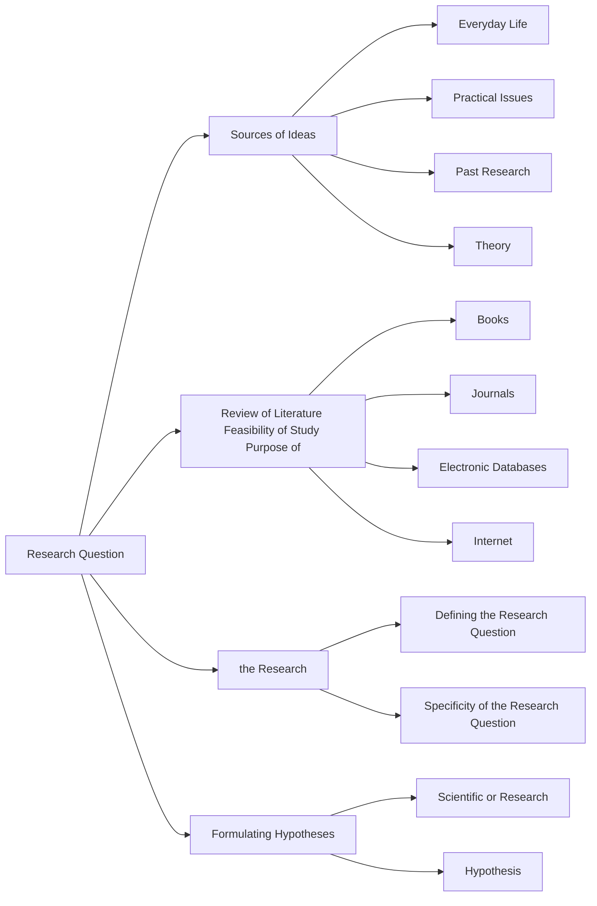

📑 <b>Table of Contents</b>

- [PART II Planning the Research Study](#part-ii-planning-the-research-study)
- [Chapter 3 Identifying Research Questions and Forming Hypotheses](#chapter-3-identifying-research-questions-and-forming-hypotheses)
  - [Learning Objectives](#learning-objectives)
- [Sources of Research Ideas](#sources-of-research-ideas)
  - [Everyday Life](#everyday-life)
  - [Practical Issues](#practical-issues)
  - [Past Research](#past-research)
  - [Theory](#theory)
  - [EXHIBIT 3.1 Finding the Cause and Treatment of Peptic](#exhibit-3-1-finding-the-cause-and-treatment-of-peptic)
- [Breadth of Research Ideas](#breadth-of-research-ideas)
  - [Ideas Not Capable of Scientific Investigation](#ideas-not-capable-of-scientific-investigation)
- [Review of the Literature](#review-of-the-literature)
  - [Getting Started](#getting-started)
  - [Defining Objectives](#defining-objectives)
  - [Conducting the Search](#conducting-the-search)
  - [EXHIBIT 3.2 Example of PsycINFO Result for an Article](#exhibit-3-2-example-of-psycinfo-result-for-an-article)
  - [EXHIBIT 3.2 Example of PsycINFO Result for an Article (Continued)](#exhibit-3-2-example-of-psycinfo-result-for-an-article-continued)
  - [Obtaining Resources](#obtaining-resources)
  - [Additional Information Sources](#additional-information-sources)
- [Feasibility of the Study](#feasibility-of-the-study)
- [Purpose of the Research](#purpose-of-the-research)
  - [Defining the Research Question](#defining-the-research-question)
  - [Specificity of the Research Question](#specificity-of-the-research-question)
- [Formulating Hypotheses](#formulating-hypotheses)
  - [Summary](#summary)
  - [Key Terms and Concepts](#key-terms-and-concepts)
  - [Related Internet Sites](#related-internet-sites)
  - [Practice Test](#practice-test)
  - [Challenge Exercises](#challenge-exercises)

<!-- Page 1 -->
## PART II Planning the Research Study

## Chapter 3 Identifying Research Questions and Forming Hypotheses

### Learning Objectives

🎯 **3.1** Develop research questions from each of the sources discussed.
🎯 **3.2** Explain the need for a diverse scientific community in psychology research.
🎯 **3.3** Explain the value of a literature review using multiple sources.
🎯 **3.4** Explain what it means to state that a proposed study is feasible.
🎯 **3.5** Develop a research question.
🎯 **3.6** Formulate a hypothesis relating to your research question.

<!-- Page 2 -->
## Sources of Research Ideas

🎯 **3.1** Develop research questions from each of the sources discussed.

Up to this point in the text, we have discussed the general characteristics of scientific research. However, the scientific approach is only useful if we have questions to answer, problems to solve, and knowledge to acquire. This need for information leads to our research ideas. In the field of psychology, identification of a research idea should be relatively simple because people are fascinating and the possibility of understanding who we are, what we think, and why we do what we do, leads to an almost endless array of questions. To convert these into legitimate research questions, you should be inquisitive and ask why certain types of behavior occur. For example, assume that you observe someone frequently posting comments on social media about the importance of voting in a democratic society. Then, surprisingly, you find that this person did not vote in the recent political election. You have seen a contradiction between this individual’s attitude and behavior. Two well-founded research questions are “Why is there a lack of correspondence between attitude and behavior?” and “Under what circumstance do attitudes *not* predict behavior?” Let’s look at the major sources of research questions.

Where do research ideas, questions, and topics originate? In all fields, there are a number of common sources, such as existing theories and past research. In psychology, we are even more fortunate; we have our own personal experience and everyday events to draw from. The things we see, read about, or hear about can serve as ideas to be turned into research topics. But identifying these ideas as research topics requires that we be alert and curious. Rather than just passively observing behavior or reading material relating to psychology, we must actively question the reasons for the occurrence of an event or behavior. If you ask, “Why?” you will find many researchable topics. Typically, research ideas originate from one or a combination of four sources: everyday life, practical issues, past research, and theory.

### Everyday Life

As we proceed through our daily routine, we come into contact with many questions in need of solution. Parents want to know how to handle their children; students want to know how to learn material faster. When we interact with others or see others react, we note many individual differences. If we observe children on a playground, these differences are readily apparent. One child might be very aggres-

The responses of a particular person also vary according to the situation. A person who is very aggressive in one situation might be passive in another. Why do these differences exist? What produces these varying responses? Why are some people leaders and others followers? Why do we like some people and not others? Many such researchable questions can be identified from everyone’s interactions and personal experiences.

### Practical Issues

Many research ideas arise from practical issues that require solutions. Private industry faces such problems as low employee morale, absenteeism, turnover, selection, and placement. Research has been and continues to be conducted in these areas. Clinical psychology is in need of a great deal of research to identify more efficient modes of dealing with mental disturbances. Units of the federal and state governments support experimentation designed to solve practical problems, such as finding a cure for cancer. Large expenditures are also being directed toward improving the educational process.

<!-- Page 3 -->
### Past Research

Previously conducted research is an excellent source of research ideas. Past research can be replicated to determine if the findings are the same across studies. Also, one of the interesting features of research is that it tends to generate more questions than it answers! Although each well-designed study provides additional knowledge, phenomena are multidetermined. In any experiment, only a limited number of variables can be studied. Investigation of these variables can lead to hypotheses about the effects of other variables. The multidimensional nature of phenomena is also frequently the cause of a lack of agreement among research results. An unidentified variable might be the source of conflict among various studies on a given problem, and research must be conducted to uncover this variable and thereby eliminate the apparent contradiction. For example, one study might report that a new bullying prevention program is effective and another study might report that the same program was not effective. This conflicting finding might be explained by yet another study that shows the prevention program is effective for students in middle school but that it does not work with high school students. In research, each study leads to a subsequent study, so people can spend their whole lives investigating and extending knowledge in one particular area. Research is an ongoing process.

### Theory

A **theory** is a statement or group of statements that explain “how” and “why” some part of the world works, and a theory helps researchers make new theoretical predictions about the world. Theoretical predictions become hypotheses to be empirically tested. Theories must be continually tested with different people in different contexts to determine their accuracy and conditions of applicability. Some theoretical predictions will apply broadly. The operant conditioning principle of positive reinforcement (i.e., the frequency of occurrence of a behavior increases following reinforcement) applies very broadly. Other predictions will depend on person, place, context, and other variables. For example, Roth and Fonagy (2005) explain that psychotherapeutic research must focus on “what works for whom.” As you might guess, theories are therefore excellent sources of researchable ideas.

Leon Festinger’s (1957) theory of cognitive dissonance is an example of a theory that stimulated an extraordinary amount of research in the decade that followed its publication. From this theory, Festinger and Carlsmith (1959) hypothesized and validated the less-than-obvious prediction that, after completing a boring task, participants who were given &#36;1 to tell someone else that the boring task was interesting and fun actually stated that they had enjoyed the task more than did the participants who were given &#36;20 to do the same thing. The theory of cognitive dissonance continues to influence recent research as its interactions with additional variables are understood (Hinojosa, Gardner, Walker, Cogliser, &amp; Gullifor, 2017).

The four sources of research ideas—everyday life, practical issues, past research, and theory—barely scratch the surface of circumstances that can inspire a creative idea. The important issue is not the identification of sources of ideas but the generation of these ideas, as illustrated in Exhibit 3.1. In fact, the best research ideas often come from integrating theory, past research, and practical issues. One way of looking at this integration is to view practical problems as providing motivation to study a problem. The research literature provides you with a knowledge base relating to the practical problem and theory helps integrate the knowledge and gives insight into the practical problem in a way that cannot be achieved just from the research literature. To develop researchable ideas requires the development of a way of thinking. You have to develop a questioning and inquisitive approach to life, see what answers might already be available, and build on what is known to produce something better.

<!-- Page 4 -->
### EXHIBIT 3.1 Finding the Cause and Treatment of Peptic

Ulcer Disease

In the early part of the 20th century, peptic ulcer disease was believed to be caused by stress and dietary factors. Treatment for the disease involved hospitalization, bed rest, and a diet of bland foods. Later in the 20th century, gastric acid was blamed for the disease. Antacids and medications that block acid production became the standard therapy. However, the incidence of peptic ulcer disease remained high, and victims of this disease continued to battle it in spite of this treatment.

The real cause and an effective treatment did not appear on the medical scene until 1982 when Australian physician Barry Marshall first identified a link between

Helicobacter pylori

(

H. pylori

) and ulcers (e.g., see Marshall, 2008). Marshall concluded that the bacterium, not stress or diet, causes ulcers. However, the medical community was slow to accept this novel finding, and it was not until over 10 years later that the National Institutes of Health Consensus Development Conference concluded that there was a strong association between

H. pylori

infections and ulcer disease. At this time, the conference also recommended that ulcer patients with H.  pylori

infection be treated with antibiotics. In 1996, the Food and Drug Administration approved the first antibiotic for treatment of ulcer disease (Centers for Disease Control, 2001).

Although we now know a cause and effective treatment of peptic ulcer disease, this knowledge came only with Dr. Marshall’s boundless conviction that he was right when others doggedly pronounced him wrong. Marshall’s initial

investigation into this disease began when he was a medical resident at Royal Perth Hospital. He searched the literature and discovered that the presence of the spiral bacterium in the stomach had been reported as far back as the late 1800s and became convinced that this bacterium was the key to the cause and treatment of gastritis and ulcers. As a result of this conviction, he collaborated with Robin Warren, a staff pathologist at Royal Perth Hospital. Both of these individuals knew that the spiral bacterium was present in more than half their patients but had not been recognized as a common occupant of human gastric mucosa. This further stimulated their investigations into the relationship between this bacterium and peptic ulcer disease. At one point, Marshall even infected himself with the ulcer-causing bacteria to create an experimental model to substantiate his hypothesis and challenge the accepted belief that mental or emotional disturbance or diet was responsible for peptic ulcer disease.

Persevering against the almost universal skepticism of his peers, Marshall’s investigations demonstrated the significance of H. pylori

in peptic ulcer disease. And finally, in 1996, the Food and Drug Administration officially approved the first drug therapy for the treatment of this disorder, a combination of bismuth and the antibiotic tinidazole. Marshall continues to investigate the significance of this bacterium and has focused on its relationship to stomach cancer, which has also gained acceptance.

## Breadth of Research Ideas

🎯 **3.2** Explain the need for a diverse scientific community in psychology research.

Although there are many sources of ideas in psychology, it is important that we not overlook significant topics. To do so would lead us to develop a knowledge base that is incomplete. All scientists probably agree that we need to conduct research on all important topics. However, scientists are human, and the questions and particular topics they think are important can be affected by their personal and demographic characteristics such as gender, social class, ethnicity, sexual orientation, religiosity, age, and so forth. For example, in past years there was a lot of research focusing on the influence of mothers’ working outside the home on their children’s psychological welfare. Much less attention focused on whether fathers’ commitment to their work endangers their children’s welfare or if the mothers’ employment might even benefit their children (Hare-Mustin &amp; Marecek, 1990). It appears that personal biases have influenced the selection of research questions and have led scientists to overlook important aspects of human behavior. To correct for potential bias and ensure that all topics of importance receive attention, it is imperative that the scientific community include scientists of many different personal and demographic characteristics.

<!-- Page 5 -->
### Ideas Not Capable of Scientific Investigation

Researchable ideas, as you have just seen, originate from a variety of sources. However, it is important to realize that not all ideas are directly subject to scientific investigation. One of the criteria that a scientific study must meet is that the research idea must be capable of being scientifically tested. There are some ideas that are very important, are debated vigorously, and consume much time and energy but are not subject to scientific testing. These ideas typically revolve about issues of morality and religion. Consider, for example, the issue of abortion. This is an issue that has been debated for decades and has polarized the population. A large segment of the population advocates a prochoice position; another large segment advocates a prolife position. Science can investigate the genesis of these positions and mechanisms for changing them, and provide empirical data that the different sides might decide to use, but it cannot resolve the issue of which position is the best or correct one.

> [!TIP] **Study Questions 3.1**
> - Where can you get ideas for a research study?
>
> - Why do we need diversity among scientists?
>
> - Explain why some ideas you might have cannot be subjected to a scientific investigation.

## Review of the Literature

🎯 **3.3** Explain the value of a literature review using multiple sources.

Once you identify a research topic, the next step in the research process is to become familiar with the information available on the topic. For example, assume that you want to conduct research on the impact of environmental stress on AIDS. Before beginning to design such a research project, you should first become familiar with current information on both environmental stress and AIDS. Prior work has been conducted on practically all psychological problems, and the topics of AIDS and environmental stress are no exceptions.

At this point you might be asking yourself, “Why should I review the literature on my selected topic? Why not just proceed to the laboratory and find an answer to the question?” There are several good reasons why you should do your homework in the form of a literature review before conducting any empirical research. The general purpose of the library search is to gain an understanding of the current state of knowledge about the selected topic. Specifically, a review of the literature

**1.**Will tell you the degree to which the idea you have identified has already been researched. If it has been heavily researched, you should either revise the idea and your research question in light of the results so that your study builds on the current literature, or you should look for another research idea.

**2.**Might give you ideas as to how to proceed in designing your study so that you can obtain an answer to your research question.

**3.**Can point out methodological problems specific to the research question you are studying.

<!-- Page 6 -->
**4.**Can identify whether special groups or special pieces of equipment are needed and perhaps give clues as to where to find the equipment or how to identify the particular groups of participants needed.

**5.**Will provide needed information for preparing the research report, because this research report requires that you not only set your study in the context of prior studies but also that you discuss the results in relation to other studies.

These are just a few of the more salient reasons for conducting a literature review.

Assuming you are convinced of the necessity of a literature review, you now need to know how to conduct such a review. Frequently, students don’t know what kind of literature search is expected, where to start, how to get the best results from a search, what resources are available, or when to stop the search. We now provide some guidelines to guide your search process.

### Getting Started

It may be tempting to get started by just “googling” your topic, but you really need to stop and take advantage of your library! To conduct an effective search, you should know how to use the library and its many resources. If you are unfamiliar with your library, you should ask your librarian where and how to find documents related to psychology. You also need to define your topic area before beginning the search. This definition needs to be relatively narrow and specific to conduct an appropriate literature search. For example, you might be interested in depression. However, the topic of depression is very broad and would be unmanageable because it includes everything about depression from causes to treatment. For example, a PsycINFO search of depression in 2019 yielded more than 306,000 abstracts! If you narrow this topic to something like relapse of depression, you will have a more manageable topic.

In conducting the literature search, be prepared to spend considerable time and effort. Effective searches frequently take many hours. When you search for journal articles, you will see abstracts of these articles. Do not rely only on the information in these abstracts. Abstracts should be used only to give you information about the content of the actual article so you can tell if you need to select that article for further reading. When you get an actual journal article, take detailed notes of its content as you read it. This includes a complete reference, details about the methodology, important findings, strengths and weaknesses, and any other thoughts or comments that might arise as you are reading the article. You may want to use software like Mendeley (www.mendeley.com) or Zotero (www.zotero.org) to help you organize your sources, keep track of your notes, and easily draft the reference section of a paper.

### Defining Objectives

Before starting the literature search, it is helpful to define your literature search objectives. For example, is your literature search being conducted to familiarize you with the topic area you want to investigate, or are you doing the literature search to help develop the methodology you need to use in conducting your research study? Identifying your objectives will show you that there are different reasons for doing a literature search and give you a focus when reading the literature.

### Conducting the Search

After you have developed some knowledge of your library and have defined the objectives of your search, you should be ready to conduct your literature search. There are many resources at your disposal that will give you more information than you ever thought existed. These resources consist of books, journal articles, computer databases, and the World Wide Web.

<!-- Page 7 -->
**Books** Books have been written about most areas in psychology. This is a good place to start your literature search because it will provide an introduction to your research topic and a summary of the literature published up to the time of the writing of the book. One book that is often very useful is the *Annual Review of Psychology.* Published yearly since 1950, it presents experts’ in-depth discussions of the principal work done during the preceding year on a variety of topics. One of the topics might relate to your own, so it is worthwhile to check this source. Other relevant books and chapters can be identified from a search of *Psychological Abstracts* or PsycINFO (discussed later). After you have identified the book or books, you should connect to your library’s online catalogue to see if your library holds the book or books you are interested in. You should be able to connect to your library’s online catalogue through the Internet. If your library does not have the books you are interested in, you can request them through interlibrary loan.

Most books do not, however, provide a comprehensive review of all research conducted on a topic. The author(s) of the book has to be selective and present only a small portion of the literature. To be sure that the author has not presented a biased orientation, you should select and read several books on your chosen research topic.

**Psychological Journals** Most of the relevant information about a research topic is usually found in psychological journals. Frequently, a review that has started with books leads to the journals. Because books are generally the outgrowth of work cited in journals, this progression from books back to journals is a natural one.

How should one proceed in reviewing the work cited in the journals? There are so many psychological journals that it would be impossible to go through each and every one looking for relevant information.

**Computerized or Electronic Databases** **PsycINFO** is an electronic bibliographic database providing abstracts and citations to the scholarly literature in the behav-

Association and has the mission of locating and summarizing psychologically relevant documents from a variety of disciplines and disseminating these summaries in a form that is easy to access and retrieve.

The PsycINFO database contains more than 4 million references to the psychological literature accumulated from 1887 to the present day. It covers publications from approximately 50 countries and literature written in more than 29 languages. Because of its depth and breadth of coverage, PsycINFO is the database of choice for a search of psychologically relevant material. For additional up-to-date information on PsycINFO, you can check out the website at http://www.apa.org/psycinfo/. This website will also give you information about other electronic products such as those listed in Table 3.1.

**Table 3.1** *Additional Electronic Products from PsycINFO*

<table class="textbook-table" style="width: auto; max-width: 100%; border-collapse: collapse; margin: 1.5em 0;">
  <thead>
    <tr>
      <th>Product</th>
      <th>Description</th>
    </tr>
  </thead>
  <tbody>
    <tr>
      <td>PsycARTICLES</td>
      <td>Database containing full-text articles from over 80 journals published by APA and allied organizations</td>
    </tr>
    <tr>
      <td>PsycBOOKS</td>
      <td>Full-text database of scholarly titles published by APA</td>
    </tr>
  </tbody>
</table>

In searching PsycINFO, the basic procedure is to identify a list of search terms, enter them, and let the computer search for articles focusing on the issues relating to those terms. For example, if you were interested in literature focusing on the effect of food on a person’s mood, you might select terms such as “food and mood,” “carbohydrates and mood,” and “carbohydrate cravings.” There are times when you might not know which terms to select for your search or you might think that there are more terms that should <!-- Page 8 -->
be used than you can think of. This is where the *Thesaurus of Psychological Index Terms* is helpful. This is an index of psychological terms as well as terms that describe interrelationships and related categories. For example, if you were interested in child welfare, the *Thesaurus of Psychological Index Terms* would provide a list of additional terms (adoption advocacy, child abuse, child day care, child neglect, child self-care, foster care, social casework, and social services) relevant to the topic of child welfare. These additional terms could also be searched to provide references to additional journal articles and books on the topic of child welfare. The thesaurus can be accessed from the PsycINFO main menu, so if you have access to PsycINFO, you can first access the thesaurus to identify a list of appropriate search terms and then have PsycINFO conduct your search using these terms.

Once you have identified the terms you want to use in your search, you are ready to conduct your search. PsycINFO gives you the option of searching for articles that contain your key search terms in the title, in the subject, or anywhere. You could also do an author search if you know the author of a journal article of interest to you. In addition to searching by using relevant search terms, PsycINFO allows you to limit your search in a number of ways, such as searching only journal articles and not books or searching only animal literature and not human literature. These are specific things you can do to ensure that you identify relevant literature. You will develop proficiency in using these options as you gain experience doing PsycINFO literature searches.

Assume you are interested in road rage and want to identify the literature on this topic area. You connect to PsycINFO and search the literature for the years 2000 to the present, and your search identifies 89 journal articles. Your next step is to read the abstracts of these articles and identify the ones that are of interest to you. Exhibit 3.2 presents the information provided by PsycINFO for one of these articles. If this abstract indicates that the article contains information of importance to you, then you retrieve the article. The information given identifies the author(s), title, and journal in which the article appeared, allowing you to seek and obtain a copy of the entire article. As you read the article, take notes to get as much as you can out

### EXHIBIT 3.2 Example of PsycINFO Result for an Article

**Record:** 1

**Title:** Is road rage increasing? Results of a repeated survey.

**Author(s):** Smart, Reginald G., Social, Prevention and Health Policy Research Department, Centre for

Addiction and Mental Health, Toronto, ON, Canada, reg_smart@camh.net

Mann, Robert E., Social, Prevention and Health Policy Research Department, Centre for Addiction

and Mental Health, Toronto, ON, Canada

Zhao, Jinhui, Social, Prevention and Health Policy Research Department, Centre for Addiction and

Mental Health, Toronto, ON, Canada

Stoduto Gina, Social, Prevention and Health Policy Research Department, Centre for Addiction and

Mental Health, Toronto, ON, Canada

**Address:** Smart, Reginald G., Social, Prevention and Health Policy Research Department, Centre for

Addiction and Mental Health, 33 Russell St., Toronto, ON, Canada, M5S 2S1, reg_smart@camh.net

**Source:** Journal of Safety Research

, Vol. 36(2), 2005, pp. 195–201.

**Publisher:** The Netherlands: Elsevier Science

Publisher URL: http://elsevier.com

**ISSN:** 0022-4375 (Print)

**Digital Object Identifier:** 10.1016/j.jsr.2005.03.005

(

Continued

)

<!-- Page 9 -->
### EXHIBIT 3.2 Example of PsycINFO Result for an Article (Continued)

**Language:** English

**Keywords:** road rage; victimization; perpetration; demographics

**Abstract:** Problem: We report on trends in road rage victimization and perpetration based on population survey

data. Method: Based on repeated cross-sectional telephone surveys of Ontario adults between July

2001 and December 2003, logistic regression analyses examined differences between years in road rage

**victimization and perpetration in the previous year controlling for demographic characteristics. Results:** The prevalence of any road rage victimization in the previous year decreased significantly from 47.5% in

2001 to 40.6% in 2003, while prevalence of any road rage perpetration remained stable (31.0–33.6%).

Logistic regression analyses revealed that the odds of experiencing any road rage victimization was

33% higher in 2001 and 30% higher in 2002 than in 2003. Discussion: Survey data provide a valuable

perspective on road rage trends, but efforts to track road rage incidents are also needed. Summary: In

Ontario, the proportion of adults experiencing any road rage victimization decreased from 2001 to 2003,

while the proportion reporting any road rage perpetration remained stable. Impact on industry: None.

(PsycINFO Database Record © 2005 APA, all rights reserved) (journal abstract)

**Subjects:** Aggressive Driving Behavior; Demographic Characteristics; Harassment; Highway Safety;

Victimization

**Classification:** Transportation (4090)

**Population:** Human (10)

Male (30)

Female (40)

**Location:** Canada

**Age Group:** Adulthood (18 years and older) (300)v

Young Adulthood (18–29 years) (320)

Thirties (30–39 years) (340)

Middle Age (40–64 years) (360)

Aged (65 years and older) (380)

Very Old (85 years and older) (390)

**Tests and Measures:** Computer Assisted Telephone Interview

**Form/Content Type:** Empirical Study (0800)

Study (0890)

Article (2400)

**Publication Type:** Peer Reviewed Journal (270); Print Format(s) Available: Print; Electronic

**Release Date:** 20050718

**Accession Number:** 2005-06225-010

Number of Citations

20

**in Source:**

**Database:** PsycINFO

of it. Scholarly articles are written for professionals, so there might be some parts that are difficult for you to understand. Table 3.2 gives some guidelines for reading journal articles.

You should also consider searching databases (see Table 3.3) in addition to PsycINFO because you might find important and related research. This is particularly valuable if your research topic bridges other areas, such as medicine or sociology or education.

When you find the articles that you want to read, you need to think about how to work your way through a journal article. Most quantitative empirical psychological journal articles will have several different sections. The first section, the abstract, gives a brief overview of the entire article. The next section, Introduction, is a review of the current research literature that explains why the current study is needed. Typically, the

<!-- Page 10 -->
**Table 3.2** *Guide for Reading Journal Articles*

1. Read and remember the title because it tells you what is being investigated in the article.
2. Read the abstract very carefully because it summarizes what is being investigated as well as what was found in the study.
3. As you read the introduction to the article, pay particular attention to the first paragraph because this typically gives a general statement of the topic area and research question being studied.
4. Toward the end of the introduction, typically in the last paragraph, the author(s) usually state the purpose of the study and, perhaps, the hypotheses being tested in the study. Keep these two in mind as you read the rest of the article, and see how the author(s) go about testing the hypotheses or meeting the purpose of the study and what the results have to say about them.
5. As you read the Method section, make note of the type of research participants used and then pay particular attention to the Procedure section be- cause this section tells you how the author(s) designed the study to test their hypotheses and meet the purpose of the study. Pay attention to what was done to the participants and what the participants were asked to do and then ask yourself if this tested the hypotheses of the study.
6. The Results section might be the hardest for you to read and comprehend because the author(s) might have used statistical procedures unfamiliar to you. Rather than spending time trying to understand the statistical analysis, look at what the authors say about the results of the statistical analysis. Look at any tables and figures presented, and try to relate the information in them to the hypotheses and purpose of the study.
7. If you have difficulty with the Results section, read the first paragraph of the Discussion section. This typically summarizes the results of the study in a form that is easier to understand. In addition to helping understand the results, the Discussion section is where the author(s) explain why the study turned out as it did: Did it support the hypotheses? As you read this section, think about the purpose and hypotheses and look for the explanation of why the study did or did not support the hypotheses and fulfill the purpose of the study. Table 3.3 Databases Incorporating Psychological Publications Database Subject Coverage Internet Address PsycINFO Psychology, mental health, biomedicine Connect through your university library ERIC Education Connect through your university library

When you read scholarly articles, you might have a difficult time comprehending some of the material. If you follow these simple steps, you will get the most out of the article: introduction ends with a brief rationale for the current study and the goals of the current study. The next section, Methods, describes the participants of the study and the methods that were used in the study. This will include a description of how the variables were measured. Now you are ready for the results. The results section can be intimidating if you are not yet comfortable with statistics. The results section describes the analyses and the findings from the study. Even if you are not comfortable with the statistics, the results section also includes clear statements about what the statistical findings mean. The next section in the journal article is the discussion. The discussion often begins with a summary of the findings. These findings are then discussed and compared with the hypotheses of the study and the previous research literature. The discussion often ends with acknowledgments of the weaknesses of the study and ideas for future research.

**Internet Resources** The Internet is an additional resource that can be used to acquire psychological information. The Internet is best described as a “network of networks” consisting of millions of computers and users all over the world, all of which are joined into a single network to promote communication. It is probably an understatement to say that the Internet is revolutionizing communications much the way the telephone did many years ago. Now we can connect to the Internet and communicate with someone in another country just as easily as we can with our neighbor next door. The Internet has a number of tools that are of value to both the student and psychologists. In addition to the resources discussed here, there are conferences, debates, journals, and lists of references, as well as complete studies, on the Internet.

Electronic Mail. E-mail, or electronic mail, is probably one of the most frequent uses of the Internet. E-mail is an electronic means of sending messages as well as files and documents to another person over the Internet. It provides an unprecedented means

**Table 3.3** *Databases Incorporating Psychological Publications*

<table class="textbook-table" style="width: auto; max-width: 100%; border-collapse: collapse; margin: 1.5em 0;">
  <thead>
    <tr>
      <th>Database</th>
      <th>Subject Coverage</th>
      <th>Internet Address</th>
    </tr>
  </thead>
  <tbody>
    <tr>
      <td>PsycINFO</td>
      <td>Psychology, mental health, biomedicine</td>
      <td>Connect through your university library</td>
    </tr>
    <tr>
      <td>ERIC</td>
      <td>Education</td>
      <td>Connect through your university library</td>
    </tr>
    <tr>
      <td>MEDLINE</td>
      <td>Medicine, biomedicine, health care</td>
      <td>http://www.ncbi.nlm.nih.gov</td>
    </tr>
    <tr>
      <td>CINAHL</td>
      <td>Allied health and nursing</td>
      <td>Connect through your university library</td>
    </tr>
    <tr>
      <td>Social Work Abstracts</td>
      <td>Social work and human services journals</td>
      <td>Connect through your university library</td>
    </tr>
    <tr>
      <td>SocINDEX</td>
      <td>Sociology and related disciplines</td>
      <td>Connect through your university library</td>
    </tr>
  </tbody>
</table>

<!-- Page 11 -->
of communication that avoids the problems of playing phone tag when trying to reach another person. Most, if not all, colleges and universities have connections to the Internet and provide a means for students to either become connected using their own computers or provide access to computers that are connected to the Internet. Through e-mail, you can easily contact researchers around the world.

Listserv. Discussion groups are also used for communication among researchers, students, and others interested in a particular topic, such as anxiety. Within psychology, there are many topics that are of interest to a particular group of individuals. These special interest groups use a variation of e-mail called a Listserv to communicate among all members of the group (kind of like a very large group text). A Listserv is a program that automatically distributes messages to all members of the list so it can be viewed as a discussion group organized around a particular topic.

For an excellent collection of lists to consider joining, go to the “Electronic Mailing Lists for Students” that is maintained by the American Psychology Association (http://www.apa.org/apags/resources/listservs/). To become a participant in a Listserv, you must first join or subscribe to the list. Once you have joined the list, the Listserv sends you all the messages posted by other subscribers. Some users set their Listserv preference to “digest form,” which tells the system to send them only one e-mail per day that includes all of the day’s messages. You can just read the messages, reply to them for discussion, or send your own message about ideas of interest to you. For example, if you are having difficulty finding information on a topic of interest, you might post a message on a Listserv asking for information or their thoughts relating to that topic. In a short period of time, you should get many replies from other participants trying to help you.

World Wide Web. Probably the most popular part of the Internet is the World Wide Web. The Web consists of millions of computers, each containing information, some of which might be useful and much of which is not. There is a wealth of information on the Web, and students and faculty alike enjoy surfing the Web. However, the giant waves of information contain both relevant and irrelevant information. This is why the Web can be a frustrating and time-consuming place to search for information. Therefore, you need a clear idea of what you are looking for to be able to search the Web effectively.

A web search will not search subscription or proprietary databases such as PsycINFO or SocINDEX. Although some databases, such as MEDLINE, are free and can be accessed by anyone, other databases, such as PsycINFO, are not free and have to be accessed through your library because your library has paid the fee to permit your access. But remember that you can access your university library via the Web. Another increasingly popular source for published research via the Web is Google Scholar (http://scholar.google.com/). As you know, to access material on the Web you simply make use of a **search engine** such as Google Chrome, Internet Explorer, Safari, Opera, Microsoft Edge, or Firefox. The World Wide Web is a potentially valuable resource, giving you a wealth of information. Its tremendous advantage is that it is accessible 24 hours a day and can be accessed from the comfort of your own home, apartment, office, or dorm room. However, there are some significant disadvantages to conducting a web search. It can be time consuming because much of the information is disorganized. A lot of the information you get will be irrelevant. Also, there is no controlling authority ensuring the accuracy or credibility of the information, so you must judge each website to determine if the information contained is reliable and accurate. You must critically evaluate the information that you find on the Web. One hint will be the suffix of the web address; use of.gov (government),.edu (education), or.org (organization) will tell you a little bit about the credibility of source. But you need to know much more. For example, who are the authors of the information and what are their qualifications and motivations? Are they experts on the topic?

<!-- Page 12 -->
Do they have a product or issue that they are trying to persuade you to purchase or endorse? Next, what is the date of the information? Is it up-to-date? Consider the breadth of the information—does it tell the whole story or does it seem to be biased or one-sided? You are responsible for thinking critically and investigating the credibility of what you find on the Web. Just because it is on the Web, please do not assume that it is valid!

### Obtaining Resources

We have talked about where to find your information, and the full articles and documents often will be available from the places you search. Sometimes, however, your search engine will not include linked access to the full document. When this is the case, your first choice should be to rely on your library. Libraries purchase many books and subscribe to many journals and other documents, and it is possible that the books and journal articles you need are in your library or in one of the online databases the library has subscribed to. However, few libraries will provide all the resources you have selected, and in such cases, you must use alternative means of securing documents.

Your first choice for securing documents not physically located in your library collection or available in its online databases should be through the interlibrary loan department. This is a department maintained by the library dedicated to obtaining documents from other locations, such as other libraries. In most instances, they are efficient and can obtain documents quickly. Journal articles are often sent to you as pdf files; therefore, you don’t have to go to the library to pick them up. Rather than using interlibrary loan, you can contact the author of a journal article and request a reprint of that article. When authors publish journal articles, they typically receive a number of reprints that they distribute to  individuals requesting copies.

### Additional Information Sources

Regional and national psychological association meetings are excellent sources of *current* information. We emphasize *current* because of the publication lag that exists in journals and books. A research study that appears in a book might be several years old, whereas studies presented at professional meetings are typically much more recent. Another advantage of securing information at professional meetings is that frequently you can interact with the investigator. Exchanging ideas with the researcher is likely to generate added enthusiasm and many more research ideas. It is recommended that psychology majors try to attend one of these national or regional meetings. Table 3.4 lists the various regional psychological associations, as well as a variety of other, more specialized psychological associations.

**Table 3.4** *Psychological Associations*

<table class="textbook-table" style="width: auto; max-width: 100%; border-collapse: collapse; margin: 1.5em 0;">
  <thead>
    <tr>
      <th>National</th>
      <th>Regional</th>
      <th>Selected Others</th>
    </tr>
  </thead>
  <tbody>
    <tr>
      <td>American Psychological Association</td>
      <td>New England Psychological Association</td>
      <td>Psychonomic Society</td>
    </tr>
    <tr>
      <td>American Psychological Society</td>
      <td>Southwestern Psychological Association Eastern Psychological Association Southeastern Psychological Association Western Psychological Association Midwestern Psychological Association</td>
      <td>Association for Behavioral and Cognitive Therapies National Academy of Neuropsychologists International Neuropsychological Society</td>
    </tr>
  </tbody>
</table>

Information can also be gained from direct communication with researchers. It is not unusual for researchers to call, write, or e-mail one another to inquire about current studies or methodological techniques.

Rocky Mountain Psychological Association

<!-- Page 13 -->
> [!TIP] **Study Questions 3.2**
> - What is the purpose of a literature review?
>
> - How would you go about conducting a literature review?
>
> - What resources are available for conducting a literature review?

## Feasibility of the Study

🎯 **3.4** Explain what it means to state that a proposed study is feasible.

After you have completed the literature search, you are ready to decide whether it is feasible for you to conduct the study. Each study varies in its requirements with respect to time, type of research participants, expense, expertise of the experimenter, and ethical sensitivity.

For example, you might want to study the effect of being sexually abused as a child on the stability of a person’s later marital relationship. Although this is an excellent research question and one that has been investigated and needs further investigation, it is a difficult study to conduct and one that is not feasible for most students. This study requires the identification of sexually abused children, which would be difficult in the best of circumstances. In addition, it requires following the abused children for years until they marry, which would take an inordinate amount of time. Then an assessment of the couple’s marital stability has to be obtained, which might require a level of expertise you do not have. In addition, this is an ethically sensitive topic, because just revealing the fact that a person has been sexually abused could have a variety of consequences.

Contrast this with the study conducted by Homan, McHugh, Wells, Watson, and King (2012) about the effect of viewing photographs of very thin women. Female college students were randomly assigned to one of three conditions in which they either viewed pictures of thin women, normal weight women, or neutral objects. Body dissatisfaction was measured after viewing the pictures. As predicted, the participants who viewed pictures of thin women expressed greater body dissatisfaction. This study was relatively simple to conduct, did not require any special skills on the part of the experimenters or the research participants, was relatively inexpensive, and took only a moderate amount of time.

These two studies represent opposite ends of the continuum with respect to the issues of time, money, access to participant sample, expertise, and ethics. Although most studies fall somewhere between the two extremes, these examples serve to emphasize the issues that must be considered in selecting a research topic. If the research topic you have selected will take an inordinate amount of time, require funds that you don’t have or can’t acquire, call for a degree of expertise you don’t have, or raise sensitive ethical questions, you should consider altering the project or selecting another topic. If you have considered these issues and find that they are not problematic, then you should proceed with your research topic. The next step is to state the specific purpose of your research.

> [!TIP] **Study Question 3.3**
> What does it mean for a study to be feasible?

<!-- Page 14 -->
## Purpose of the Research

🎯 **3.5** Develop a research question.

You should now be prepared to make a clear and exact statement of the purpose of your research. The literature review has revealed not only what is currently known about your research topic, but also the ways in which it has been studied in the past. Such information is a tremendous aid helping you to decide what needs to be researched and how it can be researched. We recommend that you fill in the blank in the following sentence to state the purpose of your research study:

> The purpose of the (proposed) research is to ____________.

### Defining the Research Question

Typically, a **research question** is a question that identifies the variables and relationships to be studied. For example, Milgram (1964a) asked, “Can a group induce a person to deliver punishment of increasing severity to a protesting individual?” This statement conforms to the definition of a research question because it contains two variables—group pressure and severity of punishment delivered—and asks a question regarding the relationship between these variables.

Are all research questions equally useful? Assume that you posed the question: “Do space creatures influence the behavior of college students?” This question might meet the definition of a research question, but it obviously cannot be tested. Kerlinger (1973) presents three criteria that good research questions must meet. First, the variables in the question should express a relationship. Second, the relationship should be stated in question form. The statement of the research question should begin with “What is the effect of...,” “Under what conditions do...,” “Does the effect of...,” “What is the relationship of...”, or some similar form. Sometimes only the purpose of a study is stated, which does not necessarily communicate the research question clearly. Asking a question has the benefit of presenting the research directly, thereby minimizing misunderstanding. The third criterion, and the one that most frequently distinguishes a researchable from a nonresearchable question, states, “The problem statement should be such as to imply possibilities of empirical testing” (p. 18). Many interesting and important questions fail to meet this criterion and therefore are not amenable to empirical inquiry. Quite a few philosophical and theological questions fall into this category. Milgram’s research question, on the other hand, meets all three criteria. A relation was expressed between the variables, it was stated in question form, and it was possible to test the relationship empirically. Severity of punishment was measured by the amount of electricity supposedly delivered to the protesting individual, and group pressure was applied by having two confederates suggest increasingly higher shock levels.

### Specificity of the Research Question

In formulating a research question, **specificity of the research question** is an important consideration. Think of the difficulties facing the experimenter who asks the question “What effect does the environment have on learning ability?” This question meets all the criteria of a research question, and yet it is stated so vaguely that the investigator could not pinpoint what was to be investigated. The concepts of  *environment* and *learning ability* are vague (what environmental characteristics? learning of what?). In this case, the experimenter must specify what is meant by *environment* and by *learning ability* to be able to conduct the experiment. Now contrast <!-- Page 15 -->
this question with the following: “What effect does the amount of exposure to words have on the speed with which they are learned?” This question specifies exactly what is to be studied.

The two examples of questions presented here demonstrate the advantages of formulating a very specific research question. A specific question helps to ensure that the researchers understand and communicate exactly what they plan to study. If the research question is stated vaguely, the researchers probably do not know exactly what they want to study and therefore might design a study that will not adequately address the question. A specific research question also helps the researchers make necessary decisions about such factors as participants, apparatus, instruments, and measures. A vague research question helps very little with such decisions. To drive this point home, go back and reread the two questions given in the preceding paragraph and ask yourself, “What research participants should I use? What measures should I use? What apparatus or instruments should I use?”

How specific should one be in formulating a research question? The primary purposes of formulating a specific research question are to ensure that the researcher has a good grasp of the variables to be investigated and to aid the researcher in designing and carrying out the study. If the formulation of the question is specific enough to serve these purposes, then additional specificity is not needed. To the extent that these purposes are not met, additional specificity and narrowing of the research question are required. Therefore, the degree of specificity required may vary across research questions.

> [!TIP] **Study Questions 3.4**
> - What is meant by “research question” and what are the characteristics of a good research question?
>
> - Why should a research question be stated in very specific and precise terms?

## Formulating Hypotheses

🎯 **3.6** Formulate a hypothesis relating to your research question.

After the literature review has been completed and the research question has been stated, you should begin formulating your **hypothesis**. Hypothesis testing is an important part of quantitative research (as opposed to qualitative research that focuses more on exploration). For example, if you are investigating the influence of the number of bystanders on the speed of intervention in emergencies, you might hypothesize that as the number of bystanders increases, the speed of intervention will decrease. From this example, you can see that hypotheses represent predictions of the relation that exists among the variables or tentative answers to the research question. The formulation of the hypothesis logically follows the statement of the research question, because one cannot state a hypothesis without having a clear question.

The hypothesis to be tested is often a function of the literature review, although hypotheses are also frequently formulated from theory. As stated earlier, theories guide research, and one of the ways in which they do so is by making predictions of possible relationships among variables. Hypotheses also (but less frequently) come from reasoning based on the observation of events. In some situations, it seems fruitless to formulate hypotheses. When one is engaged in exploratory work in a relatively <!-- Page 16 -->
new area, where the important variables and their relationships are not known, hypotheses serve little purpose.

More than one hypothesis may be needed depending on the complexity of the research question. Here again the literature review can be an aid because a review of prior research can suggest the most probable relationships that might exist among the variables.

Regardless of the source of the hypothesis, it *must* meet one criterion: A hypothesis must be stated so that it is capable of being either refuted or confirmed. In an experiment, it is the hypothesis that is being tested. One does not test a question such as the one Milgram posed; rather, one tests one or more of the hypotheses that could be derived from this question, such as “group pressure increases the severity of punishment that participants will administer.” A hypothesis that fails to meet the criterion of testability, or is nontestable, removes the research from the realm of science. Any conclusions reached regarding a nontestable hypothesis do not represent scientific knowledge.

Why should research hypotheses be set up in the first place? Why not just forget about research hypotheses and proceed to attempt to answer the research question? Hypotheses serve a valuable function. Remember that hypotheses are derived from knowledge obtained from the literature review of other research, theories, and so forth. Such prior knowledge serves as the basis for the hypothesis. For example, if an experiment confirms the hypothesis, then, in addition to providing an answer to the question asked, it gives additional support to the literature that suggested the hypothesis. But what if the hypothesis is not confirmed by the experiment? Does this invalidate the prior literature? If the hypothesis is not confirmed, then the hypothesis is false, or some error exists in the conception of the hypothesis, or some other assumption made was false. For example, if the variables were not measured accurately, then the hypothesis test will be meaningless. Likewise, if there are not enough participants in the study, the test of the hypothesis will be inadequate. If there is an error in conceptualization of the hypothesis, it could be due to any of a number of problems. Some of the information obtained from prior research might be false, or some relevant information might have been overlooked during the literature review. It is also possible that the researcher misinterpreted some of the literature. These are a few of the more salient errors that could have taken place. In any event, failure to support a hypothesis might indicate that something is wrong, and it is up to the researcher to discover what it is. Once the researcher uncovers what he or she thinks is wrong, a new hypothesis is proposed that can be tested. The researcher now has another study to conduct. Such is the continuous process of science. Even if the hypothesis is false, knowledge has been advanced, because, for now, an incorrect hypothesis can be ruled out. Another hypothesis must be formulated and tested in order to reach a solution to the problem.

> [!TIP] **Study Questions 3.5**
> - What is a hypothesis and what specific criterion must a hypothesis meet?

### Summary

In order to conduct research, it is first necessary to identify a research question in need of an answer. Psychological research questions arise from several traditional sources: theories, practical issues, and past research. In addition, in psychology, we have our personal experience to draw on for researchable topics, because psychological research is concerned with behavior. Once a researchable topic has been identified, the literature <!-- Page 17 -->
relevant to this idea should be reviewed. A literature review will reveal the current state of knowledge about the selected topic. It will indicate ways of investigating the topic and will point out related methodological problems. The literature review should probably begin with books written on the topic and progress from there to the actual research as reported in journals. In surveying the past research conducted on a topic, the scientist can make use of an electronic database, one of which is operated by the can search the World Wide Web and obtain information by attending professional conventions or by calling, writing, or e-mailing other individuals conducting research on the given topic.

When the literature review has been completed, the researcher must determine whether it is feasible to conduct the study. This means that an assessment must be made of the time, research participant population, expertise, and expense requirements, as well as the ethical sensitivity of the study. If this assessment indicates that it is feasible to conduct the study, the researcher must make a clear and exact statement of the research question to be investigated. This means that the researcher must formulate the research question asking about the relationship between two or more variables. This research question must express a relation and be capable of being tested empirically. The question must also be specific enough to assist the researcher in making decisions about such factors as participants, apparatus, and general design of the study.

After the question has been stated, the researcher needs to state the hypotheses. These must be formalized because they represent the predicted relation that exists among the variables under study. Often, hypotheses are a function of past research. If they are confirmed, the results not only answer the question asked, but also provide additional support to the literature that suggested the hypotheses. There is one criterion that any hypothesis must meet: It must be stated so that it is capable of being either refuted or confirmed.

## 🗂️ Chapter Key Terms & Active Recall

> 💡 **Learning tip:** Try to recall the definition of each term *before* clicking to reveal it.
> This active retrieval practice strengthens long-term memory far more than re-reading.

📇 <b>Theory</b> *(p. 3)*

> **Definition:** A statement or group of statements that explain “how” and “why” some part of the world works and provide predictions about the world to be empirically tested

📇 <b>PsycINFO</b> *(p. 7)*

> **Definition:** An electronic bibliographic database of abstracts and citations to the scholarly literature in psychology

📇 <b>Search engine</b> *(p. 11)*

> **Definition:** A software program that seeks out web pages stored on servers throughout the World Wide Web

📇 <b>Research question</b> *(p. 14)*

> **Definition:** Any question that asks about the relationship between at least two variables

📇 <b>Specificity of the research question</b> *(p. 14)*

> **Definition:** The preciseness with which the research question is stated

📇 <b>Hypothesis</b> *(p. 15)*

> **Definition:** The researcher’s prediction or a tentative answer to a research question

### Key Terms and Concepts

| Term | Term | Term |
| --- | --- | --- |
| [Hypothesis *p. 56*](#term-hypothesis) | [Research question *p. 55*](#term-research-question) | [Specificity of the research question *p. 55*](#term-specificity-of-the-research-question) |
| [PsycINFO *p. 48*](#term-psycinfo) | [Search engine *p. 52*](#term-search-engine) | [Theory *p. 44*](#term-theory) |

### Related Internet Sites

- <http://www.apa.org/education/undergrad/library-research.aspx>
  This site provides instruction on how to find relevant information on psychological topics in outlets ranging from  newspaper articles to scientific journals. It also includes links to information about PsycINFO, PsycARTICLES,  PsycBOOKS, and so on.

- <http://library.albany.edu/usered/>
  This is a great site containing links to information relevant to just about anything you want to know about searching the World Wide Web, as well as links to information regarding evaluating information on the Web.

### Practice Test

*Answers to these questions can be found in the Appendix.*

**1.** Assume that you have just been to a demonstration
by the psychic Uri Geller and watched him apply his psychic powers to do such things as bend spoons. Let’s further assume that you are a skeptic and doubt that this was done by psychic powers. You want to conduct a study to determine if Uri Geller really has the ability to bend a spoon through use of his psychic powers. This research idea has origi- nated from <!-- Page 18 -->
a.  Everyday life
b.  A practical issue
c.  Past research
d.  Theory

**2.** Dr. Skeptic was interested in the following questions:
- Is it ethical to experiment with animals?

- Is there an afterlife? The common element of these two questions is that they
a.  Arise from everyday life experience
b.  Arise from practical issues
c.  Arise from past research
d.  Are not capable of scientific investigation

**3.** If you are doing a literature search, you can log on
to the World Wide Web and conduct your search us- ing one of the available search engines. Using this procedure to do your literature search has the disad- vantage of
a.  Not providing any relevant information
b.  Being too slow c.  Not providing enough information
d.  Providing too much information with questionable
credibility

**4.** Consider the research question: “Does excessive
drinking occur in animals other than rats?” This is considered a good research question because it
a.  Asks a question
b.  Focuses on a relationship between two variables
c.  Can be empirically tested
d.  Is stated specifically enough to specify the
variables being tested and to aid in the design of the study
e.  All of the above

**5.** One way to reduce bias in research questions is to
a.  Work with a research team that includes a diverse
group of scientists
b.  Work with a research team where everyone shares
the same point of view
c.  Work with a research team where everyone is the
same age
d.  Avoid reading research from other disciplines

### Challenge Exercises

**1.** Construct a research question that could be
experimentally investigated and then provide the following information about this research issue.
a.  My research question is
b.  The relation expressed in my research question is
c.  The research question can be empirically tested
because
d.  The hypothesis I want to test is

**2.** Now that you have a research question, you should
conduct a literature review. Conduct this litera- ture review using the databases specified here. You should get very different results, and this should illustrate to you the advantages and limitations of each.
a.  Conduct a mini-literature review of the  information
relating to your research topic using the PsycINFO database. Use the following  approach when doing this literature review:

1. List the search terms you want to use when searching PsycINFO.

2)  Identify five articles related to your research question. For each of these articles, provide the following information:
a)  Author(s)
d)  Study hypothesis or
purpose
b)  Title
e)  Results, or what the
c)  Journal
study found
b.  Conduct a mini-literature review using the World
Wide Web. Use the following approach when conducting this search:

1. Specify a search engine.

2. Identify two web pages that you think you can use for your literature review, and answer the following questions regarding each web page:
a)  What is the source of the information?
b)  What is the purpose of the web page?
c)  Is the information accurate, and how can
you tell that it is accurate?
d)  Does the web page report the results of a
study or a summary of several studies? Does it provide some acknowledgment of the limitations of the information?
e)  What type of information is being provided
(scholarly, popular, trade, etc.)?
