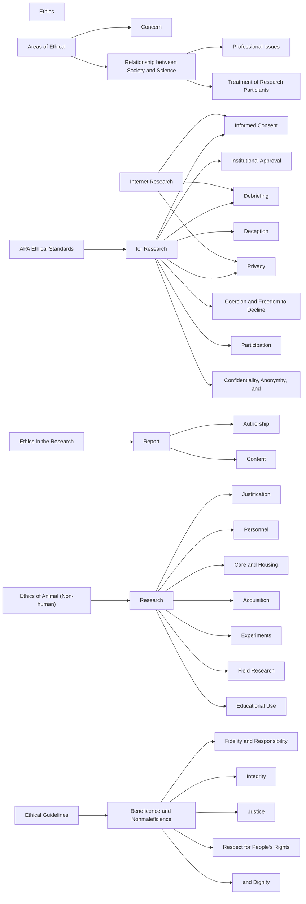
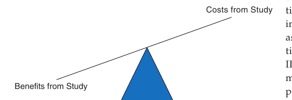
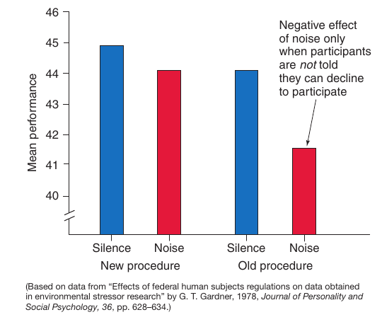

📑 <b>Table of Contents</b>

- [Chapter 4 Ethics](#chapter-4-ethics)
  - [Learning Objectives](#learning-objectives)
- [Research Ethics: What Are They?](#research-ethics-what-are-they)
  - [Relationship Between Society and Science](#relationship-between-society-and-science)
  - [Professional Issues](#professional-issues)
  - [EXHIBIT 4.1 Two Cases of Reportedly Fraudulent Research](#exhibit-4-1-two-cases-of-reportedly-fraudulent-research)
  - [EXHIBIT (Continued)](#exhibit-continued)
  - [Treatment of Research Participants](#treatment-of-research-participants)
- [Ethical Dilemmas](#ethical-dilemmas)
  - [EXHIBIT 4.2 Sample Consent Form](#exhibit-4-2-sample-consent-form)
- [Ethical Guidelines](#ethical-guidelines)
  - [EXHIBIT 4.3 The Tuskegee 
<!-- AI-REVIEW-START id="rev-1" category="ocr_typo" -->
<!-- ORIGINAL:
Syphilis
-->
<!-- REASON: The word is cut off at the end of the segment. It is clearly 'Syphilis' in the context of 'Tuskegee Syphilis Study'. -->
Syphilis
<!-- AI-REVIEW-END -->
is Experiment](#exhibit-4-3-the-tuskegee-syphilis-experiment)
  - [Beneficence and Nonmaleficence](#beneficence-and-nonmaleficence)
  - [Fidelity and Responsibility](#fidelity-and-responsibility)
  - [Integrity](#integrity)
  - [Justice](#justice)
  - [Respect for People’s Rights and Dignity](#respect-for-people-s-rights-and-dignity)
- [APA Ethical Standards for Research](#apa-ethical-standards-for-research)
  - [Institutional Approval](#institutional-approval)
  - [Informed Consent](#informed-consent)
  - [Deception](#deception)
  - [Debriefing](#debriefing)
  - [Coercion and Freedom to Decline Participation](#coercion-and-freedom-to-decline-participation)
  - [Confidentiality, Anonymity, and the Concept of Privacy](#confidentiality-anonymity-and-the-concept-of-privacy)
- [Ethical Issues in Electronic Research](#ethical-issues-in-electronic-research)
  - [Informed Consent and Internet Research](#informed-consent-and-internet-research)
  - [Privacy and Internet Research](#privacy-and-internet-research)
  - [Debriefing and Internet Research](#debriefing-and-internet-research)
- [Ethical Issues in Preparing the Research Report](#ethical-issues-in-preparing-the-research-report)
  - [Authorship](#authorship)
  - [Writing the Research Report](#writing-the-research-report)
- [Ethics of Animal (Nonhuman) Research](#ethics-of-animal-nonhuman-research)
  - [Safeguards in the Use of Animals](#safeguards-in-the-use-of-animals)
  - [Animal Research Guidelines](#animal-research-guidelines)
  - [Summary](#summary)
  - [Key Terms and Concepts](#key-terms-and-concepts)
  - [Related Internet Sites](#related-internet-sites)
  - [Practice Test](#practice-test)
  - [Challenge Exercises](#challenge-exercises)

<!-- Page 1 -->
## Chapter 4 Ethics

### Learning Objectives

🎯 **4.1** Summarize the three areas of research ethics.
🎯 **4.2** Explain how the Institutional Review Board (IRB) judges the ethical appropriateness of research proposals.
🎯 **4.3** Explain the moral principles underlying the APA ethics code.
🎯 **4.4** Describe ethical issues and procedures that that must be considered when conducting research.
🎯 **4.5** Describe the specific ethical issues and procedures that must be considered when conducting electronic research.
🎯 **4.6** Summarize the ethical principles to be followed concerning authorship and writing the research report.
🎯 **4.7** Explain the guidelines that must be followed in conducting research with animals.

<!-- Page 2 -->
Once you have constructed your research question and hypothesis, you are ready to develop the research design. The design will specify how you will collect data that will test your hypothesis. However, at the same time you are designing the research study, you must pay attention to ethical issues involved in research.

In pursuit of knowledge, psychologists conduct surveys, manipulate the type of experience that individuals receive, or vary the stimuli presented to individuals and then observe the research participants’ reactions to these stimuli. Such manipulations and observations are necessary in order to identify the influence of various experiences or stimuli. At the same time, scientists recognize that individuals have the right to privacy and to self-determination. The scientific community is confronted with the problem of trying to satisfy the public demand for solutions to problems such as cancer, arthritis, alcoholism, child abuse, and penal reform without infringing on people’s rights. For a psychologist trained in research techniques, a decision *not* to do research is also a matter of ethical concern because research is needed to address a number of societal problems. Consideration of ethical issues is integral to the development of a research proposal and to the conduct of research. Ethical principles are vital to the research enterprise because they assist the scientist in preventing abuses that might otherwise occur and delineate the responsibilities of the investigator.

## Research Ethics: What Are They?

🎯 **4.1** Summarize the three areas of research ethics.

**Research ethics** is a set of principles that assist the community of researchers in deciding how to conduct ethical research. Within the social and behavioral sciences, ethical concerns can be divided into three areas (Diener &amp; Crandall, 1978): (1) relationship between society and science, (2) professional issues, and (3) treatment of research participants.

### Relationship Between Society and Science

The ethical issue concerning the relationship between society and science concerns the extent to which societal issues and cultural values should direct the course of scientific investigation. The federal government spends millions of dollars each year on research, and it sets priorities for how the money is to be spent. To increase the probability of obtaining research funds, investigators orient their research proposals toward these same priorities, which means that the federal government at least partially dictates the type of research conducted. AIDS (acquired immunodeficiency syndrome) research provides an excellent illustration. Prior to 1980, AIDS was virtually unheard of. Few federal dollars were committed to investigating this disorder. But when AIDS turned up within the U.S. population and its lethal characteristic was identified, it rapidly became a national concern. Millions of dollars were immediately earmarked for research to investigate causes and possible cures. Many researchers reoriented their interests and investigations to the AIDS problem because of the availability of research funds.

The corporate world also provides extensive research funding, which frequently comes with a set of potential biases and restrictions. For example, most of the research sponsored by drug companies has focused on the development of variants of existing drugs with the goal of improving sales rather than developing new drugs. When comparisons are made between a new drug and a traditional therapy, studies funded by the company that produced the new drug are more likely to find that the new drug is more effective than are studies funded by other sources (Lexchin, Bero, Djulbegovic, &amp; Clark, 2003). Drug companies obviously want their newly patented drugs to turn out <!-- Page 3 -->
to be superior because this leads to sales of the new drug and increases the profit that can be made by the company.

While corporate support of research can be a good way for researchers to advance their program of research, corporate funding can become a conflict of interest when the researcher’s activities and decision making are unduly affected by the corporate interest. Such actual or potential conflicts of interest run the risk of influencing one or more aspects of a research study and can threaten the public’s trust in science. This is

(Standard 3.06, Conflict of Interest, APA, 2010) stating that psychologists should refrain from engaging in professional activities where they have such a conflict of interest.

### Professional Issues

The category of professional issues includes the problem of research misconduct. In December 2000, the U.S. Office of Science and Technology Policy (OSTP) defined **research misconduct** as “fabrication, falsification, or plagiarism (FFP) in proposing, performing, or reviewing research, or in reporting research results” (OSTP, 2005). The attention fabrication, falsification, and plagiarism has received is understandable, given that a scientist is trained to ask questions, to be skeptical, and to use the research process in the search for knowledge. This search for knowledge is completely antithetical to engaging in any type of deception. The most serious ethical offense in the scientific profession is to cheat or present fraudulent results. Although fraudulent activity is condemned on all fronts, in the past decades there has been an increase in the number of reports of scientists who forge or falsify data, manipulate results to support a theory, or selectively report data, as illustrated in Exhibit 4.1. Fanelli (2009) conducted a meta-analysis of self-report surveys of scientific fraud and found that approximately 2% of scientists reported serious fraudulent behavior and approximately 30% reported engaging in questionable practices. When asked to report about other scientists (not themselves), the reported estimate of serious fraud was approximately 14%. It is important to note that these were self-report data and may underestimate the problem.

### EXHIBIT 4.1 Two Cases of Reportedly Fraudulent Research

Although most known cases of fraudulent research have occurred in the field of medicine, several very significant instances have recently been identified in the field of psychology. Two of the most infamous cases are described in this exhibit.

Cyril Burt, the first British psychologist to be knighted, received considerable acclaim in both Great Britain and the United States for his research on intelligence and its genetic basis. A biographical sketch published upon his death depicted a man with unflagging enthusiasm for research, analysis, and criticism. Shortly after his death, however, questions about the authenticity of his research

began to appear. Ambiguities and oddities were identified in his research papers. A close examination of his data revealed that correlation coefficients did not change across samples or across sample sizes, suggesting that he might have fabricated data. Attempts to locate one of Burt’s important collaborators were unsuccessful. Dorfman (1978) conducted an in-depth analysis of Burt’s data and showed beyond a reasonable doubt that Burt fabricated his data on the relationship between intelligence and social class.

More recently, the National Institute of Mental Health (NIMH) conducted an investigation of alleged research fraud

The cost of such fraudulent activity is enormous, both to the public and to the scientist. Not only is the whole scientific enterprise discredited, but the professional career of the individual is destroyed. Breuning (see Exhibit 4.1) pleaded guilty to scientific misconduct in a plea bargain and was sentenced to 60 days in a halfway house, 250 hours of community service, and 5 years of probation. There is no justification for faking or altering scientific data.

<!-- Page 4 -->
### EXHIBIT (Continued)

by one of its grantees, Steven E. Breuning. Breuning received his doctorate from the Illinois Institute of Technology in 1977 and several years later obtained a position at the Coldwater Regional Center in Michigan. At Coldwater, Breuning was invited to collaborate on an NIMH-funded study regarding the use of neuroleptics on institutionalized people with mental disabilities. In January 1981, he was appointed director of the John Merck program at Pittsburgh’s Western Psychiatric Institute and Clinic, where he continued to report on the results of the Coldwater research and even obtained his own NIMH grant to study the effects of stimulant medication on participants with mental disabilities. During this time, Breuning gained considerable prominence and was considered one of the field’s leading researchers. In 1983, however, questions were raised about the validity of Breuning’s work. The individual who had initially taken Breuning on as an

investigator started questioning a paper in which Breuning reported results having impossibly high reliability. This prompted a further review of Breuning’s published work, and contacts were made with personnel at Coldwater, where the research had supposedly been conducted. Coldwater’s director of psychology had never heard of the study and was not aware that Breuning had conducted any research while at Coldwater. NIMH was informed of the allegations in December 1983. Following a 3-year investigation, an NIMH team concluded that Breuning “knowingly, willfully, and repeatedly engaged in misleading and deceptive practices in reporting his research.” He reportedly had not carried out the research that was described, and only a few of the experimental subjects had ever been studied. It was concluded that Breuning had engaged in serious scientific misconduct (Holden, 1987).

Although fraudulent activity is obviously the most serious form of scientific misconduct, there is a broader range of less serious, although still unacceptable, practices that are receiving attention. These include such practices as failure to notice others’ use of flawed data; failing to present data contradicting one’s own work; changing the design, methodology, or results of a study in response to pressure from a funding source; or circumventing minor aspects of human-participant requirements. While these practices do not approach the seriousness of fabrication, falsification, or plagiarism, they are of concern to the profession, especially as Martinson, Anderson, and de Vries (2005) have revealed that more than a third of U.S. scientists surveyed admitted to engaging in one or more of these practices in the past 3 years. This does not necessarily mean that the structure of the research process has eroded. However, these problems deserve serious attention.

The increased frequency and interest in scientific misconduct have naturally stimulated discussion about its cause and the type of action that needs to be taken to reduce the frequency of misconduct (DuBois, et al., 2013; Hilgartner, 1990). One of the best deterrents is probably the development of an institutional culture in which key faculty members model ethical behavior, stress the importance of research integrity, and translate these beliefs into action (Adams &amp; Pimple, 2005). Prevention strategies that make it difficult to engage in scientific misconduct include working with the IRB to explain one’s ethical procedures as listed in Table 4.1, following those procedures, and for the IRB to engage in auditing of research practice.

**Table 4.1** *Information that must be Presented in a Research Protocol Presented to the IRB*

- Purpose of the research
- Relevant background and rationale for the research
- Participant sample
- Experimental design and methodology
- Incentives offered, if any
- Risks and benefits to the participants and precautions to be taken
- Privacy and confidentiality of the data collected

Additionally, the National Institutes of Health (NIH) require that all investigators who receive funding from NIH, as well as other key personnel such as coinvestigators and study coordinators, complete an education module on the protection of human participants. The National Science Foundation (NSF) has recently mandated that any research projects supported by NSF funds provide appropriate training and oversight in the responsible and ethical conduct of research for undergraduates, graduate <!-- Page 5 -->
students, and postdoctoral researchers. Starting January 25, 2010, NIH requires similar training in the Responsible Conduct of Research for NIH supported career development awards, research education grants, and dissertation research grants. Most universities extend these requirements to all investigators, including other key personnel such as graduate and undergraduate students who are conducting research with human participants whose research does not receive NIH funding.

### Treatment of Research Participants

The treatment of research participants is the most fundamental issue confronted by scientists. The conduct of research with humans can potentially create a great deal of physical and psychological harm. For example, in September 1995, *U.S. News &amp;* *World Report* (Pasternak &amp; Cary, 1995) published an article on once-secret records of government-sponsored or funded radiation experiments carried out between 1944 and 1974. During this time, more than 4,000 radiation experiments were conducted on tens of thousands of Americans for the dual purpose of learning more about the effects of radiation on humans and the potential medical benefits of radiation on cancer.

In one of the most controversial experiments, cancer patients receiving radiation treatments were told that the radiation might cure their cancer. Documents, however, suggested that many of these treatments were conducted only to gather data on the effect of radiation on humans. Other radiation studies were conducted on patients with cancer resistant to radiation. In these experiments, the principal investigator even stated that he was experimenting and not treating the patients’ disease. There was a 25% mortality rate. Such experiments are clearly unethical and should not be conducted.

Experiments designed to investigate important psychological issues might subject participants to humiliation, physical pain, and embarrassment. In planning an experiment, a scientist is obligated to consider the ethics of conducting the research. Unfortunately, some studies cannot be designed in such a way that the possibility of physical and psychological harm is eliminated. Hence, the researcher often faces the dilemma of having to determine whether the research study should be conducted at all. Because it is so important, we will consider this issue in some detail.

> [!TIP] **Study Questions 4.1**
> - What is meant by the term *research ethics*?
>
> - What are the major areas of ethical concern in the social and behavioral sciences?
>
> - What are the ethical issues in each of these areas and which area is of most concern?

## Ethical Dilemmas

🎯 **4.2** Explain how the Institutional Review Board (IRB) judges the ethical

> **appropriateness of research proposals.**

Conducting psychological research creates a special set of dilemmas. On the one hand, the research psychologist is trained in the scientific method and feels an obligation to conduct research that will benefit society; on the other hand, doing so might subject research participants to stress, failure, pain, aggression, or deception. Thus, there arises the **ethical dilemma** of having to determine if the potential gain in knowledge <!-- Page 6 -->
from the research study outweighs the cost to the research participant. In weighing the pros and cons of such a question, the researcher must give primary consideration to the welfare of the participant. Unfortunately, there is no formula or rule that can help investigators. The decision must be based on a subjective judgment, which cannot be made by the research team because they may be so involved in the study that they exaggerate the scientific merit and potential contribution of the study. Investigators must seek the recommendations of others, such as scientists in related fields, students, or lay individuals.

At the present time, the recommendations regarding the cost–benefit relationship in a study come from the Institutional Review Board (IRB). This is a board made up of scientists and nonscientists that exists at all institutions that receive federal funds for research. It reviews research proposals involving human participants.

In reviewing the research proposals, members of the IRB are required to make judgments regarding the ethical appropriateness of the proposed research by ensuring that the research is fully explained to the research participants and that the risks of harm are reasonable in relation to the hoped-for benefits. To make this judgment, the IRB members must have sufficient information about the specifics of the research protocol. This means that the investigator must submit a research protocol that the IRB can review. This research protocol must provide the information listed in Table 4.1.

From the information contained in the research protocol, IRB members must make a judgment as to the ethical acceptability of the research. In making this judgment, the primary concern of the IRB is the welfare of the research  participants. Specifically, the IRB will review proposals to ensure that research participants provide informed consent (see sample in Exhibit 4.2) for participation

### EXHIBIT 4.2 Sample Consent Form

Consent to Participate in Research

Primary Investigator: Jane Doe

Department: Psychology Telephone Number: 123-4567

The purpose of this research is to determine the role of beliefs about success and failure and about self-esteem in cognitive tasks. If you agree to participate in this research, you will be asked to complete two questionnaires about your attitudes and beliefs.

After completing both questionnaires, you will be asked to read a set of instructions and then try to solve as many anagrams as possible in a limited amount of time. Anagrams are jumbled letters that can be reordered to form a word (e.g., rlyibar

library).

Your participation in this research is entirely voluntary. You can change your mind and withdraw at any time without penalty.

Your privacy will be carefully protected. Code numbers will be used to record all test results and responses to questionnaires. Your name will not be used. Should the results of this research be published or presented in any form, your name or other identifying information will not be revealed.

This research has been approved by the Institutional Review Board of the University of USA. Any questions you might have should be directed to Dr. Jane Doe, who can be reached at 123-4567. Should you have unresolved questions relating to your rights as a research participant, you can contact the Institutional Review Board at 246-8910.

I have read or have had read to me and understand the above research study and have had an opportunity to ask questions that have been answered to my satisfaction I agree voluntarily to participate in the study as described.

_____________________________

Date

_____________________________

Participant’s Name (printed)

_____________________________

Participant’s Signature

_____________________________

Signature of Investigator

-

<!-- Page 7 -->

*Figure 4.1 Decision model for cost–benefit analysis.*

in the study and that the procedures used in the study do not harm the participants. This committee has paranalysis should work. We always want the benefits to outweigh the costs. Studies having low benefits and high costs would *not* be approved. Studies having high benefits and low costs would be approved. When benefits and costs are balanced, the decisions are more difficult. Studies that involve low benefits and low costs may be difficult because, although they create little potential cost to the participant, they are also likely to yield little benefit. Studies with high benefits and high costs are difficult because, although the benefit accruing from the study is high, costs to the participants are also high. For example, perhaps a new chemotherapy drug has the potential to cure a form of cancer but also poses potentially life- threatening risks to the participants. Sometimes the board’s decision is that the risks to the research participants are too great to permit the study; in other instances, the decision is that the potential benefits outweigh the risks and the study may proceed. Even if the IRB approves the research, the investigator must always remember that no amount of advice or counsel can alter the fact that the final ethical responsibility lies with the researcher conducting the study.

> [!TIP] **Study Question 4.2**
> What is the ethical dilemma researchers are faced with in psychology, and how is this dilemma resolved?

## Ethical Guidelines

🎯 **4.3** Explain the moral principles underlying the APA ethics code.

Nazi scientists during World War II conducted grossly inhumane experiments that were universally condemned as being unethical. For example, they immersed people in ice water to determine how long it would take them to freeze to death, performed mutilating surgery, and deliberately infected many individuals with lethal pathogens. In 1946, 23 of the physicians went on trial at Nuremberg for the crimes they committed against these prisoners of war. During this trial, the fundamental ethical standards for the conduct of research were set forth in what has become known as the Nuremberg Code. This code set forth 10 conditions that must be met to justify research involving human participants. Of the 10 conditions, two of the most important were voluntary informed consent and a valid research design that had the potential of yielding valuable results.

One would logically think that the Nuremberg trials and the ethical standards resulting from this trial would have led to the conduct of ethical research with human participants. However, this was not consistently the case. In the medical field, Pappworth (1967) cited numerous examples of research that violated the ethical rights of human participants. The Tuskegee experiment (Jones, 1981), described in Exhibit 4.3, epitomizes the type of unethical experimentation that was conducted within the medical field.

<!-- Page 8 -->
### EXHIBIT 4.3 The Tuskegee Syphilis Experiment

In July 1972, the Associated Press released a story that revealed that the U.S. Public Health Service (PHS) had for 40 years been conducting a study of the effects of untreated syphilis on black men in Macon County, Alabama. The study consisted of conducting a variety of medical tests (including an examination) on 399 black men who were in the late stages of the disease and on 200 controls. Although a formal description of the experiment could never be found (apparently one never existed), a set of procedures evolved in which physicians employed by the PHS administered a variety of blood tests and routine autopsies to learn more about the serious complications that resulted from the final stages of the disease.

This study had nothing to do with the treatment of syphilis; no drugs or alternative therapies were tested. It was a study aimed strictly at compiling data on the effects of the disease. The various components of the study, and not the attempt to learn more about syphilis, made it an extremely unethical experiment. The participants in the study were mostly poor and illiterate, and the PHS offered incentives to participate, including free physical examinations, free rides

to and from the clinic, hot meals, free treatment for other ailments, and a &#36;50 burial stipend. The participants were not told the purpose of the study or that they were not be- ing treated for their illness. Even more damning is the fact that the participants were monitored by a PHS nurse, who informed local physicians that those individuals were tak- ing part in the study and that they were not to be treated for syphilis. Participants who were offered treatment by other physicians were advised that they would be dropped from the study if they took the treatment.

As you can see, the participants were not aware of the purpose of the study or the danger it posed to them, and no attempt was ever made to explain the situation to them. In fact, they were enticed with a variety of inducements and were followed to ensure that they did not receive treatment from other physicians. This study seems to have included just about every possible violation of our present standard of ethics for research with humans.

(From Jones, 1981.)

The widespread concern over ethical violations led to the development of several sets of guidelines, such as the Belmont Report (Office for Protection from Research

*Psychologists and Code of Conduct* (APA, 2010), one section of which is for researchers to use when conducting their research.

The APA Ethics Code includes five general aspirational or moral principles: (a) beneficence and nonmaleficence, (b) fidelity and responsibility, (c) integrity, (d) justice, and (e) respect for people’s rights and dignity. The hope and intention of the APA is that these principles will inspire all psychologists to the highest ethical behavior possible.

### Beneficence and Nonmaleficence

**Beneficence** means doing good for others and **nonmaleficence** means doing no harm to others. As psychologists, we should strive to help our clients, our field, our body of research, and our society, and we should strive to *not* hurt or harm others in any way. Psychologists have power and influence and should use it to help others. When conflicts arise among our concerns and obligations, psychologists should attempt to maximize the good and minimize bad or do no harm.

In research, the general principle says that psychologists should design and conduct research in a way that minimizes the likelihood of harm to participants and maximizes the likelihood that participants and society receive some benefit.

### Fidelity and Responsibility

Fidelity and responsibility refers to the way psychologists interact with others. Psychologists aspire to developing trusting relationships with others. They are aware of the influence they wield and are concerned with the needs of others. In conducting a research study, psychologists should understand the nature of the researcher– participant relationship and treat the relationship responsibly.

<!-- Page 9 -->
### Integrity

The principle of integrity states that psychologists strive to be honest, accurate, and truthful in teaching, research, and all other professional activities. Psychologists conduct studies to uncover the mysteries of behavior—to acquire knowledge that will advance our understanding of behavior. To accomplish this goal, the scientist must not only conduct quality research, but must also truthfully report the research conducted. Both of these components are integral to the discovery and promulgation of truth. Integrity speaks directly to the issue of presenting fraudulent results that we discussed earlier in this chapter. As stated earlier, faking or altering scientific results has no place in science.

### Justice

According to the principle of justice, everyone should have access to and be able to receive the benefits and contributions of psychology. Everyone should be treated justly and should have access to equal quality services. Achieving this principle in research studies is, perhaps, one of the more difficult goals to accomplish and is unlikely to be fully achieved (Sales &amp; Folkman, 2000) in our imperfect world. In the research arena, justice asks the question: Who should receive the benefits of the research and who should bear its burdens? The benefits and burdens must be equally distributed. It is unethical for one group to bear the burdens of research and a different group to receive the benefits.

### Respect for People’s Rights and Dignity

This principle states that psychologists are to respect the worth and dignity of everyone and that everyone has the right of privacy, confidentiality, and self-determination. Psychologists also recognize that some individuals have vulnerabilities that impair their decision-making ability. Special attention must be given to the rights of these vulnerable groups. Within the context of research studies, respecting the rights and dignity of research participants means that a prospective research participant has the right to choose to participate in a research study. This principle is adhered to by obtaining the prospective participant’s informed consent. This means that the prospective participant is given all the information about a research study that might influence his or her willingness to participate. Once they have this information, they can make an informed choice whether to participate.

> [!TIP] **Study Questions 4.3**
> - What are the five basic moral principles that psychologists should follow when conducting research?
>
> - Explain what is meant by each of these principles.

## APA Ethical Standards for Research

🎯 **4.4** Describe ethical issues and procedures that that must be considered when

**conducting research.**

Any psychologist conducting research must ensure that the dignity and welfare of the research participants are maintained and that the investigation is carried out in accordance with federal and state regulations and with the standards set forth by

<!-- Page 10 -->
(APA, 1953), was the outcome of about 15 years of discussion within APA. Since that time, the code has been revised several times. The most recent revision was approved in October of 2002 and amended in 2010 and 2016. The Ethics Code for research and publication can be found at http://www.apa.org/ethics/code/. The code includes discussion of important topics such as institutional approval, informed consent, deception, debriefing, humane care and use of animals, plagiarism, and issues relevant for publication. We strongly  recommend that you visit this APA site and study the Ethics Code.

### Institutional Approval

Most, if not all, institutions that have active research programs have a requirement that all human research is reviewed by an IRB. The primary role of the IRB is to protect human research participants. The requirement that all human research be reviewed by an IRB dates back to 1966. At the time there was a concern for the way in which medical research was designed and conducted. As a result of this concern, the surgeon general initiated an institutional review requirement at the Department of Health, Education, and Welfare (DHEW). This policy was extended to all investigations funded by the Public Health Service that involved human participants, including those in the social and behavioral sciences.

Ethical Standard 8.01 of the Ethics Code specifies that, when such institutional approval is required, psychologists must provide accurate information about their research proposal, receive approval from the IRB, and then conduct the research in accordance with the approved protocol.

There are three categories of review that a research proposal can receive from the IRB. These categories relate directly to the potential risk of the study to the participant. Studies can receive exempt status, expedited review, or review by the full IRB (Code of Federal Regulations 45 CFR 46). *Exempt* studies are studies that involve no known emotional, physiological, or economic risk to the participants. Studies of typical educational practice, anonymous surveys, and some forms of secondary data are likely to be exempt. In making the decision to place a study in the exempt category, the IRB staff makes use of the exempt categories set forth in the Code of Federal Regulations. The IRB makes this decision—not the researcher. Therefore, even if a researcher believes the study is exempt, the research proposal still must be submitted for review by the IRB staff.

The second category of review, *expedited* review, is a process where a study is rapidly reviewed by fewer members than the full IRB. Studies receiving expedited review are typically those involving no more than minimal risk, where “minimal risk” means that the discomfort or harm expected from participation in the research is not greater than would be expected in daily life or from physical or psychological tests. Expedited studies would include the following:

**1.**Research involving data, documents, records, or specimens that have been collected or will be collected solely for nonresearch purposes.

**2.**Research involving the collection of data from voice, video, digital, or image recordings made for research purposes.

**3.**Research on individual or group characteristics or behavior (e.g., perception, cognition, motivation, and social behavior) or research employing survey, interview, oral history, focus groups, program evaluation, human factors evaluation, or quality assurance methodologies when they present no more than minimal risk to participants.

Many of the studies conducted by students and psychology faculty fall into the minimal risk category and should receive expedited review.

<!-- Page 11 -->
The third category of review is *full board review*. This is a review by all members of the IRB. Any proposal that involves more than minimal risk (e.g., experimental drugs, stressful psychological testing, and vulnerable populations) raises red flags and must receive full board review.

### Informed Consent

**Informed consent** refers to fully informing the research participants about all aspects of the study that may affect the decision to participate. Standards 8.02–8.04 of the Ethics Code (http://www.apa.org/ethics/code/) state that fully informing the research participants means that you inform them of all aspects of the research, from the purpose and procedures to any risks and benefits, including such things as incentives for participation and the option to withdraw from the study. This information must be presented in a manner that is easily understood by the participants. With this information, the research participant can make an informed decision and choose to either decline to participate in the study or give his or her informed consent.

Gaining a participant’s informed consent is vital because of the sacredness of individuals’ right to determine what is done to their minds and bodies. Once a person is provided with all available information, it is assumed that he or she can make a free decision as to whether to participate, and in this manner, participants can avoid experimental procedures they consider objectionable. In this way, the basic principle of “respect for people’s rights and dignity,” discussed early in this chapter, is achieved.

Federal guidelines as well as the APA’s Ethics Code, Standard 8.05, recognize the possibility of sometimes forgoing the requirement of informed consent. However, the Ethics Code specifies that informed consent can be dispensed with only under specific and limited conditions in which the research will not reasonably be assumed to create distress or harm and the research is (a) normal educational practice, (b)  anonymous information or nonsensitive observations, (c) factors related to job effectiveness when there is no risk and confidentiality is respected, or (d) where dispensing with informed consent is permitted by law or federal or institutional regulations.

**Informed Consent and Minors** The principle of informed consent refers to the fact that a person, once given the pertinent information, is competent and legally free to make a decision as to whether to participate in a given research study. Minors, however, are presumed to be incompetent and cannot give consent. In such instances, Standard 3.10(b)(4) states that permission must be obtained from a legally authorized person, if this substitute consent is permitted or required by law. In most instances, the substitute consent is obtained from the minor’s parents or legal guardians after they have been informed of all the features of the study that might affect their willingness to allow their child to participate. In addition to obtaining informed consent from the minor’s parents or legal guardians, Standard 3.10(b)(1 &amp; 2) of the Ethics Code specifies that the minor be given an appropriate explanation of the study and that he or she give his or her assent. **Assent** means that the minor agrees to participate in the research after receiving an appropriate explanation. By appropriate, we mean that the explanation is in language that the minor can understand.

Federal regulations (OPRR, 2001) state that provisions should be made for soliciting the assent of a minor, when, in the judgment of the IRB, the minor is capable of providing assent. However, the age at which a person is capable of providing assent can differ among children. To provide assent, the child must be able to understand what is being asked, to realize that permission is being sought, and to make choices free from outside constraints. This depends on the cognitive capabilities of the child. Unfortunately, the cognitive capabilities of children develop at different rates, making it difficult to state an age at which a child is capable of providing assent. The Society <!-- Page 12 -->
for Research in Child Development (2003) state that researchers should respect the rights of children and understand that children have the right to choose if they want to participate in research. Not only is it ethically important to obtain the assent of minors, but it might also enhance the validity of the study. Insisting that minors participate when they do not want to participate might affect their behavioral responses and produce a confounding influence on the data collected.

**Passive Versus Active Consent** The discussion of consent has, up to this point, focused on active consent. An example of an active consent form was provided above in Exhibit 4.2. **Active consent** involves consenting to participate in a research study by agreeing and signing a consent form. When minors are used as research participants, consent is typically obtained from the minor’s parent or legal guardian. If consent is desired from school-age children, a common way in which consent is obtained is to provide the parent or legal guardian with a consent form by some means, such as mailing the consent form or sending it home with the minor. Ideally, the parent reads the consent form and either gives or refuses consent and returns the consent form to the researcher. However, studies (e.g., Ellickson, 1989) have revealed that only 50–60% of parents return consent forms even when follow-up efforts are made. One interpretation of the failure to return consent forms is that the parents have denied consent. However, there are a number of other reasons parents might not return consent forms. They might not have received the consent form, might forget to sign and return the form, or might not take enough time to read and consider the request. The existence of any or all of these possibilities will reduce the sample size and possibly bias the results because the parents who take the time to read and return the consent form may differ from parents who do not return the form.

To increase participation in research studies, Ellickson (1989) recommended the use of passive consent. **Passive consent** is a process where parents or legal guardians give consent by not returning the consent form. They return the consent form only if they do *not* want their child to participate in the research. Passive consent has been promoted by some investigators as a legitimate means of securing parental consent. Ethical concerns have been raised when passive consent procedures are used, because these studies might include children whose parents actually oppose their participation in the research but did not return the consent form or perhaps did not receive it. However, studies (e.g., Ellickson &amp; Hawes, 1989; Severson &amp; Ary, 1983) have revealed that active and passive consent procedures yield comparable rates of participation when the active consent procedures used extensive follow-up techniques. In contrast, in a recent comparison of active consent (without extensive follow-up) and passive consent, participation rates were much greater with passive consent than active consent (Doumas, Esp, &amp; Hausheer, 2015). Proponents of passive consent argue that passive consent results in a larger sample and broader range of participants while still giving parents the option to prevent their children from participating.

In spite of these cogent arguments for the use of passive consent, the practice is controversial. Individuals such as Hicks (2005) have argued that passive consent violates the intent as well as the spirit of informed consent. Additionally, passive consent is not consistent with either the APA Ethics Code (APA, 2010) or federal regulations, except under special circumstances (e.g., when research meets the APA ethical standard focusing on dispensing with informed consent). It is for such reasons that we recommend that you use *active consent*. This is the best form of consent. Passive consent should be considered only when the integrity of the study would be seriously compromised by requiring active consent. The APA Ethics Code does not directly address passive consent so it is imperative that you inform the IRB whenever you want to hope to use passive consent and receive its approval prior to making use of this technique.

<!-- Page 13 -->
> [!TIP] **Study Questions 4.4**
> - What is meant by *informed consent* and why is this considered a vital component of a research protocol?
>
> - What is meant by *assent* and when should it be obtained?
>
> - What is the difference between active consent and passive consent?
>
> - What ethical issues are associated with passive consent?

### Deception

Deception refers to deceit. The use of deception in psychological research is counter to the requirement of fully informing the research participants of the nature of the research in which they are asked to participate. It also runs counter to the basic moral principle of trust that psychologists should adhere to when conducting research with humans. However, psychologists must also conduct their research with fidelity and scientific integrity. This means that they must conduct well-designed and executed studies to advance our understanding of behavior. To conduct such studies requires, in some instances, the use of deception. This requirement is acknowledged by the Ethics Code. However, the Ethics Code does not permit the unfettered use of deception. Rather, the use of deception is limited to studies in which alternative procedures are not available and the study has the potential of producing important knowledge. Deception cannot be used in studies that are expected to cause harm or severe emotional distress. If deception is used, the participants are informed of its use as early as is feasible and participants have the option to withdraw their data from the study.

In social and behavioral research, deception can be either active or passive deception (Rosnow &amp; Rosenthal, 1998). **Active deception** refers to deception by commission, when the researcher deliberately misleads the research participants, such as when they are given false information about the purpose of the experiment or when they are deliberately led to believe that a confederate is a research participant. (A confederate is a member of the research team who is acting as a participant.) **Passive** **deception** refers to deception by omission, when certain information is withheld from the research participants, such as not giving the research participants all the details of an experiment.

Given that deception can be used in psychological research, we need to take a look at the effect of deception on research participants. More than five decades ago Kelman (1967) predicted that the persistent use of deception would cause research participants to become distrustful of psychologists and undermine psychologists’ relations with them. Fortunately, this prediction has not come true. Sharpe, Adair, and Roese (1992) revealed that research participants are as accepting of arguments justifying the use of deception as they were 20 years earlier. Soliday and Stanton (1995) found that mild deception had no effect on attitudes toward researchers, science, or psychology. Fisher and Fyrberg (1994) even found that most of the student research participants in their study believed that the deception studies they evaluated were scientifically valid and valuable. Most also believed that the use of deception was an important methodology to retain even when other methodologies, such as role playing or questionnaires, were available.

Although the majority of research participants consistently report that they do not mind having been misled and were not harmed by deception experiments, a case could be made for the view that the detrimental effects of deception depend on the type of study being conducted. Christensen (1988) and others (Sieber, Iannuzzo, &amp; Rodriguez, 1995) pointed out that deception is not acceptable ethically if the study investigates private behaviors or if the experimental procedure has significant <!-- Page 14 -->
potential to harm the research participant. This is consistent with the Ethics Code, which states that deception should not be used in research expected to cause pain or severe emotional distress.

### Debriefing

**Debriefing** refers to a postexperimental interview or discussion with the participant about the purpose and details of the study, including an explanation for the use of any deception. APA Ethics Code Standard 8.08 specifies that psychologists must debrief participants as soon as possible following completion of a study and that if this information must be delayed, measures must be taken to reduce any risk of harm. In addition, if the research procedures might have harmed the participant, steps must be taken to minimize the harm. Debriefing participants is not only required by the Ethics Code, but can also be beneficial to the researcher in many ways. We elaborate on the beneficial use of debriefing in Chapter
8. Here we focus on deception and the use of debriefing because of the ethical nature of this issue.

The evidence shows that deception is not necessarily the harmful component many individuals assume it to be. However, this does not mean that the potentially harmful effects of deception can be ignored. One of the primary modes used to eliminate any harmful effects of deception is debriefing. All the studies cited that investigated the impact of deception incorporated a debriefing procedure, and, if such a procedure does in fact eliminate any harmful effects of deception, this might explain the positive findings of these experiments.

Milgram (1964b) reported that, after extensive debriefing, only 1.3% of his participants reported any negative feelings about their experiences in the experiment. Such evidence indicates that the debriefing was effective in eliminating the extreme anguish that these participants apparently experienced. Ring, Wallston, and Corey (1970), in their quasi-replication of Milgram’s classic (1964a) experiment, found that only 4% of the participants who had been debriefed indicated they regretted having participated in the experiment and only 4% believed that the experiment should not be permitted to continue. On the other hand, about 50% of the participants who had not been debriefed responded in this manner. Berscheid, Baron, Dermer, and Libman (1973) found similar ameliorative effects of debriefing on consent-related responses. Holmes (1973) and Holmes and Bennett (1974) took an even more convincing approach and demonstrated that debriefing reduced the arousal generated in a stressproducing experiment (expected electric shock) to the prearousal level, as assessed by both physiological and self-report measures.

This suggests that debriefing is quite effective in eliminating the stress produced by the experimental treatment condition. APA guidelines state that debriefing should correct participants’ misconceptions and minimize harm. Similarly, Holmes (1976a, 1976b) has pointed out that there are two goals of debriefing: dehoaxing and desensitizing. **Dehoaxing** refers to debriefing the participants about any deception that the researcher used. In the dehoaxing process, the problem is one of convincing the participant that the fraudulent information given was, in fact, fraudulent. **Desensitizing** refers to debriefing the participants about their behavior. If the experiment has made participants aware that they have some undesirable features (e.g., that they could and would inflict harm on others), then the debriefing procedure should attempt to help the participants deal with this new information. This is typically done by suggesting that the undesirable behavior was caused by some situational variable rather than by some dispositional characteristic of the research participant. Another tactic used by researchers is to point out that the research participants’ behavior was not abnormal or extreme. The big question is whether or not such tactics are effective in desensitizing or dehoaxing the participants. In Holmes’s (1976a, 1976b) review of the literature relating to these two techniques, he concluded <!-- Page 15 -->
that they were effective. Fisher and Fyrberg (1994) support this conclusion. More than 90% of their student research participants were of the opinion that the dehoaxing would be believed.

This only means that effective debriefing is *possible.* These results hold only if the debriefing is carried out properly. A sloppy or improperly prepared debriefing session might very well have a different effect. In addition, the beneficial impact of debriefing can be experienced only if the experimental procedure includes a debriefing session.

> [!TIP] **Study Question 4.5**
> What is deception, and what are the ethical issues involved with the use of deception in psychological research? In answering this question, consider the effect of deception on the research participant and the use of debriefing.

### Coercion and Freedom to Decline Participation

Standard 3.08 of the Ethics Code explicitly states that psychologists should not exploit the individuals over whom they have some authority. This includes students and clients/patients. The concern with coercion has probably been expressed most frequently over the widespread use of research participant pools and the nature of the relationship between professors and students. Professors might present situations where students might feel coercive pressure to participate, such as providing extra-credit for participation. Leak (1981) found that students who were induced to participate by means of an offer of extra-credit points were divided on their perception of the coercive nature of the means used for attaining participation. However, they did not resent or object to being offered the extra credit for participation and, overall, viewed the research experience as being worthwhile.

In addition to the issue of coercion, individuals must always feel free to decline to participate in or free to withdraw from the research at any time. Interestingly, the freedom to decline to participate or withdraw from a study can impact the findings (Gardner, 1978). The subtle influence of telling research participants that they were free to discontinue participation was discovered quite accidentally. Gardner had been experimenting on the detrimental impact of environmental noise. to participate.

*Figure 4.2 Accuracy of performance of participants during silence or environmental noise conditions after being instructed or not instructed that they can decline*

<!-- Page 16 -->
### Confidentiality, Anonymity, and the Concept of Privacy

**Privacy** refers to controlling other people’s access to information about a person. There are two aspects to privacy that must be considered (Folkman, 2000). The first involves a person’s freedom to identify the time and circumstances under which information is shared with or withheld from others. For example, a person might not want private information shared with others. The second is the person’s right to decline receiving information that he or she does not want. For example, a person might not want to know if he or she performed worse on a task than the average person.

While respecting the privacy of research participants is at the heart of the conduct of ethical research, constitutional and federal laws have not been passed that would protect the privacy of information collected within the context of social and behavioral research. So how do we protect the privacy of research information? Researchers attempt to ensure the privacy of research participants by either collecting anonymous information or ensuring that information collected is kept confidential. Anonymity is an excellent way of protecting privacy because **anonymity** means that the identity of the participant is not known. In the context of a research study, anonymity is achieved if the researcher cannot connect the data collected with any specific participant. For example, if you were conducting a survey of the study habits of college students, you might ask every person taking a psychology course during the fall semester to complete the survey. If the research participants did not put any identifying information on the survey, anonymity would be obtained. However, even if participants are anonymous, researchers must not reveal  anything about the participants that might allow someone else to identify the participants.

Confidentiality is the other means that researchers use to protect the privacy of research participants. **Confidentiality**, in the context of a research study, refers to an agreement with research investigators about what might be done with the information obtained about a research participant. Typically, this means that the personal information obtained, although known to the research group, will not be revealed to anyone other than the researcher and his or her staff. The APA Ethics Code is very explicit in stating that information obtained about a research participant must be kept confidential because to do otherwise is a violation of the right to privacy.

This promise to keep information confidential is provided in the context of the informed consent. However, investigators must be careful about what they promise for several reasons. The APA Ethics Code permits disclosure of confidential information without consent to protect others from harm; individual states also have laws regulating what therapists should report to protect potential victims from harm. Also, all states have mandatory reporting of child abuse or neglect, and many mandate reporting of elder abuse or neglect. This means that researchers should be familiar with state and federal laws to determine what can and cannot be kept confidential, and this information should be explained to participants in the informed consent.

Because information collected by researchers is not protected by law, confidentiality can be difficult to maintain. Research records can be subpoenaed by a court to be turned over to the party that wants them. However, research data are rarely subpoenaed because they typically do not provide information central to the issue being litigated. If you think your data might be subject to litigation and subpoenaed, you could obtain a “certificate of confidentiality” from the U.S. Department of Health and Human Services. Obtaining such a certificate provides immunity from the requirement to reveal names or identifying information in a legal proceeding.

As the above indicates, ensuring the privacy of research participants is littered with obstacles, some of which are not under the control of the researcher. This means that researchers should carefully consider the nature of the study they are conducting and the probability that the data collected may be the subject of some type of litigation and <!-- Page 17 -->
incorporate as many controls as seems prudent to ensure the privacy of the research participants. It is also incumbent upon the researcher to inform the research participants of the limits of their ability to maintain the privacy of the information collected.

> [!TIP] **Study Questions 4.6**
> - Define or refute the position that participants in most psychological research studies are coerced to participate.
>
> - Explain privacy and how confidentiality and anonymity relate to privacy.

## Ethical Issues in Electronic Research

🎯 **4.5** Describe the specific ethical issues and procedures that must be considered

**when conducting electronic research.**

Over the past decade, researchers have increasingly turned to the Internet as a medium for conducting research investigating important psychological issues. The increasing use of the Internet in the conduct of psychological studies is logical, given the advantages it offers. Internet studies can access not only a large number of individuals in a short period of time, but also those with diverse backgrounds. This is contrasted with numerous psychological studies that are limited to their universities’ “subject or participant pool” consisting primarily of psychology students. Psychology experiments conducted on the Internet are also cost-effective and capable of reaching individuals anywhere in the world.

The ease with which many studies can be conducted with the Internet also raises ethical issues. These issues focus on topics such as informed consent, privacy, and debriefing, which have been recognized and discussed by organizations such as the APA (http://www.apa.org/science/leadership/bsa/internet/internet-report. aspx) and the Association of Internet Research (http://aoir.org/reports/ethics2.pdf). Before getting into the thorny and difficult issues, we do want to point out that the absence of an experimenter in Internet research reduces the probability of coercion (Nosek, Banaji,  &amp; Greenwald, 2002) as a source of concern, which is an advantage. Because Internet studies are not conducted in a face-to-face environment and the researcher has no obvious power over the potential participant, there is little possibility for the participant to feel coerced into participating. In fact, it is extremely easy for the potential participants to hit the “delete” button on their computers if they do not want to participate.

### Informed Consent and Internet Research

Obtaining the informed consent of participants is one of the vital components of conducting ethical research, because this is the component that recognizes the autonomy of research participants. Obtaining informed consent and answering questions participants might have regarding consent is a relatively simple process in the context of most experiments. However, when conducting research over the Internet, there are a variety of issues that must be confronted, such as when informed consent is required, how informed consent should be obtained, and how you can make sure that the participant actually provided informed consent.

The issue of when informed consent should be obtained is complicated because it involves a determination of what is public and what is private behavior. Informed consent might not be needed with data collected from the public domain. For <!-- Page 18 -->
example, data collected from television or radio programs or from books or conferences are definitely within the public domain. However, are the data that could be obtained from newsgroups, Listservs, and chat rooms within the public or private domain? Some see these components of cyberspace as being in the public domain because they are there for anyone to read. Others disagree because, although the communications are public, the cyberspace participants might perceive and expect a degree of privacy in their communications. This is one of those issues that has not been resolved.

If it is determined that a study requires informed consent, there is the issue of how it should be obtained. Informed consent has three components: providing the information to participants, ensuring that they comprehend it, and then obtaining their voluntary consent to participate. Obviously a consent form can be placed online with a request that the participant read it and then check a box next to a statement such as “I agree to the above consent form.” However, there are the accompanying issues of ensuring that the participant comprehends the information contained in the consent form and answering any questions he or she might have. If a study is online, it is accessible 24 hours a day, but researchers are not. To try to deal with this issue, Nosek et al. (2002) suggested that consent forms be accompanied by FAQs (frequently asked questions) that anticipate potential questions and concerns.

### Privacy and Internet Research

Maintaining the privacy of the research data collected from participants is essential to the conduct of an ethical study. That’s because participants can be harmed when their privacy is invaded or when confidential information is revealed. This is an important issue when conducting research over the Internet because there are limits to the ability to maintain the privacy and confidentiality of information collected. Privacy and confidentiality can be compromised during data transmission and storage in a multitude of ways—from hackers to someone sending an e-mail to the wrong address. However, data transmitted over the Internet can be encrypted, and if no identifying information is collected, the only connection that could possibly lead to a participant is the Internet protocol (IP) address. However, IP addresses identify machines and not individuals, so the only way an IP address could be connected to a participant is if the participant is the sole user of the device or computer. If identifying data are obtained, assurance of privacy and confidentiality is not as great if the information is stored in a file that is on an Internet-connected server. However, most of the data collected in psychological studies would be of little interest to hackers, so we suspect that these data would run little risk of being compromised. In spite of this, individuals conducting Internet research must consider such a possibility and take as many precautions as necessary to prevent it.

### Debriefing and Internet Research

To conduct an ethical study, it is helpful to debrief participants following its completion. To be most effective, debriefing should be interactive, with the researcher providing a description of the study, including its purpose and the way in which it was conducted. The researcher is also available to answer any questions the participant might have, and, more importantly, to ensure that the participant is adequately dehoaxed if deception is used and desensitized if made to feel uncomfortable. However, the Internet can create difficulties in effectively debriefing participants for a variety of reasons. The study could be terminated early because of a computer or server crash, a broken Internet connection, or a power outage. Also, the participant might become irritated with the study or decide to voluntarily terminate due to boredom or frustration. All of these are real possibilities that could preclude the possibility of conducting debriefing. Nosek et al. (2002) anticipated such difficulties and have <!-- Page 19 -->
identified several options researchers can use to maximize the probability of debriefing in the event that a study is terminated early.

**1.**Require the participant to provide an e-mail address so that a debriefing statement can be sent to them.

**2.**Provide a “leave the study” radio button on every page that will direct them to a debriefing page.

**3.**Incorporate a debriefing page into the program driving the experiment that directs the participant to this page if the study is terminated prior to completion.

As you can see, researchers conducting research on the Internet encounter a number of ethical issues that do not have a perfect solution. If you are going to conduct a study using the Internet, you must consider the issues of privacy, informed consent, and debriefing just discussed and identify the best way to accomplish each. In doing this, you must keep the general principles of the Ethics Code in mind. Also keep in mind that data collected over the Internet are potentially available to anyone if they are not encrypted.

> [!TIP] **Study Question 4.7**
> What are the ethical issues involved in conducting research on the Internet?

## Ethical Issues in Preparing the Research Report

🎯 **4.6** Summarize the ethical principles to be followed concerning authorship and

**writing the research report.**

Throughout this chapter we have concentrated on various ethical issues that must be considered in designing and conducting an ethical study. After you have completed your study, the last phase of the research process is to communicate the results of the study to others. Communication most frequently takes place through professional journals. This means that you must write a research report stating how the research was conducted and what was found. In writing the research report, the moral principles of justice and fidelity and scientific integrity are involved. Justice involves the decision of authorship, or who receives credit for the research. Fidelity and scientific integrity in the preparation of the research report refers to the accurate and honest reporting of all aspects of the study.

### Authorship

Authorship is important because it is used to identify the individual or individuals who are responsible for the study. It is also important because it provides a record of a person’s scholarly work and, for the professional, relates directly to decisions involving hiring, salary, promotion, and tenure. For the student, it can have direct implications for getting into a graduate program or for securing a job upon completion of doctoral studies. Authorship, therefore, has serious implications for all those involved. However, everyone who makes a contribution to the research study should not receive authorship. The person or persons who receive authorship should be the individuals who have made a substantial contribution to the conceptualization, design, execution, analysis, or interpretation of the study being reported. The order of authorship of these individuals is typically such that the person who made the most substantial <!-- Page 20 -->
contribution is listed as the first author. Anyone who has made a contribution of a technical nature, such as collecting, coding, entering data into a computer file, or running a standard statistical analysis under the supervision of someone else does not warrant authorship. These individuals’ contributions are generally acknowledged in a footnote.

### Writing the Research Report

The primary ethical guidelines that must be followed in writing the research report are fidelity/honesty and integrity. You should never fabricate or falsify any information presented, and you should report the methodology used in collecting and analyzing the data accurately and in a manner that allows others to replicate the study and draw reasonable conclusions about its validity. In writing this research report, it is necessary to refer to the work of others both in the introduction section where you develop the rationale for the study and in the discussion section where you discuss your study’s findings and relate them to the findings of others.

When making use of the contributions of others, it is essential that you give credit to them. To use the contributions of others without giving them credit constitutes plagiarism. **Plagiarism** occurs when you use someone else’s work but do not give them appropriate credit. When you do not give them credit, you are giving the reader the impression that the information and ideas are original to you. This is a type of scholarly thievery and is unethical.

If you are using information or ideas from a source but you are not quoting, you must still credit the source! You would paraphrase the information in your own words and then cite the source in the text using the author’s name and the date of the publication. The full reference is placed in the reference section of the report. This is the method typically used throughout this text.

If you ever directly use a string of four or more of an author’s words, you must quote the author. To appropriately give credit to the person whose words you are quoting, you either use quotation marks (less than 40 words) or block indent the material (40 or more words) and give a citation for the material you have quoted. If you were using some of the material presented in the Nosek et al. (2002) article discussing many issues involved in Internet research, you could put the material you were using in quotation marks and then give the authors credit as follows: Nosek et al. (2002) have stated, “The potential of the information highway to advance understanding of psychological science is immense...” (p. 161). If you wanted to use a longer quote you would indent the quoted material as follows: Nosek et al. (2002) have stated,

> The potential of the information highway to advance understanding of psychological science is immense, and it is likely that the Internet will decisively shape the nature of psychological research. Yet as any researcher who has attempted to use the Internet to obtain data will have discovered, a host of methodological issues require consideration because of differences between standard laboratory research and Internet-based research concerning research methodology. (pp. 161–162)

Although we have only addressed plagiarism with regard to the written work, it is equally important that you give appropriate credit if you use tables or figures taken from someone else’s work, including something you find on the Internet. The basic principle you must use is that if you use something someone else has created, you must give them credit for that work!

> [!TIP] **Study Question 4.8**
> Summarize the ethical principles involved in writing a research report.

<!-- Page 21 -->
## Ethics of Animal (Nonhuman) Research

🎯 **4.7** Explain the guidelines that must be followed in conducting research

**with animals.**

Considerable attention has been devoted to the ethics of human research. However, psychologists also use nonhuman animals as their research participants when it is appropriate for the research question. Of the animals used by psychologists, 90% have been rodents and birds. Only about 5% are monkeys and other primates. Dogs and cats are rarely used.

### Safeguards in the Use of Animals

There are many safeguards that have been instituted to ensure that laboratory animals receive humane and ethical treatment. The Animal Welfare Act, enforced by the Department of Agriculture, governs the care and use of many research animals and requires unannounced inspections of both public and private animal research facilities. In addition, institutions conducting animal research, and covered by the act, are required to have an Institutional Animal Care and Use Committee (IACUC) that reviews each research protocol. This committee reviews the researcher’s rationale for the proposed experiment, the conditions of animal care during the experiment, the rationale for the number of animals that will be used, as well as the researcher’s assessment of the pain and suffering that might be involved in the experiment and the approach that the researcher uses for alleviating any pain and suffering.

Professional societies whose members conduct animal research also have a set of ethical standards and guidelines to which their members must adhere. The APA Ethics Code includes principles for the humane and ethical treatment of research animals. All APA members are committed to upholding these principles.

### Animal Research Guidelines

The APA Ethics Code focuses primarily on animal welfare and not animal rights. **Animal welfare** is concerned with improving laboratory conditions and reducing the number of animals needed in research (Baldwin, 1993). **Animal rights** focuses on the rights of animals. This position states that animals have the same rights as humans and should not be used in research. Because there is often no substitute for the use of animals as research participants, the focus of attention here is on animal welfare, which concerns the humane treatment of animals.

The acquisition, care, housing, use, and disposition of animals should be in compliance with the appropriate federal, state, local, and institutional laws and regulations and with international conventions to which the United States is a party. APA authors must state in writing that they have complied with the ethical standards when submitting a research article for publication. Violations by an APA member should be reported to the APA Ethics Committee, and any questions regarding the guidelines should be addressed to the APA Committee on Animal Research and Ethics (CARE).

**I. Justification of the Research** Research using animals should be undertaken only when there is a clear scientific purpose and a reasonable expectation that the research will increase our knowledge of the processes underlying behavior, increase our understanding of the species under study, or result in benefits to the health or welfare of humans or other animals. Any study conducted should have sufficient potential importance to justify the use of animals, and any procedure that produces pain in humans should be assumed to also produce pain in animals.

<!-- Page 22 -->
The species chosen for use in a study should be the one best suited to answer the research question. However, before a research project is initiated, alternatives or procedures that will minimize the number of animals used should be considered. Regardless of the type of species or number of animals used, the research cannot be conducted until the protocol has been reviewed by the IACUC. After the study has been initiated, the psychologist must continuously monitor the research and the animals’ welfare.

**II. Personnel** All personnel involved in animal research should be familiar with the appropriate guidelines. Any procedure used by the research personnel must conform with federal regulations regarding personnel, supervision, record keeping, and veterinary care. Both psychologists and their research assistants must be informed about the behavioral characteristics of their research animals so that unusual behaviors that could forewarn of health problems can be identified. Psychologists should ensure that anyone working for them when conducting animal research receives instruction in the care, maintenance, and handling of the species being studied. The responsibilities and activities of anyone dealing with animals should be consistent with his or her competencies, training, and experience, regardless of whether the setting is the laboratory or the field.

**III. Care and Housing of Animals** The psychological well-being of animals is a topic that is currently being debated. This is a complex issue because the procedures that promote the psychological well-being of one species might not be appropriate for another. For this reason, the APA does not stipulate any specific guidelines but rather states that psychologists familiar with a given species should take measures, such as enriching the environment, to enhance the psychological well-being of the species.

In addition to providing for the animals’ psychological well-being, the facilities housing the animals should conform to current U.S. Department of Agriculture (https://www.aphis.usda.gov/aphis/ourfocus/animalwelfare) regulations and guidelines. Any research procedures used on animals are to be reviewed by the IACUC to ensure that they are appropriate and humane. This committee essentially supervises the psychologist who has the responsibility for providing the research animals with humane care and healthful conditions during their stay at the research facility.

**IV. Acquisition of Animals** Animals used in laboratory experimentation should be lawfully purchased from a qualified supplier or bred in the psychologist’s facility. When animals are purchased from a qualified supplier, they should be transported in a manner that provides adequate food, water, ventilation, and space and that imposes no unnecessary stress on the animals. If animals must be taken from the wild, they must be trapped in a humane manner. Endangered species should be used only with full attention to required permits and ethical concerns.

**V. Experimental Procedures** The design and conduct of the study should involve humane consideration for the animals’ well-being. In addition to the procedures governed by guideline I, “Justification of the Research,” the researcher should adhere to the following points:

**1.**Studies, such as observational and other noninvasive procedures, that involve no aversive stimulation and create no overt signs of distress are acceptable.

**2.**Alternative procedures that minimize discomfort to the animal should be used when available. When the aim of the research requires use of aversive conditions, the minimal level of aversive stimulation should be used. Psychologists engaged in such studies are encouraged to test the painful stimuli on themselves.

<!-- Page 23 -->
**3.**It is generally acceptable to anesthetize an animal prior to a painful procedure and euthanize the animal before it can regain consciousness.

**4.**Subjecting an animal to more than momentary or slight pain that is not relieved by medication or some other procedure should be undertaken only when the goals of the research cannot be met by any other method.

**5.**Any experimental procedure requiring exposure to prolonged aversive conditions, such as tissue damage, exposure to extreme environments, or experimentally induced prey killing, requires greater justification and surveillance. Animals that are experiencing severe distress that cannot be relieved and are not essential to the research should be euthanized.

**6.**Procedures using restraint must conform to federal guidelines and regulations.

**7.**It is unacceptable to use a paralytic drug or muscle relaxants during surgery without a general anesthetic.

**8.**Surgical procedures should be closely supervised by a person competent in the procedure, and aseptic techniques that minimize risk of infection must be used on warm-blooded animals. Animals should remain under anesthesia until the procedure is ended, unless there is good justification for doing otherwise. Animals should be given postoperative monitoring and care to minimize discomfort and prevent infection or other consequences of the procedure. No surgical procedure can be performed unless it is required by the research or it is for the well-being of the animal. Alternative uses of an animal should be considered when they are no longer needed in a study. Multiple surgeries on the same animal must receive special approval from the IACUC.

**9.**Alternatives to euthanasia should be considered when an animal is no longer required for a research study. Any alternative taken should be compatible with the goals of the research and the welfare of the animal. This action should not expose the animal to multiple surgeries.

**10.**Laboratory-reared animals should not be released because, in most cases, they cannot survive or their survival might disrupt the natural ecology. Returning wild-caught animals to the field also carries risks both to the animal and to the ecosystem.

**11.**Euthanasia, when it must occur, should be accomplished in the most humane manner and in a way that ensures immediate death and is in accordance with the American Veterinary Medical Association panel on euthanasia. Disposal of the animals should be consistent with all relevant legislation and with health, environmental, and aesthetic concerns and should be approved by the IACUC.

**VI. Field Research** Field research, because of its potential for damaging sensitive ecosystems and communities, must receive IACUC approval, although observational research might be exempt. Psychologists conducting field research should disturb their populations as little as possible and make every effort to minimize potential harmful effects on the population under investigation. Research conducted in inhabited areas must be done so that the privacy and property of any human inhabitants are respected. The study of endangered species requires particular justification and must receive IACUC approval.

**VII. Educational Use of Animals** Discussion of the ethics and value of animal research in all courses is encouraged. Although animals can be used for educational purposes after review of the planned use by the appropriate institutional committee, some procedures that might be appropriate for research purposes might not be justified for educational purposes. Classroom demonstrations using live animals can

<!-- Page 24 -->
be valuable instructional aids—as can videotapes, films, and other  alternatives. The anticipated instructional gain should direct the type of demonstration.

> [!TIP] **Study Questions 4.9**
> - What is the distinction between animal welfare and animal rights?
>
> - What basic guidelines have been adopted by APA for the care and use of research animals?

### Summary

The ethical concerns surrounding the conduct of psychological research can be divided into three areas: relationship between society and science, professional issues, and treatment of research participants. The area involving the relationship between society and science focuses on the extent to which societal concerns and cultural values direct scientific investigations. Because research is an expensive en- terprise, both federal and corporate funding directs a large portion of the research that is conducted. Professional issues include a variety of areas such as failure to notice others’ use of flawed data. However, the most serious professional issue is research misconduct— scientists must not forge or falsify data. The treatment of research participants is the most important and fundamental ethical issue confronted by scientists. Research includes costs and benefits that must be carefully considered. To address the ethical concerns of researchers, the APA has developed an Ethics Code that includes a set of standards that psychologists must adhere to when conducting research studies. Inherent in the Ethics Code are five aspirational or moral principles that should be ad- hered to when conducting research with human participants: beneficence and nonma- leficence, fidelity and responsibility, integrity, justice, and respect for people’s rights and dignity. The specific issues addressed by Section 8 of the Ethics Code include get- ting institutional approval, informed consent, deception, and debriefing. Approval must be obtained from the IRB prior to conducting any study involving human participants. Even if the research falls into the exempt category, the research protocol must still be submitted to the IRB because this is the board that must approve its exempt status. The Ethics Code requires that research participants be fully informed about all  aspects of the study so that they can make an informed decision to choose or to decline to participate. However, the Ethics Code recognizes that there are instances in which it is appropriate to dispense with informed consent. This occurs only under specific and limited conditions in which it is permitted by law or federal or institu- tional regulations. If the research participant is a minor, informed consent must be obtained from the minor’s parent or legal guardian. If consent is given, assent should be obtained from the minor. Some studies require the use of deception to ensure the integrity and fidelity of the research study. Although deception runs counter to the necessity of informed consent, the Ethics Code recognizes that, in some studies, deception is necessary. A number of individuals have suggested alternatives to deception, such as role playing, but research studies have shown that such alternatives are poor substitutes.

<!-- Page 25 -->
Therefore, deception remains a part of numerous psychological studies, and its potential effects must be considered. It is generally assumed that deception creates stress and that this stress or invasion of privacy is ethically objectionable and perhaps harmful to the research participants. Yet research indicates that most participants do not view deception as detrimental and that those who have been involved in deceptive studies view their research experience as more valuable than do those who have not. This phenomenon might be due to the increased attention given in deception studies to debriefing, which seems to be largely effective in eliminating the negative effects of deception as well as any stress that might have occurred.

Investigators are also quite concerned about coercing students to become research participants. Experiments investigating the perceptions of research participants drawn from a research participant pool reveal that they generally view their research experience quite positively.

A significant ethical concern involves ensuring the privacy of the information obtained from research participants, because privacy is at the heart of conducting ethical research. Anonymity is an excellent way of ensuring privacy because the identity of the research participant is unknown. If anonymity is not possible, the information obtained must be kept confidential. However, the information collected by researchers is not protected by law, so confidentiality might be difficult to maintain if researchers are subpoenaed by a court of law. If this is a possibility, a researcher could obtain a “certificate of confidentiality” that would provide immunity from the requirement to reveal names or identifying information.

In recent years, there has been an increasing use of the Internet for conducting psychological research. Using the Internet has many advantages such as reduced cost, access to many individuals, and the reduction of participants’ feeling coerced into participation. However, there are many ethical issues that accompany use of the Internet such as obtaining informed consent from the participants, ensuring the privacy of the data collected, and debriefing the participants following completion of the study.

When preparing a research report of a completed study, ethically, only those individuals who made a substantial contribution should receive authorship. Also, honesty and integrity should be followed when writing the research report. This means that you should not plagiarize because this is a form of scholarly thievery.

There is concern for the ethical treatment of animals in research. Recent efforts have resulted in the development of institutional animal care and use committees and a set of guidelines adopted by the APA for use by psychologists working with animals. These guidelines address various issues, ranging from how the animals are acquired to where the animals are housed. Psychologists using animals for research or educational purposes should be familiar with these guidelines and adhere to them.

## 🗂️ Chapter Key Terms & Active Recall

> 💡 **Learning tip:** Try to recall the definition of each term *before* clicking to reveal it.
> This active retrieval practice strengthens long-term memory far more than re-reading.

📇 <b>Research ethics</b> *(p. 2)*

> **Definition:** A set of guidelines to assist researchers in conducting ethical research

📇 <b>Research misconduct</b> *(p. 3)*

> **Definition:** Fabricating, falsifying, or plagiarizing the proposing, performing, reviewing, or reporting of research results

📇 <b>Ethical dilemma</b> *(p. 5)*

> **Definition:** The investigator’s conflict in weighing the potential cost to the participant against the potential gain to be accrued from the research project

📇 <b>Beneficence</b> *(p. 8)*

> **Definition:** Acting for the benefit of others

📇 <b>Nonmaleficence</b> *(p. 8)*

> **Definition:** Doing no harm to others

📇 <b>Informed consent</b> *(p. 11)*

> **Definition:** Informing the research participant of all aspects of the study that might influence his or her willingness to volunteer to participate

📇 <b>Assent</b> *(p. 11)*

> **Definition:** Agreement from a minor to participate in research after receiving an age-appropriate explanation of the study

📇 <b>Active consent</b> *(p. 12)*

> **Definition:** Verbally agreeing and signing a form consenting to participate in research

📇 <b>Passive consent</b> *(p. 12)*

> **Definition:** Consent is assumed from a parent or guardian by not returning the consent form

📇 <b>Active deception</b> *(p. 13)*

> **Definition:** Deliberately misleading research participants by giving them false information

📇 <b>Passive deception</b> *(p. 13)*

> **Definition:** Withholding information from the research participants by not giving them all the details of the experiment

📇 <b>Debriefing</b> *(p. 14)*

> **Definition:** A postexperimental discussion or interview about the details of the study, including an explanation for the use of any deception

📇 <b>Dehoaxing</b> *(p. 14)*

> **Definition:** Debriefing the participants about any deception that was used in the experiment

📇 <b>Desensitizing</b> *(p. 14)*

> **Definition:** Eliminating any undesirable influence that the experiment might have had on the participant

📇 <b>Privacy</b> *(p. 16)*

> **Definition:** Controlling other people’s access to information about a person

📇 <b>Anonymity</b> *(p. 16)*

> **Definition:** Identity of participants is unknown and therefore cannot be revealed

📇 <b>Confidentiality</b> *(p. 16)*

> **Definition:** Not revealing identifying information obtained from a research participant to anyone outside the research group

📇 <b>Plagiarism</b> *(p. 20)*

> **Definition:** Using work produced by someone else and calling it one’s own

📇 <b>Animal welfare</b> *(p. 21)*

> **Definition:** Improving the laboratory conditions in which animals live and reducing the number of animals used in research

📇 <b>Animal rights</b> *(p. 21)*

> **Definition:** The belief that animals have rights similar to humans and should not be used in research

### Key Terms and Concepts

| Term | Term | Term |
| --- | --- | --- |
| [Active consent *p. 71*](#term-active-consent) | [Confidentiality *p. 75*](#term-confidentiality) | [Passive consent *p. 71*](#term-passive-consent) |
| [Active deception *p. 72*](#term-active-deception) | [Debriefing *p. 73*](#term-debriefing) | [Passive deception *p. 72*](#term-passive-deception) |
| [Animal rights *p. 80*](#term-animal-rights) | [Dehoaxing *p. 73*](#term-dehoaxing) | [Plagiarism *p. 79*](#term-plagiarism) |
| [Animal welfare *p. 80*](#term-animal-welfare) | [Desensitizing *p. 73*](#term-desensitizing) | [Privacy *p. 75*](#term-privacy) |
| [Anonymity *p. 75*](#term-anonymity) | [Ethical dilemma *p. 64*](#term-ethical-dilemma) | [Research ethics *p. 61*](#term-research-ethics) |
| [Assent *p. 70*](#term-assent) | [Informed consent *p. 70*](#term-informed-consent) | [Research misconduct *p. 62*](#term-research-misconduct) |
| [Beneficence *p. 67*](#term-beneficence) | [Nonmaleficence *p. 67*](#term-nonmaleficence) |  |

<!-- Page 26 -->
### Related Internet Sites

- <http://www.nap.edu/openbook.php?record_id=4917>
  This site reproduces a book online that includes a discussion of most of the topics relating to the ethical conduct of research.

- <http://www.apa.org/ethics/>
  This is the American Psychological Association’s site for information on ethics. It contains links to the Ethics Code and information on ethics in the use of animals.

- <http://www.apa.org/ethics/code/index.aspx>
  This link takes you to the Ethical Principles of Psychologists and Code of Conduct, which includes five general principles, 10 standards, the 2010 amendments, and more.

- <http://www.psychologicalscience.org/teaching/tips/tips_0902.cfm>
  This site is maintained by the American Psychological Society and provides information relevant to teaching ethics. There are many brief cases at this site that can be used for the discussion of ethics in the conduct of research and in the delivery of psychological services.

### Practice Test

*The answers to these questions can be found in the Appendix.*

**1.** The National Institutes of Mental Health funded
Dr. Doom’s study of the effect of treating obsessive- compulsive disorder with a new drug produced by one of the biotechnology companies. Dr. Doom reported that his research found that the new drug was more effective than any prior treatment of this disorder. However, a detailed investigation of Dr. Doom’s research revealed that he fudged and manipulated some of the data to show these results. This ethical issue falls under which of the following areas:
a.  The relationship between society and science
b.  Professional issues
c.  Treatment of research participants
d.  Autonomy

**2.** Studies that receive an expedited IRB review
a.  Involve no more than minimal risk
b.  Include only vulnerable samples
c.  Involve more than minimal risk

**3.** Deception
a.  Is never allowed in psychological research
b.  Is sometimes used in psychological research under
limited conditions
c.  Can be used in psychological research as
long as the participants never know they were deceived

**4.** When you are proposing a research study that uses
13-year-olds as the research participants, you must
a.  Get the informed consent of their parent or
guardian
b.  Get the child’s assent to participate in the research
study
c.  Both a and b

**5.** The committee that reviews the care and use of
nonhuman animals in research is the
a.  IRB
c.  PETA
b.  IACUC
d.  AEA

### Challenge Exercises

**1.** This challenge exercise is intended to give you
some practice and experience in recognizing and dealing with scientific fraud. For this exercise, we will focus on the case of Steven E. Breuning. Read the article Holden, C. (1987). NIMH finds a case of “serious misconduct.” *Science, 235*, 1566–1567.

Read some of the other articles that are provided in the reference section as well, and then answer the following questions.
a.  What evidence led to the exposure of Breuning’s
scientific misconduct?
b.  What ethical principles were violated by
Bruening’s behavior?

<!-- Page 27 -->
c.  What were the consequences to Bruening of his
behavior?
d.  What are the possible consequences of his
misconduct to his colleagues, to the organization in which he worked, to other scientists, and to the general public?

**2.** This challenge exercise is intended to give you some
practice reviewing a research protocol and then acting like an IRB member, scrutinizing the protocol and making a decision as to whether the research should receive approval. Assume that you received a protocol having the following characteristics: Dr. Smith is interested in studying the resilience of some individuals to the effects of exposure to maladaptive environments. The basic research question she poses is this: Why are some individuals able to fend off the negative consequences of adverse environmental conditions, whereas others are not? Dr. Smith proposes to study sixth, seventh, and eighth graders who have been exposed to violent and stressful home and community environments. The research participants will be assessed at 6-month intervals for the next 3 years by means of surveys and individual interviews. These outcome measures will assess the extent and frequency of exposure to violence and stress both in the home and in the community. Additional outcome measures will assess psychological stability (anxiety, depression, suicidal thoughts, and social support), academic achievement, and psychological and behavioral coping responses. Dr. Smith has received the approval of the local school system as well as the principal of the school in which the study is to be conducted. She proposes to obtain passive consent from the students’ parents and to provide the school system with a summary of the outcome of the study. As an IRB member, evaluate this study from the perspective of
a.  The investigators—what are the important items
to consider?
b.  The nature of the study—what are the important
aspects of the study design that must be considered?
c.  The research participants—what are the important
considerations regarding who they are and how they are recruited?
d.  Confidentiality—what information should be kept
confidential, and what can be revealed?

e.  Debriefing—what should these children be told
about the study?

**3.** This challenge exercise pertains to Internet research.
Think about a study that is being conducted via the Internet regardless of whether this is a survey or an experimental study.
a.  What are the ethical issues that must be considered
and that might create difficulty in conducting such a study? In answering this question, consider the five moral principles discussed in this chapter as well as the Ethics Code.
b.  Is the current Ethics Code sufficient to cover
research conducted in cyberspace?

**4.** This challenge exercise involves more of a debate
than a specific exercise. There has been considerable emotion devoted to the issue of the use of animals in research. The basic questions are these: Should they be used, and is the harm and suffering inflicted on them justified by the benefit achieved? Animal rights people say no to both, but researchers say yes. For this exercise, form two groups, one to argue the animal rights’ and one to argue the researchers’ point of view. Take about 10 minutes to form your positions and then debate the issue for another 10 minutes. After the debate, consider this general issue: What limits should we place on our scientific curiosity in our use of animals in research?

**5.** This challenge exercise provides a set of questions
to help you direct a discussion of ethics in order to articulate your views:
a.  Who in society should decide whether a research
topic is morally/ethically defensible?
b.  Who should decide whether your proposed
research study is morally/ethically defensible?
c.  When could there be a tension between
“scientifically valid” and “ethically appropriate” research?
d.  Are laboratory experiments with random
assignment necessary? When?
e.  Should research conducted in universities be
required to have a practical benefit? f.  At the current time, are there any groups in society that university research should focus on? Elaborate. g.  On what topics should research psychologists conduct their research? h.  What topics should research psychologists
*avoid*?

<!-- OBSIDIAN_NAV_START -->
---

← [[ch03_identifying_research_questions_and_forming_hypotheses|Ch03 Identifying Research Questions and Forming Hypotheses]] &nbsp;&nbsp;|&nbsp;&nbsp; [[ch05_measuring_variables_and_sampling|Ch05 Measuring Variables and Sampling]] →

<!-- OBSIDIAN_NAV_END -->
