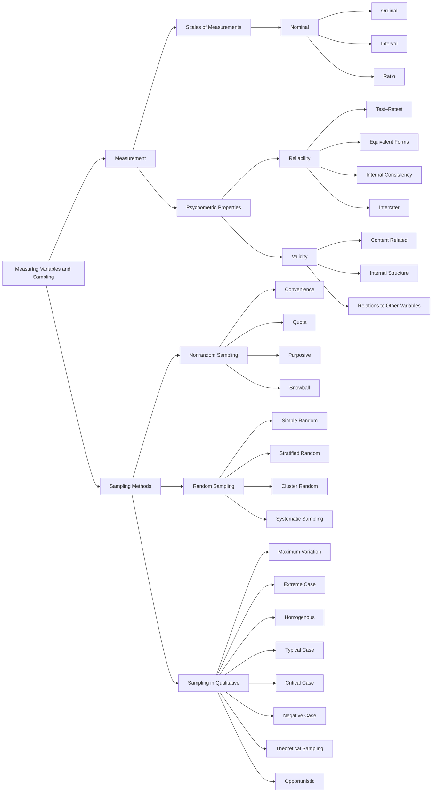
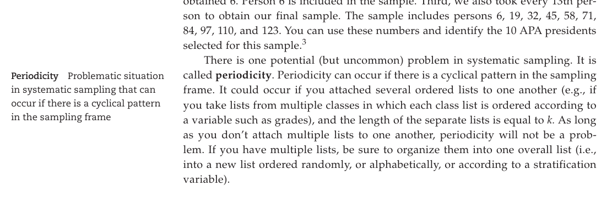

📑 <b>Table of Contents</b>

- [PART III Foundations of Research](#part-iii-foundations-of-research)
- [Chapter 5 Measuring Variables and Sampling](#chapter-5-measuring-variables-and-sampling)
  - [Learning Objectives](#learning-objectives)
- [Defining Measurement](#defining-measurement)
  - [Scales of Measurement](#scales-of-measurement)
- [Psychometric Properties of Good Measurement](#psychometric-properties-of-good-measurement)
  - [Overview of Reliability and Validity](#overview-of-reliability-and-validity)
  - [Reliability](#reliability)
  - [Validity](#validity)
  - [Summary of Methods for Obtaining Evidence of Validity](#summary-of-methods-for-obtaining-evidence-of-validity)
  - [Using Reliability and Validity Information](#using-reliability-and-validity-information)
  - [Sources of Information About Tests](#sources-of-information-about-tests)
- [Sampling Methods](#sampling-methods)
  - [Terminology Used in Sampling](#terminology-used-in-sampling)
  - [Random Sampling Techniques](#random-sampling-techniques)
  - [Nonrandom Sampling Techniques](#nonrandom-sampling-techniques)
- [Random Selection and Random Assignment](#random-selection-and-random-assignment)
- [Determining the Sample Size When Random Sampling Is Used](#determining-the-sample-size-when-random-sampling-is-used)
- [Sampling in Qualitative Research](#sampling-in-qualitative-research)
  - [Summary](#summary)
  - [Key Terms and Concepts](#key-terms-and-concepts)
  - [Related Internet Sites](#related-internet-sites)
  - [Practice Test](#practice-test)
  - [Challenge Exercises](#challenge-exercises)

<!-- Page 1 -->
## PART III Foundations of Research

## Chapter 5 Measuring Variables and Sampling

### Learning Objectives

🎯 **5.1** Explain the concept of measurement and describe the characteristics of the four scales of measurement.
🎯 **5.2** Differentiate between the different types of reliability and validity evidence.
🎯 **5.3** Analyze the strengths and weaknesses of each of the sampling methods.
🎯 **5.4** Distinguish between random selection and random assignment.
🎯 **5.5** Explain how to determine recommended sample size.
🎯 **5.6** Summarize the sampling methods used in qualitative research.

<!-- Page 2 -->
You have probably realized that psychology uses the language of variables. You have learned about independent, dependent, mediating, moderating, and extraneous variables. As you know from earlier chapters, a **variable** is a condition or characteristic that can take on different values or categories. A key point now is that many variables are difficult to accurately measure, and if psychologists do not measure variables accurately, then their research is flawed. It’s like the GIGO principle: garbage in, garbage out. If you fail to measure your variables accurately, you will obtain useless data and, therefore, useless results.

## Defining Measurement

🎯 **5.1** Explain the concept of measurement and describe the characteristics of the

**four scales of measurement.**

When we measure, we attempt to identify and characterize the dimensions, quantity, capacity, or degree of something. More formally, **measurement** refers to the act of measuring, and it is conducted by assigning symbols or numbers to something according to a specific set of rules. This definition is based on the work of the famous Harvard psychologist Stanley Smith Stevens (1906–1973). For an example of measurement, you could measure the length of a textbook with a ruler. You would assign the number taken from the ruler to represent your book’s length. “Length of books” is a variable because different books can take on different values (i.e., they can vary).

### Scales of Measurement

In addition to helping define measurement, Stevens (1946) showed that measurement can be categorized by the type of information that is communicated by the way the variables are measured. Based on his work, we usually identify four levels of measurement, which provide different kinds and amounts of information. Stevens called these following four levels of measurement the “scales of measurement”: nominal scale, ordinal scale, interval scale, and ratio scale. You can also refer to these as variables: nominal variables, ordinal variables, interval variables, and ratio variables. We now explain the characteristics of each of Stevens’ four scales of measurement. The key ideas are summarized in Table 5.1.

**Table 5.1** *Stevens’ Four Scales of Measurement*

<table class="textbook-table" style="width: auto; max-width: 100%; border-collapse: collapse; margin: 1.5em 0;">
  <thead>
    <tr>
      <th>Scale*</th>
      <th>Characteristics</th>
      <th>Examples</th>
    </tr>
  </thead>
  <tbody>
    <tr>
      <td>Nominal</td>
      <td>Used to name, categorize, or classify.</td>
      <td>Gender, marital status, memory strategy, personality type, type of therapy, experimental condition (treatment vs. control).</td>
    </tr>
    <tr>
      <td>Ordinal</td>
      <td>Used to rank order objects or individuals.</td>
      <td>Order of finish in race, social class (e.g., low, medium, high), ranking of  need for therapy, letter grade (A, B, C, D, F).</td>
    </tr>
    <tr>
      <td>Interval</td>
      <td>Used to rank order, plus has equal intervals or distances between adjacent numbers.</td>
      <td>Celsius temperature, Fahrenheit temperature, IQ scores, year.</td>
    </tr>
    <tr>
      <td>Ratio</td>
      <td>Fully quantitative, includes rank ordering, equal intervals, plus has an absolute zero point.</td>
      <td>Kelvin temperature, response time, height, weight, annual income, group size.</td>
    </tr>
  </tbody>
  <tfoot>
    <tr class="table-notes"><td colspan="3"><em>* The first letters of the four scales spells NOIR (which means black in French). You can use this acronym to help you remember the order of the four scales of measurement, from least</em></td></tr>
  </tfoot>
</table>

**Nominal Scale** The simplest and most basic level of measurement is what Stevens called a nominal scale. It is a nonquantitative scale of measurement because it identifies  *types* rather than amounts of something. A **nominal scale** uses symbols, such as words or numbers, to classify or categorize the values of a variable quantitative to the most quantitative.

<!-- Page 3 -->
(i.e., nominal scaled variables) into groups or types. Numbers can be used to label the categories of a nominal variable, but these numbers serve only as markers, not as indicators of amount or quantity. For example, you might mark the categories of the variable  “college major” with 1 = psychology, 2 = engineering, and 3 = philosophy. Some other examples of nominal-level variables are personality type, country you were born in, gender, and research group (e.g., experimental group or control group).

**Ordinal Scale** An **ordinal scale** is a *rank-order* scale of measurement. Any variable where the levels can be ranked (but you don’t know if the distance between the levels is the same) is an ordinal variable. It allows you to determine which person is higher or lower on a variable of interest, but it does not allow you to know exactly how much higher or lower a person is compared to another. Some examples of ordinal-level variables are the order of finish in a marathon, social class (e.g., high, medium, and low), rank ordering of applicants for a job, and rank ordering of need for special services. In a marathon, for example, the distance between the first-place and second-place runners might be different from the distance between the second-place and third-place runners. That is, the scores on an ordinal variable do not tell you about the distance between each score but they do tell you the ranking.

**Interval Scale** The third level of measurement, the **interval scale**, has equal distances between adjacent values on the scale (called *equal intervals*) as well as the characteristics of the lower-level scales (i.e., marking/naming of levels and rank ordering of levels). For example, the difference between 1 5 and 2 5 Fahrenheit is the same amount of temperature as the distance between 50 5 and 51 5 Fahrenheit. Other examples of interval-level variables are Celsius temperature, year, and IQ scores.

Although the distance between adjacent points on an interval scale is equal, an interval scale does not possess an absolute zero point. The zero point is somewhat arbitrary. You can see this by noting that neither 0 5 Celsius nor 0 5 Fahrenheit means no temperature. Zero degrees Celsius (0 5 C) is the freezing point of water, and zero degrees Fahrenheit (0 5 F) is 32 degrees below freezing.

**Ratio Scale** The fourth level of measurement, the **ratio scale**, is the highest (i.e., most quantitative) level of measurement; these scores communicate the most numerical information. A ratio scale has an *absolute zero point* as well as the characteristics of the lower-level scales. It marks/names the values of the variable (as in nominal scales), provides rank ordering of the values of the variable (as in ordinal scales), and has equal distances between the values of the variable (as in interval scales). In addition, only ratio scales have a true or absolute zero point (where 0 means none).

Some examples of ratio-level variables are weight, height, Kelvin temperature, and annual income. If your annual income is zero dollars, then you earned no annual income. You can buy absolutely nothing with zero dollars. On the Kelvin temperature scale, zero is the lowest possible temperature; zero means no molecular movement or no heat whatsoever. (In case you are curious: 0 5 Kelvin = - 459 5 Fahrenheit = - 273 5 Celsius.)

> [!TIP] **Study Question 5.1**
> What are the distinguishing characteristics of the four levels of measurement?

<!-- Page 4 -->
## Psychometric Properties of Good Measurement

🎯 **5.2** Differentiate between the different types of reliability and validity evidence.

Good measurement is fundamental for research. If variables are not measured well, then the results cannot be trusted. So, what is needed to obtain good measurement? The two major properties of good measurement are reliability and validity.

### Overview of Reliability and Validity

Reliability refers to the consistency or stability of the scores of your measurement instrument. Validity refers to the extent to which your measurement procedure is measuring what you think it is measuring (and not something else) and whether you have used and interpreted the scores correctly. If you are going to have validity, you must have some reliability, but reliability is not enough to ensure validity.

Here’s the idea: Assume you weigh 125 pounds. If you weigh yourself five times and get scores of 135, 135, 135, 135, and 135, then your scales are perfectly reliable, but they are not valid. The scores were consistent, but wrong! If you weigh yourself five times and get scores of 125, 125, 125, 125, and 125, then your scales are fully reliable and valid. Researchers want their measurement procedures to be both reliable and valid.

### Reliability

**Reliability** refers to consistency or stability of scores. In psychological testing, it refers to the consistency or stability of the scores that we get from a test or assessment procedure. In psychological research, it refers to the consistency or stability of the scores that we get from our research apparatus and instruments used to measure our variables. There are four primary types of reliability: test–retest, equivalent forms, internal consistency, and interrater reliability. Frequently, reliability coefficients are obtained as quantitative indexes of reliability. A **reliability coefficient** is a type of correlation, and it should be strong and positive (i.e., Ú.70) to indicate strong consistency of relationship.

**Test–Retest Reliability** The first type of reliability, **test–retest reliability**, refers to the consistency of scores over time. To determine the test–retest reliability of a test or research instrument, you administer the test, wait for a week or so, and administer it again. The two sets of scores (scores at time one and scores at time two) are correlated to determine the strength of relationship. A strong relationship indicates consistency across time [people with high (or low) scores at time one tended to be the same people with high (or low) scores at time two]. A primary issue is identifying the appropriate time interval between the two testing occasions because, generally speaking, the longer the time  interval between the two testing occasions, the lower the  reliability coefficient will be.

**Equivalent-Forms Reliability** The second type of reliability, **equivalent-forms reli-** **ability**, refers to the consistency of scores obtained on two equivalent forms of a test or research instrument designed to measure the same thing. Examples of tests with equivalent forms are seen in college entrance exams (SAT, GRE, ACT). This type of reliability is measured by correlating the scores obtained by giving two different forms of the same test to a single group of people. This correlation should be very strong and positive, indicating that the people with high (low) scores on form one tend to have high (low) scores on form two. The success of this method hinges on the equivalence of the two forms of the test.

<!-- Page 5 -->
**Internal Consistency Reliability** The third type of reliability, **internal  consistency reli-** **ability**, refers to the consistency with which items on a test or research instrument measure a single construct. For example, psychological research is conducted on constructs such as learning, shyness, love, or a number of personality dimensions such as dominance or extraversion. To obtain a measure of these constructs, we typically devise a test or scale composed of multiple items. No single item is assumed to be able to provide a sufficient measure of the construct, so multiple items are constructed—each of which is assumed to contribute to the measure of the construct. Internal consistency reliability is affected by the length of the test—as the test gets longer, it becomes more reliable. Your goal is to obtain high reliability with relatively few items for each construct.

Estimation of internal consistency only requires one administration of a test or scale, which is probably one reason it is commonly reported in journal articles. The most commonly reported index of internal consistency is **coefficient alpha** (also called **Cronbach’s alpha**). Coefficient alpha should be.70 or higher, and a high value is  evidence that the items are consistently measuring the same thing. Researchers use coefficient alpha when they want an estimate of the reliability of a homogeneous test or scale. When a test or scale is *multidimensional* (i.e., measures more than one construct or trait), coefficient alpha should be reported for each dimension separately. For example, if your instrument includes five sets of items measuring five different constructs, then you should report five coefficient alphas in your research write-up.

**Interrater Reliability** The fourth major type of reliability, **interrater   reliability**, refers to the consistency or degree of agreement between two or more scorers, judges, observers, or raters. For example, you might have two judges rate a set of 35 student essay papers. You would correlate the two judges’ ratings of the papers and obtain the interrater reliability coefficient, which is an index of the degree of consistency of the two judges’ ratings. This reliability coefficient should be strong and positive, indicating strong agreement or consistency between the judges. Interrater reliability is also measured by **interobserver agreement**, which is the percentage of times different raters agree. For example, you might have two individuals observe children and record the incidence of violent behavior. Each observer would record a child’s behavior as being either violent or not violent. The measure of reliability would be the percentage of time that the two observers agreed.

> [!TIP] **Study Question 5.2**
> How does one obtain evidence of reliability in measurement?

### Validity

According to current thinking by measurement experts, **validity** refers to the accuracy of the inferences, interpretations, or actions made on the basis of test scores (Messick, 1989). We are using the word “test” broadly to include any measurement procedure or device (standardized test, survey instrument, multi-item scale, experimental apparatus, observational coding). Sometimes researchers claim that a particular test or instrument is valid; however, technically speaking, that is not quite correct. It is the interpretations and actions taken based on the test scores that are valid or invalid. Here’s how Anastasi and Urbina (1997, p. 113) put it: “The validity of a test concerns what the test measures and how well it does so. It tells us what can be inferred from test scores.... [Test] validity must be established with reference to the particular use for which the test is being considered.” Cronbach (1990, p. 145) states that “validation is inquiry into the soundness of the interpretations proposed for scores from a test.”

<!-- Page 6 -->
Because tests and research instruments always involve the measurement of constructs (e.g., intelligence, gender, age, depression, self-efficacy, personality, eating disorders, pathology, and cognitive styles), measurement experts (called psychometricians) generally agree that all types of validity are part of *construct validity* (Anastasi &amp; Urbina, 1997; Messick, 1995). For example, when we talk about individuals diagnosed with schizophrenia, obsessive-compulsive disorder, or an eating disorder, we are dealing with the constructs of these disorders. Constructs could also characterize a field experimental setting such as an impoverished setting, enriched setting, or a poverty neighborhood. For example, if you are investigating the effect of being depressed on marital discord among married adults living in an impoverished neighborhood, you have a construct representing the research participants (married adults), the independent variable (degree of depression), the dependent variable (amount of marital discord), and the setting of the experiment (a poverty neighborhood). For each of these constructs, you must identify a set of operations that represent the construct. The difficulty arises in identifying the set of operations that will best and most  efficiently allow you to infer each of the constructs accurately from the data collected.

An **operationalization** (also called an *operational definition*) is the particular measurement procedure used in a research study to represent the constructs of interest. For example, married adults might be defined as people who are over the age of 18 and are legally married. The independent variable depression might be operationalized as persons scoring above 20 on the Beck Depression Inventory-II (Beck, Steer, &amp; Brown, 1996). The dependent variable of marital discord might be operationalized by a count of the number of arguments the couple had per day for the last month, and the setting of a poverty neighborhood might be based on the type and condition of the homes and other buildings in the neighborhood in which the participants lived.

The important issue with respect to validity is whether the operations produce a correct or appropriate representation of the intended construct. Are people over the age of 18 who are legally married really representative of married adults? Are participants who score above 20 on the Beck Depression Inventory-II really depressed? These are the questions that must be asked to determine if claims of validity can be made.

Validity is based on evidence revealing that the target construct can correctly be inferred from the particular operations of measurement. **Validation** is the gathering of evidence supporting inferences to be made on the basis of the scores obtained from the operations of measurement. Evidence of validity is obtained by developing a theory about how a test or instrument should operate if it is working correctly, and then the theory is tested to obtain the evidence. Validation should be viewed as a continual or never-ending process. Researchers should never stop asking whether their measures are working validly with their particular research participants. The more validity evidence a researcher provides, the more confidence you can place in the interpretations based on measurement scores. Now we describe three major ways to collect evidence of validity.

**Validity Evidence Based on Content** This kind of validity is called **content-related** **evidence (or content validity)**. It is based on a judgment of the degree to which the items, tasks, or questions on a test or instrument adequately represent the construct. You need to be an expert on the construct of interest to make these judgments. Therefore, the judgment of multiple experts is typically used to obtain evidence of content validity. When making decisions about content-related evidence, experts collect the necessary data to answer the following kinds of questions:

**1.**Do the items appear to represent the thing a researcher is attempting to measure?

> (This prima facie judgment is sometimes called **face validity**.)

**2.**Does the set of items underrepresent the construct’s content (i.e., did the researcher exclude any important content areas or topics)?

<!-- Page 7 -->
**3.**Do any of the items represent something other than what the researcher is trying to measure (i.e., were any irrelevant items included)?

If, in the judgment of the experts, the test adequately samples the content domain and meets the three criteria just suggested (i.e., the test has face validity, it does not underrepresent the construct, and no irrelevant items are included), then the test is said to have content validity.

**Validity Evidence Based on Internal Structure** Some tests/instruments are designed to measure one general construct, but others are designed to measure several dimensions of a **multidimensional construct**. The Rosenberg Self-Esteem Scale (Rosenberg, 1989) is a 10-item scale that measures the single construct of global self-esteem. In contrast, the Harter Self-Perception Scale (Harter, 2012) is used to measure global self-esteem and five dimensions, including social acceptance, scholastic competence, physical appearance, athletic competence, and behavioral conduct in children and adolescents.

Sometimes researchers use a statistical technique called **factor analysis** to determine the number of dimensions in a set of items. The researcher collects data on the items, enters the data into a statistical program, and runs the factor analysis procedure; the results indicate whether the items are all interrelated and reflect a unidimensional construct or whether there are subsets of items that are closely related to one another and reflect a multidimensional construct. The number of subsets of items indicates the number of dimensions (also called “factors”) that are present. The key point is that the factor analysis results tell you whether a test is unidimensional (i.e., it just measures one factor) or multidimensional (i.e., it measures two or more factors). It is important that a researcher know how many dimensions or factors are represented by the items because, otherwise, incorrect interpretations of the results would follow.

Indexes are also used to indicate the degree of homogeneity of each dimension or factor. **Homogeneity** is the degree to which a set of items measures a single construct or trait. The two primary indices of homogeneity are the *item-to-total* *correlation* (i.e., correlate each item with the total test score) and coefficient alpha (discussed earlier under the heading “Internal Consistency Reliability”). The larger the value on these indices, the more strongly the items are related to one another, which provides evidence that they measure the same unidimensional construct or dimension of a multidimensional construct. As you can see, evidence based on the internal structure of a test or instrument is based on how the items are related to one another. The next source of validity evidence comes from relating the items to other criteria.

**Validity Evidence Based on Relations to Other Variables** This form of evidence is obtained by relating your test scores with one or more relevant and known criteria. A *criterion* is the standard or benchmark that you want to correlate with or predict accurately on the basis of your test scores. If we use a correlation coefficient for validity evidence, we call it a **validity coefficient**. The key is that the test scores should be related to the criterion in the predicted direction and magnitude.

There are several different kinds of relevant validity evidence based on relations to other variables. The first is **criterion-related validity** evidence, which is validity evidence based on the extent to which scores from a test can be used to predict or infer performance on some known or standard criterion, such as future performance. There are two different types of criterion-related validity: predictive validity and concurrent validity. The only difference between these two types is time. **Predictive validity** involves using your procedures or behavioral measures to predict some future criterion performance; **concurrent validity** involves using <!-- Page 8 -->
your procedures or behavioral measures to predict some concurrent criterion performance. For example, if you were testing the concurrent validity of a new depression scale, you could administer your new scale and administer scales of sadness and hopelessness (the known criterion) to a set of research participants (some of whom are expected to be depressed). The scores from your scale and the other measures should be strongly and positively correlated if your new scale is valid. If you were testing the predictive validity of a new scale that you developed to measure success in college, then you could administer your scale and, at a later time, measure how well the participants perform in college. The two sets of scores should be strongly and positively related.

Evidence of validity based on relations to other variables can also be obtained by collecting convergent and discriminant evidence. Similar to concurrent validity just discussed, **convergent validity evidence** is evidence based on the relationship between the focal test scores (i.e., the test you are developing and checking for validity) and independent measures of the same construct. **Discriminant validity** **evidence** is evidence that the scores on your focal test are not related to the scores from other tests that are designed to measure theoretically different constructs. Convergent and discriminant validity evidence are used together in testing how well a new scale or test operates. The key point is that both convergent and divergent evidence are desirable.

The last type of validity evidence discussed here is **known groups validity** **evidence**. This is evidence that groups that are known to differ on the construct are said to differ (in the hypothesized direction) on the test being used to classify the participants into groups. For example, if you develop a test of psychology knowledge, you would hypothesize that senior psychology majors will score higher on psychology knowledge than freshmen psychology majors. Then you would test this hypothesis with seniors and freshmen to see if you have evidence of validity.

We have listed several kinds of validity evidence here, but we reiterate our point that the more validity evidence, the better. You must develop a theory of how a scale or test should operate and test the theory in multiple ways. For your convenience, the three major methods for obtaining evidence of validity are summarized in Table 5.2.

**Table 5.2** *Summary of Methods for Obtaining Evidence of Validity*

<table class="textbook-table" style="width: auto; max-width: 100%; border-collapse: collapse; margin: 1.5em 0;">
  <thead>
    <tr>
      <th>Type of Evidence</th>
      <th>Procedures</th>
    </tr>
  </thead>
  <tbody>
    <tr>
      <td>Evidence based on content</td>
      <td>Experts on the construct examine the test/scale content and determine whether the content adequately represents the construct.</td>
    </tr>
    <tr>
      <td>Evidence based on internal</td>
      <td>Use factor analysis , which indicates how many constructs are present in the set of items. Also, examine the</td>
    </tr>
    <tr>
      <td>structure</td>
      <td>homogeneity of each set of unidimensional items by calculating item-to-total correlation and coefficient alpha .</td>
    </tr>
    <tr>
      <td>Evidence based on relations</td>
      <td>Determine whether the scores are related to a known criterion by collecting concurrent and predictive validity</td>
    </tr>
    <tr>
      <td>to other variables</td>
      <td>evidence. Also determine if the test/scale scores are strongly correlated with participants’ scores from other measures of the same construct ( convergent validity evidence) and are NOT correlated with scores from measures of different constructs ( discriminant validity evidence). Last, determine if groups that are known to differ on the construct are accurately classified by the scale under consideration ( known groups validity evidence).</td>
    </tr>
  </tbody>
</table>

### Summary of Methods for Obtaining Evidence of Validity

**Type of Evidence**
**Procedures**
Evidence based on content Experts on the construct examine the test/scale content and determine whether the content adequately represents the construct. Evidence based on internal Use
*factor analysis*
, which indicates how many constructs are present in the set of items. Also, examine the structure
*homogeneity*
of each set of unidimensional items by calculating Evidence based on relations Determine whether the scores are related to a known criterion by collecting to other variables evidence. Also determine if the test/scale scores are strongly correlated with participants’ scores from other measures of the same construct (
*convergent*
constructs (
*discriminant*
validity evidence). Last, determine if groups that are known to differ on the construct are accurately classified by the scale under consideration ( Study Question 5.3 measurement?

*item-to-total correlation*
and
*coefficient alpha*
.
*concurrent*
and
*predictive*
validity validity evidence) and are NOT correlated with scores from measures of different
*known groups*
validity evidence). How does one obtain evidence of validity in

<!-- Page 9 -->
### Using Reliability and Validity Information

You must be careful when interpreting the reliability and validity evidence provided with standardized tests and when judging empirical research journal articles. With standardized tests, the reported validity and reliability data are typically based on a **norm group** (which is an actual group of people; a synonym is “norming group”). If the people you intend to use a test with are very different from the people in the norm group, then the validity and reliability evidence provided with the test becomes questionable. That is because you need to know if the test or scale is valid with the people in *your* research study.

When reading journal articles, you should view an article positively to the degree that the researchers provide reliability and validity evidence for the measures that they use with their research participants. Two questions to ask when reading and evaluating an empirical research article are as follows: “Did the researchers use appropriate measures?” and “How much evidence did the researchers provide for measurement reliability and validity?” If the answers are positive, then give the article high marks for measurement. If the answers are negative, then you should significantly downgrade your assessment of the research.

### Sources of Information About Tests

The two most important sources of information about standardized tests are the *Mental* *Measurements Yearbook* (MMY) and *Tests in Print* (TIP); you can find both of these at your college library. Another very important source is the empirical research literature found on databases such as PsycINFO, PsycARTICLES, SocINDEX, MEDLINE, and ERIC. When trying to determine how to measure a construct, you should carefully study the measures currently being used by the top researchers in the research area. Then try to obtain permission to use the best measures of the constructs you hope to study. Some additional sources are Miller and Salkind’s (2002) *Handbook of Research Design* *and Social Measurement*; Maddox’s (2002) *Tests: A Comprehensive Reference for Assessment* *in Psychology, Education, and Business*; Fields’ (2002) *Taking the Measure of Work: A Guide* *to Validated Scales for Organizational Research and Diagnosis*; and Robinson, Shaver, and Wrightsman’s (1991) *Measures of Personality and Social Psychological Attitudes.*

## Sampling Methods

🎯 **5.3** Analyze the strengths and weaknesses of each of the sampling methods.

Whenever you review published research, it is important to critically examine the sampling methods used (i.e., how the researcher obtained the research participants) so that you can judge the quality of the study. Furthermore, if you conduct an empirical research study on your own, you will need to select research participants and use the best sampling method for your situation. In experimental research, random samples are usually *not* used because the focus is primarily on the issue of causation; in experiments, random assignment to groups is far more important than random sampling because the goal is to examine cause-and-effect relationships. Conversely, in survey research, random samples often are used and are quite important if the researcher intends to generalize directly to a population based on his or her single research study results. Political polls are a common example where the researcher needs to generalize to a population based on a single sample. The purpose of this second major part of the chapter is to introduce you to the different kinds of sampling methods that are available to researchers.

<!-- Page 10 -->
### Terminology Used in Sampling

Before discussing the specific methods of sampling, you need to know the definitions of some key terms that are used in sampling. A **sample** is a set of elements taken from a larger population; it is a subset of the population. An **element** is the basic unit of sampling. The **population** is the full set of elements or people from which you are sampling. **Sampling** refers to drawing elements from a population to obtain a sample. The usual goal of sampling is to obtain a **representative sample**, which is a sample that is similar to the population on all characteristics (except that it includes fewer people because it is a sample rather than the complete population). A perfectly representative sample would provide an exact image of the population from which it was selected (except that it would include fewer people).

When you want your sample to represent the population, the best way is to use an  **equal probability of selection method (EPSEM)**. An EPSEM is any sampling method in which each individual member of the population has an equal chance of being selected for inclusion in the sample. If everyone has an equal chance, then the kinds of people in large groups will be selected more often and the kinds of people in small groups will be selected less often, but every single individual person will have the same chance of inclusion. For example, if the composition of a population is 55% female, 75% young adults aged 18–28, and 80% individuals who have completed an introductory psychology course, then a representative sample would have approximately the same percentages on these characteristics. Approximately 55% of the *sample* participants would be female, approximately 75% would be young adults, and approximately 80% would have completed an introductory psychology course. You will learn presently that there are several equal probability sampling methods, but simple random sampling, perhaps, is the most common (Peters &amp; Eachus, 2008).

Once you collect data from the research participants in your sample, you must analyze the data. During analysis, you will determine characteristics of your sample such as the mean and variance of variables, as well as relationships between variables; these results calculated from your sample data are known as statistics. A **statistic** is a numerical characteristic of the sample data. For example, perhaps the mean income in a particular sample (i.e., the statistic) is &#36;56,000 per year. Oftentimes a researcher also wants to make statements about population characteristics based on the sample results, such as an estimate of the population mean based on the sample mean. In statistical jargon, the researcher wants to make statements about parameters. A **parameter** is a numerical characteristic of a population. Perhaps the mean income in the entire population (i.e., the parameter) is &#36;51,323 per year.

Notice that our sample mean and population mean income levels are different (&#36;56,000 in the sample vs. &#36;51,323 in the population). That’s the typical situation in sampling, even when the best sampling methods are used. The term **sampling error** is used to refer to the difference between the value of a sample statistic and the value of the population parameter. In our case of annual income, the sampling error was equal to &#36;4,677 (i.e., 56,000 - 51,323 = 4,677). A key point is that some error is always present in sampling. With random sampling methods, errors are random (i.e., the sample could result in an over- or underestimate of the population parameter) rather than being systematically wrong. With random sampling, the errors will be relatively small if large samples are drawn—that’s why larger sample sizes are preferred to smaller sample sizes. When error is random, as in random sampling, the average of all possible samples is equal to the true population parameter, and the values of the samples vary randomly around the true parameter. This is the best we can hope for with sampling. If you need to have no sampling error, you will have to avoid sampling and conduct a **census**—you will have to collect data from everyone in the population. Conducting a census is rarely an option because most populations are very large, and it would be too expensive and virtually impossible to have everyone participate in your study.

<!-- Page 11 -->

*Figure 5.1. This sampling frame includes all the presidents of the American Psychological Association since its founding in 1892. The population is “Presidents of the APA.” This sampling frame also includes an identification number for each population member,*

Most sampling methods require that you have a list of the people who are in the population. This list is called a **sampling frame**. An example of a sampling frame is shown in consent to participate. To indicate the degree of sample participation in research studies, researchers report the response rate. The **response rate** is the percentage of people in the sample selected for study who actually participate. This rate should be as high as possible. If 300 of the 400 members selected in the APA descriptive study sample participate, the response rate would be 75% (i.e., 300 divided by 400).

### Random Sampling Techniques

The two major types of sampling used in psychological research are random sampling and nonrandom sampling. When the goal is to generalize from a specific sample to a population, random sampling methods are preferred because they produce representative samples. Nonrandom sampling methods generally produce **biased samples** (i.e., samples that are not representative of a known population). Any particular research sample might (or might not) be representative, but your chances are much greater if you use a random sampling method (in particular, if you use an equal probability of selection method). It is especially important that the demographic characteristics of nonrandom samples be described in detail in research reports so that readers can understand the exact characteristics of the research participants. Researchers and readers of reports can then make generalizations based on what the famous research methodologist (and past APA president) Donald Campbell (1916–1996) called  **proximal similarity**. Campbell’s idea is that you can generalize research results to different people, places, settings, and contexts to the degree that the people in the field are similar to those described in the research study.

**Simple Random Sampling** The most basic type of random sampling is  **simple random** **sampling**. Simple random sampling is the definitive case of an equal  probability of selection method. Remember, to be an EPSEM, everyone in the population must have an equal chance of being included in the final sample. It is the  characteristic of equal probability that makes simple random sampling produce representative samples, and if your sample is representative you can generalize from your sample to the population.

One way to visualize simple random sampling is to think of what we call “the hat model.” The idea is to write everyone’s name on an equal-sized slip of paper. Then put the slips into a hat, cover the top of the hat, and shake it up so that the slips are randomly distributed. Next, pull out a slip of paper and place it to the side. You would repeat this procedure until the number of selected slips of paper pulled from the hat equals the desired sample size.

<!-- Page 12 -->
When drawing a simple random sample, sampling experts recommend that you use sampling “without replacement” (as we did in the “hat model” example) instead of sampling “with replacement” (where one would put the selected slip of paper back in the hat to potentially be selected again). That’s because sampling without replacement is slightly more *efficient* in producing representative samples (i.e., it requires slightly fewer people and is therefore slightly cheaper). When sampling without replacement, you do not allow anyone to be selected more than once; once a person is selected, you do not put the person back into the pool of people to be potentially selected. Therefore, each selected participant is unique; no one is included more than once in your sample.

In practice, you would not use a “hat model” for drawing a random sample. Before the widespread availability of computers, a traditional way to obtain simple random samples was to use a table of random numbers from which researchers obtained numbers to be used in identifying people to be included in a sample. Today, the use of random number generators is more common. Here are links to some popular and easy-to-use random number generators that are available on the World Wide Web: http://www.randomizer.org http://www.random.org

To find additional random number generators, just search the Web for “random number generator.”

If you are using a random number generator, such as the ones just listed, you are actually randomly selecting a set of numbers. Therefore, you must make sure that each person in your sampling frame is associated with a number. Look at Figure 5.1, and you will see that each of the APA presidents was assigned an identification number. We will use these numbers to identify the persons selected for our sample.

With the help of the randomizer.org program, we selected a sample of size 10 from our sampling frame in Figure 5.1. We needed 10 numbers randomly selected from 1 to 128 because there are 128 APA presidents in our sampling frame. We went to the website and answered each of the questions as follows:

**1.**How many sets of numbers do you want to generate?

- We inserted 1 to indicate that we wanted one set of numbers.

**2.**How many numbers per set?

- We inserted 10 to indicate that we wanted 10 numbers in our set.

**3.**Number range?

- We inserted 1 and 128 to indicate the range of numbers in our sampling frame.

**4.**Do you wish each number in a set to remain unique?

- We clicked “yes” to indicate that we wanted sampling *without replacement*.

**5.**Do you wish to sort the numbers that are generated?

- Either yes or no is fine. We clicked “yes.”

**6.**How do you wish to view your random numbers?

> - We left the program at its default value (“place markers off”) because we did not want a listing of the order in which the numbers were selected.

**7.**Next, to obtain our set of random numbers we clicked “Randomize Now!”

The resulting set of numbers from the random number generator was 1, 4, 22, 29, 46, 60, 63, 76, 100, and 117. The last step was to go to the sampling frame in Figure 5.1 to determine who from our population was included in the sample. We did this by locating the people in the sampling frame who were associated with our randomly generated identification numbers. Here is the resulting random sample of 10 APA presidents: 1-Granville Stanley Hall, 4-James McKeen Cattell, 22-Howard Crosby Warren, 29-Shepard Ivory Franz, 46-Edward Chace Tolman, 60-Robert R. Sears, 63-O. H. Mower, 76-Gardner Lindzey, 100-Charles Spielberger, and 117-Alan E. Kazdin.

<!-- Page 13 -->

*Figure 5.1 A sampling frame of presidents of the American Psychological Association.* 1. Granville Stanley Hall (1892)
2. George Trumbull Ladd (1893)*

22. Howard Crosby Warren (1913)
65. Theodore M. Newcombe (1956)
23. Robert Sessions Woodworth (1914)
66. Lee J. Cronbach (1957)
24. John Broadus Watson (1915) 67. H. F. Harlow (1958)
25. Raymond Dodge (1916) 68. W. Kohler (1959)
26. Robert Mearns Yerkes (1917)
69. Donald O. Hebb (1960)
27. John Wallace Baird (1918)
70. Neal E. Miller (1961)
28. Walter Dill Scott (1919)
71. Paul E. Meehl (1962)
29. Shepard Ivory Franz (1920)
72. Charles E. Osgood (1963)
30. Margaret Floy Washburn (1921)
73. Quinn McNemar (1964)
31. Knight Dunlap (1922)
74. Jerome Bruner (1965)
32. Lewis Madison Terman (1923)
75. Nicholas Hobbs (1966)
33. Granville Stanley Hall (1924)
76. Gardner Lindzey (1967)
34. Madison Bentley (1925) 77. A. H. Maslow(1968)
35. Harvey A. Carter (1926)
78. George A. Miller (1969)
36. Harry Levi Hollingsworth (1927)
79. George W. Albee (1970)
37. Edwin Garrigues Boring (1928)
80. Kenneth B. Clark (1971)
38. Karl Lashley (1929)
81. Anne Anastasi (1972)
39. Herbert Sidney Langfeld (1930)
82. Leona E. Tyler (1973)
40. Walther Samuel Hunter (1931)
83. Albert Bandura (1974)
41. Walter Richard Miles (1932)
84. Donald T. Campbell (1975)
42. Luis Leon Thurstone (1933)
85. Wilbert J. Mckeachie (1976)
43. Joseph Peterson (1934)
86. Theodore Blau (1977)

*Year of each president’s term is provided in parentheses.

87. M. Brewster Smith (1978)
88. Nicholas A. Cummings (1979)
89. Florence L. Denmark (1980)
90. John J. Conger (1981)
91. William Bevan (1982)
92. Max Siegal (1983)
93. Janet T. Spence (1984)
94. Robert Perloff (1985)
95. Logan Wright (1986)
96. Bonnie R. Strickland (1987)
97. Raymond D. Fowler (1988)
98. Joseph D. Matarazzo (1989)
99. Stanley Graham (1990) 100. Charles Spielberger (1991) 101. Jack Wiggins, Jr. (1992) 102. Frank Farley (1993) 103. Ronald E. Fox (1994) 104. Robert J. Resnick (1995) 105. Dorothy W. Cantor (1996) 106. Norman Abeles (1997) 107. Martin E. P. Seligman (1998) 108. Richard M. Suinn (1999) 109. Patrick H. Deleon (2000) 110. Norine G. Johnson (2001) 111. Philip G. Zimbardo (2002) 112. Robert J. Sternberg (2003) 113. Diane F. Halpern (2004) 114. Ronald F. Levant (2005) 115. Gerald P. Koocher (2006) 116. Sharon Stephens Brehm (2007) 117. Alan E. Kazdin (2008) 118. James H. Bray (2009) 119. Carol D. Goodheart (2010) 120. Melba J. T. Vasquez (2011) 121. Suzanne Bennett Johnson (2012) 122. Donald N. Bersoff (2013) 123. Nadine Kaslow (2014) 124. Barry S. Anton (2015) 125. Susan H. McDonald (2016) 126. Antonio E. Puente (2017) 127. Jessica H. Daniel (2018) 128. Rosie P. Davis (2019)

**Stratified Random Sampling** A second type of random sampling is  **stratified random** **sampling** (or stratified sampling). In stratified sampling, the population is divided into mutually exclusive groups (the strata), and then a random sample is selected from each of the groups. The set of groups make up the levels of the  **stratification variable**.

For example, if gender were the stratification variable, the population sampling frame would be divided into a group of all the females and a group of all the males. Figure 5.2 shows our sampling frame stratified by gender. Stratification variables can be categorical variables (e.g., gender, ethnicity, personality type) or quantitative variables (e.g., intelligence, height, age), and more than one stratification variable can be used.

> Here is how you obtain a stratified sample with just one stratification variable:

**1.**Stratify your sampling frame (e.g., divide the list into the males and the females if gender is your stratification variable), and give the elements in each set identification numbers.

**2.**Draw a random sample from each of the groups (e.g., take a random sample of females and a random sample of males).

**3.**Combine the sets of randomly selected people (e.g., males and females), and you will have the final sample.

There are actually two different kinds of stratified sampling: proportional stratified sampling and disproportional stratified sampling. In **proportional stratified sampling**,

<!-- Page 14 -->

*Figure 5.2 Sampling frame stratified by gender.* Female APA Presidents:

1. Mary Whiton Calkins (1905)*

12. William Lowe Bryan (1903)
49. Calvin Perry Stone (1942)
13. William James (1904)
50. John Edward Anderson (1943)
14. James Rowland Angell (1906)
51. Garder Murphy (1944)
15. Henry Rutgers Marshall (1907)
52. Edwin R. Guthrie (1945)
16. George Malcolm Stratton (1908)
53. Henry E. Garrett (1946)
17. Charles Hubbard Judd (1909)
54. Carl R. Rogers (1947)
18. Walter Bowers Pillsbury (1910)
55. Donald G. Marquis (1948)
19. Carl Emil Seashore (1911)
56. Ernest R. Hilgard (1949)
20. Edward Lee Thorndike (1912)
57. Joy Paul Guilford (1950)
21. Howard Crosby Warren (1913)
58. Robert R. Sears (1951)
22. Robert Sessions Woodworth (1914)
59. Joseph McVicker Hunt (1952)
23. John Broadus Watson (1915)
60. Laurence Frederic Shaffer (1953)
24. Raymond Dodge (1916) 61. O. H. Mowrer (1954)
25. Robert Mearns Yerkes (1917) 62. E. Lowell Kelly (1955)
26. John Wallace Baird (1918)
63. Theodore M. Newcombe (1956)
27. Walter Dill Scott (1919)
64. Lee J. Cronbach (1957)
28. Shepard Ivory Franz (1920) 65. H. F. Harlow (1958)
29. Knight Dunlap (1922) 66. W. Kohler (1959)
30. Lewis Madison Terman (1923)
67. Donald O. Hebb (1960)
31. Granville Stanley Hall (1924)
68. Neal E. Miller (1961)
32. Madison Bentley (1925)
69. Paul E. Meehl (1962)
33. Harvey A. Carter (1926)
70. Charles E. Osgood (1963)
34. Harry Levi Hollingsworth (1927)
71. Quinn McNemar (1964)
35. Edwin Garrigues Boring (1928)
72. Jerome Bruner (1965)
36. Karl Lashley (1929)
73. Nicholas Hobbs (1966)
37. Herbert Sidney Langfeld (1930)
74. Gardner Lindzey (1967)

*The 18 female presidents are listed first, followed by the 110 male presidents.

13. Melba J. T. Vasquez (2011)
14. Suzanne Bennett Johnson (2012)
15. Nadine Kaslow (2014)
16. Susan H. McDonald (2016)
17. Jessica H. Daniel (2018)
18. Rosie P. Davis (2019)

75. A. H. Maslow (1968)
76. George A. Miller (1969)
77. George W. Albee (1970)
78. Kenneth B. Clark (1971)
79. Albert Bandura (1974)
80. Donald T. Campbell (1975)
81. Wilbert J. Mckeachie (1976)
82. Theodore Blau (1977)
83. Brewster Smith (1978)
84. Nicholas A. Cummings (1979)
85. John J. Conger (1981)
86. William Bevan (1982)
87. Max Siegal (1983)
88. Robert Perloff (1985)
89. Logan Wright (1986)
90. Raymond D. Fowler (1988)
91. Joseph D. Matarazzo (1989)
92. Stanley Graham (1990)
93. Charles Spielberger (1991)
94. Jack Wiggins, Jr. (1992)
95. Frank Farley (1993)
96. Ronald E. Fox (1994)
97. Robert J. Resnick (1995)
98. Norman Abeles (1997)
99. Martin E. P. Seligman (1998) 100. Richard M. Suinn (1999) 101. Patrick H. Deleon (2000) 102. Philip G. Zimbardo (2002) 103. Robert J. Sternberg (2003) 104. Ronald F. Levant (2005) 105. Gerald P. Koocher (2006) 106. Alan E. Kazdin (2008) 107. James H. Bray (2009) 108. Donald N. Bersoff (2013) 109. Barry S. Anton (2015) 110. Antonio E. Puente (2017) the numbers of people selected from the groups (e.g., females and males) are proportional to their sizes in the population. For example, if 60% of the population is female, then you select 60% of your sample from the female stratum. In  **disproportional** **stratified  sampling**, the numbers of people selected from the groups are not proportional to their sizes in the population. For example, if 60% of the population is female, but you want equal numbers of males and females in your study, you might select only

50% of the sample to be female.

> Assume that you want to stratify on the basis of the variable gender, and the large population is 75% female and 25% male. Also assume that you want a sample of size

> 100. For proportional stratified sampling, you would randomly select 75 females and

> 25 males from the stratified sampling frame; the final sample would exactly match the population on gender percentages (75%, 25%). Proportional stratified sampling is an

> EPSEM (each individual has an equal chance of being included in the final sample), and you can directly generalize from the sample to the population.

> For disproportional stratified sampling, you might randomly select 50 females and 50 males from the gender populations. Disproportional stratified sampling is not

<!-- Page 15 -->
EPSEM because everyone does not have an equal chance. In this case, the population is 75% female and 25% male, but the sample is 50% female and 50% male. You have undersampled females and oversampled males. When you under- or oversample groups like this, your sampling method is no longer an equal probability of selection method. You cannot combine the samples of 50 females and 50 males and directly generalize to the population.[^1] Even though disproportional stratified sampling is not an EPSEM, it is still used sometimes because small groups might be missed if they are not oversampled.

Proportional stratified sampling is an especially strong type of sampling. Just like simple random sampling, proportional stratified random sampling is EPSEM, which means you will be able to generalize directly from your final combined sample to the population (Kalton, 1983; Kish, 1995). However, proportional stratified sampling is a little more efficient than simple random sampling (which means it requires slightly fewer people and is therefore slightly less expensive). A proportional stratified sample is a slightly improved simple random sample (i.e., it is forced to be representative of the stratification variable; otherwise, it is a random sample). Corporations that spend a lot of money on sampling often prefer stratified sampling because it results in reduced costs.

**Cluster Random Sampling** In the third major type of random sampling, called **cluster random sampling** (or cluster sampling), the researcher randomly selects *clus-* *ters* rather than individual-type units (such as individual people) in the first stage of sampling. A **cluster** is a collective type of unit that includes multiple elements; it has more than one element in it. Some examples of clusters are neighborhoods, families, schools, classrooms, and work teams. Notice that all of these collective-type units include multiple individual elements.

We briefly explain two types of cluster sampling: one stage and two stage. The first type of cluster sampling is **one-stage cluster sampling**. To select a one-stage cluster sample, you randomly select a sample of clusters. You include in your final sample all of the individual elements in the randomly selected clusters. For example, if you randomly select 15 psychology classes, you would include all of the students in those 15 psychology classes in your sample.

The second type of cluster sampling is **two-stage cluster sampling**. In the first stage, you randomly select a sample of clusters (i.e., just like you did in one-stage cluster sampling). However, in the second stage you draw a random sample from the elements in each of the clusters selected in the first stage. For example, in stage one you might randomly select 30 psychology classes and in stage two randomly select 10 students from each of the 30 psychology classes.

Cluster sampling is an EPSEM if the clusters are approximately the same size. Remember that EPSEM is very important because that is what makes the sampling method produce representative samples. If the clusters are not the same size, there are some advanced techniques beyond the scope of this book that can be used to help make it EPSEM. 2

**Systematic Sampling** Another type of sampling that usually produces samples similar to random samples is **systematic sampling**.  Systematic sampling is about as efficient as simple random sampling and, like simple random sampling, systematic sampling is an EPSEM (Kalton, 1983). If you decide to draw a sample using

[^1]: In this case, sampling experts would weight the female and male data back to their appropriate sizes if they wanted to generalize from the sample to the population.
[^2]: You can fix this problem by using a technique called “probability proportional to size” (PPS).

<!-- Page 16 -->

*Figure 5.1. The population size is 128 and the desired sample size is 10; therefore, k is 128 divided by 10, which is approximately equal to 13 (12.8 used the random number generator to select a number between 1 and 13, and we*

systematic sampling, you must follow three steps. First, determine the **sampling** **interval**, which is the population size divided by the desired sample size. The sampling interval can be symbolized by “*k.*” Second, randomly select a number between 1 and *k*, and include that person in your sample. Third, also include each *k*th element in your sample. For example, assume your population is 100 in size and you want a sample of
10. In this case, *k* is equal to 10 (i.e., 100/10 = 10), which is your sampling interval. Next, assume your randomly selected number between 1 and 10 is
5. Last, in addition to person 5, include every 10th person (e.g., the second person will be person 15 because 5 + 10 is 15, and the third person will be person 25 because 15 + 10 is 25, and continue this process). The final sample will include persons 5, 15, 25, 35, 45, 55, 65, 75, 85, and
95. If you follow the three steps, then when you get to the end of your sampling frame, you will always have all the people to be included in your sample. In systematic sampling, you essentially take a random starting point and work your way through a list of names.

> Let’s now select a systematic sample of size 10 from our sampling frame in

&amp; 13). Second, we

3

> [!TIP] **Study Question 5.4**
> What are the strengths and weaknesses of the major random sampling techniques?

### Nonrandom Sampling Techniques

The other major type of sampling used in psychological research is nonrandom sampling. These tend to be weaker sampling methods, but sometimes they are necessary because of practical considerations. We briefly explain the four major nonrandom sampling methods: convenience sampling, quota sampling, purposive sampling, and snowball sampling. Nonrandom methods are used frequently in psychology (especially convenience and purposive sampling).

When using **convenience sampling**, you simply ask people who are most available or the most easily selected to participate in your research study. For example, psychologists often include college students from the introductory psychology subject pool (i.e., students who are participating in a research project for college credit and to learn what it is like to be a research participant).

*Figure 5.2. In fact, this is slightly better because of the advantage of stratification.*

[^3]: You can also use systematic sampling with a stratified sampling frame such as the one shown in

<!-- Page 17 -->
When using **quota sampling**, the researcher sets quotas (which are the numbers of the kinds of people you want in the sample), and then the researcher locates (using convenience sampling) the numbers of people needed to meet the quotas. For example, a set of quotas might be as follows: 25 Psychology majors, 25 Biology majors, 25 Education majors, and 25 Engineering majors. You could use convenience sampling to find the people. The key is to obtain the right number of people for each group quota.

When using **purposive sampling**, the researcher specifies the characteristics of the population of interest and then locates individuals who match the needed characteristics. For example, you might decide that you want to conduct a research study with “adolescent boys and girls aged 14–17 who have been diagnosed with obsessive compulsive disorder.” If you want a sample of size 100, you would locate 50 boys and 50 girls who meet the inclusion criteria and are willing to participate, and include them in your research study.

Last, in **snowball sampling** each research participant is asked to identify other potential research participants who have a certain inclusion characteristic (or set of characteristics). You start with one or a few participants whom you can locate; you ask them to participate and also ask them if they know of some other potential participants who meet the inclusion characteristic. You then locate these additional participants, ask them to participate, and ask them for other potential participants. You continue this process until you have a sufficient number of research participants. Snowball sampling is especially useful when you need to select from a hard-to-find population where no sampling frame exists. For example, if you want to conduct a study of people in your city who have a lot of political power (formal and informal power), you might use snowball sampling because there is no sampling frame. You would identify a starting set of people with power, and then you would use the process of snowball sampling just described.

> [!TIP] **Study Question 5.5**
> What are the key characteristics of the different types of nonrandom sampling methods?

## Random Selection and Random Assignment

🎯 **5.4** Distinguish between random selection and random assignment.

This chapter is about measurement and sampling techniques. It is not about assigning participants to levels of an independent variable. However, we need to make sure you understand the important distinction between random selection and random assignment. Random selection is a sampling technique, and random assignment is not. In random selection, you select a sample from a population using one of the random sampling techniques that we have discussed. The purpose of **random selection** is to obtain a sample that represents a population. If you use an EPSEM technique, the resulting random sample will be similar to the population (i.e., it will be representative). For example, if you randomly select (e.g., using simple random sampling) 1,000 people from the adult population in Ann Arbor, Michigan, your sample would be similar to the adult population of Ann Arbor. Random selection is very important for survey research in which you need to generalize from a single sample directly to a population.

<!-- Page 18 -->
**Random assignment** is not used to obtain a sample. Random assignment is used in experimental research to produce treatment and control groups (or comparison groups) that are similar on all possible characteristics. When conducting random assignment, you start with a set of people (typically you will have a *convenience sample*), and then you randomly divide the set of people into two or more groups. Then one group can be given the treatment condition, and the other can serve as the control condition (determined randomly), and you conduct the experiment. *The random assignment  process is a* *key element in producing the strongest experimental designs available for the study of causation.* Randomized designs are explained in Chapter
9. It is important to remember that the difference between random selection and random assignment is the purpose. *The* ***purpose*** ***of random selection****is to obtain a representative sample, and the****purpose of  random assign-*** ***ment*** *is to produce two or more probabilistically equivalent groups for use in an experiment.*

> [!TIP] **Study Question 5.6**
> Compare and contrast random selection and random assignment.

## Determining the Sample Size When Random Sampling Is Used

🎯 **5.5** Explain how to determine recommended sample size.

When you design a research study, the following key question will inevitably arise: “How many people should I include in my sample?” Although this is a very practical question, it is difficult to answer because sample size is affected by many different factors. We now offer some recommendations and provide some relevant information that will help.

Here are five relatively “simple” answers to the important question about sample size. First, if your population is 100 people or fewer, then include the entire population in your study rather than drawing a sample. In this case, we recommend that you don’t take a sample; include everyone. Second, try to get a relatively large sample size when possible for your research study. Larger sample sizes make it less likely that you will miss an effect or relationship that is present in your population. At some point, adding more people adds little benefit and can become cost ineffective; however, we don’t expect you to be in that situation very often. Third, we recommend that you carefully examine other research studies in the research literature on your topic and determine how many participants other researchers are selecting. Fourth, for an exact number of people to include in a sample, look at Table 5.3, which shows recommended sample sizes. Table 5.3, however, is only an approximate starting point for consideration because several assumptions were made in determining the sample sizes provided. Fifth, we strongly recommend that you use a **sample size calculator**. You will have to learn a little about inferential statistics in order to use these calculators, but we discuss inferential statistics in detail in Chapter
16. Perhaps the most popular sample size calculation program is G-Power (Erdfelder, Faul, &amp; Buchner, 1996). Here’s a link to this free program: http://www.gpower.hhu.de/en.html.

We complete this section with a few additional points about sample sizes. First, you will need a larger sample size when your population is heterogeneous (i.e., composed of widely different kinds of people). Second, you will need larger sample sizes when you want to break down your data into multiple subcategories. For example, if you want to conduct a separate analysis for males and females (rather than just looking at the overall group) or by ethnic groups, you will need a sufficient sample size for every subgroup. Third, you will need larger sample sizes when you want to obtain a

<!-- Page 19 -->
**Table 5.3***Sample Sizes for Various Populations of Size 10–50 Million****N*** **stands for the size of the population.** ***n*** **stands for the size of the recommended sample.** **The sample sizes are based on the 95% confidence level.** ***N*** ***n*** ***N*** ***n*** ***N*** ***n*** ***N*** 10 10 130 97 250 152 950 20 19 140 103 260 155 1,000 30 28 150 108 270 159 1,100 40 36 160 113 280 162 1,200 50 44 170 118 290 165 1,300 60 52 180 123 300 169 1,400 70 59 190 127 400 196 1,500 80 66 200 132 500 217 2,000 90 73 210 136 600 234 3,000 100 80 220 140 700 248 3,500 110 86 230 144 800 260 4,000 120 92 240 148 900 269 5,000 Numbers in table were calculated by author. ***n*** ***N*** ***n*** 274 10,000 370 278 20,000 377 285 30,000 379 291 40,000 380 297 50,000 381 302 75,000 382 306 100,000 384 322 250,000 384 341 500,000 384 346 1,000,000 384 351 10,000,000 384 357 50,000,000 384 relatively narrow (i.e., precise) confidence interval. For example, a confidence interval estimate that 75% of clinical psychologists support a new prescription licensing bill *plus* *or minus 4%* is narrower (i.e., more precise) than a confidence interval estimate of *plus or* *minus 8%.* Unfortunately, increased precision will come at a cost: You will need a larger sample if you want increased precision. Fourth, you will need a larger sample size when you expect a weak relationship or a small effect. It takes a larger sample to detect weak relationships. There tends to be a lot of random error or “noise” present in data from a small sample, making it difficult to pick up a “weak signal” given by a weak relationship. Fifth, you will need a larger sample size when you use a less-efficient technique of random sampling (e.g., cluster sampling is less efficient than proportional stratified sampling). Sixth, some statistical techniques require different sample sizes. We provide a table with recommended sample sizes for several different statistical tests in Chapter 8 (Table 8.1, page 155). You will learn more about this issue when you take a statistics course. Last, you will need a larger sample size when you expect to have a low response rate. As you learned earlier, the response rate is the percentage of people in your sample who agree to be in your study. If many people refuse to participate in your research study, you will need to select more people in order to obtain the desired sample size.

> [!TIP] **Study Question 5.7**
> Explain how to determine the appropriate sample size for a study.

## Sampling in Qualitative Research

🎯 **5.6** Summarize the sampling methods used in qualitative research.

Qualitative psychological research usually focuses on understanding the thinking of particular people, groups, places, and contexts. It can also be used to add insights to quantitative research. Qualitative research tends to focus on in-depth understanding of one or a few cases rather than on the breadth of study of many cases. Therefore, a primary goal in qualitative research is to find information-rich cases. As the cases are “selected,” data collection methods such as in-depth interviews and field observation are used to obtain open-ended data.

<!-- Page 20 -->
Because of the focus on particular cases, sampling in qualitative research is usually  *purposive*. The idea is to identify a particular group or kind of person that you wish to study in-depth to learn about a particular phenomenon. Oftentimes, sampling in qualitative research is **theoretical sampling**. The idea is to select cases during the conduct of a research study (rather than only in the beginning). You continually select people who you believe are information rich and are likely to aid in the development of a theory about how and why some process works. You will continually locate the potential cases and gain permission for study. Sampling in qualitative research is typically not random and not designed to represent a population. In Table 5.4, we list several specific sampling methods that are often identified with qualitative research (Miles &amp; Huberman, 1994). One can also use what is called **mixed sampling**. Mixed sampling involves the mixing of qualitative sampling methods (Table 5.4) and quantitative sampling methods (discussed earlier under random and nonrandom sampling methods). The idea of mixed sampling is to develop more complex sampling methods that are tailored to your particular research questions, purposes, and needs.

**Table 5.4** *Sampling Methods Used in Qualitative Research*

*as the opportunity arises.*

> [!TIP] **Study Question 5.8**
> Summarize the sampling methods used in qualitative research.

### Summary

Measurement is the act of measuring by assigning symbols or numbers to something according to a specific set of rules. Stevens’ four “scales of measurement” are nominal (“type”), ordinal (rank), interval (equal distances between adjacent numbers), and ratio (includes an absolute zero). Examples are political party (nominal), order of finish in a race (ordinal), Fahrenheit temperature (interval), and income (ratio). The two primary psychometric characteristics of a test or instrument are reliability (consistency or stability of scores) and validity (correctness of interpretations about constructs made from scores). The key reliability types are test–retest (consistency over time), equivalent forms (con- sistency across forms), internal consistency (interrelatedness of items or consistency in measuring a single construct), and interrater (consistency of agreement between raters). The key types of validity evidence include content-related evidence, internal structure evidence, and evidence based on relations to other variables (e.g., predictive, concurrent, convergent, discriminant, known groups).

<!-- Page 21 -->
The second major topic was sampling (i.e., selecting a set of people from a population). Important terminology includes sample versus population, statistic versus parameter, representative sample, EPSEM, sampling error, sampling frame, and response rate. Random sampling techniques include simple random sampling, proportional stratified sampling, disproportional stratified sampling, cluster sampling, and systematic sampling. The following are equal probability of selection methods (EPSEM): simple random sampling, proportional stratified sampling, systematic sampling (as long as you have a random start and periodicity is not present), and cluster sampling (when the clusters are of equal size). Major nonrandom sampling methods include convenience, quota, purposive, and snowball sampling. It is essential to understand the difference between random selection and random assignment; the chapter was about sampling, but the distinction is carefully explained. Multiple factors were discussed for consideration when determining the appropriate sample size. Finally, several sampling methods used in qualitative research were briefly discussed.

## 🗂️ Chapter Key Terms & Active Recall

> 💡 **Learning tip:** Try to recall the definition of each term *before* clicking to reveal it.
> This active retrieval practice strengthens long-term memory far more than re-reading.

📇 <b>Variable</b> *(p. 2)*

> **Definition:** A condition or characteristic that can take on different values or categories

📇 <b>Measurement</b> *(p. 2)*

> **Definition:** The assignment of symbols or numbers to something according to a set of rules

📇 <b>Nominal scale</b> *(p. 2)*

> **Definition:** The use of symbols, such as words or numbers, to classify or categorize measurement objects into groups or types

📇 <b>Ordinal scale</b> *(p. 3)*

> **Definition:** A rank-order measurement scale

📇 <b>Interval scale</b> *(p. 3)*

> **Definition:** A scale of measurement with equal intervals or distance between adjacent numbers

📇 <b>Ratio scale</b> *(p. 3)*

> **Definition:** A scale of measurement with rank ordering, equal intervals, and an absolute zero point

📇 <b>Reliability</b> *(p. 4)*

> **Definition:** The consistency or stability of scores

📇 <b>Reliability coefficient</b> *(p. 4)*

> **Definition:** Type of correlation coefficient used as an index of reliability

📇 <b>Test–retest reliability</b> *(p. 4)*

> **Definition:** Consistency of a group of individuals’ scores on a test over time

📇 <b>Equivalent-forms reliability</b> *(p. 4)*

> **Definition:** Consistency of a group of individuals’ scores on two versions of the same test

📇 <b>Internal consistency reliability</b> *(p. 5)*

> **Definition:** Consistency with which items on a test measure a single construct

📇 <b>Coefficient alpha</b> *(p. 5)*

> **Definition:** The most frequently used index of internal consistency

📇 <b>Cronbach’s alpha</b> *(p. 5)*

> **Definition:** Another name for coefficient alpha

📇 <b>Interrater reliability</b> *(p. 5)*

> **Definition:** The degree of consistency or agreement between two or more scorers, judges, observers, or raters

📇 <b>Interobserver agreement</b> *(p. 5)*

> **Definition:** The percentage of time that different observers’ ratings are in agreement

📇 <b>Validity</b> *(p. 5)*

> **Definition:** Accuracy of inferences, interpretations, or actions made on the basis of test scores

📇 <b>Operationalization</b> *(p. 6)*

> **Definition:** The way a construct is represented and measured in a particular research study

📇 <b>Validation</b> *(p. 6)*

> **Definition:** Gathering of evidence regarding the soundness of inferences made from test scores

📇 <b>Content-related evidence or content validity</b> *(p. 6)*

> **Definition:** Judgment by experts of the degree to which items, tasks, or questions on a test adequately represent the construct

📇 <b>Face validity</b> *(p. 6)*

> **Definition:** Prima facie judgment of whether the items appear to represent the construct and whether the test or instrument looks valid

📇 <b>Multidimensional construct</b> *(p. 7)*

> **Definition:** Construct consisting of two or more dimensions; contrasted with a unidimensional construct

📇 <b>Factor analysis</b> *(p. 7)*

> **Definition:** A statistical analysis procedure used to determine the number of dimensions present in a set of items

📇 <b>Homogeneity</b> *(p. 7)*

> **Definition:** The degree to which a set of items measures a single construct

📇 <b>Validity coefficient</b> *(p. 7)*

> **Definition:** The type of correlation coefficient used in validation research

📇 <b>Criterion-related validity</b> *(p. 7)*

> **Definition:** Degree to which scores predict or relate to a known criterion such as a future performance or an alreadyestablished test

📇 <b>Predictive validity</b> *(p. 7)*

> **Definition:** Degree to which scores obtained at one time correctly predict the scores on a criterion at a later time

📇 <b>Concurrent validity</b> *(p. 7)*

> **Definition:** Degree to which scores obtained at one time correctly relate to the scores on a known criterion obtained at approximately the same time

📇 <b>Convergent validity evidence</b> *(p. 8)*

> **Definition:** Validity evidence based on the degree to which the focal test scores correlate with independent measures of the same construct

📇 <b>Discriminant validity evidence</b> *(p. 8)*

> **Definition:** Validity evidence based on the degree to which the focal test scores do correlate with meanot sures of constructs different

📇 <b>Known groups validity evidence</b> *(p. 8)*

> **Definition:** Degree to which groups that are known to differ on a construct actually differ according to the test used to measure the construct

📇 <b>Norm group</b> *(p. 9)*

> **Definition:** The reference group upon which reported reliability and validity evidence is based

📇 <b>Sample</b> *(p. 10)*

> **Definition:** A subset of the population; the set of cases or elements selected from the population

📇 <b>Element</b> *(p. 10)*

> **Definition:** The basic unit selected

📇 <b>Population</b> *(p. 10)*

> **Definition:** The full group of interest to the researcher that the researcher wants to generalize to, and from which the sample is selected

📇 <b>Sampling</b> *(p. 10)*

> **Definition:** The process of drawing a sample from a population

📇 <b>Representative sample</b> *(p. 10)*

> **Definition:** A sample that resembles the population

📇 <b>Equal probability of selection method (EPSEM)</b> *(p. 10)*

> **Definition:** Sampling method in which each individual element in the population has an equal probability of selection into the sample

📇 <b>Statistic</b> *(p. 10)*

> **Definition:** A numerical characteristic of sample data

📇 <b>Parameter</b> *(p. 10)*

> **Definition:** A numerical characteristic of a population

📇 <b>Sampling error</b> *(p. 10)*

> **Definition:** Differences between sample values and the true population parameter

📇 <b>Census</b> *(p. 10)*

> **Definition:** Collection of data from everyone in the population

📇 <b>Sampling frame</b> *(p. 11)*

> **Definition:** A list of all the elements in a population

📇 <b>Response rate</b> *(p. 11)*

> **Definition:** The percentage of people selected to be in a sample who actually participate in the research study

📇 <b>Biased sample</b> *(p. 11)*

> **Definition:** A nonrepresentative sample

📇 <b>Proximal similarity</b> *(p. 11)*

> **Definition:** Generalization to people, places, settings, and contexts that are similar to those described in the research study

📇 <b>Simple random sampling</b> *(p. 11)*

> **Definition:** A popular and basic equal probability of selection method

📇 <b>Stratified random sampling</b> *(p. 13)*

> **Definition:** Division of population elements into mutually exclusive groups and then selection of a random sample from each group

📇 <b>Stratification variable</b> *(p. 13)*

> **Definition:** The variable on which the population elements are divided for the purpose of stratified sampling

📇 <b>Proportional stratified sampling</b> *(p. 13)*

> **Definition:** Stratified sampling where the sample proportions are made to be the same as the population proportions on the stratification variable

📇 <b>Disproportional stratified sampling</b> *(p. 14)*

> **Definition:** Stratified sampling where the sample proportions are made to be from the population different proportions on the stratification variable

📇 <b>Cluster random sampling</b> *(p. 15)*

> **Definition:** Sampling method where clusters are randomly selected

📇 <b>Cluster</b> *(p. 15)*

> **Definition:** A collective type of unit that includes multiple elements

📇 <b>One-stage cluster sampling</b> *(p. 15)*

> **Definition:** Clusters are randomly selected and all the elements in the selected clusters constitute the sample

📇 <b>Two-stage cluster sampling</b> *(p. 15)*

> **Definition:** Clusters are randomly selected, and a random sample of elements is drawn from each of the selected clusters

📇 <b>Systematic sampling</b> *(p. 15)*

> **Definition:** The sampling method where one determines the sampling interval ( k ), randomly selects an element between 1 and k , and then selects every k th element

📇 <b>Sampling interval</b> *(p. 16)*

> **Definition:** The population size divided by the desired sample size; it’s symbolized by the letter k

📇 <b>Periodicity</b> *(p. 16)*

> **Definition:** Problematic situation in systematic sampling that can occur if there is a cyclical pattern in the sampling frame

📇 <b>Convenience sampling</b> *(p. 16)*

> **Definition:** Use of people who are readily available, volunteer, or are easily recruited for inclusion in a sample

📇 <b>Quota sampling</b> *(p. 17)*

> **Definition:** A researcher decides on the desired sample sizes or quotas for groups identified for inclusion in the sample, followed by convenience sampling from the groups

📇 <b>Purposive sampling</b> *(p. 17)*

> **Definition:** A researcher specifies the characteristics of the population of interest and then locates individuals who have those characteristics

📇 <b>Snowball sampling</b> *(p. 17)*

> **Definition:** Each sampled person is asked to identify other potential participants with the inclusion characteristic

📇 <b>Random selection</b> *(p. 17)*

> **Definition:** Selection of participants using a random sampling method

📇 <b>Random assignment</b> *(p. 18)*

> **Definition:** Placement of participants into experimental conditions on the basis of a chance process

📇 <b>Purpose of random selection</b> *(p. 18)*

> **Definition:** To obtain a representative sample

📇 <b>Purpose of random assignment</b> *(p. 18)*

> **Definition:** To produce two or more equivalent groups for use in an experiment

📇 <b>Sample size calculator</b> *(p. 18)*

> **Definition:** A statistical program used to provide the recommended sample size

📇 <b>Theoretical sampling</b> *(p. 20)*

> **Definition:** Continual selection of new participants during a study based on who might be most relevant for developing a good theoretical explanation

📇 <b>Mixed sampling</b> *(p. 20)*

> **Definition:** Use of a combination of quantitative and qualitative sampling methods

📇 <b>Maximum variation sampling</b> *(p. 20)*

> **Definition:** —Identification and selection of a wide range of cases for data collection and analysis (e.g., locate psychotherapy clients at a college clinic who have high, medium, and low self-esteem).

📇 <b>Extreme case sampling</b> *(p. 20)*

> **Definition:** —Identification and selection of cases from the extremes or poles of a dimension (e.g., locate psychotherapy clients at a college clinic who have very high and very low self-esteem).

📇 <b>Homogeneous sample selection</b> *(p. 20)*

> **Definition:** —Identification and selection of a small and homogeneous group or a set of homogeneous cases for intensive study (e.g., selection of adolescent girls for a focus group discussion on diet and ideal body images).

📇 <b>Typical-case sampling</b> *(p. 20)*

> **Definition:** —Identification and selection of what is believed to be a typical or average case (e.g., selection and in-depth interviews with several college students without health care coverage).

📇 <b>Critical-case sampling</b> *(p. 20)*

> **Definition:** —Identification and selection of particularly important cases (i.e., you select cases that are known to be very important).

📇 <b>Negative-case sampling</b> *(p. 20)*

> **Definition:** —Identification and selection of cases that you believe will probably disconfirm your generalizations, so that you can make sure that you are not just selectively finding cases to support your personal theory.

📇 <b>Opportunistic sampling</b> *(p. 20)*

> **Definition:** —Identification and selection of useful cases during the conduct of a research study,

### Key Terms and Concepts

| Term | Term | Term |
| --- | --- | --- |
| [Biased sample *p. 97*](#term-biased-sample) | [Interrater reliability *p. 91*](#term-interrater-reliability) | [Ratio scale *p. 89*](#term-ratio-scale) |
| [Census *p. 96*](#term-census) | [Interval scale *p. 89*](#term-interval-scale) | [Reliability *p. 90*](#term-reliability) |
| [Cluster *p. 101*](#term-cluster) | Known groups validity | [Reliability coefficient *p. 90*](#term-reliability-coefficient) |
| [Cluster random sampling *p. 101*](#term-cluster-random-sampling) | [evidence *p. 94*](#term-evidence) | [Representative sample *p. 96*](#term-representative-sample) |
| [Coefficient alpha *p. 91*](#term-coefficient-alpha) | [Measurement *p. 88*](#term-measurement) | [Response rate *p. 97*](#term-response-rate) |
| [Concurrent validity *p. 93*](#term-concurrent-validity) | [Mixed sampling *p. 106*](#term-mixed-sampling) | [Sample *p. 96*](#term-sample) |
| Content-related evidence or content | [Multidimensional construct *p. 93*](#term-multidimensional-construct) | [Sample size calculator *p. 104*](#term-sample-size-calculator) |
| [validity *p. 92*](#term-validity) | [Nominal scale *p. 88*](#term-nominal-scale) | [Sampling *p. 96*](#term-sampling) |
| [Convenience sampling *p. 102*](#term-convenience-sampling) | [Norm group *p. 95*](#term-norm-group) | [Sampling error *p. 96*](#term-sampling-error) |
| [Convergent validity evidence *p. 94*](#term-convergent-validity-evidence) | [One-stage cluster sampling *p. 101*](#term-one-stage-cluster-sampling) | [Sampling frame *p. 97*](#term-sampling-frame) |
| [Criterion-related validity *p. 93*](#term-criterion-related-validity) | [Operationalization *p. 92*](#term-operationalization) | [Sampling interval *p. 102*](#term-sampling-interval) |
| [Cronbach’s alpha *p. 91*](#term-cronbach-s-alpha) | [Ordinal scale *p. 89*](#term-ordinal-scale) | [Simple random sampling *p. 97*](#term-simple-random-sampling) |
| [Discriminant validity evidence *p. 94*](#term-discriminant-validity-evidence) | [Parameter *p. 96*](#term-parameter) | [Snowball sampling *p. 103*](#term-snowball-sampling) |
| Disproportional stratified | [Periodicity *p. 102*](#term-periodicity) | [Statistic *p. 96*](#term-statistic) |
| [sampling *p. 100*](#term-sampling) | [Population *p. 96*](#term-population) | [Stratification variable *p. 99*](#term-stratification-variable) |
| [Element *p. 96*](#term-element) | [Predictive validity *p. 93*](#term-predictive-validity) | [Stratified random sampling *p. 99*](#term-stratified-random-sampling) |
| Equal probability of selection method | [Proportional stratified sampling *p. 99*](#term-proportional-stratified-sampling) | [Systematic sampling *p. 101*](#term-systematic-sampling) |
| [(EPSEM) *p. 96*](#term-epsem) | [Proximal similarity *p. 97*](#term-proximal-similarity) | [Test–retest reliability *p. 90*](#term-test-retest-reliability) |
| [Equivalent-forms reliability *p. 90*](#term-equivalent-forms-reliability) | [Purpose of random assignment *p. 104*](#term-purpose-of-random-assignment) | [Theoretical sampling *p. 106*](#term-theoretical-sampling) |
| [Face validity *p. 92*](#term-face-validity) | [Purpose of random selection *p. 104*](#term-purpose-of-random-selection) | [Two-stage cluster sampling *p. 101*](#term-two-stage-cluster-sampling) |
| [Factor analysis *p. 93*](#term-factor-analysis) | [Purposive sampling *p. 103*](#term-purposive-sampling) | [Validation *p. 92*](#term-validation) |
| [Homogeneity *p. 93*](#term-homogeneity) | [Quota sampling *p. 103*](#term-quota-sampling) | [Validity *p. 91*](#term-validity) |
| [Internal consistency reliability *p. 91*](#term-internal-consistency-reliability) | [Random assignment *p. 104*](#term-random-assignment) | [Validity coefficient *p. 93*](#term-validity-coefficient) |
| [Interobserver agreement *p. 91*](#term-interobserver-agreement) | [Random selection *p. 103*](#term-random-selection) | [Variable *p. 88*](#term-variable) |

### Related Internet Sites

- <http://buros.org/questions-ask-when-evaluating-tests>
  How to evaluate a standardized test.

- <http://www.personal.psu.edu/users/d/m/dmr/testing/testlinks.htm>

<!-- Page 22 -->
Scale construction. **http://www.randomizer.org** Random number generator. **http://www.gpower.hhu.de/en.html** Sample size calculator mentioned in the chapter. **http://www.surveysampling.com/** This is a company that sells samples to corporations and consulting firms that don’t have the resources to conduct large-scale sampling.

### Practice Test

*The answers to these questions can be found in the Appendix.*

**1.** Which is the correct order of the scales of measurement?
a.  Nominal, ordinal, interval, ratio
b.  Ordinal, interval, ratio, nominal
c.  Interval, ordinal, ratio, nominal
d.  Ratio, nominal, ordinal, interval

**2.** Reliability of a test refers to which of the following?
a.  The consistency or stability of test scores
b.  Whether a test measures what it is supposed to
measure
c.  Whether a test is valid
d.  Its content sampling

**3.** Which of the following sampling techniques is an
*equal probability selection method* (i.e., EPSEM) in which
every individual in the population has an equal chance of being selected?
a.  Simple random sampling
b.  Proportional stratified sampling c.  Cluster sampling when the clusters are of
equal size
d.  All of the above are EPSEM

**4.** Determining the sample interval (represented by *k*),
randomly selecting a number between 1 and *k*, and then including every *k*th element in your sample are the steps for which type of sampling?
a.  Simple random sampling
b.  Three-stage cluster sampling
c.  Stratified sampling
d.  Systematic sampling

**5.** The purpose of random ____________ is to produce a
set of groups that are similar on all possible factors at the beginning of an experiment.
a.  Sampling
b.  Assignment

### Challenge Exercises

**1.** Use the randomizer.org random number generator to
select a proportional stratified sample of APA presi- dents. Assume that you want a final sample of size 20 APA presidents. As seen in Figure 5.2, 18 of the APA presidents were women (numbered 1–18) and 110 were men (numbered 1–110); about 15.2% of this population is female, and about 84.8% is male. For your sample, 15.2% of 20 rounds to 3 and 84.8% of 20 rounds to 17, so you want 3 female APA presidents and 17 male APA presidents. Therefore, you will want to use the random number generator to select 3 female APA presidents, and use it again to select 17 male APA presidents. Combining the two sub- samples, you will have a stratified random sample of APA presidents (with gender as the stratification variable).

**2.** Professor Christensen develops a test of emotional
intelligence. Which of the following represent conver- gent and discriminant evidence?

a.  The test correlates highly with another test of
emotional intelligence and is uncorrelated with self-efficacy.
b.  The test correlates highly with another test of
emotional intelligence and is highly correlated with self-efficacy.
c.  The test does not correlate with another test of
emotional intelligence but does correlate with self-efficacy.
d.  The test does not correlate with other tests of
emotional intelligence nor with self-efficacy. Next, explain why your answer is correct. Finally, search the published research literature and decide what specific tests you would use in this validation process.

<!-- OBSIDIAN_NAV_START -->
---

← [[ch04_ethics|Ch04 Ethics]] &nbsp;&nbsp;|&nbsp;&nbsp; [[ch06_research_validity|Ch06 Research Validity]] →

<!-- OBSIDIAN_NAV_END -->
