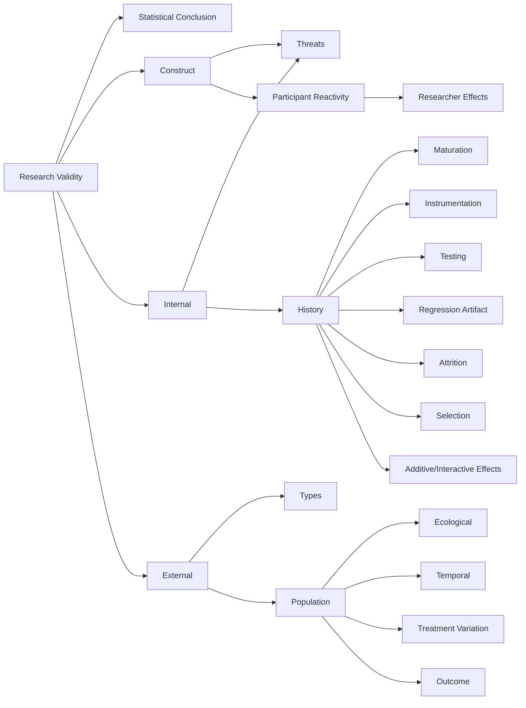
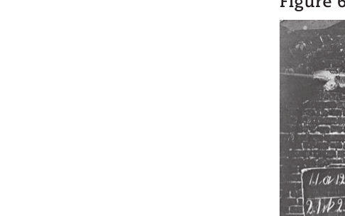
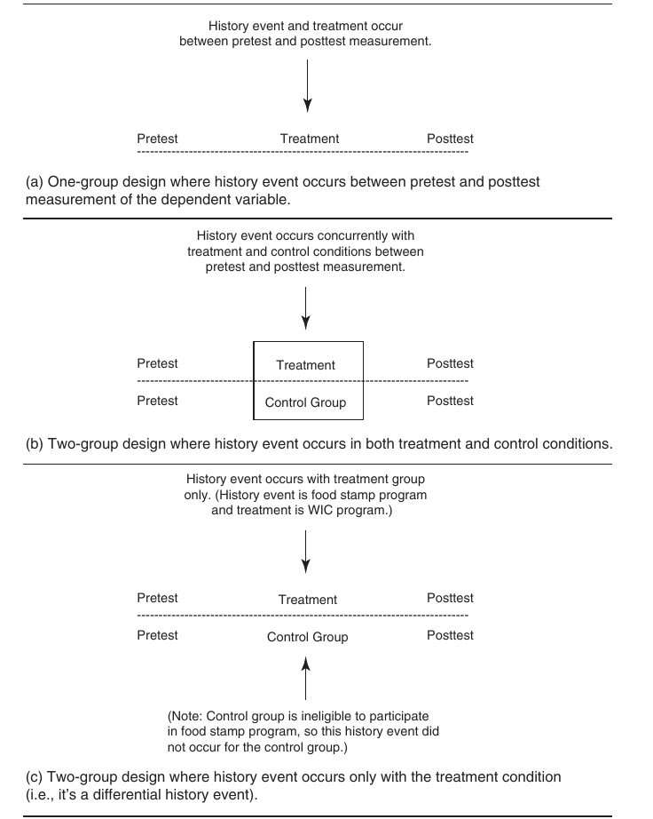

<style>
  /* Textbook typographic styling */
  p {
    text-align: justify;
    text-justify: inter-word;
  }
  h1, h2, h3, h4, h5, h6 { text-align: left; }
  blockquote { text-align: left; }

  /* Textbook Plum Table & Card Styling */
  .textbook-table-wrapper, .comparison-card, .framed-card {
    margin: 1.8em 0;
    border: 1px solid #e5cfdc;
    border-radius: 6px;
    overflow: hidden;
    background: #ffffff;
    box-shadow: 0 1px 3px rgba(0,0,0,0.05);
  }
  .table-caption, .card-caption, .framed-card-header {
    padding: 10px 14px;
    font-size: 0.95em;
    font-weight: 600;
    background: #ffffff;
    border-bottom: 2px solid #842959;
  }
  .textbook-table {
    width: auto;
    max-width: 100%;
    border-collapse: collapse;
    font-size: 0.9em;
  }
  .textbook-table th {
    background: #842959;
    color: #ffffff;
    font-weight: bold;
    padding: 10px 12px;
    text-align: left;
  }
  .textbook-table td {
    padding: 9px 12px;
    border-bottom: 1px solid #f0e6ec;
    vertical-align: top;
  }
  .textbook-table tr.category-header td {
    background: #f7f0f4;
    font-weight: bold;
    color: #842959;
    padding: 8px 12px;
    border-top: 1px solid #e5cfdc;
    border-bottom: 1px solid #e5cfdc;
  }
  .table-footer-notes td, tr.table-notes td {
    font-size: 0.85em;
    color: #666666;
    background: #fafafa;
    border-top: 1px solid #e5cfdc;
    padding: 8px 12px;
  }
  /* Comparison Card (Strengths & Weaknesses) */
  .banner-header {
    background: #842959;
    color: #ffffff;
    font-weight: bold;
    padding: 8px 14px;
    font-size: 0.9em;
    letter-spacing: 0.3px;
  }
  .banner-weaknesses .banner-header {
    background: #73224d;
  }
  .banner-list, .framed-card-body {
    margin: 0;
    padding: 12px 20px 16px 36px;
    background: #faf7f9;
  }
  .banner-list li, .framed-card-body li {
    margin-bottom: 6px;
    line-height: 1.5;
    color: #2b1b24;
  }
  /* Counseling Dialogue / Transcript Styling */
  .dialogue-block {
    margin: 1.4em 0;
    padding: 12px 18px;
    background: #fdfbf7;
    border-left: 4px solid #b38867;
    border-radius: 0 6px 6px 0;
  }
  .dialogue-speaker {
    font-weight: bold;
    color: #5c3d2e;
  }
</style>

<details open>
<summary>📑 <b>Table of Contents</b></summary>

- [Chapter 6 Research Validity](#chapter-6-research-validity)
  - [Learning Objectives](#learning-objectives)
- [Overview of Four Major Types of Validity](#overview-of-four-major-types-of-validity)
- [Statistical Conclusion Validity](#statistical-conclusion-validity)
- [Construct Validity](#construct-validity)
  - [Threats to Construct Validity](#threats-to-construct-validity)
- [Internal Validity](#internal-validity)
  - [Threats to Internal Validity](#threats-to-internal-validity)
  - [Summary of Threats to Internal Validity for Single- and Multiple-Group Designs](#summary-of-threats-to-internal-validity-for-single-and-multiple-group-designs)
- [External Validity](#external-validity)
  - [Population Validity](#
<!-- AI-REVIEW-START id="rev-1" category="ocr_typo" -->
<!-- ORIGINAL:
population
-->
<!-- REASON: Cutoff/incomplete word at end of text. -->
population
<!-- AI-REVIEW-END -->
on-validity)
  - [Ecological Validity](#ecological-validity)
  - [Temporal Validity](#temporal-validity)
  - [Treatment Variation Validity](#treatment-variation-validity)
  - [Outcome Validity](#outcome-validity)
- [Relationship Between Internal and External Validity](#relationship-between-internal-and-external-validity)
  - [Summary](#summary)
  - [Key Terms and Concepts](#key-terms-and-concepts)
  - [Related Internet Sites](#related-internet-sites)
  - [Practice Test](#practice-test)
  - [Challenge Exercises](#challenge-exercises)

</details>


<!-- Page 1 -->
## Chapter 6 Research Validity



### Learning Objectives

🎯 **6.1** Summarize the types of validity in quantitative research.
🎯 **6.2** Explain the importance of statistical conclusion validity in research.
🎯 **6.3** Analyze the effects of threats to construct validity on study outcomes.
🎯 **6.4** Explain the meaning of internal validity and describe the threats to internal validity in single-group and multiple-group designs.
🎯 **6.5** Analyze the types of external validity.
🎯 **6.6** Explain the relationship between internal and external validity.

<!-- Page 2 -->
**Research validity** refers to the correctness or truthfulness of an inference that is made from the results of a research study. Research validity is important in all types of research. To conduct a valid research study, you must develop a plan and follow it closely. This plan must involve the use of strategies for obtaining valid results. In this chapter, we will focus on the various types of validity and the key threats to validity in quantitative research, especially experimental research. We address validity in  qualitative research in Chapter 14.

## Overview of Four Major Types of Validity

🎯 **6.1** Summarize the types of validity in quantitative research.

The best way to ensure that a quantitative research study yields empirical findings from which accurate inferences can be made is to try to ensure that the study has the four types of validity that are listed in Table 6.1 (Shadish, Cook, &amp; Campbell, 2002): statistical conclusion validity, construct validity, internal validity, and external validity. However, it is best to think of validity as falling on a continuum rather than into the dichotomous categories of 100% valid versus 0% valid. The goal is to maximize all four validity types as much as possible. This is difficult to do because we cannot incorporate all the methods and procedures that would enable us to simultaneously achieve all four types of validity. Sometimes increasing one type of validity will have a positive impact on other types of validity. For example, greater statistical and construct validity will also support internal and external validity. However, sometimes, incorporating a method to achieve one type of validity will reduce our chances of achieving another type of validity. You will learn that this seems to be particularly true for internal and external validity. Sometimes, the methods used to increase internal validity will also decrease external validity. In this chapter, we introduce you to the major types of validity in research and explain the major threats that often creep into research studies when a study is not designed and executed well. Later chapters will go into much greater depth on the specifics of designing and executing the research study.

**Table 6.1** *Types of Validity in Quantitative Research*

<table class="textbook-table" style="width: auto; max-width: 100%; border-collapse: collapse; margin: 1.5em 0;">
  <thead>
    <tr>
      <th>Validity Types</th>
      <th>Description</th>
    </tr>
  </thead>
  <tbody>
    <tr>
      <td>Statistical conclusion validity</td>
      <td>Validity of the inference made about whether the independent and dependent variables covary.</td>
    </tr>
    <tr>
      <td>Construct validity</td>
      <td>Validity of the inference about the higher-order constructs from the operations used to represent them.</td>
    </tr>
    <tr>
      <td>Internal validity</td>
      <td>Validity of the inference that the independent and dependent variables are causally related.</td>
    </tr>
    <tr>
      <td>External validity</td>
      <td>Validity of the inference about whether the causal relationship generalizes to other people, settings, treatment variables, measurement variables, and time.</td>
    </tr>
  </tbody>
</table>

> [!TIP] **Study Question 6.1**
> Summarize the four types of validity. How are they related to one another?

## Statistical Conclusion Validity

🎯 **6.2** Explain the importance of statistical conclusion validity in research.

**Statistical conclusion validity** refers to the validity with which we can infer that the independent and dependent variables covary. By *covary* we mean that with every variation in the independent variable (IV), there is a corresponding variation in the dependent variable (DV); that is, we mean that the IV and DV are statistically related.

<!-- Page 3 -->
As a reminder, covariation, or relationship between the IV and DV, was  the first of three required criteria for making a claim of causation (see Table 2.2, page 23). We make this inference about covariation, or relationship between the IV and DV, from the results of the statistical analysis of the data in the research study. You will learn in Chapter 16 that not only do we want to see if the data show a relationship, but we must also determine if the observed relationship is statistically significant. A relationship is **statistically significant** when the analysis procedure described in Chapter 16 (called significance testing) indicates that the observed relationship is probably not due to chance. If the relationship is probably not due to chance, we infer that it is a real relationship.

If the researcher’s inference about the covariation between the variables is correct, then the study has statistical conclusion validity. Sometimes, however, the inferences researchers make from their statistical analysis to the populations of interest are wrong. For example, if a study does not have enough research participants, the statistical test used might not have sufficient power to detect the covariation that really exists between the independent and dependent variables in the population, leading to the wrong conclusion (i.e., that no relationship between the variables exists when it really does). A researcher might also incorrectly conclude that a relationship is large when it actually is small, or vice versa. The lack of a sufficient number of participants is one of the many factors that threaten statistical conclusion validity. However, understanding these threats requires a statistical background and will not be reviewed here; if you are interested in them, see Shadish et al. (2002, p. 45).

> [!TIP] **Study Questions 6.2**
> - What is statistical conclusion validity?
>
> - Why is statistical conclusion validity important?

## Construct Validity

🎯 **6.3** Analyze the effects of threats to construct validity on study outcomes.

**Construct validity** is the extent to which we can infer higher-order constructs from the operations we use to represent them. As discussed in the previous chapter, measuring constructs accurately is very important because, in many ways, scientific psychology is the study of constructs. For example, when we talk about individuals diagnosed with schizophrenia, obsessive-compulsive disorder, or an eating disorder, we are dealing with the constructs of these disorders. Constructs are also used to refer to experimental or nonexperimental research settings such as impoverished settings, enriched settings, or poverty neighborhoods. If you are investigating the effect of being depressed on  marital conflict among married adults living in an impoverished neighborhood, you have a construct representing the research participants (married adults), the independent variable (degree of depression), the dependent variable (amount of marital conflict), and the setting of the study (a poverty neighborhood). For each of these  constructs, you must identify a set of operations that adequately represent the construct.

As we explained in the previous chapter, construct validity is the unifying concept for measurement validity, and we provided a section on validity in that chapter that explained how to obtain construct validity. In this chapter, we focus on some key threats to construct validity. When a construct is not measured well, these threats come into play.

<!-- Page 4 -->
### Threats to Construct Validity

Construct validity is concerned with the extent to which operationalizations accurately represent and, therefore, can be used to infer the higher-order constructs they describe. For example, is number of arguments in a week a good representation of the construct of marital conflict? In other words, is there a match between the construct and the operations used to measure the construct in your study? Sometimes our operationalizations are good  representations, and sometimes they are not. Shadish et al. (2002) have identified a number of reasons why we might be incorrect in the inferences we make about constructs from our study operations. These reasons, presented in Table 6.2, are considered to be threats to construct validity. For example, the first threat in the table says that if you have an inadequate understanding of the construct, then it will be difficult to adequately measure it. According to the second threat, when possible, you should use operations that measure your construct only, rather than measuring more than one construct. You should read the table to learn about some additional ways that construct validity can be threatened.

**Table 6.2** *Threats to Construct Validity*

- Inadequate explanation of the construct —if a construct is not adequately explained and analyzed, it can lead to a set of operations that do not represent the construct adequately.
- Construct confounding —the operations used in a study represent more than one construct.
- Mono-operation bias —a study uses only one operationalization of a construct. This typically results in an underrepresentation of the construct and lowers construct validity.
- Mono-method bias —a study uses only one method (e.g., physiological recording) to operationalize a construct. When this occurs, the method used might influence the results.
- Confounding constructs with level of constructs —a study investigates only a few levels of a construct (e.g., three doses of a drug), but makes inferences about the overall construct (e.g., the overall effect of the drug).
- Treatment-sensitive factorial structure —an instrumentation change that occurs because of the experimental treatment.
- Reactive self-report changes —changes that a research participant might make on self-report measures as a result of a motivational shift after being included in the experimental study.
- Participant reactivity to the experimental situation —research participants’ perceptions and motives can affect the responses they make to the dependent variable, and these responses can be interpreted as part of the treatment construct being tested. Experimenter effects
- —the experimenter’s attributes and expectancies can influence the responses made by the research participants, and these responses can be interpreted as part of the treatment construct being tested. Novelty and disruption effects
- —research participants usually respond better to a new and novel situation and poorly to one that disrupts their routine. These effects are part of the overall treatment effect.
- Compensatory equalization —individuals try to provide the same benefits or services to the control group that are received by the experimental group.
- Compensatory rivalry —individuals resent being assigned to the control group and respond more negatively than would be expected, because of the resentment they feel.
- Treatment diffusion —individuals in one treatment group receive some or all of another group’s treatment.

Two of the threats listed in Table 6.2—participant reactivity to the experimental situation and experimenter effects—are discussed next in more detail because a considerable amount of research has documented the biasing effect that they can have on the outcome of experimental studies.

**Participant Reactivity to the Research Situation** This threat falls into the category of participant effects. Participant reactivity refers to the fact that participants may vary in the way they interpret a research situation and these varied interpretations may affect the responses they make on the dependent variable measures. Although we focus here on participant effects in experiments, the concepts in this  section apply to any research that includes human participants.

When agreeing to take part in an experiment, we assume that all participants will fully understand the tasks the way we intend. In reality, such an ideal situation does not exist because participants are not passive responders to the experimental instructions and manipulations. Kihlstrom (1995) put it well when he stated that participants “are sentient curious creatures, constantly thinking about what is happening to them, <!-- Page 5 -->
evaluating the proceedings, figuring out what they are supposed to do, and planning their responses” (p. 10). These cognitive activities can become confounded with the experimental procedures and threaten the construct validity of the experimental treatment because the treatment is no longer the pure scientific production aimed for by the researcher.

When participants enter a research study such as an experiment, they are generally naive regarding its purpose or the task required of them. Once they arrive, they receive information from the way the researcher greets them, the instructions given about the experiment, the task required of them, the laboratory setting (including the visible equipment), and any rumors they might have heard about the research. This information, called the **demand characteristics** of the experiment, defines the experimental “demands” from the participants’ point of view (Orne, 1962; Rosnow, 2002). Demand characteristics provide the participants with information from which they construct their perceptions of the purpose of the experiment and the task required. These perceptions can affect performance of the experimental task(s), and therefore, the outcome of the experiment.

Participants often respond to the experimental or research task as they perceive it (Carlopia, Adair, Lindsay, &amp; Spinner, 1983; Carlston &amp; Cohen, 1980), but their response may also be affected by their desire to make a good impression. For example, if the research involves a learning task, participants may believe that if they learn the material rapidly, this suggests that they are intelligent. Most individuals have a desire to appear intelligent, so they will try to learn as rapidly as possible. Similarly, if the task suggests something about emotional stability, participants will respond in such a way as to appear most emotionally stable (Rosenberg, 1989). Consequently, although participants seem to approach an experiment with the motivation to perform the task requested, superimposed on this desire is the wish to make a **positive   self-presentation** (Christensen, 1981). This means that participants use their perceptions of the research to determine how to respond in such a way that they appear most positive.

Implications for Research. The key implication of participant effects is that researchers must try to understand the impact of participant effects on research outcomes. In an experiment, participant perceptions should be held constant across the groups throughout all phases and conditions of the experiment. When such constancy is not maintained, alternative explanations of findings can be expected to occur because of the confounding of participant effects with the experimental treatment condition. The next chapter will discuss control techniques to help address these participant effects.

**Researcher Effects** You have just seen that participants have motives that can affect the results and threaten the validity of the inferences you make from your research. In a like manner, the experimenter or researcher is not just a passive, noninteractive observer but an active agent who can influence the outcome of the study. These influences are called the **researcher or experimenter effects**. These effects can be intentional or unintentional. Although we will not go into the literature in depth here, the evidence indicates that researcher expectancy effects can be large and that precautions should be taken against them.

Consider the motives that researchers might bring to the study. First, a researcher has a specific motive for conducting the study such as to understand, control, and predict behavior. The researcher also has expectations about the outcome of the study and hopes the hypotheses will be confirmed. In addition, because of the policy of journals, studies supporting hypotheses have a greater chance of being accepted for publication. Can the researcher’s desires and expectations bias the results of the experiment and increase the probability of attaining the desired outcome? Consider the fascinating <!-- Page 6 -->
story of Clever Hans. Clever Hans (shown in Figure 6.1) was a remarkable horse that appeared to solve arithmetic problems. Von Osten, the master of Clever Hans, would give Hans a problem, and then Hans would give the correct answer by tapping with his hoof. Pfungst (1911/1965) observed and studied this incredible behavior. Careful scrutiny revealed that von Osten would, as Hans approached the correct answer, look up at Hans. This response of looking up presented a cue for Hans to stop tapping his foot. The cue was unintentional and not noticed by observers, who attributed mathematical skills to the horse.

Observations, going as far back as Pfungst’s observations, indicate that researchers’ desires and expectancies can somehow be communicated to participants and that participants will respond to them. As discussed, often research participants are motivated to present themselves in the most positive manner. If this is true, then the subtle cues presented by the researcher in a study are noticed by participants and might influence their performance in the direction desired by the researcher. Consequently, the researcher produces a demand characteristic.

Researcher effects can take several forms. In particular, researcher effects can arise because of researcher expectancies and attributes of the researcher. **Researcher** **expectancies** are biasing effects that can be attributed to the expectancies a researcher has about the outcome of a study. These expectancies can lead researchers to behave unintentionally in ways that result in the research participant providing responses that support the hypothesis, thus biasing the results of the study, such as in Clever Hans. **Researcher attributes** are physical and psychological characteristics of researchers that can produce changes in the performance of research participants. Rosenthal (1966) classified researcher attributes into three categories. First is  *biosocial* *attributes*, which includes factors such as age, sex, race, and religion. Second is *psychosocial attributes.* These attributes include researcher psychological and social characteristics, such as anxiety level, need for social approval, hostility, authoritarianism, intelligence, dominance, and warmth. The third category is *situational* *factors.* This includes whether the researcher and the participant have had prior contact, whether the researcher is a naive or experienced researcher, and whether the participant is friendly or hostile.

(From Archives of the History of American Psychology—The University of Akron.) Mary Evans Picture Library/Alamy


*Illustration*



*Figure 6.1 Picture of Clever Hans and his owner, Wilhelm von Osten.*

<!-- Page 7 -->
Although researcher expectancies and attributes can affect construct and internal validity, this does not mean that they will necessarily do so. However, because we know that they can sometimes have an effect, controls for these effects should be incorporated into our studies. We explain some of the control procedures in the next chapter.

> [!TIP] **Study Questions 6.3**
> - What is construct validity, and why is it important?
>
> - What are some threats to construct validity?
>
> - What is meant by participant *reactivity to the research situation* and how does this bias the results of a psychological research?
>
> - What is meant by the *researcher effect* and how does this bias the results of research?

## Internal Validity

🎯 **6.4** Explain the meaning of internal validity and describe the threats to internal

> **validity in single-group and multiple-group designs.**

Identifying cause-and-effect relationships is perhaps the most frequent purpose of psychological research, and internal validity is concerned specifically and only with the issue of causation. **Internal validity** is the degree to which you can correctly conclude that the relationship between an independent variable and a dependent variable is causal. Stated another way, it is the degree to which you can justifiably claim from your empirical research study that changes in the independent variable caused changes in the dependent variable. Because internal validity specifically concerns causation, a synonym for the term internal validity is **causation validity**.

In Chapter 2, we pointed out that there are three “required criteria” that must be met if you are going to make a claim of cause and effect. You can make a cause-andeffect claim only when (1) you have obtained strong evidence that the presumed cause and effect variables are related, (2) the cause precedes the effect, and (3) no plausible alternative explanation for the relationship exists. These three required criteria for making a claim of cause and effect are summarized in Table 2.2 (page 23). Please take a moment to look at that table again; it is important that you understand those three criteria and apply them when you wish to make a claim of causation.

Internal validity boils down to ensuring that the observed effect, as measured by the dependent variable, is caused *only* by the variation in your independent variable. That’s another way of stating required criterion 3 (no alternative explanation exists for the observed relationship). This requirement is the most difficult to achieve because the dependent variable can be influenced by variables other than the independent variable. For example, you might investigate the influence of tutoring (independent variable) on grades (dependent variable). Assume that you do *not* use the strongest experimental design (which has random assignment to the groups to equate them on all extraneous variables at the start of the study), and you provide tutoring to the students in one class and no tutoring to the students in another class. If the students receiving tutoring show more improvement in their grades than the students not receiving tutoring, you might want to conclude that the difference is due to the tutoring. However, an alternative explanation exists. What if the tutored students just happened to be more motivated at the outset of the experiment than those who were <!-- Page 8 -->
not tutored? Perhaps the superior performance by tutored students was due to their motivation. In such an instance, academic motivation would represent an alternative explanation for the relationship you observed between your independent (tutoring) and dependent (grades) variables. This alternative explanation is due to the presence of a confounding *extraneous variable*. If a confounding extraneous variable is present, the researcher cannot claim that a causal relationship exists between the independent and dependent variables because an alternative explanation exists. The alternative explanation is that the confounding extraneous variable caused the outcome.

**Confounding**, therefore, occurs when the research study contains an extraneous variable that systematically varies with the independent variable and this variable also affects the dependent variable. This is an important point because extraneous variables might or might not introduce a confound. The only extraneous variables that can introduce confounds are extraneous variables that (a) *systematically* vary with the independent variable and (b) cause changes in the dependent variable. Remember, in our example, it is possible that the tutored students were also more motivated than the nontutored students. This is a systematic variation—tutored students are more motivated and nontutored students are less motivated. This extraneous variable (motivation) could cause changes in the dependent variable (grades). Therefore, any difference in the dependent variable of grades could be due to the tutoring, the difference in motivation levels of the tutored and nontutored students, or some combination of these two variables. The key point is that it is impossible to tell what caused the grade difference because the influence of the extraneous variable of motivation was confounded with the influence of tutoring.

If the extraneous variable of student motivation did not systematically vary with the independent variable of tutoring, it would not be a confounding extraneous variable. If the students who received and did not receive tutoring had the same motivation level, any difference in grades could not be attributed to motivation. Motivation level, in this case, would represent an extraneous variable, but it would not represent a **confounding extraneous variable** because it did not vary systematically with the independent variable. You must attempt to control for any and all extraneous variables that you believe might systematically vary with your independent variable and affect the dependent variable. Remember this key point: Good researchers are always looking out for confounding extraneous variables.

### Threats to Internal Validity

The purpose of many research studies is to obtain evidence that a cause-and-effect relationship exists. However, extraneous variables that could affect the results of the study must be controlled to achieve internal validity. Because the concept of internal validity was developed in the context of experimental research and because experiments offer the best way to study cause and effect, the remainder of this section focuses on threats to internal validity in experimental research. However, if you ever conduct a nonexperimental study, the same three criteria required to establish cause and effect must be met! When attempting to establish cause and effect in a nonexperimental research study, the key idea is to conduct a nonexperimental study that  *approximates* a strong experimental design as closely as possible. This would include using strategies such as theoretical modeling, hypothesis testing, and control strategies that are available (e.g., path analysis, statistical control, matching, longitudinal data).

Controlling for the effect of extraneous variables does not mean totally eliminating their influence because eliminating the influence of many extraneous variables— such as intelligence, past experience, or motivation—is not possible. The key strategy is to eliminate any *differential* influence that these variables have across the various levels of the independent variable. This means that you must keep the influence of these variables **constant** across the various levels of the independent variable. In other <!-- Page 9 -->
words, your goal is to **equate the groups** (which form the levels of the independent variable) on all extraneous variables that could affect the results. For example, in our tutoring example above, you would need to make sure that the two groups (tutoring group and nontutoring group) were equivalent on motivation (and any additional extraneous variables that you are worried about, such as intelligence and prior knowledge). If you make the two groups the same on all of these variables, then any difference found on the dependent variable cannot be due to those extraneous variables (because those extraneous variables do not systematically vary with levels of the independent variable). Remember: The key idea is to “equate your groups.”

How is this constancy achieved? That is, how do we arrange factors so that extraneous variables are equated across the groups and do not differentially influence the results? The only way is through some type of control. Control means exerting a constant influence. Thus, if we wanted to hold constant the trait of dominance, we would attempt to make sure that this trait had an equal influence on all groups of participants.

Control, or achieving constancy, is relatively easy to accomplish if you can identify the potentially confounding extraneous variables. The difficulty frequently lies in identifying the problematic extraneous variables. Shadish et al. (2002) have identified a number of extraneous variables that have been shown to affect a study. We discuss these next. These extraneous variables are threats to the internal validity of a study and must be controlled if the researcher intends to infer that a causal relationship exists between the independent and dependent variables. Threats vary with type of research design, so we discuss two broad categories of experimental research designs: single-group and multiple-group designs. Table 6.3 summarizes these threats.

Recall that experiments manipulate an independent variable and measure the effect on a dependent variable. When the experiment does not have a control or comparison group, it is a single-group design. The single-group is the treatment group. The most common single group design is the one-group pretest–posttest design where participants are pretested and then experience the independent variable and then are posttested. This design is depicted in Figure 6.2(a). This is a relatively weak design with many threats to internal validity.

Multiple-group experimental designs are an improvement over single-group designs because a multiple-group design includes a separate control group. The purpose of the control group is to provide evidence of what is likely to have occurred without the introduction of the treatment level of the independent variable. (The IV here has two

**Table 6.3**

### Summary of Threats to Internal Validity for Single- and Multiple-Group Designs

**I. Threats Often Present in Single-Group Designs**
**History:**
Any event that can affect a participants’ score on the dependent variable, other than the treatment, that also occurs during the study before the posttest.
**Maturation:**
Any physical or mental change that occurs with the passage of time and affects scores on the dependent variable.
**Instrumentation:**
Changes from pretest to posttest in the assessment or measurement of the dependent variable.
**Testing:**
Changes in a person’s score on a later administration of a test resulting from having previously taken the test.
**Regression artifact:**
Effects that appear to be due to the treatment but are due to regression to the mean because of the use of groups with either very high or very low scores on the dependent variable.
**II. Threats Often Present in Multiple-Group Designs That Don’t Have Random Assignment**
**Selection:**
Production of nonequivalent groups because a different selection or assignment procedure operates across the groups. This produces differences on the dependent variable.
**Differential history:**
In a multiple-group design, the groups experience different history events that result in differences on the dependent variable.
**Differential attrition:**
In a multiple-group design, the groups become different on an extraneous variable because of differences in the loss of participants across the groups. This problem produces differences on the dependent variable.
**Additive and interactive:**
Differences between groups is produced because of the combined effect of two or more threats to internal validity. These effects produce differences on the dependent variable.

<!-- Page 10 -->


*Figure 6.2 Demonstration: The basic mixed or confounded with the treatment; it is cause the groups to become nonequivalent; in (c) the problem is called*

**history** threat *is* a problem in (a) because it is *not* a problem in (b) because it does not **differential** **history** because a history event causes the groups to become nonequivalent. levels, treatment vs. control/no-treatment.) The presence of a control group takes care of some of the threats to internal validity. However, a crucial element of the multiple-group design is how the participants are assigned to the different groups. If the participants are randomly assigned to groups, you can assume that the groups are equated at the outset of the study. Therefore, the only difference between the groups will be the level of the independent variable they were assigned to (e.g., treatment or control). This takes care of virtually all of the threats to internal validity! Now, let’s investigate the common threats to internal validity that may occur in single- and multiple-group designs.

**History** The first threat to internal validity is called **history**. History refers to any event that can produce the outcome, other than the treatment, that occurs after the beginning of the study but before the posttest measurement of the dependent variable. The basic history threat is a problem in a one-group experimental design, such as the design depicted in Figure 6.2(a). Look at the design in the figure and notice

<!-- Page 11 -->
that participants are measured on the dependent variable at the pretest and the posttest, and the treatment is administered between these two test points. A history threat exists in this one-group design if an event occurs (other than the treatment) that can affect the dependent variable. If this situation happens, the treatment and the history event would both occur between the pretest and the posttest (they are confounded), and you would not know if a pretest-to-posttest improvement was caused by the treatment or by the history event because you cannot separate their influences.

For example, Johnson and Zlotnick (2008) investigated the impact of psychotherapy for female prison inmates with depression and substance abuse histories. Results indicated a reduction in depressive symptoms after the intervention. The researchers hypothesized that the treatment was responsible for the reduction in symptoms. Although this might be true, it is important to realize that weeks elapsed between the pretesting and the posttesting, and many other events that took place in the prison during this time—such as participating in educational classes, counseling groups, or developing new friends—that might have accounted for the improvement in symptoms. The history effect in the one-group design would have been controlled if Johnson and Zlotnick had included a control group in the design. Look at the design depicted in Figure 6.2(b). It is a two-group design that includes a treatment group and a control group. If Johnson and Zlotnick had included a control group of participants similar to those in the treatment groups, and if both of these groups were institutionalized, then any difference in the reduction in depressive symptoms could not be attributed to institutionalization because both groups were institutionalized. The key point is that the basic history threat *is* a problem for the one-group design shown in Figure 6.2(a), but it *is not* a problem when a control group is added, as long as the history event affects both of the groups in the control-group design, such as the one depicted in Figure 6.2(b). In short, addition of the control group in Figure 6.2(b) fixed the basic history problem shown in Figure 6.2(a).

Unfortunately, we are not out of the woods yet. The problem of differential history is shown in Figure 6.2(c).  **Differential history** occurs when one group experiences the history event, but the other group does not. When differential history operates, the groups become different on the history variable, which is problematic because the groups should only differ on the levels of the independent variable; they should not be different on any extraneous variables. Here’s an example. Shadish and Reis (1984) revealed that women who participated in the experimental group of the federal Women, Infants, and Children (WIC) program to improve their pregnancy outcome by improving their nutritional intake were also eligible for and probably participated in the food stamps program. Because the food stamps program could also lead to better nutrition and improve pregnancy outcomes, it was a history threat in studies attempting to demonstrate the efficacy of the WIC program.

This idea of a history event affecting only one group in a two-group design (i.e., differential history) is illustrated in Figure 6.2(c). The women in the experimental group of the WIC program received the WIC treatment condition, *but they also experi-* *enced the history event* (i.e., participation in the food stamp program). The women in the control group did not receive the WIC treatment and they did not experience the history event. This means that if the experimental and control groups differed at the end of the experiment, the researcher would not know if the outcome was due to the new treatment or to the food stamps. Therefore, the researcher could not legitimately claim that the new treatment was “the cause” of the improved pregnancy outcomes.

Researchers must always be on the lookout for history effects and should use designs that help eliminate the history threat. A key point is that adding a control group to the one-group design is an effective way to eliminate the basic history threat, as shown by moving from the design in Figure 6.2(a) to the improved design in Figure 6.2(b); however, this inclusion of a control group will not fix the problem of differential history, which is shown in Figure 6.2(c).

<!-- Page 12 -->
**Maturation** This threat refers to changes in the internal conditions of the individual that occur as a function of the passage of time. The changes involve both biological and psychological processes, such as age, learning, fatigue, boredom, and hunger, that are not related to specific external events but reside within the individual. To the extent that such natural changes affect the individual’s performance on the  dependent variable, they threaten internal validity.

Consider a study that attempts to evaluate the benefits achieved from a Head Start program. Assume the investigator gave the participants an achievement test at the beginning of the school year (i.e., the pretest) and again at the end of the school year (the posttest). (This is the one-group design just shown in Figure 6.2(a).) In comparing the pretest and posttest achievement measures, the investigator found that a significant increase in achievement existed and concluded that the Head Start program was beneficial. Unfortunately, this study is internally invalid because there was no control for maturational influence. The increased achievement could have been due to the changes that occurred with the passage of time. A group of children who did not participate in Head Start might have progressed an equal amount. In order to determine the effect of a program such as Head Start, a control group that does not receive the treatment (and is very similar to the treatment group in every other way) should be included to control for maturation.

```python
**Instrumentation** This threat refers to changes that occur over time (i.e., during the course of the study) in the measurement of the dependent variable. This class of confounding extraneous variables does not refer to participant changes but to changes that occur in the measurement process. For example, the problem will be present in a one-group design if the measurement process at the pretest is different from the measurement process at the posttest.

```
Measurement procedures that require use of human observers are the most likely to have instrumentation error. Human observers are subject to such influences as fatigue, boredom, and learning processes. In administering intelligence tests, novice testers typically gain skill over time and collect more reliable and valid data as additional tests are given. Observers and interviewers are often used to assess the effects of various experimental treatments. As the observers and interviewers assess more and more individuals, they gain skill. The interviewers might, for example, be more skilled in their posttest measurements than in their earlier pretest measurements. This results in a change from pretest to posttest that cannot be attributed to either the participant or the treatment conditions. This is why studies that use human observers typically use more than one observer and have each of the observers go through an extensive training program. Typically, the data collected by the multiple observers must coincide before they are considered valid.

**Testing** This threat refers to changes in the scores participants make on the later administration of a test that result from having previously taken the test. In other words, the experience of taking a test at the pretest can alter the results obtained on a second administration of the same test at the posttest. Taking a test does a number of things that can alter a person’s performance on a subsequent administration of the same test. Taking a pretest can sensitize you to the test topic or issues related to the topic. Taking a test also gives you practice with taking the test and familiarizes you with the content of the test. After taking a test, you might think about the errors you made that could be corrected if the test were taken over. When the test is administered a second time, you are already familiar with it and you might remember some of your prior responses. This can lead to an enhanced performance entirely tied to the initial or pretest administration. Any alteration in performance as a result of a **testing effect** threatens the internal validity of a study because it serves as an alternative explanation to the claim that performance on the second administration of a test was due to the treatment. As with the previous threats,

<!-- Page 13 -->
this threat in its basic form is problematic for the one-group design in Figure 6.2(a), but adding a control group as in Figure 6.2(b) usually eliminates this threat.

**Regression Artifact** Many psychological studies involve the selection of research participants that have high (or low) scores on a measure. For example, when studying anxiety, you might select participants with high anxiety scores. When studying functional illiteracy, you might select participants with very low reading scores. This makes a lot of sense because the purpose of this sort of research is to find ways to improve participants’ status on these dependent variables. Unfortunately, the threat to internal validity known as regression artifact operates when participants are selected based on extreme (high or low) scores. Participants with very high scores have a  tendency to decrease and participants with very low scores have a tendency to increase *without any* *treatment from the pretest to the posttest measurement*. Here is a formal definition from the founder of the threat (Campbell &amp; Kenny, 1999): **Regression artifacts** are “pseudoeffects that appear to be effects due to some supposed causal variable (e.g., an intervention) but are nothing more than regression toward the mean” (Campbell &amp; Kenny, 1999, p. 37). This phenomenon is also called **regression toward the mean** because very high scores and very low scores tend to show the most movement toward the mean from pretest to posttest measurement. More simply, regression artifacts can be viewed as the *“you can only go up (or down) from here”* phenomenon (Trochim, 2001).

If you select participants based on very high or very low scores and use the onegroup pretest–posttest design shown earlier in Figure 6.2(a), some or all of the change from pretest to posttest might be due to the regression artifact problem. You will not know if the change is due to the treatment or if it is due to the operation of a regression artifact. There is a solution that usually solves the problem, however. If you use two similar groups in the two-group design shown in Figure 6.2(b), the regression artifact is not problematic. That’s because even if regression occurs, the *difference* between the groups will not be due to a regression artifact. If you ever select participants based on extreme scores, you should be on the lookout for a regression artifact, and you should always include a control group with similar scores in this situation.

**Attrition** Some individuals do not complete a research study for a variety of reasons, such as failure to show up at the scheduled time and place or not participating in all phases of the study. This dropping out of the research study is called  **attrition**. Human experiments must contend with participants who do not show up for the experiment at the designated time and place or do not participate in all the conditions required by the study. Attrition is not an internal validity problem in the one-group design, although it will negatively affect your ability to generalize the results—you will be able to only generalize to the kinds of people who stayed in the study. The internal validity problem with attrition arises because the loss of participants might produce *differences* in the groups that cannot be attributed to the experimental  treatment—it is a threat to internal validity in the two-group design shown in Figure 6.2(b), and it is called **differential attrition** (or, sometimes, the “selection-attrition effect”).

Consider the following example. Assume that you want to test the effect of a certain treatment designed to increase participants’ empathy. Also assume that past research has demonstrated that females score higher on measures of empathy than males do, so you control for this factor by assigning an equal number of males and females to two groups. When you actually run the experiment, however, half of the male participants assigned to the group that received the experimental treatment condition (i.e., the treatment group) do not show up and half of the female participants assigned to the group that does not receive the treatment condition (i.e., the control group) do not show up. Because of differential attrition, your treatment group is now heavily female constituted and the control group is heavily male constituted. Statistical analysis reveals that the treatment group, on average, reports significantly <!-- Page 14 -->
more empathy than does the control group. Can you conclude that this significantly greater degree of empathy in the treatment group is caused by the independent variable administered? Such an inference would be incorrect because the treatment group had a greater percentage of female participants, and past research indicates that females exhibit a greater degree of empathy. This extraneous variable (i.e., gender), and not the independent variable (treatment vs. no-treatment), could have produced the observed significant difference. When participants drop out from your study, you should always attempt to determine if your groups have become *different* on an extraneous variable that could confound the results. You must always remember the cardinal rule of experimentation: You want your groups to differ because of exposure to the independent variable and not because of an extraneous variable.

**Selection** The threat known as **selection** exists when a selection or assignment procedure results in nonequivalent groups. Ideally, participants are randomly assigned to the various experimental groups (e.g., to the treatment and control groups). Random assignment is the best procedure for equating groups (i.e., constructing groups that are very unlikely to differ on any extraneous variable)! When random assignment to groups cannot be used, there is a high probability that alternative explanations are introduced (“required criterion 3”). Assume that you conduct the empathy study mentioned in the previous paragraph and that you did not randomly assign participants to the treatment and control groups. Because of the lack of random assignment of participants to the two groups, the two groups might differ on many extraneous variables,  *including gender.* After administration of the treatment, you find that the treatment group exhibits more empathy on average than the control-group participants. Can you claim that this difference between the groups is because of the treatment? You should not make this claim. The groups can differ on extraneous variables, which might be the cause of the observed group differences. In this case, if the treatment group had a higher percentage of female participants, then it is quite likely that gender (rather than the treatment) is the cause of the difference between the groups on the dependent variable.

**Additive and Interactive Effects** Validity threats do not necessarily operate in isolation.  **Additive and interactive effects** refer to the fact that the threats to internal validity can combine to produce complex problems. Of special importance, the selection threat can combine with history, maturation, instrumentation, testing, and regression artifacts. Selection is a problem when your groups are composed of different kinds of people; therefore, the different groups might react differently to the threats. A **selection-history** effect occurs when the groups are exposed to the same history event but react to it differently. This can happen when the groups are composed of different kinds of people. A **selection-maturation** effect occurs if the groups mature at different rates. This can happen when the groups are composed of different kinds of people. A **selection-instrumentation** effect occurs if the groups respond differently to an instrumentation effect because they are composed of different kinds of people. A **selection-testing** effect occurs if testing affects the groups differently because they are composed of different kinds of people. A **selection-regression-artifact** effect occurs if a regression artifact affects the groups differently because they are composed of different kinds of people.

A key idea here is that when the validity threats operate in combination, such as the ones just mentioned, the groups in a multiple-group design will differ not just on the levels of the independent variable (e.g., treatment vs. control), which is what is desired; unfortunately, the groups will also be different because of the operation of extraneous variables, and you will not know if the difference between the groups’ scores on the dependent variable at the end of the experiment is due to the <!-- Page 15 -->
independent variable or if it is due to a confounding extraneous variable. Another key point, which we will explain in greater detail in later chapters, is that the best solution to the problems caused by the threats to internal validity discussed in this chapter is to construct the groups at the beginning of your experiment using random assignment; this process helps ensure that the groups will not systematically differ on any extraneous variable. When an experimental research study uses random assignment to the groups, you should upgrade your assessment of that study’s ability to provide strong evidence of cause and effect.

> [!TIP] **Study Questions 6.4**
> - What is meant by internal validity and why is it important?
>
> - What is the principle of constancy and why is it important?
>
> - What are the threats to internal validity and how does each threaten internal  validity?

## External Validity

🎯 **6.5** Analyze the types of external validity.

Internal validity focused on whether you could claim that a cause-and-effect relationship was present for the participants in your single research study. The fourth major type of validity, called **external validity**, focuses on whether a researcher can generalize the research findings to other people, settings, treatments, outcomes, and times. Because external validity is always about generalizing, it can also be called **generalizing** **validity**. External validity is an inferential process because it involves making broad statements based only on limited information. Stating that a particular study conducted on 100 college students in a psychology laboratory is fully *externally valid* would imply that the results obtained from the experiment are true for all college students responding in a variety of settings to variations in the treatment and outcome measures, and at different times. Researchers hope to make these kinds of inferences because one of the most important goals of psychological research is to identify regularities in human thinking and behavior. Generalization is a major goal of scientific research.

In order to generalize the results of a study, you must identify a target population of people, settings, treatment variations, outcome measures, and times and try to use representative samples of these. In an ideal research world, you would be able to randomly select individuals from the population so that the sample would be representative of the defined population. For a variety of reasons (e.g., cost, time, accessibility), most experimental research studies are not based on a random sample from the defined population. Failure to randomly select participants means that the study will probably contain characteristics that will threaten its external validity. In short, one reason for lack of generalizability of a set of findings is the lack of random selection. Another reason for the lack of generalizability of the research findings from a single research study is because of chance factors. Findings usually vary slightly from study to study because of the operation of chance, but occasionally this variation will be large simply because of the operation of chance. This is why *replication* is so important in scientific research. Another major reason for the lack of generalizability of research findings is because sometimes the relationship between an independent variable and the dependent variable varies across the levels of another independent variable. For example, if one attitude change procedure works best with females and another works <!-- Page 16 -->
best with males, then the results are specific to each gender. In this situation, the finding does not generalize broadly to everyone (i.e., to males *and* females), and your mission will be to correctly specify to whom a finding does and does not generalize.

Now we cover the major types of external validity and some of the associated threats. The types of external validity fall into five broad categories: population validity, ecological validity, treatment variation validity, outcome validity, and temporal validity (Bracht &amp; Glass, 1968; Shadish et al. 2002; Wilson, 1981). The key points are going to be that your results might not generalize to other people (population validity), other settings (ecological validity), other treatments (treatment variation validity), other outcomes  (outcome validity), or other times (temporal validity). It is essential that a researcher knows how research findings can be generalized and understands the threats to generalization.

### Population Validity

**Population validity** refers to the ability to generalize from the sample on which your study is conducted to the larger population of individuals in which you are interested. The **target population** is the larger population (such as all college students) to whom you hope to generalize the results of your study. You want to be able to say that the results of your study will hold for all college students in the United States. To be able to make such a statement, however, you must randomly select your sample from the target population of all college students in the United States, which is almost impossible! Because many research studies are based on nonrandom samples, generalization of findings usually is obtained through replication instead of directly generalizing from a single nonrandom sample to a target population.

Most of this discussion about population thus far has been about generalizing the characteristics of a study sample (e.g., sample averages, differences between means in the sample, and correlations between variables based on the sample data) to the characteristics of the target population (e.g., population averages, differences between means in the population, and correlations between variables in the population). This is sometimes called “generalizing *to* a population.” Random sampling is especially strong in allowing one to generalize from sample characteristics *to* population characteristics. However, another major issue in generalizing is to what extent a sample finding generalizes across the different kinds of people in the sample and in the population. This is called “generalizing *across* a population” (Cook &amp; Campbell, 1979), and it refers to how broadly a finding applies. For example, perhaps the average on a self-esteem scale is 80 in your sample. Does this mean that all the males and all the females got an 80? Does it mean that everyone in the sample got an 80? Does it mean that everyone in the population would obtain a score of 80 if they were to fill out the scale? The key point here is that some research findings generalize better than other findings *across* all of the people.

Here are some examples of the lack of generalization *across* people. Research shows that men and women can have very different reactions to drugs (Neergaard, 1999). First, women reject heart transplants more often than men do. Second, the effectiveness of aspirin in preventing strokes varies for men and women. These gender differences have resulted in the Food and Drug Administration’s requirement that drug manufacturers analyze how different sexes respond to experimental therapies. The issue of lack of generalization across people is not a problem that can be solved with random sampling. It is just an empirical fact of our world that some findings generalize only to certain kinds of people. This is frequently examined in research by collecting data on the characteristics of the people, determining for whom the findings apply, and following this with additional research to determine why this happens.

<!-- Page 17 -->
### Ecological Validity

**Ecological validity** refers to the generalizability of the results of a study across different settings or from one set of environmental conditions to another. Laboratory experiments are sometimes criticized for a lack of ecological validity. If the results of a laboratory experiment can be generalized to nonlaboratory settings (such as a therapy setting or a labor relations setting), then the experiment possesses ecological validity. Ecological validity exists to the extent that the treatment effect is independent of the experimental setting. If a treatment effect depends on the experimental setting and does not generalize beyond that setting, then ecological validity does not exist.

### Temporal Validity

**Temporal validity** refers to the extent to which the results of an experiment or other type of research study can be generalized across time. For example, in 1974, Rubin, Provenzano, and Luria reported that parents of newborns engaged in gender stereotyping when asked to rate their infants. Infant girls were rated as weaker and having finer features than male infants even when physical data indicated the female infants were not smaller than the male infants. In a replication of this study, Karraker, Vogel, and Lake (1995) reported that parents engaged in less gender stereotyping of their infants (although a few stereotypes persisted). What do you think these findings would look like if the study were repeated this year? Generalizing across time can be particularly difficult in a rapidly changing society.

Some more predictable time patterns of results also have been identified. **Seasonal** **variation** occurs when the values on a dependent variable tend to vary by season. For example, juvenile delinquency tends to increase in the summer. This is because, during the summer months, adolescents are not in school and have more free time to get into trouble. Studies conducted during the summer are, therefore, likely to show more overall juvenile delinquency than studies during other months. Likewise, if you are studying the influence of an advertising campaign on retail sales, you would need to take into account the predictable seasonal variation that sales go up during the December holiday season. Seasonal variation is one type of the more general concept of **cyclical variation**, which can refer to any up-and-down variation that occurs over time. The time period can be short or quite long. A relatively short cyclical variation is the circadian (approximately 24-hour) rhythm on which our pulse rate, temperature, and endocrine and kidney functions operate. Research results might differ on these variables depending on the time of day in which the study is conducted. A longer term and less predictable cyclical variation is the business cycle in which the economy tends to vary between periods of expansion and growth to periods of contraction and recession over multiple years.

### Treatment Variation Validity

**Treatment variation validity** refers to the generalizability of results across variations of the treatment. Treatment variation validity is an issue because the administration of a treatment can vary from one administration to the next. For example, many studies have been conducted demonstrating that cognitive-behavior therapy is effective in treating depression. However, these studies have typically been conducted in a way that has provided maximum assurance that the therapists are competent and have delivered the therapy in the prescribed manner. Therapists who administer cognitive-behavior therapy to the general public, however, vary considerably in their competency and the extent to which they deliver the therapy in the prescribed manner. This means that there is considerable variation in the way the therapy is administered. If cognitive-behavior therapy produces a beneficial effect for the

<!-- Page 18 -->
treatment of depression across these different variations in the way it is delivered, treatment variation validity exists. If cognitive-behavior therapy is beneficial only when administered exactly as prescribed and is not beneficial when administered in a slightly different way, then treatment variation validity does not exist.

### Outcome Validity

**Outcome validity** refers to the generalizability of results across different but related dependent variables. Many studies investigate the effect of an independent variable on more than one dependent variable. Outcome validity refers to the extent to which the same effect is measured by all related outcome measures. For example, a job-training program is expected to increase the likelihood of a person’s getting a job after graduation. This is probably the primary outcome measure of interest. However, an equally important issue is keeping the job. This means that the person must arrive on time, not miss work, work well with others, and demonstrate an acceptable level of performance. The effectiveness of the job-training program might increase the probability of getting a job but have no effect on job retention because it has little impact on these other essential adaptive job skills. If this is the case, the job-training program does not have outcome validity. However, if the job-training program increases the probability of getting a job and also keeping a job, the training program has outcome validity.

> [!TIP] **Study Questions 6.5**
> - What is meant by external validity and why is it important?
>
> - What are some factors that can threaten external validity?
>
> - What specific sort of generalizability does each of the types of external validity address?

## Relationship Between Internal and External Validity

🎯 **6.6** Explain the relationship between internal and external validity.

It is clear from our discussion that achieving both internal and external validity are important goals of psychological research. Unfortunately,  there tends to be an inverse relationship between internal and external validity. When external validity is increased, internal validity tends to be sacrificed; when internal validity is increased, external validity tends to suffer (Kazdin, 2017).

Experiments tend to have high internal validity (i.e., they provide strong evidence of cause-and-effect relationships). The researcher often conducts the experiment in a controlled laboratory setting in order to present a specific treatment and to eliminate the influence of extraneous variables, such as the presence of noise or other distractions. While in the laboratory setting, the research participants receive a set of standardized instructions delivered by one experimenter or perhaps by some automated device and complete outcome measures at one specific point in time. But these same features that maximize the possibility of attaining internal validity—using a restricted sample of research participants and testing them in the artificial setting of a laboratory at one specific time—limit the external validity (Kazdin, 2017) by excluding different people, treatment variations, settings, and times. However, if an experimenter tried to maximize external validity by conducting the experiment on diverse groups of individuals and treatment variations <!-- Page 19 -->
in many settings and at different points in time, control would likely decrease and the experiment’s internal validity would decrease. Therefore, external validity of cause-andeffect relationships is often obtained by observing the same cause-and-effect relationship in research studies conducted by different researchers in different settings, with different kinds of people, with slightly different treatments and outcome variables.

The type of validity that is most important depends on the purpose of the research study. If your primary purpose is to determine if the relationship between two variables is causal, then internal validity takes priority. However, if prior research has established that a causal relationship exists between the two variables, then the purpose of the study might be to assess the external validity of the causal relationship. In some studies, such as in survey research, your primary research goal might be to make statements about the characteristics of a target population based on a single sample of research participants. In this situation, external validity would be of primary importance.

> [!TIP] **Study Questions 6.6**
> - How can one maximize internal validity?
>
> - How can one maximize external validity?
>
> - Why does there tend to be an inverse relationship between internal and external validity?

### Summary

Research validity refers to the truthfulness of the inferences made from a research study. There are four major types of research validity in quantitative research: (1) statistical con- clusion validity (degree to which a claim about the existence and strength of a reported relationship is correct), (2) construct validity (degree to which a construct is adequately represented by the operations used in the study), (3) internal validity (the correctness of a claim about cause and effect), and (4) external validity (degree to which the results can be generalized to and across other people, settings, treatments, outcomes, and times). The threats to internal validity (or causation validity) (i.e., to one’s ability to claim cause and effect) are history, maturation, instrumentation, testing, regression artifacts, attrition, selection, and additive and interactive effects. The threats to internal validity become problematic when they cause the independent variable groups to become dif- ferent on confounding extraneous variables. A cardinal rule in experimental research is that you want your groups to differ only on the independent variable conditions. The best way to make the groups the same on extraneous variables (called equating the groups) is to use random assignment of participants to the groups. Once you have groups that are similar, you administer the levels of the independent variable and determine if the groups become different on the dependent variable. If they do, you can conclude that the cause was the independent variable. External validity (or generalizing validity) refers to whether the researcher can gen- eralize the results. Population validity is present to the degree that you can generalize your results to and across people in the target population. Ecological validity is present to the degree that you can generalize your results to other settings. Treatment variation validity is present to the degree that you can generalize your results to slightly different versions or administrations of the treatment. Outcome validity is present to the degree that you can generalize your results to different but related dependent variables. Finally, temporal validity is present to the degree that your results generalize across time.

<!-- Page 20 -->
## 🗂️ Chapter Key Terms & Active Recall

> 💡 **Learning tip:** Try to recall the definition of each term *before* clicking to reveal it.
> This active retrieval practice strengthens long-term memory far more than re-reading.

<details id="flashcard-research-validity">
<summary>📇 <b>Research validity</b> *(p. 2)*</summary>

> **Definition:** Truthfulness of inferences made from a research study

</details>

<details id="flashcard-statistical-conclusion-validity">
<summary>📇 <b>Statistical conclusion validity</b> *(p. 2)*</summary>

> **Definition:** The validity of inferences made about the covariation between the independent and dependent variables

</details>

<details id="flashcard-statistically-significant">
<summary>📇 <b>Statistically significant</b> *(p. 3)*</summary>

> **Definition:** The observed relationship is probably not due to chance

</details>

<details id="flashcard-construct-validity">
<summary>📇 <b>Construct validity</b> *(p. 3)*</summary>

> **Definition:** The extent to which a construct is adequately represented by the measures used in a research study

</details>

<details id="flashcard-participant-reactivity-to-the-research-situation">
<summary>📇 <b>Participant reactivity to the research situation</b> *(p. 4)*</summary>

> **Definition:** Research participants’ motives and tendencies that affect their perceptions of the situation and their responses on the dependent variable

</details>

<details id="flashcard-demand-characteristics">
<summary>📇 <b>Demand characteristics</b> *(p. 5)*</summary>

> **Definition:** Any of the cues available in an experiment, such as instructions, rumors, or setting characteristics, that influence the responses of participants

</details>

<details id="flashcard-positive-self-presentation">
<summary>📇 <b>Positive self-presentation</b> *(p. 5)*</summary>

> **Definition:** Participants’ motivation to respond in such a way as to present themselves in the most positive manner

</details>

<details id="flashcard-researcher-or-experimenter-effects">
<summary>📇 <b>Researcher or experimenter effects</b> *(p. 5)*</summary>

> **Definition:** Actions and characteristics of researchers that influence the responses of participants

</details>

<details id="flashcard-researcher-expectancies">
<summary>📇 <b>Researcher expectancies</b> *(p. 6)*</summary>

> **Definition:** Biasing experimenter effects attributable to the researcher’s expectations about the outcome of the experiment

</details>

<details id="flashcard-researcher-attributes">
<summary>📇 <b>Researcher attributes</b> *(p. 6)*</summary>

> **Definition:** Biasing experimenter effects attributable to the physical and psychological characteristics of the researcher

</details>

<details id="flashcard-internal-validity">
<summary>📇 <b>Internal validity</b> *(p. 7)*</summary>

> **Definition:** The correctness of inferences made by researchers about cause and effect

</details>

<details id="flashcard-causation-validity">
<summary>📇 <b>Causation validity</b> *(p. 7)*</summary>

> **Definition:** A synonym for internal validity

</details>

<details id="flashcard-confounding">
<summary>📇 <b>Confounding</b> *(p. 8)*</summary>

> **Definition:** Occurs when an extraneous variable co-occurs with the independent variable and affects the dependent variable

</details>

<details id="flashcard-confounding-extraneous-variable">
<summary>📇 <b>Confounding extraneous variable</b> *(p. 8)*</summary>

> **Definition:** An extraneous variable that co-occurs with the independent variable and affects the dependent variable

</details>

<details id="flashcard-constancy">
<summary>📇 <b>Constancy</b> *(p. 8)*</summary>

> **Definition:** The influence of an extraneous variable is same on all of the independent variable groups

</details>

<details id="flashcard-equating-the-groups">
<summary>📇 <b>Equating the groups</b> *(p. 9)*</summary>

> **Definition:** Using control strategies to make the influence of extraneous variables constant across the independent variable groups so that the only systematic difference between the groups is due to the influence of the independent variable

</details>

<details id="flashcard-history">
<summary>📇 <b>History</b> *(p. 10)*</summary>

> **Definition:** Any event that can produce the outcome, other than the treatment condition, that occurs during the study before posttest measurement

</details>

<details id="flashcard-differential-history">
<summary>📇 <b>Differential history</b> *(p. 11)*</summary>

> **Definition:** The groups in a multiple-group design experience different history events that result in differences on the dependent variable

</details>

<details id="flashcard-maturation">
<summary>📇 <b>Maturation</b> *(p. 12)*</summary>

> **Definition:** Any physical or mental change that occurs with the passage of time and affects dependent variable scores

</details>

<details id="flashcard-instrumentation">
<summary>📇 <b>Instrumentation</b> *(p. 12)*</summary>

> **Definition:** Changes from pretest to posttest in the assessment or measurement of the dependent variable

</details>

<details id="flashcard-testing">
<summary>📇 <b>Testing</b> *(p. 12)*</summary>

> **Definition:** Changes in a person’s score on the second administration of a test resulting from having previously taken the test

</details>

<details id="flashcard-regression-artifacts">
<summary>📇 <b>Regression artifacts</b> *(p. 13)*</summary>

> **Definition:** Effects that appear to be due to the treatment but are due to regression to the mean

</details>

<details id="flashcard-regression-toward-the-mean">
<summary>📇 <b>Regression toward the mean</b> *(p. 13)*</summary>

> **Definition:** A synonym for regression artifacts

</details>

<details id="flashcard-attrition">
<summary>📇 <b>Attrition</b> *(p. 13)*</summary>

> **Definition:** Loss of participants because they don’t show up or they drop out of the research study

</details>

<details id="flashcard-differential-attrition">
<summary>📇 <b>Differential attrition</b> *(p. 13)*</summary>

> **Definition:** In a multiplegroup design, groups become different on an extraneous variable because of differences in the loss of participants across the groups

</details>

<details id="flashcard-selection">
<summary>📇 <b>Selection</b> *(p. 14)*</summary>

> **Definition:** Production of nonequivalent groups because a different selection procedure operates across the groups

</details>

<details id="flashcard-additive-and-interactive-effects">
<summary>📇 <b>Additive and interactive effects</b> *(p. 14)*</summary>

> **Definition:** Differences between groups are produced because of the combined effect of two or more threats to internal validity

</details>

<details id="flashcard-selection-history-effect">
<summary>📇 <b>Selection-history effect</b> *(p. 14)*</summary>

> **Definition:** An extraneous event occurring between pretest and posttest influences participants in one group differently than participants in another group

</details>

<details id="flashcard-selection-maturation-effect">
<summary>📇 <b>Selection-maturation effect</b> *(p. 14)*</summary>

> **Definition:** Participants in one group experience a different rate of maturation than participants in another group

</details>

<details id="flashcard-selection-instrumentation-effect">
<summary>📇 <b>Selection-instrumentation effect</b> *(p. 14)*</summary>

> **Definition:** Participants’ scores in one group are affected by changes in the process of measurement differently than participants in another group

</details>

<details id="flashcard-selection-testing-effect">
<summary>📇 <b>Selection-testing effect</b> *(p. 14)*</summary>

> **Definition:** Previous experience with the test affects the groups differently

</details>

<details id="flashcard-selection-regression-artifact-effect">
<summary>📇 <b>Selection-regression-artifact effect</b> *(p. 14)*</summary>

> **Definition:** Participants in one group display a different rate of regression to the mean than participants in another group

</details>

<details id="flashcard-external-validity">
<summary>📇 <b>External validity</b> *(p. 15)*</summary>

> **Definition:** Degree to which the study results can be generalized to and across other people, settings, treatments, outcomes, and times

</details>

<details id="flashcard-generalizing-validity">
<summary>📇 <b>Generalizing validity</b> *(p. 15)*</summary>

> **Definition:** A synonym for external validity

</details>

<details id="flashcard-population-validity">
<summary>📇 <b>Population validity</b> *(p. 16)*</summary>

> **Definition:** Degree to which the study results can be generalized to and across the people in the target population

</details>

<details id="flashcard-target-population">
<summary>📇 <b>Target population</b> *(p. 16)*</summary>

> **Definition:** The large population to which the researcher would like to generalize the study results

</details>

<details id="flashcard-ecological-validity">
<summary>📇 <b>Ecological validity</b> *(p. 17)*</summary>

> **Definition:** The degree to which the results of a study can be generalized across settings or environmental conditions

</details>

<details id="flashcard-temporal-validity">
<summary>📇 <b>Temporal validity</b> *(p. 17)*</summary>

> **Definition:** The degree to which the results can be generalized across time

</details>

<details id="flashcard-seasonal-variation">
<summary>📇 <b>Seasonal variation</b> *(p. 17)*</summary>

> **Definition:** Values on the dependent variable vary by season

</details>

<details id="flashcard-cyclical-variation">
<summary>📇 <b>Cyclical variation</b> *(p. 17)*</summary>

> **Definition:** Any type of systematic up-and-down movement on the dependent variable over time

</details>

<details id="flashcard-treatment-variation-validity">
<summary>📇 <b>Treatment variation validity</b> *(p. 17)*</summary>

> **Definition:** The degree to which the results of a study can be generalized across variations in the treatment

</details>

<details id="flashcard-outcome-validity">
<summary>📇 <b>Outcome validity</b> *(p. 18)*</summary>

> **Definition:** The degree to which the results of a study can be generalized across different but related dependent variables

</details>


<a id="key-terms-and-concepts"></a>
### Key Terms and Concepts

| Term | Term | Term |
| --- | --- | --- |
| [Additive and interactive effects *p. 122*](#term-additive-and-interactive-effects) | [Generalizing validity *p. 123*](#term-generalizing-validity) | [Research validity *p. 110*](#term-research-validity) |
| [Attrition *p. 121*](#term-attrition) | [History *p. 118*](#term-history) | [Seasonal variation *p. 125*](#term-seasonal-variation) |
| [Causation validity *p. 115*](#term-causation-validity) | [Instrumentation *p. 120*](#term-instrumentation) | [Selection *p. 122*](#term-selection) |
| [Confounding *p. 116*](#term-confounding) | [Internal validity *p. 115*](#term-internal-validity) | [Selection-history effect *p. 122*](#term-selection-history-effect) |
| Confounding extraneous | [Maturation *p. 120*](#term-maturation) | [Selection-instrumentation effect *p. 122*](#term-selection-instrumentation-effect) |
| [variable *p. 116*](#term-variable) | [Outcome validity *p. 126*](#term-outcome-validity) | [Selection-maturation effect *p. 122*](#term-selection-maturation-effect) |
| [Constancy *p. 116*](#term-constancy) | Participant reactivity to the research | Selection-regression-artifact |
| [Construct validity *p. 111*](#term-construct-validity) | [situation *p. 112*](#term-situation) | [effect *p. 122*](#term-effect) |
| [Cyclical variation *p. 125*](#term-cyclical-variation) | [Population validity *p. 124*](#term-population-validity) | [Selection-testing effect *p. 122*](#term-selection-testing-effect) |
| [Demand characteristics *p. 113*](#term-demand-characteristics) | [Positive self-presentation *p. 113*](#term-positive-self-presentation) | [Statistical conclusion validity *p. 110*](#term-statistical-conclusion-validity) |
| [Differential attrition *p. 121*](#term-differential-attrition) | [Regression artifacts *p. 121*](#term-regression-artifacts) | [Statistically significant *p. 111*](#term-statistically-significant) |
| [Differential history *p. 119*](#term-differential-history) | [Regression toward the mean *p. 121*](#term-regression-toward-the-mean) | [Target population *p. 124*](#term-target-population) |
| [Ecological validity *p. 125*](#term-ecological-validity) | [Researcher attributes *p. 114*](#term-researcher-attributes) | [Temporal validity *p. 125*](#term-temporal-validity) |
| [Equating the groups *p. 117*](#term-equating-the-groups) | [Researcher expectancies *p. 114*](#term-researcher-expectancies) | [Testing effect *p. 120*](#term-testing-effect) |
| [External validity *p. 123*](#term-external-validity) | [Researcher or experimenter effects *p. 113*](#term-researcher-or-experimenter-effects) | [Treatment variation validity *p. 125*](#term-treatment-variation-validity) |

### Related Internet Sites

- <http://www.wadsworth.com/psychology_d/templates/student_resources/workshops/index.html>
  This site contains a variety of workshops focusing on research methods. To get to the one on reliability and validity, click on the “Research Methods Workshop” link. Then click on the “reliability and validity” workshop link.

- <http://psych.athabascau.ca/html/Validity/>
  This site has a tutorial on internal validity. The tutorial exposes the student to each of the threats to internal validity discussed by Campbell and Stanley (1963).

- <http://www.socialresearchmethods.net/kb/constval.htm>
  This site discusses construct validity and gives a variety of links that help in understanding construct validity and the threats to construct validity.

- <http://www.socialresearchmethods.net/kb/external.htm>
  This site provides a brief discussion of external validity as well as of threats to external validity.

### Practice Test

*The answers to these questions can be found in the Appendix.*

**1.** When we talk about the validity of psychological
research studies, we are referring to:
a.  Statistical conclusion validity
b.  Internal validity
c.  Construct validity
d.  External validity
e.  All of the above

**2.** If a research study permits you to accurately infer
that the independent variable is the cause of the changes observed in the dependent variable, then you have a study
a.  That has internal validity
b.  That has too few participants c.  That has many threats to internal validity
d.  That has external validity

**3.** Dr. Know conducted an experiment on youth violence
and found that his treatment was effective when he conducted it at the Strickland Youth Center; he also tried it at the Boys Club, testing which threat to external validity?
a.  Treatment variation validity threat
b.  Ecological validity threat
c.  Temporal validity threat
d.  Outcome validity threat

**4.** Dr. Johnson is testing the effectiveness of a new
study skills intervention that is designed to increase

<!-- Page 21 -->
GPA. Participants are students currently with GPAs below
1. These students are enrolled in the intervention and then GPA is measured at the end of the semester. Results indicate that GPA improved and Dr. Johnson attributes the improvement to the intervention. Although the intervention may be effective, selecting students with the lowest scores puts the study at-risk for
a.  A history threat
b.  An attrition threat
c.  A regression artifact threat
d.  An instrumentation threat

**5.** In an effort to increase internal validity, Dr. Zlomke
conducted her empathy study in a laboratory setting. Preschoolers were randomly assigned to either seeing a child who was happy or a child who was sad. The participant’s response to the other child was recorded. If we are concerned about whether the findings from this study apply to empathy in the preschool classroom, we are concerned about
a.  Construct validity
b.  External validity
c.  Maturation threat
d.  History threat

### Challenge Exercises

**1.** For each of the following research examples, identify
the threat to internal validity that could also explain the improvement in math performance. Because a pretest–posttest design is used and the same test is used at both pretest and posttest assessment in many of the examples, there is naturally a potential testing threat. However, there is also another potential threat in each example, and it is this other threat that you should identify.
a.  Dr. Green was investigating the effect of a
compensatory education program in mathematics for first-grade students. This study gave a standardized math achievement test to all first- grade students and, based on the results of this test, identified the first-grade students who scored in the lowest quartile on this test. He then placed these students in the compensatory education program and administered the program for the next 6 months. At the end of the 6-month period, he again administered the standardized math achievement test to these students and found that they had significantly increased their math score and concluded that the compensatory program was effective in remediating poor math performance.
b.  Dr. Green was investigating the effect of a
compensatory education program in mathematics for first-grade students. This study gave a standardized math achievement test to all first- grade students and administered the program to half of the students for the next 6 months; the other half of students were in the control group. During this 6-month period, a number of families moved and withdrew their children from this school. As it turned out, most of the children from families that moved were in the control group. It also turned out that most of the students who were withdrawn from school were poor math students. At the end of the 6-month period, Dr.

Green again administered the standardized math achievement test to the treatment and control- group participants who remained in the study and found that the treatment-group students had increased their math score significantly more than the control-group students. Dr. Green concluded that the compensatory program was effective in remediating poor math performance.
c.  Dr. Green was investigating the effect of a
compensatory education program in mathematics for first-grade students. This study gave a standardized math achievement test to all first- grade students and then placed these students in the compensatory education program and administered the program for the next 6 weeks. At the end of the 6-week period, he again administered the standardized math achievement test to these students. However, the company from which he purchased the standardized math achievement test had developed an updated and revised form, which was supposed to be better, so he used the new form for the posttest and found that the students had significantly increased their math score at posttesting time. Therefore, Dr. Green concluded that the compensatory program was effective in remediating poor math performance.
d.  Dr. Green was investigating the effect of a
compensatory education program in mathematics for first-grade students. This study gave a standardized math achievement test to all first- grade students and administered the program to these students for the entire year. At the end of the year, he again administered the standardized math achievement test to these students and found that they had significantly increased their math score and concluded that the compensatory program was effective in remediating poor math performance.

<!-- Page 22 -->
e.  Dr. Green was investigating the effect of a compensatory education program in mathematics for first-grade students. This study gave a standardized math achievement test to all firstgrade students and then placed these students in the compensatory education program and administered the program for the next 6 weeks. During this 6-week period, *Sesame Street* ran a special program on mathematics concepts, which many of the students watched. Dr. Green encouraged the students to watch this program and even used examples from it when he was teaching to emphasize the concepts he used in his compensatory math program. At the end of the 6-week period, he again administered the standardized math achievement test to these students and found that they had significantly increased their math score and concluded that the compensatory program was effective in remediating poor math performance.

**2.**For each of the following research examples, identify a.  The independent variable b.  The dependent variable c.  The constructs being investigated d.  The operations used to represent these constructs e.  How you would collect evidence indicating the construct validity of the operations

A.  Logue and Anderson (2001) were interested in determining whether experienced administrators were more likely than individuals training to be administrators to consider the long-term consequences of their actions. The experienced group of administrators consisted of 44 provosts (chief academic officers) of colleges and universities, and the trainees consisted of 14 individuals enrolled in the American Council on Education Fellows Program (a program that trains individuals to be college and university administrators). One of the measures of longterm consequences was that all participants made a series of 59 hypothetical choices between two monetary alternatives. These alternatives always took the form of “The administrator to whom you report will give your unit $X right now or The administrator to whom you report will give you &#36;20,000 in Y time.” The $X amounts varied from &#36;20 to &#36;20,000 in increments of &#36;666, and the Y time periods were 1 week, 10 weeks, 5 months, 10 months, 1.5 years, 3 years, 6 years, and 12 years. The participants had to select one of the two alternatives. Interestingly, when given the choice between choosing a smaller but immediate amount of money versus a larger amount to be received at some time in the future, the experienced administrators were more likely to choose the immediate funding, whereas the trainees were more likely to select the larger future funding.

B.  Blascovich, Spencer, Quinn, and Steele (2001) wanted to test the hypothesis that stereotype threat causes an increase in blood pressure among African Americans but not among European Americans. To test this hypothesis, African American and European American participants were randomly assigned to a high-stereotype or low-stereotype threat condition. In the high-stereotype condition, the experimenter was a European American man presumably from Stanford University who informed the participants about the debate regarding standardized tests—whether they were biased toward particular subcultural groups—and that a new test of intelligence had been developed and asked the participants to take the new test to obtain a nationally representative sample. In the low-stereotype condition, the experimenter was an African American man presumably from Stanford University. He noted the debate about the use of standardized tests and said he wanted them to take a new culturally unbiased test. He further noted that prior studies had indicated that the test was unbiased. All participants then completed the Remote Associates Test, which consists of presenting three words and asking the participants to generate a fourth word related to the three they see. Arterial blood pressure of the participants was taken prior to hearing the instructions and continuously while they took the Remote Associates Test.


<!-- OBSIDIAN_NAV_START -->
---

<div align="center">

← [[ch05_measuring_variables_and_sampling|Ch05 Measuring Variables and Sampling]] &nbsp;&nbsp;|&nbsp;&nbsp; [[ch07_control_techniques_in_research|Ch07 Control Techniques in Research]] →

</div>
<!-- OBSIDIAN_NAV_END -->
