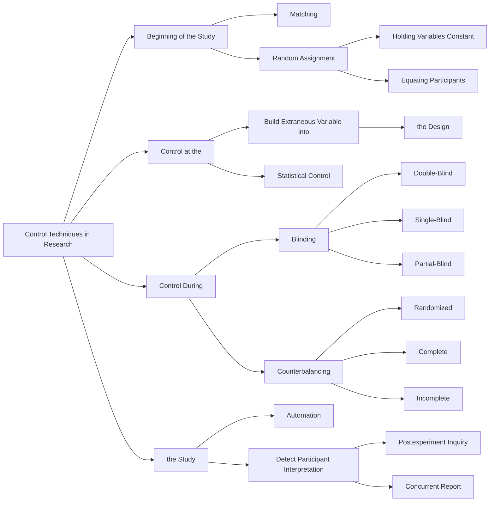
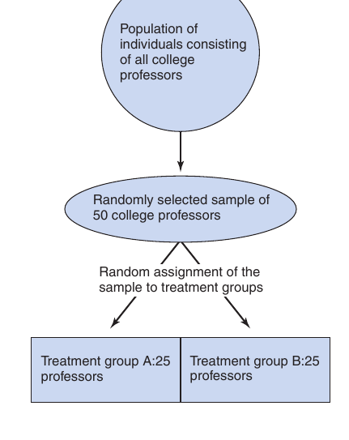
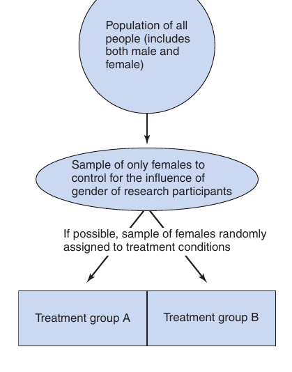
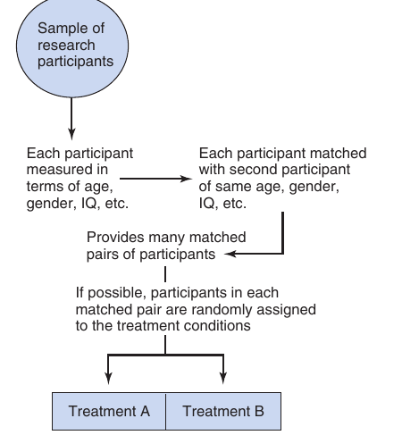
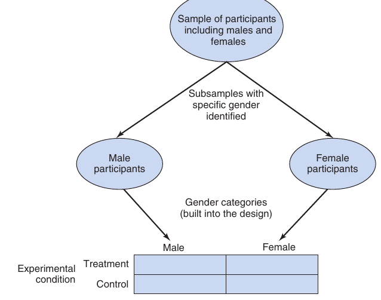
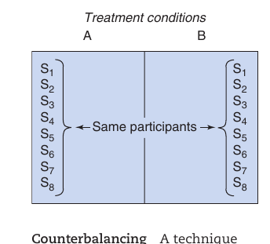
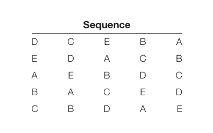

📑 <b>Table of Contents</b>

- [Chapter 7 Control Techniques in Research](#chapter-7-control-techniques-in-research)
  - [Learning Objectives](#learning-objectives)
- [Control Techniques Carried Out at the Beginning of the Study](#control-techniques-carried-out-at-the-beginning-of-the-study)
- [Random Assignment](#random-assignment)
- [Matching](#matching)
  - [Matching by Holding Variables Constant](#matching-by-holding-variables-constant)
  - [Matching by Equating Participants](#matching-by-equating-participants)
- [Building the Extraneous Variable into the Design](#building-the-extraneous-variable-into-the-design)
- [Statistical Control](#statistical-control)
- [Control Techniques Carried Out During the Study](#control-techniques-carried-out-during-the-study)
- [Counterbalancing](#counterbalancing)
  - [Randomized Counterbalancing](#randomized-counterbalancing)
  - [Complete Counterbalancing](#complete-counterbalancing)
  - [Incomplete Counterbalancing](#incomplete-counterbalancing)
- [Blind Technique](#blind-technique)
  - [Double-Blind Technique](#double-blind-technique)
  - [Single-Blind Technique](#single-blind-technique)
  - [Partial-Blind Technique](#partial-blind-technique)
- [Automation](#automation)
- [Likelihood of Achieving Control](#likelihood-of-achieving-control)
  - [Detecting Participant Interpretation](#detecting-participant-interpretation)
  - [Summary](#summary)
  - [Key Terms and Concepts](#key-terms-and-concepts)
  - [Related Internet Sites](#related-internet-sites)
  - [Practice Test](#practice-test)
  - [Challenge Exercises](#challenge-exercises)

<!-- Page 1 -->
## Chapter 7 Control Techniques in Research

### Learning Objectives

🎯 **7.1** Describe the purpose of control techniques that are carried out at the beginning of the study.
🎯 **7.2** Describe random assignment and how it controls for extraneous variables.
🎯 **7.3** Describe matching techniques and how they control for extraneous variables.
🎯 **7.4** Summarize the advantages of building an extraneous variable into your design.
🎯 **7.5** Identify the purpose of statistical control.
🎯 **7.6** Describe the purpose of the control techniques that are carried out during the study.
🎯 **7.7** Describe when counterbalancing is used, explain the different types of counterbalancing, and be able to construct counterbalanced sequences.
🎯 **7.8** Explain how the different blind techniques can be used to reduce researcher and participant effects.
🎯 **7.9** Explain automation and how it can be used to reduce researcher effects.
🎯 **7.10** Summarize the effectiveness of control techniques.

<!-- Page 2 -->

*Figure 7.1 Illustration of the ideal procedure for obtaining participants for an experiment.*

> In Chapter 5, we covered how researchers obtain their samples. We discussed several types of random sampling (e.g., simple random sampling, stratified sampling, systematic sampling, and cluster sampling) and nonrandom sampling (e.g., convenience sampling, purposive sampling, quota sampling, and snowball sampling). In this chapter, we will assume that you already have

> In the remainder of this chapter we want you to assume that you already

Remember, evidence for cause-and-effect relationships must meet our the IV precede the changes in the DV?), and (3) no plausible alternative explanation (Is there a plausible alternative explanation that could account for the relationship between the IV and DV?). This chapter primarily deals with techniques used to ensure that extraneous variables are controlled so we can eliminate alternative explanations for the relationship between the IV and DV. If we can control for the influence of extraneous variables, internal validity is achieved. Unfortunately, there are many different extraneous variables that can threaten internal validity such as those presented in Chapter 6.

The key strategy for eliminating extraneous variables as alternative or rival explanations for claims of causation is to produce a situation that holds the extraneous variables constant across the different levels of the independent variable. In an experiment, the groups (e.g., treatment and control) should have the same levels of each extraneous variable to eliminate any  **differential influence**. The *only* difference between the experimental groups should be the levels of the independent variable. The 19th-century philosopher John Stuart Mill (1806–1873) called this process the **method of difference**. When the only difference between the groups is due to the independent variable, the researcher can confidently conclude that the result of the study is due to the independent variable and not to an extraneous variable.

Many techniques have been developed over the years that enable researchers to control the influence of confounding extraneous variables. In this chapter, we discuss the more commonly used control techniques. It is important to remember that strong experimental research is the best research method for obtaining evidence of cause and effect. The strongest experimental designs include random assignment of participants to the groups forming the independent variable. This will be our first control technique discussed. When random assignment cannot be used, it is important to adopt other control techniques, such as matching. After discussing control techniques that are implemented at the beginning of a study, we discuss several techniques that are implemented during the study.

<!-- Page 3 -->
## Control Techniques Carried Out at the Beginning of the Study

🎯 **7.1** Describe the control techniques that are carried out at the beginning

**of the study.**

In experimental research, the major goal is to make sure that there are no differences between the groups (e.g., treatment and control groups). The only difference should come during the experiment in the administration of the different conditions according to your independent variable(s). At the beginning of the study this means that you should attempt to equate the groups on all worrisome extraneous variables. The four major techniques to use at the beginning of the experiment are (1) random assignment, (2) matching, (3) building the extraneous variable into the design, and (4)  statistical  control.

## Random Assignment

🎯 **7.2** Describe random assignment and how it controls for extraneous variables.

**Random assignment** (also called **randomization**) is the most important of all the control methods. Only randomized experimental research designs include the use of random assignment. Random assignment is a probabilistic control technique designed to equate experimental groups at the start of an experiment on all extraneous variables, both known and unknown. Because it “equates groups,” there will not be systematic group differences on extraneous variables to bias the study results. Random assignment is the only technique for controlling both known and unknown sources of extraneous variation. As Cochran and Cox (1957) stated in an old but classic book,

> Randomization [random assignment] is somewhat analogous to insurance, in that it is a precaution against disturbances that may or may not occur and that may or may not be serious if they do occur. It is generally advisable to take the trouble to randomize even when it is not expected that there will be any serious bias from failure to randomize. The experimenter is thus protected against unusual events that upset his [or her] expectations. (p. 8)

How does random assignment eliminate systematic bias in the experiment? The key word is *random.* The term *random* refers to the statistical characteristic of equiprobability (i.e., equal in probability) of events. Random assignment of participants to the experimental groups assures that each participant has an equal chance of being assigned to each group. In order to achieve equiprobability of events when randomly assigning participants to treatment conditions, it is necessary to use a random process, such as a random number generator as described below. When a random process is used, maximum assurance is provided that systematic differences between the groups will be eliminated. Random assignment produces control by virtue of the fact that all variables present in a group of participants will be distributed in approximately the same manner in all of the groups. When the distributions of extraneous variables are approximately equal in all groups, the influence of the extraneous variables is held constant because they cannot exert any *differential influence* on the dependent variable. For example, gender cannot be the cause of the difference found between two groups if 58% of the treatment group and 58% of the control-group participants are women; likewise, gender cannot be the cause if 30% of the treatment group and 30% of the control-group participants are women. Gender could be a problem, however, if 68% of one group and 30% of the other group were women (if gender also affects the dependent variable). The key is not the level of the extraneous variable in the groups, but that *the groups do not differ* on the level of the extraneous variable. It is a cardinal <!-- Page 4 -->
rule in experimental research that you want your groups to be equivalent on any and all extraneous variables!

Will random assignment *always* result in equal distributions of the variables to be controlled? As long as a sufficient sample size is used, a researcher can reasonably assume that random assignment will produce groups that are approximately equal. Although it is possible for random assignment to fail in any particular study, it is a relatively rare event. Consequently, a researcher can reasonably assume that the distribution and influence of the extraneous variables, both known and unknown, will be approximately the same in all groups of participants at the start of the experiment when random assignment is used to form the groups. Because the probability of the groups’ being equal is so much greater with random assignment than with any other control technique, random assignment is considered the most important and most powerful control method in experimental research. And because it is really the *only* method for controlling unknown extraneous variables, it is important to randomize whenever and wherever possible.

Consider the following example using the random assignment of participants. Professor X was conducting a study on learning. The extraneous variable intelligence is correlated with learning, so this factor must be controlled for, or equated across the groups. Let us consider two possibilities—one that provides the needed control through the use of random assignment and one that does not. Assume first that no random assignment of participants existed, but that the first 10 participants who showed up for the experiment were assigned to the control group, and the second 10 participants were assigned to the treatment group. Assume further that the results of the experiment revealed that the treatment group learned significantly faster than the control group. Is this difference caused by the treatment or by the fact that the participants in the treatment group *may* have been more intelligent than those in the control group? Suppose the investigator also considers intelligence to be a possible confounding variable and gives all participants an intelligence test. The left-hand side of Table 7.1 depicts the hypothetical distribution of IQ scores of these 20 participants. From this table, you can see that the mean IQ score of the people in the treatment group is 10.6 points higher than that

**Based on Arrival Sequence** **of Participants to Groups**

Difference between Control mean and Treatment mean: 10.6 Difference between Control mean and Treatment mean:.2

**Table 7.1** *Hypothetical Distribution of 20 Research Participants’ IQ Scores*

<table class="textbook-table" style="width: auto; max-width: 100%; border-collapse: collapse; margin: 1.5em 0;">
  <thead>
    <tr>
      <th></th>
      <th>Group Assignment</th>
      <th>Random Assignment</th>
    </tr>
  </thead>
  <tbody>
    <tr>
      <td>Control Group</td>
      <td>Treatment Group</td>
      <td>Control Group Treatment Group</td>
    </tr>
    <tr>
      <td>Participants</td>
      <td>IQ Scores Participants IQ Scores</td>
      <td>Participants IQ Scores Participants IQ Scores</td>
    </tr>
    <tr>
      <td>1</td>
      <td>97 11 100</td>
      <td>1 97 3 100</td>
    </tr>
    <tr>
      <td>2</td>
      <td>97 12 108</td>
      <td>2 97 4 103</td>
    </tr>
    <tr>
      <td>3</td>
      <td>100 13 110</td>
      <td>11 100 6 108</td>
    </tr>
    <tr>
      <td>4</td>
      <td>103 14 113</td>
      <td>5 105 12 108</td>
    </tr>
    <tr>
      <td>5</td>
      <td>105 15 117</td>
      <td>13 110 7 109</td>
    </tr>
    <tr>
      <td>6</td>
      <td>108 16 119</td>
      <td>9 113 8 111</td>
    </tr>
    <tr>
      <td>7</td>
      <td>109 17 120</td>
      <td>15 117 14 113</td>
    </tr>
    <tr>
      <td>8</td>
      <td>111 18 122</td>
      <td>10 118 16 119</td>
    </tr>
    <tr>
      <td>9</td>
      <td>113 19 128</td>
      <td>19 128 17 120</td>
    </tr>
    <tr>
      <td>10</td>
      <td>118 20 130</td>
      <td>20 130 18 122</td>
    </tr>
    <tr>
      <td>Mean</td>
      <td>106.1 116.7</td>
      <td>111.5 111.3</td>
    </tr>
    <tr class="category-header"><td colspan="3"><strong>IQ score</strong></td></tr>
  </tbody>
</table>

<!-- Page 5 -->
of those in the control group. Intelligence is, therefore, a potentially confounding extraneous variable and serves as an alternative explanation for the observed performance difference in the two groups. The experimental group may have performed better than the control group because they were more intelligent (not because of the experimental treatment). To state that the treatment produced the observed effect, researchers must control for potentially  confounding extraneous variables such as IQ.

One means of eliminating such a bias is to randomly assign the 20 participants to the two treatment and control groups. The right-hand side of Table 7.1 depicts the random distribution of the 20 participants and their corresponding hypothetical IQ scores. Now note that the mean IQ scores for the two groups are very similar. There is only a.2-point IQ difference as opposed to the prior 10.6-point difference. In addition to similar mean IQ scores, both groups of participants must have a similar distribution of IQ scores, the effect of which is to control for the potential biasing effect of IQ. The IQ scores in Table 7.1 have been rank-ordered to show this similar distribution.

Remember, we illustrated the use of a random number generator in Chapter 5 for use in random selection. That same random number generator (http://randomizer. org) can be used for random assignment. Let’s assume that you have 60 participants, and you want to randomly assign them to three groups, with 20 people in each group. Here’s how to use the randomizer.org program for random assignment. Go to the website and answer the questions as follows:

**1.**How many sets of numbers do you want to generate?

> - Insert 20 (which is your total number of participants divided by the number of groups; in our case this is 60 &gt; 3 = 20).

**2.**How many numbers per set?

- Insert 3 (which is the number of groups we want).

**3.**Number range?

> - Insert 1 and 3 (which will order the list of numbers into blocks, including the numbers 1, 2, and 3).

**4.**Do you wish each number in a set to remain unique?

- Click “yes” so that every block of three numbers will include the numbers 1, 2, and 3.

**5.**Do you wish to sort the numbers that are generated?

- Click “no.”

**6.**How do you wish to view your random numbers?

- Leave the program at its default value (“place markers off”).

**7.**To obtain your list of random numbers organized into blocks of 1, 2, and 3, click

“Randomize Now!”

Here is the blocked list of random numbers that we obtained when we ran the program: 3,2,1, 1,3,2, 3,2,1, 2,1,3, 2,3,1, 2,1,3, 2,1,3, 1,3,2, 3,1,2, 3,2,1, 2,3,1, 3,1,2, 1,3,2, 2,1,3, 2,1,3, 3,2,1, 3,1,2, 2,1,3, 2,1,3, 1,3,2 (we underlined the blocks for clarity). To use these numbers, start with the first block, and place your first participant in group 3, the second participant in group 2, and the third in group 1; then go to the second block and place the fourth participant in group 1, the fifth participant in group 3, and the sixth participant in group 2; continue this process until you have used all of the 60 numbers in the list. The 60 participants will have been randomly assigned to the three groups, and you will have 20 people in each group. Now you know how to randomly assign your participants to groups! This is the best way to equate your groups on extraneous variables and eliminate alternative explanations for your findings.

<!-- Page 6 -->
> [!TIP] **Study Questions 7.1**
> - Why is random assignment the most important control technique?
>
> - How does random assignment control for the confounding effect of extraneous  variables?
>
> - How does one randomly assign a set of participants to groups to be used in an experiment?

## Matching

🎯 **7.3** Describe matching techniques and how they control for extraneous variables.

Although random assignment is the best control technique available in experimental research, random assignment is not always possible or expedient. When random assignment is not possible, **matching** can be an effective technique to equate groups if the researcher has the information required for matching. For example, if you wish to match participants on intelligence, you will need to know their intelligence scores. The strength of matching is that it ensures that participants in the different groups are equated on the **matching variable**(s). The variables on which participants are matched are controlled because those variables are equated across the groups. If participants in different conditions are matched on intelligence, then the intelligence level of the research participants will be the same in each group and therefore controlled. The key weakness of matching is that the groups are equated only on the matching variables. The groups may differ on other variables that were not used in matching. If you can combine matching with random assignment (e.g., match pairs of participants and then randomly assign them to treatment and control groups), this problem is eliminated because random assignment equates the groups on known and unknown extraneous variables. In the sections that follow, we present several ways in which matching is accomplished.

### Matching by Holding Variables Constant

> One technique that can be used to control an extraneous variable is to hold the extraneous variable constant for all participants in the study.

> Although sometimes used, the technique of holding variables constant

*Figure 7.2 Illustration of matching by holding variables constant.*

<!-- Page 7 -->
### Matching by Equating Participants

Matching by equating participants controls for the extraneous variable by ensuring that different groups are equivalent on the matched variable. This kind of matching is called **individual matching** (or **subject matching**).

Individual matching is illustrated in Figure 7.3. This technique requires the investigator to match participants on a case-by-case basis for each matching variable (i.e., the extraneous variable used in matching). The figure shows that you start with a sample of participants to participate in your research study. Then you order them on the matching variable. For example, you could rank all of the participants from lowest to highest IQ scores. Next you match participants; if you have two treatment groups, then the two participants with the lowest IQ scores would be your first set. You would then randomly assign each of these two individuals to one of the two treatment groups. You continue this process until you get to the two participants with the highest IQ scores and randomly assign each of them to one of the two groups. (Note that if you had three treatment groups rather than two, you would work your way from lowest to highest IQ scores in sets of three rather than two, and randomly assign to the three treatment groups.)

The technique we just described is used in strong experimental research where you can randomly assign each set of matched participants to the treatment groups. This is an excellent strategy to make the best control technique (i.e., random assignment) even better. Individual matching is also used in quasi-experimental research (where random assignment is not present) and in nonexperimental research (where there is neither random assignment nor active manipulation of the independent variable). A technique often used in quasi- and nonexperimental research is to start with the group that has the condition of interest to you, and then you search for similar people (on the matching variables) until you have constructed a satisfactory control or comparison group.

Averbeck, Bobin, Evans, and Shergill (2012) used matching in a nonexperimental study. These researchers investigated the emotion recognition skills of individuals with schizophrenia compared to individuals without schizophrenia. The researchers could not manipulate schizophrenia and therefore could not randomly assign participants to groups. The comparison group included participants who did not have schizophrenia and were matched on gender, age, and IQ to the participants with schizophrenia.

The Averbeck et al. study illustrates the advantages and disadvantages of individual matching. The primary advantage is that the participants in the various groups are equal on the matched variable or variables; that is, *the groups are equated on the matching variables*, which rules out these extraneous variables as rival explanations for the relationship between the independent and dependent variables. In the Averbeck et al. study, a critic would not be able to claim that the relationship observed between schizophrenia and emotion recognition was due to the extraneous variables used in matching (i.e., age, gender, and IQ) because the groups were the same on those variables.

Individual matching has three major disadvantages when used without random assignment as its final step. First, it is difficult to know which matching variables should be used and which of the potential matching variables are most critical. The logic of matching is to identify the variables that are likely to affect the DV and that the comparison groups may differ on and to match on those variables. In many instances, the researcher does not know what extraneous variables the groups differ on, and there often are many potentially relevant variables. Averbeck et al. selected age, gender, and IQ, but many other variables could have been selected. (From

*Figure 7.3 Illustration of individual matching technique.*

<!-- Page 8 -->
a statistical standpoint, the variables selected should be those that show the lowest intercorrelation but the highest correlation with the dependent variable.)

A second problem encountered in individual matching is that the difficulty in finding matched participants increases disproportionately as the number of matching variables increases. In order to match individuals on many variables, one must have a large pool of individuals available in order to obtain a few who are matched on the relevant variables.

A third problem is that matching can limit the generalizability of the results of the study. This will occur if you have to throw out participants for whom you cannot find adequate matches. When you start eliminating certain kinds of people, you will produce unrepresentative samples. You will only be able to generalize to the kinds of people that remain in your study. A fourth disadvantage is that some variables are very difficult to use in matching. If having received psychotherapy was considered a relevant variable, an individual who had received psychotherapy would have to be matched with another person who had also received psychotherapy. A related difficulty is the inability to obtain adequate measures of the variables to be matched. If we wanted to equate individuals on the basis of the effect of psychotherapy, we would have to measure such an effect. Matching can only be as accurate as the available measurement of the matching variable.

## Building the Extraneous Variable into the Design

🎯 **7.4** Summarize the advantages of building an extraneous variable into your

**design.**

Another useful way to control the effect of one or more extraneous variables is to build the extraneous variable into the research design so that you can systematically study its effects. This is often done when you also have theoretical interest in the extraneous variable. (In the psychological literature, this technique sometimes is called “blocking.”) This idea is demonstrated in Figure 7.4. Assume that we are conducting an aggression study and want to control for the effects of gender. Also assume that we considered the technique of holding the variable constant by selecting only males but thought it unwise and inexpedient to do so. Instead, we decided to treat gender as an independent variable of interest to the research. This allows us to control for and detect the influence of the gender variable. Therefore, gender is not confounded with the IV because we can examine the effects of the IV separately for males and females.

Building the extraneous variable into the research design is a good technique for achieving control over the extraneous variable. The technique is recommended if we are interested in the differences produced by the various levels of the extraneous variable or in the interaction between the extraneous variable and other independent variables. In the hypothetical aggression study, we might be interested in the differences between males and females and how these differences may

*Figure 7.4 Illustration of building the extraneous variable into the research design.*

<!-- Page 9 -->
interact with the experimental conditions. Perhaps the treatment condition results in less aggression for males but has no effect on females. By including gender as another variable in your design, you would discover this nuanced effect. This control technique takes a factor that can operate as a confounding extraneous variable and investigates it. This allows you to advance understanding of both of the variables and how they interact.

## Statistical Control

🎯 **7.5** Identify the purpose of statistical control.

Control can also be accomplished by measuring the relevant extraneous variables in the study design and then using statistical control during data analysis. Remember, you can only statistically control for variables that you have measured. This form of control is called **statistical control** because it is accomplished during the statistical analysis of the data. Statistical control is much more important in quasi-experimental designs and nonexperimental designs than in randomized experimental designs. It is wise for the researcher to determine all of the relevant extraneous variables, measure those variables, and then control for those variables during data analysis. There are many statistical analysis procedures that can be used for statistical control. We explain how to carry out this type of statistical analysis in the chapter on inferential statistics (i.e., Chapter 16).

> [!TIP] **Study Questions 7.2**
> - What are the strengths and weaknesses of matching?
>
> - What are the strengths and weaknesses of building the extraneous variable into the design?
>
> - Describe statistical control?

## Control Techniques Carried Out During the Study

🎯 **7.6** Describe the major control techniques that are carried out during the study.

Up to this point, we have explained how to control extraneous variables at the outset of a research study. Unfortunately, extraneous variables also can enter into a study during the conduct of the study. A key point here is as follows: *In an experiment you* *must treat the different groups in the same way during the conduct of the experiment, except* *for administration of the different levels of the independent variable.* We now explain the most important control techniques employed during the study.

## Counterbalancing

🎯 **7.7** Describe when counterbalancing is used, explain the different types of

> **counterbalancing, and be able to construct counterbalanced sequences.**

In most experiments, the different groups are composed of different participants, and our goal has been to make sure the participants in the different groups are similar (i.e., the groups are “equated”). In another type of experimental design, called the repeated

<!-- Page 10 -->

*Figure 7.5 Illustration of the type of design that might include sequencing effects.*

measures design (or a within-participants design), all research participants receive all treatments. The idea of this type of experiment is shown in Figure 7.5 (and discussed in depth in Chapter 9). A key point here is that *the control method of* ***counterbalancing***

When all participants receive all treatments but at different times (as in the withinthen 1, and the third participant might receive condition 3, then 1, then
2. Again, sequencing effects can occur when participants participate in more than one treatment condition. There are two types of sequencing effects. The first is an **order** **effect**, which arises from the order in which the treatment conditions are administered to the participants. Changes that occur over time within a repeated measures experiment will result in order effects because the participant has changed somewhat from the first condition to the last condition, regardless of what treatments are administered. Suppose that you are conducting a learning experiment in which the independent variable is rate of presentation of words. The participant has to learn, sequentially, word list S (the slow list, in which the words are presented at 6-second intervals), then word list M (the moderate list, in which the words are presented at 4-second intervals), and finally word list F (the fast list, in which the words are presented at 2-second intervals). In this experiment, it is possible that extraneous variables such as practice with the equipment, learning how to work with the memory task, or becoming more familiar with the experimental environment will enhance performance.

Let us assume that one or more of these extraneous variables does enhance performance and that the increment due to this order effect is 4 units of performance for participants progressing from list one to list two (S to M) and 2 units of performance for participants progressing from list two to list three (M to F). The left half of Table 7.2 depicts these order effects. As you can see, order effects could affect the conclusions reached because of the performance increments due to the order of the lists. When the increment in performance is caused by order effects, conclusions about the effect of the list type would be misleading. If the order of the lists were reversed, the increments in performance due to ordering would occur in the same ordinal position, as is shown in the right half of Table 7.2. The key point is that participants’ increased familiarity and practice with the whole experimental environment can produce order effects such as the ones shown in the table. Other experimental factors, such as the time of testing (morning, noon, or night), can also produce order effects. Such effects must be controlled to avoid reaching false conclusions.

**Table 7.2** *Hypothetical Order Effects*

<table class="textbook-table" style="width: auto; max-width: 100%; border-collapse: collapse; margin: 1.5em 0;">
  <thead>
    <tr>
      <th></th>
      <th>List Learned</th>
      <th>Reversed Order of List</th>
    </tr>
  </thead>
  <tbody>
    <tr>
      <td>Increment in performance</td>
      <td>0 4</td>
      <td>2 0 4 2</td>
    </tr>
  </tbody>
</table>

The second type of sequencing effect that can occur is a carryover effect. A **carryover effect** occurs when performance in a treatment condition is affected by the treatment condition that preceded it. Consider an experiment studying the relative effectiveness of three types of therapy (e.g., client-centered therapy, rational–emotive therapy, and Gestalt therapy). Perhaps participants tend to be relaxed after clientcentered therapy and somewhat on edge after rational–emotive therapy, and these effects carry over to any subsequent conditions, changing the apparent effectiveness of the later treatment conditions. Counterbalancing can control for these carryover effects. Another strategy for minimizing carryover effects is to provide a sufficient time period between conditions for the effects of the previous condition to wear off. This sometimes is called the “wash out” period. Use of washout periods is especially important in drug studies and learning studies, or any other type of study where the effects linger over some period of time.

<!-- Page 11 -->

*S* *M* *F* *F* *M* *S*

Order effects and carryover effects are potential sources of bias in any studies in which the participant takes part in several treatment conditions. In such cases, the sequencing effects need to be controlled, and researchers often use counterbalancing. We now discuss several counterbalancing techniques for dealing with sequencing effects.

### Randomized Counterbalancing

When counterbalancing at the individual level, the method of choice for controlling for sequencing effects is to randomize the sequence of the treatment conditions across the participants. In **randomized counterbalancing**, in effect, the experiment is replicated for each participant using different counterbalanced sequences. This is done by randomly generating and assigning a sequence to each research participant. If you have a sufficient number of participants in a study, randomizing the sequences of treatment conditions ensures that each sequence occurs in each ordinal position approximately the same number of times and each condition occurs before and after each other condition approximately the same number of times. As a result, sequencing effects will be equally distributed across the conditions and eliminated as threats to the internal validity of your research study.

For an example, assume that you have an independent variable with three levels (e.g., client-centered therapy, rational–emotive therapy, and Gestalt therapy). In this case, you have three treatment groups. When you have three treatments, there are six possible sequences in which the conditions can be presented to participants: 1,2,3; 1,3,2; 2,3,1; 2,3,2; 3,1,2; and 3,2,1. You could use the same random number generator we used earlier for this process of assigning each participant a random ordering of the numbers 1, 2, and
3. In your research study, participant one might receive sequence 2,3,1; participant two sequence 2,1,3; participant three sequence 3,1,2, and so forth. The randomized procedure is used until you have determined the sequence for the last research participant. It is essential that you remember that you do not decide the sequence; you must use a random process such as a random number generator.

### Complete Counterbalancing

In  **complete counterbalancing**, all possible sequences of the treatment conditions are used in the experiment, and an equal proportion of research participants are randomly assigned to each sequence. When there are two treatment conditions, there are just two possible sequences, which are as follows:

1,2 2,1

If there are three treatment conditions, there are six possible sequences:

1,2,3 1,3,2 2,3,1 2,1,3 3,1,2 3,2,1

<!-- Page 12 -->
When using complete counterbalancing, it is important that an equal number of research participants are randomly assigned to each of the sequences.

A limitation of complete counterbalancing is that when the number of treatment conditions is large, the number of possible sequences becomes unwieldy. You can determine the number of possible sequences by calculating *N*! (called “*N* factorial”). 1 The number of treatment conditions is symbolized by “*N*,” and the “!” symbol means you multiply *N* by the numbers falling below it: *N* times *N* - 1 times *N* - 2, and so on, until you reach
1. For example, if you have three groups, then *N* is 3 and *N*! is 3 times 2 times 1 (which is 6; i.e., 3 * 2 = 6 and 6 * 1 = 6). For four groups, *N*! is 4 times 3 times 2 times 1 (which is 24; i.e., 4 * 3 = 12, 12 * 2 = 24, and 24 * 1 = 24). For five groups, *N*! is 5 times 4 times 3 times 2 times 1 (which is 120). As you can see, the possible number of sequences was fully 120 for just five conditions! Because of this problem, complete counterbalancing is rarely used when the researcher has three or more treatment conditions.

### Incomplete Counterbalancing

The most frequently used group counterbalancing technique is **incomplete** **counterbalancing**. This technique derives its name from the fact that all possible sequences of treatment conditions are *not* employed. The first criterion that incomplete counterbalancing must meet is that, for the sequences employed, each treatment condition must appear an equal number of times in each ordinal position. Also, each treatment condition must precede and be followed by every other condition an equal number of times.

Assume that you are conducting an experiment to determine whether caffeine affects reaction time. You want to administer 100, 200, 300, and 400 mg of caffeine (conditions A, B, C, and D, respectively) to participants to see whether reaction time increases as the amount of caffeine consumed increases. You know that if each participant takes all four doses of caffeine in the same order, sequencing effects could alter the results of your experiment, so you want to counterbalance the order in which the dosages are administered to the participants. Whenever the number of treatment conditions is even, as is the case with the four caffeine dosages, the number of counterbalanced sequences equals the number of treatment conditions. The sequences are established in the following way. The first sequence takes the form 1, 2, *n*, 3, (*n* - 1), 4, (*n* - 2), 5, and so forth, until we have accounted for the total number of treatment conditions. In the case of the caffeine study with four treatment conditions, the first sequence would be ABDC, or 1, 2, 4, 3. If an experiment consisted of six treatment conditions, the first sequence would be ABFCED, or 1, 2, 6, 3, 5, 4. The remaining sequences of the incomplete counterbalancing technique are then established by incrementing each value in the preceding sequence by
1. For example, for the caffeine study, in which the first sequence is ABDC, the second sequence is BCAD. Naturally, to increment the last treatment condition, D, by 1, you do not proceed to E but go back to A. This procedure results in the following set of sequences for the caffeine study.

> **Participant** **Sequence** 1 A $\rightarrow$ B $\rightarrow$ D $\rightarrow$ C 2 B $\rightarrow$ C A $\rightarrow$ D 3 C $\rightarrow$ D $\rightarrow$ B A 4 D A $\rightarrow$ C $\rightarrow$ B

If the number of treatment conditions is odd, as with five treatment conditions, the criterion that each value must precede and follow every other value an equal

[^1]: You can easily find a factorial calculator on the Web. Here is one: https://goodcalculators.com/ factorial-calculator/

<!-- Page 13 -->

*Diagram*

number of times is not fulfilled if the above procedure is followed. For example, the foregoing procedure would give the following set of sequences:

> **Sequence** A $\rightarrow$ B $\rightarrow$ E $\rightarrow$ C B $\rightarrow$ C A $\rightarrow$ D C $\rightarrow$ D $\rightarrow$ B $\rightarrow$ E D $\rightarrow$ E $\rightarrow$ C A E A $\rightarrow$ D $\rightarrow$ B D E A B C

In this case, each treatment condition appears in every possible position; but, for example, D is immediately preceded by A twice but never by B. To remedy this situation, we must enumerate five additional sequences that are exactly the reverse of the first five sequences. In the five-treatment-condition example, the additional five sequences appear as follows:

When these 10 sequences are combined, the criteria of incomplete counterbalancing are met. Consequently, the incomplete counterbalancing technique provides for control of most sequencing effects.

How well does the incomplete counterbalancing technique control for sequencing effects? The influence of sequencing effects is controlled because every treatment condition occurs at each possible position in the sequence. In other words, every condition (A, B, C, and D) precedes and follows every other condition an equal number of times. However, sequencing effects are controlled only if they are linear for all sequences. If they are not, then all types of counterbalancing are inadequate. More specifically, no type of counterbalancing controls for **differential carryover effect**. This problem occurs if an earlier administration of a treatment affects participants’ performance in a later treatment condition in one way, but in a different way when followed by a different treatment condition. For example, perhaps the carryover from treatment A is 4 units when it is immediately followed by treatment B, but the carryover from treatment A is 2 units when it is immediately followed by treatment C. To learn more about identifying and dealing with differential carryover effects see Keppel and Zedeck (1989) and Maxwell, Delaney, and Kelley (2018).

> [!TIP] **Study Question 7.3**
> What are the strengths of the counterbalancing techniques discussed?

## Blind Technique

🎯 **7.8** Explain how the different blind techniques can be used to reduce researcher

**and participant effects.**

In Chapter 6, you learned that participants’ behavior in research can be influenced by the perceptions and motives they bring with them. We noted the implications of <!-- Page 14 -->
demand characteristics (cues in the study that might influence participant behavior) and positive self-presentation (participants’ motivation to present themselves in a positive light). You also learned that researcher expectancies (the researcher’s expectations about the outcome) and researcher attributes (biopsychosocial characteristics) can inadvertently affect participant behavior in a study. For internal validity to be obtained, participant and researcher effects must be controlled. Only then can a researcher state with certainty that administration of the independent variable caused the variation in the dependent variable. The blind technique is one method of controlling participant and researcher effects.

### Double-Blind Technique

One of the best techniques for reducing participant and researcher effects is the **double-blind technique**. This requires that the researcher “devise manipulations that appear essentially identical to research participants in all conditions” (Aronson &amp; Carlsmith, 1968) and that the researcher not know which group received the placebo condition or the experimental manipulation. Both the participant and the researcher are “blind” to any differences between the conditions.

If you were conducting an experiment designed to test the effect of aspartame on disruptive behavior in young children, you would have to administer this sweetener to one group of children and a placebo to another group. To make this a double-blind experiment, the researcher must not know whether a given participant received the aspartame or the placebo in order to avoid communicating any researcher expectancy, and participants in both the aspartame and the placebo conditions must have the same perceptions of their condition. They cannot know which condition they are in. In short, the researcher as well as the participant must be “blind” to the treatment condition that a given participant received. For some time, drug research has recognized the influence of patients’ and providers’ expectations on their experiences when taking a drug. Thus, drug research consistently uses the double-blind placebo technique to control for the influence of these perceptions.

Use of the double-blind technique is a way to eliminate the development of differential participant perceptions because all participants are told the same thing (that they might or might not receive the treatment). And because the researcher does not know which participants have received the experimental treatments, he or she cannot communicate this information to the participants. Therefore, the demand characteristics surrounding the administration of the conditions are controlled by using the double-blind technique.

Unfortunately, many types of experiments cannot use a double-blind technique because all conditions cannot be made to appear identical in all respects. In such cases, other techniques must be employed.

### Single-Blind Technique

The **single-blind technique** actually corresponds to half of the double-blind technique. In the single-blind technique, the participant is blind as to which treatment condition he or she is in. If the participant is “blind,” participant interpretation and positive-self-presentation effects should be consistent across the treatment and control groups. However, in many studies, it is impossible to remain ignorant of the condition the participant is in.

### Partial-Blind Technique

In cases where the double-blind technique cannot be employed, it is sometimes possible to use the **partial-blind technique**, whereby the researcher and/or the participant is kept ignorant of the condition the participant is in *for a portion of the study*. The researcher or participant could remain blind while initial contact was made and <!-- Page 15 -->
during all conditions prior to the actual presentation of the independent variable. When the treatment condition is administered to the participant, the researcher could use random assignment to designate which condition the participant is in. Therefore, all instructions and conditions prior to the manipulations would be standardized and researcher expectancy effects and participant effects would be minimized.

## Automation

🎯 **7.9** Explain automation and how it can be used to reduce researcher effects.

A final possibility for reducing researcher effects in animal and human research is total **automation** of the study. Indeed, numerous animal researchers currently use automated data collection procedures. Many human studies can also be completely automated by having instructions written, tape-recorded, filmed, televised, or presented by means of a computer, and by recording responses via timers, counters, pen recorders, computers, or similar devices. These procedures are easily justified to the participant on the basis of control and standardization, and they minimize the participant–researcher interaction. Therefore, researcher expectancy and researcher attribute effects are reduced. Also, when automation is used for data collection, data recording errors are reduced.

> [!TIP] **Study Questions 7.4**
> - What techniques can be used to control for participant and researcher effects?
>
> - How does each technique produce the necessary control?

## Likelihood of Achieving Control

🎯 **7.10** Summarize the effectiveness of control techniques.

We have looked at several categories of extraneous variables that need to be controlled and a number of techniques for controlling them. Do these methods allow us to achieve the desired control? Are they effective? The answer to these questions seems to be both yes and no. The control techniques are effective, but not 100% effective. The key is to use the strongest control methods available and to do your best to collect additional data to help determine how well the control techniques have worked. One way to determine how well your control techniques work is to use strategies to help you understand the participants’ interpretation of your study. If you understand the participants’ perceptions, you may be able to better interpret your findings and to design future studies to address issues related to participant perceptions. Below are a few methods that are effective at bringing to light participant interpretation.

### Detecting Participant Interpretation

A variety of techniques that can be used to gain insight into participants’ perceptions of a study are summarized in Christensen (1981) and Adair and Spinner (1981). These methods can be grouped into two categories: retrospective verbal reports and concurrent verbal reports. A **retrospective verbal report** is obtained using a technique such as the **postexperimental inquiry**, which is exactly what it says it is—questioning the participant regarding the experiment after completion of the study. What did the participant think the study was about? What did he or she think the researcher expected to find? What type of response did the participant attempt to give, and why? How <!-- Page 16 -->
does the participant think others will respond in this situation? Such information
**Concurrent verbal report**
A participant’s oral report of the will help to expose the participant’s perception and ways that perception might have experiment, which is obtained as influenced behavior. The primary disadvantage of retrospective reporting is that par- the  experiment is being performed ticipants might fail to recall and report perceptions they had earlier in the experiment.
**Concurrent verbal reports**  include techniques such as Solomon’s sacrifice group
**Sacrifice groups**
Groups of par- (Orne, 1973), concurrent probing, and the think-aloud technique (Ericsson &amp; Simon, ticipants who are stopped and in- 1980). In Solomon’s **sacrifice groups** , each group of participants is “sacrificed” by being terviewed at different stages of the experiment stopped at a different point in the study and questioned regarding the participants’ per- ceptions of the study. You will not have data on the dependent variable from the partici-
**Concurrent probing**
Obtaining pants that are “sacrificed,” but you will gain insight into how the study is understood by a participant’s perceptions of the the participants. “Sacrificing” can be done at different points in the procedure, not just at experiment after completion of the end, as in retrospective reporting. **Concurrent probing**  requires participants to report each trial their perceptions at the end of each trial of the study. The **think-aloud technique**  requires
**Think-aloud technique**
A method participants to verbalize any thoughts or perceptions they have regarding the study while that requires participants to they are performing the study. The obvious disadvantage to concurrent probing and the verbalize their thoughts as they think-aloud technique is that verbalizing one’s thoughts during the study often affects are performing the experiment participants’ behavior and, therefore, the dependent variable (Wilson, 1994). Study Question 7.5 Assume you want to identify the research participants’ perception of the purpose of the study. What are the various ways in which you could accomplish this purpose, and how do they operate? None of the techniques presented here is foolproof or without disadvantages. However, the use of these methods will provide some evidence regarding research participants’ perceptions of the study and will enable you to interpret your cur- rent study more accurately and design future studies to minimize these participant effects.

### Summary

In conducting research that attempts to identify a causal relationship, the researcher must accomplish one important task: controlling for the influence of extraneous vari- ables. In experiments that have more than one group (e.g., treatment group and con- trol group), the desired outcome is for the groups to be equivalent on all extraneous variables *except* for the independent variable (i.e., the different groups get the different levels of the independent variable). When the only difference between the groups is due to the independent variable, the researcher can legitimately claim that differ- ences between the groups on the dependent variable at the end of the experiment are due to the independent variable. Most control techniques operate by attempting to equate the groups; the idea is to eliminate differential influence of extraneous vari- ables. Following are four main control techniques carried out at the beginning of the experiment: random assignment of participants to groups (which is the best control technique), matching, statistical control, and building the extraneous variable into the design. Here are the matching techniques covered: matching by holding variables constant (i.e., only use one level of the extraneous variable; e.g., only use females in the study) and matching by equating participants on matching variables. Control techniques carried out during the experiment were also discussed. They include coun- terbalancing (randomized counterbalancing, complete counterbalancing, and incom- plete counterbalancing), methods for dealing with researcher and participant effects

<!-- Page 17 -->
(including double-blind, single-blind, partial blind, and automation), and methods for discovering participant interpretation (including retrospective verbal reports  obtained in a postexperimental inquiry and concurrent verbal reports such as sacrifice groups, concurrent probing, and the think-aloud technique).

## 🗂️ Chapter Key Terms & Active Recall

> 💡 **Learning tip:** Try to recall the definition of each term *before* clicking to reveal it.
> This active retrieval practice strengthens long-term memory far more than re-reading.

📇 <b>Differential influence</b> *(p. 2)*

> **Definition:** When the influence of an extraneous variable is different for the various groups

📇 <b>Method of difference</b> *(p. 2)*

> **Definition:** If groups are equivalent on every variable except for one, then that one variable is the cause of the difference between the groups

📇 <b>Random assignment</b> *(p. 3)*

> **Definition:** Control technique that equates groups of participants by ensuring every member an equal chance of being assigned to any group

📇 <b>Randomization</b> *(p. 3)*

> **Definition:** A synonym for random assignment. It refers to the chance process.

📇 <b>Matching</b> *(p. 6)*

> **Definition:** Using any of a variety of techniques for equating participants on one or more variables

📇 <b>Matching variable</b> *(p. 6)*

> **Definition:** The extraneous variable used in matching

📇 <b>Individual matching</b> *(p. 7)*

> **Definition:** A matching technique in which each participant is matched with another participant on selected variables

📇 <b>Subject matching</b> *(p. 7)*

> **Definition:** Synonym for individual matching.

📇 <b>Statistical control</b> *(p. 9)*

> **Definition:** Control of measured extraneous variables during data analysis

📇 <b>Counterbalancing</b> *(p. 10)*

> **Definition:** A technique used to control for sequencing effects

📇 <b>Order effect</b> *(p. 10)*

> **Definition:** A sequencing effect arising from the order in which the treatment conditions are administered to participants

📇 <b>Carryover effect</b> *(p. 10)*

> **Definition:** A sequencing effect that occurs when performance in a treatment condition is affected by the treatment condition that preceded it.

📇 <b>Randomized counterbalancing</b> *(p. 11)*

> **Definition:** Sequence order of the treatment conditions is randomly determined for each individual

📇 <b>Complete counterbalancing</b> *(p. 11)*

> **Definition:** Enumerating all possible sequences and requiring different groups of participants to take different sequences

📇 <b>Incomplete counterbalancing</b> *(p. 12)*

> **Definition:** Systematically enumerating fewer than all possible sequences and requiring different groups of participants to take the different sequences

📇 <b>Differential carryover effect</b> *(p. 13)*

> **Definition:** A treatment condition affects participants’ performance in a later condition one way but in a different way when followed by a different condition

📇 <b>Double-blind technique</b> *(p. 14)*

> **Definition:** Neither the researcher nor the participant is aware of the treatment condition administered to the participant

📇 <b>Single-blind technique</b> *(p. 14)*

> **Definition:** A method where the research participant is not aware of the treatment condition he or she is in.

📇 <b>Partial-blind technique</b> *(p. 14)*

> **Definition:** A method whereby knowledge of each research participant’s treatment condition is kept from the researcher and/or participant through as many stages of the experiment as possible

📇 <b>Automation</b> *(p. 15)*

> **Definition:** The technique of totally automating the experimental procedures so that no researcher– participant interaction is required

📇 <b>Retrospective verbal report</b> *(p. 15)*

> **Definition:** An oral report in which the participant retrospectively recalls aspects of the experiment

📇 <b>Postexperimental inquiry</b> *(p. 15)*

> **Definition:** Asking the participants for their impressions of the study after they complete the study

📇 <b>Concurrent verbal report</b> *(p. 16)*

> **Definition:** A participant’s oral report of the experiment, which is obtained as the experiment is being performed

📇 <b>Sacrifice groups</b> *(p. 16)*

> **Definition:** Groups of participants who are stopped and interviewed at different stages of the experiment

📇 <b>Concurrent probing</b> *(p. 16)*

> **Definition:** Obtaining a participant’s perceptions of the experiment after completion of each trial

📇 <b>Think-aloud technique</b> *(p. 16)*

> **Definition:** A method that requires participants to verbalize their thoughts as they are performing the experiment

### Key Terms and Concepts

| Term | Term | Term |
| --- | --- | --- |
| [Automation *p. 145*](#term-automation) | [Incomplete counterbalancing *p. 142*](#term-incomplete-counterbalancing) | [Randomization *p. 133*](#term-randomization) |
| [Carryover effect *p. 140*](#term-carryover-effect) | [Individual matching *p. 137*](#term-individual-matching) | Randomized |
| [Complete counterbalancing *p. 141*](#term-complete-counterbalancing) | [Matching *p. 136*](#term-matching) | [counterbalancing *p. 141*](#term-counterbalancing) |
| [Concurrent probing *p. 146*](#term-concurrent-probing) | [Matching variable *p. 136*](#term-matching-variable) | [Retrospective verbal report *p. 145*](#term-retrospective-verbal-report) |
| [Concurrent verbal report *p. 146*](#term-concurrent-verbal-report) | [Method of difference *p. 132*](#term-method-of-difference) | [Sacrifice groups *p. 146*](#term-sacrifice-groups) |
| [Counterbalancing *p. 140*](#term-counterbalancing) | [Order effect *p. 140*](#term-order-effect) | [Single-blind technique *p. 144*](#term-single-blind-technique) |
| [Differential carryover effect *p. 143*](#term-differential-carryover-effect) | [Partial-blind technique *p. 144*](#term-partial-blind-technique) | [Statistical control *p. 139*](#term-statistical-control) |
| [Differential influence *p. 132*](#term-differential-influence) | [Postexperimental inquiry *p. 145*](#term-postexperimental-inquiry) | [Subject matching *p. 137*](#term-subject-matching) |
| [Double-blind technique *p. 144*](#term-double-blind-technique) | [Random assignment *p. 133*](#term-random-assignment) | [Think-aloud technique *p. 146*](#term-think-aloud-technique) |

### Related Internet Sites

- <http://www.randomizer.org>
  This site permits the user, or student, to randomly sample participants from a defined populationon or to randomly assign participants to an experimental treatment condition.

- <http://skepdic.com/experimentereffect.html>
  This site gives a good example of experimenter expectancy effects and how they can influence the outcome of a study.

### Practice Test

*The answers to these questions can be found in the Appendix.*

**1.** If you could use only one control technique, which
one should you use?
a.  Random assignment of participants to groups
b.  Matching by holding variables constant
c.  Automation

**2.** Assume that you wanted to investigate the effect
of caffeine on a person’s ability to identify the number of times the letter *q* appeared in a page filled with a random list of letters. To control for the extraneous variable of a person’s reaction time, you divided people into those who had high and low reaction times and then included this differ- ence in reaction time as another independent vari- able in the design of your study. By controlling for the possible influence of reaction time in this way you
a.  Randomly assigned participants to reaction time
groups
b.  Counterbalanced by having participants in each
reaction-time group c.  Built the extraneous variable into the design of the
study
d.  Used the blind technique, because the people did
not know if their reaction times were fast or slow

**3.** Matching is most appropriate when you
a.  Need to control for a small number of known
extraneous variables
b.  Need to control for a large number of known
extraneous variables
c.  Need to control for a small number of unknown
extraneous variables
d.  Need to control for extraneous variables that
cannot be effectively measured

**4.** Assume you wanted to find out if alcohol increased a
person’s aggressiveness. To test this hypothesis, you wanted to test people’s aggressiveness while they were under the influence of alcohol and while they were not. However, you know that you are asking the same people to perform under two conditions <!-- Page 18 -->
and that performing once might change their per- formance on the second occasion. To control for this effect, you elect to
a.  Randomly select the research participants from the
larger group of people who volunteer for the study
b.  Match the people who participate in terms of their
sensitivity to alcohol
c.  Counterbalance the administration of the alcohol
and no-alcohol conditions

**5.** If you wanted to control for the expectancies that the
researcher might have regarding the outcome of the study, you might a.  Counterbalance the treatment conditions so that
any change due to expectancies is distributed equally across groups of participants
b.  Automate the experimental procedure so that
the researcher does not interact with the research participant
c.  Randomly assign participants to treatment
conditions so that the expectancies are distributed equally across groups
d.  Match participants so that the expectancies are the
same for all participants

### Challenge Exercises

**1.** You want to conduct an experiment to test the effect
of a new drug for treating children with attention deficit hyperactivity disorder. You have decided to test four different amounts of the new drug—5, 10, 15, and 20 mg. The parents of 40 children with attention deficit hyperactivity disorder have volunteered their child to participate in the study. Randomly assign the 40 children to the four drug conditions using the ran- dom number generator for which we provided a link. Describe each step you took, and list the participant numbers for each of the four groups.
**Participants Randomly Assigned to Groups**
Group 1 Group 2 Group 3 Group 4

**2.** You want to test the effect of a new drug for treating
children with attention deficit disorder, but this time you want all the children to take a 5, 10, 15, and 20 mg on different days. You know that using this procedure might result in either carryover or order effects, so you want to counterbalance the order of presentation of the four dosages. Construct the different coun- terbalanced order of treatment conditions using the incomplete counterbalancing technique.

**3.** Dr. Know developed a new type of therapy for treat-
ing individuals’ depression. He wanted to find out if the therapy technique he developed was effective and resulted in an amelioration of depression. Assume that he enlisted your aid in setting up a study that would test the effectiveness of this therapy. Identify the extraneous variables that could confound the results of this experiment, explain how the confound- ing would take place, and identify how you would control for these extraneous variables.

<!-- OBSIDIAN_NAV_START -->
---

← [[ch06_research_validity|Ch06 Research Validity]] &nbsp;&nbsp;|&nbsp;&nbsp; [[ch08_procedure_for_conducting_a_research_study|Ch08 Procedure for Conducting a Research Study]] →

<!-- OBSIDIAN_NAV_END -->
