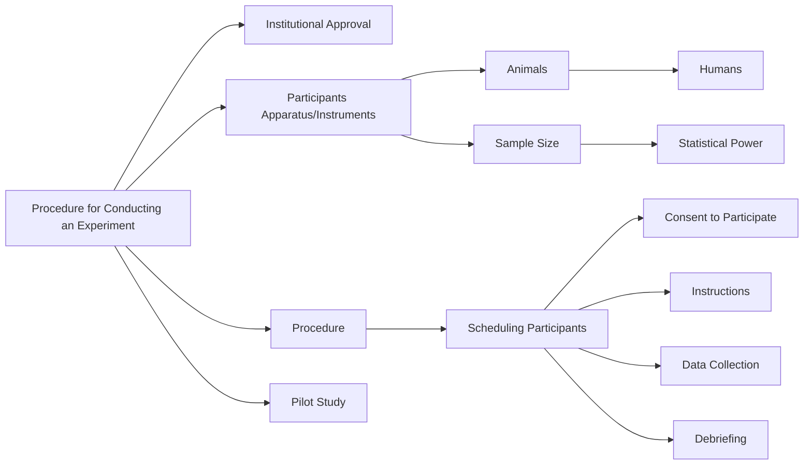

📑 <b>Table of Contents</b>

- [Chapter 8 Procedure for Conducting a Research Study](#chapter-8-procedure-for-conducting-a-research-study)
  - [Learning Objectives](#learning-objectives)
- [Institutional Approval](#institutional-approval)
- [Research Participants](#research-participants)
  - [Obtaining Animals](#obtaining-animals)
  - [Obtaining Human Participants](#obtaining-human-participants)
- [Sample Size](#sample-size)
  - [Power](#power)
- [Apparatus and/or Instruments](#apparatus-and-or-instruments)
- [Procedure](#procedure)
  - [Scheduling of Research Participants](#scheduling-of-research-participants)
  - [Consent to Participate](#consent-to-participate)
  - [Instructions](#instructions)
  - [Data Collection](#data-collection)
  - [Debriefing](#debriefing)
- [Pilot Study](#pilot-study)
  - [Summary](#summary)
  - [Key Terms and Concepts](#key-terms-and-concepts)
  - [Practice Test](#practice-test)
  - [Challenge Exercise](#challenge-exercise)

<!-- Page 1 -->
## Chapter 8 Procedure for Conducting a Research Study

### Learning Objectives

🎯 **8.1** Outline the IACUC and IRB review processes.
🎯 **8.2** Describe how to select participants for a research study.
🎯 **8.3** Explain the importance of sample size and the concept of statistical power.
🎯 **8.4** Explain the role of research instruments/ apparatus.
🎯 **8.5** Summarize the procedural details to be carried out for a research study.
🎯 **8.6** Explain why it is important to conduct a pilot study prior to data collection.

<!-- Page 2 -->
Researchers design their studies to answer their research questions. This means that they identify the relevant independent and dependent variables and attempt to control for extraneous variables. After these design and control decisions have been made, however, there are still many decisions to be made about actually conducting the study because the design provides only the framework of the study. Once established, this framework must be filled in and implemented. The researcher has to determine the kinds of participants to be used, how many participants are needed, and how the participants will be obtained. If human participants are to be used, the researcher must determine what instructions and tasks and measures will be given.

In this chapter, we discuss the issues that must be addressed to conduct the study. We address the issues in a general way because each study has its own unique characteristics; however, the discussion should provide the information you will need to conduct your own research study. Many of the principles in this chapter apply to both experimental and nonexperimental research. That’s because almost every study involves a research topic, research questions, a research plan (e.g., data collection, data analysis), and implementation of the plan. This chapter is about implementation of a research plan. We explain institutional approval, selection of participants and sample size, selection of appropriate instruments, scheduling participants, obtaining informed consent for participants, instructions, data collection, and debriefing. When you finish this chapter, you will understand the “nuts and bolts” of conducting a research study.

## Institutional Approval

🎯 **8.1** Outline the IACUC and IRB review processes.

If you are conducting a study that uses nonhuman animals as research participants, you must receive approval from the Institutional Animal Care and Use Committee (IACUC). If you are conducting a study that uses humans as research participants, you must receive approval from the Institutional Review Board (IRB). Remember from Chapter 4, you must prepare a research protocol that details all aspects of the research, including the type of participants you propose to use and the procedures that will be employed in conducting the study. A detailed protocol is necessary because either the IACUC or the IRB must review your research protocol to determine if your research study is ethically acceptable.

The IACUC reviews research protocols to determine if animals will be used in appropriate ways. Specifically, the IACUC reviews research protocols to determine if the researcher is planning to employ procedures to help avoid or minimize pain and discomfort to the animals, use sedatives or analgesics in situations requiring more than momentary or slight pain, whether activities involving surgery will include appropriate preoperative and postoperative care, and whether methods of euthanasia are in accordance with accepted procedures. If the study procedures conform to acceptable practices, the IACUC will approve the study, and you can then proceed with data collection. If it does not approve the study, the committee will explain why it was not approved.

The IRB reviews research protocols to determine if humans will be treated in appropriate ways. The primary concern of the IRB is the welfare of the human participants. The IRB will review protocols to ensure that participants will provide informed consent for participation in the study and that the procedures will not harm the participants. This committee has particularly difficult decisions to make when a procedure involves the potential for harm. Some procedures, such as administering an experimental drug, have the potential for harming research participants. In such instances, the IRB must carefully consider the potential benefits that might accrue from the study relative to the risks to the participants. Thus, the IRB frequently faces the ethical questions discussed in Chapter
4. Sometimes the board’s decision is that the risks to the human participants are too great to permit the study; in other instances, the decision is that the potential benefits are so great that the risks to the human participants are deemed to be acceptable. If the IRB does not approve <!-- Page 3 -->
the study, the investigator must redesign the study to overcome the objections of the IRB, supply additional information that will possibly overcome the objections of the IRB, or not conduct the study at all.

Receiving approval from the IRB or the IACUC is one of the important steps that investigators must accomplish in order to conduct their proposed research studies. Conducting research (experimental and nonexperimental) without such approval is an ethical violation and can cause investigators and their institutions to be severely reprimanded and jeopardize the possibility of receiving Public Health Service funding for future research projects. To receive approval from the appropriate review board, you must be able to describe in detail how you will conduct your research. In the following sections, we discuss the decisions that you must make about conducting your research. Let’s start by  considering who will participate in your research.

> [!TIP] **Study Question 8.1**
> What is the purpose of the IRB and IACUC?

## Research Participants

🎯 **8.2** Describe how to select participants for a research study.

Psychologists investigate the behavior of organisms, and there are many organisms that can potentially serve as research participants. In most cases, the research question dictates the type of organism to be used. If, for example, a study is to investigate imprinting ability, then a species must be selected, such as ducks, that demonstrates this ability. Much psychological research focuses on questions specific to humans such as human attitudes, emotions, cognitions, and behaviors. Therefore, humans are often the participants in psychological research. Other than humans, a number of other species are used in psychological research, such as the albino variant of the brown rat.

### Obtaining Animals

Once a decision has been made about the type of organism to be used, the next question is where to get the participants and how to care for them. Ethical procedures dictate how animals should be acquired and cared for. The Animal Welfare Act, most recently amended in 2013, regulates the care, handling, treatment, and transportation of most animals used in research. The National Academy of Sciences Institute of Laboratory Animal Research (ILAR) developed a *Guide for the Care and Use of* *Laboratory Animals* (2011). The purpose of this guide is to assist scientific institutions in using and caring for laboratory animals in professionally appropriate ways. The recommendations in this publication reflect the policies of the National Institutes of Health (NIH) and the American Association for the Accreditation of Laboratory Animal Care (AAALAC). Therefore, the guidelines in this manual are the ones that researchers should adhere to when caring for and using laboratory animals.

### Obtaining Human Participants

Researchers selecting humans as their research participants must decide on the inclusion and exclusion criteria for their participants. For example, are you looking for human participants in a certain age group or with a certain disorder or a certain set of experiences? Your recruitment strategy will be partially determined by the type of participants that you need. For example, if you are conducting a study with homeless people, you might contact homeless shelters and visit areas that are known to be frequented by individuals who are homeless. Additionally, your recruitment <!-- Page 4 -->
strategy is influenced by your resources. In much psychological research with human participants, participants are recruited on the basis of convenience and availability.

A great deal of psychological research is conducted at colleges and universities, and many of these studies use students as participants. In most university settings, the psychology department has a participant pool consisting of introductory psychology students. These students are motivated to participate in a research study because they are frequently offered this activity as an alternative to some other course requirement, such as writing a brief paper. Participant pools provide a readily available supply of participants for the researcher. Participant pools can be operated in a number of ways, varying from a website that allows students to register and sign up to participate in research to announcements posted in a central departmental location informing students of research opportunities. While the participant pool that exists within psychology departments provides a convenient sample, there is a serious concern that the findings obtained from these participants are not generalizable to a noncollege student populationon. Consider the fact that college students are bright individuals, all of whom have chosen to attend college, but have not yet graduated from college. This represents a unique segment of the populationon.

Some studies require a noncollege student populationon. For example, a child psychologist who wishes to study kindergarten children usually will try to solicit the cooperation of a local kindergarten. Similarly, to investigate incarcerated criminals, we must seek the cooperation of prison officials as well as the criminals. When we have to draw research participants from sources other than a departmental participant pool, a new set of problems arises. Assume that a researcher is going to conduct a study using kindergarten children. The first task is to find a kindergarten that will allow the researcher to collect the data needed for the study. In soliciting the cooperation of the person in charge, the researcher must be honest, open, and respectful. Conducting research in the community requires a partnership with that community group. Community partnerships are very important to research. Without these partnerships, it would be impossible to conduct research outside of the university. As a researcher, you should always be open to the ideas and concerns that you may encounter among your community partners. If the person in charge agrees to allow the researcher to conduct the study, the next task is to obtain the parents’ permission to allow their children to participate. This involves having parents sign consent forms that explain the nature of the research and the tasks required of their children. The children also should provide their assent to participate. Where an agency or school is involved, such as a program for persons with intellectual disabilities, you might be required to submit a research proposal for the agency’s research committee to review.

The Internet is a powerful tool for recruiting research participants. However, you must keep in mind that Internet users are a select group. Obviously, Internet users cannot represent people who do not have access to the Internet or who choose not to use the Internet. On the other hand, the Internet is capable of reaching individuals from other cultures and individuals who might be inaccessible due to time and cost constraints, such as individuals with disabilities. If you wanted to conduct a study investigating some aspect of unique populationons such as identical twins, you could recruit such individuals via the World Wide Web or the Internet from online groups such as Mothers of Twins Clubs. Such online groups exist for many special populationons. With the Internet, you have  immediate access to a larger sample of individuals not confined to your geographic location.

Internet studies offer different challenges in terms of contacting and obtaining research participants. For example, if your strategy is to contact individuals and ask them to participate in your study, you must identify a mechanism for contacting these individuals. If the research participants belong to an organization or association, you could contact the organization or association and ask for a list of e-mail addresses of their members. You could also post a request to a selected number of e-mail lists, Usenet groups, or open discussion groups. There are also commercial services, such as Mechanical Turk (http://www.mturk.com) that will identify and select specific samples of individuals for your study.

<!-- Page 5 -->
Alternatively, if your strategy is to post a research study on the Internet and have participants log on to the website and complete the study, you could post the study on one of several websites that specialize in advertising research opportunities. One of these sites is hosted by the Social Psychology Network, http://www.socialpsycholhttp://psych.hanover.edu/research/exponnet.html.

After identifying the target participant populationon, you must select individual participants from that group. Ideally, this should be done randomly. In a study investigating kindergarten children, a sample should be randomly selected from the populationon of all kindergarten children (e.g., in the United States or the area of interest to you). However, random selection from large dispersed populationons is usually impractical. Therefore, human participants are generally selected on the basis of convenience, availability, and willingness to participate. The kindergarten children used in a study will probably be those who live closest to the university and who cooperate with the investigator.

Because samples are not usually randomly selected, they may differ from the populationon in a number of ways. For example, the children whose parents allow them to participate might perform differently than those whose parents restrict their participation. The participants who volunteer to participate in an Internet study might perform differently than those who do not volunteer to participate. Because of the inability to select participants randomly, the investigator *must* report the nature of participant selection and assignment, in addition to the characteristics of the participants. This information will enable other investigators to replicate the experiment and assess the compatibility of the results.

> [!TIP] **Study Questions 8.2**
> - What factors frequently determine the selection of research participants used in a study?
>
> - What sources can be used to recruit research participants?

## Sample Size

🎯 **8.3** Explain the importance of sample size and the concept of statistical power.

After you have decided which type of participants will be used in your research study and have obtained access to a populationon of such participants, you must determine how many participants are needed to test the hypothesis adequately. This decision is based on the design of the study, the variability of the data, and the type of statistical procedure to be used. The relationship between the design of the study and sample size can be seen clearly by contrasting a single-case and a multiparticipant design. Obviously, a single-case design requires a sample size of one, so sample size is not an issue. In multiparticipant designs, however, the sample size is important because the number of participants used can theoretically vary from two to infinity. We usually want more than two participants, but it is impractical and unnecessary to use too many participants. As the number of participants within a study increases, the ability of our statistical tests to detect relationships among the variables increases; that is, the power of the statistical test increases. Power, therefore, is an important concept in determining sample size.

### Power

**Power** (also called statistical power) is defined as the probability of rejecting a false null hypothesis. In statistical analysis (see Chapter 16) we have to test null hypotheses rather than our research hypothesis. The null hypothesis states there is no relationship

<!-- Page 6 -->
between your independent and dependent variables, and *you hope to reject the null* *hypothesis when it is false*. A false null means the null is not true so there really *is* a relationship between your variables (e.g., your independent variable has an effect on your dependent variable). Any time you fail to reject a false null hypothesis you have missed the opportunity to correctly identify a relationship that exists in the world. In hypothesis testing, we want to reject the null and correctly conclude that a relationship does exist. That’s why we want power to be high. Therefore, a key point here is that we want power to be high, or, more specifically, by convention, *we want to have a* *power of at least.80* (which means we will correctly reject a false null hypothesis 80% of the time).

Power (or our ability to identify a real relationship existing in the world) is strongly dependent on sample size—as the number of participants in your study increases, power increases! As the sample size increases, however, the cost in terms of both time and money also increase. From an economic standpoint, we would like a relatively small sample. Researchers must balance the competing desires of detecting an effect and reducing cost. They must select a sample size that is small enough to fit within their cost constraints but large enough to detect an effect produced by the independent variable. A power analysis is the best method for resolving these competing desires because it tells you the minimum sample size needed for your study.

The power of a statistical test is affected by many factors. Four of the most important factors are the sample size, the effect size, the alpha level, and the type of statistical test you are using. The **effect size** is the true magnitude of the relationship between the independent and dependent variable in the populationon. You can identify the anticipated effect size based on a review of the literature in your research area. If there is little or no research in your area, Jacob Cohen (1992) offers starting points for what can be considered small, medium, and large effect sizes for several statistical indices. For example, for a correlation coefficient, he considers.10 to be small,.30 to be medium, and.50 as large in psychological research. For differences between means using the Cohen’s *d* statistic,.20 is considered small,.50 is medium, and.80 is large. Don’t worry about these numbers for now, because we explain correlation coefficients and Cohen’s *d* in Chapter
15. For now, just think about effects as being small, medium, or large.

We explain the concept of alpha level in Chapter 16—all you need to know for now is that in most psychological research, *we use an alpha level of.05.* (If you are curious, an alpha level of.05 means that you will at most claim there is an relationship when there really isn’t a relationship in the populationon, 5% of the time.) Power is also affected by the kind of statistical test used, which you will learn about in Chapter
16. For example, if you want to see if two quantitative variables are significantly related, you use a correlation coefficient. If you want to see if two means are significantly different (e.g., the treatment group mean vs. the control group mean), you use the *t* test for two group means.

You now know that power is affected by sample size, effect size, alpha level, and statistical test used. When conducting research, we can rarely influence the effect size, we almost always set alpha at.05, and the statistical test is determined by the kind of data we have. Therefore, the factor that *is* under your control is the *sample size*. When you are planning your research study, you must determine how many participants you need in your study. We have included a table to help you with this important decision.

Table 8.1 shows the number of research participants that you will need in your research study when power is.80 (which is recommended) for alpha levels of.01 and.05 for small, medium, and large effect sizes for several different statistical tests that you might use one day. We will show how to use Table 8.1 for two tests.

> First, assume that you want to conduct an experiment, and you will want to determine if the difference between the treatment group mean and the control group mean is

<!-- Page 7 -->
**$\alpha$** **.01** *Test* *Small* *Medium* *Large* *t* test for two means* 586 95 38 Simple correlation ( *r* )** 1,163 125 41 Analysis of variance* 2 groups 586 groups 464 groups 388 groups 336 55 22 Multiple regression** 2 predictors 698 predictors 780 108 50 4 predictors 841 118 55 5 predictors 901 126 59 **.05** *Small* *Medium* *Large* 393 64 26 783 85 28

481 67 30 547 76 34 599 84 38 645 91 42 statistically significant. You have examined the prior literature, and it suggests that the effect size is medium. Following convention, you will use an alpha level of.05. To determine the sample size that you will need in your study, go to the table and find the number corresponding to “*t* test for two means,” for a “medium” effect size, for an alpha of “.05.” The number is on the first line, and is
64. This is the number of participants that you need *in each of your two groups*. Therefore, you will need a total of 128 participants in your study sample.

Second, let’s assume that you want to determine the correlation between two variables. You have examined the literature, and it suggests that the effect size is medium. Following convention again, you use an alpha level of.05. Go to the table and find the number corresponding to “simple correlation” for a “medium” effect size for an alpha of “.05.” The number is on the second line, and it is
85. This is the *total* *number of participants* that you will need to in your study sample.

To learn more about power and sample size, you should read the article from which we developed Table 8.1. The author, Jacob Cohen (1992), explains the idea of power in more depth and explains what he means by small, medium, and large effect sizes. Also, there is an excellent and free program called G*Power that you can download from the Internet to use to determine the sample size you need (http://www.gpower.hhu.de/ en.html). You will learn how to conduct significance testing in Chapter 16.

**Table 8.1** *Number of Research Participants Needed for Small, Medium, and Large Effect Sizes at Recommended Power of .80 for Alpha = .01 and .05*

- The sample size number is for each group. Multiply this number by the number of groups to determine the total sample size needed.
- *The sample size reported is the total sample size needed. Note: Effect size is the strength of relationship. Analysis of variance is used to compare two or more means for statistical significance. Multiple regression is used to predict or explain variance in a dependent variable using two or more independent variables (labeled “predictors” in table). Information from table was extracted from Cohen (1992).

> [!TIP] **Study Questions 8.3**
> - How should a researcher determine the sample size to use in a multiparticipant design?
>
> - Using Table 8.1, how many research participants would you need in an experiment if you have three groups, you expect a medium effect size, and you want to use an alpha level of.01?

<!-- Page 8 -->
## Apparatus and/or Instruments

🎯 **8.4** Explain the role of research instruments/apparatus.

In addition to securing the appropriate number of research participants, in an experiment the investigator must identify how the independent variable conditions will be presented and how the dependent variable will be measured. In some studies, the presentation and manipulation of the independent variable requires the active participation of the investigator, and the measurement of the dependent variable involves the administration of a variety of psychological assessment instruments. For example, Langhinrichsen-Rohling and Turner (2012) investigated the effectiveness of a foursession healthy relationship program for at-risk adolescents. The treatment required active intervention on the part of the experimenter, which meant that the investigator was actively participating in the manipulation of the independent variable. To assess the effectiveness of the treatment, Langhinrichsen-Rohling and Turner administered several psychological inventories. Consequently, psychological assessment instruments were used as the dependent variable measures.

In other studies, a specific type of apparatus must be used to arrive at a precise presentation of the independent variable and to measure the dependent variable. For example, assume that you are conducting a study in which the independent variable involves presenting words on a screen for different periods of time. You could try to control manually the length of time during which the words were presented, but because it is virtually impossible for a human to consistently present words for a very specific duration of time, a computer is typically used. Similarly, if the dependent variable is the recorded heart rate, you could use a stethoscope and count the number of times per minute a participant’s heart beats. It is, however, much more accurate and far simpler to use an electronic means for measuring this kind of dependent variable. The use of such automatic recording devices also reduces the likelihood of making a recording error as a function of experimenter expectancies or some type of observer bias.

Microcomputers (i.e., personal computers) are used frequently in experimentation, both for the presentation of stimulus material and for the recording of dependent variable responses. In addition to the use of microcomputers, advances in technology and interdisciplinary research have enabled psychologists to conduct research that would have been impossible several decades ago. For example, psychologists have been measuring brain waves for many years. However, it is only recently that we have used the measurement of brain waves, or the electroencephalograph (EEG), to study the way brain systems respond to various stimulus conditions such as written words. This research has progressed to the point where recordings are taken from a configuration of 80 or more electrodes placed on the scalp of a research participant’s head. This electrical activity of the brain is then transformed into a series of pictures, or maps of the brain, which depict the degree of activity of various areas of the brain. Areas of the brain that are very active are interpreted as the areas that are stimulated by the independent variable that was presented, such as seeing a word presented on a computer screen.

To further examine brain function, research participants have had positron emission tomography (PET) and/or magnetic resonance imaging (MRI) scans while participating in an experiment and responding to the presentation of an independent variable such as word presentation. Psychologists, particularly cognitive neuropsychologists, in collaboration with physicians, are increasingly combining the technological tools of brain imaging from EEG recordings and PET and MRI scans to investigate the brain systems involved in a variety of behavioral activities and disorders.

Because the apparatus for a given study can serve a variety of purposes, the investigator must consider the particular study being conducted and determine the <!-- Page 9 -->
type of apparatus that is most appropriate. One journal, *Behavior Research Methods*, is devoted specifically to apparatus and instrumentation. If you have difficulty identifying an instrument or a computer program that will perform a certain function, you might find it helpful to consult this journal and the previous research conducted in your area of investigation.

> [!TIP] **Study Question 8.4**
> Give examples of different types of research instruments.

## Procedure

🎯 **8.5** Summarize the procedural details to be carried out for a research study.

Prior to conducting your study, you need to specify all of the procedural details. The events to take place in the experiment must be arranged so that they flow smoothly. You must carefully plan the whole study and specify the sequence in which each activity is to take place, laying down the exact procedure to be followed during data collection. For animal research, this means not only specifying the conditions of the laboratory environment and how the animals are going to be handled in the laboratory, but also specifying how they are to be maintained in their maintenance quarters and how they are to be transferred to the laboratory. These are important considerations because such variables can influence the animals’  behavior in the laboratory.

With human participants, the researcher must specify what the participants are to do, how they are to be greeted, and the type of nonverbal behavior (looking at the participants, smiling, using a particular tone of voice in reading instructions, etc.) as well as the verbal behavior in which the experimenter is to engage. In this section, we explain some of the procedural “nuts and bolts” for conducting your study.

### Scheduling of Research Participants

Scheduling research participants in the experiment involves the consideration not only of when the researcher has time available but also of the type of participants being used. With rats, for example, there is the problem of the lighting cycle. As Sidowski and Lockard (1966, p. 10) have noted:

> Rats and other nocturnal animals are most active in the dark phase of the lighting cycle and do most of their eating and drinking then. From the animal’s point of view, the light portion of the day is for sleeping and inactivity but may be interrupted by an experimenter who requires him to run or bar-press for food. It is unfortunate that the amount of lighting and the timing of the cycle are usually arranged for the benefit of the caretaker and not the animals or the experimenter.

Clearly, researchers must be aware of the implications of their scheduling decisions.

When scheduling human participants, there is a different set of issues to consider. First, the experiment must be scheduled at a time when the experimenter and the participants are available. Some participants will undoubtedly fail to show up, so it is often advisable to allow for limited rescheduling. Some participants who do not show up at the designated time will not want to be rescheduled. In such instances, the researcher will need to use replacement participants, and then replacement participants must be scheduled to substitute for those who drop out.

<!-- Page 10 -->
> [!TIP] **Study Question 8.5**
> What issues need to be considered in scheduling human and animal research participants?

### Consent to Participate

Most studies require that you obtain each research participant’s informed consent to participate in the study. The consent process must inform each research participant of all aspects of the study that might influence his or her decision to participate. This information, included in the consent to participate form, is typically provided in written form. Ideally, a consent form should be written in simple, first-person, layperson’s language. If the research participant is a minor, the parent or guardian must provide consent. If the minor is over the age of seven, he or she should have the opportunity to give assent or decline to participate, in addition to the required parent/guardian consent.

> The consent form should be prepared so that it includes the following elements:

1.  What the study is about, where it will be conducted, the duration of the study, and when the research participant will be expected to participate should be specified.

2.  The statement should list what procedures will be followed and whether any of them are experimental. In the description of the procedures, the possible discomforts and risks should be spelled out.

3.  Any benefits to be derived from participation in the study and any alternative procedures that might be beneficial to the participant should be identified.

4.  If the research participant will receive any monetary compensation, this should be detailed, including the schedule of payments and the effect (if any) on the payment schedule in the event the participant withdraws from the study. If course credit is to be given, the statement should provide an explanation of how much credit will be received and whether the credit will still be given if the research participant withdraws from the study.

5.  If the study involves responding to a questionnaire, participants should be informed that they can refuse to answer, without penalty, any questions that make them uncomfortable.

6.  Studies that investigate sensitive topics such as depression, substance abuse, or child abuse should provide information on where assistance for these problems can be obtained, such as from counselors, treatment centers, and hospitals.

7.  The participants must be told that they can withdraw from the study at any time without penalty.

8.  The participants must be informed as to how the records and data obtained will be kept confidential.

As you can see, the consent form is quite involved, and its purpose is to provide research participants with complete information about the study so that they can make an intelligent and informed choice as to whether they want to participate. Exhibit 4.2 in Chapter 4 gives an illustration of a consent form. Only after consent has been obtained can you proceed with the study.

> [!TIP] **Study Question 8.6**
> What is the purpose of the consent form, and what information is included in this form?

<!-- Page 11 -->
### Instructions

When you conduct a research study using human participants, you must prepare a set of instructions. This brings up such questions as “What should be included in the instructions?” and “How should they be presented?” Instructions must include a clear description of the research purpose, or disguised purpose, and the task that the research participants are to perform. Certain types of instructions might be ineffectual in producing the desired outcome. Instructions requesting that the research participant “pay attention,” “relax,” or “ignore distractions” are probably ineffective because research participants are constrained by other factors that limit their ability to adhere to the commands.

Instructions should be clear, unambiguous, and specific, but at the same time, they should not be too complex. Beginning researchers often think that directions should be extremely terse and succinct. Although this style may be good for writing the research report, in writing instructions one runs the risk that the participants will not grasp important points. Instructions should be very simple, down to earth, and, at times, even redundant. You might find it useful to include “warm-up” trials as part of your instructions. These are practice trials that are similar to those the participant would complete in the actual study. They are included to ensure that the research participants understand the instructions and what they are being asked to do.

> [!TIP] **Study Questions 8.7**
> - What purpose do the instructions to participants serve?
>
> - What guidelines should be followed in preparing these instructions?

### Data Collection

Once you have scheduled your participants and received their informed consent, you are ready to collect data from the research participants. The primary rule to follow in this phase is to adhere as closely as possible to the procedure that has been laid out and do this consistently for each participant. A great deal of work has gone into developing this procedure, and if it is not followed exactly, you run the risk of introducing threats to the validity of your study. If this should happen, you will not have the well-controlled study you worked so hard to develop, and you might not attain an answer to your research question.

### Debriefing

Once the data have been collected, there is a tendency to think that the job has been completed and the only remaining requirement (other than data analysis) is to thank the participants for their participation and send them on their way. However, the experiment does not—or should not—end with the completion of data collection. In most studies, following data collection, there should be a **debriefing** with the participants that provides information about the study and allows participants to comment freely about any part of the study. Debriefing can also provide information regarding the participants’ thinking or strategies used during the study, which can help explain their behavior. Ideally, this sharing of information is done with an interview but in some cases, debriefing information can be provided in a statement.

**Debriefing Functions** Tesch (1977) has identified three specific functions of debriefing: ethical, educational, and methodological. First, debriefings have an ethical function. In some studies, research participants are deceived about the true purpose of the

<!-- Page 12 -->
study. Ethics dictate that we must undo such deceptions, and the debriefing session is the place to accomplish this. Some studies will generate negative affect in the participants or, in some other way, create physical or emotional stress. The researcher must attempt to return the participants to their previous state by eliminating any stress that the study has generated. Second, debriefings have an educational function. The typical rationale used to justify requiring the participation of introductory psychology students in research is that they learn something about psychology and psychological research. This learning process is much enhanced by debriefing. The third function of debriefing is methodological. Debriefing may include an opportunity to talk to the participants and better understand their perspective of the study. For example, if deception was used, did participants become suspicious or figure out the deception? Debriefings may also be used to gather evidence about the effectiveness of an independent variable manipulation. For example, if the manipulation included jokes that were assumed to be funny, it would be important to know what the participants thought about the jokes. Finally, a debriefing session may also be used to ask the participants not to reveal the experiment to others. Sieber (1983) added a fourth function. She stated that participants should, from their participation in the study, derive a sense of satisfaction from the knowledge that they have contributed to science and society. The debriefing procedure should be designed to help bring about this belief.

**How to Debrief** Given these functions of debriefing, how do we proceed? Two approaches have been used. Some investigators use a form that explains what has occurred. Others use a face-to-face interview, which seems to be the best approach because it is more interactive and provides an opportunity to directly answer participants’ questions.

If you want to probe for any suspicions that the participants might have had about the experiment, this is the first order of business. Social psychologists Aronson and Carlsmith (1968) believe that the researcher should begin by asking the participants if they have any questions. If so, the questions should be answered as completely and truthfully as possible. If not, the researcher should ask the participants if all phases of the study—both the procedure and the purpose—were clear. Next, depending on the study being conducted, it might be appropriate to ask participants to describe how they felt during the study and whether they encountered any difficulties.

If the study contained deception and the participants suspected that it did, they are likely to have revealed this fact by this time. If no suspicions have been revealed, the researcher can ask the participants if they thought there was more to the study than was immediately apparent. Such a question cues the participants that there must have been more to the study. Most participants will therefore say yes, so this should be followed with a question about what the participants thought was involved and how this might have affected their behavior. Such questioning will give the investigator additional insight into whether the participants had the study figured out and will also provide a perfect point for the experimenter to lead into an explanation of the purpose of the study. The experimenter can continue “the debriefing process by saying something like this: ‘You are on the right track, we *were* interested in some problems that we didn’t discuss with you in advance. One of our major concerns in this study is...’” (Aronson &amp; Carlsmith, 1968, p. 71).

Next, if the study involved deception, the reasons that deception was necessary should be included. The purpose of the study should then be explained in detail, as well as the specific procedures for investigating the research question. This means explaining the independent and dependent variables and how they were manipulated and measured. As you can see, the debriefing requires explaining the entire study to the participants.

The last part of the debriefing session should be geared to convincing the participants not to discuss any components of the study with others. This can be accomplished by asking the participants not to describe the study to others until after the date of completion of the data collection, pointing out that communicating the results to others <!-- Page 13 -->
might invalidate the study. At this point you might wonder whether this debriefing procedure accomplishes the functions it is supposed to accomplish. The ethical function will be accomplished quite well if the procedures are followed. The educational function is fulfilled less completely in debriefing. Most investigators seem to think, or rationalize, that the educational function is served if the participants participate in the experiment and are told of its purpose and procedures during debriefing. However, data indicate that participants perceive psychological experiments to be most deficient in educational value, although they view debriefing in general to be quite effective (Smith &amp; Richardson, 1983). The methodological function seems to be served best when participants have the opportunity to share their thoughts and experiences with the researcher.

It is questionable as to whether all the functions of debriefing are fulfilled when conducting an online research study. The most common and direct way of providing debriefing is to post the debriefing at the website on which the study is located. This way you can tailor the debriefing to the study you are conducting. It is even possible to make the debriefing material available to those who decide to terminate the study prior to completion by having a “leave the study” link button, or a pop-up window that executes when a person leaves a study. While these techniques will present the debriefing material, online research makes it difficult to engage in the desensitizing component of debriefing because it is difficult to assess the participant’s psychological state and determine if an individual has been stressed by the study. It is also difficult to determine if any stress that has been created by the study has been reduced through debriefing because it is difficult to receive feedback from the research participant.

> [!TIP] **Study Questions 8.8**
> - What functions are served by debriefing?
>
> - How should you debrief?

## Pilot Study

🎯 **8.6** Explain why it is important to conduct a pilot study prior to data collection.

Before conducting a study, it is strongly recommended that you conduct a pilot study. A **pilot study** is a run-through of the entire study with a small number of participants. The pilot study can provide a great deal of information. If the instructions are not clear, this will show up either in the debriefing session or by virtue of the fact that the participants do not know what to do after the instructions have been read!

In an experiment, the pilot study can also indicate whether the independent variable manipulation produced the intended effect. For example, if you were trying to induce the emotion of surprise, debriefing can help to determine if fear, surprise, or some other state was actually generated. If none of the pilot participants report the particular emotion under study, then their help can be solicited in assessing why it was not generated, after which, changes can be made until the intended state is reliably induced. In a similar manner, the sensitivity of the dependent variable can be checked. Pretesting might suggest that the dependent variable is too crude to reflect the effect of the manipulation and that a change would make it more appropriate.

The pilot study also gives the researcher experience with the procedure. At first, the experimenter will not be familiar with the sequence and therefore probably will not make a smooth transition from one part of the study to another. With practice, the researcher will develop fluency in carrying out the steps, which is required if constancy is to be maintained across all participants in the study. During the pilot study, <!-- Page 14 -->
the researcher also tests the procedure. Too much time might be allowed for certain parts and not enough for others, the deception (if used) might be inadequate, and so on. If there are problems, the researcher can identify them before any data are collected, and the procedure can be corrected.

If you are conducting an Internet-based study you should complete the online study tasks yourself as well as have a few pilot participants complete the tasks. Completing the study yourself will allow you to understand how it feels to be a participant, and having pilot participants complete the study will allow you to get feedback. Completing a pilot run of your online study will also show whether the study works properly in your browser and if the data are returned to you in a manner that is understandable and arranged in the desired way.

Many subtle factors can influence a research study, and the pilot phase is the time to identify them. Pilot testing involves checking all parts of the study to determine if they are working appropriately. If a problem is isolated, it can be corrected without any damage to the study. If the problem is not detected until after the data have been collected, it *might* have had an influence on the results of the study. If changes are made to the study after receiving IRB approval, the IRB must approve the intended changes.

> [!TIP] **Study Questions 8.9**
> - What procedural issues must be specified prior to actual data collection?
>
> - What purpose is served by a pilot study?

### Summary

After designing a study, the investigator must make a number of additional decisions before beginning to collect data. The entire plan for the study must be presented to the appropriate board for review. The investigator must decide on the type of organism to be used in the study. Once the question of type of organism has been resolved, the researcher needs to determine where these organisms can be obtained. Nonhuman animals, particularly rats, are available from a number of commercial sources. Most human research par- ticipants used in psychological experimentation come from departmental participant pools, which usually consist of introductory psychology students. If the study calls for participants other than those represented in the participant pools, the investi- gator must locate an available source and make the necessary arrangements. One source that is used with increasing frequency is the Internet. In addition to identify- ing the source of research participants, the researcher needs to determine how many participants should be used. A power analysis is used for determining sample size. Instructions must also be prepared for studies using human research participants. The instructions should include a clear description of the purpose (or disguised purpose) of the task required of the participants. Next, the investigator must specify the procedure to be used in data collection— the exact sequence in which all phases of the experiment are to be carried out, from the moment the investigator comes in contact with the research participants until that contact terminates. When the research participant arrives at the study, the first task of the experimenter is to obtain the research participant’s consent to participate in the <!-- Page 15 -->
study. This means that the participant must be informed of all aspects of the study that might affect his or her willingness to participate. Only after this information has been conveyed and the participant agrees to participate can the researcher proceed with the study. Immediately following data collection, the researcher should conduct a debriefing session, with the participants. During this session, the researcher attempts to detect any suspicions that the participants might have had. In addition, the researcher explains to the participants the reasons for any deceptions that might have been used, as well as the entire procedure and purpose. It is helpful to conduct a pilot study to iron out unforeseen difficulties.

## 🗂️ Chapter Key Terms & Active Recall

> 💡 **Learning tip:** Try to recall the definition of each term *before* clicking to reveal it.
> This active retrieval practice strengthens long-term memory far more than re-reading.

📇 <b>Power</b> *(p. 5)*

> **Definition:** The probability of rejecting a false null hypothesis

📇 <b>Effect size</b> *(p. 6)*

> **Definition:** The magnitude of the relationship between two variables in a populationon

📇 <b>Debriefing</b> *(p. 11)*

> **Definition:** A postexperimental discussion or interview about the details of the study, including an explanation for the use of any deception

📇 <b>Pilot study</b> *(p. 13)*

> **Definition:** A preliminary study that is conducted on a few participants prior to the actual research study

### Key Terms and Concepts

| Term | Term | Term |
| --- | --- | --- |
| [Debriefing *p. 159*](#term-debriefing) | [Pilot study *p. 161*](#term-pilot-study) | [Power *p. 153*](#term-power) |
| [Effect size *p. 154*](#term-effect-size) | [Postexperimental interview *p. 159*](#term-postexperimental-interview) |  |
| Related Internet Site |  |  |
| http://opl.apa.org |  |  |
| This site offers a number of classic studies in psychology in which students can participate. After participating in an |  |  |
| online experiment, they can analyze the data collected as well as see the results of the data collected. |  |  |

### Practice Test

*The answers to these questions can be found in the Appendix.*

**1.** If you want to conduct research with human
participants, you must receive approval from
a.  IACUC
b.  IRB
c.  Your professor

**2.** Sample size should be determined by a combination
of which of the following factors?
a.  Effect size, alpha level, power, statistical test
b.  Effect size, alpha level, significance level
c.  Significance level, alpha power, straight power
d.  Alpha level, power, beta level

**3.** Which of the following journals will be helpful in
identifying a specific piece of apparatus or computer program to assist in data collection?
a.  *Psychological Methods*
b.  *Psychological Assessment*
c.  *Behavior Research Methods*

**4.** If you have pretested your entire procedure on a few
participants prior to actually collecting data, you have
a.  Sampled your procedure
b.  Conducted a pilot study
c.  Conducted postexperimental debriefing
d.  Missed participants who could have contributed
to the study

**5.** What function does debriefing serve?
a.  Ethical function
b.  Educational function
c.  Methodological function
d.  Participant satisfaction from contributing
to science
e.  All of the above are functions of debriefing

<!-- Page 16 -->
### Challenge Exercise

**1.**Employment agencies are in the business of finding employment for individuals. One of the difficulties these agencies have is identifying individuals with the necessary skills to keep a job after they are placed. Let’s assume that you are aware of this difficulty and you have developed a four-week course designed to teach individuals the skills they need to retain a job. Your four-week course consists of training in dealing with a boss, dealing with other difficult employees, dressing for the job, and other skills such as just ensuring that the worker arrives on time for work. The basic design you want to use is a simple posttest-only control group design. With this as your research question and experimental design, answer the following questions: a.  What research participants do you plan to use, and how do you plan to obtain these participants? b.  How many participants should you use?

Identify how you would decide on the number of participants to use if you do not have sufficient information to identify the specific number. c.  What factors do you have to take into consideration in presenting the treatment condition and control conditions, and how will you implement these factors? What outcome measures will you use to test the effectiveness of the treatment condition? d.  What type of approval is needed to enable you to conduct this study? e.  Prepare a short consent form for this study. f.  Prepare a short debriefing statement for this study.
