

📑 <b>Table of Contents</b>

- [PART IV Experimental Methods](#part-iv-experimental-methods)
- [Chapter 9 Experimental Research Design](#chapter-9-experimental-research-design)
  - [Learning Objectives](#learning-objectives)
  - [Summary of Threats to Internal Validity for Weak Experimental Designs](#summary-of-threats-to-internal-validity-for-weak-experimental-designs)
  - [One-Group Posttest-Only Design](#one-group-posttest-only-design)
  - [Posttest-Only Design with Nonequivalent Groups](#posttest-only-design-with-nonequivalent-groups)
  - [Summary of Threats to Internal Validity for Strong Experimental Designs](#summary-of-threats-to-internal-validity-for-strong-experimental-designs)
- [Between-Participants Designs](#between-participants-designs)
  - [Posttest-Only Control-Group Design](#posttest-only-control-group-design)
- [Within-Participants Designs](#within-participants-designs)
  - [Strengths and Weaknesses of Within-Participants Designs](#strengths-and-weaknesses-of-within-participants-designs)
- [Mixed Designs (i.e., Combination of Between and Within)](#mixed-designs-i-e-combination-of-between-and-within)
  - [Pretest–Posttest Control-Group Design](#pretest-posttest-control-group-design)
  - [Advantages and Disadvantages of Including a Pretest](#advantages-and-disadvantages-of-including-a-pretest)
- [Factorial Designs](#factorial-designs)
  - [EXHIBIT 9.1 Examples of Main Effects and Interaction Effects](#exhibit-9-1-examples-of-main-effects-and-interaction-effects)
  - [EXHIBIT 9.1 Examples of Main Effects and Interaction Effects (Continued)](#exhibit-9-1-examples-of-main-effects-and-interaction-effects-continued)
  - [Factorial Designs Based on Within-Participants](#factorial-designs-based-on-within-participants)
  - [Independent Variables](#independent-variables)
  - [Factorial Designs Based on a Mixed Model](#factorial-designs-based-on-a-mixed-model)
  - [Nature of Independent Variables in Factorial Designs](#nature-of-independent-variables-in-factorial-designs)
  - [Strengths and Weaknesses of Factorial Designs](#strengths-and-weaknesses-of-factorial-designs)
- [How to Choose or Construct the Appropriate Experimental Design](#how-to-choose-or-construct-the-appropriate-experimental-design)
  - [Summary](#summary)
  - [Key Terms and Concepts](#key-terms-and-concepts)
  - [Related Internet Sites](#related-internet-sites)
  - [Practice Test](#practice-test)
  - [Challenge Exercises](#challenge-exercises)

<!-- Page 1 -->
## PART IV Experimental Methods

## Chapter 9 Experimental Research Design

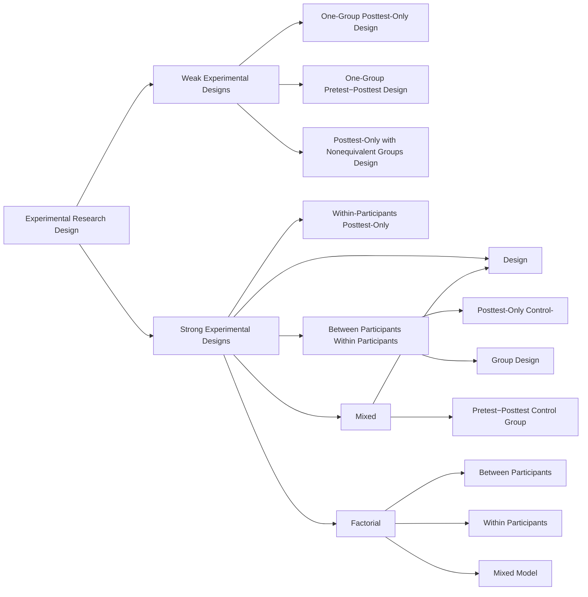

### Learning Objectives

🎯 **9.1** Analyze the threats to internal validity in each of the weak experimental designs.
🎯 **9.2** Describe the criteria required for strong experimental research designs.
🎯 **9.3** Describe the structure, strengths, and weaknesses of between-participants designs.
🎯 **9.4** Describe the structure, strengths, and weaknesses of within-participants designs.
🎯 **9.5** Describe the structure, strengths, and weaknesses of mixed designs.
🎯 **9.6** Differentiate between main effects and interaction effects in factorial designs.
🎯 **9.7** Describe the considerations made when deciding upon the appropriate experimental design.

<!-- Page 2 -->
After a research topic has been selected and decisions have been made about the independent and dependent variables, it is necessary to develop a plan for collecting data and testing the effect of one or more independent variables (IV) on the dependent variable(s) (DV). This plan is the research design of the experiment. The term **research** **design** refers to the outline, plan, or strategy that specifies the procedure to be used in seeking an answer to your research question(s). It specifies such things as how to collect and analyze the data. Building a research design is often a complex process because you might encounter constraints on what type of design will work for you and for your research question.

The goal in research is to use the strongest design that is possible, ethical, and feasible for your research question. But what makes a design strong or weak? You will see that strong designs often include pretests (to measure the level of the dependent variable before the start of the experiment), control groups (to allow a comparison of the experimental treatment group to a group that did not receive the treatment), and random assignment (to equate the experimental and control groups at the outset of the experiment). The designs and their salient characteristics are summarized in Table 9.1.

**Table 9.1** *Experimental Designs Covered in Chapter 9*

<table class="textbook-table">
  <thead>
    <tr>
      <th>Weak Designs</th>
      <th>Salient Characteristics</th>
    </tr>
  </thead>
  <tbody>
    <tr>
      <td>One-group posttest only</td>
      <td>No pretest and no comparison or control group.</td>
    </tr>
    <tr>
      <td>One-group pretest–posttest</td>
      <td>No comparison or control group</td>
    </tr>
    <tr>
      <td>Posttest only with nonequivalent groups</td>
      <td>Comparison/control group is not formed using random assign- ment, and there is no pretest.</td>
    </tr>
    <tr>
      <td>Strong Designs</td>
      <td>Salient Characteristics</td>
    </tr>
    <tr>
      <td>Posttest-only control-group design</td>
      <td>Participants are randomly assigned to groups, and there is no pretest</td>
    </tr>
    <tr>
      <td>Within-participants posttest only</td>
      <td>Participants receive all levels of the IV; must also use counterbalancing</td>
    </tr>
    <tr>
      <td>Pretest–posttest control group</td>
      <td>Participants are randomly assigned to groups</td>
    </tr>
    <tr>
      <td>Factorial with only between-</td>
      <td>More than one IV allows for study of interaction effects, and</td>
    </tr>
    <tr>
      <td>participants IVs</td>
      <td>has random assignment to groups</td>
    </tr>
    <tr>
      <td>Factorial with only within-participants IVs</td>
      <td>More than one IV allows for study of interaction effects, par- ticipants receive all combinations of the IVs; must also use counterbalancing</td>
    </tr>
    <tr>
      <td>Mixed model factorial</td>
      <td>Includes mixture of between- and within-participants IVs, has random assignment to the between-participants IV</td>
    </tr>
  </tbody>
</table>

This chapter is very important because experimental research is the best type of research when you want to make claims about *cause and effect*. Experimental research provides evidence of cause-and-effect relations because the independent variable is manipulated (i.e., it is under the control of the experimenter) and in strong experimental designs, extraneous variables are controlled. It is important to note that manipulation of the independent variable can take different forms. The manipulation of the independent variable can take the form of present/absent, amount, or type. Often an experimental group (also called a treatment group) is compared to a control group that does not receive any treatment. This is called the present/absent form of independent variable manipulation (i.e., the treatment is either present or absent). In the amount form of independent variable manipulation, the groups differ in the amount of the independent variable received. For example, researchers might compare the effectiveness of a 20-mg dose of an antidepressant to a 40-mg dose in reducing depression. Finally, in the type form of independent variable manipulation, the groups will differ in the type of the IV received. For example, researchers might compare the effectiveness of group therapy to individual therapy in decreasing depression. So, you can see that the IV can be manipulated in a number of ways.

<!-- Page 3 -->
**Table 9.2** *Summary of Threats to Internal Validity for Weak Experimental Designs*

  
Summary of Threats to Internal Validity for Weak Experimental Designs

  <ul class="framed-card-body">
    <li></li>
    <li>NA NA NA</li>
    <li>NA NA only design One-group pretest–</li>
    <li></li>
    <li></li>
    <li></li>
    <li></li>
    <li>+ NA NA posttest design Posttest-only with + + NA NA + +</li>
    <li></li>
    <li>nonequivalent groups design*</li>
    <li>If a basic threat acts differentially, it is subsumed under additive/interactive effects and is a threat. Note: A negative sign (</li>
    <li>) indicates a potential threat to internal validity, a positive sign ( + ) indicates that the threat is controlled, and NA indicates that the threat does not apply to that design.</li>
  </ul>

Now we cover the different types of experimental designs. We start with a discussion of several weak designs that do not control for important threats to internal validity. We then cover strong designs that provide excellent control for the threats to internal validity and, therefore, provide strong evidence about causal relationships between independent and dependent variables. Next, we dis- cuss factorial designs; these designs are strong and very important because they enable researchers to test for the separate and interactive effects of two or more independent variables. We conclude with comments on choosing or constructing a research design. Study Question 9.1 What is a research design and what is its purpose? Weak Experimental Research Designs
**9.1**
**Analyze the threats to internal validity in each of the weak experimental**
**designs.**
In seeking answers to questions about cause and effect, the scientist conducts experiments. By definition, all experiments have manipulation of at least one inde- pendent variable. Ideally, these experiments control for all threats to internal valid- ity and support a conclusion about whether the independent variable affected the dependent variable. However, sometimes this is not possible, and many threats to internal validity cannot be eliminated. As Shadish, Cook, and Campbell (2002) have pointed out, sometimes researchers have to use designs that do not control for vari- ous threats to internal validity such as when the focus of attention is on external validity or when ethical considerations preclude including design elements that would control for more threats to internal validity. When these weaker designs are used, it becomes much more difficult to infer a causal relationship between your independent and dependent variables. The first few designs that we discuss are considered  **weak experimental designs**  because they control for very few threats to internal validity. These designs should be avoided when a strong design can be used, and if a strong design can’t be used, the quasi-experimental designs discussed in the next chapter are also superior to the weak experimental designs. Table 9.2 is a summary of the threats to internal validity that may operate in each of the weak designs discussed in this section.
**Table 9.2**

**Weak experimental designs**
Designs that do not control for many extraneous variables and provide weak evidence of cause and effect

### Summary of Threats to Internal Validity for Weak Experimental Designs

**Design**
**History**
**Maturation**
**Instrumentation**
One-group posttest- - - NA only design One-group pretest– - - posttest design Posttest-only with + + NA nonequivalent groups design*
*If a basic threat acts differentially, it is subsumed under additive/interactive effects and is a threat.
*Note:*
A negative sign ( - ) indicates a potential threat to internal validity, a positive sign (

**Additive/**
**Regression**
**interaction**
**Testing**
**artifact**
**Attrition**
**Selection**
**effects**
NA NA - NA NA - - - + NA NA NA + + - - + ) indicates that the threat is controlled, and NA indicates that the threat does not apply to that design.

<!-- Page 4 -->
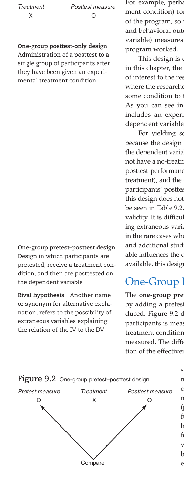

*Figure 9.1  One-group posttest- only design.*

### One-Group Posttest-Only Design

In the **one-group posttest-only design**, a single group of research participants is measured on a dependent variable after having undergone an experimental treatment.

> For example, imagine that your school district adopted an expen-

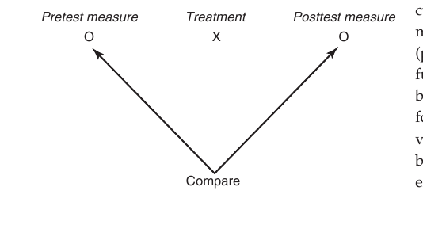

*Figure 9.2  One-group pretest–posttest design.*

<!-- Page 5 -->
In our example, one academic year elapsed between the pretest and posttest. Consequently, as summarized in Table 9.2, the uncontrolled rival hypotheses of history, testing, regression artifact, instrumentation, and maturation could account for some, if not all, of the observed change in performance. In order to determine that the observed change was caused by the treatment effect (the experimental curriculum) and not by any of these rival hypotheses, researchers should have included an equated group of first graders who did not receive the new curriculum. This equated group’s performance would be compared with the performance of the children who received the experimental treatment. If a significant difference was found between the scores of these two groups, it could have been attributed to the influence of the experimental curriculum because both groups would have equally experienced any history, testing, regression artifact, instrumentation, and maturation effects. The design of the one-group pretest–posttest study is weak, not so much because the sources of rival hypotheses *can* affect the results, but because in most cases we do not know if they did.

Although the one-group pretest–posttest does not allow us to confidently say that the independent variable caused changes in the dependent variable, it is not totally worthless. In situations in which it is impossible to obtain an equated comparison group, the design can be used to provide some information. However, the confidence one has in concluding that the treatment produced the observed effect is dependent on the success of identifying the possible threats to internal validity that were actually operating in the particular study.

### Posttest-Only Design with Nonequivalent Groups

The primary disadvantage of the previous two designs is that there are many serious threats (i.e., alternative explanations) to the claim that the independent variable influenced the dependent variable. The **posttest-only design with nonequivalent groups** (see Figure 9.3) makes an attempt to remedy this deficiency by including a control group. In this design, one group of research participants receives the treatment condition (X) and is then compared on the dependent variable (O) with a group that did not receive this treatment condition. This sounds ideal, and by adding a control group, this design does address *some* of the threats to internal validity, specifically history, maturation, regression artifact, and attrition (see Table 9.2). The problem is that in this design, the comparison group is a nonequivalent group. That is, the participants in the comparison group might differ in important ways from the participants in the experimental group. In Chapter 6, this threat to internal validity was called *selection*. The point is that the “selection threat” occurs when the participants are not randomly assigned to the groups—the resulting problem is that you end up with nonequivalent groups (i.e., groups that differ on more variables than just the independent variable). You want your groups to differ only on the independent variable so that you can confidently claim that the independent variable is causing the changes in the dependent variable.

In our example of the new reading curriculum, let’s imagine that some schools adopt the new curriculum and others do not. At the end of the year, we compare reading scores of the schools that adopted the curriculum to those that did not, and we observe that the schools with the new curriculum scored better on the reading test. The problem is that these groups might differ in many important ways including initial reading levels of the students, parental involvement, and parental education levels. The researcher will not know whether the posttest difference in reading level is due to the treatment *or* due to one of these initial differences between the groups.

The only way to ensure that the groups are equated is to assign participants randomly to the two groups. The dashed line

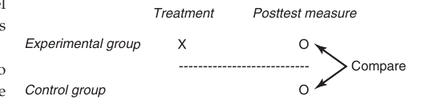

*Figure 9.3  Posttest-only design with nonequivalent groups. The dashed line indicates nonequivalent groups.*

<!-- Page 6 -->
****

**Table 9.3** *Summary of Threats to Internal Validity for Strong Experimental Designs*

  
Summary of Threats to Internal Validity for Strong Experimental Designs

  <ul class="framed-card-body">
    <li>control-group design Within-participants + + + + + + NA NA</li>
    <li>* posttest-only design Pretest–posttest + + + + + + + + control-group design* Factorial designs: All between- + + + + + + + + participants IVs* All within- NA NA + + + + + + participants IVs**</li>
    <li>If a basic threat acts differentially, it is subsumed under additive/interactive effects and is a threat.</li>
    <li>*Assuming counterbalancing for within-participants variable(s). Note: A negative sign (</li>
    <li>) indicates a potential threat to internal validity, a positive sign ( + ) indicates that the threat is controlled, and NA indicates that the threat does not apply to that design.</li>
  </ul>

in Figure 9.3 is used to indicate that random assignment is *not* included in the non- equivalent posttest-only design. In studies in which it is not possible to assign partici- pants randomly, the next best technique is to match on relevant variables. However, matching is no substitute for random assignment because it does not control for many other variables. This design, therefore, does not eliminate selection effects and should be considered a weak design. Study Questions 9.2 •  What are the components and structure of weak experimental research designs?

- Explain why the threats to internal validity exist in each of these designs. Strong Experimental Research Designs
**9.2**
**Describe the criteria required for strong experimental research designs.**
The designs just presented are weak designs because, in general, they do not pro- vide a way of isolating the effect of the treatment condition; rival hypotheses are not eliminated. How, then, is a strong research design different? Strong experimental research designs have greater internal validity. That is, they provide more assurance that the effect of the independent variable (IV) on the dependent variable (DV) has been isolated and tested. Table 9.3 provides a summary of the threats to internal validity that may operate in the strong experimental designs discussed in this chap- ter. You can refer to this table as needed during our discussion of each design, and for review. In order to achieve internal validity, we must eliminate potential rival hypotheses (i.e., alternative explanations). This can be accomplished by two primary means: con- trol techniques and a control group. The most important control technique, as indi- cated in Chapter 7, is random assignment to groups (also called randomization) because this is the only means by which known *and* unknown variables can be
**Table 9.3**

### Summary of Threats to Internal Validity for Strong Experimental Designs

**Design**
**History**
**Maturation**
**Instrumentation**
Posttest-only + + +
*
control-group  design Within-participants + + +
**
posttest-only design Pretest–posttest + + + control-group  design* Factorial designs: All between- + + + participants IVs* All within- + + + participants IVs**
*If a basic threat acts differentially, it is subsumed under additive/interactive effects and is a threat.
**Assuming counterbalancing for within-participants variable(s).
*Note:*
A negative sign ( - ) indicates a potential threat to internal validity, a positive sign ( + ) indicates that the threat is controlled, and NA indicates that the threat does not apply to that design.

**Additive/**
**Regression**
**interaction**
**Testing**
**artifact**
**Attrition**
**Selection**
**effects**
+ + + + + + + + NA NA + + + + + + + + + + NA NA + + +

<!-- Page 7 -->
controlled. Randomization is the best control technique because it is the best means for insuring that your groups vary *only* on the variable that you manipulate—your independent variable. The groups should be comparable across all variables other than the independent variable. A popular synonym for designs with random assignment to the experimental and control groups is RCT (which stands for **randomized** **controlled trial**).

The second means of eliminating potential rival hypotheses is the inclusion of a control group. A **control group** is a group of research participants that does not receive the active level of the independent variable; they might either receive zero amount of the independent variable or receive an amount that is in some sense a *standard* value, such as what they would typically receive if they were not participants in research. An **experimental group** (also called a *treatment group*) is a group of research participants that receives some level of the independent variable that is intended to produce an effect. In our study of the reading curriculum, if we randomly assigned half of the first graders to receive the experimental reading curriculum and the other half to receive the standard reading instruction that was typically used in the school district, we would be able to determine if the reading curriculum really caused an increase in reading scores beyond the standard practice.

A control group serves two functions. First, it serves as a source of comparison. Only by including a control group—assuming all other variables are controlled—can we get a clear indication of whether the treatment produced results different from those that would have been attained in the absence of the treatment. The responses of the control group must stand for the responses that members of the experimental group would have given if they had not received the treatment condition. Stated more technically, the control group is used to estimate the **counterfactual** (i.e., what the participants’ responses *would have been had they not received the treatment*). The participants in the two groups must be as similar as possible so that theoretically they would yield identical scores in the absence of the introduction of the independent  variable.

Second, the control group serves as a control for rival hypotheses. The experimenter’s goal is for all variables to operate on the control and experimental groups identically, except for the one variable (i.e., the independent variable) being manipulated by the experimenter. In this way, the influence of extraneous variables is held constant. If a control group is included and random assignment is used, extraneous variables will equally affect the performance of *both* the control and the experimental participants, effectively holding the influence of the extraneous variables constant. If an extraneous variable affects both groups equally, then the groups will not differ on that variable, enabling the researcher to conclude that the reason the groups differed at the posttest was because of the treatment. The only variable the groups should vary on is the independent variable.

In the next sections of this chapter, we consider several strong experimental research designs. To be a **strong experimental design**, the research design must enable the researcher to maintain control over assignment of research participants to groups, in terms of who gets the treatment condition and in terms of the amount of the treatment condition that participants receive. In other words, the researcher must have a controlled experiment in order to conclude that there is a causal relation between the independent and dependent variable. Strong research designs can take the form of a between-participants research design in which participants are randomly assigned to different groups and participate in a single condition, a within-participants design where participants serve as their own control group by participating in all of the conditions sequentially, or a mixed design that is a combination of these. We now discuss these three major types of research designs.

<!-- Page 8 -->
> [!TIP] **Study Questions 9.3**
> - What are the criteria that need to be met to have a strong experimental research design?
>
> - What function is served by the control group?
>
> - What function is served by random assignment of participants to groups?

## Between-Participants Designs

🎯 **9.3** Describe the structure, strengths, and weaknesses of between-participants

**designs.**

In the strong experimental research designs known as **between-participants** **designs**, the groups are composed of different people, the participants are randomly assigned to groups, and the groups are exposed to different experimental conditions. The use of random assignment of the participants to different groups eliminates most of the threats to internal validity. Because these designs rely on random assignment, they are also called **randomized designs**. We now introduce the basic between-participants research design—the posttest-only control-group design. This is considered to be the “basic” between-participants design because it has only one independent variable and one dependent variable and it does not include a pretest. In the section “Factorial Designs,” we introduce designs that include more than one independent variable.

### Posttest-Only Control-Group Design

In the between-participants **posttest-only control-group design**, the research participants are randomly assigned to as many groups as there are experimental conditions. For example, if a researcher was investigating the effects of one independent variable (e.g., social skills training) and the presence-versus-absence form of variation (one group receives the training, one group does not) was being used with this independent variable, participants would be randomly assigned to two groups, as illustrated in Figure 9.4. This design is similar in appearance to the nonequivalent posttest-only design, except for one important difference: The nonequivalent posttest-only design lacks random assignment. Remember that the nonequivalent posttest-only design was criticized primarily because it does not provide any assurance of equality among the groups.

The between-participants posttest-only control-group design provides the necessary equivalence on extraneous variables by randomly assigning participants to two or more groups. If enough participants are included to allow randomization to work, then, theoretically, all possible known and unknown extraneous variables are controlled (excluding those such as experimenter expectancies and any differential treatment the participants might receive during

By including a randomized control group,

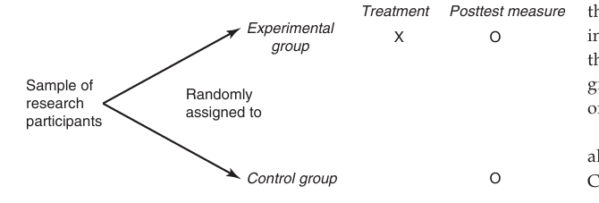

*Figure 9.4  Posttest-only control-group design.*

<!-- Page 9 -->
maturation, instrumentation, testing, regression artifact, attrition, selection, and additive/interactive (i.e., differential) effects. This is summarized in Table 9.3. These threats are controlled because the effects of these extraneous variables affect both the experimental and control groups equally. For example, when participants are randomly assigned, each group should have the same percentage of extreme scores and, therefore, should demonstrate the same degree of regression toward the mean. Selection bias is naturally ruled out because random assignment has assured the equality of the experimental and control groups at the time of randomization. As stated earlier, randomization does not provide 100% assurance. It is, however, our *best* protection against the selection rival hypothesis.

As long as the extraneous variables affect both groups equally, any observed difference between the groups will not be due to these extraneous variables, and we can assume that the difference is due to the independent variable. Thus we can conclude that the independent variable is the cause of the different performance on the dependent variable. Remember, we want the groups to be identical on all variables except the independent variable. Note, however, that if any of the threats to internal validity act differentially, then the threat will remain. An effect acts differentially when it causes the groups to become different because the threat affects one group but not the other group.

For example, if the participants in the experimental group were treated in one session and the participants in the control group were treated in a different session, it is possible that certain events took place in one session that did not take place in the other. If a differential event did take place (e.g., laughter, a joke, or a comment about the purpose of the experimental procedure), there would be no way of eliminating its influence, and it might affect the dependent variable for that particular group. Such an event would have to be considered a possible cause for any significant difference noted between the groups, and it competes with the independent variable in explaining the difference between the groups’ performance on the dependent variable.

Fortunately, the internal validity threats usually do not occur differentially (i.e., affect the groups differentially) when the participants are randomly assigned to the groups and when the experimenter treats the groups similarly during the experiment in every way except for the administration of the levels of the independent variable. For example, to control for instrumentation, it is required that the groups do not differ with regard to the observers or interviewers who collect the dependent variable data. Therefore, the same observers or interviewers must be used for both groups (and “blinded” in that they do not know what group participants are in). The key point is that random assignment typically ensures that the effect of extraneous variables is randomly distributed across the groups at the outset of the experiment and thus does not threaten the internal validity of the experiment. As summarized in Table 9.3, you can see that this design controls for all of the threats to internal validity.

**Strengths and Weaknesses of the Posttest-Only Control-Group Design** At least two difficulties can be identified in the posttest-only control-group design. First, although random assignment is the best control technique available for achieving equivalence, it does not provide complete assurance that the necessary equivalence has been attained. This is particularly true when the number of participants being randomized is small (e.g., fewer than 30 participants). If there is any doubt that random assignment will work, it is advisable to combine matching and statistical control along with the randomization technique.

Second, because the posttest-only control-group design lacks a pretest, it lacks the potential benefits of including a pretest, such as providing a way to check on the success of the randomization process (i.e., are the groups similar on the pretest measure?),

<!-- Page 10 -->
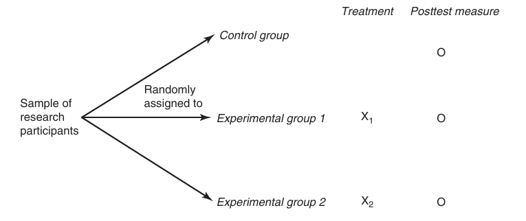

*Figure 9.5  Posttest-only control-group design with three levels of variation of the independent variable.*

When *statistical power* is increased, the researcher is more likely to detect a statistically significant difference between the groups if there is a true difference in the populations from which the groups were sampled. (This idea is demonstrated in Chapter 16 when we discuss a statistical technique called the *analysis of covariance.*) More advantages of including a pretest in an experiment are provided below when we discuss the pretest–posttest control-group design.

The most basic version of the posttest-only control-group design contains only two groups (i.e., an experimental group and a control group), but it illustrates the two key features of all strong between-participants designs: inclusion of a control group and random assignment of participants to the groups. These features produce a very strong design for eliminating threats to internal validity. However, experiments are seldom confined to just two levels of variation of one independent variable. Instead, most studies use several levels of variation of the independent variable, resulting in more than two groups.

For example, let’s say that a recent study found that college students who were assigned to monthly meetings with their advisor were more likely to complete college. We might want to know if meeting each month was necessary for the program to be successful. To obtain information about how many advisor sessions are needed, the researcher could randomly assign students to three different groups that varied on the number of sessions received. In one experimental group, the participants would meet with their advisor once each month for a year. In a second experimental group, the participants would meet with their advisor once every 2 months, and a control group would be included that did not have any meetings with their advisor. The structure of this expanded posttest-only control-group design is depicted in Figure 9.5. This design includes more than one experimental group, and it allows us to address more specific research questions.

> [!TIP] **Study Questions 9.4**
> - What is the structure of a posttest-only control-group design?
>
> - What threats to internal validity are eliminated with this design, and how does the design control for these threats?
>
> - What are some of the strengths and weaknesses of the posttest-only control-group design?
>
> - What are the strengths and weaknesses of between-participants designs?

<!-- Page 11 -->
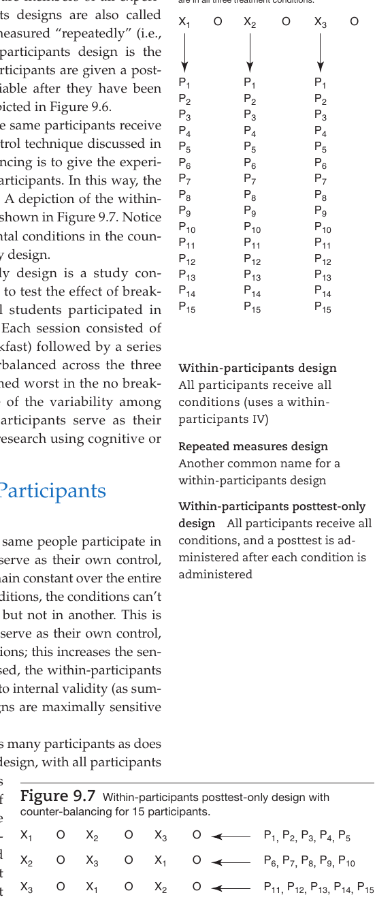

*Figure 9.6  Within-participants posttest-only design with 15 participants.*

## Within-Participants Designs

🎯 **9.4** Describe the structure, strengths, and weaknesses of within-participants

**designs.** *Note:* **** *X* is condition 1, *X* is condition 2, *X* is condition 3, P stands for participant, and O stands for 1 2 3 In a **within-participants design**, all research participants are members of all experi- posttest measurement. Note that participants 1–15 mental conditions in the experiment. Within-participants designs are also called **repeated measures designs** because all participants are measured “repeatedly” (i.e., under each experimental condition). The basic within-participants design is the **within-participants posttest-only design** in which the participants are given a posttest measuring their performance on the dependent variable after they have been exposed to each experimental condition. This design is depicted in Figure 9.6.

Because of the likelihood of carryover effects when the same participants receive all experimental conditions, many researchers use the control technique discussed in Chapter 7 called *counterbalancing.* The idea of counterbalancing is to give the experimental conditions in different orders to different sets of participants. In this way, the researcher can average out basic (linear) carryover effects. A depiction of the withinparticipants posttest-only design with counterbalancing is shown in Figure 9.7. Notice that all of the participants still receive all of the experimental conditions in the counterbalanced version of the within-participants posttest-only design.

An example of the within-participants posttest-only design is a study conducted by Mahoney, Taylor, Kanarek, and Samuel (2005) to test the effect of breakfast type on cognitive performance. Elementary school students participated in three within-participant sessions (on 3 different days). Each session consisted of one of three types of breakfast (cereal, oatmeal, no breakfast) followed by a series of cognitive tasks. Order of breakfast type was counterbalanced across the three sessions. Mahoney et al. found that the students performed worst in the no breakfast sessions and best in the oatmeal sessions. Because of the variability among different people, within-participants designs (where participants serve as their own control) are often the designs that are employed in research using cognitive or physiological measures.

### Strengths and Weaknesses of Within-Participants Designs

As we have explained, in within-participants designs, the same people participate in *all* experimental conditions. Because of this, participants serve as their own control, and variables such as age, gender, and prior experience remain constant over the entire experiment. In other words, if all participants are in all conditions, the conditions can’t differ because some kinds of people are in one condition but not in another. This is a powerful technique of control. Because the participants serve as their own control, they are perfectly matched in the various treatment conditions; this increases the sensitivity of the experiment. In fact, if counterbalancing is used, the within-participants posttest-only design controls for all of the common threats to internal validity (as summarized in Table 9.3). Therefore, within-participants designs are maximally sensitive to the effects of the independent variable.

Also, the within-participants design does not require as many participants as does the between-participants design. In the *within-participants* design, with all participants experiencing all conditions, the number of participants needed for an entire experiment is equal to the number of participants needed for one experimental condition. In the *between-participants* design, the number of research participants needed equals the number of participants required for one treatment condition times the number of treatment conditions. If 25 participants are needed in each treatment

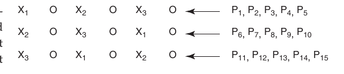

*Figure 9.7  Within-participants posttest-only design with counter-balancing for 15 participants.*

<!-- Page 12 -->
condition and there are three treatment conditions, then only 25 participants are needed in a within-participants design, whereas 75 participants (25 * 3) are needed in the between-participants design. When participants are difficult to obtain, this withinparticipants design advantage is important.

With these advantages, you might think that within-participants designs would be used more than the between-participants designs. Actually, this is not always true because of the disadvantages that accompany the within-participants design. First, within-participants designs can be taxing on participants because they have to be present for multiple treatment conditions. Second, perhaps the most serious handicap is the confounding influence of a sequencing effect. Remember that a sequencing effect can occur when participants participate in more than one treatment condition. Because the primary characteristic of a within-participants design is that all participants participate in all experimental conditions, a sequencing rival hypothesis is a real possibility. Fortunately, you can use the control technique of *counterbalancing* (shown in Figure 9.7) to help rule out the sequencing threat to internal validity. Unfortunately, as discussed in Chapter 7, counterbalancing controls only linear sequencing effects; if the sequencing effects are nonlinear (called *differential carryover effects*), then a confounding carryover sequencing effect will remain.

As you can see, there are some problems associated with the within-participants design, and these problems are generally more difficult to control than those in the between-participants design. As a result, the within-participants design is not the most commonly used design.

> [!TIP] **Study Questions 9.5**
> - Draw a diagram of the within-participants posttest-only design
>
> (with three levels of one independent variable) with and without counterbalancing.
>
> - What are some strengths and weaknesses of the within-participants posttest-only design?

## Mixed Designs (i.e., Combination of Between and Within)

🎯 **9.5** Describe the structure, strengths, and weaknesses of mixed designs.

Earlier we explained *between-participants designs*, where the different levels of the independent variable were experienced by different people (e.g., the experimental and control groups included different people). We didn’t mention it, but this kind of independent variable is called a **between-participants independent variable** (also called a between-subjects independent variable). The particular between-participants design we discussed was the *posttest-only control-group design*—where the sample of research participants is randomly divided (via random assignment) into the different groups, with each group receiving only one level of the IV. We also explained *within-participants* *designs* where all levels of the independent variable are administered to all participants. This kind of independent variable is called a **within-participants independent** **** **variable** (also called a within-subjects independent variable). The particular withinparticipants design we discussed was the *within-participants  posttest-only design*—where everyone in the sample receives all levels of the IV (at different times, of course).

<!-- Page 13 -->
You can probably guess from the title of the current section that a *mixed design* has a combination of between- and within-participants independent variables. It must have at least one between-participants IV *and* at least one within-participants IV. The pretest–posttest control-group design is an example of a mixed design.

### Pretest–Posttest Control-Group Design

As can be seen in Figure 9.8, the pretest–posttest control-group design is like a posttest-only control-group design *with the addition of a pretest*. In the **pretest–** **posttest control-group design**, the research participants are randomly assigned to two or more treatment conditions and a pretest is administered; then the treatment conditions are administered; and last, the posttest is administered. This is a mixed design because it has a between-participants IV (the treatment groups are composed of different participants) and a within-participants factor of “time” (where all participants receive the pretest at time 1 and the posttest at time 2). Because of random assignment, this design is strong on internal validity, ruling out all of the basic threats to internal validity as summarized in Table 9.3.

Here is an example. You decide to conduct an experiment using the pretest– posttest control group design to test a treatment for social anxiety. You randomly assign your 100 participants to the two levels of the treatment variable where the control group does not receive anxiety reduction therapy and the experimental group does receive anxiety reduction therapy. You have 50 participants in both groups making up your between-participants IV. Your within-participants independent variable is “time” because you measured participants’ anxiety level before the intervention (pretest) and after the intervention (posttest). Your dependent variable is level of social anxiety.

We have plotted the results of your experiment in Figure 9.9. You can see that both groups had high social anxiety at the beginning of your experiment (pretest means), but after the intervention, on the posttest, the experimental group was lower in anxiety than was the control group. This is exactly what was hoped for. The treatment helped the experimental group members lower their anxiety. (You would also have to determine if your result is “statistically significant,” but we discuss that much later, in Chapter 16.)

### Advantages and Disadvantages of Including a Pretest

There are several reasons researchers often prefer to include a pretest in this and other designs (Maxwell, Delaney, &amp; Kelly 2018; Selltiz, Jahoda, Deutsch, &amp; Cook., 1959). First, including the pretest measurement allows the researcher to check to see

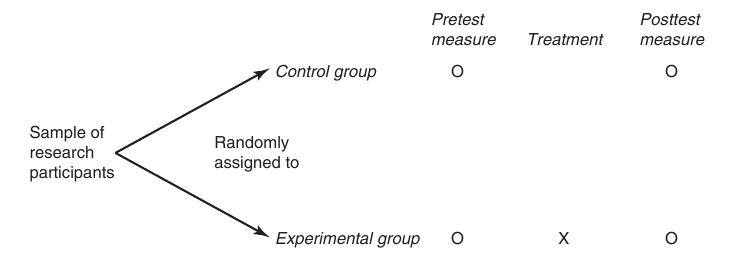

*Figure 9.8  Pretest–posttest control-group design.*

<!-- Page 14 -->
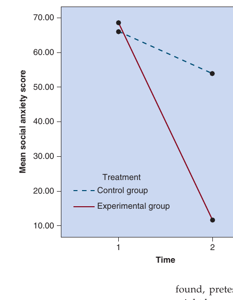

*Figure 9.9  Mean results of pretest–posttest control-group design studying effectiveness of anxiety reduction therapy.*

> how well the randomization process (i.e., random assignment) worked. Although random assignment provides the greatest assurance possible of *initial comparability* of research participants, it is not infallible. When a pretest is included, the researcher does not have to assume that randomization worked properly; the researcher can check to see if the groups are similar on the dependent variable after random assignment but before the experimental conditions are introduced. If the researcher measures the participants on additional variables relevant to the study, initial comparability can also be checked on those variables (e.g., motivation, intelligence, attitudes).

> Second, if a pretest is included, the researcher can determine if a ceiling effect or floor effect is likely to occur (when pretest scores are examined before introducing the experimental conditions). A **ceiling effect** occurs when the participants’ scores on the dependent variable are so high that they cannot go up from pretest to posttest. A **floor effect** occurs when scores are so low that they cannot go down from pretest to posttest. For example, if a dependent variable had a maximum value of 100 and the average score for some participants was 98 or 99 on the pretest, then there would be little room left for improvement. If no treatment effect is

Third, if the experimental and control groups are slightly different on the dependent variable measure at the pretest, the researcher can use a statistical technique (explained in Chapter 16) called **analysis of covariance** to statistically control for these pretest differences. Not only does this statistical technique adjust for pretest differences, it also provides a more accurate and powerful test of the differences between the experimental and control group posttest scores. This means that if the experiment has an impact, this design is slightly more likely to pick up on the impact because of the inclusion of the pretest.

Fourth, perhaps the most common reason for pretesting is to gain an empirical demonstration of whether an overall change in response occurred from pretesting to posttesting. The most direct way of gaining such evidence of *change* is to determine if there is a statistically significant difference between the pretest and posttest change scores of the experimental and control groups.

There is at least one potential difficulty when a pretest is used in the  pretest– posttest control-group design and other designs. The participants might change in some way because they were given a pretest. Note, however, that because both groups were given the pretest, they both should be affected equally by taking the pretest; therefore, the internal validity of the design is not weakened. However, external validity can sometimes be weakened when a pretest is included in the design.

As you know from Chapter 6, external validity is the degree to which the results of a study generalize. The issue here is that when everyone in the experiment is given a pretest, the results might generalize best to people who have taken a pretest and might not generalize as well to those who have not taken a pretest. Because this generalization problem does not exist in the posttest-only control-group design, the pretest–posttest control-group design can sometimes have slightly less external validity. Many researchers believe that the advantages of including a pretest in the pretest–posttest control-group design outweigh this disadvantage. The pretest–posttest control-group design is indeed a very strong research design.

<!-- Page 15 -->
> [!TIP] **Study Questions 9.6**
> - Diagram a pretest–posttest control-group design, and explain the components of this design.
>
> - What threats to internal validity are eliminated with this design, and how does the design control for these threats?
>
> - What are some of the strengths and weaknesses of including a pretest in the pretest–posttest control-group design?

## Factorial Designs

🎯 **9.6** Differentiate between main effects and interaction effects in factorial

**designs.**

The posttest-only control-group, within-participants, and pretest–posttest controlgroup designs have only one independent variable of interest to the researcher, and that variable is the independent variable manipulated by the researcher. However, in psychological research, our interest often includes two or more independent variables acting in concert. When there is more than one independent variable of interest, a factorial design is the experimental design of choice. In a **factorial** **design**, two or more independent variables are simultaneously studied to determine their separate and interactive effects on the dependent variable. The independent variables in factorial designs can be between-participants variables (i.e., participants experience only one level of the independent variable), withinparticipants variables (i.e., participants experience all levels of the independent variable), or a combination of between and within-participants variables (producing a mixed design).

In this section, we focus on a factorial design with two between-participants independent variables. Figure 9.10 depicts the *design layout* (i.e., a picture showing logical structure) of a factorial design in which one of the independent variables has three levels (variable A) and the other has two levels (variable B). The levels of variable A are A, A, and A, and the levels of variable B are B and B. There are six combina- tions of these two independent variables—A B,  A B,  A B,  A B,  A B, and A B. 1 1 1 2 2 1 2 2 3 1 3 2 Each of these combinations is referred to as a **cell** in the design layout and represents an experimental condition. The number of cells in a design layout is obtained by multiplying the number of levels of the independent variables—in this case there are six cells (3 * 2 = 6 ).

The participants would be randomly assigned to the six cells and would receive the appropriate treatment combination when the experiment is conducted.

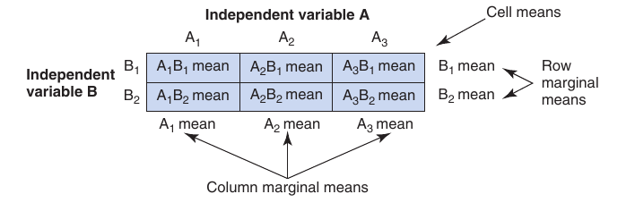

*Figure 9.10  Factorial design with two independent variables.*

<!-- Page 16 -->
The participants randomly assigned to A B receive the A level of the first inde- pendent variable and the B 1 level of the second independent variable. In like manner, the participants randomly assigned to the other cells receive the designated combination of the two independent variables. Once the experiment is conducted, the researcher obtains the two types of means shown in Figure 9.10: cell means and marginal means. A **cell mean** is the mean score of the participants in a cell. A **mar-** **ginal mean** is the mean score of all participants receiving one level of an independent variable (ignoring or averaging across the levels of the other independent variable).

The factorial design allows the investigation of two types of effects: main effects and interaction effects. A **main effect** refers to the separate influence of each independent variable on the dependent variable. The term *main effect* did not arise in the previous designs in this chapter because only one independent variable existed (and therefore, only one main effect). However, more than one independent variable exists in a factorial design, and the separate effects of each independent variable must be identified. To distinguish the influence of the different independent variables, we refer to each one as a separate main effect. In a design with two independent variables, two main effects are investigated.

The factorial design also allows the investigation of interaction effects. An **interaction effect** occurs when the effect of one independent variable on the dependent variable varies at the different levels of the other independent variable. For example, perhaps the effect of caffeine consumption on the dependent variable test anxiety varies according to the amount of sleep someone has had. When you have two independent variables in your factorial design, you analyze the data for two main effects (one for each independent variable—such as caffeine consumption and amount of sleep) and one interaction effect (for the “interaction” of the two independent variables).

You might ask: Why not just conduct a separate experiment for each independent variable? The answer is that both separate experiments and the factorial design enable you to study the main effects, but only the factorial design enables you to study the interaction effect. It is very important to know whether independent variables interact. In a sense, the factorial design is more than the sum of its parts. By including the two independent variables in the same design, you learn about the main effects for each variable *and* you can determine if an interaction effect is present.

Let’s make these concepts more concrete with an example. Let’s say that we are interested in factors that affect driving performance. Our first independent variable (variable A) is caffeine consumption with the levels of low (A ), medium (A ), and 1 2 high (A ). The second independent variable (variable B) is sleep deprivation with the 3 levels of not deprived (B ) and deprived (B ). Students are randomly assigned to each 1 2 combination of these two independent variables (i.e., to each cell). The dependent variable is driving performance (operationalized as the number of correct maneuvers on the training course).

The cell and marginal means for this hypothetical experiment are provided in

*Figure 9.11. To determine if there are any main effects, you compare the marginal means for each independent variable. The marginal means for caffeine consumption are 2.2, 7.3, and 5.3, which suggests that (ignoring the sleep deprivation variable) driving perfor-*

<!-- Page 18 -->
> interaction is present, you cannot provide a simple answer to the question: “Which level of caffeine consumption provides the best performance?” The answer is that it depends on whether the participants are sleep deprived or not. It appears that both caffeine consumption and sleep deprivation influence driving performance; however, the causal impact is an interactive effect.

> Now you know about cell means, marginal means, main effects, and interaction effects. Because these concepts are very important in psychological research, we demonstrate several additional possible outcomes from a two-factor experiment in

> [!NOTE]
> Exhibit 9.1.

### EXHIBIT 9.1 Examples of Main Effects and Interaction Effects

The concepts of main effects and interaction effects are very important in psychological research. We present several different outcomes that could accrue from an experiment having the design shown in Figure 9.10 (i.e., an experiment with three levels of variable A and two levels of variable B). Some of the outcomes presented represent interactions and others do not, so that you can see the difference in the two situations. We will set up a progression from a situa- tion in which one main effect is significant to a situation in which both main effects and the interaction are significant. (Although significance is determined via statistical testing,

you can assume that the effects we demonstrate are statisti- cally significant.) The letters A and B continue to represent the two independent variables. If it helps you to understand the tables and graphs better by using “real” variables, you can use the variables we used earlier (i.e., A

caffeine con- sumption, B

sleep deprivation, and the dependent variable is driving performance). Table 9.4 and Figure 9.13 depict the various cases included in this exhibit.

Table 9.4 shows the cell means and marginal means. Each cell contains the mean score for all the participants in the cell. There are six cell means in each case. The means

- 

- 

**Table 9.4** Tabular Presentation of Hypothetical Data Illustrating Different Kinds of

Main and Interaction Effects

(Note: Cell means are inside the cells, and the marginal means are in the margins.)

A A A

B 10 20 30 20 $\rightarrow$ B

B 10 20 30 20 $\rightarrow$ B

(a) A is significant; B and the interaction are not significant

A A A

B 30 40 50 40 $\rightarrow$ B

B 2 50 40 30 40 $\rightarrow$ B 2

(c) Interaction is significant; A and B are not significant

A 1 A 2 A 3

B 1 20 30 40 30 $\rightarrow$ B 1

B 30 30 30 30 $\rightarrow$ B

(e) A and the interaction are significant; B is not significant

A A A 1 2 3

B 30 50 70 50 1

B 2 20 30 40 30

A A A 1 2 3 1 2 3

> (b) B is significant; A and the interaction are not significant

A A A 1 2 3 1 2 3

> (d) A and B are significant; interaction is not significant

A 1 A 2 A 3

> (f) B and the interaction are significant; A is not significant

[^25]: 40 55 (g) A, B, and the interaction are significant

<!-- Page 19 -->
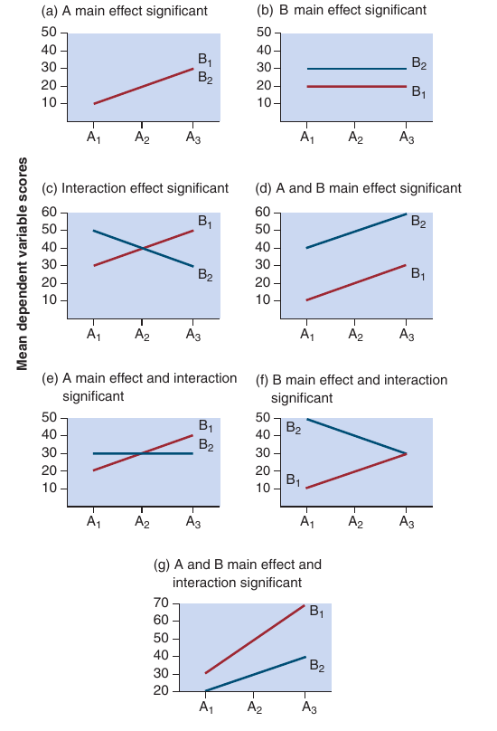

*Figure 9.13  Graphic presentation of hypothetical data illustrating different kinds of main and interaction effects.*

outside of each box are the *marginal means*, which are used to determine if main effects are present. To determine the same at all levels of A. if an interaction effect is present, the cell means are plotted in Figure 9.13 for each table from Table 9.4. Remember: If Neither main effect is significant, as indicated by the fact the lines in the plot of cell means are parallel, there is no interaction; if they are not parallel, there is an interaction.

Parts (a), (b), and (d) of Figure 9.13 represent situations in which one or both of the main effects are significant, but there is no interaction. In each case, the mean scores for the level of variation of at least one of the main effects differ. This can be seen from both the marginal means in the in Figure 9.13. Note also from Figure 9.13 that the lines for

In such a situation an interaction cannot exist, because an depends on the level of the other variable being considered, the information. such as A, A, or A. In each of these cases, the B effect is 1 2 3

> Part (c) depicts the classic example of an interaction. that the three-column means are identical and the two-row means are identical and reveal no variation in Table 9.4.

> However, if the variable A treatment effect is considered only for level B, we note that the scores systematically increase 1 from level A to A. In like manner, if only level B is consid1 3 2 ered, then there is a systematic decrease from level A to A. 1 3

> In other words, A *is* effective but in opposite directions for numerical examples presented in Table 9.4 and the graphs levels B 1 and B 2, or the effect of A depends on which level of

> B we are considering. Therefore, there is an *interaction.* We levels B and B are parallel in each of these (a), (b), and (d). find graphs to be more helpful than tables in depicting interaction, but you should use whichever mode better conveys *interaction* means that the effect of one variable, such as B, 1

( *Continued* )

[^1]: 2

<!-- Page 20 -->
### EXHIBIT 9.1 Examples of Main Effects and Interaction Effects (Continued)

Parts (e) and (f) show examples of situations in which a main effect and an interaction are significant; part (g) shows a case in which both main effects and the interaction are significant. These illustrations exhaust the possibilities that exist for relationships in a factorial design having two in- dependent variables. The exact nature of the main effects or the interaction may change, but one of these types of conditions will exist, unless you have no main effects and no interaction effect in which no effect would be significant in

your experiment. Before we leave this section, one additional point needs to be made regarding the interpretation of signif- icant main and interaction effects. Whenever either a main or an interaction effect

alone

is significant, you naturally have to interpret this effect. When

both

main and interaction effects are significant, however, and the main effect is contained in the interaction effect, then only the interaction effect is inter- preted because the significant interaction effect qualifies the meaning that would arise from the main effect alone.

> [!TIP] **Study Questions 9.7**
> - Draw a diagram of a factorial design in which variable A has three levels and variable B has three levels.
>
> - What is a main effect, and how do you determine if a main effect is present?
>
> - What is an interaction effect, and how do you determine if an interaction is present?

### Factorial Designs Based on Within-Participants

### Independent Variables

As stated in the last section, the factorial design can incorporate between-participants, within-participants, or a combination of between- and within-participants independent variables. In the last section, the design had two between-participants IVs. In this section we explain the case where you have two within-participants IVs.

A first key point is that regardless of the kind of independent variables (between, within, or a combination of the two), you check for main effects and interaction effects, exactly as demonstrated above. Second, regardless of the kind of independent variable, the number of levels of the independent variables defines the design layout in which the cell means fall. For example, if one of your IVs has two levels and the other has three levels, then you have a 2 * 3 design with six cells (i.e., 2 * 3 = 6). If you have two independent variables

* 2 = 4).

* 4 design? *Hint:* just multi-

> As shown in Figure 9.14, the unique feature of a factorial design

> * 2 design, but all 20 participants (P - P ) are shown in 1 20

> When you have within-participants IVs, experimenters usu-

> * 3 design with randomized counterbalancing, participants

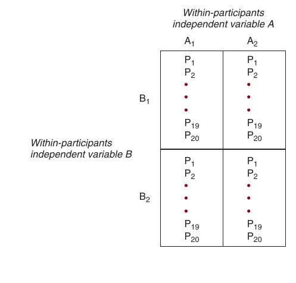

*Figure 9.14  Factorial design with two within- participants independent variables.*

<!-- Page 21 -->
would receive 6 treatment conditions in random order. Using a random number generator, you might find that person one is to receive order 6, 1, 3, 5, 4, 2; person two is to receive order 2, 1, 3, 4, 6, 5, person three is to receive order 1, 2, 3, 5, 4, 6, and so forth. (Randomized and other types of counterbalancing are explained, in more detail, in the previous chapter.)

As an example of a 2 * 3 design, you might want to know if different reward amounts (large versus small) are equally effective for easy, moderate, and difficult tasks. Reward is a within-participants IV because all participants receive both levels of rewards (at different times). Likewise, task difficulty is a within-participants IV because all participants perform easy, moderate, and difficult tasks (at different times). Because one of these independent variables has two levels and the other IV has three levels, the number of treatment combinations is 6 (i.e., 2 * 3 = 6). The order in which the participants receive these 6 conditions will be different (i.e., counterbalanced) to eliminate order and carryover effects.

> [!TIP] **Study Question 9.8**
> What are the characteristics of a factorial design based on within-participants independent variables?

### Factorial Designs Based on a Mixed Model

Now we show a factorial design with a combination of between- and withinparticipants independent variables. This is a mixed design, and it is sometimes called a **factorial design based on a mixed model**. The simplest form of this design involves the combination of one between-participants independent variable and one within-participants independent variable. The between-participants variable requires a different group of research participants for each level of variation. The within-participants  variable is constructed so that all participants have to take each level of variation. When these two independent variables are included in the same scheme, it becomes a factorial design based on a mixed model, as illustrated in the within-participants IV. As with all factorial designs, the number of experimental conditions is equal to the product of the number of levels of the independent variables. For example, you might want to know if three different types of motivational instructions are equally effective for easy, moderate, and difficult tasks. Motivational instruction is the between-participants independent variable because you assign participants to the three motivational instructions conditions, forming three independent groups. The withinparticipants independent variable is task difficulty, and each group will perform the easy, moderate, and difficult tasks. Because both of these independent variables (type of instructions and difficulty of task) have three levels, the number of treatment combinations is 9 (i.e., 3 * 3 = 9).

Regardless of the type of IV (between, within, or a combination), if you have two IVs you can test the effects produced by each of the two independent variables, as well as the interaction between the two independent

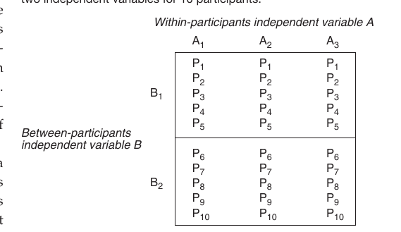

*Figure 9.15. In this design, participants are randomly assigned to the different levels of varia- tion of the between-participants IV, but all participants take each level of variation of*

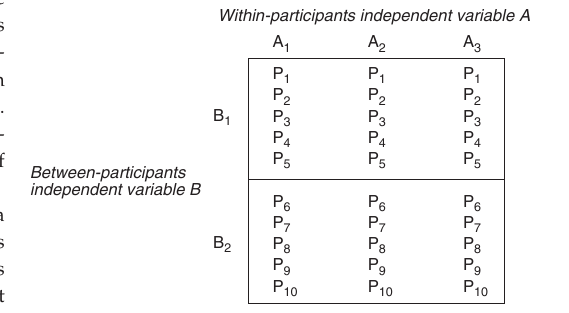

*Figure 9.15 Factorial design based on a mixed model with two independent variables for 10 participants.*

<!-- Page 22 -->
variables. In comparison to the design where there were two between-participant IVs, the mixed design has the advantage of needing fewer participants because all participants take all levels of variation of one of the independent variables. Therefore, the number of participants required is only some multiple of the number of levels of the between-participants independent variable. The factorial designs needing the fewest number of participants, however, are designs with only within-participants factors.

> [!TIP] **Study Question 9.9**
> What are the characteristics of a factorial design based on a mixed model?

### Nature of Independent Variables in Factorial Designs

The examples of factorials that we presented thus far included two independent variables where both IVs were manipulated by the researcher. However, frequently, we want to investigate variables that we cannot manipulate, such as age, personality, or gender in combination with manipulated variables. By definition, factorial designs must include at least one independent variable that is manipulated, but it may also include one or more nonmanipulated IVs. For example, you may want to determine if a new bullying prevention program is equally effective for children and adolescents. Your independent variables are the manipulated treatment (bullying prevention vs. control) and the nonmanipulated variable age (children vs. adolescents). You would randomly assign participants from each age group to the treatment and control groups, which would result in four groups. This is an important design because it addresses the issue that the treatment may work differently at different ages. An interaction would indicate that the treatment is not equally effective for both age groups. However, when interpreting findings from this design, the *causal* conclusions that are warranted will vary for the manipulated variable (treatment vs. control) and the nonmanipulated variable (children vs. adolescents). Specifically, strong causal claims are only appropriate for the manipulated independent variable. That’s because there may be confounding extraneous variables that account for the relationship between the nonmanipulated IV and the DV.

### Strengths and Weaknesses of Factorial Designs

So far, the discussion of factorial designs has been limited to those with two independent variables. There are times when it is advantageous to include three or more independent variables in a study. Factorial designs enable us to include as many independent variables as we consider important. Mathematically or statistically, there is almost no limit to the number of independent variables that can be included in a study.

Practically speaking, however, there are several difficulties associated with increasing the number of independent variables. First, there is an associated increase in the number of research participants required. In an experiment with two independent variables, each of which has two levels of variation, a 2 * 2 arrangement is generated, yielding four cells. If 15 participants are required for each cell, the experiment requires a total of 60 participants. In a three-variable design, with two levels of variation per independent variable, a 2 * 2 * 2 <!-- Page 23 -->
arrangement exists, yielding eight cells, and 120 participants are required in order to have 15 participants per cell. Four independent variables mean that 16 cells and 240 participants are required. As you can see, the required number of participants increases rapidly with an increase in the number of independent variables. This difficulty, however, does not seem to be insurmountable; many studies are conducted with large numbers of research participants.

A second problem with factorial designs incorporating more than two independent variables is the increased difficulty of simultaneously manipulating the combinations of independent variables. In an attitude study, it is harder to simultaneously manipulate the credibility of the communicator, type of message, gender of the communicator, prior attitudes of the audience, and intelligence of the audience (a five independent variable problem) than it is just to manipulate the credibility of the communicator and prior attitudes of the audience.

A third complication arises when higher-order interaction effects are significant. We have explained the concept of an interaction for a factorial with two independent variables; this is called a **two-way interaction**. Designs with more than two independent variables have higher-order interactions effects. In a design with three independent variables, it is possible to have a three-way interaction. A **three-** **way interaction** (or a “triple” interaction) is present when a two-way interaction changes at the different levels of the third independent variable. In addition to the three-way interaction, in a design with three independent variables you might also have up to 3 two-way interactions (A * B,  A * C, and B * C ) and three main effects (for a total of seven effects). In a design with four independent variables, it is possible to have a four-way interaction (i.e., a three-way interaction changes at the different levels of the fourth independent variable). In addition to the fourway interaction, you might also have up to 4 three-way interactions, 6 two-way interactions, and 4 main effects (for a total of 15 effects)! Three-way interactions can be difficult to interpret, and interactions of an even higher order (e.g., fourway interactions) tend to become unwieldy.

In spite of these problems, factorial designs are very popular because of their overriding advantages when appropriately used. The following three advantages of factorial designs are adapted from Kerlinger and Lee (2000, pp. 371–372).

The first advantage is that factorial designs allow the experimenter to manipulate more than one independent variable simultaneously in an experiment; therefore, more precise hypotheses can be tested. For example, did a combination of three variables produce an effect? A second positive feature is that the researcher can control a potentially confounding variable by building it into the design as an independent variable. For example, if you are worried that an effect might be different for men and women, you can add gender to your design. The third advantage of the factorial design is that it enables the researcher to study the interactive effects of the independent variables on the dependent variable. This advantage is probably the most important because it enables us to hypothesize and test interactive effects. Testing main effects does not require a factorial design, but testing interactions does. It is this testing of interactions that lets researchers investigate the complexity of behavior and see that behavior is caused by the interaction of many independent variables.

> [!TIP] **Study Question 9.10**
> What are some strengths and weaknesses of the factorial design?

<!-- Page 24 -->
## How to Choose or Construct the Appropriate Experimental Design

🎯 **9.7** Describe the considerations made when deciding upon the appropriate

**experimental design.**

It is your task to determine which research design is most appropriate for a particular research study. There are several factors to consider in making the design decision, including the nature of the research problem, the specific research question, the extraneous variables that must be controlled, and the relative advantages and disadvantages inherent in each design. Experimental research is appropriate for research questions concerning cause and effect, and the randomized or strong designs are the best experimental designs available.

When you have a causal research question and are going to use an experimental design, you will usually find that one of the specific designs illustrated in this chapter will fit your needs. Sometimes, however, you might need to extend the designs we have presented and construct a more complex experimental design. To do this, you will use the designs and design components provided in this chapter. When you read journal articles in your particular research area, you might find that some of the designs are more complex. Fortunately, you will also find that the designs were constructed using the components we have provided in this chapter.

If you need to construct a more complex design, you should carefully examine the designs used in the prior research literature and determine why the more complex designs are used. Then, think carefully about your research question and determine the design components that are needed to answer the question. Here are some considerations that are under your control when constructing an experimental research design: (1) Should I use a control group? (2) Should I use multiple treatment comparison groups (comparing more than one active treatment)? (3) Should I use a pretest? (4) Should I use just one or multiple pretests (to get a stable baseline)? (5)  Should I use just one or multiple posttests (to get a stable treatment effect or identify delayed outcomes)? (6) Should I use a within-participants or a  between-participants independent variable, or should I use both? (7) Should I include multiple theoretically interesting independent variables in the design (as in factorial designs)? and (8) Should I include more than one dependent variable (to see how the treatment affects several different outcomes)?

If you become a psychologist, then, over time, you will become more and more adept at design selection and construction. For now, start with the major design types and specific designs presented in this chapter, but over time you must continue reading and learning from the published research literature. Keep taking more classes in research design and in statistics, and continue advancing your knowledge. To get you started, your next step after reading our text will be to read the more advanced book (published in 2002), *Experimental and Quasi-Experimental Designs for Generalized Causal* *Inference,* by Shadish et al.

> [!TIP] **Study Questions 9.11**
> - What are the design components used to construct an experimental design?
>
> - Select one of the experimental designs presented in this chapter, and discuss the components used and their purposes.

<!-- Page 25 -->
### Summary

The design of a research study is the basic outline of the experiment, specifying how the data will be collected and analyzed and how unwanted variation will be con- trolled. The purpose of an experimental design is to answer a question about cause and effect. A good experimental research design must satisfy two criteria. First, the design must test the causal hypotheses advanced. Second, extraneous variables must be controlled so that the experimenter can attribute the observed effects to the in- dependent variable (i.e., to claim that A caused B). If you have the choice of several designs that will enable you to answer your research question, then you should select or construct the design that will provide maximum control over extraneous variables that may compete with your independent variable in explaining the results; your goal is always to eliminate rival hypotheses. Experimental designs can be viewed as falling on a continuum, with weak de- signs falling on or near one pole and strong or randomized designs falling on or near the other pole. Strong experimental designs provide the strongest evidence of cause and effect. Weak designs provide weak evidence of cause and effect. The center of the continuum includes moderately strong designs known as quasi-experimental designs. Quasi-experimental designs provide moderately strong evidence of cause and effect, and they are discussed in Chapter
10. The current chapter focuses on weak designs and strong designs. The weak designs discussed are the *one-group posttest-only design* (administration of a posttest to a single group of participants after they have been given an experi- mental treatment condition), the *one-group pretest–posttest design* (administration of a posttest to a single group of participants after they have been pretested and given an experimental treatment condition), and the *posttest-only design with nonequivalent*
*groups* (comparison of posttest performance of a group of participants who have been
given an experimental treatment condition with a group that has not been given the experimental treatment condition). These weak designs usually do not provide the desired answers because they do not control for the influence of many extraneous variables that can affect the results. Before listing the strong experimental designs, remember that when a between- participants independent variable is used, different sets of participants receive the different levels of the independent variable; when a within-participants independent variable is used, all participants receive all levels of the independent variable. The strong designs discussed include the between-participants *posttest-only control-group*
*design* (the basic version has administration of a posttest to two randomly assigned
groups of participants after one group has been administered the experimental treat- ment condition), the *within-participants posttest-only design* (all participants receive all treatments, and a posttest is administered after participants have been exposed to each experimental condition), the mixed design known as the *pretest–posttest control-*
*group design* (the basic version has administration of a posttest to two randomly as-
signed groups of participants after both groups have been pretested and one of the groups of participants has been administered the experimental treatment condition), and *factorial designs* where you have two or more independent variables that are used to study the separate and joint influence of the independent variables; the indepen- dent variables can all be between-participants variables, within-participants variables, or a combination of between and within. Factorial designs sometimes include pretests, but they always include posttests. Strong experimental designs are especially strong for answering questions about cause and effect. Therefore, when you want to know if an independent variable causes changes in a dependent variable, you should select or construct strong experimental research designs.

<!-- Page 26 -->
## 🗂️ Chapter Key Terms & Active Recall

> 💡 **Learning tip:** Try to recall the definition of each term *before* clicking to reveal it.
> This active retrieval practice strengthens long-term memory far more than re-reading.

📇 <b>Research design</b> *(p. 2)*

> **Definition:** The outline, plan, or strategy used to investigate the research question

📇 <b>Weak experimental designs</b> *(p. 3)*

> **Definition:** Designs that do not control for many extraneous variables and provide weak evidence of cause and effect

📇 <b>One-group posttest-only design</b> *(p. 4)*

> **Definition:** Administration of a posttest to a single group of participants after they have been given an experimental treatment condition

📇 <b>One-group pretest–posttest design</b> *(p. 4)*

> **Definition:** Design in which participants are pretested, receive a treatment condition, and then are posttested on the dependent variable

📇 <b>Rival hypothesis</b> *(p. 4)*

> **Definition:** Another name or synonym for alternative explanation; refers to the possibility of extraneous variables explaining the relation of the IV to the DV

📇 <b>Posttest-only design with nonequivalent groups</b> *(p. 5)*

> **Definition:** Design in which the performance of an experimental group is compared with that of a nonequivalent control group at the posttest

📇 <b>Design History Maturation</b> *(p. 6)*

> **Definition:** Posttest-only +

📇 <b>Randomized controlled trial (RCT)</b> *(p. 7)*

> **Definition:** Experimental design with random assignment to experimental (treatment) and control groups

📇 <b>Control group</b> *(p. 7)*

> **Definition:** The group of participants that does not receive the active treatment condition and serves as a standard of comparison for determining whether the treatment condition produced any causal effect

📇 <b>Experimental group</b> *(p. 7)*

> **Definition:** The group of participants that receives the treatment condition that is intended to produce an effect

📇 <b>Counterfactual</b> *(p. 7)*

> **Definition:** What the experimental group participants’ responses would have been if they had not received the treatment

📇 <b>Strong experimental designs</b> *(p. 7)*

> **Definition:** Designs that effectively control extraneous variables and provide strong evidence of cause and effect

📇 <b>Between-participants designs</b> *(p. 8)*

> **Definition:** Groups are produced by random assignment, and the different groups are exposed to the different levels of the independent variable (uses a between-participants IV)

📇 <b>Randomized designs</b> *(p. 8)*

> **Definition:** Betweenparticipants designs in which participants are randomly assigned to groups

📇 <b>Posttest-only control-group design</b> *(p. 8)*

> **Definition:** Administration of a posttest to two or more randomly assigned groups of participants that receive the different levels of the independent variable

📇 <b>Within-participants design</b> *(p. 11)*

> **Definition:** All participants receive all conditions (uses a withinparticipants IV)

📇 <b>Repeated measures design</b> *(p. 11)*

> **Definition:** Another common name for a within-participants design

📇 <b>Within-participants posttest-only design</b> *(p. 11)*

> **Definition:** All participants receive all conditions, and a posttest is administered after each condition is administered

📇 <b>Between-participants independent variable</b> *(p. 12)*

> **Definition:** Type of independent variable where different participants receive different levels of the independent variable

📇 <b>Within-participants independent variable</b> *(p. 12)*

> **Definition:** Type of independent variable where all participants receive all levels of the independent variable

📇 <b>Pretest–posttest control-group design</b> *(p. 13)*

> **Definition:** Administration of a posttest to two or more randomly assigned groups of participants after the groups have been pretested and administered the different levels of the independent variable

📇 <b>Ceiling effect</b> *(p. 14)*

> **Definition:** Situation where participants’ pretest scores on the dependent variable are too high to allow for additional increases

📇 <b>Floor effect</b> *(p. 14)*

> **Definition:** Situation where participants’ pretest scores on the dependent variable are too low to allow for additional decreases

📇 <b>Analysis of covariance</b> *(p. 14)*

> **Definition:** A statistical procedure in which group means are compared after adjusting for pretest differences

📇 <b>Factorial design</b> *(p. 15)*

> **Definition:** Two or more independent variables are studied to determine their separate and joint effects on the dependent variable

📇 <b>Cell</b> *(p. 15)*

> **Definition:** Combination of levels of two or more independent variables

📇 <b>Cell mean</b> *(p. 16)*

> **Definition:** The average score of the participants in a single cell

📇 <b>Marginal mean</b> *(p. 16)*

> **Definition:** The average score of all participants receiving one level of an independent variable

📇 <b>Main effect</b> *(p. 16)*

> **Definition:** The separate influence of one independent variable on the dependent variable

📇 <b>Interaction effect</b> *(p. 16)*

> **Definition:** When the effect of two or more IVs on the DV is more complex than indicated by the main effects

📇 <b>Factorial design based on a mixed model</b> *(p. 21)*

> **Definition:** A factorial design that uses a combination of withinparticipants and betweenparticipants independent variables

📇 <b>Two-way interaction</b> *(p. 23)*

> **Definition:** The effect of one independent variable on the dependent variable varies across the different levels of the other independent variable

📇 <b>Three-way interaction</b> *(p. 23)*

> **Definition:** A two-way interaction that changes at the different levels of the third independent variable

### Key Terms and Concepts

| Term | Term | Term |
| --- | --- | --- |
| [Analysis of covariance *p. 178*](#term-analysis-of-covariance) | [Interaction effect *p. 180*](#term-interaction-effect) | Randomized controlled trial |
| [Between-participants designs *p. 172*](#term-between-participants-designs) | [Main effect *p. 180*](#term-main-effect) | [(RCT) *p. 171*](#term-rct) |
| Between-participants independent | [Marginal mean *p. 180*](#term-marginal-mean) | [Repeated measures design *p. 175*](#term-repeated-measures-design) |
| [variable *p. 176*](#term-variable) | One-group posttest-only | [Research design *p. 166*](#term-research-design) |
| [Ceiling effect *p. 178*](#term-ceiling-effect) | [design *p. 168*](#term-design) | [Rival hypothesis *p. 168*](#term-rival-hypothesis) |
| [Cell *p. 179*](#term-cell) | One-group pretest–posttest | [Strong experimental designs *p. 171*](#term-strong-experimental-designs) |
| [Cell mean *p. 180*](#term-cell-mean) | [design *p. 168*](#term-design) | [Three-way interaction *p. 187*](#term-three-way-interaction) |
| [Control group *p. 171*](#term-control-group) | Posttest-only control-group | [Two-way interaction *p. 187*](#term-two-way-interaction) |
| [Counterfactual *p. 171*](#term-counterfactual) | [design *p. 172*](#term-design) | [Weak experimental designs *p. 167*](#term-weak-experimental-designs) |
| [Experimental group *p. 171*](#term-experimental-group) | Posttest-only design with | [Within-participants design *p. 175*](#term-within-participants-design) |
| [Factorial design *p. 179*](#term-factorial-design) | [nonequivalent groups *p. 169*](#term-nonequivalent-groups) | Within-participants independent |
| Factorial design based on a mixed | Pretest–posttest control-group design | [variables *p. 176*](#term-variables) |
| [model *p. 185*](#term-model) | p. 177 | Within-participants posttest-only |
| [Floor effect *p. 178*](#term-floor-effect) | [Randomized designs *p. 172*](#term-randomized-designs) | [design *p. 175*](#term-design) |

### Related Internet Sites

- <http://www.wadsworth.com/psychology_d/templates/student_resources/workshops/index.html>
  This site has several tutorials maintained by Wadsworth. When you get to this site, click on research methods workshops and then on the icon for True Experiments and Between versus Within Designs.

- <http://www.socialresearchmethods.net/kb/expfact.htm>
  This site provides instruction on factorial designs and interactions.

### Practice Test

*The answers to these questions can be found in the Appendix.*

**1.** The one-group posttest-only design, the one-group
pretest–posttest design, and the posttest-only de- sign with nonequivalent groups have in common
a.  Their frequent use by research psychologists
b.  The fact that they do not control for many threats
to internal validity
c.  The fact that they are all strong designs
d.  The fact that they are more typically used in
animal (vs. human) research

**2.** A control group is needed
a.  To control for some rival hypotheses
b.  To serve as a comparison
c.  Both a and b are correct.

**3.** The primary difference between a between-participants
and a within-participants design is
a.  The number of independent variables they can test
b.  Whether they can test for the effect of an
interaction c.  The number of main effects they can test
d.  Whether the various treatment combinations use
different participants or the same participants

**4.** If you have studied the effect that three dosages—15,
30, and 60 mg—of the drug Cymbalta has on de- pressed people and people with an eating disorder and have found that the lower dosages are most effec- tive with people with eating disorders and the higher dosages are most effective with people with depres- sion, you have identified
a.  An interaction between the drug dosage and the
type of disorder
b.  A main effect of drug dosage
c.  A main effect of type of treatment
d.  A main effect of both drug dosage and type of
treatment

**5.** If you have conducted an experiment that requires
you to randomly assign 30 participants to two levels of one independent variable (15 in one condition and

<!-- Page 27 -->
15 in the other condition) and all 30 participants take
c.  Within-participants posttest-only design
all three levels of a second independent variable,
d.  Factorial design based on a mixed model
what type of design have you used?
a.  Pretest–posttest design
b.  Simple randomized design

### Challenge Exercises

**1.** For each of the following experimental briefs:
a.  Identify the type of design used to test the hy-
pothesis of the study
b.  Explain why this design might have been used
c.  Identify the threats to internal validity
**Study A.** College students are used to test the
hypothesis that carbohydrate cravings increase as a person’s level of depression increases. To test this hypothesis, the experimenter randomly assigns participants to three groups and then administers a mood- induction technique that will temporarily induce different types of moods. One version of the mood-induction technique is administered to one group to induce a depressed mood, another ver- sion is used to induce an elated mood in a second group, and a third version is administered to the third group to ensure that their mood does not change. After the mood-induction procedure has been administered to each group, the participants provide an assessment of the extent to which they experience carbohydrate cravings.
**Study B.** Hillary wants to find out if nicotine
patches really help people quit smoking, so she identifies 100 people who have been smoking at least a pack of cigarettes a day for the past 10 years and want to quit. She has them all sign a form agreeing to stop smoking. She lets the participants decide if they want to be in the group that will wear the patch for a month or the group that will not wear the patch. At the end of the month, she monitors their cigarette smoking and finds that 35% of the individuals in the patch group quit smoking and 20% of the individuals in the no-patch group stopped smoking. Hillary concludes that the nico- tine patches are effective in helping people quit or reduce their consumption of cigarettes.
**Study C.** Dr. Cane was interested in deter-
mining if there was an association between a person’s gender and the tendency to report a false memory. To test this hypothesis, male and female participants were interviewed about a real emotional event that happened to them (a serious accident) between the ages of 4 and 10 and about a false event (getting lost). Two weeks later, these same individuals were interviewed about both events, and the interviewers attempted to elicit both  memories using guided imagery, context  reinstatement, and mild social pressure. The results of this experiment revealed that 100% of females and males recalled the real emotional event. However, 28% of females and 55% of males recalled the false event.

**2.** Basketball players naturally want to increase their
accuracy in shooting foul shots, so they hire a sports psychologist who hypothesizes that either anxiety reduction or mental imagery can help them. The sports psychologist randomly assigns 60 basketball players to six treatment conditions (10 in each condi- tion). Each group of basketball players then shoots 20 free throws under one of six conditions formed by the two independent variables. The first independent variable is anxiety and has three levels—high, moder- ate, or low; the second independent variable is imag- ery and has two levels—imaging that the shot is going through the hoop or imaging that the shot is missing the hoop. The mean number of shots that are made by each group of basketball players is as follows:
*Anxiety conditions*
High Moderate Low
*Imagery*
Making shot 15 14 6
*conditions*
Missing shot 9 12 17
a.  Does there seem to be an anxiety main effect? If
there is, what does it mean? (*Hint*: calculate mar- ginal means for the three anxiety conditions)
b.  Does there seem to be an imagery main effect?
If there is, what does it mean? (*Hint*: calculate marginal means for the two imagery conditions conditions)
c.  Does there seem to be an interaction? If there is,
graph the interaction and explain what it means. (*Hint*: plot the cell means and see if the lines are parallel or not)

**3.** Assume that you wanted to examine the impact of
classroom technology on class attendance of male and female students. Students are randomly assigned to a psychology class with either no technology, moderate <!-- Page 28 -->
technology, or extensive technology. This study produced the following data.

*Technology use* None Moderate Extensive *Student sex* Male 30 55 75 Female 38 60 28 a.  Does there seem to be a technology main effect?

If there is, what does it mean? (*Hint*: calculate marginal means for the three technology use conditions) b.  Does there seem to be a sex main effect? If there is, what does it mean? (*Hint*: calculate marginal means for the two student sex conditions) c.  Does there seem to be an interaction? If there is, graph the interaction and explain what it means. (*Hint*: plot the cell means and see if the lines are parallel or not)
