

📑 <b>Table of Contents</b>

- [Chapter 10 Quasi-Experimental Designs](#chapter-10-quasi-experimental-designs)
  - [Learning Objectives](#learning-objectives)
  - [Summary of Quasi-Experimental Designs](#summary-of-quasi-experimental-designs)
  - [Summary of Threats to Internal Validity for Quasi-Experimental Designs](#summary-of-threats-to-internal-validity-for-quasi-experimental-designs)
  - [Outcomes with Rival Hypotheses](#outcomes-with-rival-hypotheses)
  - [Ruling Out Threats to the Nonequivalent Comparison Group Design](#ruling-out-threats-to-the-nonequivalent-comparison-group-design)
  - [Causal Inference from the Nonequivalent Comparison Group Design](#causal-inference-from-the-nonequivalent-comparison-group-design)
- [Time-Series Design](#time-series-design)
  - [Interrupted Time-Series Design](#interrupted-time-series-design)
- [Regression Discontinuity Design](#regression-discontinuity-design)
  - [Summary](#summary)
  - [Key Terms and Concepts](#key-terms-and-concepts)
  - [Related Internet Sites](#related-internet-sites)
  - [Practice Test](#practice-test)
  - [Challenge Exercises](#challenge-exercises)

<!-- Page 1 -->
## Chapter 10 Quasi-Experimental Designs

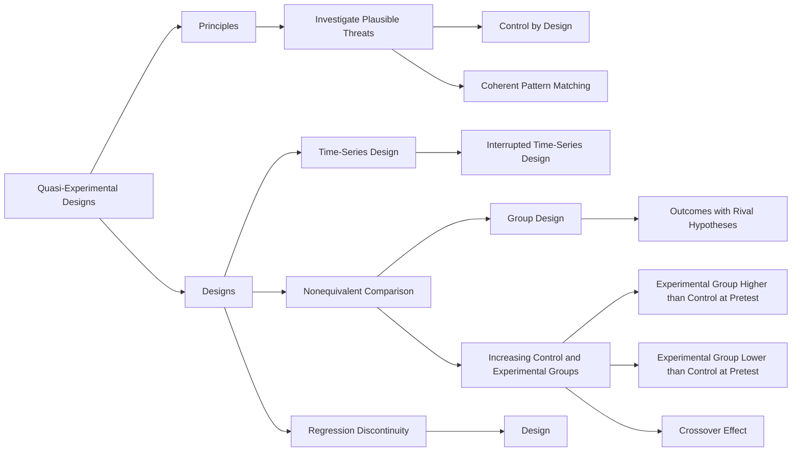

### Learning Objectives

🎯 **10.1** Explain the purpose of quasi-experimental designs and how they differ from weak and strong experimental designs.
🎯 **10.2** Describe the nonequivalent comparison group design and explain how to interpret the different possible outcomes.
🎯 **10.3** Describe the advantages of the interrupted time-series design over the one-group pretest–posttest design.
🎯 **10.4** Describe the structure and requirements of the regression discontinuity design.

<!-- Page 2 -->
**Table 10.1** *Summary of Quasi-Experimental Designs*

<table class="textbook-table" style="width: auto; max-width: 100%; border-collapse: collapse; margin: 1.5em 0;">
  <thead>
    <tr>
      <th>Design Name</th>
      <th>Salient Characteristics</th>
    </tr>
  </thead>
  <tbody>
    <tr>
      <td>Nonequivalent comparison group</td>
      <td>Includes pretest and posttest, no random assignment to groups, called “nonequivalent” because you need to worry about the groups being different before the study begins</td>
    </tr>
    <tr>
      <td>Interrupted time series</td>
      <td>One-group design, includes multiple pretests and posttests to reliably establish baseline and treatment results to be compared</td>
    </tr>
    <tr>
      <td>Regression discontinuity</td>
      <td>Experimenter controls assignment to groups based on a cutoff score on an assignment variable; effectiveness demonstrated by a discontinuity in the relation of the assignment variable scores to the posttest scores</td>
    </tr>
  </tbody>
</table>

Quasi-Experimental Designs
**10.1**
**Explain the purpose of quasi-experimental designs and how they differ**
**from weak and strong experimental designs.**
A  **quasi-experimental design**  is an experimental design that does not meet all
**Quasi-experimental design**
A the requirements necessary for controlling the influence of extraneous variables. research design in which an ex- perimental procedure is  applied Quasi-experimental designs include manipulation of the independent variable, but but all extraneous variables are not they do *not* include random assignment of participants to groups. Remember, ran- controlled dom assignment was a key element of the strong experimental designs discussed in Chapter
9. Fortunately, quasi-experimental designs are better at controlling extra- neous variables than the weak designs discussed in Chapter
9. It is helpful to view these three types of designs (weak, quasi, and strong) as falling on the continuum shown in Figure 10.1. The figure shows that quasi-experimental designs are nei- ther the worst nor the best experimental designs. Quasi-experimental designs fall in between strong and weak designs. Table 10.1 summarizes quasi-experimental designs.  For comparison, Table 9.1 on page 166 summarizes the weak and strong experimental designs.
**Figure 10.1**
Continuum of experimental research designs. 9GCM GZRGTKOGPVCN FGUKIPU You might ask whether it is possible to draw causal inferences from studies based on a quasi-experimental design because such a design does not rule out the influence of all rival hypotheses that operate as alternative explanations for the relationship between the independent and dependent variables. Making a causal inference from a quasi-experiment requires meeting the same basic requirements needed for any causal relationship. You must meet the following three criteria: (1) Cause and effect must covary (i.e., there must be a relationship between the inde- pendent and dependent variables), (2) cause must precede effect (i.e., changes in the independent variable must precede changes in the dependent variable), and (3) all plausible alternative explanations must be ruled out (i.e., the relationship between the independent and dependent variables must not be due to a confound- ing extraneous variable). The first two requirements (cause covarying with effect and cause preceding effect) are easy to handle in quasi-experiments because, as in randomized experiments, the researcher actively manipulates the independent variable so that the cause precedes the effect (which is measured at posttest after the manipulation), and then simply analyzes the data to determine if a statisti- cal relationship is present. However, the third requirement, ruling out alternative
**Table 10.1**

3WCUK 5VTQPI GZRGTKOGPVCN GZRGTKOGPVCN FGUKIPU FGUKIPU

### Summary of Quasi-Experimental Designs

**Design Name**
Nonequivalent comparison group Interrupted time series Regression discontinuity

**Salient Characteristics**
Includes pretest and posttest, no random assignment to groups, called “nonequivalent” because you need to worry about the groups being different before the study begins One-group design, includes multiple pretests and posttests to reliably establish baseline and treatment results to be compared Experimenter controls assignment to groups based on a cutoff score on an assignment variable; effectiveness demonstrated by a discontinuity in the relation of the assignment variable scores to the posttest scores

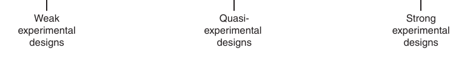

*Figure 10.1 Continuum of experimental research designs.*

<!-- Page 3 -->
explanations, is more difficult because random assignment is not possible in quasiexperiments. Therefore, one or more rival hypotheses, or alternative explanations for the observed relationship between the independent and dependent variables, frequently exist with quasi-experiments.

Causal inferences can be made using quasi-experimental designs, but these inferences are made only when data are collected that help render alternative explanations implausible. Furthermore, the evidence will usually be more suspect than evidence from a strong experimental design. Shadish, Cook, and Campbell (2002) have identified three principles, presented in Table 10.2, to address rival explanations and show that they are implausible. Principle one requires the identification and study of all plausible threats to internal validity.

**Table 10.2** *Principles Used to Rule out Rival Explanations in Quasi-Experiments*

1. Identification and study of plausible threats to internal validity: This principle involves identifying plausible rival explanations and then probing and investigating them to determine how likely it is that they can ex- plain the covariation between the treatment and the outcome.
2. Control by design: This principle involves adding design elements, such as additional pretest time points or additional control groups, to either eliminate a rival explanation or obtain evidence about the plausibility of the rival explanation.
3. Coherent pattern matching: This principle can be used when a complex prediction can be made about a causal hypothesis and there are few, if any, rival explanations that would make the same prediction. If the complex prediction is supported by the data, most rival explanations are eliminated. The more complex the prediction, the less likely it is that a rival explanation can explain the prediction and the more likely that the independent variable is producing the effect.

Principle two (i.e., control by design) involves the use of design components to control for plausible threats. As a review from the last chapter, here are the six major **design components** that are usually available to a researcher: (1) control or comparison groups (zero, one, or more than one), (2) pretest (zero, one, or more than one), (3) posttest (one or more than one), (4) within-participants and/ or  between-participants independent variables, (5) inclusion of one or more theoretically interesting independent variables, and (6) measurement of one or more theoretically interesting dependent variables. You can view the quasi-experimental designs presented as design improvements upon the weak designs explained in Chapter
9. For example, you will see that the interrupted time-series design (a quasi-experimental design) discussed in this chapter is like the one-group pretest–posttest design (a weak design from Chapter  9) with additional pretests and posttests added. Likewise, nonequivalent comparison group design (a quasiexperimental design) is like the posttest-only design with nonequivalent groups (a weak design from  Chapter 9) with a pretest added. You can also think of quasiexperimental designs as like strong designs with one or more components removed (typically random assignment to groups).

The third principle (i.e., coherent pattern matching) recommends the use of a pattern-matching strategy. This typically involves stating complex hypotheses about how multiple dependent variables will precisely change after an intervention. Stronger (i.e., more complex) hypotheses generally require stronger theory and are more easily falsifiable, which is what the philosopher Karl Popper (1902–1994) recommended (he called these “bold” hypotheses). For example, we might predict that after a treatment, the experimental treatment group will increase very much on one dependent variable, decrease very much on another dependent variable, and increase only slightly on yet another dependent variable, and, at the same time, the control group might be predicted to show no movement at all on any of the dependent variables. This would be a relatively complex pattern-matching type of hypothesis. To learn more about pattern matching, we recommend Campbell (1966), Shadish et al. (2002), and Trochim and Donnelly (2008). In the remainder of the chapter, we focus on principles one and two.

<!-- Page 4 -->
In Table 10.3 you can see the plausible threats to internal validity for the three quasi-experimental research designs explained in this chapter. You can refer to this table as needed during the explanation of each design, and for review. We recommend that you compare Table 10.3 with Table 9.2 (page 167) and Table 9.3 (page 170). As a set, these three tables show the weak, quasi, and strong designs along with their threats to internal validity.

**Table 10.3**

### Summary of Threats to Internal Validity for Quasi-Experimental Designs

**Design**
**History**
**Maturation**
**Instrumentation**
Nonequivalent + + + comparison group design* Interrupted time- - + + series design Regression + + + discontinuity design*
*If a basic threat acts differentially, it is subsumed under additive/interactive effects and is a threat.
**Note:**
A negative sign ( - ) indicates a potential threat to internal validity, a positive sign ( + ) indicates that the threat is controlled, and NA indicates that the threat does not apply to that design. Study Questions 10.1 •  How does a quasi-experimental research design differ from a strong ex- perimental research design?

- What are the requirements for making a strong claim of cause and effect?

- How are rival hypotheses ruled out in quasi-experimental designs? Nonequivalent Comparison Group Design
**10.2**
**Describe the nonequivalent comparison group design and explain how to**
**interpret the different possible outcomes.**
The  **nonequivalent comparison group design**  is probably the most common of all
**Nonequivalent comparison group**
**design**
quasi-experimental designs (Shadish et al., 2002). This design includes both an experi- A quasi-experimental design in which nonequivalent mental and a control group, but participants are not randomly assigned. Because experimental treatment and com- of the lack of random assignment, the participants in the control and experimental parison groups are tested at pre- groups will not be equivalent on all extraneous variables, and this can affect the test and posttest dependent variable. These uncontrolled extraneous variables operate as rival hypoth- eses to explain the outcome of the experiment, making these designs weaker than the strong experimental designs. But when a better design cannot be used, some form of a nonequivalent comparison group design is frequently recommended. The basic scheme, depicted in Figure 10.2, consists of giving an experimental group and a control group first a pretest and then a posttest (after the treatment condi- tion is administered to the experimental group). The pretest to posttest changes of the two groups are then compared to determine if significant differences exist. The design appears similar to the pretest–posttest control-group experimental design. However, there is one important difference that makes one a *strong* experimental design and the other a *quasi*-experimental design. In the between-participants pretest–posttest control-group design, the participants are randomly assigned to the experimental and control groups, whereas in the nonequivalent comparison group design they are

**Additive/**
**Regression**
**interaction**
**Testing**
**Artifact**
**Attrition**
**Selection**
**effects**
+ + + - - NA NA NA + + + + + + -

<!-- Page 5 -->
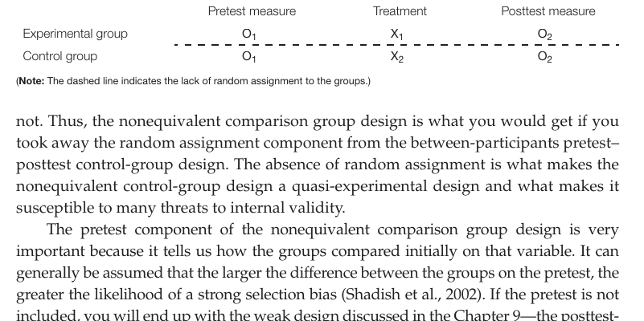

*Figure 10.2 Nonequivalent comparison group design.*

Treatment Posttest measure X 1 O 2 X 2 O 2 included, you will end up with the weak design discussed in the Chapter 9—the posttestonly design with nonequivalent groups. From a design perspective, be sure to notice that the *nonequivalent comparison group design* presented here (a quasi-experimental design) is an improvement over the *posttest-only design with nonequivalent groups*, but is not as good as the *pretest–posttest control-group design* (a strong, randomized design). The point is to notice what happens when design components (such as pretests and random assignment) are added or subtracted from designs.

Pretesting allows for testing and examination of possible group differences that often threaten the design. As shown in Table 10.3, the threats for the nonequivalent comparison-group design are selection and additive/interaction effects. There are actually several kinds of additive/interaction effects, and they are listed in Table 10.4. *All* of these threats to internal validity would have been minimized if the researcher could randomly assign participants, but that’s not possible with the  nonequivalent comparison group design. *Selection bias* is the most obvious result of the lack of random assignment—the groups likely will not be equivalent on all extraneous variables. Because participants are not randomly assigned, you cannot assume that the groups are equivalent; in fact, you should assume that the groups are different or “nonequivalent” on variables in addition to the independent variable. Remember, you want the groups to be different *only* on the levels of the independent variable.

**Table 10.4** *Selection and Additive/Interaction Threats to the Internal Validity of the Nonequivalent Comparison Group Design*

1. Selection bias —Because groups are nonequivalent, there will always be a potential selection bias. However, the pretest allows the exploration of the possible size and direction of the bias on any variables measured at pretesting.
2. Selection-attrition bias —This might exist if there is differential attrition in the groups. The pretest allows examination of the nature of attrition to see if there is a difference between those that drop out or do not complete the experiment and those that do.
3. Selection-maturation bias —This might exist if one group of participants matures at a different rate than the other group.
4. Selection-instrumentation bias —This might exist if the nonequivalent groups of participants react differently to a change in instrumentation.
5. Selection–testing bias —This might exist if the nonequivalent groups react differently to a pretest.
6. Selection-regression-artifact bias —This might exist if the two groups show different amounts of regression to the mean.
7. Selection-history bias —This might exist if the nonequivalent groups react differently to a history effect.
8. Differential-history bias —This might exist if one of the groups experiences a history effect and the other group does not.

Because of the lack of random assignment and resulting nonequivalent groups, participants might be more likely (a) to drop out of one group than from another group

<!-- Page 6 -->
(called  *selection-attrition bias*), (b) to mature at different rates in the different groups (called  *selection-maturation bias*), (c) to be differently assessed by the measurement process in different groups (called *selection-instrumentation bias*), (d) to “regress-to-themean” at different rates in the different groups (called *selection-regression-artifact bias*), and (e) to react differently to non–treatment-related events occurring between the pretest and posttest (called *selection-history bias*). The key point here is that we want differences between the groups at the posttest (on the dependent variable) to be due *only* *to the independent variable*, and we do not want differences (on the dependent variable) to be caused by group differences in extraneous variables such as attrition, maturation, operation of instruments, regression to the mean, or reactions to non–treatment history events occurring during the experiment.

Shadish et al. (2002) have pointed out that the possibility of an extraneous variable confounding the results of a study depends on the characteristics of the design as well as the pattern of results obtained from the study. That means that by examining the pattern of results, you can often determine which threats are more plausible for your study. Not all threats are equally relevant for all outcomes. You need to think logically about your findings and the threats that could account for your specific findings. Therefore, we now examine several possible patterns of results to see when threats can be considered more or less plausible.

> [!TIP] **Study Questions 10.2**
> - Diagram the nonequivalent comparison group design and explain why it is a quasi-experimental design.
>
> - What are the major potential threats to internal validity when using this design?

### Outcomes with Rival Hypotheses

**Outcome I: Increasing Control and Experimental Groups** In the **increasing-** **control-and-experimental-groups effect** illustrated in Figure 10.3, the control group reveals a small positive change from pretest to posttest, but the experimental group increases at a faster rate. Prima facie, the pattern suggests that the experimental treatment was effective because the difference between the experimental and control groups increases from pretest to posttest. However, this outcome could have also occurred, for example, as a result of a selection-maturation or selectionhistory effect.

> A **selection-maturation effect** refers to the fact that one of the two groups of participants was selected in such a way that its participants were growing

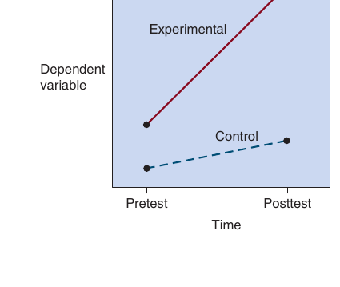

*Figure 10.3 Increasing-control-and-experimental-groups effect.*

<!-- Page 7 -->
A second rival explanation that could explain the pattern shown in Figure 10.3 is a **selection-history effect** (Cook &amp; Campbell, 1979) or a differential-history effect. A general history effect, discussed in Chapter 6, is controlled in the nonequivalent comparison group design by inclusion of a control group. However, the design is still susceptible to a selection-history effect, in which the groups react differently to a history event, or a differential history effect where one group experiences a history event and the other does not. Perhaps some significant event occurred between the pretest and posttest for the experimental group but not for the control group. For example, in the experimental preschool example, perhaps the preschool served as reliable child care, which allowed the parents to find better jobs and increase their income, which led to increased educational opportunities in the home such as books and computers. This is something the researcher would need to consider carefully in the context of his or her particular research study, and to determine its plausibility.

Other rival explanations of the pattern shown in Figure 10.3 are possible. For example, a **selection-instrumentation effect** might occur if a change in measurement affected the two groups differently. You might be able to rule this out easily, however, after examining the measurement instruments and procedure used in the study. **Selection-** **testing effect** could occur if the two groups reacted differently to having taken the pretest. **Selection-attrition effect** (or differential attrition) also might have occurred if the groups became different because of participants dropping out. Careful examination of the characteristics and pretest scores of participants who dropped out would help determine the plausibility of this effect. A **selection-regression-artifact effect** appears unlikely because the experimental group started out higher on the pretest than the control group. You would have expected the lower scoring group to have shown greater upward regression to the mean.

**Outcome II: Experimental-Group-Higher-than-Control-Group-at-Pretest Effect** In this effect pattern, illustrated in Figure 10.4, the control group shows no change from pretest to posttest, but the experimental group starts higher and shows significant positive change from pretest to posttest. Such a pattern suggests a positive treatment effect because one group changed and the other group showed no change at all. A rival explanation would require a plausible alternative explanation that accounts for both the lack of change in the control group and the positive change in the experimental group. A selection-maturation effect is possible, but it seems unlikely because the control group shows no maturation at all. Selection-regression-artifact seems unlikely because the experimental group started out higher than the control group and should have shown less of an upward regression effect. Perhaps the most plausible threat is a selection-history effect. Perhaps a significant event happened (other than administration of the treatment) that affected the treatment group differently than the control group. Or perhaps some event happened only for the experimental group that caused them to work harder and show more improvement. The potential threats should be carefully examined in the context of the particular research study.

**Outcome III: Experimental-Group-Lower-than-Control-Group-at-** **Pretest Effect** In this effect pattern, illustrated in Figure 10.5, the control group shows no change from pretest to posttest, but the experimental group starts much lower and shows significant positive change from pretest to posttest. Before we can interpret the increase in performance of the experimental treatment group as being the result of the independent variable, we must consider potential rival hypotheses. The pattern shown in Figure 10.5 suggests the possibility of a selection-regression-artifact effect because the experimental group started out much lower and showed upward improvement. If the

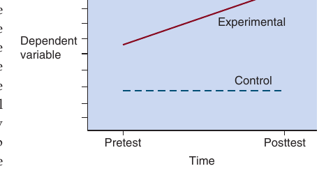

*Figure 10.4 Experimental-group-higher-than- control-group-at-pretest effect.*

<!-- Page 8 -->
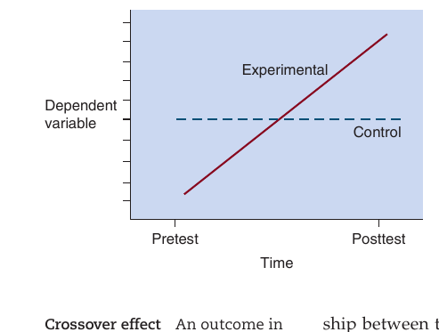

*Figure 10.6 Crossover effect.*

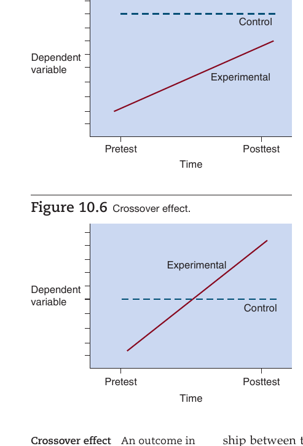

*Figure 10.5 Experimental-group-lower-than- control-group-at-pretest effect.*

program is given to the children with unusually low scores on the pretest measure of the dependent variable and the control condition was given to  average-scoring children, then we would expect regression to

Figure 10.6 depicts the  **crossover**

The outcome pattern shown in Figure 10.6 provides the strongest this entire process must be reported to the reader in the final research report.

### Ruling Out Threats to the Nonequivalent Comparison Group Design

In an attempt to eliminate the potential impact of selection biases, researchers try to ensure the similarity of groups by either matching on variables that pose rival explanations or using statistical control procedures. For example, in a Head Start program, you might want to match on income, intelligence, parental involvement, and so forth. This list raises an important issue: It is often impossible to identify and match on all of the important variables. Matching also should be carried out on the dependent variable, which is assumed to equate participants on additional variables. Matching equates the groups on the matched variables at the start of the experiment. Unfortunately, you can never fully match, and matching is not a perfect replacement for the much stronger control technique of random assignment available in strong experimental research designs. Nonetheless, when random assignment is not possible, you should carefully examine the literature and local situation to determine the most important variables to use in matching.

You must be careful when matching, however, for the following two situations that can occur as a result of selection-regression-artifact effects. Assume that a researcher wants to match individuals from a populationon of students at-risk of academic failure with individuals from a populationon of students that are not at-risk. Assume that the average pretest performance score in the at-risk populationon is 44 and <!-- Page 9 -->
in the not at-risk populationon is
88. Also assume that both populationons’ scores are normally distributed around the mean (where most scores are near the mean with far fewer scores at the extremes). This situation is shown in Figure 10.7.

In our first case, the experimenter decides to match on pretest scores by giving the education program (i.e., the treatment) to at-risk individuals and locating individuals from the not-at-risk group *with similar pretest scores* to serve in the control group. To do this, the researcher takes high-scoring at-risk individuals and finds matches from low-scoring not-at-risk individuals. The resulting treatment and control groups will have similar scores on the pretest and will appear to be fairly matched (equated on pretest scores). However, in this situation, the at-risk individuals will tend to regress downward from pretest to posttest (closer to the at-risk group average), and the not at-risk individuals will tend to regress upward from pretest to posttest (closer to the not-at-risk group average), independently of any treatment effect. If the experimental condition is administered to the at-risk individuals (and the not-at-risk serve as controls), then finding a positive program effect becomes highly unlikely because the at-risk individuals must improve enough to overcome their own propensity to regress downward (to their group mean), and they must also offset the not-at-risk individuals’ propensity to regress upward (to their group mean) in this situation. This use of individuals from opposite ends of preexisting groups works against finding a positive improvement due to the program, *even if the program* *is effective.*

Second, in our scenario, if the program was given to the low-scoring not-at-risk individuals (and high-scoring at-risk individuals served as controls), then *the program* *might appear effective, even if it was an ineffective program.* The key message is to be careful of selection-regression-artifact effects when matching participants from different populationons because you might end up matching individuals that come from the opposite extremes of their respective groups. This can result in an effective treatment appearing to be ineffective or an ineffective treatment appearing to be effective!

Another strategy for equating groups is to attempt to determine what variables (other than your independent variable) your groups will likely differ on and measure those variables. Then, during data analysis, statistical control techniques can be used to adjust for pretest differences on the measured variables. Although this process can help, statistical control cannot fully equate the groups on all known and unknown variables. Also, statistical control techniques tend to be especially susceptible to measurement error on the pretest. To help deal with this problem, a statistical procedure known as *reliability adjusted analysis of covariance* (ANCOVA) is recommended (see Trochim &amp; Donnelly, 2008). This approach and additional statistical approaches such as *propensity score matching* and *selection modeling* are beyond the scope of this text, but are discussed in more advanced books and articles (e.g., Rindskopf, 1992; Shadish et al., 2002).

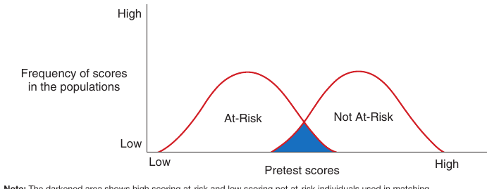

*Figure 10.7 Distributions of at-risk and not at-risk groups.*

<!-- Page 10 -->
### Causal Inference from the Nonequivalent Comparison Group Design

The nonequivalent comparison group design, as we have just discussed, is susceptible to a number of threats to internal validity. The existence of these potential internal validity threats suggests that the results obtained from this quasi- experimental design might be different from what would be obtained from one of the randomized experimental designs. Heinsman and Shadish (1996) conducted a meta- analysis comparing the effect-size estimates from randomized experimental designs and the nonrandomized nonequivalent comparison group design to determine the extent to which similar results have been obtained from studies using these two designs. This analysis suggested that if the randomized experimental design and the nonequivalent comparison group design were equally well designed and executed, they yielded about the same effect size. In other words, the nonequivalent  comparison group design gave about the same results as the  randomized experimental design.

The result of this meta-analysis is a strong endorsement of the nonequivalent comparison group design. However, this strong endorsement exists only when the nonequivalent comparison group design is as well designed and executed as the randomized experimental design. As Heinsman and Shadish (1996) have pointed out, it is probably very difficult in many studies to design and execute the nonequivalent comparison group design as well as the randomized experimental designs. Therefore, in many studies, the nonequivalent comparison group design will give results that are difficult to interpret.

There are two design components that researchers must focus on when designing and conducting quasi-experiments to strengthen internal validity. The first component focuses on the way participants are assigned to groups. To obtain accurate results, experimenters must not let the participants self-select into groups or conditions. The more participants self-select into the treatment conditions, the more likely a selection effect will be a plausible explanation for the results. The second component focuses on pretest differences. Big differences at the pretest will lead to big differences at the posttest. This means that the researcher should either try to reduce pretest differences by matching the comparison groups on variables correlated with the dependent variable or control for pretest differences by statistically adjusting the posttest scores for any pretest differences (e.g., using ANCOVA). If the experimenter focuses on these two design characteristics, the results obtained from the nonequivalent comparison group design will produce a closer approximation to a randomized experimental research design.

> [!TIP] **Study Questions 10.3**
> - What are the various outcomes that could occur in a nonequivalent comparison group design, and explain why they might occur?
>
> - Why is the crossover effect not readily explained by rival hypotheses?
>
> - What design components should be used to reduce bias in quasi-experiments?

## Time-Series Design

🎯 **10.3** Describe the advantages of the interrupted time-series design over

> **the one-group pretest–posttest design.**

In research areas such as psychotherapy and program evaluation, it is sometimes very difficult to find an equivalent group of research participants to serve as a control group. Is the *one-group pretest–posttest design*  (discussed in Chapter 9) the only <!-- Page 11 -->
available design in such cases? Is there no means of eliminating some of the rival hypotheses that arise from this design? Fortunately, there is a means for eliminating some of these rival hypotheses, but to do so one must think of mechanisms other than using a control group.

### Interrupted Time-Series Design

The  **interrupted time-series design** requires the investigator to take a series of measurements with a single group both before and after the introduction of some treatment condition, as depicted in Figure 10.8. As shown in the figure, all of the participants are pretested a number of times and then posttested a number of times after or during exposure to the experimental treatment condition. The researcher plots the data for the dependent variable for all measurement points, before and after the treatment, and compares the before and after treatment patterns. The result of the treatment condition is indicated by a discontinuity in the recorded series of response measurements. For example, an effect is demonstrated when there is a change in the level and/or slope of the posttreatment responses as compared to the pretreatment responses.

Consider the intervention conducted by Lewis and Eves (2012) to encourage university students to use the stairs instead of the elevator. Students’ baseline elevator and stair usage was observed in four university buildings twice each day for several days. Then posters identifying the benefits of using the stairs (e.g., calories burned) were strategically placed between the elevator and stairs. Students’ elevator and stair usage was observed twice each day for several more days. The pattern of stair usage indicated an increase after the intervention (posters). The program appears effective. Now it is necessary to ask two questions. First, did a statistically significant change occur following the introduction of the treatment condition? Second, can the observed change be attributed to the treatment condition?

The answer to the first question naturally involves tests of statistical significance; a test of statistical significance would indicate whether the difference in the pre and post patterns was greater than what would be expected by chance. However, before discussing tests of significance, we want to remind you why the *interrupted time-series* *design* is better than the *one-group pretest–posttest design*. The interrupted time-series design has numerous measures of the dependent variable both before and after the treatment, helping one to see the pattern on the dependent variable both before and after the treatment. In contrast, the one-group pretest–posttest design has only one pretest and one posttest measure, making it a weak design. When you use an interrupted time-series design, visual inspection of the pre and post *patterns* is very helpful in determining whether an experimental treatment has a real effect and determining the pattern of an effect.

You can see a number of possible patterns of responses in Figure 10.9. All of the pre and post data points shown in each line in Figure 10.9 would be used in an interrupted time-series design, but only the single points immediately before and after the vertical line would have been used in a one-group pretest–posttest design. Please examine each line in Figure 10.9 and try to determine if different conclusions about program effectiveness would have been obtained when all of the points are used versus when only the point before and the point after the treatment are used. When using all points before and after treatment, the first three patterns (1, 2, and 3) reveal no treatment effect but merely represent

> Treatment Multiple posttests O O O O O X O O O O O

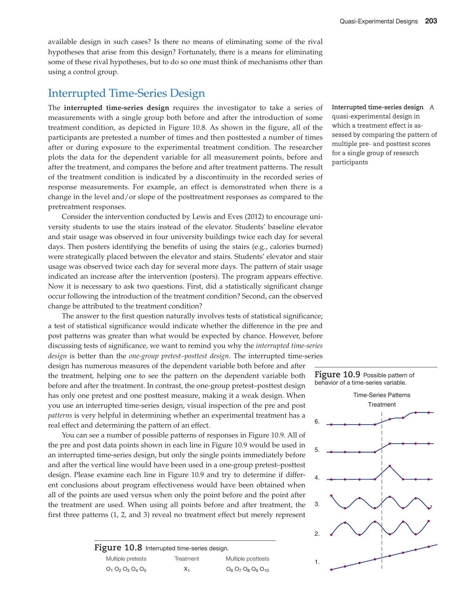

*Figure 10.8 Interrupted time-series design. Multiple pretests*

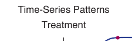

*Figure 10.9 Possible pattern of behavior of a time-series variable.*

<!-- Page 12 -->
a continuation of a previously established pattern of behavior. However, if the onegroup pretest–posttest approach had been used (i.e., examining only the one point before the treatment and the one point after the treatment), we would conclude that the treatment was effective in case 1 and case 3 (because it shows an increase) and that the treatment had a negative effect in case 2 (because it shows a decrease). All three of these conclusions would have been false! Using the interrupted time-series approach (i.e., using all the points in each line), lines 4, 5, and 6 suggest reliable changes in behavior, although line 4 shows only a temporary shift. This is the same conclusion we would have obtained using the one-group pretest–posttest approach; however, in these cases, the interrupted time-series approach provided additional information about the longer-term pattern of posttest results (e.g., does it go up and stop? does it continue going up? does it go up and then decline?). The first key message is that we need more than two data points (one pre and one post) when assessing the effects of a treatment for a single group. The second message is that history (see Table 10.2) is the key threat to the interrupted time-series design. If something in addition to the treatment occurs at the time of the treatment, you would not know if the treatment or the other factor is the cause of the observed change in the pretest and posttest patterns.

> [!TIP] **Study Question 10.4**
> What are the strengths and weaknesses of the interrupted time-series design?

## Regression Discontinuity Design

🎯 **10.4** Describe the structure and requirements of the regression discontinuity

**design.**

The **regression discontinuity design** is a design that is used to determine whether a group of individuals meeting some predetermined criterion profit from receiving a treatment. This design, depicted in Figure 10.10, consists of measuring all participants on an **assignment measure** and then selecting a cutoff score based on this measure. All participants who score above the cutoff score receive the treatment, and all participants who score below the cutoff score do not receive the treatment. The opposite case also is used, where participants below the cutoff score get the treatment and participants above the cutoff score do not get the treatment. After the treatment is administered, the posttest measure is obtained and the two groups are compared on the outcome measure to determine whether the treatment was effective.

For example, a researcher might measure college students on an English test that measures English deficiency and assign those students with scores above the median deficiency to an English remediation program and use those with scores below the median as controls (Leake &amp; Lesik, 2007). Although this might sound like a bad idea (i.e., to construct groups that are different at the start of the experiment), it actually is the assignment variable p

> O p $\rightarrow$ C X $\rightarrow$ O 2 O p $\rightarrow$ C O

*Figure 10.10 Structure of the regression discontinuity design. O measure; C indicates the assignment measure cutoff score used to assign participants to conditions (where participants with scores above the cutoff are assigned to the treatment condition and par-*

<!-- Page 13 -->
works in this situation because the researcher knows the precise variable used for group assignment (Shadish et al., 2002). The participants are not allowed to self-select into the groups; the researcher fully controls participants’ group assignment based on the selected cutoff score. Basically, the statistical procedure determines if there is a significant difference between the experimental and control groups’ performance on the dependent variable (i.e., Is the difference between the two lines significantly different at the cutoff point in the graph?). For more information on the analysis of data from the regression discontinuity design, see Shadish et al. (2002).

Pictorial depictions of results when no treatment effect is present and when a treatment effect is present will help you to see the idea clearly. Figure 10.11 illustrates the expected results when there is *no* treatment effect, and Figure 10.12 illustrates the expected results when there *is* a treatment effect. Both of these figures show the relationship between pretest and posttest scores for the treatment and control groups. The participants who scored higher than 40 on the group assignment variable received the treatment, and those scoring lower than 40 received the control condition. First look at Figure 10.11; you can see that there is no discontinuity in the regression line. There is a continuous increase of scores from a low of about 30 to a high of about 50, with a cutoff score of 40 separating the control group from the treatment group. The straight line pushed through the scores is the “regression line.” This continuous regression line indicates that there was *no effect* of the treatment because the scores of the people above the cutoff of 40 who received the treatment simply continued the same pattern of scores of people below the cutoff of 40 who did not receive the treatment. Now look at Figure 10.12. This figure shows a regression line for the people above the cutoff score of 40, which is not a continuation of the regression line that would be expected for people with a cutoff score below
40. In other words, there is a discontinuity of the regression line. This discontinuity indicates that the treatment had an effect, because if there were no treatment effect, there would be no discontinuity of the regression line, as illustrated in Figure 10.11.

The regression discontinuity design is an excellent design that can be used when researchers want to investigate the efficacy of some program or treatment but cannot randomly assign participants to comparison groups. However, there are a number of criteria, listed in Table 10.5, that must be adhered to for the design to effectively assess

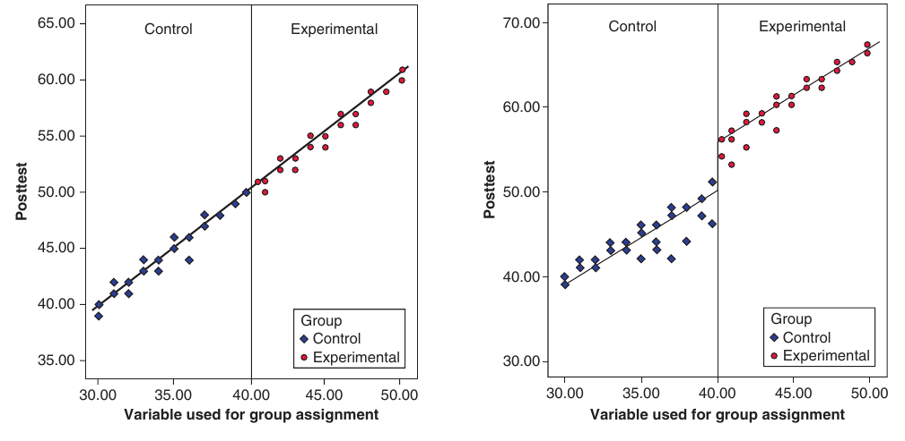

*Figure 10.11 Regression discontinuity design with no treatment effect.*

*Figure 10.12 Regression discontinuity design with a treatment effect.*

<!-- Page 14 -->
which makes it quite unlikely).

**Table 10.5** *Requirements of the Regression Discontinuity Design*

- Assignment to comparison groups must be based only on the cutoff score.
- The assignment variable must be at least an ordinal variable, and it is best if it is a continuous variable. It cannot be a nominal variable such as sex, ethnicity, religious preference, or status as a drug user or nonuser.
- The cutoff score ideally should be located at the mean of the distribution of scores. The closer the cutoff score is to the extremes, the lower the statistical power of the design.
- Assignment to comparison groups must be under the control of the experimenter to avoid a selection bias. This requirement rules out most retrospective uses of the design.
- The relationship between the assignment and outcome variables (whether it is linear, curvilinear, etc.) must be known to avoid a biased assessment of the treatment effect.
- All participants must be from the same populationon. With respect to the regression discontinuity design, this means that it must have been possible for all participants to receive the treatment condition. This means that the design is not appropriate, for example, if the experimental participants are selected from one school and control participants from another. the effectiveness of a treatment condition. When these criteria are met, the regression discontinuity design is a very good design to use for testing the effect of a treatment condition and is typically more powerful than other quasi-experimental designs. Any threat to the validity of the regression discontinuity design would have to cause a sudden discontinuity in the regression line that coincides with the cutoff. As Shadish et al. (2002) have pointed out, this is implausible, although possible. The primary threat that could produce such an effect is a differential history effect (which is a type of “additive/interactive” effect in Table 10.3). This history effect would have to be one that affected only participants on one side of the cutoff (i.e.,

> [!TIP] **Study Question 10.5**
> - What are the characteristics of the regression discontinuity design?

### Summary

This chapter presented several quasi-experimental research designs, which are superior (for controlling extraneous variables) to the weak designs but not as good as the strong designs discussed in Chapter
9. Because of the difficulty of random assignment in field settings, quasi-experimental designs often are the best type of design available for use in field studies in which causal inferences are desired. The quasi-experimental designs presented are the nonequivalent comparison group design, the interrupted time-series design, and the regression discontinuity design. The threats to the internal validity for these three designs are summarized in Table 10.3. The nonequivalent comparison group design is the one most frequently used. It is similar to the pretest–posttest control group design (a strong design) except that the participants are *not* randomly assigned to the experimental and control groups, which means that we do not have the necessary assurance that the two groups of participants are equated. When using this design, researchers should attempt to de- termine the variables that may be related to the dependent variable and on which the treatment and control groups differ and then attempt to equate the groups on these variables using matching and/or statistical control techniques. However, this still <!-- Page 15 -->
does not assure that the participants are equated on other extraneous variables that were not identified. The most common threats to internal validity of this design are provided in Table 10.3. Generally speaking, this design gives results that are of about the same average effect size as a randomized experiment when the two are equally well designed and executed.

The interrupted time-series design attempts to eliminate rival hypotheses without the use of a control group. In the interrupted time-series design, a series of measurements is taken on the dependent variable both before and after the introduction of the experimental treatment condition. The effect of that condition is then determined by examining the magnitude of the discontinuity produced by the condition in the series of recorded responses. The primary source of error in this design is a history effect.

The regression discontinuity design is used when the researcher can’t give the treatment to all participants and can assign participants to groups based on their scores on an assignment variable. The effect of the treatment condition is determined by examining the regression line. A treatment effect is inferred if there is a discontinuity in the regression line for the two groups.

## 🗂️ Chapter Key Terms & Active Recall

> 💡 **Learning tip:** Try to recall the definition of each term *before* clicking to reveal it.
> This active retrieval practice strengthens long-term memory far more than re-reading.

📇 <b>Quasi-experimental design</b> *(p. 2)*

> **Definition:** A research design in which an experimental procedure is applied but all extraneous variables are not controlled

📇 <b>Design components</b> *(p. 3)*

> **Definition:** Structures and procedures used in constructing research designs

📇 <b>Design History Maturation</b> *(p. 4)*

> **Definition:** Nonequivalent + + comparison group design* Interrupted time+ series design Regression + + discontinuity design* *If a basic threat acts differentially, it is subsumed under additive/interactive effects and is a threat.

📇 <b>Note:</b> *(p. 4)*

> **Definition:** A negative sign ( ) indicates a potential threat to internal validity, a positive sign (

📇 <b>Nonequivalent comparison group design</b> *(p. 4)*

> **Definition:** A quasi-experimental design in which nonequivalent experimental treatment and comparison groups are tested at pretest and posttest

📇 <b>Increasing-control-andexperimental-groups effect</b> *(p. 6)*

> **Definition:** An outcome in which the experimental and control groups differ at pretesting and both increase from pretest to posttest, but the experimental group increases at a faster rate

📇 <b>Selection-maturation effect</b> *(p. 6)*

> **Definition:** Participants in one group experience a different rate of maturation than participants in another group

📇 <b>Selection-history effect</b> *(p. 7)*

> **Definition:** An extraneous event occurring between pretest and posttest influences participants in one group differently than participants in another group

📇 <b>Selection-instrumentation effect</b> *(p. 7)*

> **Definition:** Participants’ scores in one group are affected by changes in the process of measurement differently than participants in another group

📇 <b>Selection-testing effect</b> *(p. 7)*

> **Definition:** Previous experience with the test affects the groups differently

📇 <b>Selection-attrition effect</b> *(p. 7)*

> **Definition:** Participants who drop out of one group are dissimilar to those in another group

📇 <b>Selection-regression-artifact effect</b> *(p. 7)*

> **Definition:** Participants in one group display a different rate of regression to the mean than participants in another group

📇 <b>Experimental-group-higher-thancontrol-group-at-pretest effect</b> *(p. 7)*

> **Definition:** An outcome in which the experimental group performs better than the control group at pretesting, and only the experimental group’s scores change from preto posttesting

📇 <b>Experimental-group-lower-thancontrol-group-at-pretest effect</b> *(p. 7)*

> **Definition:** An outcome in which the control group performs better than the experimental group at pretesting, but only the experimental group improves from preto posttesting

📇 <b>Crossover effect</b> *(p. 8)*

> **Definition:** An outcome in which the control group performs better at pretesting but the experimental group performs better at posttesting

📇 <b>Interrupted time-series design</b> *(p. 11)*

> **Definition:** A quasi-experimental design in which a treatment effect is assessed by comparing the pattern of multiple preand posttest scores for a single group of research participants

📇 <b>Regression discontinuity design</b> *(p. 12)*

> **Definition:** A design that assigns participants to groups based on their scores on an assignment variable and assesses the effect of a treatment by looking for a discontinuity in the groups’ regression lines

📇 <b>Assignment measure</b> *(p. 12)*

> **Definition:** Measure used to assign participants to experimental and control groups; those with scores below the cutoff score are assigned to one group, and those with scores above the cutoff are assigned to the other group

### Key Terms and Concepts

| Term | Term | Term |
| --- | --- | --- |
| [Assignment measure *p. 204*](#term-assignment-measure) | Increasing-control-and-experimental- | [Selection-attrition effect *p. 199*](#term-selection-attrition-effect) |
| [Crossover effect *p. 200*](#term-crossover-effect) | [groups effect *p. 198*](#term-groups-effect) | [Selection-history effect *p. 199*](#term-selection-history-effect) |
| [Design components *p. 195*](#term-design-components) | [Interrupted time-series design *p. 203*](#term-interrupted-time-series-design) | Selection-instrumentation |
| Experimental-group-higher-than- | Nonequivalent comparison group | [effect *p. 199*](#term-effect) |
| [control-group-at-pretest effect *p. 199*](#term-control-group-at-pretest-effect) | [design *p. 196*](#term-design) | [Selection-maturation effect *p. 198*](#term-selection-maturation-effect) |
| Experimental-group-lower-than- | [Quasi-experimental design *p. 194*](#term-quasi-experimental-design) | [Selection-regression-artifact effect *p. 199*](#term-selection-regression-artifact-effect) |
| [control-group-at-pretest effect *p. 199*](#term-control-group-at-pretest-effect) | [Regression discontinuity design *p. 204*](#term-regression-discontinuity-design) | [Selection-testing effect *p. 199*](#term-selection-testing-effect) |

### Related Internet Sites

- <http://www.socialresearchmethods.net/kb/quasiexp.htm>
  This site provides a brief discussion of quasi-experimental design and has links to other designs such as the nonequiva- lent groups design and the regression discontinuity design as well as other issues relevant to this topic.

- <http://www.socialresearchmethods.net/kb/quasioth.php>
  This link takes you to some additional quasi-experimental designs.

### Practice Test

*The answers to these questions can be found in the Appendix.*

**1.** The primary *difference* between a quasi-experimental
design and a randomized experimental design is
a.  The number of independent variables that can be
manipulated
b.  That randomized designs are more often used in
field research c.  The ability of the design to control for potential
threats to internal validity
d.  The size of the treatment effect that can be
expected

<!-- Page 16 -->
**2.** The primary threat to internal validity in the non-
equivalent comparison group design is some form of a ___________ effect.
a.  History
c.  Testing
b.  Selection
d.  Instrumentation

**3.** The outcome from a nonequivalent comparison
group design that gives us the most confidence that the treatment produced the observed effect is
a.  An increasing treatment effect
b.  An effect in which both the experimental and
control groups increase, but the experimental group increases more
c.  A crossover effect

**4.** Many of the threats to internal validity are ruled out
in the interrupted time-series design
a.  As a result of random assignment
b.  As a result of matching c.  As a result of the multiple pretests and posttests
d.  As a result of counterbalancing

**5.** A school superintendent wants to decrease the
amount of truancy that exists in her school system. She assigns all those students who have missed coming to school an average of twice every week for the past year to participate in a program designed to make school more enjoyable and rewarding. The students with an average of less than two absences a week will serve as controls. To test the effective- ness of this program she would probably use which design?
a.  Randomized experimental design
b.  Regression discontinuity design
c.  Nonequivalent comparison group design
d.  Time-series design

### Challenge Exercises

**1.** For each of the following design briefs, identify
a.  The type of quasi-experimental design used
b.  The potential threat(s) to internal validity that
might exist in concluding that the treatment produced the observed effect A.  The National Institutes of Health wanted to improve the research careers of promising young scientists by giving them a significant grant to allow them to devote time to their research careers. They requested and received applica- tions from 100 scientists who were assistant professors and had been in their first job for less than 5 years. From this pool of 100 applicants, they selected the 50 most promising individuals in terms of number of publications, school from which they had received their terminal degree, and letters of recommendation. After 5 years had elapsed, they compared the performance of the 50  applicants who had received the award with the  applicants who had not. It was found that the applicants who received the award were more productive in terms of number of publications, more of them had been promoted to associate professor, and their salary was higher than those who did not receive the award. Based on this evi- dence it was concluded that the program should be continued because it was a great success. B.  MADD (Mothers against Drunk Drivers) has lobbied for tougher laws against drunk drivers for years. Assume that it was successful in convincing the legislators in your state to pass a tougher law against drunk drivers that required a mandatory jail sentence of at least 6 months, loss of driver’s license for 5 years, and a fine of at least &#36;10,000. You want to test the effect of this tougher law, so you record the number of people arrested and convicted for DUI (driving under the influence of alcohol) for each of the 5 years prior to the passage of this law and for each of the 5 years after passage of this law. You find that the number of arrests and convictions decreased after the law was passed, so you conclude that the tougher laws are effective. C.  School systems frequently provide instruction and classes for individuals who are behind in particular academic subject areas. You want to determine if a reading program is effective for children with reading difficulties, so you test all second-grade children on reading ability. The children who score below 30 on your test of reading ability are required to participate in the reading program. After these children have been in the reading program for a time, you again test all the second-grade children on reading ability. You find that the children given the program improved more than would be expected and conclude that it indicates that the program was effective.

**2.** A youth center wants to improve the family life for
teenagers at risk for violence. One of the current pro- grams that is being implemented is a type of therapy <!-- Page 17 -->
called Functional Family Therapy. To assess the effectiveness of this type of therapy in reducing violence among youth, two youth centers are selected. They both conduct a pretest. One provides Functional Family Therapy to the families of teenagers who have been at the youth center and are being released back into the care of their parents; the other youth center continues its standard practice of follow-up and brief counseling of parents. For each teenager who is being released to his or her family, data are collected on the number of violent encounters with other teenagers, the law, and other family members for 1 month before and after the Functional Family Therapy treatment program was initiated. The following shows four different outcomes that could occur. a.  Graph each outcome. b.  State whether the treatment condition seems to have been effective. c.  Identify the rival hypotheses that might explain the observed effect.

First Experimental Pretest = 27 Posttest = 13 outcome: group:

> Control group: Pretest = 10 Posttest = 10

Second Experimental Pretest = 16 Posttest = 4 outcome: group:

> Control group: Pretest = 10 Posttest = 27

Third Experimental Pretest = 14 Posttest = 27 outcome: group:

Control group: Pretest = 5 Posttest = 10

Fourth Experimental Pretest = 4 Posttest = 13 outcome: group:

> Control group: Pretest = 15 Posttest = 15
