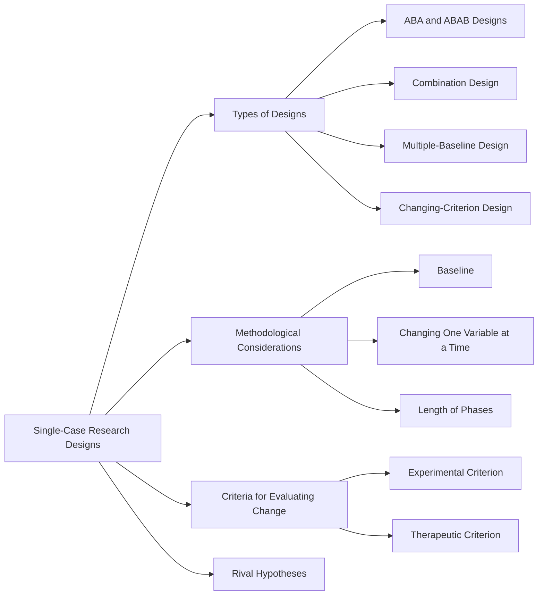
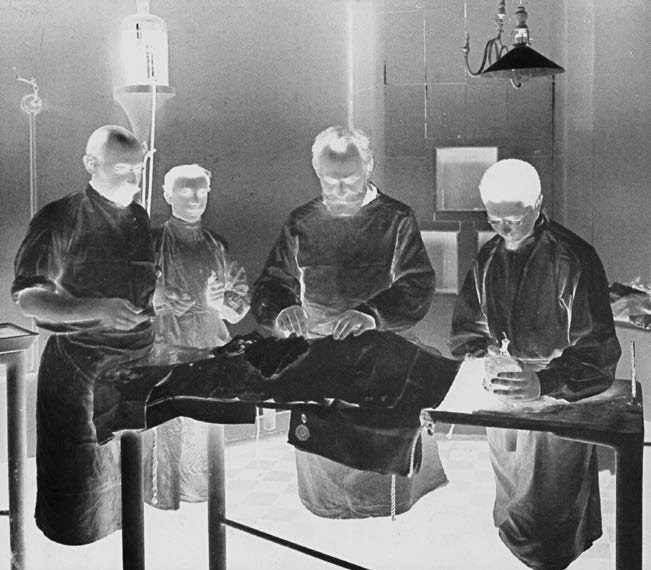
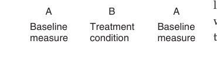
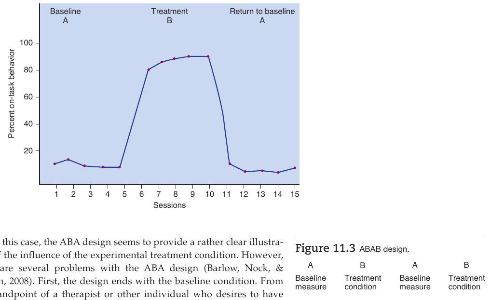
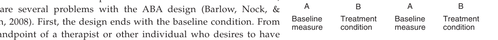
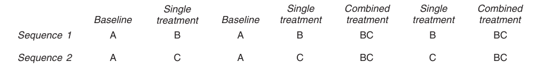
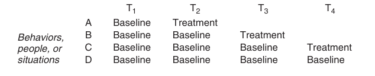
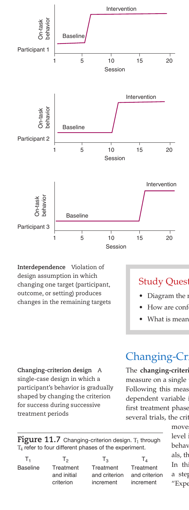
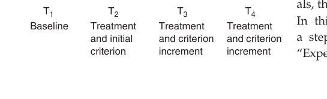
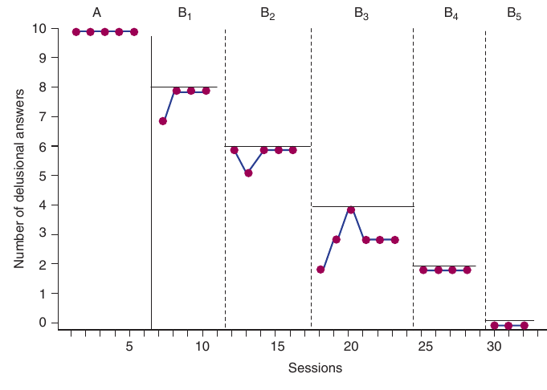

📑 <b>Table of Contents</b>

- [Chapter 11 Single-Case Research Designs](#chapter-11-single-case-research-designs)
  - [Learning Objectives](#learning-objectives)
  - [Summary of Single-Case Designs](#summary-of-single-case-designs)
  - [EXHIBIT 11.1 Pavlov with His Laboratory](#exhibit-11-1-pavlov-with-his-laboratory)
- [Single-Case Designs](#single-case-designs)
  - [ABA and ABAB Designs](#aba-and-abab-designs)
  - [Combination Design](#combination-design)
  - [Multiple-Baseline Design](#multiple-baseline-design)
- [Methodological Considerations in Using Single-Case Designs](#methodological-considerations-in-using-single-case-designs)
  - [Baseline](#baseline)
  - [Changing One Variable at a Time](#changing-one-variable-at-a-time)
  - [
<!-- AI-REVIEW-START id="rev-1" category="ocr_typo" -->
<!-- ORIGINAL:
Length of P
-->
<!-- REASON: The text is abruptly cut off at the end of the file. However, given the context 'Length of P' and the typical structure of 'Length of Project' or 'Length of Program', 'Length of Project' is a common academic phrase. However, since the exact word is missing, it's technically a truncation error. -->
Length of Project
<!-- AI-REVIEW-END -->
hases](#length-of-phases)
- [Criteria for Evaluating Change](#criteria-for-evaluating-change)
  - [Experimental Criterion](#experimental-criterion)
  - [EXHIBIT 11.2 Analysis of Data Obtained from Single-Case](#exhibit-11-2-analysis-of-data-obtained-from-single-case)
  - [Therapeutic Criterion](#therapeutic-criterion)
- [Rival Hypotheses](#rival-hypotheses)
  - [Summary](#summary)
  - [Key Terms and Concepts](#key-terms-and-concepts)
  - [Related Internet Sites](#related-internet-sites)
  - [Practice Test](#practice-test)
  - [Challenge Exercises](#challenge-exercises)

<!-- Page 1 -->
## Chapter 11 Single-Case Research Designs

### Learning Objectives

🎯 **11.1** Describe the history of single-case designs.
🎯 **11.2** Describe the different types of single-case designs.
🎯 **11.3** Describe the methodological issues that must be considered when using single-case designs.
🎯 **11.4** Differentiate between experimental and therapeutic criteria used to evaluate treatment effects in single-case designs.
🎯 **11.5** Describe the rival hypotheses that may occur in single-case designs.

<!-- Page 2 -->
Up to this point in the book, the designs that we discussed involved groups of individuals. However, there are times when large groups of individuals are not available to participate in an experiment. There are also times when you need to assess the effect of a treatment on a single individual. This means that you cannot use either random assignment or inclusion of a control group, which are the primary techniques used to control for the influence of rival hypotheses. How can we control for the influence of extraneous variables and rule out rival hypotheses when conducting an experiment on only one participant? The answer is to make use of single-case designs—designs constructed for use with only one participant and constructed in a manner that controls for the influence of many rival hypotheses.

**Single-case research designs** (sometimes called single-subject designs) are designs that use only one participant or one group of individuals to investigate the influence of a treatment. The unique feature of these designs is the capacity to conduct experimental research with one participant or with one group of individuals such as a community, a group of employees, or a group of adolescents. Although single-case designs can be used with a group of participants as well as with a single participant, they are most frequently used with single participants. In discussing these designs, we focus attention on their use in experimentation with single participants.

This chapter presents the most frequently used single-case designs and demonstrates how each of them enables the investigator to assess the impact of an independent variable while controlling for the influence of rival hypotheses. The designs are summarized in Table 11.1. The chapter concludes with a discussion of methodological issues that must be considered when designing a single-case research study.

**Table 11.1** *Summary of Single-Case Designs*

<table class="textbook-table" style="width: auto; max-width: 100%; border-collapse: collapse; margin: 1.5em 0;">
  <thead>
    <tr>
      <th>Design Name</th>
      <th>Salient Characteristics</th>
    </tr>
  </thead>
  <tbody>
    <tr>
      <td>ABA or ABAB</td>
      <td>Effectiveness of IV is indicated by the predicted change in the DV that coincides with administration of the IV and a return to pretreatment (baseline) levels upon removal of the IV.</td>
    </tr>
    <tr>
      <td>Combination</td>
      <td>Uses ABAB logic to test the independent and combined effects of more than one IV.</td>
    </tr>
    <tr>
      <td>design</td>
      <td>Tests if the effect of the combined IVs on the DV is greater than either IV alone.</td>
    </tr>
  </tbody>
</table>

### Summary of Single-Case Designs

**Design Name**
**Salient Characteristics**
ABA or ABAB Effectiveness of IV is indicated by the predicted change in the DV that coincides with administration of the IV and a return to pretreatment (baseline) levels upon removal of the IV. Combination Uses ABAB logic to test the independent and combined effects of more than one IV. design Tests if the effect of the combined IVs on the DV is greater than either IV alone. Multiple baseline The IV is successively applied to multiple participants, outcomes, or settings; effectiveness is indicated by changes in the DV that coincide with introduction of the IV. Changing The administration of the IV is based on gradual changes in the DV. Effectiveness is criterion indicated by gradual changes in the DV that coincide with the stated changing criterion for the IV.
*Note:*
IV refers to independent variable, and DV refers to dependent variable. History of Single-Case Designs
**11.1**
**Describe the history of single-case designs.**
Encountering these designs for the first time, most people tend to equate them with case studies, but this is incorrect: Single-case designs experimentally investigate a treatment effect, whereas case studies provide an in-depth description of an individ- ual or group of people. A brief look at the history of experimental psychology reveals that psychological research actually began with the intensive study of a single organ- ism. Wundt’s (1902) use of the method of introspection required a highly trained sin- gle participant. Ebbinghaus (1913/1885) conducted his landmark studies on memory using only one participant—himself. Pavlov’s (1928) basic findings were the result of experimentation with a single organism, a dog (see Exhibit 11.1), but were replicated on other organisms.

<!-- Page 3 -->
### EXHIBIT 11.1 Pavlov with His Laboratory

Apparatus

In this photo, Pavlov observes saliva flow in a dog subjected to a classical conditioning procedure in his laboratory.

(Archives of the History of Psychology—The University of Akron.)

As you can see, single-case research was alive and well during the early history of psychology. However, in 1935, Sir Ronald Fisher published a book on experimental design that altered the course of psychological research. In it, Fisher laid the foundation for conducting and analyzing multiparticipant experiments. Psychologists quickly realized that the designs and statistical procedures elaborated by Fisher were very useful. With the publication of Fisher’s (1935) work, psychologists turned from single-case studies toward multiparticipant studies.

The one notable exception to the multiparticipant tradition was B. F. Skinner (1953), his students, and his colleagues. They developed a general approach that has been labeled the *experimental analysis of behavior*. This method is devoted to experimentation with a single participant (or with only a few participants) on the premise that the detailed examination of a single organism under rigidly controlled conditions will yield valid conclusions about the effectiveness of a treatment condition. The use of this approach led to the development of a variety of single-case experimental designs. Single-case designs are most commonly used today in research and practice areas that rely on applied behavior analysis. Applied behavior analysis is based on the principles of behavioral learning theory, especially operant conditioning. Two of the most prestigious journals publishing single-case research today are the *Journal of* *Experimental Analysis of Behavior* (started in 1958) and the *Journal of Applied Behavior* *Analysis* (started in 1968). Both of these journals were founded by the Society for the Experimental Analysis of Behavior. Professionals who are trained and certified in the area of applied behavior analysis are called applied behavior analysts. They use evidence-based learning principles to help clients increase adaptive behaviors and decrease maladaptive behaviors.

*Illustration*

<!-- Page 4 -->
> [!TIP] **Study Questions 11.1**
> - What is a single-case design, and who is it used with?
>
> - Discuss the history of single-case research.
>
> - What theory underlies much single-case research?

## Single-Case Designs

🎯 **11.2** Describe the different types of single-case designs.

When planning an experimental study that uses only one participant, it is necessary to use some form of time-series design. Recall that the interrupted time-series design requires that repeated measurements be taken on the dependent variable both before and after the treatment condition is introduced. For example, assume we wanted to determine if caffeine was the cause of the emotional disturbance experienced by a truck driver. We could administer the caffeine and measure the participant’s level of emotional stability, but then we would have no basis for determining whether the caffeine produced the effect because we would not know how stable the participant was when he was not consuming caffeine. Without such a comparison, it is impossible to infer any effect of the treatment condition.

What can we use as a basis of comparison in a single-case design? Because there is only one participant in the study, the comparison responses have to be the participant’s own pretreatment responses. In other words, the investigator has to record the participant’s responses before and after (or during) administration of the independent variable. In the caffeine experiment, we would have to record the participant’s level of emotional stability prior to and after (or while) consuming caffeine. If we take only one pretreatment and posttreatment measure, we will have the analog of a one-group pretest–posttest design, which has many disadvantages. To overcome some of those problems (such as maturation and history), we must obtain multiple pretreatment and posttreatment measures. For example, we could measure the truck driver’s level of emotional stability each day over a period of two weeks prior to consuming caffeine and then daily for two weeks while consuming caffeine. Now we have the analog of an interrupted time-series design using one participant, which furnishes a relatively continuous record of the participant’s responses on the dependent variable emotional stability during the course of the experiment. Using this procedure, we would have a record of the truck driver’s level of emotional stability over the course of the entire experiment. This technique is also experimental because it permits us to introduce a planned intervention—a treatment condition such as caffeine. Consequently, it allows us to evaluate the effect of an independent variable.

Although the basic interrupted time-series design can be used in single-case research, we must remember that it is a quasi-experimental design. Taking repeated pretreatment and posttreatment measures of the dependent variable allows us to rule out many potential threats to internal validity, but it does not rule out the possibility of a history effect. The ability to detect a treatment effect with a time-series design hinges on the researcher’s ability to determine what would have happened if the treatment condition had not been administered. This hypothetical situation of what would have happened to the treated participants had they not received the treatment is called the *counterfactual*. In other words, the pretreatment responses are used to forecast what the posttreatment responses would have been in the absence of the treatment. If this forecast is inaccurate, then we cannot completely assess the effects of the treatment intervention.

<!-- Page 5 -->
> [!TIP] **Study Question 11.2**
> What are the limitations of the most basic time-series design (interrupted time-series design)?

### ABA and ABAB Designs

In order to improve on the basic time-series for single cases by generating stronger evidence of the causal effect of a treatment condition, the **ABA design** was developed. The ABA design, depicted in Figure 11.1, is the most basic of the single-case research designs. As the name suggests, it has three separate conditions. The A condition is the **baseline** condition, which is where the target behavior (i.e., the dependent variable) is recorded in its freely occurring state. In other words, the first baseline refers to a given behavior as observed prior to presentation of any treatment. The baseline measure thus gives the researcher a frame of reference or counterfactual for assessing the influence of a treatment condition on the target behavior. The B condition is the experimental condition, where the treatment is deliberately imposed to try to alter the target behavior. Generally, the treatment condition is continued for an interval equivalent to the original baseline period or until some substantial and stable change occurs in the behaviors being observed. Typically, the dependent variable is measured throughout this treatment condition.

After the treatment condition has been introduced and the dependent variable measured, the A condition is then reintroduced. That is, the treatment condition is withdrawn, and whatever condition existed during baseline is reinstated. This second A condition is reinstituted in order to determine whether behavior will revert back to its pretreatment level. It is generally assumed that the effects of the treatment are reversible, but this is not always the case. **Reversal** *of the behavior back to its* *pretreatment level is the crucial element for demonstrating that the experimental treatment* *condition, and not some other extraneous variable, produced the change observed during the* *B phase of the experiment.* If the plan had included only two phases (A and B), as in the basic time-series design, rival hypotheses, such as history, could have existed. However, if the behavior reverts back to the original baseline level when the treatment conditions are withdrawn, rival hypotheses become less plausible because it is unlikely that a history effect would be perfectly timed to cause scores on the dependent variable to change when the treatment is introduced and change again when the treatment is removed.

Consider the study conducted by Walker and Buckley (1968). These researchers investigated the effect of using positive reinforcement to increase attending behavior in a 9-year-old boy named Phillip. A bright, underachieving child, Phillip was referred to the investigators because he exhibited behavior that interfered with classroom performance. The investigators first took a baseline measure of the percentage of time that Phillip spent on his academic assignment. After the percentage of attending time had stabilized, the treatment condition was introduced, which consisted of enabling Phillip to earn points for paying attention during a given time interval. These points could then be exchanged for a model of his choice. When Phillip had completed three successive 10-minute attention sessions, the reinforcement of being able to earn points was withdrawn. Figure 11.2 shows the pattern of data you would expect from an effective ABA design. During the first baseline (A) condition, the behavior is very

*Figure 11.1  ABA design.*

<!-- Page 6 -->

*Figure 11.2 Signature pattern of an effective ABA design.*

In this case, the ABA design seems to provide a rather clear illustration of the influence of the experimental treatment condition. However, there are several problems with the ABA design (Barlow, Nock, &amp; Hersen, 2008). First, the design ends with the baseline condition. From the standpoint of a therapist or other individual who desires to have some behavior changed, this is unacceptable because the benefits of the treatment condition are denied. Fortunately, this limitation is easily handled by adding a fourth phase to the ABA design in which the treatment condition is reintroduced. We now have an **ABAB design**, as illustrated in Figure 11.3. For example, in the study above, the treatment would be reinstated after the second baseline so that Phillip ends the study with the treatment phase (and better classroom performance). The participant thus leaves the experiment with the full benefit of the treatment condition.

A second potential problem with the ABA design is not so easily handled. As previously stated, one of the strengths of the ABA design is that it can demonstrate that the outcome variable reverts to the baseline level when the experimental treatment condition is withdrawn. Unfortunately, a reversal to baseline does not occur with all dependent variables. Failure to reverse might be due to a treatment that resulted in a relatively permanent change in behavior. You will see soon that a *multiple-baseline design* is better suited for studying interventions that might result in relatively permanent changes in behavior.

> [!TIP] **Study Questions 11.3**
> - Diagram the ABA single-case research design, and explain how this design rules out confounding extraneous variables.
>
> - Why is the ABA design often extended to an ABAB design?
>
> - Under what circumstances are the ABA and ABAB designs ineffective in identifying a treatment effect?

*Figure 11.3 ABAB design.*

<!-- Page 7 -->
### Combination Design

A survey of the literature on single-case designs shows that researchers have extended the ABA and ABAB designs in a variety of ways. One intriguing and valuable extension is the use of a **combination design** to identify the combined effect of two or more independent variables. For example, we could investigate the combined effect of a concrete reinforcement (giving of tokens) and verbal reinforcement (the experimenter saying “good”). In order to isolate the combined effect of two variables from the effect that would be achieved by each variable alone, it is necessary to analyze the influence of each variable separately and the two variables in combination. To complicate the issue further, we must do this by changing only one variable at a time. It is a cardinal rule in single-case research that you must change only one variable at a time. Thus the sequence in which we test for the influence of each variable separately and in combination must ensure that the influence of the combination of variables can be compared with the influence of each variable separately. Figure 11.4 illustrates this design. In sequence 1 (row 1), the researcher begins with an ABAB design logic to test the effect of B; then, B becomes the “comparison” to test the combined effect of BC compared to B. This logic is repeated in sequence 2 (row 2) to first test the effect of C and then the combined effect of BC compared to C. *The idea is to see if “BC combined” has a greater effect* *than “only B” and “only C.”*

Here’s an example. Let’s say that we want to know if tokens, social praise, or the combination of tokens and praise is more effective for increasing on-task classroom behavior. In sequence 1, we establish the baseline (A). Then the effect of treatment B (tokens) is independently investigated, and then the combined influence of treatments B (tokens) and C (social praise) is compared to the influence of treatment B (tokens) alone. In like manner, in sequence 2, we establish the baseline, then the effect of treatment C (social praise) is independently investigated, and then the combined influence of treatments B (tokens) and C (social praise) is compared to treatment C (social praise) alone. In this way, it is possible to determine whether the combined influence of B and C was greater than that of either B or C alone. However, if the combined effect was greater than one of the treatment variables (C) but not the other (B), then we conclude that the effect can more parsimoniously be attributed to treatment B. That is, if the combination of social praise and tokens is greater than tokens alone, but is not greater than social praise alone, then, social praise appears to be causing the greatest change in the dependent variable.

Investigating the combined effects of multiple independent variables can be complicated. First, at least two research participants are typically required. One person has to be tested using one sequence and another person has to be tested using the other sequence as shown in Figure 11.4. Second, the combined effect of the IVs can be demonstrated only under conditions in which each variable alone (e.g., social praise) does *not* produce maximum increment in the dependent variable. However, understanding the combined role of independent variables is an important goal of research, and studying these combined effects is well worth the effort.

*Figure 11.4  Single-participant combination design.*

<!-- Page 8 -->
> [!TIP] **Study Questions 11.4**
> - Diagram the combination single-case research design, and explain the parts.
>
> - What is the purpose of the combination design?

### Multiple-Baseline Design

One of the primary limiting features of the ABA design is its failure to rule out a history effect in situations where the dependent variable behavior does not revert to baseline level when the treatment condition is withdrawn. If you suspect that such a situation might exist, the multiple-baseline design is a logical alternative because it does not entail withdrawing a treatment condition. Therefore, its effectiveness does not hinge upon a reversal of behavior to baseline level.

In the **multiple-baseline design**, depicted in Figure 11.5, baseline data are collected on the same behavior for two or more different individuals, on two or more different behaviors for the same individual, or on the same behavior across two or more different situations for the same individual. After the baseline data have been collected, the experimental treatment is *successively* administered to each target. By successive administration we mean the experimental treatment is administered to the first participant (or, alternatively, to the first behavior or situation); then, after a period of time, the treatment is also administered to the second participant (or, second behavior or second situation); and, then, after a period of time, the treatment is also administered to the third participant (or behavior or situation). If each target changes only when the treatment is applied, this provides evidence for the efficacy of the treatment. It becomes increasingly implausible that rival hypotheses would influence each different target only at the time the treatment was administered. Figure 11.6 depicts this pattern of effect.

Here’s an example where the researchers (Van Houten, Van Houten, &amp; Malenfant, 2007) used a multiple-baseline design to test the effectiveness of a program designed to increase helmet use by middle school students when riding their bicycles. Three schools were targeted, and baseline helmet use data were gathered at each school. The treatment program was introduced at one school at a time. When the treatment was introduced at the first school, helmet use increased (but did not change at the other two schools). When the treatment program was added at the second school, helmet use increased (but remained low at the third school). Finally, when the treatment was added at the third school, helmet use was high at all three of the middle schools. This fingerprint or pattern of change provided evidence of the causal efficacy of the helmet advocacy program on helmet use by students.

Although the multiple-baseline design avoids the problem of reversibility, it has a basic difficulty. For this design to be effective in evaluating the efficacy of the treatment condition, the target outcomes must not be interrelated. If the design uses several target participants, the participants must not communicate or interact (i.e.,

*Figure 11.5  Multiple-baseline design across four time periods.*

<!-- Page 9 -->

*Figure 11.6  Hypothetical data for a multiple-baseline study.*

what is happening with one participant must be independent from what is happening with another participant). Or, if the

> The problem of interdependence of targets is real and needs

*Figure 11.7  Changing-criterion design. T 4 refer to four different phases of the experiment.*

<!-- Page 10 -->
of change in the target behavior, which changes with each stepwise change in criterion” (Kratochwill, 1978, p. 66).

Himadi, Osteen, Kaiser, and Daniel (1991) provide a good illustration of the changing-criterion design in a study to reduce the delusional verbalizations of a 51-year-old participant with schizophrenia, chronic undifferentiated type. The content of the delusions involved grandiose and bizarre elements, including the beliefs that he was the son of Jesus and Mary, he controlled the U.S. government, he owned the U.S. Mint as well as a gold mine, and his brain was surgically removed when he was an infant. To modify these delusional verbalizations, the investigators first obtained baseline data on the number of delusional answers given, over five baseline sessions, to 10 questions identified as reliably eliciting delusional answers. After collecting the baseline data, the treatment was applied. The treatment session consisted of asking the patient a question that had reliably elicited a delusional answer and instructing the patient to respond to the question “so that other people would agree with your answers.” If a delusional answer was given, the experimenter provided an appropriate answer and had the patient model this answer, with the experimenter’s assistance, until the patient could do so readily. After the patient provided the appropriate answer, he was given a reinforcer consisting of a cup of coffee. During the first phase, the treatment was applied to *two* questions, with the criterion being that the patient had to provide nondelusional responses to the two questions. After successfully reaching the desired criterion performance over five sessions, the criterion was increased, now requiring nondelusional responses to *four* delusion-eliciting questions. The results of this experiment, shown in onstrates the effect of the treatment contingency.

Hartmann and Hall (1976) indicate that the successful use of the changingcriterion design requires attention to three factors: the length of the baseline and treatment phases, the magnitude of change in the criterion, and the number of treatment phases or changes in the criterion. With regard to the length of the  treatment and baseline phases, Hartmann and Hall state that the treatment phases should be of different lengths, or, if they are of a constant length, then the baseline phases should be longer than the treatment phases. This is needed to ensure that the

*Figure 11.8, reveal that the patient’s performance improved as the criterion level was increased. This overall pattern of results is the desired “fingerprint” pattern. When a change in behavior parallels the criterion change so closely, it rather convincingly dem-*

*Figure 11.8 A record of a behavioral training program to alter delusional responses to personal background questions. The horizontal lines reflect criterion levels.*

<!-- Page 11 -->
step-by-step changes in the participant’s behavior are caused by the experimental treatment and not by some history or maturational variable that occurs simultaneously with the criterion change. With regard to the actual length of each treatment, the rule of thumb is that each treatment phase must be long enough to allow the behavior to change to its new criterion level and then to stabilize. If the behavior continues to fluctuate between the new and the old criterion level, stability has not been achieved.

The second consideration is the magnitude of the criterion change. Naturally, it must be large enough so that a detectable change can occur. If the behavior is difficult to change, the criterion change should be small enough so that it can be achieved but still large enough to be noticed. If the behavior fluctuates wildly, then the criterion change must be rather large in order to allow the experimenter to detect any change.

Hartmann and Hall (1976) state that two criterion changes might be adequate. This issue is, however, directly dependent on the number of replications that are required to demonstrate convincingly that the behavioral change is the result of the treatment condition. For this reason, Kratochwill (1978) recommends at least four criterion changes. When the participant’s behavior is quite variable, Hall and Fox (1977) suggest including a reversal in one of the treatment phases. This reversal could consist of reverting back to baseline or to a former criterion level. Such a reversal would provide additional evidence of the influence of the treatment condition.

The changing-criterion design can be a useful design in studies that require shaping of behavior over a period of time (Hall &amp; Fox, 1977). It is also useful in cases in which step-by-step increases in accuracy, frequency, duration, or magnitude are the therapeutic or research goals (Hartmann &amp; Hall, 1976). For example, this would be the case in learning to read or write.

> [!TIP] **Study Questions 11.6**
> - Diagram the changing-criterion design, and identify the type of situation in which this design would be appropriate to use.
>
> - What are the issues related to (a) length of baseline and treatment phases,
>
> (b) magnitude of change in the criterion, and (c) the number of treatment phases, and how do these issues relate to the changing-criterion design.

## Methodological Considerations in Using Single-Case Designs

🎯 **11.3** Describe the methodological issues that must be considered when using

**single-case designs.**

The preceding discussion of single-case research designs is by no means an exhaustive survey, but we presented the most basic and commonly used designs. Regardless of which design you use, there are several common issues to consider when conducting a single-case study.

### Baseline

Baseline has been defined as the target behaviors in their freely occurring state. Baseline data in single-case research is of critical importance. A prime concern is obtaining a **stable baseline** because the baseline data serve as the standard against <!-- Page 12 -->
which change induced by the treatment is assessed. A stable baseline is characterized by an absence of trend (or slope) in the data and only a slight degree of variability (Kazdin, 2016). An absence of trend (or slope) means that the baseline data should not demonstrate an increase or decrease over time. Although this is the ideal, sometimes it is impossible to eliminate a baseline trend.

If the trend occurring during the baseline phase is opposite from that which is expected during the treatment phase (e.g., the target behavior is getting worse during baseline), the experiment can demonstrate that the treatment is powerful enough not only to produce an effect but also to reverse a previous trend. However, if the baseline trend is in the same direction as is expected from the treatment (e.g., the target behavior is getting better during baseline), it is difficult to draw an unambiguous conclusion regarding the influence of the treatment condition. In such a case, it is best to wait for the baseline to stabilize before introducing the treatment condition. If this cannot be done, we can resort to an alternating-treatments design in which the two treatments are designed to change the trend in opposite directions.

A stable baseline is also characterized by having little variability in the baseline data. Excessive variability during baseline, or other phases of a single-case design, can interfere with our ability to draw valid conclusions about a treatment effect. However, the definition of excessive variability is relative because variability is excessive only if it interferes with our ability to draw conclusions about the treatment effect, and drawing valid conclusions depends on many factors, such as the initial level of behavior during baseline and the magnitude of change when the intervention is implemented. When extreme fluctuations or unsystematic variations exist in the baseline data, we should check all components of the study and try to identify and control the sources of the variability. Sometimes the fluctuation can be traced to sources that are important to the validity of the experiment, such as unreliability in scoring the dependent variable. When the sources cannot be identified or controlled, we can artificially reduce the variability by averaging data points across consecutive days or sessions. This averaging substantially reduces variability and allows the effect of the treatment condition to be accurately assessed. However, it does distort the day-to-day pattern of performance.

There is one additional problem to be considered in obtaining baseline frequencies on humans: the potential reactive effect of the assessment on the behavior under study (Webb, Campbell, Schwartz, &amp; Sechrest, 1999). The fact that baseline data are being taken might itself have an effect on the behavior. For example, if participants are aware that the number of cigarettes smoked is being measured, they may change their smoking behavior.

### Changing One Variable at a Time

A cardinal rule in single-case research is that only one variable can be changed from one phase of the experiment to the next (Barlow et al., 2008). Only when this rule is followed can the variable that produced a change in behavior be isolated. Assume that you want to test the effect of reinforcement on increasing the number of appropriate social responses emitted by a child. In an attempt to employ an ABA design, you first measure baseline performance by recording the number of social responses. Following baseline, you enroll your participant in a new school and say “good” after each social response. At this point, you are violating the rule of one variable because you introduced a new school *and* a reinforcement procedure. If the number of appropriate social responses increases, you will not know whether the change is due to the new school or the reinforcement procedure. In fact, it might not be either variable independently but the combined influence that is the catalyst. To isolate the separate and combined influences of the two variables, you would need a combination design.

<!-- Page 13 -->
### Length of Phases

Although there are few length of phases guidelines to follow, most experimenters advocate continuing each phase until some semblance of stability has been achieved. Although this is the ideal, in many clinical studies it is not feasible. In addition, following this suggestion leads to unequal phases, which Barlow et al. (2008) consider to be undesirable. According to these investigators, unequal phases (particularly when the treatment phase is extended in time to demonstrate a treatment effect) increase the possibility of a confounding influence of history or maturation. For example, if the baseline phase consisted of recording responses for 7 days and the treatment phase lasted 14 days, we would have to entertain the possibility of a history or maturation variable affecting the data if a behavioral change did not take place until about the 7th day of the treatment phase. Because of such potential confounding influences, Barlow et al. suggest using an equal number of data points for each phase of the study.

Two other issues relate directly to the length of phases: carryover effects and cyclic variations (Barlow et al., 2008). Carryover effects in single-case ABAB designs usually appear in the second baseline phase of the study as a failure to revert to original baseline level. When such effects do occur or are suspected, some single-case researchers (e.g., Bijou et al., 1969) advocate using short treatment condition phases (B phases) or a multiple-baseline design.

Barlow et al. (2008) also consider cyclic variations an important issue in the applied single-case literature. It is of paramount concern when participants are influenced by cyclic factors, such as monthly paychecks or cyclical physiological and psychological changes in bipolar participants. Where the data might be influenced by cyclical factors, it is advisable to extend the measurement period during each phase to incorporate the cyclic variation in both baseline and treatment phases of the study. If this is not possible, then the results must be replicated across participants that are at different stages of the cyclic variation or you must include participants not affected by the cyclical variation. If identical results are achieved across participants regardless of the stage of the cyclic variation, then meaningful conclusions can still be derived from the data.

> [!TIP] **Study Question 11.7**
> What are the methodological issues that must be considered when designing a single-case experiment.

## Criteria for Evaluating Change

🎯 **11.4** Differentiate between experimental and therapeutic criteria used to evaluate

> **treatment effects in single-case designs.**

The single-case designs discussed in this chapter attempt to rule out the influence of extraneous variables by using strategies that should produce hypothesized “fingerprint” patterns of responses, which are quite different from the control techniques used in multiparticipant experimental research designs. Single-case designs use different criteria for evaluating treatment effects than do multiparticipant designs. The two criteria that are most commonly used in single-case research are an experimental criterion and a therapeutic criterion (Kazdin, 1978).

<!-- Page 14 -->
### Experimental Criterion

In single-case research, the **experimental criterion** requires repeated demonstration that a behavioral change occurs when the treatment is introduced. This often involves comparing the baseline and intervention behavior. The experimental criterion is met if scores on the dependent variable during the intervention phase do not overlap with scores on the dependent variable during the baseline phase or if the trend during baseline and intervention phases differs. In making this comparison, many experimenters using a single-case design do not employ statistical analysis, which is a source of controversy, as illustrated in Exhibit 11.2. Additionally, many researchers rely on replicating the treatment effect over time as the experimental criterion of success. When it can be demonstrated that behavior repeatedly changes as the treatment conditions change, the experimental criterion is met and the researcher may conclude that the treatment is responsible for the change in behavior.

### EXHIBIT 11.2 Analysis of Data Obtained from Single-Case

Designs

In the past, when single-case research designs were con- ducted predominantly by Skinner, his colleagues, and his students, statistical analysis of single-case data was shunned. It was considered unnecessary because the stud- ies were conducted on laboratory animals, and sufficient experimental control of extraneous variables could be estab- lished to enable the experimental effect to be determined by visual inspection of the data.

As single-case designs have become more popular, some people have insisted on the need for statistical analysis of the data. This point of view is by no means universal, however.

The arguments against the use of statistical analysis are as follows:

1.  Statistical analysis of the data provides evidence of a

treatment effect only by demonstrating if the effect is

statistically significant. It offers no evidence regard-

ing the treatment’s clinical effectiveness. For example,

even though a treatment condition that was applied to

reduce irrational thought patterns in individuals with

schizophrenia produces a statistically significant decline

in such thought patterns, the client might not have im-

proved enough to operate effectively in the community.

2.  Statistical tests often hide the performance of the indi-

vidual because they lump participants together and fo-

cus only on average scores. Consequently, a treatment

condition that benefited only a few individuals might not

achieve statistical significance and would therefore be

considered ineffective when in fact it was beneficial for

some individuals.

Two basic arguments support the use of statistical analysis:

1.  Visual inspection of the data obtained from single-case

designs will not provide an accurate interpretation

when a stable baseline cannot be established. When

data are not statistically analyzed, investigators must

use the trend and the variability of the data to reach

a conclusion as to whether the treatment condition

produced an effect. If the baseline data and the treat-

ment data have different trends or different levels of

performance, then a decision is typically made that the

treatment condition produced an effect, particularly if

there is a stable baseline. However, if there is a great

deal of variability in the data, it is difficult to interpret

the data without statistical analysis. Statistical analysis

can analyze extremely variable data more objectively

than individuals.

2.  Visual inspection of the data can lead to unreliable

interpretation of the treatment effects. For example,

Gottman and Glass (1978) found that the 13 judges

given data from a previously published study dis-

agreed on whether the treatment effect was signifi-

cant. Seven said a treatment effect existed, and six

said it did not.

The proponents and opponents of statistical analysis each have valid points to make. However, positions that unequivocally advocate one strategy to the exclusion of the other seem to do more harm than good. When a stable baseline and limited variability can be achieved, statistical analysis probably adds little to the interpretation of the data. When they cannot, statistical analysis should be used in addition to visual analysis. Visual inspection and statistical analysis should be viewed as complementary tools in the de- velopment and verification of hypotheses using single-case designs.

<!-- Page 15 -->
### Therapeutic Criterion

The  **therapeutic criterion** focuses attention on the clinical and social significance of a therapeutic or other psychological intervention for an individual or group of clients.  **Clinical significance** is a term popular in clinical psychology, social work, and health sciences research, and it refers to when the treatment effect is of sufficient magnitude to be of practical importance in the lives of the person or persons undergoing the treatment (Vogt &amp; Johnson, 2016). To determine clinical significance, you should answer the following question: Did the treatment eliminate the disorder for the participant or significantly enhance the participant’s everyday functioning? This criterion is much more difficult to demonstrate than is the experimental criterion. For example, a child might demonstrate a 20% reduction in self-injurious acts following treatment but still engage in 50 instances of such behavior every hour. Even though the experimental criterion has been satisfied, the child is still far from reaching a typical level of behavior.

The concept of clinical significance overlaps in some ways with Kazdin’s (1978) concept of social validation. **Social validation** is a term popular in the applied behavior analysis literature and it refers to when the treatment effect has produced an important change in the way the client can function in everyday life (e.g., after treatment, can a client with claustrophobia ride in an elevator?) and this change is perceived by others. This validation is accomplished by either a social comparison method or a subjective evaluation method.

The  **social comparison method** involves comparing the behavior of the client before and after treatment with the behavior of his or her typically developing peers. If the participant’s behavior is no longer distinguishable from that of the typical peers, then the therapeutic criterion has been satisfied. The **subjective** **evaluation method** involves assessing whether the treatment has led to qualitative differences in how others view the participant. Individuals who normally interact with the participant and are able to assess the participant’s behavior might be asked to provide a global evaluation of the client’s functioning on an assessment instrument, such as a rating scale or a behavioral checklist. If this evaluation indicates that the client is functioning more effectively, then the therapeutic criterion is considered to have been satisfied. Each of these methods has its limitations, but both provide additional information regarding the therapeutic effectiveness of the experimental treatment condition.

> [!TIP] **Study Question 11.8**
> Discuss the criteria that have been used for evaluating treatment effects in single-case research designs.

## Rival Hypotheses

🎯 **11.5** Describe the rival hypotheses that may occur in single-case designs.

The last methodological consideration applies to all psychological research. The researcher must continuously consider potential rival hypotheses (i.e., alternative explanations) for the experimental findings (e.g., experimenter expectancies, sequence effects, instructions). If a pattern of results appears to support your interpretation, you still must carefully consider whether another (rival) interpretation might be superior or might call into question your interpretation. For each of the <!-- Page 16 -->
single-case designs discussed, we have listed a number of requirements for proper usage; we have also listed several general methodological requirements for the conduct of single-case research. If any basic requirement is not met for one design, then you must select an alternative design. Sometimes you will need to construct more complicated designs than the ones discussed in this chapter to meet your particular research needs. Furthermore, if any additional threats creep into your experiment, you must be alert to identify them. Good research requires careful implementation of design and continuous observation and thought by the experimenter about what is happening and what it means.

> [!TIP] **Study Question 11.9**
> What are some possible rival hypotheses for the findings from ABA and ABAB designs, combination designs, multiplebaseline designs, and changing-criterion designs?

### Summary

In conducting an experimental research study that uses only one participant, you must reorient your thinking because extraneous variables cannot be controlled by using a randomization control technique nor can they be handled by the inclusion of a control group. To begin to rule out the possible confounding effect of extraneous variables, re- searchers can use a form of a time-series design. This means that multiple premeasures and postmeasures on the dependent variable are made in order to rule out potential rival hypotheses such as maturation and history. A commonly used single-case design is the ABA type, which requires the investigator to take baseline measures before and after the experimental treatment. The experimental treatment effect is demonstrated by a change in behavior when the treatment condition is introduced and a *reversal* of the behavior to its pretreatment level when the experimental treatment condition is withdrawn. The success of this design depends on the reversal. Many extensions of the basic ABA design have been made. The combination de- sign attempts to assess the combined effect of two or more variables. The influence of each variable is assessed separately and in combination. In addition, the influence of the combination of variables must be compared with that of each variable sepa- rately. This usually means that at least two participants must be used in the study. A third type of single-case design is the multiple-baseline design. This design avoids the necessity for reversal required in the ABA design by relying on the succes- sive administration of the experimental treatment condition to different target partici- pants (or target behaviors or target contexts). The influence of the treatment condition is revealed if a change in behavior occurs simultaneously with each successive intro- duction of the treatment condition. Although the multiple-baseline design avoids the problem of reversibility, it requires that target participants, behaviors, or contexts be- ing studied are independent. The changing-criterion design is useful in studies that require the shaping of be- havior over a period of time. This design requires that, following the baseline phase, a treatment condition is implemented and continued across a series of intervention phases. For each intervention phase, a stronger criterion level of performance is required in order for the participant to advance to the next intervention phase. The experimenter makes the criterion level progressively more difficult. In this way, be- havior can gradually be shaped to a desired criterion level.

<!-- Page 17 -->
In addition to a basic knowledge of the single-case designs, you should also un- derstand the methodological considerations required to appropriately implement the designs. These include the following:

**1.** *Baseline.*
A stable baseline should be obtained, although some variation will always be found in the freely occurring target behaviors.

**2.** *Changing one variable at a time.*
one variable can be changed from one phase of the experiment to another.

**3.** *Length of phases.*
Although there is some disagreement, many methodologists contend that the length of the phases should be kept equal.

**4.** *Criteria for evaluating change.*
both) should be used to evaluate the results of a single-case design to determine whether the experimental treatment produced the desired effect.

**5.** *Rival hypotheses.*
including the effect of variables such as instructions, experimenter expectancies, and sequencing effects.

A cardinal rule in single-case research is that only An experimental or a therapeutic criterion (or Alternative explanations of the findings should be considered,

## 🗂️ Chapter Key Terms & Active Recall

> 💡 **Learning tip:** Try to recall the definition of each term *before* clicking to reveal it.
> This active retrieval practice strengthens long-term memory far more than re-reading.

📇 <b>Single-case research design</b> *(p. 2)*

> **Definition:** Research design in which a single participant or a single group of individuals is used to investigate the influence of a treatment condition

📇 <b>ABA design</b> *(p. 5)*

> **Definition:** A single-case design in which the response to the treatment condition is compared to baseline responses recorded before and after treatment

📇 <b>Baseline</b> *(p. 5)*

> **Definition:** The target behavior of the participant in its naturally occurring state.

📇 <b>Reversal</b> *(p. 5)*

> **Definition:** Change of behavior back to baseline level after withdrawal of treatment

📇 <b>ABAB design</b> *(p. 6)*

> **Definition:** Extension to ABA design to include reintroduction of the treatment condition

📇 <b>Combination design</b> *(p. 7)*

> **Definition:** Single-case design used to identify the combined effects of multiple independent variables

📇 <b>Multiple-baseline design</b> *(p. 8)*

> **Definition:** A single-case design in which the treatment condition is successively administered to several target participants, target outcomes, or target settings

📇 <b>Interdependence</b> *(p. 9)*

> **Definition:** Violation of design assumption in which changing one target (participant, outcome, or setting) produces changes in the remaining targets

📇 <b>Changing-criterion design</b> *(p. 9)*

> **Definition:** A single-case design in which a participant’s behavior is gradually shaped by changing the criterion for success during successive treatment periods

📇 <b>Stable baseline</b> *(p. 11)*

> **Definition:** A set of responses characterized by the absence of trend and little variability

📇 <b>Experimental criterion</b> *(p. 14)*

> **Definition:** In singlecase research, repeated demonstration that a behavioral change occurs when the treatment is introduced

📇 <b>Therapeutic criterion</b> *(p. 15)*

> **Definition:** Demonstration that the treatment condition has improved everyday functioning in ways that are clinically or socially relevant

📇 <b>Clinical significance</b> *(p. 15)*

> **Definition:** Treatment effect is of sufficient magnitude to affect real-life functioning

📇 <b>Social validation</b> *(p. 15)*

> **Definition:** Determination by others that the treatment condition has significantly changed the participant’s functioning

📇 <b>Social comparison method</b> *(p. 15)*

> **Definition:** A social validation method in which the participant is compared with typical peers

📇 <b>Subjective evaluation method</b> *(p. 15)*

> **Definition:** Social validation method where others are asked if they perceive a change in the participant’s behavior

### Key Terms and Concepts

| Term | Term | Term |
| --- | --- | --- |
| [ABA design *p. 214*](#term-aba-design) | [Experimental criterion *p. 223*](#term-experimental-criterion) | [Social comparison method *p. 224*](#term-social-comparison-method) |
| [ABAB design *p. 215*](#term-abab-design) | [Interdependence *p. 218*](#term-interdependence) | [Social validation *p. 224*](#term-social-validation) |
| [Baseline *p. 214*](#term-baseline) | [Multiple-baseline design *p. 217*](#term-multiple-baseline-design) | [Stable baseline *p. 220*](#term-stable-baseline) |
| [Changing-criterion design *p. 218*](#term-changing-criterion-design) | [Reversal *p. 214*](#term-reversal) | Subjective evaluation |
| [Clinical significance *p. 224*](#term-clinical-significance) | Single-case research | [method *p. 224*](#term-method) |
| [Combination design *p. 216*](#term-combination-design) | [designs *p. 211*](#term-designs) | [Therapeutic criterion *p. 224*](#term-therapeutic-criterion) |

### Related Internet Sites

- <http://onlinelibrary.wiley.com/doi/10.1002/jaba.2017.50.issue-4/issuetoc>
  This is a site for a prominent journal that relies on single-case designs and analysis, the Journal of Applied Behavior Analysis.

- <https://onlinelibrary.wiley.com/journal/19383711>
  This is a site for a prominent journal that relies on single-case designs and analysis, the Journal of the Experimental Analysis of Behavior.

### Practice Test

*The answers to these questions can be found in the Appendix.*

**1.** Single-case research designs use some form of
a.  Time-series design
c.  Factorial design
b.  RCT design
d.  Case studies

**2.** When the ABA design cannot be used because the
targeted behavior does not return to baseline after the treatment is implemented, a good alternative is to use the
a.  Combination design
b.  Multiple-baseline design c.  ABAB design
d.  ABBA

**3.** Which of the single-case designs would you use if
you wanted to test the combined effect of two treat- ment conditions?
a.  ABA design
b.  Combination design
c.  Multiple-baseline design
d.  Changing-criterion design

<!-- Page 18 -->
**4.** If you used the experimental criterion for  evalu ating the
effectiveness of a treatment effect, you would
a.  Determine whether the participant could function
effectively in society after the treatment
b.  Determine whether the behaviors seen during
baseline and treatment overlap or differ from each other

**5.** Rival hypotheses are ruled out in the single-case
designs  by a.  The repeated measurements during baseline and
following treatment
b.  The withdrawal of treatment in the ABA and
ABAB designs
c.  The administration of the treatment condition
at different times to different participants in the multiple-baseline design
d.  All of the above are correct

### Challenge Exercises

**1.** Assume that you conducted a study using an ABA
design in which you tested the effectiveness of turn- ing off the television every time a 10-year-old boy sucked his thumb. Construct a graph depicting
a.  The effectiveness of the denial of watching TV on
the reduction of thumb sucking
b.  A reduction in thumb sucking when the TV was
turned off, but an inability to verify that the reduction in thumb sucking was due *only* to the turning off the TV

**2.** Assume you wanted to test the effectiveness of a spe-
cific treatment of stuttering. You identified three chil- dren who stuttered and used the multiple-baseline design to demonstrate that the treatment worked. Construct a graph depicting
a.  The effectiveness of the treatment
b.  An ineffective treatment

**3.** Assume that you wanted to evaluate the effectiveness
of a program designed to help people get over their claustrophobia. This program consisted of having them give you &#36;50. Each day they were able to stay in a small enclosed room for an additional 10 minutes, you returned &#36;10, until they were able to remain in there for a total of 50 minutes. On the first day that they stayed in the room for 10 minutes, they received &#36;10. Then they had to stay in the room for 20 minutes to receive another &#36;10, and so forth, until they were able to remain for 50 minutes and get the last &#36;10.
a.  Construct a graph depicting the effectiveness of
this strategy.
b.  Specify the type of design used.

**4.** Assume a mother came to you with the following
problem. Every time her child was around other kids, he bit them severely. She did not know how to elimi- nate this problem and wanted your help. You suggest that a combination of reinforcement and punishment would probably work. As a researcher, design a study that will test the effectiveness of your suggestion. Construct a design using two participants that will test the effectiveness of the combined effects of rein- forcement and punishment in eliminating children’s biting of other children.

<!-- OBSIDIAN_NAV_START -->
---

← [[ch10_quasi-experimental_designs|Ch10 Quasi-Experimental Designs]] &nbsp;&nbsp;|&nbsp;&nbsp; [[ch12_nonexperimental_quantitative_research_methods|Ch12 Nonexperimental Quantitative Research Methods]] →

<!-- OBSIDIAN_NAV_END -->
