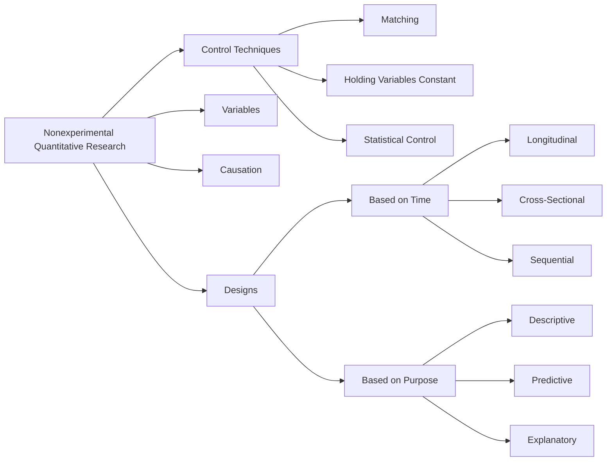
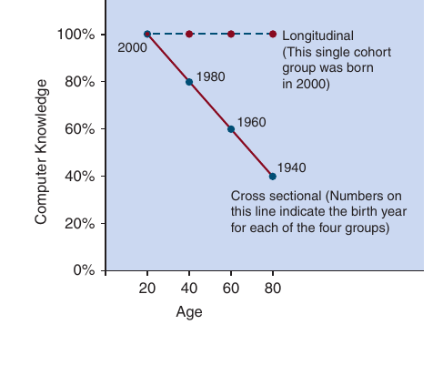
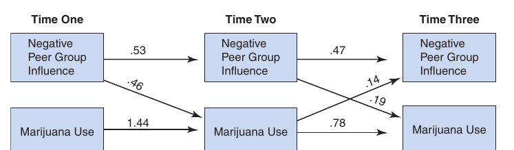

<style>
  /* Textbook typographic styling */
  p {
    text-align: justify;
    text-justify: inter-word;
  }
  h1, h2, h3, h4, h5, h6 { text-align: left; }
  blockquote { text-align: left; }

  /* Textbook Plum Table & Card Styling */
  .textbook-table-wrapper, .comparison-card, .framed-card {
    margin: 1.8em 0;
    border: 1px solid #e5cfdc;
    border-radius: 6px;
    overflow: hidden;
    background: #ffffff;
    box-shadow: 0 1px 3px rgba(0,0,0,0.05);
  }
  .table-caption, .card-caption, .framed-card-header {
    padding: 10px 14px;
    font-size: 0.95em;
    font-weight: 600;
    background: #ffffff;
    border-bottom: 2px solid #842959;
  }
  .textbook-table {
    width: 100%;
    border-collapse: collapse;
    font-size: 0.9em;
  }
  .textbook-table th {
    background: #842959;
    color: #ffffff;
    font-weight: bold;
    padding: 10px 12px;
    text-align: left;
  }
  .textbook-table td {
    padding: 9px 12px;
    border-bottom: 1px solid #f0e6ec;
    vertical-align: top;
  }
  .textbook-table tr.category-header td {
    background: #f7f0f4;
    font-weight: bold;
    color: #842959;
    padding: 8px 12px;
    border-top: 1px solid #e5cfdc;
    border-bottom: 1px solid #e5cfdc;
  }
  .table-footer-notes td, tr.table-notes td {
    font-size: 0.85em;
    color: #666666;
    background: #fafafa;
    border-top: 1px solid #e5cfdc;
    padding: 8px 12px;
  }
  /* Comparison Card (Strengths & Weaknesses) */
  .banner-header {
    background: #842959;
    color: #ffffff;
    font-weight: bold;
    padding: 8px 14px;
    font-size: 0.9em;
    letter-spacing: 0.3px;
  }
  .banner-weaknesses .banner-header {
    background: #73224d;
  }
  .banner-list, .framed-card-body {
    margin: 0;
    padding: 12px 20px 16px 36px;
    background: #faf7f9;
  }
  .banner-list li, .framed-card-body li {
    margin-bottom: 6px;
    line-height: 1.5;
    color: #2b1b24;
  }
  /* Counseling Dialogue / Transcript Styling */
  .dialogue-block {
    margin: 1.4em 0;
    padding: 12px 18px;
    background: #fdfbf7;
    border-left: 4px solid #b38867;
    border-radius: 0 6px 6px 0;
  }
  .dialogue-speaker {
    font-weight: bold;
    color: #5c3d2e;
  }
</style>

<details open>
<summary>📑 <b>Table of Contents</b></summary>

- [PART V Nonexperimental,  Qualitative, and Mixed Methods Research](#part-v-nonexperimental-qualitative-and-mixed-methods-research)
- [Chapter 12 Nonexperimental Quantitative Research Methods](#chapter-12-nonexperimental-quantitative-research-methods)
  - [Learning Objectives](#learning-objectives)
- [Independent Variables and Dependent Variables in Nonexperimental](#independent-variables-and-dependent-variables-in-nonexperimental)
- [Quantitative Research](#quantitative-research)
- [The Bradford Hill Criteria for Causation](#the-bradford-hill-criteria-for-causation)
- [Techniques of Control in Nonexperimental Quantitative Research](#techniques-of-control-in-nonexperimental-quantitative-research)
  - [Matching](#matching)
  - [Holding the Extraneous Variable Constant](#holding-the-extraneous-variable-constant)
  - [Statistical Control](#statistical-control)
- [Nonexperimental Designs Based on the Time Dimension](#nonexperimental-designs-based-on-the-time-dimension)
  - [Cross-Sectional and Longitudinal Designs](#cross-sectional-and-longitudinal-designs)
  - [Evaluation of Cross-Sectional and Longitudinal Designs](#evaluation-of-cross-sectional-and-longitudinal-designs)
- [Nonexperimental Research Designs based on Research Purpose](#nonexperimental-research-designs-based-on-research-purpose)
  - [Descriptive Nonexperimental Quantitative Research](#descriptive-nonexperimental-quantitative-research)
  - [Predictive Nonexperimental Quantitative Research](#predictive-nonexperimental-quantitative-research)
  - [Explanatory Nonexperimental Quantitative Research](#explanatory-nonexperimental-quantitative-research)
  - [Summary](#summary)
  - [Key Terms and Concepts](#key-terms-and-concepts)
  - [Related Internet Sites](#related-internet-sites)
  - [Practice Test](#practice-test)
  - [Challenge Exercises](#challenge-exercises)

</details>


<!-- Page 1 -->
## PART V Nonexperimental,  Qualitative, and Mixed Methods Research

## Chapter 12 Nonexperimental Quantitative Research Methods



### Learning Objectives

🎯 **12.1** Explain the kinds of independent and dependent variables in nonexperimental quantitative research (NQR) and the simple cases of NQR.
🎯 **12.2** List the Bradford Hill criteria for causation.
🎯 **12.3** Explain how to use the different techniques of control in NQR.
🎯 **12.4** Explain the types of NQR designs that are based on the time dimension, including their strengths and weaknesses.
🎯 **12.5** Explain the types of NQR designs that are based on research purpose.

<!-- Page 2 -->
## Independent Variables and Dependent Variables in Nonexperimental

## Quantitative Research

🎯 **12.1** Explain the kinds of independent and dependent variables in

> **nonexperimental quantitative research (NQR) and the simple cases of NQR.**

The major difference between **nonexperimental quantitative research (NQR)** and experimental research (weak, quasi, and strong/randomized) is that NQR does *not* have manipulation of the independent variable (IV). This is the defining characteristic of NQR and is why it is called *non*experimental. Nonexperimental research is often needed in psychology because there are many independent variables that we cannot manipulate—for ethical reasons, for practical reasons, or for literal reasons such as when it is impossible to manipulate the IV. Here’s an example of an experiment that you could not conduct because you could not manipulate the independent variable (smoking) for ethical and practical reasons: Randomly assign 500 newborns to experimental and control groups (250 in each group), where the experimental group newborns *must smoke* cigarettes and the controls do not smoke.

Nonexperimental quantitative research (sometimes called *correlational research*) relies on categorical and/or quantitative independent variables. Typically, the dependent variables (DVs) are quantitatively measured outcome variables. In NQR, the independent variables are sometimes called *predictor variables*, especially when the research purpose is prediction. Some examples of independent or predictor variables in NQR that cannot be manipulated are gender, age, parenting style, ethnicity, developmental stage, intelligence, and personality traits. Some examples of independent variables that it would be unethical to manipulate are smoking and drug use. If you try, you can think of some more independent variables that cannot or should not be manipulated, but are nonetheless important to understand.

Earlier you learned that experimental research varies from weak to strong. Strong experimental designs that use random assignment provide especially strong (i.e., the best) evidence of cause and effect relationships because they control for virtually all extraneous variables (both known and unknown). In contrast, NQR cannot control for all extraneous variables. However, the strength of NQR also varies based on the degree to which the design controls for extraneous variables.

Let’s start by examining the “simple cases” of NQR designs. These designs are extremely weak because they do not control for any extraneous variables. A **simple** **case of NQR** is where you have a single independent variable and a dependent variable, and you do not control for any extraneous variables. In the first simple case (case one), you have a categorical independent/predictor variable and a quantitative dependent variable. In this situation, you compare the scores of different groups on the dependent variable, and you don’t control for any extraneous variables. For example, consider the nonexperimental research question: Do adults score higher than adolescents on an empathy test? Age cannot be manipulated, but we often want to know how adolescents and adults score on a dependent variable such as empathy. Therefore, we would compare the empathy scores of adolescents and adults to see if there is a relationship between age and empathy. Here’s another nonexperimental research question: Do introverts and extroverts differ in their use of social media? Again, we cannot manipulate introversion, but we want to know if this personality characteristic is related to how  students use social media. Therefore, we compare the social media use of introverted and extroverted college students.

<!-- Page 3 -->
In the second simple case (case two), the researcher examines one quantitative independent/predictor variable and a quantitative dependent variable, and he or she does not control for any extraneous variables. In this case, instead of comparing different groups, you measure the independent variable and the dependent variable with all participants. For example, if you wanted to know the relation between self-esteem and empathy, you could measure these two quantitative variables with all participants and then examine the relationship between the variables. Perhaps people who have higher self-esteem also report more empathy.

In both of the simple cases you *only* have information about a relationship between the two variables. A simple relationship does not indicate the direction of causation even if causation were operating (“Does variable A cause variable B or does variable B cause variable A?”) and simple relationships are often spurious. A **spurious rela-** **tionship** is a relationship that is *not causal* such as when the relationship is present because of a “third variable” (i.e., a confounding extraneous variable). You always need to “control for” **third variables**.  In Chapter 2 we told you about the spurious (noncausal) relationship between the amount of fire damage and the number of fire trucks responding to the fire—the more fire trucks responding to a fire, the more fire damage. A greater number of fire trucks does not *cause* greater fire damage! That spurious relationship was due to a third variable—size of fire. Size of fire is the cause of both greater number of fire trucks and greater amount of fire damage. Remember: you cannot make a claim of causation from just the presence of a relationship or correlation.

The key point is that the simple cases of NQR are severely flawed and they can*not* be used for making claims of cause and effect. Observing a relationship does NOT provide sufficient information to make a claim about cause and effect. We have explained in earlier chapters that when you want to make a claim about cause and effect (IV $\approx$ DV), you must meet three criteria for cause and effect: (1) the relationship criterion (i.e., there must be a relationship between the two variables), (2) the temporal order criterion (i.e., changes in the causal variable must precede the changes in dependent variable), and (3) the no plausible alternative explanation criterion (i.e., the researcher must rule out all plausible alternative explanations for the observed relationship). It should be very clear that in the simple cases of NQR, the research study provides information only about a relationship between the variables, and the researcher cannot draw the conclusion that the relationship is causal. We explained in earlier chapters that strong experimental designs allow researchers to satisfy all three of the required criteria for cause and effect.

It is important to understand that when independent variables cannot be manipulated, for whatever reason, researchers do not give up! Instead, researchers do the best they can to gain some knowledge about how these kinds of variables operate in the world. Next, we provide some additional criteria that are used for obtaining evidence of cause and effect.

> [!TIP] **Study Questions 12.1**
> - What are the two simple cases of NQR and why are they flawed if one is interested in making a claim of cause and effect?
>
> - What is a spurious relationship, including an example or two?

## The Bradford Hill Criteria for Causation

🎯 **12.2** List the Bradford Hill criteria for causation.

We have explained the three required criteria for making claims about causation (i.e., the relationship criterion, the temporal order criterion, and the rule out alternative <!-- Page 4 -->
explanations criterion). We have pointed out that you are always *required* to meet all three criteria if you want to make a claim of cause and effect. It is also important to understand that making a claim about causation is always a matter of degree of evidence, often accumulated over a relatively long period of time—evidence will vary from little or no evidence of causation, all the way to relatively strong evidence of causation (which is best provided by strong experimental research).

Researchers in the field of epidemiology (study of health and disease) have provided an additional list of criteria for cause and effect (Doll, 1992; Hill, 1965; Susser, 1977) that is still very useful in research. The work of epidemiologists is especially relevant here because they often have to operate in situations where the independent variable is difficult (or impossible) to manipulate. When you look at the list, note that no single criterion is sufficient for making a claim of causation, but the more criteria are successfully met, the stronger the cumulative or combined evidence. These criteria, often called the **Bradford Hill criteria for causation**, include the following:

**1.***Strength of association.* **** The stronger the relationship/association between the independent variable and dependent variables, the less likely it is that the relationship is due to an extraneous variable.

**2.***Temporality.* **** A cause must precede an effect in time.

**3.***Consistency.* **** Multiple observations of a relationship, under different circumstances, with different people, and with different measurement instruments all increase the credibility of the claim.

**4.***Theoretical plausibility.* **** It is easier to accept an observed relationship as causal when there is a theoretical and rational basis for drawing a causal conclusion.

**5.***Coherence.* **** A cause-and-effect interpretation for a relationship is clearest when it does not conflict with what is known about the variables under study and when there are no plausible rival hypotheses or competing theories. That is, the association must be coherent with other scientific knowledge.

**6.***Specificity in the causes.* **** In the ideal situation, the effect has only one cause.

**** **7.***Dose–response relationship.* There should be a direct relationship between the risk factor (i.e., the independent variable) and people’s status on the disease variable (i.e., the dependent variable).

**8.***Experimental evidence.* **** Any related research that is based on experiments makes a causal inference much more plausible.

**9.***Analogy.* **** Sometimes a commonly accepted phenomenon in one area can be applied to another area.

The Bradford Hill criteria were famously used in the 1960s to allow the justified claim that cigarette smoking leads to cancer. *Criterion 1:* Researchers observed that the lung cancer rate was higher for people that smoked. *Criterion 2:* Smoking regularly preceded the onset of lung cancer. *Criterion 3:* Different research methods all produced the same result (smoking appeared to produce lung cancer), and the finding applied to different kinds of people (male and female; rich and poor). *Criterion* *4:* Biological theory suggested/explained how smoking can produce lung cancer. *Criterion 5:* The causal conclusion made sense based on the history of the disease and current knowledge about smoking and about lung cancer. *Criterion 6:* Lung cancer was best predicted by prior, long-term smoking. *Criterion 7*: The research data indicated a positive and linear relationship between the amount of prior smoking and the incidence of lung cancer. *Criterion 8:* Experimental laboratory rats whose ears were painted with tar (produced by the smoking of tobacco) were likely to get cancer in the ear tissue. *Criterion 9:* Induced “smoking” in laboratory rats showed a causal relationship (analogy).

<!-- Page 5 -->
The major point here is that *the more evidence you can obtain that suggests a causal* *relationship, the better*, if your goal is to make a causal claim. In contrast to strong experimental research designs (with random assignment), in NQR there are almost always alternative explanations for claims of causation that must be studied. Because of the general weakness of NQR designs, nonexperimental researchers must always identify as many alternative explanations as possible and then attempt to rule them out. The more alternative explanations that are eliminated over time, the better the evidence for a causal claim. Next, we discuss some control techniques as they are applied in NQR.

> [!TIP] **Study Questions 12.2**
> - What are the Bradford Hill criteria for causation?
>
> - Which Bradford Hill criteria do you consider the most important? Why?

## Techniques of Control in Nonexperimental Quantitative Research

🎯 **12.3** Explain how to use the different techniques of control in NQR.

Thus far in this chapter we have critiqued the simple cases of NQR where you only have information about a relationship between two variables. If you hope to obtain any evidence about causation, you need to meet the three criteria for causation (relationship plus temporal order plus rule out alternative explanations) and you should try to meet as many of the Bradford Hill criteria as possible. Now, we reexamine some control techniques discussed in Chapter
7. These techniques are very important in NQR as you attempt to rule out extraneous or third variables that suggest alternative explanations for the relationship between your two variables. A key point here is that you can improve upon the flawed simple cases in NQR through the use of control techniques. Unfortunately, random assignment (the best control technique) is only available in experimental research. Therefore, the major control techniques in NQR are matching, holding the extraneous variable constant, and statistical control.

### Matching

The first technique to control for an extraneous variable (and rule out an alternative explanation) is called *matching*. To perform matching, you need to identify one or more extraneous variables that you want to control for. Each of those identified variables that is used is called a matching variable. A **matching variable** is defined as an extraneous variable the researcher ensures does not vary across levels of the IV (e.g., match on gender, income, intelligence); that is, the researcher constructs the IV so that the different groups or levels do not differ on the matching variable(s). In Chapter 7 we showed how to match two groups on a matching variable. The goal of matching is to make sure that your independent variable of interest is not correlated or “confounded” with the matching variable(s). When this is the case, the relationship between the independent and dependent variable is no longer affected by the third variable (i.e., the extraneous variable that you want to control for).

Perhaps you are interested in studying the relationship between divorce and current life satisfaction. Clearly, marital status is a variable that a researcher cannot manipulate, but you still think it is important to study how this variable operates in the world. In this example, your dependent variable is life satisfaction and your <!-- Page 6 -->
independent variable is the categorical variable marital status (divorced vs. not divorced). Your research hypothesis is that divorce results in lower life satisfaction, but you realize that age is a serious extraneous variable that you would need to control for because you know that age is also related to current life satisfaction. You want to eliminate the alternative explanation that “the relationship between marital status and life satisfaction is due to age.” Therefore, you decide to match on and control for age. To make this matching process manageable, you could categorize the quantitative matching variable (i.e., age) into four ordinal levels: 18–24, 25–39, 40–60, and 60 and older.

Next, to match divorced and nondivorced people on age, you need to be able to compare divorced and not-divorced people who are not different on age. You will need to find data for divorced individuals at all four of the age levels and find data for nondivorced individuals at all four of the age levels—then the divorced and nondivorced groups will not differ on age. Age will be “controlled for.”

To complete this process, you could construct the following matching matrix, and then you would need to locate participants for each of the cells:

**Ages 18–24** **Ages 25–39** **Ages 40–59** **Ages 60 or Older** Divorced 25 people 25 people 25 people 25 people Not divorced 25 people 25 people 25 people 25 people

In this example with matching on age, if marital status (IV) and life satisfaction (DV) turn out to be related/associated/correlated based on your analysis of the data, you would be able to claim that the observed relationship between marital status and life satisfaction is *not due to age*. In other words, you will have ruled out *one* alternative explanation for why marital status and life satisfaction are related.

The matching table just shown resembles the kind of table used with the control technique discussed of *building the extraneous variable into the design*, which can also be used with NQR (see Chapter 7, page 138). The difference between the two techniques is that with matching, the researcher is not interested in studying the relationship between the matching variable (in this example, age) and the dependent variable, but when “building the variable into the design” the researcher is interested in how the DV is related to both the IV *and* the extraneous variable that was “built into the design.” In the current example, this just means that (a) if you are interested only in controlling for age then call it *matching* and analyze the relation of marital status to life satisfaction, but (b) if you are interested in studying the relationship between age and the DV (life satisfaction) (in addition to marital status and life satisfaction), then call it *building the* *variable into the design* and analyze the relation of marital status to life satisfaction at each level of age.

You can use matching to control for one or more extraneous variables. In NQR, you usually need to control for more than one extraneous variable because there are usually multiple plausible alternative explanations for the observed relationship between the nonmanipulated IV and the DV of interest. In our example, you might decide that you also want to control for life satisfaction during childhood. In this case you would construct a new matching matrix that includes (a) marital status (two levels), (b) age (four levels), *and* (c) childhood life satisfaction (three levels: low, medium, high). That would result in new matching matrix with 24 cells (2 * 4 * 3).

Although matching in NQR improves upon the simple cases (where you don’t control for any extraneous variables), it still has several limitations. Here are some of the primary limitations:

**1.**Matching only controls for the particular matching variable(s) used in a study.

**2.**Matching can be cumbersome because you must locate participants for all of the cells of the matrix you construct. This can be problematic unless you have a very large and heterogeneous pool of potential participants.

<!-- Page 7 -->
**3.**Matching can produce an unrepresentative sample because participants are selected to enable matching and not because they represent a particular population.

**4.**There are usually multiple alternative explanations or extraneous variables that need to be controlled for, so you usually need to match on multiple variables. This can be cumbersome because it results in a high number of cells or combinations that require participants.

**5.**You must determine the important extraneous variables on which to match, and rarely will you know all of the important extraneous variables.

**6.**You will never know if you have matched on (controlled for) all of the relevant extraneous variables.

### Holding the Extraneous Variable Constant

If you use the control technique of **holding the extraneous variable constant**, you make the decision to only collect data from study participants who are at the same (constant) level on the variable you want to control for. For example, if you wanted to control for college major using this strategy, you would *only* include psychology majors in your research study (or you would only include a different major such as business in your study). If there is still a relationship between your IV and your DV (e.g., motivation and test grades in Psychology 101), you will be able claim that the observed relationship is not due to the third variable of major because  *you have made major a constant* (by only including psychology majors in your research study). You are probably thinking this control technique has a serious external (generalizing) validity problem. You would be right—the results would only apply to psychology majors if you excluded students in other majors from your study.

Despite the external validity (i.e., generalizing) problem with holding the extraneous variable constant, there are times when it *is* reasonable to use this technique. For example, you might want to study academic giftedness (defined by scores on a standard intelligence test). You would therefore only include individuals with IQ scores of 130 or greater (i.e., high intelligence) in your research study. As another example, you might want to conduct research with people who are “at risk” for dropping out of college; in this study, you would exclude possible participants who are not at risk.

### Statistical Control

**Statistical control** involves using statistical software (e.g., R, SPSS) to mathematically control for extraneous variables during data analysis. Here is the logic of statistical control: Examine the relationship between the IV and the DV at each level of the control/extraneous variable. Then you would average the relationship between the IV and DV across all of those levels. When you (or the computer) do this, the relationship cannot be due to the extraneous variable because you only looked at the relationship between the IV and DV when the extraneous variable was constant. You could do this by hand, but it is much easier and more convenient to let the computer program do this for you.

Let’s look at the logic of statistical control with an example. You probably know that there is a relationship between gender and income in the United States. Men, on average, earn more money than women. Now let’s assume you were discussing this relationship with a friend and your friend said the relationship was because of education, specifically because men have more education than women. How could you use the above logic to statistically control for education? You could do this (assume that you have a large data set). First, order your data by years of education from 0 to 21 (0 = no education, 12 = high school graduate, 16 = college graduate, 18 = master’s <!-- Page 8 -->
degree, and 21 = PhD, MD). Second, examine the relationship between gender and income within each of the levels of education—compare the average for men and the average for women *at each level of education*. Third, take the average of those comparisons of male and female incomes at the different levels. The result will show the relationship between gender and income controlling for education; that’s because all of the comparisons between female and male income were made when the amount of education did not differ. In practice, you will find that even after controlling for education, men still, on average, earn more income than women.

Although we don’t discuss statistical analysis until Chapters 15 and 16, we will mention and define some statistical procedures that are available to statistically control for other variables. One statistical technique for controlling for one or more extraneous variables is called *partial* correlation. A **partial correlation coefficient** is a type of correlation that shows the correlation between two quantitative variables after statistically controlling for one or more quantitative extraneous variables. It is called a partial correlation coefficient because it “partials out” of the original relationship the extraneous variable. Just like a regular correlation coefficient (called Pearson’s correlation coefficient), a partial correlation coefficient varies from - 1.00 to + 1.00, where 0 = no correlation. It is different from the simple correlation coefficient because it shows the correlation after controlling for the extraneous variable(s). Interestingly, it is just as easy when using statistical packages to obtain partial correlation coefficients as regular correlation coefficients. We can calculate correlation coefficients by hand, but it is much easier to use a computer program (such as R or SPSS) for this calculation.

A second type of statistical control is called analysis of covariance (abbreviated as ANCOVA). This statistical technique will show you the relationship between a categorical IV and a quantitative DV after statistically controlling for one or more quantitative extraneous/control variables. Using our example of gender and income controlling for education, income would be the DV, gender would be the IV, and education would be the control variable. In short, you just have to figure out what you want to “control for” and collect the empirical data on your control variables. Then you will probably use a statistical package to give you the result.

> [!TIP] **Study Questions 12.3**
> - How would you match on an extraneous variable?
>
> - How would you use the “hold the extraneous variable constant” control technique?
>
> - How does statistical control eliminate the influence of an extraneous variable?

## Nonexperimental Designs Based on the Time Dimension

🎯 **12.4** Explain the types of NQR designs that are based on the time dimension,

> **including their strengths and weaknesses.**

### Cross-Sectional and Longitudinal Designs

In a **cross-sectional design**, data are collected from research participants during a single, relatively brief period. The “single” time period is just long enough to collect data from all of the participants. In a **longitudinal design**, the data are collected at two or more points in time. If the longitudinal data are collected and then the group is followed forward in <!-- Page 9 -->
time for later data collection, the term *prospective cohort design* is sometimes applied. If the longitudinal outcome data are collected in the present time and data from earlier times are located (e.g., from past records), the term *retrospective cohort design* is sometimes used. In cross-sectional and longitudinal designs, the primary independent variable might or might not be a manipulated independent variable. In other words, these studies are sometimes experimental studies, but more commonly, they are nonexperimental studies. Cross-sectional and longitudinal designs are frequently used in developmental psychology and are used to study changes associated with age. Age is a nonmanipulable variable, so if it is the primary independent variable, then the study will be nonexperimental.

In developmental research, a longitudinal design involves choosing a single group of participants and measuring them repeatedly at selected time intervals to note changes that occur over time on the variables of interest. For example, Gathercole and Willis (1992) measured a group of children’s phonological memory and their vocabulary knowledge at four times (when they were 4, 5, 6, and 8 years old) to determine if the relationship between phonological memory and vocabulary knowledge changed as the children got older. On the other hand, in developmental research, a cross-sectional design involves identifying representative samples of individuals that differ on some characteristic, such as age, and measuring these different samples of individuals on the same variable or variable(s) at one point in time. For example, Wagner, Torgesen, Laughon, Simmons, and Rashotte (1993) used the cross-sectional approach in their study of the nature and development of young children’s phonological processing abilities. They randomly selected 95 kindergarten and 89 second-grade students from three elementary schools and administered a number of phonological tasks to both groups to determine whether phonological processing abilities differ among these two age groups.

Although longitudinal and cross-sectional designs are frequently used in developmental research, these types of studies are not confined to this specific area. For example, Moskowitz and Wrubel (2005) used a longitudinal design to gain a more in-depth understanding of the meaning of having contracted HIV. To accomplish the purpose of this study, Moskowitz and Wrubel identified 57 gay men testing positive for HIV and then conducted bimonthly interviews over the course of 2 years to identify how these individuals appraised their HIV changes over time. Andersen, Franckowiak, Christmas, Walston, and Crespo (2001) took a cross-sectional approach to assess the relationship between rate of participating in leisure time physical activity and body weight among various ethnic groups of older U.S. adults. To accomplish the goal of the study, these investigators surveyed a national representative cross-section of the U.S. population (e.g., Hispanic Americans, African Americans, Caucasian Americans) of individuals aged 60 and older regarding their weight and participation in leisure time activity.

> There has been discussion of the relative advantages and disadvantages of longitudinal and cross-sectional designs in developmental research. One important point is that these two approaches will not always produce similar results. For example, imagine a cross-sectional and longitudinal study examining the relation of age to participants’



*Figure 12.1  Hypothetical cross-sectional and longitudinal studies examining the relationship between age and computer knowledge.*

<!-- Page 10 -->


*Figure 12.2  This is a sequential design that examines 10- to  40-year-olds in a 10-year span. Comparisons of different cohorts of the same age can be made (e.g., 20-year-olds born in 2010 can be compared to 20-year-olds born in 2000 and 30-year-olds born in 2000 can be compared to 30-year-olds*

and will likely continue to use them as they age. Figure 12.1 depicts these two different patterns of results. In the cross-sectional study each age group is also a different cohort (they were born at a different time); we can say that age is confounded with cohort.  The older groups in the cross-sectional study did not grow up using computers. Their lower computer knowledge is likely due to the cohort they are in and not due to their chronological age.

Sequential designs combine multiple longitudinal, cross-sectional, or a combination of both designs. For example, a **cohort-sequential design** may start with a cross-sectional study and then add a longitudinal component as shown in Figure 12.2. For example, Chouinard and Roy (2008) were interested in the changes that occur in students’ academic motivation during adolescence. They recruited a group of seventh graders and a group of ninth graders and followed them until they completed 9th and 11th grade, respectively. Use of the cohort-sequential design allowed these researchers to gather data from 7th to 11th grade in less time than would be required with a fully longitudinal design. The sequential design typically results in less cost, time, and attrition than a fully longitudinal design. born in 1990).

### Evaluation of Cross-Sectional and Longitudinal Designs

Cross-sectional research examines relationships based on data collected at a single point in time, and longitudinal research collects data over two or more points in time. Some advantages of cross-sectional designs are that (a) it does not take a long time to conduct the research study and (b) it is relatively inexpensive. Its major weakness is that it is very weak on providing any evidence of cause and effect. Cross-sectional research is strong on causal criterion 1 (relationship) but is very weak on criterion 2 (time order) and criterion 3 (rule out alternative explanations). Another weakness is that it is very difficult to make claims about what happens as people age because the older people lived at different times than the younger people in a cross-sectional sample; that is, the different age groups are from different cohorts.

Some advantages of longitudinal NQR designs are that (a) you can measure change on variables over time and (b) you can see if changes on a DV occur after changes on an IV because data are collected over time (the temporal order criterion for cause and effect). This is important when you want to obtain evidence of cause and effect. Some weaknesses of longitudinal research are (a) the study can take quite a long time (some longitudinal studies occur over decades); (b) attrition (dropping out) can become a problem; (c) if the study is limited to one cohort that is followed in time, it will only generalize to that single cohort; (d) longitudinal research is expensive; and (e) longitudinal is still weaker on causal criterion 3 (rule out alternative explanations) as compared to strong experimental research designs.

<!-- Page 11 -->
> [!TIP] **Study Questions 12.4**
> - What are cross-sectional and longitudinal designs?
>
> - What are the strengths and weaknesses of cross-sectional and longitudinal designs?
>
> - How does the sequential design combine characteristics of cross-sectional and longitudinal designs?

## Nonexperimental Research Designs based on Research Purpose

🎯 **12.5** Explain the types of NQR designs that are based on research purpose.

You learned in the last section that nonexperimental quantitative research can be classified according to the type of data collected: cross-sectional data versus longitudinal data. Now we shift to another useful way to classify NQR designs—specifically, according the research purpose. It is useful to distinguish three major purposes of NQR. Those major purposes are description, prediction, and explanation (or descriptive NQR, predictive NQR, and explanatory NQR). Purposes may sometimes seem to overlap, so the question for you to answer is what is the primary purpose of the NQR design.

### Descriptive Nonexperimental Quantitative Research

In  **descriptive NQR**, the researcher uses empirical data to provide an accurate picture or description of the status or characteristics of a situation or phenomenon. The focus of descriptive NQR is not on cause and effect but on describing variables in situations and often describing the relationships among those variables. When reading a research article, you can usually examine the researcher’s stated purpose and/ or research questions to determine if you should classify it as “descriptive research.” Only sometimes authors will explicitly label their research descriptive.

The following steps are commonly used in descriptive NQR: (1) Identify the population of interest and select a sample (random sampling is the best, but purposive sampling is often necessary) from the target population. (2) Collect the data and based on the analysis describe the data values (e.g., means, percentages) on the variables of interest, and look for relationships among the variables. (3) Infer or estimate the population characteristics based on the sample data. If the study is not based on a random sample, it is important that the researcher provide a detailed profile of the study participants so that a reader will know the kinds of people to whom the results might be generalized.

One example of a descriptive NQR study is titled “Health-Related Quality of Life Among Adolescents in Residential Care: Description and Correlates” (Nelson et al., 2014). Health-related quality of life (HRQoL) “refers to an individual’s overall sense of well-being, including physical, mental, and social functioning” (p. 226). The researchers’ interest was to describe the quality of life of adolescents in full-time residential care. They found that 24% of the residential youth were in the “at risk” category for poor HRQoL. Furthermore, HRQoL was lower for females than males, lower for younger adolescents, and lower for adolescents taking psychotropic medications. Ethnicity was not related to HRQoL scores. The longer the amount of time spent at the residential setting was associated with better HRQoL. The data were cross-sectional, and “The single data collection offered a ‘snapshot’ of youth quality of life at the time of the assessment” (p. 231). This kind of research can suggest the need for new interventions and effectiveness research as well as policy changes.

<!-- Page 12 -->
In another example of descriptive NQR, the researchers collected descriptive data about military service members and their tattoos (Lande, Bahroo, &amp; Soumoff, 2013). The majority (57%) got their tattoos before being deployed. Eighty-two percent said at least one family member also had a tattoo. The vast majority (approximately 80%) of the participants had multiple tattoos. The average age at first tattoo was 19.6 for males and 23.2 for females. The most popular tattoo was a person’s name. Other popular tattoos were real animals, ethnic/cultural/tribal symbols, Christianity symbols, and skulls/grim-reaper/tombstone symbols. Most of the participants had few or no regrets about acquiring tattoos, and they rarely acquired their tattoos while under the influence of alcohol or illicit drugs.

Another important kind of descriptive NQR is **meta-analysis** research, which we briefly discussed in Chapter
1. You have learned that you should not place excess weight on a single empirical research study. Before making a strong claim, you need evidence that the research finding has been corroborated multiple times in different places, times, situations, and with different kinds of people. A meta-analysis provides this kind of information, and it can also indicate when a relationship changes across the levels of other variables (e.g., moderator variables such as gender, social class, IQ, personality). For example, Miao, Humphrey, and Qian (2016) found that, averaged across 119 published empirical research studies, emotional intelligence was positively correlated with worker satisfaction. They also found that this relation varied according to the type of work, with the relationship being the strongest for job contexts that required frequent face-to-face contact with the public. Clearly, evidence from 119 studies is stronger than from a single research study!

Another important kind of descriptive NQR is measurement research. **Measurement** **research** focuses on determining the psychometric properties (i.e., reliability, validity, dimensionality, and operation across different kinds of people) of measurement instruments. This is very important research because without good measurement, it would be impossible to conduct meaningful empirical quantitative research. It is essential that researchers and psychologists know what their instruments measure and whether the instruments/questionnaires/tests might operate differentially with different kinds of people. There is a large measurement research literature in psychology because of the importance of testing and assessment. Perhaps the top measurement research journal in psychology is *Psychological Assessment*, which is published by the American Psychological Association (http://www.apa.org/pubs/journals/pas/index.aspx).

```python
An example of a measurement research study is titled “The Grandiose Narcissism Scale: A Global and Facet-Level Measure of Grandiose Narcissism” (Foster, McCain, Hibberts, Brunell, &amp; Johnson, 2015). Grandiose narcissism (GN) is “a type of narcissism characterized by generally positive intrapersonal functioning (e.g., high selfesteem) and negative (especially long-term) interpersonal functioning” (p. 12). The authors showed that GN has seven sub-dimensions or factors, including “authority (preferring to be in charge), self-sufficiency (preferring to do things on one’s own rather than in groups), superiority (belief that one is better than others), vanity (strong focus on physical appearance), exhibitionism (acting in ways that grab others’ attention), entitlement (belief that one is deserving of special treatment), and exploitativeness (willingness to take advantage of others)” (p. 13). The authors also showed that these dimensions had strong reliability in the sample of 1,017 college students. Wouldn’t it be interesting to see additional measurement research to address the reliability and validity of the GN scale with other populations?

```
### Predictive Nonexperimental Quantitative Research

In **predictive NQR**, the researcher uses one or more predictor variables to make predictions about outcomes occurring in the future. Predictive research is important for the advancement of science, and it is also important in policy and practice. It is important to <!-- Page 13 -->
identify who is “at risk” for various problems so that preventative actions can be made. Predictive NQR generally follows these four steps: (1) identify the dependent or “criterion” variable that you want to predict, (2) identify the variables that should be useful in making predictions, (3) collect and analyze the empirical data, and (4) examine the empirical results to determine which variables are useful for making predictions.

Psychologists are interested in many kinds of predictive findings. Here are just a few of the many outcomes psychologists strive to predict: psychosis/schizophrenia, chronic depression, treatment success vs. recidivism, type of antidepressant that is most likely to work, suicide, dropout from school or treatment, academic performance in graduate school, workplace bullying and violence, sexual harassment, intimate partner violence, drug and alcohol abuse, rape, adolescent pregnancy, eating disorder, autism, life satisfaction, internet addiction, and the list goes on. You can think of additional variables that you hope to predict in your research one day in the future!

An example of a predictive NQR study is “Prospective Prediction of First Lifetime Suicide Attempts in a Multi-Site Study of Substance Users” (Trout, Hernandez, Kleiman, &amp; Liu, 2017). This study was based on a sample of 3,518 participants with an average age of 31.68 years who were recruited from 78 substance abuse treatment centers across the United States. The data were collected when participants entered treatment, when they exited treatment, and one year after completion of the treatment for substance abuse. The results showed that first-time attempts of suicide (during the time period of this study) were correlated with “sex, baseline health-related work impairment, history of psychiatric service use, history of depressive symptoms, history of suicidal ideation, childhood physical abuse, and childhood sexual abuse” (p. 37). The most important predictors of a suicide attempt were health-related work impairment, history of suicidal ideation, and childhood physical abuse. This information should be informative for practicing psychologists and other service providers.

In another predictive NQR study, titled “Parental Rejection, Personality, and Depression in the Prediction of Suicidality in a Sample of Nonclinical Young Adults” (Sobrinho, Campos, &amp; Holden, 2016) the researchers examined predictors of suicidality with a sample of young adults who were *not* considered high risk. This sample included 165 participants who were in college. Seventy-five percent were female, the average age was 20.2, and only 5% were currently employed. The dependent or criterion variable, suicidality, was based on indicators of suicidal ideation, communication of suicide intention, and previous suicide attempts. The results indicated that self-criticism and prior depression were predictive of recent depression, and the best direct predictors of suicidality were recent depression and rejection by mother and/ or father.

As you can see, predictive research can be quite interesting and is quite useful so that preventive actions can be taken by psychologists and other practitioners. Here are two more articles for the interested reader: (1) “Prediction of Violence Perpetration Among High-Risk Youth” (Sussman, Skara, Weiner, &amp; Dent, 2004) and (2) “Combining Clinical Variables to Optimize Prediction of Antidepressant Treatment Outcomes” (Iniesta et al., 2016). We recommend that you conduct a literature search whenever you need to identify predictive studies of importance to you, and remember that prediction is an important goal of science and practice.

### Explanatory Nonexperimental Quantitative Research

In **explanatory NQR**, the research purpose is to explain how and why a phenomenon operates the way it does, and the researcher is interested in gaining some evidence of the operation of cause and effect. Experimental research is the most powerful form of explanatory research for establishing cause and effect, but explanatory NQR also <!-- Page 14 -->
is very important in psychology because there are many causal factors operating in the world that we cannot manipulate for practical or ethical reasons but, nonetheless, need to be understood using the best science we can assemble. In explanatory NQR, rather than exploring relationships operating in the world, researchers often rely on theory and develop and test research hypotheses. Explanatory NQR can rely on either cross-sectional or longitudinal data, but longitudinal designs are preferable because it enables the researcher to gain evidence of the temporal ordering of the variables (causal criterion 2). In all cases, explanatory NQR does *not* include manipulation of the independent variable.

In our first example of explanatory NQR, a statistical technique called **path** **analysis** was used. The logic of path analysis is to develop a theoretical model describing how a set of variables are related and then empirically test the model to see how well it fits the data. For example, Turner and Johnson (2003) proposed a theoretical model of children’s motivation, which is shown in Figure 12.3. Moving from left to right in the model, you will see that parenting characteristics (i.e., parents’ education, income, and self-efficacy) were hypothesized to affect parenting beliefs and parent–child relationships. Next, parenting beliefs and parent–child relationships were hypothesized to affect children’s mastery motivation (labeled child’s mastery). Last, children’s motivation was hypothesized to affect their academic performance. Remember from Table 2.1 (page 20) that a mediating variable is a variable that comes in between two variables; given this definition, you can see that the variables in the middle of the Figure 12.3 operate as mediating variables because they are placed between the parent’s characteristic variables on the left and child’s mastery and achievement on the right. In path analysis, we often talk about direct and indirect effects. The theoretical model shows several hypothesized **direct** **effects** where one variable has an arrow going from it directly to another variable. In $\approx$ A B, variable A has a direct effect on variable B. The theoretical model also shows several **indirect effects**, where one variable affects another variable by going through

$\approx$ $\approx$ a mediating variable. In A B C, the variable A has an indirect effect on C through the mediating variable B.

Turner and Johnson (2003) tested their theoretical model with longitudinal data collected from 169 African American children and their teachers and parents. The final path analysis model, shown in Figure 12.4, only includes the statistically significant paths. The paths that were not supported were removed. You can see in this variable(s).


*Figure 12.3  Theoretical child mastery “path model.” Each single arrow shows a hypothesized direct effect. Two or more arrows in a causal line show a hypothesized indirect effect, where one variable is hypothesized to affect a later variable by operating through one or more mediating*

<!-- Page 15 -->


*Figure 12.4  The trimmed child mastery path model. It is the theoretical path model with the nonsignificant paths eliminated (i.e., it is the model that the data support). The numbers on the lines are called path coefficients, and they show the strength and direction of the relationship (i.e., the*

closer the numbers are to + 1.00 or to - 1.00, the stronger the relationship; if the number is positive, then as one variable increases, so does the other variable; if the number is negative, then as one variable increases, the other variable decreases).

“trimmed model” which hypothesized paths were supported by the empirical data. The final model suggests that parenting characteristics affect children’s mastery motivation through the mediating variable of parent–child relationships. In other words, it suggests that parenting characteristics affect the type of parent–child relationships present, and these parent–child relationships affect children’s mastery motivation. The results also suggest that mastery motivation mediates the relationship between parent–child relationships and children’s achievement. In other words, the parent– child relationships have an effect on children’s mastery motivation, and this mastery motivation has an effect on the children’s achievement.

The strength of path analysis models (when properly conducted) is that the researcher carefully develops a theoretical model and then empirically tests the model. Testing our theories and hypotheses is very important in science. The primary weakness of path analysis is that the models usually are based on nonexperimental data rather than experimental research data. Therefore, you should not place too much faith in these models, especially from a single study.

A second example of explanatory NQR (McDonough, Jose, &amp; Stuart, 2016) is titled “Bi-Directional Effects of Peer Relationships and Adolescent Substance Use: A Longitudinal Study.” These researchers collected data from middle and high school students on peer connectedness, negative peer group, and several substance use variables (alcohol consumption, cigarette smoking, marijuana use, and other illegal drug use). They used a **longitudinal cross-lagged design** where the data on these variables were collected at three time points, spaced one year apart (time 1, time 2, and time 3). We will focus here only on the marijuana use variable. (You can find the additional findings in the original article.)

One of the research questions was whether negative peer group influence affected marijuana use or is the direction of relationship from marijuana use to negative peer group influence? That is, (a) does being influenced negatively by peers (i.e., groups that advocate that members do things that go against the wishes of adults) lead to greater marijuana use? or (b) does greater use of marijuana lead to greater negative peer group influence? What do you think, (a) or (b)? As it turns out, these variables have a reciprocal (bidirectional) effect on each other (i.e., the relationship goes both ways). This is exactly what the researchers hypothesized. If you think about it, many variables in the world operate this way (i.e., A $\approx$ B and B $\approx$ A).

<!-- Page 16 -->
The longitudinal cross-lagged design with the results for the dependent variable marijuana use is shown in Figure 12.5. Evidence for the influence of marijuana use on negative peer group influence is seen in the arrow (of size.14) from marijuana use at time 2 to negative peer group influence at time 3. (*Technical note:* This.14 arrow controls for negative peer group influence at time 2, meaning that the participants were statistically equated on negative peer group influence at time 2; hence, negative peer group influence at time 2 cannot explain why we see the positive arrow from marijuana use at time 2 to negative peer group influence at time 3.)

The results also suggest there is an influence of negative peer group on marijuana use; in fact, it appears that this relationship is stronger than the reverse effect. The evidence is seen in Figure 12.5 in the arrow from time 1 negative peer group influence to time 2 marijuana use (.46) and the arrow from time 2 negative peer group influence to time 3 marijuana use (.19). Notice that we also see evidence of mediation. For example, negative peer group influence at time 1 leads to marijuana use at time 2 which leads to even greater negative peer group influence at time 3 (marijuana use at time 2 is the mediating or intervening variable).

In sum, this longitudinal explanatory research supported the conclusion of a bidirectional relationship between negative peer group influence and marijuana use. These variables appear to result in a maladaptive cycle with each leading to greater change in the other. From a policy standpoint, if the goal is to prevent or reduce marijuana use, programs should focus both on minimizing negative peer group influence and the use of marijuana.

A third example of explanatory NQR (Hughes, West, Kim, &amp; Bauer, 2017) is titled “The Effect of Early Grade Retention on School Completion: A Prospective Study.” The research question was “Does retention of elementary school students result in greater high school dropout?” Researchers obviously cannot randomly assign students to be retained in a grade versus not retained in a grade—this variable had to be studied nonexperimentally. In this longitudinal study, the researchers followed 734 students from elementary school to the time for high school graduation. At the end of the study, the researchers used a statistical technique called **propensity score matching**, which allowed them to construct two groups for comparison: a group of students that were retained for a grade in elementary school and a group of students who were not retained but were equivalent on 65  extraneous variables.

Equating the groups on 65 extraneous variables produced highly similar comparison groups. If you think about the third criterion for cause and effect (eliminating all plausible alternative explanations), you can see that this research design allowed the researchers to rule out 65 alternative explanations for the observed relationship between retention and dropping out. The researchers controlled for achievement/cognitive variables (e.g., reading scores, math scores, intelligence test scores), demographic variables (e.g., ethnicity, age, gender, socioeconomic status, number of children in the



*Figure 12.5  Longitudinal cross-lagged design for negative peer group influence and marijuana use.*

<!-- Page 17 -->
family), home-school interaction variables (e.g., parent self-efficacy for helping child, parental involvement), motivation and personality variables (e.g., student academic self-efficacy, student conscientiousness, student agreeableness), relation with teacher variables (e.g., teacher–student conflict, teacher–student support), remedial services variables (e.g., child attended a pre-K program, student received tutoring by an adult), school risk variables (e.g., school percentage free or reduced lunch, district average level literacy), self-regulation variables (e.g., student ego control and student inhibitory control), and social/behavioral variables (e.g., student trouble, student aggression, student prosocial behaviors, liking by peers). That’s pretty powerful, isn’t it? Remember in strong experimental research, we use random assignment to equate the groups; in NQR, researchers sometimes use propensity score matching to statistically equate the groups. They are basically attempting to approximate an experiment.

After statistically constructing the retained and nonretained student groups, the researchers compared the rates of dropping out of high school for the two groups. They found that the odds of dropping out versus not dropping out of high school for the retained students (after controlling for the extraneous variables) was 2.32. The retained students were approximately two times as likely to drop out of high school compared to the nonretained students. From a policy perspective, this finding suggests that many elementary schools should seriously reconsider their student retention policies.

> [!TIP] **Study Questions 12.5**
> - What is descriptive NQR?
>
> - What is predictive NQR?
>
> - What is explanatory NQR?

### Summary

Nonexperimental quantitative research (NQR) is the type of quantitative research in which the independent variable (IV) is *not* manipulated by the researcher. NQR is important in psychology and related disciplines because there are many IVs that can- not be manipulated for practical and/or ethical reasons but need to be studied for the advancement of science. For example, a researcher cannot manipulate smoking, drug use, personality type, or mental disorder. There are two simple cases of NQR, both of which lack control for any extraneous variables. In simple case 1, the IV is categorical and there is a single quantitative DV. In simple case 2, both the IV and DV are quantita- tive variables. These cases provide information only about relationship (causal criterion 1). These cases provide no information on the temporal order of the variables (causal criterion 2) and they are always challenged by many alternative explanations (causal cri- terion 3). We have explained that claims of causation always require satisfaction of three causal criteria: relationship, temporal order, and to rule out alternative explanations. An additional set of criteria (which has some overlap) is the Bradford Hill criteria for causa- tion; the more you satisfy, the better. The chapter explains the three major techniques of control in NQR: matching, holding the extraneous variable constant, and statistical con- trol. NQR designs include cross-sectional designs (data collected at a single time point) and longitudinal designs (data are collected at two or more time points). A sequential design combines aspects of both cross-sectional and longitudinal designs. Designs in NQR also vary according to the purpose of the NQR study (description, prediction, and explanation).

<!-- Page 18 -->
## 🗂️ Chapter Key Terms & Active Recall

> 💡 **Learning tip:** Try to recall the definition of each term *before* clicking to reveal it.
> This active retrieval practice strengthens long-term memory far more than re-reading.

<details id="flashcard-nonexperimental-quantitative-research-nqr">
<summary>📇 <b>Nonexperimental quantitative research (NQR)</b> *(p. 2)*</summary>

> **Definition:** Type of quantitative research in which the independent variable is not manipulated by the researcher

</details>

<details id="flashcard-simple-case-of-nqr">
<summary>📇 <b>Simple case of NQR</b> *(p. 2)*</summary>

> **Definition:** Situation in NQR where there are only two variables and the researcher does not control for any extraneous variables

</details>

<details id="flashcard-spurious-relationship">
<summary>📇 <b>Spurious relationship</b> *(p. 3)*</summary>

> **Definition:** A relationship between two variables that is not causal

</details>

<details id="flashcard-third-variable">
<summary>📇 <b>Third variable</b> *(p. 3)*</summary>

> **Definition:** A synonym for a confounding extraneous variable

</details>

<details id="flashcard-bradford-hill-criteria-for-causation">
<summary>📇 <b>Bradford Hill criteria for causation</b> *(p. 4)*</summary>

> **Definition:** Set of nine criteria used cumulatively to produce evidence of causation

</details>

<details id="flashcard-matching-variable">
<summary>📇 <b>Matching variable</b> *(p. 5)*</summary>

> **Definition:** A variable a researcher ensures does not vary across levels of the IV to rule the matching variable out as a competing alternative explanation

</details>

<details id="flashcard-holding-the-extraneous-variable-constant">
<summary>📇 <b>Holding the extraneous variable constant</b> *(p. 7)*</summary>

> **Definition:** The inclusion of participants from only one category or level of the extraneous variables

</details>

<details id="flashcard-statistical-control">
<summary>📇 <b>Statistical control</b> *(p. 7)*</summary>

> **Definition:** Control of extraneous variables during data analysis, usually using statistical software

</details>

<details id="flashcard-partial-correlation-coefficient">
<summary>📇 <b>Partial correlation coefficient</b> *(p. 8)*</summary>

> **Definition:** The correlation between two quantitative variables controlling for one or more variables

</details>

<details id="flashcard-cross-sectional-design">
<summary>📇 <b>Cross-sectional design</b> *(p. 8)*</summary>

> **Definition:** Data are collected at a single time period

</details>

<details id="flashcard-longitudinal-design">
<summary>📇 <b>Longitudinal design</b> *(p. 8)*</summary>

> **Definition:** Data are collected at two or more points in time

</details>

<details id="flashcard-cohort-sequential-design">
<summary>📇 <b>Cohort-sequential design</b> *(p. 10)*</summary>

> **Definition:** Design that combines cross-sectional and longitudinal elements by following two or more age groups over time

</details>

<details id="flashcard-descriptive-nqr">
<summary>📇 <b>Descriptive NQR</b> *(p. 11)*</summary>

> **Definition:** Research focusing on providing an accurate picture or description of the status or characteristics of a situation or phenomenon

</details>

<details id="flashcard-meta-analysis">
<summary>📇 <b>Meta-analysis</b> *(p. 12)*</summary>

> **Definition:** Quantitative technique for describing the relationship between variables across multiple research studies

</details>

<details id="flashcard-measurement-research">
<summary>📇 <b>Measurement research</b> *(p. 12)*</summary>

> **Definition:** Research focuses on determining the psychometric properties (reliability, validity, dimensionality, and operation across different kinds of people) of measurement instruments

</details>

<details id="flashcard-predictive-nqr">
<summary>📇 <b>Predictive NQR</b> *(p. 12)*</summary>

> **Definition:** The use of one or more predictor variables to make predictions about outcomes occurring in the future

</details>

<details id="flashcard-explanatory-nqr">
<summary>📇 <b>Explanatory NQR</b> *(p. 13)*</summary>

> **Definition:** Nonexperimental research focused on how and why a phenomenon operates and in gaining some evidence of cause and effect

</details>

<details id="flashcard-path-analysis">
<summary>📇 <b>Path analysis</b> *(p. 14)*</summary>

> **Definition:** Type of research in which a researcher hypothesizes a theoretical model and then tests the model with empirical data

</details>

<details id="flashcard-direct-effect">
<summary>📇 <b>Direct effect</b> *(p. 14)*</summary>

> **Definition:** An effect of one variable directly on another variable; it is depicted as a single arrow in a path model

</details>

<details id="flashcard-indirect-effect">
<summary>📇 <b>Indirect effect</b> *(p. 14)*</summary>

> **Definition:** An effect occurring through a mediating variable

</details>

<details id="flashcard-longitudinal-cross-lagged-design">
<summary>📇 <b>Longitudinal cross-lagged design</b> *(p. 15)*</summary>

> **Definition:** A design in which two variables are measured at two or more points in time to determine the direction of relationship

</details>

<details id="flashcard-propensity-score-matching">
<summary>📇 <b>Propensity score matching</b> *(p. 16)*</summary>

> **Definition:** A statistical procedure used in nonexperimental quantitative research that equates the independent variable groups on multiple extraneous variables

</details>


<a id="key-terms-and-concepts"></a>
### Key Terms and Concepts

| Term | Term | Term |
| --- | --- | --- |
| Bradford Hill criteria for | [Indirect effect *p. 241*](#term-indirect-effect) | Partial correlation |
| [causation *p. 231*](#term-causation) | Longitudinal cross-lagged | [coefficient *p. 235*](#term-coefficient) |
| [Cohort-sequential design *p. 237*](#term-cohort-sequential-design) | [design *p. 242*](#term-design) | [Path analysis *p. 241*](#term-path-analysis) |
| [Cross-sectional design *p. 235*](#term-cross-sectional-design) | [Longitudinal design *p. 235*](#term-longitudinal-design) | [Predictive NQR *p. 239*](#term-predictive-nqr) |
| [Descriptive NQR *p. 238*](#term-descriptive-nqr) | [Matching variable *p. 232*](#term-matching-variable) | [Propensity score matching *p. 243*](#term-propensity-score-matching) |
| [Direct effect *p. 241*](#term-direct-effect) | [Measurement research *p. 239*](#term-measurement-research) | [Simple case of NQR *p. 229*](#term-simple-case-of-nqr) |
| [Explanatory NQR *p. 240*](#term-explanatory-nqr) | [Meta-analysis *p. 239*](#term-meta-analysis) | [Spurious relationship *p. 230*](#term-spurious-relationship) |
| Holding the extraneous variable | Nonexperimental quantitative | [Statistical control *p. 234*](#term-statistical-control) |
| [constant *p. 234*](#term-constant) | [research (NQR) *p. 229*](#term-research-nqr) | [Third variable *p. 230*](#term-third-variable) |

### Related Internet Sites

- <https://listserv.ua.edu/archives/evaltalk.html>
  Program evaluators conduct a lot of experimental and nonexperimental research with an interest in causation. You can search these archives for excellent discussions by practicing researcher/evaluators.

- <http://onlinestatbook.com/2/research_design/causation.html>
  This is a good and free statistics book. This link takes you to its discussion of causation.

- <https://www.ncbi.nlm.nih.gov/pubmed/18063905>
  This link takes you to an article on how to use propensity score matching in nonexperimental research.

- <http://core.ecu.edu/psyc/wuenschk/stathelp/Correlation-Causation.htm>
  This link takes you to an interesting discussion of causation by some experts.

- <http://bolt.mph.ufl.edu/6050-6052/unit-2/causation-and-observational-studies/>
  This is a chapter on causation in nonexperimental research.

### Practice Test

*The answers to these questions can be found in the Appendix.*

**1.** Which of the following is a simple case of nonexperi-
mental quantitative research (NQR)?
a.  Design with one categorical IV and one DV, and
no controls
b.  Design with one quantitative IV and one DV, and
no controls
c.  Design with one categorical IV with matching
d.  Both a and b are simple cases of NQR

**2.** Which of the following is *not* one of the Bradford Hill
criteria for causation?
a.  Theoretical plausi-
c.  Dose–response
bility relationship
d.  Analogy
b.  Qualitative evidence

**3.** You are interested in the relationship between divorce
(divorced vs. not divorced) and life satisfaction. You decide to control for age by designing a study where you include 30 divorced and 30 nondivorced partici- pants at each of four levels of age (18–34, 25–39, 40–59, 60 or older). The study will require 120 study partici- pants. What control technique is used here?

a.  Statistical control
c.  Random assignment
b.  Holding the
d.  Matching
extraneous variable constant

**4.** The standard correlation coefficient (called Pearson’s
r) is used to indicate the degree of relationship be- tween two quantitative variables. What is used when you want to examine the relationship between two quantitative variables “controlling for” one or more extraneous variables?
a.  Control correlation coefficient
b.  Advanced correlation coefficient
c.  Partial correlation coefficient
d.  Multivariate correlation coefficient

**5.** Which of the following is a type of descriptive nonex-
perimental quantitative research?
a.  Path analysis
b.  Propensity score matching
c.  Measurement research
d.  Evaluation research

<!-- Page 19 -->
### Challenge Exercises

**1.** You want to conduct a research study for predict-
ing violence perpetration among high-risk youth. Describe the design you would use for this nonex- perimental quantitative research study.

**2.** You want to conduct a research study to explain
why some young adults become addicted to opioids. Describe the design you would use for this nonex- perimental quantitative research study.

**3.** You want to conduct a measurement research study
for a new instrument you just constructed to measure empathy. Describe the design you would use for this nonexperimental quantitative research study. (*Note:* You might want to also look back at Chapter 5 to get some ideas for this design. You might also  look at some published validity studies.)
