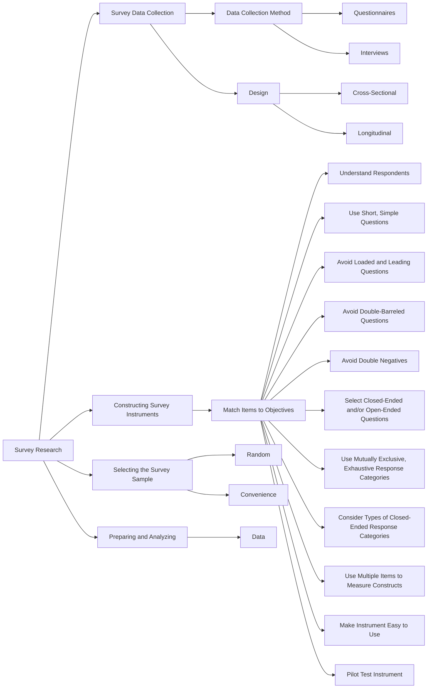

<style>
  /* Textbook typographic styling */
  p {
    text-align: justify;
    text-justify: inter-word;
  }
  h1, h2, h3, h4, h5, h6 { text-align: left; }
  blockquote { text-align: left; }

  /* Textbook Plum Table & Card Styling */
  .textbook-table-wrapper, .comparison-card, .framed-card {
    margin: 1.8em 0;
    border: 1px solid #e5cfdc;
    border-radius: 6px;
    overflow: hidden;
    background: #ffffff;
    box-shadow: 0 1px 3px rgba(0,0,0,0.05);
  }
  .table-caption, .card-caption, .framed-card-header {
    padding: 10px 14px;
    font-size: 0.95em;
    font-weight: 600;
    background: #ffffff;
    border-bottom: 2px solid #842959;
  }
  .textbook-table {
    width: 100%;
    border-collapse: collapse;
    font-size: 0.9em;
  }
  .textbook-table th {
    background: #842959;
    color: #ffffff;
    font-weight: bold;
    padding: 10px 12px;
    text-align: left;
  }
  .textbook-table td {
    padding: 9px 12px;
    border-bottom: 1px solid #f0e6ec;
    vertical-align: top;
  }
  .textbook-table tr.category-header td {
    background: #f7f0f4;
    font-weight: bold;
    color: #842959;
    padding: 8px 12px;
    border-top: 1px solid #e5cfdc;
    border-bottom: 1px solid #e5cfdc;
  }
  .table-footer-notes td, tr.table-notes td {
    font-size: 0.85em;
    color: #666666;
    background: #fafafa;
    border-top: 1px solid #e5cfdc;
    padding: 8px 12px;
  }
  /* Comparison Card (Strengths & Weaknesses) */
  .banner-header {
    background: #842959;
    color: #ffffff;
    font-weight: bold;
    padding: 8px 14px;
    font-size: 0.9em;
    letter-spacing: 0.3px;
  }
  .banner-weaknesses .banner-header {
    background: #73224d;
  }
  .banner-list, .framed-card-body {
    margin: 0;
    padding: 12px 20px 16px 36px;
    background: #faf7f9;
  }
  .banner-list li, .framed-card-body li {
    margin-bottom: 6px;
    line-height: 1.5;
    color: #2b1b24;
  }
  /* Counseling Dialogue / Transcript Styling */
  .dialogue-block {
    margin: 1.4em 0;
    padding: 12px 18px;
    background: #fdfbf7;
    border-left: 4px solid #b38867;
    border-radius: 0 6px 6px 0;
  }
  .dialogue-speaker {
    font-weight: bold;
    color: #5c3d2e;
  }
</style>

<details open>
<summary>📑 <b>Table of Contents</b></summary>

- [Chapter 13 Survey Research](#chapter-13-survey-research)
  - [Learning Objectives](#learning-objectives)
- [Purposes of Survey Research](#purposes-of-survey-research)
- [Steps in Survey Research](#steps-in-survey-research)
- [Cross-Sectional and Longitudinal Designs](#cross-sectional-and-longitudinal-designs)
- [Selecting a Survey Data Collection Method](#selecting-a-survey-data-collection-method)
- [Constructing and Refining a Survey Instrument](#constructing-and-refining-a-survey-instrument)
  - [Principle](#principle)
  - [Principle](#principle)
  - [Meaningful for the Respondents to Be Surveyed](#meaningful-for-the-respondents-to-be-surveyed)
  - [Principle](#principle)
  - [Principle](#principle)
  - [Principle](#principle)
  - [Principle](#principle)
  - [Principle](#principle)
  - [Open-Ended Questions Are Needed](#open-ended-questions-are-needed)
  - [Principle](#principle)
  - [and Exhaustive Response Categories for Closed-Ended Questions](#and-exhaustive-response-categories-for-closed-ended-questions)
  - [Principle](#principle)
  - [Ended Response Categories Rating Scales](#ended-response-categories-rating-scales)
  - [Exhibit 13.1 Examples of Response Categories](#exhibit-13-1-examples-of-response-categories)
  - [Principle](#principle)
  - [or Abstract Constructs](#or-abstract-constructs)
  - [Principle](#principle)
  - [to Use from the Beginning to the End](#to-use-from-the-beginning-to-the-end)
  - [Principle](#principle)
- [Selecting Your Survey Sample from the Population](#selecting-your-survey-sample-from-the-population)
- [Preparing and Analyzing Your Survey Data](#preparing-and-analyzing-your-survey-data)
  - [Summary](#summary)
  - [Key Terms and Concepts](#key-terms-and-concepts)
  - [Related Internet Sites](#related-internet-sites)
  - [Practice Test](#practice-test)
  - [Challenge Exercises](#challenge-exercises)

</details>


<!-- Page 1 -->
## Chapter 13 Survey Research



### Learning Objectives

🎯 **13.1** Explain the purposes of survey research.
🎯 **13.2** Explain each of the six steps in survey re- search design.
🎯 **13.3** Differentiate between cross-sectional and longitudinal designs.
🎯 **13.4** Describe the advantages and disadvantages of different survey data collection methods.
🎯 **13.5** Describe the 12 principles of constructing and refining a survey instrument.
🎯 **13.6** Explain how to select a survey sample.
🎯 **13.7** Describe how to prepare survey data for analysis.

<!-- Page 2 -->
**Survey research** is a widely used type of nonexperimental research. It is a research method where individuals fill out a questionnaire or are interviewed about their attitudes, activities, opinions, and beliefs. The questionnaire or interview protocol usually is standardized to present each research participant with the same stimulus (i.e., questions, directions). Survey research oftentimes is conducted with a sample selected from a target population of interest. Survey research can probe into a given state of affairs that exists at a given time as well as follow changes over time.

Probably the most widely known surveys in the USA are those conducted by the Gallup organization. Gallup polls are frequently conducted to survey the voting public’s opinions on such issues as the popularity of the president or a given policy or to determine the percentage of individuals who might be expected to vote for a given candidate at election time. Surveys are initially conducted to answer the questions “how many” and “how much.” But collection of frequency data is only a preliminary phase of the research in many studies. Researchers often want to answer the questions “who” and “why.” Who votes for the Republican candidate, and who votes for the Democrat? Why do people buy a certain make of car or brand of product? Such information helps us to understand why a particular phenomenon occurred and increases our ability to predict what will happen.

For example, Table 13.1 presents the results of a 2016 Pew Research Center research poll on cell phone or smartphone ownership. The responses revealed that 77% reported owning a smartphone. However, ownership varied according to the background characteristics of the respondents. For example, younger participants were more likely to own a smartphone than older participants, more educated participants were more likely to own a smartphone than less educated participants, and participants with higher income were more likely to own a smartphone than participants with less income.

**Table 13.1** *Responses from a Pew Research Poll on Cell Phone Ownership among Adults in the United States*

<table class="textbook-table">
  <thead>
    <tr>
      <th>Cell phone,</th>
      <th>No cell phone or</th>
    </tr>
  </thead>
  <tbody>
    <tr>
      <td>Smartphone but not smartphone</td>
      <td>smartphone</td>
    </tr>
    <tr>
      <td>Total 77% 18%</td>
      <td>5%</td>
    </tr>
    <tr>
      <td>Ages 18–29 92% 8%</td>
      <td>0%</td>
    </tr>
    <tr>
      <td>30–49 88% 11%</td>
      <td>1%</td>
    </tr>
    <tr>
      <td>50–64 74% 23%</td>
      <td>3%</td>
    </tr>
    <tr>
      <td>65+ 42% 38%</td>
      <td>20%</td>
    </tr>
    <tr>
      <td>Less than high school graduate 54% 39%</td>
      <td>7%</td>
    </tr>
    <tr>
      <td>High school graduate 69% 23%</td>
      <td>8%</td>
    </tr>
    <tr>
      <td>Some college 80% 16%</td>
      <td>4%</td>
    </tr>
    <tr>
      <td>College graduate 89% 8%</td>
      <td>3%</td>
    </tr>
    <tr>
      <td>Less than $30,000 64% 29%</td>
      <td>7%</td>
    </tr>
    <tr>
      <td>$30,000–$49,999 74% 21%</td>
      <td>5%</td>
    </tr>
    <tr>
      <td>$50,000–$74,999 83% 13%</td>
      <td>4%</td>
    </tr>
    <tr>
      <td>$75,000+ 93% 6%</td>
      <td>1%</td>
    </tr>
    <tr>
      <td>Men 78% 18%</td>
      <td>4%</td>
    </tr>
    <tr>
      <td>Women 75% 19%</td>
      <td>6%</td>
    </tr>
    <tr>
      <td>White 77% 17%</td>
      <td>6%</td>
    </tr>
    <tr>
      <td>Black 72% 23%</td>
      <td>5%</td>
    </tr>
    <tr>
      <td>Hispanic 75% 23%</td>
      <td>2%</td>
    </tr>
  </tbody>
</table>

The most basic tenet of survey research is this: If you want to know what people think, then ask them! As you will learn in this chapter, the researcher’s job is to make sure that questions are asked in ways that encourage participants to be honest and forthcoming. When feasible, participants’ responses should be corroborated using <!-- Page 3 -->
additional strategies and data collection methods (e.g., observational data). Because survey research data provide results based on correlations among variables, it is important to be very cautious in drawing conclusions about cause and effect unless the relationships are corroborated through experimental research.

Although psychology usually emphasizes experimental research for studying many psychological phenomena because of its superiority for demonstrating causeand-effect relationships, survey research also has a long and venerable tradition in psychology. For example, survey research was routinely used by famous psychologists such as Kurt Lewin (1890–1946), Rensis Likert (1903–1981), Floyd Henry Allport (1890–1978), and Muzafer Sherif (1906–1988). Today, survey research is an important part of many subfields in psychology, including social psychology, personality psychology, clinical psychology, industrial–organizational psychology, developmental psychology, community psychology, and cross-cultural psychology. Several APA journals that regularly publish research based on survey data are the *Journal of Applied* *Psychology, Journal of Personality and Social Psychology, Professional Psychology: Research* *and Practice, Psychology and Aging, Health Psychology, Psychology of Addictive Behaviors*, and *Psychology of Religion and Spirituality.*

It is possible to mix major research approaches. For example, a researcher might include an experimental manipulation within a survey instrument, making it a cross between survey and experimental research. However, in this chapter we focus on standard survey research designs.

## Purposes of Survey Research

🎯 **13.1** Explain the purposes of survey research.

Survey research is a research method that is applicable to a wide range of problems. It is also deceptively easy to use. The unsophisticated researcher might think that all that is needed is to construct a number of questions addressing the issue of interest and then get people to respond to these questions. However, completing these seemingly simple steps requires a lot of thought and work. Without this thought and work, the questions asked will elicit unreliable answers.

Survey research is the method of choice when you need to measure individuals’ attitudes, activities, opinions, and beliefs. In Table 13.2, we show some of the types of survey questions that can be used in survey research. The purpose of the table is to show the wide range of information that can be collected through survey research. Survey research is helpful in exploratory, descriptive, predictive, and, in some cases, explanatory research.

**Table 13.2** *Matrix of Kinds of Questions Asked in Survey Research*

```python
**Time** **Question domain** **Past (retrospective)** **Present** Behaviors When you were in elementary school, did Do you regularly arrive at your research you ever hit another child during a fight? methods class more than 5 minutes late? Experiences What was it like being a member of a gang What is it like being asked about your when you were a teenager? teenage gang membership?

```
Attitudes, opinions, When you were 10 years old, did you Do you think that you are a good person? beliefs, values believe in Santa Claus?

Knowledge When you were 10 years old, did you know What is the definition of experimental the definition of experimental research? research?

Background or What school did you attend when you were What is your current age? demographic in the 10th grade?

<!-- Page 4 -->
When survey researchers measure attitudes, opinions, and beliefs using good measurement procedures, they can examine relationships among the variables, make predictions, and determine how subgroups differ. Survey research is also helpful when there is a need to track changes in beliefs over time. For example, social psychologists have tracked changes in stereotypes toward minority groups since the early 1900s, showing major changes in beliefs and how the beliefs relate to other variables (e.g., Gilbert, 1951; Karlins, Coffman, &amp; Walters, 1969; Katz &amp; Braly, 1933; Philogene, 2001). Survey research is also commonly used to collect data used to test theoretical models constructed by researchers based on past literature, experimental results, and other factors (e.g., Pettigrew et al., 2008). Survey research in psychology is also used for more purely predictive (Donaldson, Handren, &amp; Crano, 2016) and descriptive purposes (Dispenza, Varney, &amp; Golubovic, 2017).

Strong survey research is based on random samples from populations. When this is the case, survey research is an especially useful research approach that allows us to make direct statistical generalizations about attitudes, opinions, and beliefs from a single sample to a population. This is needed in political polling, but it is also important when psychologists estimate the prevalence of social and psychological characteristics in populations. In this way, survey research provides a direct route to the external validity (i.e., population validity) of conclusions about people’s attitudes, opinions, and beliefs.

> [!TIP] **Study Question 13.1**
> What is survey research? When might survey research be needed in psychological research?

## Steps in Survey Research

🎯 **13.2** Explain each of the six steps in survey research design.

Here are the typical steps in survey research: (1) plan and design the survey research study [e.g., determine what issues you want to survey, determine whether a crosssectional or longitudinal design will be used, identify the target population, select the sample(s)], (2) construct and refine the survey instrument (this will vary slightly depending on whether you are using a questionnaire or an interview protocol), (3)  collect the survey data, (4) enter and “clean” (i.e., locate and eliminate errors where possible) the data, (5) analyze the survey data, and (6) interpret and report the results. In Table 13.3, we have listed some key issues you must consider when you design your survey research study. We provide the knowledge and principles needed to design and conduct survey research in the remainder of this chapter.

**Table 13.3** *Issues in Designing a Survey Research Study*

<div class="framed-card">
  <div class="framed-card-header">Issues in Designing a Survey Research Study</div>
  <ul class="framed-card-body">
    <li>What are the research objectives of the study (i.e., what do you want to find out?)</li>
    <li>Who is the target population?</li>
    <li>Will a cross-sectional or longitudinal design be used?</li>
    <li>What sampling method will you use?</li>
    <li>How big (i.e., number of participants) should the sample be?</li>
    <li>Can a previously used data collection instrument be found or will a new one have to be constructed?</li>
    <li>Will a questionnaire or interview protocol be used?</li>
    <li>What specific method of data collection will be used (in-person, mail, telephone, or Internet)?</li>
    <li>Who will collect the survey data and how will they be trained?</li>
    <li>What is the time frame in which the survey will be conducted?</li>
  </ul>
</div>

<!-- Page 5 -->
> [!TIP] **Study Question 13.2**
> What are the steps in survey research design and why are they important?

## Cross-Sectional and Longitudinal Designs

🎯 **13.3** Differentiate between cross-sectional and longitudinal designs.

In Chapter 12, we discuss cross-sectional and longitudinal research designs. This distinction is especially important in survey research because selecting one of these designs is done in all survey research. We briefly explain these designs here as typically applied in the survey research literature.

In **cross-sectional designs**, the data are collected from the research participants during a single, relatively brief time period (i.e., a period long enough to collect data from all the participants in the sample). The data are collected from the participants only once. Although the data are collected only once, they typically are collected from multiple groups or types of people in a cross-sectional design (e.g., such as people from multiple age groups, from different socioeconomic classes, and with different accomplishments and abilities). For example, Whisman (2007) in “Marital Distress and DSM-IV Psychiatric Disorders in a Population-Based National Survey” collected and analyzed data from a national survey research study with a representative sample of English-speaking adults (18 years or older) in the United States. Whisman found that marital distress was associated with anxiety, mood, and substance disorders. Also, the association between marital distress and depression was stronger for the older age groups in the sample. In another survey with a cross-sectional design, Plous (1996) surveyed members of the American Psychological Association (APA) to determine members’ attitudes toward the use of animals in research. The majority of respondents approved the use of animals but wanted to eliminate or minimize the pain experienced by research animals and the number of animals euthanized.

In  **longitudinal designs**, the data are collected at more than one point in time. Longitudinal studies often last multiple years. Although longitudinal studies include a minimum of two time points or data collection periods, data can be collected over as many time periods as warranted by the research questions. Longitudinal studies are expensive because data are often collected over multiple years. Therefore, longitudinal studies are not always feasible when available resources and funds are limited and when results are needed more quickly. Several types of longitudinal research are discussed in the literature.

In the survey research literature, longitudinal studies that follow a single group or cohort are sometimes referred to as **panel studies** (also called *prospective studies*). In these panel studies, the researcher collects data from the same group of people at successive points over time. The same individuals (i.e., the “panel”) are surveyed more than once over time. For example, Moskowitz and Wrubel (2005) used a longitudinal panel design to gain a more in-depth understanding of the meaning of having contracted HIV. To accomplish the purpose of this study, Moskowitz and Wrubel identified 57 gay men, ranging in ages from 24 to 48, who tested positive for HIV. Then the researchers conducted bimonthly interviews over the course of 2 years to identify how these individuals appraised their HIV-related changes over time.

One last distinction made in the survey research literature concerns what are called trend studies. In a **trend study** (also called *successive independent samples* *design*), the researcher takes independent samples from a general population over time and the same questions are asked. It is different from a panel design because <!-- Page 6 -->
different people are studied at each successive data collection period. An example of a national survey conducted with independent samples over time is the General Social Survey (http://gss.norc.org/), which is conducted by the National Opinion Research Center (at the University of Chicago). Each year a different random sample of U.S. citizens who are 18 years or older are asked questions about many social, psychological, and demographic variables. Other examples of national surveys conducted over time (annually) with independent samples are the National Survey on Drug Use and Health (e.g., https://nsduhweb.rti.org/respweb/homepage.cfm) and the Monitoring the Future survey [e.g., http://www.monitoringthefuture.org/, Schulenberg et al. (2017)].

> [!TIP] **Study Questions 13.3**
> - What are the defining characteristics of cross-sectional and longitudinal designs?
>
> - Distinguish between panel and trend studies.

## Selecting a Survey Data Collection Method

🎯 **13.4** Describe the advantages and disadvantages of different survey data

**collection methods.**

Another major decision you must make when designing a survey research study is whether you want to have your research participants complete a questionnaire or whether you want to interview them. In other words, you must decide on the type of **survey instrument** to be used for data collection. A **questionnaire** is a self-report data collection instrument that is filled out by research participants. Questionnaires traditionally are paper-and-pencil instruments, but they are increasingly being placed on the World Wide Web.

In an **interview**, a trained interviewer asks research participants (i.e., the interviewees) questions and records the responses. The survey instrument used in interviewing looks much like a questionnaire, but it is given a more specialized label of **interview protocol**. The primary difference between a questionnaire and an interview protocol is that a questionnaire must be written so that participants can easily complete it without the aid of anyone. A standardized interview protocol is a survey instrument that has been put into a script-like format so that the interviewer can systematically read the questions and easily record participant responses. Interviews are generally preferred to questionnaires because the researcher has more control over data collection and can probe participants for follow-up responses.

There are several specialized methods for collecting survey data that we now explain, including face-to-face interviewing, telephone interviewing, mail questionnaires, group-administered questionnaires, and electronic questionnaires. Each has its own set of advantages and disadvantages, such as cost and response rate. The **face-to-face interview method**, as the name suggests, is a person-to-person interview, which typically involves going to the interviewee’s home and obtaining responses by conducting a personal interview. This technique has the advantages of allowing the interviewer to clear up any ambiguities in the question asked and to probe for further clarification of responses if the interviewee provides an inadequate answer. This method generally provides a higher completion rate and more complete respondent information. The primary weakness of this method is that it is the most expensive. Also, the interviewee may be uncomfortable discussing private issues. It is possible <!-- Page 7 -->
that the interviewer might bias the responses. For example, an interviewer might (either consciously or unconsciously) spend more time and probe more effectively with an attractive or an especially interesting interviewee, resulting in biased results. Interviewer training can help interviewers learn how to conduct effective interviews to minimize any problems of this sort. Table 13.4 provides some practical tips for conducting interviews (most of which also apply to the telephone interviewing method).

**Table 13.4** *Conducting Effective Research Interviews*

<div class="framed-card">
  <div class="framed-card-header">Conducting Effective Research Interviews</div>
  <ol class="framed-card-body">
    <li>Make sure interviewers are trained.</li>
    <li>Do background homework on interviewees.</li>
    <li>Obtain informed consent from the person(s) you interview.</li>
    <li>Be sensitive to cultural differences.</li>
    <li>Find a quiet and comfortable setting for the interview.</li>
    <li>Explain the purpose of interview.</li>
    <li>Establish trust and rapport.</li>
    <li>Discuss confidentiality of interview.</li>
    <li>Follow the interview protocol exactly as explained during training.</li>
    <li>Be empathetic and remain neutral to interviewee’s statements.</li>
    <li>Continually monitor yourself and the interviewee.</li>
    <li>Be a good listener (i.e., the interviewee should be doing the talking, not you).</li>
    <li>Make sure the interviewee understands exactly what you are asking.</li>
    <li>Provide sufficient time for responses.</li>
    <li>Maintain control of the direction and focus of the interview (i.e., stay on topic).</li>
    <li>Use probes and prompts for follow-up clarifications, detail, and explanation.</li>
    <li>Demonstrate respect for the interviewee’s valuable time.</li>
    <li>Tape-record interviewee responses if possible.</li>
    <li>Take notes sparingly during interview.</li>
    <li>Immediately after the interview, edit your notes and record any additional observations.</li>
    <li>Once you transcribe the interview, give the interviewee the opportunity to make any corrections to what was said.</li>
  </ol>
</div>

With the **telephone interview method**, as the name suggests, the survey is conducted by means of a telephone interview. This method is significantly less expensive than the face-to-face interview (Groves &amp; Kahn, 1979), and some data (Rogers, 1976) demonstrate that the information collected is comparable to that obtained in a faceto-face interview. To obtain the sample of participants, **random-digit dialing** is useful. In this sampling method, telephone numbers are dialed through use of a random process, usually by a computer, which means that unlisted numbers are just as accessible as listed numbers. This results in an unbiased and representative sample if all of the people selected agree to participate. If you have access to a **computer-assisted** **telephone  interview** (CATI) system, the questions (including contingency questions or complex sequences) are prompted on the computer screen for you to read and record the interviewee's responses which are put directly into a computer file for data analysis.

The  **mail questionnaire method**, as the name suggests, involves sending questionnaires to interviewees through the mail and asking them to return the completed questionnaires, typically in stamped return envelopes provided by the organization conducting the survey. The primary advantage of this technique is its low cost. You can send a questionnaire anywhere in the world for the price of postage. However, a disadvantage is that most questionnaires are never returned. The return rate is typically 20–30% for the initial mailing (Nederhof, 1985), although the rate can be increased by use of techniques such as follow-up letters reminding survey  respondents and enclosing another copy of the questionnaire.

Sometimes a researcher is able to use the **group-administered questionnaire** **method**. In this case, the researcher has the participants convene in a group setting. The researcher hands out the questionnaire and participants fill it out during the group session. This approach sometimes is used with organizational surveys when <!-- Page 8 -->
the participants are available in a single workplace. The advantage of this approach is that questionnaires are completed quickly and efficiently. Oftentimes, however, this is not a viable approach because participants are dispersed across locations.

A  **web-based survey** involves contacting people over the Internet and having them complete a survey instrument accessed on their computer through a link provided in the email or on the webpage. In research, the link first takes the potential participant to an informed consent page that explains the purpose of the survey, their rights, and any risks (see Chapter 4 for more on informed consent). Potential participants that provide informed consent, are allowed to continue, and they are directed to the survey instrument for completion. This type of survey has shown tremendous growth and will continue to grow. In fact, you can sometimes be paid for participating in web-based surveys.

There are a number of advantages to conducting a web-based survey over other types of surveys. One major advantage is cost because web-based surveys do not require postage, printing costs, or involvement of interviewers. Anderson and Kanuka (2003) estimated that web-based surveys cost about one-tenth of the cost of a comparable mail survey. Web-based surveys also have the advantages of having instant access to a wide audience, regardless of their geographical location; being fast; being capable of having responses downloaded into a spreadsheet or a statistical analysis program; and being flexible in terms of layout because of the kinds of response formats that can be incorporated particularly with web-based surveys. While web-based surveys have a number of advantages over other survey methods, they do have disadvantages. One disadvantage is the difficulty to ensure privacy and anonymity when identifying information is included. Also, it may be impossible to determine if a participant completes the survey more than once. Another major disadvantage is that web-based surveys often are sent to Internet lists or discussion groups, where the message asks members for their responses; this is a type of **volunteer sampling**, and it produces samples that might significantly differ from the general population and, therefore, is inferior to random sampling methods that produce representative samples.

> [!TIP] **Study Question 13.4**
> What are the characteristics of the different survey data collection methods?

## Constructing and Refining a Survey Instrument

🎯 **13.5** Describe the 12 principles of constructing and refining a survey instrument.

In addition to deciding on the mode of data collection, it is necessary to construct a number of questions or survey items that will provide answers to your research questions. If an already validated survey instrument is available, we strongly recommend that you use it because constructing a survey instrument requires a lot of work. Researchers can determine if an available instrument is appropriate by (a) determining what samples it has been used with previously and examining reliability and validity data across these samples and (b) evaluating the instrument based on the guidelines in this chapter. If the instrument has worked in the literature with similar samples, then use it. If it has not been tried with people exactly like your sample, but it does follow the guidelines, then consider using it. If it is not constructed well, then don’t use it. Now, we explain how to construct a survey instrument under the assumption that an already developed instrument is *not* available for your research project.

<!-- Page 9 -->
The survey instrument of data collection will be a *questionnaire* or an *interview* *protocol*. An interview protocol is highly similar to a questionnaire; essentially, it is a questionnaire that has been put into script format so that the interviewer can read the questions and record the responses. All of the principles of questionnaire construction discussed in this section apply equally to interview protocols. In particular, we now explain the process of questionnaire construction through the use of the twelve principles that are listed in Table 13.5. You can find full-length books on survey instrument construction in Brace (2018); Dillman and Smith (2014); Harris (2014), Robinson and Leonard (2019), and Bradburn, Sudman, and Wansink (2004). There are important software tools that can be useful as you construct and distribute your questionnaire such as Google Forms, Survey Monkey, and Qualtrics.

**Table 13.5** *Principles of Questionnaire Construction*

<div class="framed-card">
  <div class="framed-card-header">Principles of Questionnaire Construction</div>
  <ol class="framed-card-body">
    <li>Write items to match the research objectives.</li>
    <li>Write items that are appropriate and meaningful for the respondents to be surveyed.</li>
    <li>Write short, simple questions.</li>
    <li>Avoid loaded and leading questions.</li>
    <li>Avoid double-barreled questions.</li>
    <li>Avoid double negatives.</li>
    <li>Determine whether closed-ended and/or open-ended questions are needed.</li>
    <li>Construct mutually exclusive and exhaustive response categories for closed-ended questions.</li>
    <li>Consider the different types of closed-ended response categories.</li>
    <li>Use multiple items to measure complex or abstract constructs.</li>
    <li>Make sure the questionnaire is easy to use from the beginning to the end.</li>
    <li>Pilot test the questionnaire until it is perfected.</li>
  </ol>
</div>

### Principle
1. Write Items to Match the Research Objectives

Your research proposal will include your research purpose and research questions or objectives. When constructing a questionnaire, your task is to construct items that cover the different areas and content needed to fulfill your objectives. This involves determining what is essential and what is not needed. You should conduct an extensive review of the literature to make sure you have identified all areas that you need to cover in your questionnaire. It also means that you must write items that will work; that is, you must write items and construct a questionnaire that will have the psychometric properties of providing reliable and valid data. The issues of content and construct validity are especially relevant; that is, make sure you construct a set of items that represent the content domain of interest and make sure you measure each construct adequately. To obtain these desired properties, make sure you follow all of the remaining principles.

### Principle
2. Write Items That Are Appropriate and

### Meaningful for the Respondents to Be Surveyed

It is essential not to forget that it is your research participants, not you, who will be completing the questionnaire. If you are going to construct questionnaire items that will work with your particular respondents, you need to consider, empathetically, how your participants will view what you write. Don’t use stilted or pretentious language. Think about the reading level and the demographic and cultural characteristics of your participants, and write items that are understandable and meaningful to them. Make sure to use natural and familiar language that is clear to both you and your research participants. This will help your participants feel relaxed and less threatened when filling out the questionnaire. It will also increase their motivation to complete the questionnaire.

<!-- Page 10 -->
### Principle
3. Write Short, Simple Questions

Survey questionnaire items should be short, clear, and precise. This includes using simple language and avoiding jargon. Your goal is for everyone to easily understand the item and interpret what the question or item is addressing in the same way. If you have something complex to ask, you must find a simple and clear way to ask it. If you write items that are unambiguous and easy to answer, participants will clearly understand what is asked and their answers should be meaningful. Furthermore, participants will be likely to continue answering all the items on your questionnaire and not leave any blank responses.

### Principle
4. Avoid Loaded and Leading Questions

Loaded and leading questions bias participants’ responses. One form of bias comes when a “loaded” term is used in the item stem. A **loaded term** is a word that produces some sort of positive or negative emotion on the part of the respondent separate from any content value. For example, in politically conservative circles in the United States the term “liberal” came to take on connotations far beyond recommending progressive change. A liberal was sometimes depicted as someone with low morals and one who does not believe in individual responsibility. Because of the loaded nature of the word, researchers needed to use synonyms to *liberal* or, even better, to specify exactly what was meant (increasing spending on education, affirmative action, etc.). For example, it would be preferable to ask the question “What is your opinion of Elizabeth Warren?” instead of “What is your opinion of the liberal Elizabeth Warren?” because of the loaded word “liberal.” The inclusion of one word can have a dramatic impact on participant responses. Here is the key point: If a particular word tends to evoke emotional feelings or stereotyped thoughts, then avoid using it.

A **leading question** is slightly different. This refers to a question or item stem (i.e., the words in the question or item not including the response categories) that suggests to the participant how he or she should respond. Here is an example from Bonevac (1999):

> Do you believe that you should keep more of your hard-earned money or that the government should get more of your money for increasing bureaucratic government programs?

Ȼ Keep more of my hard-earned money.

> Ȼ Give my money to increase bureaucratic government programs.

Ȼ Don’t know/no opinion

This question is leading because it is suggesting to participants that they should select the response “keep more of my hard-earned money.” Notice that this item also has some loaded words in it such as “bureaucratic” and “hard-earned.”

### Principle
5. Avoid Double-Barreled Questions

A **double-barreled question** asks two (or more) things in a single question, and must be avoided. A question such as “Do you agree that the president should focus primary attention on the economy and foreign affairs?” How would you interpret the participant’s response if he or she agreed? Would you claim the participant wanted attention applied to the economy, foreign affairs, or both? The question asks about two separate issues: the economy and foreign affairs. Each issue might elicit a different attitude, and combining them into one question makes it unclear which attitude or opinion is being assessed. If the word *and* or *or* appears in your question, check to make sure that you have not written a double-barreled question rather than just asking about a very specific situation.

<!-- Page 11 -->
### Principle
6. Avoid Double Negatives

A **double negative** is a sentence construction that includes two negatives. When asking participants whether they agree or disagree with statements, double negatives can easily occur. Here is an example:

> Do you agree or disagree with the following statement? Psychology professors should not be allowed to conduct research during their office hours.

In order to disagree with this statement, you have to construct a double negative. You would have to form the response that you “do not think that psychology professors should not be allowed to conduct research during their office hours.” When using agreement scales, the use of some double negatives might be unavoidable. If you do use an occasional double negative, you should underline the negative word or words to focus the participants’ attention to the negative (e.g., we should have underlined “not” in our item stem provided above), and keep double negatives to a minimum.

### Principle
7. Determine Whether Closed-Ended and/or

### Open-Ended Questions Are Needed

An  **open-ended question** requires participants to come up with their own answer. Participants respond to open-ended questions in their own natural language, and they are not limited to a set of predetermined response categories. They can provide any response that they desire. For example, if you wanted to find out what people do when they feel depressed, you could ask an open-ended question such as “What do you do most often when you feel depressed?” Open-ended questions are valuable when the researcher needs to know what people are thinking or when the dimensions of a variable are not well defined. They are commonly used in exploratory or qualitative research. However, the responses to open-ended questions must be coded and categorized, which takes time.

A **closed-ended question** requires respondents to choose from a set of predetermined response alternatives provided by the researcher. For example, if you wanted to find out what people do when they feel depressed, you could ask the question as a closed-ended question as follows:

> What do you do most often when you feel depressed?

Ȼ Eat

Ȼ Sleep

Ȼ Exercise

Ȼ Talk to a close friend

Ȼ Cry

Generally, closed-ended questions are appropriate when the dimensions of a variable are known. In such an instance, the alternative responses can be specified, and the respondent can select among these alternatives. Closed-ended questions also provide more standardized data because all participants are exposed to the same response categories.

An additional, **mixed-question format** also is possible for the question we used as an example above:

> What do you do most often when you feel depressed?

Ȼ Eat

Ȼ Sleep

Ȼ Exercise

<!-- Page 12 -->
Ȼ Talk to a close friend

Ȼ Cry

Ȼ Other (Please Specify): ________

### Principle
8. Construct Mutually Exclusive

### and Exhaustive Response Categories for Closed-Ended Questions

When constructing response categories, it is important to construct the categories so that they do no overlap. **Mutually exclusive categories** do not overlap. Here is a set of response categories for annual income that is *not* mutually exclusive:

> Please check the box that includes your current annual income in dollars:

Ȼ 25,000 or less

Ȼ 25,000 to 50,000

Ȼ 50,000 to 75,000

Ȼ 75,000 to 100,000

Ȼ 100,000 to 150,000

Ȼ 150,000 to 200,000

Ȼ 200,000 or more

Do you see the problem? What if your annual salary were $50,000 per year? There would be two possible categories for this amount because they are not mutually exclusive. Here are the *corrected,* mutually exclusive, categories:

> Please check the box that includes your current annual income in dollars:

Ȼ Less than 25,000

Ȼ 25,000 to 49,999

Ȼ 50,000 to 74,999

Ȼ 75,000 to 99,999

Ȼ 100,000 to 149,999

Ȼ 150,000 to 199,999

Ȼ 200,000 or more

It is also important to construct a set of response categories that includes a place for all possible responses. **Exhaustive categories** include a place for all possible responses. The set of annual income categories provided above was exhaustive because it included a place for all possible annual incomes. If you eliminate one of the categories in that set, it no longer would be exhaustive. For example, if you forgot to include the category “200,000 or more,” then someone earning $300,000 per year would have no place to record his or her response.

The key point is that it is important that your response categories are both mutually exclusive and exhaustive!

### Principle
9. Consider the Different Types of Closed-

### Ended Response Categories Rating Scales

When asking participants questions or measuring their reactions to statements, researchers usually prefer multichotomous rather than dichotomous response categories. Here is an item with a dichotomous response format measuring agreement:

> I take a positive attitude toward myself.

Ȼ Yes

Ȼ No

<!-- Page 13 -->
To increase variance and obtain a measure of intensity, a multichotomous response format, called a **rating scale**, is used by most researchers. Here is an example:

I take a positive attitude toward myself.


5 Strongly disagree Disagree Neutral Agree

Strongly agree

This 5-point rating scale is superior to the dichotomous response format because it taps into two key dimensions of attitudes. It measures *direction* (positive or negative toward the attitudinal object) and *strength* or intensity of attitude. Some researchers prefer to exclude the center (neutral) category and to push respondents to “lean” in one direction or the other. Research suggests that when a shift is made to a 4-point scale by excluding the center point, the distribution of agree and disagree responses is not significantly affected (Converse &amp; Presser, 1986; Schuman &amp; Presser, 1996).

When constructing the descriptors (called the **anchors**) for the points on 4-point and 5-point rating scales, you must make sure that the distance between each pair of descriptors or response categories is the same. For example, the distance between agree and strongly agree should be the same as between disagree and strongly disagree. Exhibit 13.1 provides a few examples of anchors for several commonly used rating scales measuring various attitudinal dimensions.

### Exhibit 13.1 Examples of Response Categories


for Popular Rating Scales

Agreement scale 1

2 Strongly disagree

Disagree

Amount comparison scale 1

2 Much less

A little less

Approval scale 1

2 Strongly disapprove

Disapprove

Effectiveness scale 1

2 Not at all effective

Not very effective

Evaluation scale 1

2 Very poor

Poor

Performance scale 1

2 Excellent

Good

Satisfaction scale 1

2 Very dissatisfied

Somewhat dissatisfied

Similarity scale 1

2 Very much unlike me

Somewhat unlike me

3

4

5 Neutral

Agree

Strongly agree

3

4

5 About the same

A little more

Much more

3

4

5 Neutral

Approve

Strongly approve

3

4 Somewhat effective

Very effective

3

4

5 Average

Good

Very good

3

4 Fair

Poor

3

4

5 Neutral

Somewhat satisfied

Very satisfied

3

4 Somewhat like me

Very much like me

<!-- Page 14 -->
Rating scales with more than four or five points are also commonly and effectively used in psychological research. Rating scales usually vary from 4 to 11 points. Here is an example of a 7-point scale with the center and end points anchored with descriptors:

> How would you rate the overall job performance of your supervisor?

1


Very low

Average Very high

Some researchers use “10-point” scales because they assume many people think this way (i.e., on a 1-to-10 scale, how would you rate XYZ?). However, we recommend that a zero be included because some respondents will falsely assume that 5 is the center point between 1 and
10. The center point on a 1-to-10 scale is 5.5; the center point on a 0-to-10 scale is
5. We also recommend that you anchor the center with a descriptor to reduce individual differences in scale use. For example, on the 7-point scale shown above, we anchored the center point. If you are wondering how many points should be used on scaled response categories, we recommend that you use somewhere from 4 to 11 points (McKelvie, 1978; Nunnally, 1978).

**Binary Forced Choice** Another response format sometimes used is the **binary** **forced-choice approach**. When using this approach, you do not have participants use rating scales to evaluate each attitudinal object. Instead, pairs of attitudinal objects are provided, and participants must select the ones that best fit their beliefs. For example, according to Foster and Campbell (2007), a popular instrument used to measure “normal” narcissism in personality and social psychological research is the Narcissistic Personality Inventory (NPI; Raskin &amp; Terry, 1988). Here is the introduction to the instrument followed by two of the items on the NPI:

> In each of the following pairs of attributes, choose the one that you MOST AGREE with. Mark your answer by writing EITHER A or B in the space provided. Only mark ONE ANSWER for each attitude pair, and please DO NOT skip any items.

> ________ 1. A.  I have a natural talent for influencing people.

B.  I am not good at influencing people.

> ________ 2. A.  I would do almost anything on a dare.

> B.  I tend to be a fairly cautious person.

Although some research suggests that forced-choice format can reduce response sets (explained below), item level data analysis is difficult, and psychometricians generally recommend that binary forced-choice items be avoided (Anastasi &amp; Urbina, 1997; Nunnally, 1978; Thorkildsen, 2005).

**Rankings** Sometimes survey researchers ask participants to rank-order their responses. A **ranking** indicates the importance or priority assigned to an attitudinal object. Rankings can be used with open-ended or closed-ended responses. For an open-ended example, you might ask “In your opinion, who are the three top psychology professors in your college?” Then you follow this up with a request to rank the top three professors. Rankings also are sometimes done with closed-ended items. Here is an example:

The following five professors have been nominated for the Outstanding Teacher Award this academic year. Please fill in your rank order of these professors, where 1 is your most favorite and 5 is your least favorite:

Ranks ____________ Dr. James Van Haneghan ____________ Dr. Marty Carr

<!-- Page 15 -->
____________ Dr. Thomas Johnson ____________ Dr. Alex Baxter ____________ Dr. Lisa Morrison

As a general rule, you should not ask participants to rank more than three to five attitudinal objects at one time because ranking can be a difficult task. Additionally, rank ordering can be difficult to analyze statistically when your goal is to relate the ranking to other variables. Finally, rank ordering can be achieved for a group of respondents without asking for ranks. You have participants rate each object on a rating scale (e.g., 5-point) and then you compare the group means for each object. You can then rank-order the means from lowest to highest.

**Checklists** Survey researchers sometimes provide a list of categories (a **checklist**) and ask participants to check the responses that apply to them. Unlike other response formats, the checklist is a multiple-response format because participants are told to check all categories that apply to them. Here is an example of a checklist type item:

During the past year, have you taken a course in any of the following subject areas? Check all that apply.

Ȼ Anthropology

Ȼ Economics

Ȼ History

Ȼ Political Science

Ȼ Psychology

Ȼ Sociology

### Principle
10. Use Multiple Items to Measure Complex

### or Abstract Constructs

In the last section, we explained how to set up the response categories for the items on your questionnaire. Another issue is how many items you need to measure psychological constructs adequately. Measurement is defined as “the assignment of numerals to objects or events according to rules” (Stevens, 1946). Rarely, however, is the use of a single item adequate to measure constructs of interest to psychologists. Single items can adequately measure constructs such as sex (via self-report), weight (e.g., measured on a scale), and ethnicity (self-report). However, most constructs of interest are more complex than sex and weight and, therefore, require multiple items for measurement. Examples of more complex constructs are self-esteem, intelligence, locus of control, statistics anxiety, dogmatism, and temperament. It is a maxim in psychological measurement that multiple items are needed to measure constructs. Multidimensional constructs (i.e., constructs that have two or more components or domains or dimensions such as intelligence) by definition require more than one item for measurement. Most unidimensional constructs (constructs that have only one dimension such as global self-esteem) also require multiple-item measurement because single-item measurement is notoriously unreliable (i.e., inconsistent and untrustworthy).

**Semantic Differential** A **semantic differential** is a scaling technique that is used to measure the meaning that participants give to attitudinal objects or concepts and to produce semantic profiles (Osgood, Suci, &amp; Tannenbaum, 1957). Participants are asked to rate the attitudinal object on a series of bipolar rating scales, with contrasting adjectives anchoring the left and right endpoints. A 7-point rating scale is the most popular, with only the endpoints anchored. For example, in an article entitled “Occupation and Social Experience: Factors Influencing Attitude Towards People with Schizophrenia,” the researchers (Ishige &amp; Hayashi, 2005) measured the participants’ attitudes using 20 bipolar adjectives. Here

<!-- Page 16 -->
are several of the adjective pairs they used: safe versus harmful, bad versus good, fierce versus gentle, shallow versus deep, active versus inert, lonely versus jolly, simple versus complicated, dirty versus clean, and distant versus near. As you can see, the contrasting adjective pairs are composed of antonyms. If you need help locating antonyms for a descriptor, online dictionaries are readily available on the World Wide Web.

Traditionally, in semantic differential scaling, several contrasting adjective pairs are developed to address each of the following three dimensions directed toward the attitudinal object: activity, evaluation, and potency. For example, you might rate “juveniles” as high on activity (e.g., aggressive), unfavorable on evaluation, and high on potency (e.g., powerful). You might rate “books” as low on activity (e.g., passive), favorable on evaluation (if you like books), and average on potency. Politicians might be rated as average on activity, unfavorable on evaluation, and high on potency (i.e., powerful). You can easily find many examples of semantic differential scales by conducting a literature search using “semantic differential” as the search term.

**Likert Scaling** The most frequently used multi-item approach to scaling is **Likert** **scaling**. 1 It is named after the famous social psychologist Rensis Likert (1903–1981) who, while working on his dissertation, first used this scaling approach (Likert, 1932; Seashore &amp; Katz, 1982). (His last name is pronounced “LICK-ert,” not “LIE-kert.”) In Likert scaling, each participant rates multiple items designed to measure one construct; the respondent typically rates all of the items using a 4-, 5-, 6-, or 7-point rating (i.e., response) scale. A single score is obtained for each participant by summing his or her item scores. (Some researchers also divide the sum by the total number of items.) Because each participant’s responses to the items measuring the single construct are summed, this type of scale is also known as a **summated rating scale**.

You can view a summated rating scale in Table 13.6. The scale shown is the Rosenberg Self-Esteem Scale, and it is composed of 10 items. Although the 10 items in the Rosenberg Self-Esteem Scale measure self-esteem, five of the items (3, 5, 8, 9, and 10) are worded in the negative direction. Before a research participant’s responses on the 10 items are

**Table 13.6** *The Rosenberg Self-Esteem Scale*

<div class="framed-card">
  <div class="framed-card-header">The Rosenberg Self-Esteem Scale</div>
  <ul class="framed-card-body">
    <li>I feel that I am a person of worth, at least on an equal 1 2 3 4 basis with others.</li>
    <li>I feel that I have a number of good qualities. 1 2 3 4</li>
    <li>All in all, I am inclined to feel that I am a failure. 1 2 3 4</li>
    <li>I am able to do things as well as most other people. 1 2 3 4</li>
    <li>I feel I do not have much to be proud of. 1 2 3 4</li>
    <li>I take a positive attitude toward myself. 1 2 3 4</li>
    <li>On the whole, I am satisfied with myself. 1 2 3 4</li>
    <li>I wish I could have more respect for myself. 1 2 3 4</li>
    <li>I certainly feel useless at times. 1 2 3 4</li>
    <li>At times I think I am no good at all. 1 2 3 4 Source: Morris Rosenberg’s “Self-Esteem Scale” from pp. 325–327 of Society and Adolescent Self Image , 1989.</li>
    <li>Items marked with an asterisk have reverse wording. Scores for the reverse wording items must be reversed before summing with responses to the other items. For the reverse wording items, convert a response of 1 to 4; convert 2 to 3; convert 3 to 2; and convert 4 to
1. After conversion, sum the 10 responses and divide the sum by 10 for each participant. 1 Some researchers use the term “Likert scale” to refer to any single questionnaire item that uses a 5-point response scale. We recommend that the term 5-point scale (or 4-point scale, etc.) be used instead of Likert scale because Likert scale more properly designates a multi-item summated scale. Our recom- mendation is in agreement with the Publication Manual of the American Psychological Association (2010).</li>
  </ul>
</div>

**Circle one response for each of the following items.** **Strongly** **Strongly** **disagree Disagree** **Agree** **agree**

<!-- Page 17 -->
summed, the five negative item scores must be reversed. The participant’s sum on the 10 items (after appropriate reversals) can be divided by 10 if you prefer that the final range falls between 1 and 4 (rather than between 10 and 40). When researchers use summated rating scales to measure constructs, they should report a coefficient alpha value (also called “Cronbach’s alpha”), which is an index of internal consistency reliability based on the data collected in the study being reported (see Chapter 5). The value of coefficient alpha should be.70 or higher if the scale is reliable.

### Principle
11. Make Sure the Questionnaire Is Easy

### to Use from the Beginning to the End

A checklist for questionnaire construction is provided in Table 13.7. Please read the list carefully and be sure to check it when you construct your own questionnaire. We will address some of the issues below.

**Table 13.7** *Questionnaire Construction Checklist*

<div class="framed-card">
  <div class="framed-card-header">Questionnaire Construction Checklist</div>
  <ol class="framed-card-body">
    <li>Follow the 12 principles provided in Table 13.5.</li>
    <li>Always put a title on your questionnaire.</li>
    <li>Number the items or questions consecutively (starting with “1”).</li>
    <li>Include page numbers.</li>
    <li>Use a standard font type (e.g., Times New Roman) with a readable font size (e.g., 12 point).</li>
    <li>Provide clear instructions wherever needed.</li>
    <li>Provide lead-ins for new or lengthy sections in the questionnaire.</li>
    <li>Make sure the questionnaire has a professional and uncluttered appearance.</li>
    <li>Carefully place each question or set of questions to ensure logic and flow from beginning to end.</li>
    <li>Start the questionnaire with interesting, gentle questions.</li>
    <li>Place demographic and other sensitive questions at the end of the instrument.</li>
    <li>Avoid multiple-response questions.</li>
    <li>List response categories for closed-ended questions vertically, rather than horizontally. An exception to this rule can be the horizontal presentation of a rating scale.</li>
    <li>Use closed-ended response categories when appropriate responses are known.</li>
    <li>Include some open-ended questions.</li>
    <li>Do not use “fill-in” lines with open-ended questions; provide blank space in the response area.</li>
    <li>Do not “break” questions (or instructions or lead-ins) across pages.</li>
    <li>On multipage questionnaire, place “Please continue to next page” at the bottom of pages.</li>
    <li>Always end the questionnaire with a “Thank you for completing this questionnaire.”</li>
  </ol>
</div>

**Ordering of Questions** The ordering, or sequencing, of the questions must always be considered. When the questionnaire includes both positive and negative items, it is generally better to ask the positive questions first. Similarly, some of the more important and interesting questions should come first to capture the attention of the respondent. Roberson and Sundstrom (1990) found that placing the important questions first and demographic questions (age, gender, income, etc.) last in an employee attitude survey resulted in the highest return rates. *This practice of putting* *demographics last also is standard practice in professional survey research firms* and is what we strongly recommend. You should start this last section with a lead-in like one of the following: “Last are some demographic questions that will be used for classification purposes only” or “To finish this questionnaire, we have a few questions about you.”

**Contingency Questions** It is a good idea to limit the number of contingency questions for paper-and-pencil questionnaires (i.e., questionnaires that participants fill out) because they increase the risk of error. A **contingency question** is an item that directs participants to different follow-up questions depending on their response. It

<!-- Page 18 -->
allows the researcher to direct participants to the correct place within the questionnaire (if there is any deviation from everyone answering the next question). Here is an example of a contingency question:

Question
43. Do you have children?

> Ȼ Yes $\approx$ IF YES, GO TO QUESTION 45

Ȼ No $\approx$ IF NO, GO TO QUESTION 44

The use of contingency questions is not problematic in interview protocols and questionnaires used in web-based surveys because in the former, interviewers are trained to administer the interview protocol, and in the latter, skips can be programmed into the web-based survey instrument to automatically send the participant to the correct questions.

**Questionnaire Length** Many significant questions can be asked in any survey, but every data-gathering instrument has an optimal length for the population to which it is being administered. After a certain point, the respondents’ interest and cooperation diminish. The survey researcher must therefore ensure that the questionnaire is not too long, even though some important questions might have to be sacrificed. It is impossible to specify the optimum length of any survey questionnaire because length is partially dependent on the research topic and the method of data collection. As a general rule, telephone interviews should be no longer than 15 minutes. However, a face-to-face interview might consume more time without making the interviewee feel uncomfortable. Questionnaires sent through the mail should be the shortest and easiest to complete; otherwise, potential participants will not fill them out and send them back.

**Response Bias** A person can have several types of biases when responding to surveys. One of the most common is a **social desirability bias**. This bias occurs when people respond to a survey in a way that makes them look the best rather than responding as they really feel or believe. This is synonymous with the positive self-presentation participant effect discussed in earlier chapters. Survey researchers must constantly be aware of this type of bias affecting individuals’ responses and construct instruments and interpret the results with this potential bias in mind. One strategy to minimize this bias is to make the data anonymous so that not even you, the researcher, can connect a name to a response. Then you can tell the participants that their responses will be anonymous. You must not ask for or allow participants to provide any identifying information (e.g., name, phone number, student number). After explaining that their responses will be anonymous, ask them to be open and honest in their answers. They should feel free to do this now, knowing that no one can connect their name with what they say. Another strategy is to use binary forced-choice response categories that have been equated on desirability. Respondents will have to pick one of two choices that are equally desirable. This approach is not used often because rating scales are more popular and easier to analyze than binary forced-choice response data.

Another type of bias is a specific **response set** or a tendency to respond in a specific manner to multiple or all questions. For example, a person might hesitate in giving extreme responses and tend to cluster his or her responses around a central choice. One strategy to minimize a tendency to select a center choice is to use an even number of response categories on rating scales rather than an odd number with a center point. Other individuals might be “yea-sayers,” tending to agree with every statement. One strategy to minimize this is to break up questions into different types. For example, insert an open-ended question between a set of closed-ended items. Surveys instruments need to be constructed so that biases such as these are eliminated or at least minimized. Some researchers reverse items to help eliminate response sets. This <!-- Page 19 -->
approach can help, but it has also been shown to decrease the reliability of the items. Therefore, reversing items can come with a cost. In sum, you will need to think carefully and check empirically during pilot testing to determine the kinds of biases that might affect your data collection instrument and act accordingly.

### Principle
12. Pilot Test the Questionnaire Until It Is Perfected

We already have alluded to the importance of pilot testing. We cannot stress enough how important it is to “try out,” or **pilot test**, your data collection instrument (e.g., questionnaire, interview protocol). The purpose is to identify problems and fix them. Pilot testing must be done *before* you use the instrument in a research study. You can start pilot testing by testing out your questionnaire with colleagues and friends. Then you will need to pilot test it with individuals who are very similar to those who will be in your research study. Your pilot testing participants should be instructed to complete the instrument and to identify any ambiguous or unclear items or any other problems they might have in completing the instrument. One especially useful strategy during pilot testing is to use the **think-aloud technique**, where participants verbalize their thoughts and perceptions while they engage in the activity of filling out the questionnaire. You might even decide to make audiotape or videotape recordings of the pilot test sessions for later review. It is also helpful to interview participants after they complete the questionnaire, discussing how it worked, what they thought it was about, if anything was confusing, and if anything irritated them. The ultimate purpose of pilot testing is to obtain an instrument that will work flawlessly when it is used in your research study.

> [!TIP] **Study Question 13.5**
> What are the major principles of questionnaire construction? What are the key issues within each of the 12 principles?

## Selecting Your Survey Sample from the Population

🎯 **13.6** Explain how to select a survey sample.

After the survey instrument (i.e., the questionnaire or interview protocol) has been constructed, it must be administered to a group of individuals to obtain a set of responses that will provide answers to your research questions. There are many ways in which a researcher can select the participants who will be given the questionnaire. Most research projects involve selecting a sample of participants from a population of interest. A  **population** refers to all the events, things, or individuals to be represented, and a **sample** refers to any number of individuals less than the population that is used to make the representation. The researcher makes generalizations about the population based on the sample results.

The manner in which this sample of participants is selected depends on the goals of the research project. If the research question focuses on exploring the relationship between variables and if direct, precise generalizations do not need to be made about the population, then a convenience sampling method might be used. **Convenience** **sampling** is a nonprobability sampling method whereby the sample of participants selected is based on convenience and includes individuals who are readily available. For example, a significant amount of psychological research is conducted using introductory psychology students as participants because these students are conveniently <!-- Page 20 -->
available to researchers. The obvious advantage of using the convenience sampling technique is that participants can be obtained without spending a great deal of time or money. However, researchers usually want the results of their studies to generalize to “people in general” or at least to “a college student population.” Making such a generalization from this sample of college students can be hazardous because the sample is composed of students volunteering for the study who have elected to take introductory psychology during the semester in which the study was conducted.

Responses to electronic surveys also represent a type of convenience sample because, in spite of the large number of individuals who are connected to the Internet, many people still are not connected or choose not to use the Internet. According to the Census Bureau, approximately 76% of people in the United States lived in homes with Internet access in 2010. Furthermore, participants in the final sample will include only those people who decide to respond to your e-mail invitation to participate in the survey research study. This means that any sample of responses to electronic surveys will be biased. Bias can be reduced by sampling from populations in which Internet access is extremely high, such as college students and university faculty within the United States, Canada, and Western Europe. However, even these populations might produce a biased sample because of differing levels of experience and comfort with Internet-based tools such as web browsers. When the research question requires an accurate depiction of the general population, a **random sampling** method must be used. As discussed in more detail in Chapter 5, there are several methods of random sampling, including simple random sampling, stratified sampling, and cluster sampling. We will review only simple random sampling in this chapter. An example of random sampling is seen in most presidential campaign polls conducted to test the pulse of the voting public. These polls are taken to determine the popularity of the candidates as well as the influence of various issues, such as prior drug use, on the public’s opinions of candidates. It is very important that the results based on the sample generalize to the population in political polling.

When a true random sample of participants is obtained from the population, the results can be amazingly accurate. For example, in 1976, a *New York Times*–*CBS* poll correctly predicted that 51.1% of the voters would vote for Jimmy Carter and 48.9% for Gerald Ford (Converse &amp; Traugott, 1986). The prediction was made using a sample of less than 2,000 individuals selected from almost 80 million voters. This perfectly accurate prediction was unusual, but it illustrates the accuracy with which the population responses can be predicted from a sample of just a few individuals, if these individuals are selected randomly. In virtually all polls such as this, there is **sampling error**, or random error, that arises from the fact that the sample results randomly vary slightly from the population characteristics. However, this error is typically quite small and much smaller than it would be if any other sampling method were used.

This ability to generalize directly from the single sample to the population also is important in many survey research studies. This ability to generalize is a strength of survey research that is based on random samples. Experimental research rarely is based on random samples; however, this problem is dealt with because causal generalizations based on experimental research data are based on replication with multiple samples of different people, different places, and different times. What is of most importance in experimental research is random assignment to levels of the independent variable, not random selection.

When **simple random sampling** is used, every member of the population has an equal chance of being selected for the study.[^2] The advantage of this method is that it provides a sample of participants whose responses represent those of the general population; this type of sample is called a **representative sample**. One way of thinking about simple random sampling is to consider the “hat model.” The idea is to write each person’s name on a small piece of paper and put them into a hat. There must be one equally sized piece of paper for each person in the population. Next, shake up the pieces of paper in the hat and pull one piece out. The person whose name is on that piece of paper is in your sample. If you want a sample of size 100, then repeat this process 99 more times until you have your 100 people. (You do not put the piece of paper back into the hat once selected because you want to avoid sampling the same person more than once.) If you actually draw a random sample, a better method than the hat model is to give each person in the population a number (starting with 1 and ending with the number of people in the population) and then use a random number generator to indicate the numbers (i.e., people) randomly selected to be in the sample. As mentioned in Chapter 5, you will find useful random number generators in the following websites: http://randomizer.org and http://www.random.org. For more information on random sampling methods reread Chapter 5, or see books devoted to sampling (e.g., Fowler, 2013; Henry, 1990; Kalton, 1983).

<!-- Page 21 -->

[^2]: Any sampling method that has this characteristic is called an equal probability of selection method (EPSEM). In addition to simple random sampling, there are other equal probability of selection meth- ods such as proportionate stratified sampling, cluster sampling when clusters are of equal size (or probability proportional to size, PPS, is used), and systematic sampling (when a random start is used). The key idea is that equal probability of selection methods produce representative samples, enabling the researcher to generalize from the sample directly to the population.

> [!TIP] **Study Question 13.6**
> What are the strengths and weaknesses of the different sampling methods?

## Preparing and Analyzing Your Survey Data

🎯 **13.7** Describe how to prepare survey data for analysis.

After you construct your data collection instrument, select your sample, and collect your survey data, you will be ready to enter your data into a statistical software program such as the popular program called SPSS. Quantitative (i.e., numerical data) are relatively easy to enter into SPSS; the data entry window looks and operates much like a spreadsheet. Once you enter the data, you must carefully check the quality of your data. For example, if you used a 5-point rating scale, a response of “6” or “7” would not be valid. You would need to go back to the survey instrument to determine whether you made a data entry error that can be corrected. If not, this response would have to be coded as “missing.” If you used a contingency question that directed only women to answer a question, then any responses to the question by men must be omitted (i.e., coded as missing). If you have any open-ended responses, you will need to examine the written responses for themes and categories, and if possible, you should assign codes to the themes/ categories. Those codes will represent a nominal variable and can be entered into the data set and analyzed with the other data. Once you have carefully checked and “cleaned your data,” you are ready for analysis. You will learn how to analyze data in Chapters 15 and 16.

> [!TIP] **Study Question 13.7**
> Why is it important to check your data before conducting your analyses?

<!-- Page 22 -->
### Summary

Survey research is a nonexperimental research method relying on questionnaires or interview protocols for data collection. It is used when the researcher is interested in measuring individuals’ attitudes, reported activities, opinions, and beliefs. Typically, the survey method relies on a sample of participants selected so that the researcher can generalize from the sample to the target population. Surveys can be conducted at a single time (cross-sectional) or at multiple time periods (longitudinal survey). The six steps in survey research are provided in the section titled “Steps in Survey Research,” and the key issues to address when designing a survey research study are shown in Table 13.3. The two major methods of data collection used in survey research are administering a survey instrument (i.e., a questionnaire) or conducting interviews (using an interview protocol). Interviews are usually conducted face-to-face or over the telephone (or through some other electronic device such as Skype). Table 13.4 provides the 21 principles for you to follow to conduct an effective interview. If your survey research study relies on the administration of a questionnaire that you have to construct, you need to follow the 12 principles of questionnaire construction listed in Table 13.5. When constructing or evalu- ating a questionnaire, it is very important to address all of the points in the questionnaire construction checklist provided in Table 13.7.

## 🗂️ Chapter Key Terms & Active Recall

> 💡 **Learning tip:** Try to recall the definition of each term *before* clicking to reveal it.
> This active retrieval practice strengthens long-term memory far more than re-reading.

<details id="flashcard-survey-research">
<summary>📇 <b>Survey research</b> *(p. 2)*</summary>

> **Definition:** A nonexperimental research method relying on questionnaires or interview protocols

</details>

<details id="flashcard-future">
<summary>📇 <b>Future</b> *(p. 3)*</summary>

> **Definition:** Are you going to vote in the next presidential election? If you become a parent one day, what experiences do you think you will most enjoy in that role? Do you think that you will become more politically conservative or more liberal as you get older? Do you think you will know the definition of stratified random sampling at the end of this semester? Do you plan to attend graduate school in psychology?

</details>

<details id="flashcard-cross-sectional-design">
<summary>📇 <b>Cross-sectional design</b> *(p. 5)*</summary>

> **Definition:** Data are collected at a single time period

</details>

<details id="flashcard-longitudinal-design">
<summary>📇 <b>Longitudinal design</b> *(p. 5)*</summary>

> **Definition:** Data are collected at two or more points in time

</details>

<details id="flashcard-panel-studies">
<summary>📇 <b>Panel studies</b> *(p. 5)*</summary>

> **Definition:** Longitudinal study where data are collected from the same individuals at successive time points

</details>

<details id="flashcard-trend-study">
<summary>📇 <b>Trend study</b> *(p. 5)*</summary>

> **Definition:** Independent samples are taken successively from a population over time and the same questions are asked

</details>

<details id="flashcard-survey-instrument">
<summary>📇 <b>Survey instrument</b> *(p. 6)*</summary>

> **Definition:** Data collection instrument used in survey research such as a questionnaire or interview protocol

</details>

<details id="flashcard-questionnaire">
<summary>📇 <b>Questionnaire</b> *(p. 6)*</summary>

> **Definition:** Self-report data collection instrument filled out by research participants

</details>

<details id="flashcard-interview">
<summary>📇 <b>Interview</b> *(p. 6)*</summary>

> **Definition:** Verbal self-report data are collected from interviewees by an interviewer

</details>

<details id="flashcard-interview-protocol">
<summary>📇 <b>Interview protocol</b> *(p. 6)*</summary>

> **Definition:** Data collection instrument used by the interviewer

</details>

<details id="flashcard-face-to-face-interview-method">
<summary>📇 <b>Face-to-face interview method</b> *(p. 6)*</summary>

> **Definition:** Survey method where participants are interviewed in a face-to-face setting

</details>

<details id="flashcard-telephone-interview-method">
<summary>📇 <b>Telephone interview method</b> *(p. 7)*</summary>

> **Definition:** Survey method where interviews are conducted over the telephone

</details>

<details id="flashcard-random-digit-dialing">
<summary>📇 <b>Random-digit dialing</b> *(p. 7)*</summary>

> **Definition:** Random sampling method frequently used with telephone interviewing

</details>

<details id="flashcard-computer-assisted-telephone-interview">
<summary>📇 <b>Computer-assisted telephone interview</b> *(p. 7)*</summary>

> **Definition:** the interviewer reads the questions from a computer screen, records the responses, and the data are put into a computer file.

</details>

<details id="flashcard-mail-questionnaire-method">
<summary>📇 <b>Mail questionnaire method</b> *(p. 7)*</summary>

> **Definition:** Survey method where questionnaires are sent to potential participants via regular mail

</details>

<details id="flashcard-group-administered-questionnaire-method">
<summary>📇 <b>Group-administered questionnaire method</b> *(p. 7)*</summary>

> **Definition:** Survey method where participants fill out the questionnaire in a group setting

</details>

<details id="flashcard-web-based-survey">
<summary>📇 <b>Web-based survey</b> *(p. 8)*</summary>

> **Definition:** Electronic survey where participants are contacted and complete the measure online

</details>

<details id="flashcard-volunteer-sampling">
<summary>📇 <b>Volunteer sampling</b> *(p. 8)*</summary>

> **Definition:** Nonrandom sampling method where participants self-select into the sample

</details>

<details id="flashcard-loaded-term">
<summary>📇 <b>Loaded term</b> *(p. 10)*</summary>

> **Definition:** A word that produces an emotionally charged reaction

</details>

<details id="flashcard-leading-question">
<summary>📇 <b>Leading question</b> *(p. 10)*</summary>

> **Definition:** A question that suggests how the participants should answer

</details>

<details id="flashcard-double-barreled-question">
<summary>📇 <b>Double-barreled question</b> *(p. 10)*</summary>

> **Definition:** Asking about two or more issues in a single question

</details>

<details id="flashcard-double-negative">
<summary>📇 <b>Double negative</b> *(p. 11)*</summary>

> **Definition:** A sentence construction that contains two negatives

</details>

<details id="flashcard-open-ended-question">
<summary>📇 <b>Open-ended question</b> *(p. 11)*</summary>

> **Definition:** A question that requires participants to respond in their own words

</details>

<details id="flashcard-closed-ended-question">
<summary>📇 <b>Closed-ended question</b> *(p. 11)*</summary>

> **Definition:** A question where participants must select their answer from a set of predetermined response categories

</details>

<details id="flashcard-mixed-question-format">
<summary>📇 <b>Mixed-question format</b> *(p. 11)*</summary>

> **Definition:** Includes a mixture of both closedand open-ended response characteristics in a single item

</details>

<details id="flashcard-mutually-exclusive-categories">
<summary>📇 <b>Mutually exclusive categories</b> *(p. 12)*</summary>

> **Definition:** Nonoverlapping response categories

</details>

<details id="flashcard-exhaustive-categories">
<summary>📇 <b>Exhaustive categories</b> *(p. 12)*</summary>

> **Definition:** Response categories that cover the full range of possible responses

</details>

<details id="flashcard-rating-scale">
<summary>📇 <b>Rating scale</b> *(p. 13)*</summary>

> **Definition:** An ordered set of response choices, such as a 5-point rating scale, measuring the direction and strength of an attitude

</details>

<details id="flashcard-anchor">
<summary>📇 <b>Anchor</b> *(p. 13)*</summary>

> **Definition:** Descriptors placed on points on a rating scale

</details>

<details id="flashcard-binary-forced-choice-approach">
<summary>📇 <b>Binary forced-choice approach</b> *(p. 14)*</summary>

> **Definition:** Participant must select from the two response choices provided with an item

</details>

<details id="flashcard-ranking">
<summary>📇 <b>Ranking</b> *(p. 14)*</summary>

> **Definition:** Participants asked to put their responses in ascending or descending order

</details>

<details id="flashcard-checklist">
<summary>📇 <b>Checklist</b> *(p. 15)*</summary>

> **Definition:** Participants asked to check all response categories that apply

</details>

<details id="flashcard-semantic-differential">
<summary>📇 <b>Semantic differential</b> *(p. 15)*</summary>

> **Definition:** Scaling method measuring the meanings that participants give to attitudinal objects

</details>

<details id="flashcard-likert-scaling">
<summary>📇 <b>Likert scaling</b> *(p. 16)*</summary>

> **Definition:** A multi-item scale is used to measure a single construct by summing each participant’s responses to the items on the scale

</details>

<details id="flashcard-summated-rating-scale">
<summary>📇 <b>Summated rating scale</b> *(p. 16)*</summary>

> **Definition:** Another name for Likert scaling

</details>

<details id="flashcard-contingency-question">
<summary>📇 <b>Contingency question</b> *(p. 17)*</summary>

> **Definition:** An item directing participants to different follow-up questions depending on their response to the contingency question

</details>

<details id="flashcard-social-desirability-bias">
<summary>📇 <b>Social desirability bias</b> *(p. 18)*</summary>

> **Definition:** Error occurring when participants try to respond in the way they think makes them look good

</details>

<details id="flashcard-response-set">
<summary>📇 <b>Response set</b> *(p. 18)*</summary>

> **Definition:** Tendency for a participant to respond in a particular way to a set of items

</details>

<details id="flashcard-pilot-test">
<summary>📇 <b>Pilot test</b> *(p. 19)*</summary>

> **Definition:** Testing for proper operation of a data collection instrument before using it in the research study

</details>

<details id="flashcard-think-aloud-technique">
<summary>📇 <b>Think-aloud technique</b> *(p. 19)*</summary>

> **Definition:** A method that requires participants to verbalize their thoughts as they engage in an activity

</details>

<details id="flashcard-population">
<summary>📇 <b>Population</b> *(p. 19)*</summary>

> **Definition:** The full group of interest to the researcher that the researcher wants to generalize to, and from which the sample is selected.

</details>

<details id="flashcard-sample">
<summary>📇 <b>Sample</b> *(p. 19)*</summary>

> **Definition:** A subset of the population; the set of cases or elements selected from the population

</details>

<details id="flashcard-convenience-sampling">
<summary>📇 <b>Convenience sampling</b> *(p. 19)*</summary>

> **Definition:** Use of people who are readily available, volunteer, or are easily recruited for inclusion in a sample

</details>

<details id="flashcard-random-sampling">
<summary>📇 <b>Random sampling</b> *(p. 20)*</summary>

> **Definition:** Selection of sample members using a statistically random process

</details>

<details id="flashcard-sampling-error">
<summary>📇 <b>Sampling error</b> *(p. 20)*</summary>

> **Definition:** Differences between sample values and the true population parameter

</details>

<details id="flashcard-simple-random-sampling">
<summary>📇 <b>Simple random sampling</b> *(p. 20)*</summary>

> **Definition:** A popular and basic equal probability of selection method

</details>

<details id="flashcard-representative-sample">
<summary>📇 <b>Representative sample</b> *(p. 21)*</summary>

> **Definition:** A sample that resembles the population

</details>


<a id="key-terms-and-concepts"></a>
### Key Terms and Concepts

| Term | Term | Term |
| --- | --- | --- |
| [Anchors *p. 259*](#term-anchors) | [Interview protocol *p. 252*](#term-interview-protocol) | [Rating scale *p. 259*](#term-rating-scale) |
| [Binary forced-choice approach *p. 260*](#term-binary-forced-choice-approach) | [Leading question *p. 256*](#term-leading-question) | [Representative sample *p. 267*](#term-representative-sample) |
| [Checklist *p. 261*](#term-checklist) | [Likert scaling *p. 262*](#term-likert-scaling) | [Response set *p. 264*](#term-response-set) |
| [Closed-ended question *p. 257*](#term-closed-ended-question) | [Loaded term *p. 256*](#term-loaded-term) | [Sample *p. 265*](#term-sample) |
| [Contingency question *p. 263*](#term-contingency-question) | [Longitudinal design *p. 251*](#term-longitudinal-design) | [Sampling error *p. 266*](#term-sampling-error) |
| [Convenience sampling *p. 265*](#term-convenience-sampling) | [Mail questionnaire method *p. 253*](#term-mail-questionnaire-method) | [Semantic differential *p. 261*](#term-semantic-differential) |
| [Cross-sectional design *p. 251*](#term-cross-sectional-design) | [Mixed-question format *p. 257*](#term-mixed-question-format) | [Simple random sampling *p. 266*](#term-simple-random-sampling) |
| Computer-assisted   telephone | [Mutually exclusive categories *p. 258*](#term-mutually-exclusive-categories) | [Social desirability bias *p. 264*](#term-social-desirability-bias) |
| [interview *p. 253*](#term-interview) | [Open-ended question *p. 257*](#term-open-ended-question) | [Summated rating scale *p. 262*](#term-summated-rating-scale) |
| [Double negative *p. 257*](#term-double-negative) | [Panel studies *p. 251*](#term-panel-studies) | [Survey instrument *p. 252*](#term-survey-instrument) |
| [Double-barreled question *p. 256*](#term-double-barreled-question) | [Pilot test *p. 265*](#term-pilot-test) | [Survey research *p. 248*](#term-survey-research) |
| [Exhaustive categories *p. 258*](#term-exhaustive-categories) | [Population *p. 265*](#term-population) | [Telephone interview method *p. 253*](#term-telephone-interview-method) |
| [Face-to-face interview method *p. 252*](#term-face-to-face-interview-method) | [Questionnaire *p. 252*](#term-questionnaire) | [Think-aloud technique *p. 265*](#term-think-aloud-technique) |
| Group-administered questionnaire | [Random sampling *p. 266*](#term-random-sampling) | [Trend study *p. 251*](#term-trend-study) |
| [method *p. 253*](#term-method) | [Random-digit dialing *p. 253*](#term-random-digit-dialing) | [Volunteer sampling *p. 254*](#term-volunteer-sampling) |
| [Interview *p. 252*](#term-interview) | [Ranking *p. 260*](#term-ranking) | [Web-based survey *p. 254*](#term-web-based-survey) |

### Related Internet Sites

- <http://www.src.isr.umich.edu>
  Survey research center at the University of Michigan

- <http://www.norc.uchicago.edu/>
  Research institution at the University of Chicago

- <http://www.princeton.edu/~psrc/>
  Princeton Survey Research Center

- <http://www.irss.unc.edu/>
  The Odom Institute for Research in Social Science at the University of North Carolina–Chapel Hill

<!-- Page 23 -->
**http://gallup.com**

These are some well-known survey research centers in Gallop polls and research the United States. They have many interesting materials **https://ropercenter.cornell.edu/** and helpful links. **http://www.whatisasurvey.info/** Roper Center for Public Opinion Research at Cornell University

> Link to brochures explaining survey research.

### Practice Test

*The answers to these questions can be found in the Appendix.*

**1.** A researcher wrote the following item stem for
a 5-point rating scale: “Don’t you agree that the University needs a football team?” What is the prob- lem with this item?
a.  It uses unfamiliar language.
b.  It is a double-barreled question.
c.  It is a “leading” question.

**2.** Which of the following sets of closed-ended response
categories has mutually exclusive categories?
a.  0–10, 10–20, 20–30,
c.  0–5, 5–10, 10–15,
30–40 15–20
b.  0–9, 10–19, 20–29,
d.  0, 1–3, 3–6, 6–9, 10 or
30–39 more

**3.** A technique used to measure the meaning partici-
pants attach to various attitudinal objects or concepts is called:
a.  The semantic differential technique
b.  The nonanchored rating scale c.  The mutually exclusive response list
d.  The checklist

**4.** According to your text, how many points should a
rating scale have?
a.  5
b.  4
c.  10
d.  Somewhere from 4 to 11 points

**5.** A question that allows participants to respond in their
own words is a:
a.  Loaded question
b.  Leading question
c.  Double-barreled
question
d.  Open-ended
question

### Challenge Exercises

**1.** What is the problem(s) with this set of response cat-
egories to the question “What is your current age?” 1–5 5–10 10–20 20–30 30–40

**2.** How many points should be included on a rating
scale? Why? (You can rely on our discussion as well as other discussions you might find on the Web.)

**3.** Think of an issue about which you wonder what
people might think (e.g., attitudes toward research with animals, psychology students’ understanding of the different specializations of applied psychology) and construct a 10-item questionnaire. Make sure that you include some demographic items at the end so that you would be able to check to see if the attitudes differ by group. Then evaluate your questionnaire ac- cording to the 19 checkpoints provided in Table 13.7 (Questionnaire Construction Checklist). Give yourself a numerical grade between 0 and 100% (where 100% means you properly followed all 19 checkpoints).
