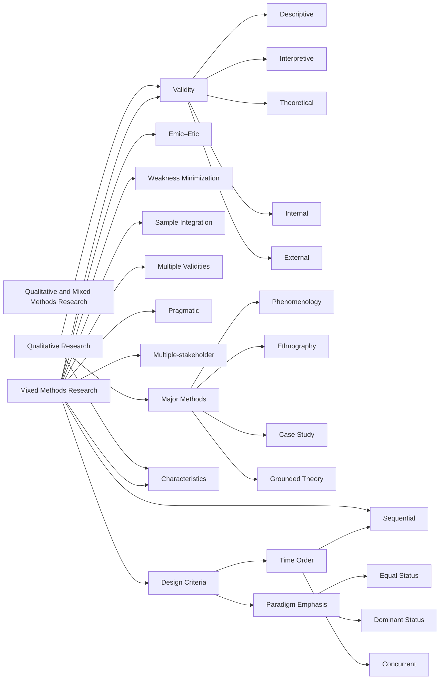
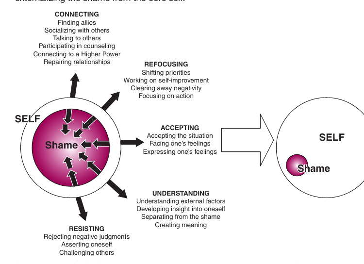
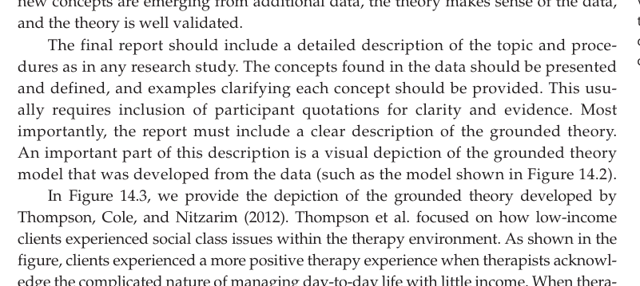
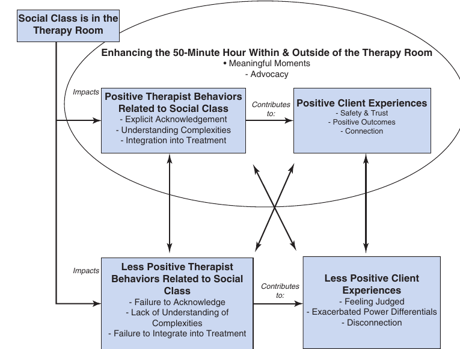
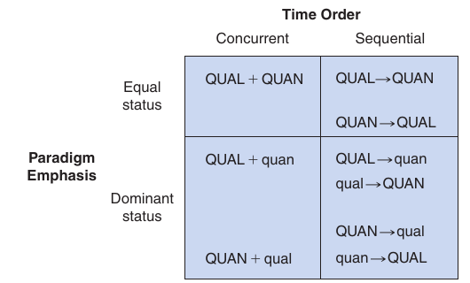

<style>
  /* Textbook typographic styling */
  p {
    text-align: justify;
    text-justify: inter-word;
  }
  h1, h2, h3, h4, h5, h6 { text-align: left; }
  blockquote { text-align: left; }

  /* Textbook Plum Table & Card Styling */
  .textbook-table-wrapper, .comparison-card, .framed-card {
    margin: 1.8em 0;
    border: 1px solid #e5cfdc;
    border-radius: 6px;
    overflow: hidden;
    background: #ffffff;
    box-shadow: 0 1px 3px rgba(0,0,0,0.05);
  }
  .table-caption, .card-caption, .framed-card-header {
    padding: 10px 14px;
    font-size: 0.95em;
    font-weight: 600;
    background: #ffffff;
    border-bottom: 2px solid #842959;
  }
  .textbook-table {
    width: 100%;
    border-collapse: collapse;
    font-size: 0.9em;
  }
  .textbook-table th {
    background: #842959;
    color: #ffffff;
    font-weight: bold;
    padding: 10px 12px;
    text-align: left;
  }
  .textbook-table td {
    padding: 9px 12px;
    border-bottom: 1px solid #f0e6ec;
    vertical-align: top;
  }
  .textbook-table tr.category-header td {
    background: #f7f0f4;
    font-weight: bold;
    color: #842959;
    padding: 8px 12px;
    border-top: 1px solid #e5cfdc;
    border-bottom: 1px solid #e5cfdc;
  }
  .table-footer-notes td, tr.table-notes td {
    font-size: 0.85em;
    color: #666666;
    background: #fafafa;
    border-top: 1px solid #e5cfdc;
    padding: 8px 12px;
  }
  /* Comparison Card (Strengths & Weaknesses) */
  .banner-header {
    background: #842959;
    color: #ffffff;
    font-weight: bold;
    padding: 8px 14px;
    font-size: 0.9em;
    letter-spacing: 0.3px;
  }
  .banner-weaknesses .banner-header {
    background: #73224d;
  }
  .banner-list, .framed-card-body {
    margin: 0;
    padding: 12px 20px 16px 36px;
    background: #faf7f9;
  }
  .banner-list li, .framed-card-body li {
    margin-bottom: 6px;
    line-height: 1.5;
    color: #2b1b24;
  }
  /* Counseling Dialogue / Transcript Styling */
  .dialogue-block {
    margin: 1.4em 0;
    padding: 12px 18px;
    background: #fdfbf7;
    border-left: 4px solid #b38867;
    border-radius: 0 6px 6px 0;
  }
  .dialogue-speaker {
    font-weight: bold;
    color: #5c3d2e;
  }
</style>

<details open>
<summary>📑 <b>Table of Contents</b></summary>

- [Chapter 14 Qualitative and Mixed Methods Research](#chapter-14-qualitative-and-mixed-methods-research)
  - [Learning Objectives](#learning-objectives)
- [Major Characteristics of Qualitative Research](#major-characteristics-of-qualitative-research)
- [Research Validity in Qualitative Research](#research-validity-in-qualitative-research)
  - [Descriptive Validity](#descriptive-validity)
  - [Interpretive or Emic Validity](#interpretive-or-emic-validity)
  - [Theoretical Validity](#theoretical-validity)
  - [Internal (Causation) Validity](#internal-causation-validity)
  - [External (Generalizing) Validity](#external-generalizing-validity)
  - [Summary of Qualitative Methods](#summary-of-qualitative-methods)
  - [Ethnography](#ethnography)
  - [Case Study Research](#case-study-research)
  - [Grounded Theory](#grounded-theory)
- [Mixed Methods Research](#mixed-methods-research)
- [Research Validity in Mixed Methods Research](#research-validity-in-mixed-methods-research)
- [Mixed Methods Designs](#mixed-methods-designs)
  - [Summary](#summary)
  - [Key Terms and Concepts](#key-terms-and-concepts)
  - [Related Internet Sites](#related-internet-sites)
  - [Practice Test](#practice-test)
  - [Challenge Exercises](#challenge-exercises)

</details>


<!-- Page 1 -->
## Chapter 14 Qualitative and Mixed Methods Research



### Learning Objectives

🎯 **14.1** Summarize the major characteristics of qualitative research.
🎯 **14.2** Explain the types of validity strategies used in qualitative research.
🎯 **14.3** Compare and contrast the four major qualitative research methods.
🎯 **14.4** Summarize the strengths and weaknesses of mixed methods research.
🎯 **14.5** Explain the major types of validity in mixed methods research.
🎯 **14.6** Explain how to construct basic mixed methods research designs.

<!-- Page 2 -->
In Chapter 2, we briefly introduced qualitative research. At its most basic level, **qualitative research** is defined as the approach to empirical research that relies primarily on the collection of qualitative data (i.e., nonnumeric data such as words, pictures, images). In this chapter, we explain qualitative research in more detail. The majority of this textbook has focused on quantitative research (such as experimental and nonexperimental quantitative studies) because the majority of psychological research is quantitative. Therefore, you now know a great deal about quantitative research. Qualitative research does, however, have a long-standing and important place in  psychological research (Camic, Rhodes, &amp; Yardley, 2003; Smith, 2008; Willig &amp; Stainton-Rogers, 2008). The third type of research, **mixed methods research**, combines ideas and approaches from quantitative and qualitative research (Hesse-Biber &amp; Johnson, 2015; Johnson, Onwuegbuzie, &amp; Turner, 2007). We will explain this type of research after explaining qualitative research in more detail.

Table  14.1 shows the key differences among quantitative, qualitative, and mixed methods research. Some of what you have learned about quantitative research is shown in the first column. For example, quantitative research focuses on testing hypotheses, and obtaining results that can be generalized broadly. Quantitative journal articles usually include quite a few numbers and statistical test results. Notice how qualitative research differs from quantitative research in the table. Qualitative research is much more focused on individual people and single, local groups for intensive case study, and there is little interest in obtaining results that are broadly generalizable. Additional differences are shown in the table. Finally, you will notice in Table 14.1 that mixed methods research is based on a combination or mixture of the characteristics of quantitative and qualitative research.

**Table 14.1** *Characteristics of Quantitative, Qualitative, and Mixed Methods Research Approaches**

<table class="textbook-table">
  <thead>
    <tr>
      <th>Quantitative Research</th>
      <th>Mixed Methods Research</th>
      <th>Qualitative Research</th>
    </tr>
  </thead>
  <tbody>
    <tr>
      <td>Scientific emphasis Confirmation and falsification. Focuses on</td>
      <td>Equal emphasis. Combines hypothesis/</td>
      <td>Exploratory. Focuses on generating</td>
    </tr>
    <tr>
      <td>testing hypotheses and theories.</td>
      <td>theory generation and testing.</td>
      <td>hypotheses and theories.</td>
    </tr>
    <tr>
      <td>View of the world Mental processes and behavior are</td>
      <td>Thought and behavior contain</td>
      <td>Mental processes and  behavior are</td>
    </tr>
    <tr>
      <td>regular and predictable.</td>
      <td>predictable and particularistic/contextual elements.</td>
      <td>situational,   dynamic,  social,   contextual, and personal.</td>
    </tr>
    <tr>
      <td>Primary view of reality Objective (material, physical, causal).</td>
      <td>Combination of objective, subjective, and intersubjective.</td>
      <td>Subjective.</td>
    </tr>
    <tr>
      <td>Research objectives Explain (cause and effect), control,</td>
      <td>Combination of objectives.</td>
      <td>Explore, particular description, depth</td>
    </tr>
    <tr>
      <td>predict,  description of characteristics of</td>
      <td></td>
      <td>of understanding, social “construction”</td>
    </tr>
    <tr>
      <td>populations.</td>
      <td></td>
      <td>of reality.</td>
    </tr>
    <tr>
      <td>Research purpose Find general and complex laws of</td>
      <td>Integrate the general and the particular.</td>
      <td>Describe and understand  particular</td>
    </tr>
    <tr>
      <td>thought and behavior.</td>
      <td></td>
      <td>groups and individuals in particular contexts.</td>
    </tr>
    <tr>
      <td>Data Quantitatively measured variables</td>
      <td>All data types are relevant; quantitative</td>
      <td>Words, text, images, documents.</td>
    </tr>
    <tr>
      <td>(numbers).</td>
      <td>and qualitative data are both used in a single study.</td>
      <td></td>
    </tr>
    <tr>
      <td>Results Generalizable findings.</td>
      <td>Attempts to integrate general and particular, and produce “practical theory.”</td>
      <td>Particularistic findings and claims.</td>
    </tr>
    <tr>
      <td>Final report Statistical results (with significance  testing</td>
      <td>Mixture of statistics and qualitative data</td>
      <td>Narrative with rich contextual description</td>
    </tr>
    <tr>
      <td>of  correlations, differences between</td>
      <td>reporting.</td>
      <td>and many direct quotations.</td>
    </tr>
    <tr class="category-header"><td colspan="3"><strong>means) with  discussion of results.</strong></td></tr>
  </tbody>
  <tfoot>
    <tr class="table-notes"><td colspan="3"><em>* Although this chapter only covers qualitative and mixed methods research, we have included the characteristics of quantitative research in this table for comparison.</em></td></tr>
  </tfoot>
</table>

In the remainder of this chapter, we will explain qualitative and mixed methods research.

<!-- Page 3 -->
## Major Characteristics of Qualitative Research

🎯 **14.1** Summarize the major characteristics of qualitative research.

Michael Patton (2015) has done a good job of summarizing the characteristics of qualitative research. Patton’s list of the 12 major characteristics of qualitative research is shown in Table 14.2. Not all qualitative research studies have all 12 of the characteristics, but studying his list will give you a good feel for features often associated with qualitative research. The 12 key terms are in italics in the table.

**Table 14.2** *Twelve Major Characteristics of Qualitative Research*

<div class="framed-card">
  <div class="framed-card-header">Twelve Major Characteristics of Qualitative Research</div>
  <ol class="framed-card-body">
    <li>Naturalistic inquiry —Studying real-world situations as they unfold naturally; nonmanipulative and noncon- trolling; openness to whatever emerges (lack of predetermined constraints on findings).</li>
    <li>Emergent design flexibility —Openness to adapting inquiry as understanding deepens and/or situations change; the researcher avoids getting locked into rigid designs that eliminate responsiveness and pur- sues new paths of discovery as they emerge.</li>
    <li>Purposeful sampling —Cases for study (e.g., people, organizations, communities, cultures, events, criti- cal incidences) are selected because they are “information rich” and illuminative, that is, they offer useful manifestations, of the phenomenon of interest; sampling, then, is aimed at insight about the phenom- enon, not empirical generalization from a sample to a population. Data-Collection and Fieldwork Strategies</li>
    <li>Qualitative data —Observations that yield detailed, thick description; inquiry in depth; interviews that capture direct quotations about people’s personal perspectives and experiences; case studies; careful document review.</li>
    <li>Personal experience and engagement —The researcher has direct contact with and gets close to the people, situation, and phenomenon under study; the researcher’s personal experiences and insights are an important part of the inquiry and critical to understanding the phenomenon.</li>
    <li>Empathic neutrality and mindfulness —An empathic stance in interviewing seeks vicarious understanding without judgment (neutrality) by showing openness, sensitivity, respect, awareness, and responsiveness; in observation it means being fully present (mindfulness).</li>
    <li>Dynamic systems —Attention to process; assumes change as ongoing whether focus is on an individual, an organization, a community, or an entire culture; therefore, mindful of and attentive to system and situation dynamics. Analysis Strategies</li>
    <li>Unique case orientation —Assumption that each case is special and unique; the first level of analysis is being true to, respecting, and capturing the details of the individual cases being studied; cross-case analysis follows from and depends on the quality of individual case studies.</li>
  </ol>
</div>

> [!TIP] **Study Question 14.1**
> In what ways does qualitative research differ from quantitative research? Which differences do you find most intriguing?
>
> **Design Strategies**
>
> 9. *Inductive analysis and creative synthesis* —Immersion in the details and specifics of the data to discover important patterns, themes, and interrelationships; begins by exploring, then confirming, guided by analytical principles rather than rules, ends with a creative synthesis.
>
> 10. *Holistic perspective* —The whole phenomenon under study is understood as a complex system that is more than the sum of its parts; focus on complex interdependencies and system dynamics that cannot meaningfully be reduced to a few discrete variables and linear, cause-effect relationships.
>
> 11. *Context sensitivity* —Places findings in a social, historical, and temporal context; careful about, even dubious of, the possibility or meaningfulness of generalizations across time and space; emphasizes instead careful comparative case analyses and extrapolating patterns for possible transferability and adaptation in new settings.

[^12]: *Voice, perspective, and reflexivity* —The qualitative analyst owns and is reflective about her or his own voice and perspective; a credible voice conveys authenticity and trustworthiness; complete objectivity being impossible and pure subjectivity undermining credibility, the researcher’s focus becomes balance- understanding and depicting the world authentically in all its complexity while being self-analytical, politi- cally aware, and reflexive in consciousness. *Source:* **** From Patton, M.Q. (2013, January 14). “Strategic themes of qualitative inquiry.” *Qualitative Evaluation Methods workshop.* Washington, DC: The Evaluators’ Institute.

<!-- Page 4 -->
## Research Validity in Qualitative Research

🎯 **14.2** Explain the types of validity strategies used in qualitative research.

We pointed out in Chapter 6 that *research validity* refers to the correctness or truthfulness of the inferences that are or can be made from the results of a research study. The validity of qualitative research findings has sometimes been questioned. For example, qualitative research has been criticized for a lack of rigor and for producing findings that are dependent upon the particular researcher conducting the study. In this section, we explain how strong qualitative research can be conducted.

One threat to watch out for is **researcher bias**, which might take the form of searching out and only confirming your preconceived notions. Although it is true that some qualitative studies have been conducted that lack validity and rigor, this does not have to be the case. Two strategies for reducing researcher bias are **reflexivity** (i.e., constantly attempting to identify your potential biases and discerning how you can minimize their effects) and **negative-case sampling** (i.e., attempting to locate and examine cases that disconfirm your prior expectations). Table 14.3 includes 15 important validity strategies that are used during the conduct of a qualitative research study to help shift it from a study of questionable value to a high-quality research study for meeting its purpose. We now briefly explain some of the validity strategies and the types of validity that are of particular relevance in qualitative research (based on the work of Joseph Maxwell, 1992, 2005, 2013).

**Table 14.3** *Validity Strategies That Should Be Used in Qualitative Research*

<table class="textbook-table">
  <thead>
    <tr>
      <th>Strategy</th>
      <th>Description</th>
    </tr>
  </thead>
  <tbody>
    <tr>
      <td>Data triangulation</td>
      <td>The use of multiple data sources to help understand a phenomenon.</td>
    </tr>
    <tr>
      <td>Extended fieldwork</td>
      <td>To provide for both discovery and validation, researchers should collect data in the field over an extended time period.</td>
    </tr>
    <tr>
      <td>External audit</td>
      <td>Using outside experts to assess the study quality.</td>
    </tr>
    <tr>
      <td>Investigator triangulation</td>
      <td>The use of multiple investigators (i.e., multiple researchers) in collecting, analyzing, and interpreting the data.</td>
    </tr>
    <tr>
      <td>Low-inference descriptors</td>
      <td>The use of description phrased very close to the participants’ accounts and researcher’s field notes. Verbatims (i.e., direct quotations) are a commonly used type of low-inference descriptors.</td>
    </tr>
    <tr>
      <td>Methods triangulation</td>
      <td>The use of multiple research methods to study a phenomenon.</td>
    </tr>
    <tr>
      <td>Negative-case sampling</td>
      <td>Attempting to select cases that disconfirm the researcher’s expectations and generalizations.</td>
    </tr>
    <tr>
      <td>Participant feedback or “member</td>
      <td>The feedback and discussion of the researcher’s interpretations and conclusions with the actual participants</td>
    </tr>
    <tr>
      <td>checking”</td>
      <td>and other members of the participant community for verification and insight.</td>
    </tr>
    <tr>
      <td>Pattern matching</td>
      <td>Predicting a series of results that form a distinctive pattern and then determining the degree to which the actual results fit the predicted pattern or “fingerprint.”</td>
    </tr>
    <tr>
      <td>Peer review</td>
      <td>Discussion of the researcher’s interpretations and conclusions with other people. This includes discussion with a disinterested peer (e.g., with another researcher not directly involved). This peer should be skeptical and play the devil’s advocate, challenging the researcher to provide solid evidence for any interpretations or conclusions. Discussion with peers who are familiar with the research can also help provide useful challenges and insights.</td>
    </tr>
    <tr>
      <td>Reflexivity</td>
      <td>Involves self-awareness and critical self-reflection by the researcher on his or her potential biases and predispo- sitions as these might affect the research process and conclusions.</td>
    </tr>
    <tr>
      <td>Researcher-as-detective</td>
      <td>A metaphor characterizing the qualitative researcher as he or she searches for evidence about causes and effects. The researcher develops an understanding of the data through careful consideration of potential causes and effects and by systematically eliminating rival explanations or hypotheses until the final case is made  beyond a reasonable doubt. The detective can utilize any of the strategies listed here.</td>
    </tr>
  </tbody>
</table>

Rule out alternative explanations Making sure that you have carefully examined evidence for competing or rival explanations and that yours is the best explanation. Theory triangulation The use of multiple explanations and perspectives to help interpret and explain the data. Triangulation Cross-checking information and conclusions through the use of multiple procedures or sources. When the different procedures or sources are in agreement you also have corroboration.

<!-- Page 5 -->
### Descriptive Validity

One purpose of qualitative research is to provide an accurate description of a particular phenomenon, situation, or group. Therefore, descriptive validity is important.  **Descriptive validity** is present to the degree that the account reported by the researcher is accurate and factual. One very useful validity strategy for obtaining descriptive validity is **investigator triangulation** (i.e., the use of multiple investigators to collect and interpret the data). By using multiple investigators, the description is less likely to be based on a single researcher’s perspective. When multiple researchers agree about the descriptive details of the account provided in a qualitative research report, readers can place more faith in that account.

### Interpretive or Emic Validity

The second type of validity for qualitative research focuses on the primary purpose of qualitative research, which is to *report how the people being studied subjectively think and feel* *about phenomena in their “world.”* **Interpretive (or emic) validity** is present to the degree that the researcher accurately portrays the *meanings given by the participants* to what is being studied. We also call it emic validity because *emic* means “insiders’ perspective.” Your goal here is to “get into the heads” of your participants and accurately document *their viewpoints and meanings* (*not* the researcher’s viewpoints and meanings). One useful validity strategy for interpretive validity is to obtain **participant feedback**; this process is also called **member checking**. The strategy is to discuss your findings with your research participants to determine if they agree with your interpretations of their viewpoints, and then, based on that feedback, make modifications so that you represent their meanings and ways of thinking. Another useful validity strategy is the use of **low-inference descriptors** in your report; this means that you should phrase your description of the participants’ thinking in language that is very close to the participants’ accounts and to your field notes taken during the research study. This means that the researcher should include quite a few quotes in the report to demonstrate points made.

### Theoretical Validity

Maxwell calls the third type of validity **theoretical validity**. It is present to the degree that the theoretical explanation provided by the researcher accurately fits the data. Four validity strategies provided in Table 14.3 are especially helpful for obtaining theoretical validity. The first strategy is **extended fieldwork**, which means that the researcher should collect data in the field over an extended period of time. The second strategy is **theory triangulation**, which involves the consideration of multiple theories and multiple perspectives to help interpret and understand the qualitative data. Out of this, a fuller explanation is expected to result. The third strategy is **pattern   matching**. This is a hypothesis-construction-and-testing strategy in which the researcher makes a unique and complex prediction (rather than a very simple prediction) and determines whether it is supported. That is, did the “fingerprint” pattern of results that the researcher predicted actually occur? If it does, the theory will have significant predictive power. The fourth strategy that is especially relevant for theoretical validity is **peer review**. This requires you to discuss your interpretations, conclusions, and explanations with your peers or colleagues, who can provide a different perspective. If you are deeply involved in a qualitative study, the use of objective outsiders, who are not deeply involved in the study, can be quite helpful in providing a fresh perspective.

### Internal (Causation) Validity

The definition of internal validity is the same as it was for quantitative research. It’s the degree to which a researcher is justified in concluding that an observed relationship is *causal*. However, the issue of causation is treated quite differently in qualitative research. In most of the science of psychology, the goal is to understand how variables <!-- Page 6 -->
are causally related and how the world operates. Qualitative research is much less concerned with the *general* human world; it focuses on studying very small, *particu-* *lar* contexts in the world. Therefore, rather than attempting to state how the human world operates in general, the goal is to describe how a particular group operates in a particular place, and sometimes the qualitative researcher is interested in what caused a particular event in a particular context. We call this particularistic notion of causation **idiographic (or local) causation**. It amounts to making a very specific and local causal claim. For example, you might say that your car wouldn’t start this morning because the battery was dead or because it ran out of gas. In other words, idiographic causation is a commonsense notion of causation used in very particularistic circumstances. Idiographic causation is contrasted with **nomological causation**, which is of primary interest to quantitative psychology, and it refers to causation indexed in relationships among variables (i.e., “Do changes in variable A cause changes in variable B?”). Again, qualitative research usually is *not* interested in the relationships among variables. Instead, it is interested in studying, in depth, local phenomena. See Johnson, Russo, and Schoonenboom (2017) for more information about idiographic and nomological causation and how you can study both of these in a single mixed methods research study.

At least four of the validity strategies in Table 14.3 are especially relevant to the issue of causation in qualitative research. The first strategy is called **researcher-** **as-detective**, which involves carefully thinking about cause and effect and examining each possible “clue” and then drawing a conclusion. Second, you should **rule** **out alternative explanations** for your claim. The third strategy is called **methods** **triangulation**, which involves the use of multiple data collection methods, such as interviews, questionnaires, and observations in investigating an issue to determine if the same conclusion is reached via the different methods. The fourth strategy is **data** **triangulation**, which involves the use of multiple data sources, such as interviews with different types of people or using observations in different settings. The idea is that you should not limit yourself to a single data source if you want to draw an accurate conclusion about what event or events caused a particular outcome.

### External (Generalizing) Validity

The definition of external validity is the same as it was for quantitative research. It is still the degree to which you can *generalize* your results to other people, settings, and times. This type of validity is the least used in qualitative research because qualitative researchers usually are *not* interested in making generalizations. Remember, the key purpose of qualitative research is to explore and describe a *particular* phenomenon in a particular place with a particular person or group of people.

When qualitative researchers consider external validity, they usually focus on a type of generalizing called **naturalistic generalization**, which refers to generalization based on similarity of the people and context reported in the study and the people and context to which the generalization is made. This type of generalization fits the qualitative research perspective because it is not the researcher that makes this generalization. Rather, it is the reader of the article or report that decides when and how to generalize. When making a naturalistic generalization, you would look at your clients or people you are working with and generalize to them to the degree that they are similar to the people in the qualitative research report.

To enable naturalistic generalizations, the qualitative research report should include sufficient and multiple details about the participants and context so that readers will be in the position to make naturalistic generalizations. If you ever consider making the more traditional sort of generalization from a qualitative research study, a strategy is to generalize the finding only when it has been shown in many different studies (using a replication logic). You are able to broadly generalize when a research result has been shown with different types of people, at different times, and in different settings.

<!-- Page 7 -->
**Table 14.4** *Summary of Qualitative Methods*

<table class="textbook-table">
  <thead>
    <tr>
      <th>Method</th>
      <th>Disciplinary Roots</th>
      <th>Key Terms</th>
    </tr>
  </thead>
  <tbody>
    <tr>
      <td>Phenomenology</td>
      <td>Philosophy, psychology</td>
      <td>Lifeworld, lived experience, significant statements</td>
    </tr>
    <tr>
      <td>Ethnography</td>
      <td>Anthropology</td>
      <td>Culture, norms, shared beliefs, shared values</td>
    </tr>
    <tr>
      <td>Case study</td>
      <td>Psychology, medicine</td>
      <td>Study of a bounded system; includes intrinsic, instrumental, and collective/comparative designs</td>
    </tr>
    <tr>
      <td>Grounded theory</td>
      <td>Sociology</td>
      <td>Theoretical sensitivity and saturation; analysis uses open, axial, and selective coding</td>
    </tr>
  </tbody>
</table>

One additional type of potential generalization in qualitative research is called
**theoretical generalization** . This involves generalizing the theory generated in a study
**Theoretical generaliza-**
[such as a grounded theory (GT) research result]. Even if the particulars do not gen-
**tion**
Generalization of a theo- retical explanation beyond the eralize, the main ideas, the relationships, and the theoretical process observed might particular research study generalize. The development of theory using qualitative research to generate a theory is a very good use of qualitative research. However, before this theoretical generaliza- tion can legitimately be made, the theory must be tested with new research partici- pants. See Shim et al. (2017) for an example of theory *generation* and theory *testing* in a single multiphase mixed methods research study. Study Question 14.2 How is “validity” established in qualitative research? What strategies are used to help establish validity in qualitative research? Four Major Qualitative Research Methods
**14.3**
**Compare and contrast the four major qualitative research methods.**
We have discussed qualitative research as a broad form of research. It turns out that there are at least four major qualitative research methods that are variations on the broad approach qualitative research discussed thus far: phenomenology, ethnography, grounded theory, and case study research. These research methods are summarized in Table 14.4. Each of these more specialized research methods has its own unique ori- gins and unique conceptual vocabulary. Sometimes a researcher will use one of these more specialized methods. At other times, the researcher might mix the approaches to meet his or her particular research circumstances and needs. Phenomenology Here is the key question addressed in phenomenology: *What is the meaning, structure, and*
*essence of the lived experience of this phenomenon by an individual or a group of individuals*?
The first major approach to qualitative research, **phenomenology** , involves the description
**Phenomenology**
Qualitative of an individual’s, or group of individuals’, conscious *experience* of a phenomenon such as research method where the researcher attempts to under- the death of a loved one; a counseling session; an illness; winning a championship football stand and describe how one or game; or experiencing a specific emotion such as guilt, anger, or jealousy. The researcher more participants experience a attempts to gain access to each participant’s **lifeworld** , which is the research participant’s phenomenon inner world of subjective experience. Your lifeworld is where you have your “lived experi- ences”; it is where your immediate consciousness exists; it’s where you feel, and sense, and
**Lifeworld**
A person’s subjective have “inner talk.” This area is also known as your *phenomenal space*. inner world of experience This research method has a long history in psychology, but its founding is usu- ally attributed to the philosopher Edmund Husserl (1859–1938). It’s Husserl who
**Table 14.4**

### Summary of Qualitative Methods

**Method**
**Disciplinary Roots**
Phenomenology Philosophy, psychology Ethnography Anthropology Case study Psychology, medicine Grounded theory Sociology

**Key Terms**
Lifeworld, lived experience, significant statements Culture, norms, shared beliefs, shared values Study of a bounded system; includes intrinsic, instrumental, and collective/comparative designs Theoretical sensitivity and saturation; analysis uses open, axial, and selective coding <!-- Page 8 -->
coined the term *Lebenswelt*, which is German for “lifeworld.” Husserl thought that all individuals would experience the same phenomenon in the same way if all other factors (preconceptions, learned feelings) were removed or “bracketed” out of the representation. Many later phenomenologists would argue that individuals and groups can experience the same phenomenon (e.g., death of a loved one) differently. Regardless of your position on this issue, phenomenological research always involved “getting inside of people’s heads” to see how *they* experience things.

Phenomenology has been used extensively in psychology and related fields. This is the case because oftentimes it is important to document how people subjectively experience their situations, from their perspectives. In a study of children with pediatric cancer, Fochtman (2008) argued that “Only when clinicians truly understand the meaning of this illness to the child can they design nursing interventions to ease suffering and increase quality of life in children and adolescents with cancer” (p. 185). Here are a few phenomenological experiences that have been studied in psychology and related fields: obsessive-compulsive disorder (Garcia et al., 2009; Wahl, Salkovskis, &amp; Cotter, 2008), brain stimulation surgery (Eatough &amp; Swaw, 2017), addiction (Gray, 2004), racism (Beharry &amp; Crozier, 2008), sexual abuse (Alaggia &amp; Millington, 2008), psychotic symptoms in narcolepsy (Fortuyn et al., 2009), life satisfaction (Thomas &amp; Chambers, 1989), and the meaning of aging (Adams-Price, Henley, &amp; Hale, 1998).

**Phenomenological Data Collection and Data Analysis** How do phenomenologists collect and analyze data and develop a description of an individual’s or group of individuals’ experience of a phenomenon? The phenomenological research method involves getting each participant to focus on his or her phenomenal space and to describe the experience (current or from memory) on its own terms. The participant must give the experience his or her full attention. The primary qualitative method of data collection used by phenomenologists is in-depth interviews, although open-ended questionnaires are also commonly used (where participants write about their experiences).

In the following example of phenomenological research, we briefly explain the process of data analysis and report writing. The study, conducted by Riemen (1983), investigated the phenomenon of caring and noncaring interactions with nurses *from* *the perspective of patients*. To investigate this phenomenon, Riemen interviewed nonhospitalized individuals over the age of 18 who had a prior interaction with a nurse. The interviewer requested that each research participant think about their experiences with one or more caring and noncaring nurses. They were asked to describe how they felt during these interactions with nurses. From the interviews, Riemen searched for **significant statements** (i.e., a few words or a phrase, a sentence, or a few sentences) that had particular relevance to the phenomenon being studied. When attempting to determine if a statement is significant, you should ask yourself questions such as (a) Is the statement descriptive of the experience? and (b) Does the statement appear to be something that is meaningful to the participant in expressing his or her experience? These statements are usually written verbatim (word for word) or as close as possible to the participants’ words. Some caring statements identified by Riemen (pp. 56–57) were “listened well,” “empathetic,” and “talked to me about things other than illness.” Some noncaring statements (pp. 57–60) included “I felt as though my hands were being slapped,” “didn’t want to talk,” and “she looked at the equipment instead of me.”

Once the significant phrases and statements were extracted from the transcribed data, Riemen constructed a list of the meanings of the statements. Riemen determined the meanings by reading, rereading, and reflecting on the statements of the research participants. Riemen’s goal was to empathetically arrive at the research participants’ meanings of their statements. For example, some of Riemen’s formulated <!-- Page 9 -->
meanings (pp. 60–63) of the significant statements about caring nurses were “Nurse’s voluntary and unsolicited return to the client was highly indicative of a caring attitude” and “Nurse’s caring made him feel comfortable, relaxed, secure, and in good hands, as though he was being taken care of by a family member.” Meaning given to some noncaring statements included “The nurse’s attitude of lack of interest in her as a person is interpreted by the client as the nurse viewing nursing as ‘only a job,’” or “The nurse who does not pay any attention to the client’s needs but views nursing as a job is perceived by the client as noncaring” (in Riemen, 1983). Next, the formulated meaning statements are organized into clusters or themes. Riemen formulated the clusters of “nurse’s existential presence,” “client’s uniqueness,” and “consequences” for the caring cluster (pp. 60–63). Finally, a summary description of the **essence** or phenomenological structure of the phenomenon is produced by integrating the statements, their meaning, and the clusters they formed.

**Phenomenological Report Writing** The final report of a qualitative phenomenological study is written in narrative form. It should include a detailed description of the participants in the study and the data collection methods used to obtain the data. The strategy of data analysis should be provided. If any validity checks were used, they should be explained. For example, one useful validity strategy is called member checking, where the researcher asks the participants if the significant statements, meanings, and phenomenological summary accurately express their views. Once validated, the significant statements and meanings should be described in some detail (including tables when needed). The results also should include a rich description of the essential or common characteristics of the experience. Sometimes, differences will be identified across types of participants, which will be reported.

Here is the essence or phenomenological structure reported by Riemen (1983) in describing participants’ experience of a caring nurse:

> In a caring interaction, the nurse’s existential presence is perceived by the client as more than just a physical presence. There is the aspect of the nurse giving of oneself to the client. This giving of oneself may be in response to the client’s request, but it is more often a voluntary effort and is unsolicited by the client. The nurse’s willingness to give of oneself is primarily perceived by the client as an attitude and behavior of sitting down and really listening and responding to the unique concerns of the individual as a person of value. The relaxation, comfort, and security that the client experiences both physically and mentally are an immediate and direct result of the client’s stated and unstated needs being heard and responded to by the nurse. (p. 65)

Here is the description of the essence or structure of the participants’ experience of a noncaring nurse:

> The nurse’s presence with the client is perceived by the client as a minimal presence of the nurse being physically present only. The nurse is viewed as being there only because it is a job and not to assist the client or answer his or her needs. Any response by the nurse is done with a minimal amount of energy expenditure and bound by the rules. The client perceives the nurse who does not respond to this request for assistance as being noncaring. Therefore, an interaction that never happened is labeled as a noncaring interaction. The nurse is too busy and hurried to spend time with the client and therefore does not sit down and really listen to the client’s individual concerns. The client is further devalued as a unique person because he or she is scolded, treated as a child, or treated as a nonhuman being or an object. Because of the devaluing and lack of concern, the client’s needs are not met and the client has negative feelings; that is, he or she is frustrated, scared, depressed, angry, afraid, and upset. (p. 66)

<!-- Page 10 -->
Although Riemen completed her dissertation more than 30 years ago (and is now retired), we suspect that the overall essence of the phenomenological experiences of being “helped” by a caring or a noncaring nurse has changed very little. How do you think this might be different today?

### Ethnography

Here is the key question addressed in ethnography: *What are the cultural characteristics* *of this group of people or of this cultural scene?*

The second major approach to qualitative research is ethnography. **Ethnography** refers to the discovery and description of the culture of a group of people or of a cultural event. Ethnography originated in the discipline of anthropology in the late 19th century, and the core concept relied upon by ethnographers is culture. A **culture** is the system of shared beliefs, values, practices, language, norms, rituals, and material things that group members use to understand their world. **Shared beliefs** are cultural statements or conventions that cultural members hold to be true or false. **Shared values** are culturally defined conceptions of what is good or bad or desirable or undesirable. **Norms** are the unwritten and written rules that specify appropriate group behavior. Embedded in the concept of culture is the idea of **holism**, which is the idea that the whole is greater than the sum of its parts. Culture sometimes is divided into *nonmaterial culture* (e.g., the shared language, beliefs, norms, values, and practices) and *material culture* (e.g., the material things created by a culture such as clothes, flags, buildings, art).

```python
The job of the ethnographer is to enter a group or scene and document the cultural characteristics. Culture is often thought of as being associated with very large groups of individuals such as Japanese, Mexican, or American. However, the concept of culture can also be used on a much smaller scale. We can study macro (i.e., large) or micro (i.e., small) cultures. Berg (1998) pointed out that a distinction is sometimes made between microethnography and macroethnography. At the macro level, we might study the cultural characteristics of Japanese adolescents or the Ohio Amish. At the micro level, we might study the cultural characteristics of a street gang, a motorcycle group, a therapeutic setting, or even the emergent culture in a research methods class of 20 students and a teacher. The difference in the two is the scope of the investigation. Obviously, studying the culture of Japanese adolescents has a greater scope than studying a particular therapeutic setting. However, regardless of the scope of the investigation, the primary concern is with describing the culture of the people in the targeted setting. Similar to phenomenology (and virtually all qualitative research), the focus of ethnography is on depicting the culture from the insider’s perspective (called the **emic perspective**). At the same time, the research also focuses on the “objective outsider’s” perspective (called the **etic perspective**). In short, the researcher must balance the emic *and* etic perspectives when producing a valid ethnography.

```
Ethnography can help psychologists better understand the many cultural groups and cultural settings with which they work, as well as in studying how interventions might interact with cultural variables. Here are a few examples of ethnographic research used in areas related to psychology: cultural adaptations of HIV prevention interventions among adults with severe mental illness (Wainberg et al., 2007), ethnography of deinstitutionalized but seriously mentally ill patients (Newton et al., 2000), ethnography of a job training program (Hull &amp; Zacher, 2007), depressive children in a hospital unit undergoing dialysis (Walters, 2008), low-income mothers’ child safeguarding practices (Olsen, Bottorff, Raina, &amp; Frankish, 2008), distance runners’ body image (Shipway &amp; Holloway, 2016), ethnography of end of life (Collier, Phillips, Iedema, 2015), ethnography of an online chat room (Shoham, 2004), and ethnography of African great apes (King, 2004).

<!-- Page 11 -->
**Ethnographic Data Collection Methods** Now let’s take a look at how an ethnographer studies a cultural setting. One method of data collection commonly used by ethnographers is in-depth interviews (also called “ethnographic interviews”) with members of the group being investigated. For example, Smith, Sells, and Clevenger (1994) conducted an ethnographic study of reflective team meetings in a family therapy setting. To acquire information about the micro culture in this therapeutic setting, Smith et al. conducted in-depth interviews with 11 couples and their therapists. They were interviewed at least twice over a 4-month period, and the interviews lasted up to 2 hours.

Participant observation is also important in ethnographic research. **Participant** **observation** is the method of data collection in which the researcher becomes an active participant in the group he or she is investigating. Ellen (1984) describes the ethnographic process as subjective soaking or becoming immersed in the culture being studied. This immersion is accomplished primarily through participant observation and face-to-face interactions with members of the culture. For example, Schouten and McAlexander (1995), in their ethnographic study of the subculture of consumption of Harley-Davidson bikers, not only went to rallies of the Harley Owners Group, but also eventually bought Harley-Davidson bikes and the appropriate clothing, such as black boots, and used the bikes for their everyday transportation. Marquart (1983), in his study of the social control system that existed in the Texas Department of Corrections (TDC), went through the training program to become a prison guard and was employed as one for 18 months in the maximum-security unit. During this period of time, he interacted with, interviewed, and observed the behaviors of the prison guards and inmates as he patrolled the cell blocks, showers, and dining halls; searched for weapons; and broke up fights. By entering, participating, leaving, and reflecting, the ethnographer is able to understand and document the insider’s perspective (i.e., the emic perspective) and the objective outsider’s perspective (i.e., the etic perspective).

**Entry, Group Acceptance, and Fieldwork** One of the first tasks that must be accomplished when using the participant observation method is to gain entry to the group you wish to study. In some instances, this is very easy. For example, if you wanted to conduct an ethnographic study of fraternity or sorority rush week, you might do so by actually participating in rush week, either as a bona fide participant or under the guise of wanting to belong to a sorority or fraternity. During rush week, you would not only be a participant in the process, but you would also be observing and taking notes on the behavior and activity of other students involved in this process.

In other instances, entry to the group or culture is not as easily accomplished. Gaining access to a local teenage street gang would, in most instances, be a rather difficult process. Similarly, access to elite groups, such as the super rich, is often very difficult because these individuals set up barriers to maintain their privacy and actively avoid scrutiny. Marquart, for example, had to get the approval of the TDC and the superintendent of the unit at which he was employed in order to conduct his study.

Before gaining entry into a group, you must decide whether this entry will be covert or overt. In some instances, the entry may be covert when the topic being studied is public. However, covert entry is generally looked down upon by Institutional Review Boards because of the lack of informed consent. Therefore, most participant observation is overt, such as in Marquart’s study mentioned earlier and in Schouten and McAlexander’s study of Harley-Davidson bikers, also mentioned earlier. However, even when entry is overt, you might have to get past **gatekeepers**—individuals who operate to protect, either formally or informally, the members of a group. Marquart, for example, had to secure the permission and approval of the warden of the prison <!-- Page 12 -->
unit in which he was employed. Even when gatekeepers provide their approval, there frequently must be acceptance by the members of the group before honest and valid information can be obtained.

One of the difficulties with collecting data through participant observation is that your presence can create a **reactive effect** in which your presence alters the behavior of the group members. Marquart had to earn the trust of each inmate before the inmate would reveal his control techniques. Suspicion and paranoia run rampant in a prison environment. It would be virtually impossible for an unknown researcher to walk into a prison and expect the inmates or the guards to divulge their informal system of control. When Schouten and McAlexander (1995) first gained entry to a Harley-Davidson motorcycle group, they “were treated politely by some, standoffishly by others, and overly gregariously by others, but no one treated us as if we really belonged there” (p. 46). It was only after they stopped and rendered assistance to one of the members who had mechanical problems with his bike that an initial bond was formed and they began to be indoctrinated into the ways of the group and eventually treated as one of the members.

In classical ethnography, the data collection process is called **fieldwork**. On the one hand, the researcher must *not* be **ethnocentric** during interactions with others in the culture (i.e., you must not judge others based on your cultural standards). On the other hand, the researcher must avoid **going native**, which would happen if you identified so completely with the group being studied that you could no longer take the perspective of an objective outsider. The insider and outsider roles must *both* be negotiated. During fieldwork, the researcher collects information on the patterns of behavior and social relations among the members of a group primarily through observing the behavior of the group members and listening to what they say. The researcher also interacts in face-to-face conversations and sometimes conducts interviews.

What you see and hear and think during fieldwork are recorded in your **fieldnotes**. The setting and context also should be richly described in the fieldnotes. You might also take photographs of surroundings and note the clothing worn by the group members. In the Harley-Davidson study, Schouten and McAlexander took pictures of the members’ dress and appearance (see Figure 14.1). When the researcher has moments to reflect and when he or she leaves the group, fieldnotes must be finished, checked, and edited, and notes must be written about his or her emerging interpretations and what kinds of data that should be collected during the next field entry period. Through this back-and-forth process between insider and outsider roles, the ethnographer produces an “objective” ethnography that also reflects the inner world of the culture.

**Data Analysis and Report Writing** As data are collected, they should be analyzed for themes, patterns, and meanings. You have to make some sense of the volumes of information that are collected. Throughout the process, the data should be checked for their validity. Once the themes, meanings, and patterns have been identified and validated, the ethnographer writes a narrative account that provides a description and interpretation of the culture being studied. This narrative report might include the characteristics of the group, how members of the group interact with one another, what the group has in common, what some of the group’s norms and rituals are, and what the group’s identity is. Schouten and McAlexander’s (1995) narrative report of their ethnographic study of Harley-Davidson bikers first discussed the structure of the Harley-Davidson biker groups and then proceeded to present a narrative of the core values of the biker groups, such as the feeling of personal freedom and machismo surrounding the Harley-Davidson culture. The narrative report should also discuss how one becomes transformed into a group member and how, once a person (Photograph courtesy of Harley-Davidson Photograph &amp; Imaging.


*Illustration*


*Figure 14.1  Example of dress and appearance of Harley-Davidson bikers.*

<!-- Page 13 -->
has become a member, he or she expresses commitment and transmits to others the material and nonmaterial culture identified with being a member of the group. The final ethnography (i.e., the report) should provide a rich and holistic description of the culture of the group under study.

### Case Study Research

Here is the key question addressed in case study research: *What are the characteristics of* *this single case or of these comparison cases?*

The third major approach to qualitative research is case study research. A **case study** is defined as the intensive and detailed description and analysis of one or more cases. A **case** is a bounded system such as a person, a group, an organization, an activity, a process, or an event. In the definition, “system” refers to a holistic entity that includes a set of interrelationships among the elements comprising the case. By “bounded,” we mean that most cases have a boundary identifying what the case is and what it is not. Case study research also frequently emphasizes the environment in which the case exists.

Case study research has a long history in psychology. Clinical case studies are especially common in clinical and counseling psychology. To give you a feel for topics studied via case study research, here are a few examples: client-centered therapy for a client that experienced severe childhood abuse (Murphy, 2009), experience of residents with severe mental illness in an inner-city recovery-housing building (Whitley, Harris, &amp; Drake, 2008), barriers to help seeking for patients with dysthymia (i.e., chronic mild depression) (Svanborg, Rosso, Lützen, Bäärnhielm, &amp; Wistedt, 2008), long-term integrative psychotherapy with a patient with schizophrenia (Lysaker, Davis, Jones, &amp; Beattie, 2007), treatment for posttraumatic stress disorder (PukayMartin, Torbit, Landy, Macdonald, &amp; Monson, 2017), comparative case study of U.S. and Malawi soccer teams (Guest, 2007), moral development in a college fraternity (Mathiasen, 2005), and a test of the self-medication hypothesis for clients experiencing social phobia (Shepherd &amp; Edelmann, 2007).

**Data Collection in Case Study Research** Multiple sources and methods of data collection are used in case study research. For example, case study data might come from in-depth interviews, documents, questionnaires, test results, and archival records. Contextual and life history data are also collected in case study research to contextualize the case and to aid in understanding the causal trajectories that might have influenced the case. Quantitative data are also sometimes used in case study research, but remember that if both qualitative and quantitative data are utilized, then it should be called a mixed methods case study rather than a qualitative case study.

**Case Study Designs** There are several types of case studies: intrinsic, instrumental, and collective (Stake, 1995). An **intrinsic case study** is an in-depth description of a particular individual, organization, or event conducted for the purpose of understanding that particular case. There is no interest in generalizing. Intrinsic case studies usually examine a very unusual or unique case.

An  **instrumental case study** is a case study conducted to provide insight into an issue or to develop, refine, or alter some theoretical explanation. It is undertaken to understand something more general than just the particular case. The specific case is not as important as gaining an understanding of the phenomenon or event. For example, right after the Columbine tragedy, the media and mental health care professionals studied the life histories of the perpetrators to try to understand why they became killers (e.g., http://www.acolumbinesite.com/why.php). They looked at the type of behavior engaged in by these two and revealed that they had become obsessed with the violent video game Doom. Doom is an interactive game in which <!-- Page 14 -->
players try to rack up the most kills. The perpetrators had been arrested in January of the previous year for breaking into a commercial van and stealing electronics. They were both enamored of Nazi culture and would berate their classmates in German. They were taunted as outcasts by some student groups. Their classroom writing assignments took on a more violent tone. These data were not examined because of an interest in describing the event of the killings at Columbine High School. Rather, they were examined to understand why the killings took place and to help develop an understanding that would apply in other times and places.

A  **collective case study** (also called a **comparative case study**) involves the extensive study of two or more individual cases. For example, a researcher might conduct a case study of three individuals with intellectual disabilities who are placed in a general education class, or examine several astronauts’ descriptions and experiences of being in space, or compare several cases of a rare clinical syndrome. When multiple cases are studied, the primary purpose is to understand the phenomenon or event comparatively, and often, the purpose is instrumental rather than intrinsic. For example, Hippocrates (1931), Posidonius (cited in Roccatagliata, 1986, p. 143), and others have provided case study descriptions of multiple individuals who suffered from seasonal affective disorder. These collective case studies provided information about a general phenomenon that afflicts many people and provided verification of the hypothesis that when a person is afflicted with this condition, he or she will usually experience depression in the winter months. Collective case studies, therefore, can provide some information that can be generalized to other cases. However, this generalization is limited because the few cases investigated will likely represent a biased sample. Ultimately, generalizing from one or several cases is possible only when there is little or no variability in the manifestation of the phenomenon being studied, which is unlikely.

**Case Study Data Analysis and Report Writing** The key idea in case study data analysis is that each case must be intensively analyzed as a separate entity. This involves analyzing the case as a system that has parts but also is a unified whole operating in an environment. The analyst must also relate the case to the research question(s). (This point is true of all research.) In a collective or comparative case study, the analyst goes one step further by also conducting a **cross-case analysis**. This means that multiple cases are compared and contrasted and the researcher looks for similarities (or patterns that cut across the cases) and differences.

The case study report should reflect the insider (i.e., emic) view of each case as well as the objective outsider (i.e., etic) viewpoint. The final report should provide a deep understanding of each case and also provide a rich (i.e., vivid and detailed) and holistic (i.e., describing the whole and its parts) description of each case and the context in which it is embedded. If the goal is to inform the research literature beyond an understanding of the particular case, then the case should be integrated into the broader literature on the topic or phenomenon that was studied. Finally, it is very important that the report discuss the validity strategies (see Table 14.3) that were used to help produce a valid and trustworthy case study.

### Grounded Theory

Here is the key question addressed in grounded theory research: *What theory or* *explanation emerges from an analysis of the data collected about this phenomenon?*

The fourth major approach to qualitative research is called grounded theory. **Grounded theory** is defined as a general methodology for generating and developing a theory that is “grounded” in empirical data (Bryant &amp; Charmaz, 2007; Strauss &amp; Corbin, 1998). A **theory** is an explanation of “how” and “why” something operates. The focus is on inductively generating a theory to describe and explain a <!-- Page 15 -->
phenomenon or process. Grounded theory was originally formulated by two sociologists, Barney Glaser and Anselm Strauss (1967), but today it is used in most social, behavioral, and clinical sciences.

In Chapter 1, we defined *induction* as an inquiry starting from the specific or particular and moving to the more abstract and general. We also discussed the difference between the *logic of discovery* and the *logic of justification* (page 12); the former emphasizes the inductive process of starting with particular empirical data, and the latter emphasizes the more deductive process of starting with a general theory or a hypothesis and deducing the consequences that should occur and then testing the hypothesis with newly collected data to determine if it is supported. Here is a relatively simple way to think about the process: The logic of discovery focuses on theory *generation*, and the logic of justification focuses on theory *testing*. Grounded theory is the qualitative research approach that is specifically developed for discovering or generating a theory or explanation from empirical data.

According to the founders (i.e., Glaser and Strauss), there are four key characteristics of a good grounded theory. First, the newly constructed grounded theory should *fit* the data. Here’s the question: “Does the theory correspond to real-world data?” Second, the theory must provide *understanding* of the phenomenon. Here’s the question: “Does the theory explain in a way that is clear and understandable to researchers and practitioners? Third, the theory should have some *generality.* Here’s the question: “Is the theory abstract enough to move beyond the specifics in the original research study?” Fourth, the theory should contribute to some *control* of the phenomenon. Here’s the question: “Can the theory be applied to produce real-world results?”

Here are some examples of grounded theory (GT) research. First, Van Vilet (2008) used GT to document how adults who have experienced severe shame experiences bounced back to reproduce a positive self. The process included factors such as connecting, refocusing, accepting, understanding, and resisting. The depiction of their GT model is shown in Figure 14.2. Second, Boyd and Gumley (2007) used GT externalizing the shame from the core self.



*Figure 14.2  Grounded theory model of rebuilding of the self. The arrows extending outward from the self represent the expansive and enhancing forces of the five main subprocesses on the self. The inward arrows represent their effect on shrinking and*

<!-- Page 16 -->
to understand how clients experienced persecutory paranoia and how these beliefs affected their behavior. The core experience category was fear and vulnerability, which included confusion and uncertainty and self under attack. These processes led to engagement in the use of safety systems, of which paranoid behavior was a key defensive system. Third, Schraw, Wadkins, and Olafson (2007) documented the process of academic procrastination among college students. Procrastination had positive (cognitive efficiency and peak experiences) and negative (fear of failure and postponement) dimensions. Operating in varying contexts (e.g., unclear directions, deadlines, and lack of incentives), procrastination led to the use of cognitive and affective coping mechanisms, which led to consequences for the students’ quality of life and quality of work.

**Data Collection in Grounded Theory Research** Any type of data collection is legitimate in grounded theory, but interviews are the most common, followed by observations. Data collection and analysis continue throughout a grounded theory study. This process is continuous because the researcher must enter the mode of “theory generator” and “theoretician,” which requires creative and descriptive skills and the use of empirical data. Using the jargon of grounded theory, during the collecting and analyzing of data, a researcher needs **theoretical sensitivity**. This just means that the researcher must be sensitive about what data are important when developing the grounded theory and to use this insight to know when and what kind of additional data need to be developed to construct the theory.

```python
**Grounded Theory Data Analysis and Report Writing** Grounded theory relies on a data analysis process that includes three stages. In the first stage, called **open coding**, you read the transcribed data (transcribed fieldnotes, interviews, open-ended questionnaires) and mark important ideas and concepts with a word or several words that represent and describe the material more succinctly. In the second stage, called **axial** **coding**, you decide which concepts are most important to the theory you are developing and begin trying to order them so that one phenomenon leads to another. In the third stage, called **selective coding**, you put the finishing touches on your explanation of the phenomenon. Your focus is on the main idea of your explanation (called “story line”), and you put the finishing touches on your “grounded theory.” We showed the visual depiction of a grounded theory in Figure 14.2, and we show another in edge the complicated nature of managing day-to-day life with little income. When therapists failed to acknowledge social class issues and/or behaved in ways that emphasized the social class differences between the therapist and client, therapy was experienced as less positive. The therapeutic relationship was improved when therapists were perceived as advocating for their clients and even providing support outside of the therapy

```


*Figure  14.3. Using the jargon of grounded theory, the grounded theory process (of collecting and analyzing data and depicting the visual model of your theory) is “com- plete” when theoretical saturation occurs. Theoretical saturation is present when no*

<!-- Page 17 -->
```python


*Figure 14.3  Grounded theory model of how clients with low-incomes experience social class during psychotherapy.*

(From Thompson, M. N., Cole, O. D., and Nitzarim, R. S. (2012). Recognizing social class in the psychotherapy relationship: A grounded theory exploration of low-income clients. *Journal of Counseling Psychology, 59* (2), 208–221. Doi:10.1037/a002753.) session (e.g., phone calls). Model building of this sort is an important part of science, whether it is done through grounded theory or some other approach. Grounded theory offers one way to conduct this initial theory-building process. Remember, however, that it is essential that grounded theory models be tested (and modified as needed) with new data in order to improve the models and to justify one’s belief that the models are correct and can be applied beyond the original research participants.

```
> [!TIP] **Study Question 14.3**
> What are the characteristics of each of the four major methods of qualitative research? What topic might one investigate with each qualitative method, and why?

## Mixed Methods Research

🎯 **14.4** Summarize the strengths and weaknesses of mixed methods research.

As defined earlier, *mixed methods research* is the research approach in which quantitative *and* qualitative data or techniques are combined or mixed in a single research study or in a set of closely related studies. Mixed methods research is the third major research approach, but it is also the newest (after quantitative research and qualitative research) and, therefore, is the least developed at present. Mixed methods research as discussed here has only recently been systematically and formally developed (Johnson et al., 2007; Tashakkori &amp; Teddlie, 2003). Although much of its potential still is to be realized in practice, mixed methods research often offers an attractive approach to research because it can be used to strengthen both quantitative and qualitative research. Some of the strengths and weaknesses that have been proposed are listed in Table 14.5.

<!-- Page 18 -->
fully worked out.

**Table 14.5** *Strengths and Weaknesses of Mixed Methods Research*

<div class="comparison-card">
  <div class="banner-strengths">
    <div class="banner-header">Strengths:</div>
    <ul class="banner-list">
      <li>Can provide multiple sources of evidence.</li>
      <li>Can reduce alternative explanations of a finding.</li>
      <li>Can help provide multiple types of validity in a single study.</li>
      <li>Can elucidate divergent aspects of a phenomenon.</li>
      <li>Can provide fuller, deeper, more complex, and more comprehensive explanation.</li>
      <li>Can provide both an emic perspective (i.e., insider’s perspective) and etic perspective (i.e., objective outsider’s perspective).</li>
      <li>Can identify mediating mechanisms and moderating factors for later testing.</li>
      <li>Can help connect theory to practice (i.e., general to specific).</li>
      <li>Can compensate for the weaknesses of one method by the systematic inclusion of another method.</li>
      <li>Can provide stronger inferences than single method research.</li>
      <li>Can illuminate subjective meaning that can be missed in purely quantitative research.</li>
      <li>Can be used to check the implementation of a study (including its meaning to the participants).</li>
      <li>Can be used to check the operation and meaning of measurement instruments.</li>
      <li>Can provide rich, detailed, subjective data and objective quantitative data in the same study.</li>
      <li>Can add an exploratory dimension to theory/hypothesis testing research (or vice versa).</li>
    </ul>
  </div>
  <div class="banner-weaknesses">
    <div class="banner-header">Weaknesses:</div>
    <ul class="banner-list">
      <li>Requires skill in both quantitative and qualitative research by a single researcher or the use of a mixed methods research team.</li>
      <li>Can be more time consuming and expensive.</li>
      <li>Because it’s a new methodology, many design, implementation, and analysis procedures remain to be</li>
    </ul>
  </div>
</div>

Proponents of mixed methods research typically adhere to a compatibility thesis and follow the philosophy of pragmatism. In this context, the **compatibility thesis** is the idea that quantitative and qualitative methods are complementary and can be used effectively together in a single research study. That is, quantitative and qualitative research approaches can be used together in a single research study to address a single research question or a set of related research questions. The philosophy of **pragmatism** provides empirical justification for the use of mixed approaches to the degree that they work in practice and produce desired outcomes. According to this philosophy, it is an “empirical question” whether combining or mixing quantitative and qualitative approaches is justified in practice (for more information on pragmatism in behavioral/social research, see Johnson, de Waal, Stefurak, &amp; Hildebrand, 2017; Johnson, Onwuegbuzie, de Waal, Stefurak, &amp; Hildebrand, 2017).

> [!TIP] **Study Question 14.4**
> Explain the benefits of using mixed methods research.

## Research Validity in Mixed Methods Research

🎯 **14.5** Explain the major types of validity in mixed methods research.

We have now covered issues of research validity for quantitative research (e.g., Chapter 6) and qualitative research (the present chapter). Likewise, research validity is essential <!-- Page 19 -->
for mixed methods research! We now examine and update several of the validity types originally provided by Onwuegbuzie and Johnson (2006). These methodologists explain that validity or legitimation is important in mixed methods research in order to produce mixed methods studies that are defensible and legitimate. Researchers in the mixed methods literature tend to use the terms *validity* and *legitimation* interchangeably. When you read about the five kinds of validity or legitimation in mixed methods research, keep in mind that this kind of research requires that you combine quantitative and qualitative research, and the key issue is to figure out how to combine them to best answer your research question(s). The first kind of mixed methods research validity/ legitimation is **emic–etic validity** (also called *inside-outside validity*). This refers to the degree to which the researcher accurately understands and presents the participants’ subjective insider or “native” view and concurrently presents the objective outsider viewpoint of the objects of study. Emic–etic validity means that you have successfully understood and can document both the insider (emic) perspective and the objective outsider (etic) perspective.

The second kind of mixed methods validity is called **weakness minimization** **validity**. This refers to the degree to which you (the researcher) have combined the quantitative and qualitative approaches to have nonoverlapping weaknesses. The strategy is to compensate for the weakness of one approach by using an additional approach that does not have the same weakness. For example, if you are constructing a new measure of a construct, such as “forgiveness,” you would correlate it with the criteria known to be related to forgiveness, but you also should interview participants to see how they interpret the meaning of the items on the instrument. Here you would have combined correlational and interview techniques. As another example, experimental research is especially strong in providing evidence of causation, but interviews conducted after the experiment can be very helpful in determining what the experiment meant to the participants and to serve as a manipulation check. Furthermore, extensive case studies are an excellent way to determine processes that might be difficult to create in a structured experimental setting. In all of these cases, you are trying to design a study that will eliminate a weakness through the combination of methods.

In the next section, we discuss the design of mixed methods research studies. Sometimes the quantitative and qualitative parts are conducted at the same time, but at other times the parts will be carried out sequentially. When the quantitative and qualitative study components are carried out sequentially you need to consider the third kind of mixed methods validity, **sequential validity**, to (a) make sure your results are not due to the ordering of the quantitative and qualitative components and (b) make sure that later phases in sequential designs appropriately build on prior stages. For example, perhaps you first collect qualitative data through individual in-depth interviews about a sensitive topic, and you follow this with a standardized test measuring some psychological construct. The sequential validity questions are this: (a) Would you have obtained different results if you had conducted the standardized testing first and the indepth interviews second? and (b) Did later phases/stages in the mixed methods design execution appropriately build on any earlier stage(s)? You could empirically test for the ordering effect by conducting the study in different orders for different participants, but this is not always feasible. You can check for the “building on earlier phases/stages” idea, by checking to see if the researchers used ideas and findings from earlier stages to inform later stages.

The fourth kind of mixed methods validity is called **sample integration** **validity**. This is present when you make appropriate claims from the combination of your qualitative and quantitative data. Perhaps you have conducted a structured survey research study with a random sample of 1,000 participants, and you interviewed a subset of 15 participants. The in-depth interviews would provide useful information, but you certainly could not generalize to the entire population like <!-- Page 20 -->
you could with your survey sample. The point is to always remember what you can conclude from your quantitative and qualitative data taken separately and combined.

The fifth kind of mixed methods validity is called pragmatic validity. **Pragmatic** **validity** refers to the extent to which the research purpose(s) was met, research questions were adequately answered, and actionable results were provided. Did the researchers succeed in what they promised? Does the study meet the “So what?” test? The sixth kind of mixed methods validity is called multiple stakeholder validity. **Multiple-stakeholder validity** refers to the degree to which the mixed methods research study addresses the interests, values, and viewpoints of different groups with a stake in the research (e.g., researchers, funders, participants, practitioners). It is important that all important voices are heard and considered, including those with the least power.

The seventh and last validity type covered is known as **multiple validities** **legitimation**. This is defined as the degree that you fulfill both the relevant quantitative *and* qualitative types of validity in the study as well as the relevant mixed methods validity types. It is important to understand that this does not mean that every possible type of validity in quantitative, qualitative, and mixed methods research is met. Instead, application of multiple-validities legitimation requires that you identify the pertinent subset of validities based on the particular needs of each research study; then you will evaluate the study using those validity standards. Again,  multiple-validities legitimation will vary from study to study, but it is very important for every research study! The key idea here is that in strong mixed methods research, the quantitative and the qualitative components, and their mixing, are all important. For example, a poorly conducted experiment combined with poorly conducted in-depth interviews does not equal a good mixed methods research study! Please make sure that you do your best to conduct each component correctly and integrate them appropriately.

> [!TIP] **Study Question 14.5**
> Explain the types of validity in mixed  methods research.

## Mixed Methods Designs

🎯 **14.6** Explain how to construct basic mixed methods research designs.

Mixed methods (MM) research designs can be constructed based on many different design factors. However, we present a relatively simple design typology that can be used as the starting point for constructing your mixed methods design. Our design scheme classifies MM designs on just two dimensions. The first dimension is  **time order**, and it has two levels: *concurrent* (the quantitative and qualitative parts are conducted at approximately the same time) and *sequential* (the quantitative and qualitative parts are conducted one after another). The second dimension is **paradigm emphasis**, and it has two levels: *equal status* (the quantitative and qualitative approaches are given equal emphasis) and *dominant status* (one approach is given primary emphasis). Paradigm emphasis is becoming somewhat less important these days because mixed methods researchers recommend that you attempt, in most studies, to use equal paradigm emphasis.

The two dimensions of time order and paradigm emphasis produce a 2-by-2 design matrix shown in Figure 14.4. The design matrix includes nine specific mixed methods designs.

<!-- Page 21 -->
In order to understand the designs, you must first understand the notation. Here is an explanation of the notation:

- QUAN and quan both stand for quantitative research.

- QUAL and qual both stand for qualitative research.

- Capital letters denote priority or increased weight or emphasis.

- Lowercase letters denote lower priority or weight or emphasis.

- A plus sign ( + ) indicates the concurrent conduct of the quantitative and  qualitative parts (e.g., collection of data).

- An arrow ( $\approx$ ) represents a sequential conduct of the quantitative and qualitative parts (e.g., collection of data).

Now we will use the notation. Here is a design: qual $\approx$ QUAN. Using the notation, you can see that this refers to a quantitatively-driven sequential mixed methods design. The overall thrust of the study would be quantitative in emphasis, and the supplemental qualitative part would precede the quantitative part or phase. A researcher might use this design to explore the factors related to employees leaving an organization. Based on the factors identified in the exploratory phase with employees who have left the organization and on the relevant turnover research literature, the researcher could construct a structured questionnaire for predicting turnover in the organization. Then, in phase two, the researcher could select a random sample of employees (or use all employees if the organization is not too large) and have the sample participants complete the instrument. Then the organizational researcher could start testing the predictive validity of the instrument by checking to see if it accurately predicts turnover during the next 6 months. In this example, the quantitative part was primary and the qualitative part was supportive. The qualitative part also occurred first because it was a sequential design.

There are eight more designs in Figure 14.4, which is far too many to memorize. However, to use the figure, you just need to answer two questions: (1) To best meet your research objective, should you operate largely within one methodological paradigm or treat them equally? (2) Should you conduct the phases of your study concurrently (i.e., at roughly the same time) or sequentially? After answering those two questions, look at the appropriate cell in Figure 14.4 and determine which design will best fit your research needs (or construct a more complex design).

When deciding how to structure the quantitative and qualitative parts of your study, and mixing them, you will need to think about three key issues. First, you must determine what kind of quantitative and qualitative data will best address your research question(s).

Second, you need to plan for and use an appropriate mixture or combination of quantitative and qualitative methods, data, and validity strategies. You will need to consider each of the kinds of mixed methods research validity. For example, you will often



*Figure 14.4  The mixed methods design matrix.*

<!-- Page 22 -->
want your study to provide both the subjective insider and objective outsider perspectives (i.e., *emic–etic validity*) because this is one of the main advantages of mixed methods research. You should select your combination of quantitative and qualitative methods to have nonoverlapping weaknesses, to achieve *weakness minimization validity*. If you are using a sequential mixed methods design, you should make sure that your later stages appropriately build on your earlier stages so that you can achieve *sequential validity*. This kind of validity also asks you to consider if your ordering of stages might be problematic; to check this, you might use a different order for a subset of your research participants. If you administer the quantitative and qualitative methods on different samples and/ or have different sample sizes, then you must be careful in forming your overall conclusions; this will ensure that you have *sample integration validity*. The rule is to draw defensible conclusions from the quantitative data and the qualitative data but to not treat them as equivalent. According to *pragmatic validity*, it is always important that the research purpose is adequately addressed and some progress is made toward answering the research question. According to *multiple-stakeholder validity*, it is important that your study meets the needs and standards of multiple stakeholder groups.

Third, and most importantly, always remember that mixed methods research is not an excuse to rely on weak quantitative or weak qualitative methods. To conduct good mixed methods research, you must collect good quantitative data and good qualitative data and meet the relevant validities for each. You also must interrelate and “integrate” your findings. These practices will help ensure that you have met *multiple* *validities legitimation* (i.e., you have identified and met the relevant set of quantitative, qualitative, *and* mixed methods validities for your particular study).

It is very important to understand that you are not limited to the mixed methods designs provided here. Our designs are provided to get you started. You can and should use the design notation we provided to construct more complex designs.

+ $\approx$ For example, a (qual QUAN) QUAN design combines concurrent and sequential design characteristics. In this quantitatively driven design, both quantitative and qualitative data are collected in phase one; in phase two, quantitative data are collected to build on the first phase. You might make this design even more complex by adding a phase three, where you conduct focus groups at the end; you could depict that design as (qual + QUAN) $\approx$ QUAN $\approx$ qual. *Once you master the notation system, you* *will be free to design and depict many mixed methods designs*, including a design you might want to use in your research!

You should feel free to mix and match other characteristics into a mixed methods research design that best fits your needs. Your goal, always, is to answer your research question(s) and to design a study that will help you to do that well. There is much more that we could have discussed here. We recommend that you refer to the *Oxford* *Handbook of Mixed and Multiple Methods Research* (Hesse-Biber &amp; Johnson, 2015) and the *Sage Handbook of Mixed Methods in Social and Behavioral Research* (Tashakkori &amp; Teddlie, 2010). Both of these books are excellent resources for additional information about mixed methods designs, sampling strategies, validity strategies, and so forth. Another excellent resource is the *Journal of Mixed Methods Research*. Here is the link to a recent special issue on mixed methods research (in the *International Journal of Multiple Research* *Approaches*) that includes 43 articles written by many well-known authors: http:// ijmra.org/inaugural-special-issue/. For more information on constructing mixed methods designs (including additional dimensions for mixing), please see Schoonenboom and Johnson (2017; available for free here: http://rdcu.be/tXiS).

In conclusion, if you select or construct a mixed methods design that addresses your research question(s) and conduct the parts well, then you will be fine for your first mixed methods study. It is essential, however, that you use quantitative, qualitative, and mixed methods research validity strategies during the conduct of your study (i.e., multiple-validities legitimation), and you must at some point integrate the quantitative and qualitative findings if you are to call your study a mixed methods research study.

<!-- Page 23 -->
> [!TIP] **Study Question 14.6**
> What are the basic mixed methods research designs?

### Summary

Most of this book focuses on quantitative research. However, this chapter explains qualitative research and mixed methods research. The differences among the three ma- jor methodologies are summarized in Table 14.1. Most simply, however, quantitative research relies on quantitative data, qualitative research relies on qualitative data, and mixed methods research relies on quantitative and qualitative data. Patton’s 12 major characteristics of qualitative research are summarized in Table 14.2. The major types of validity in qualitative research are *descriptive validity* (factual accuracy of the account provided by the researcher), *interpretive validity* (degree to which the researcher accu- rately portrays the participants’ subjective viewpoints and meanings), and *theoretical*
*validity* (degree to which the theory or explanation developed fits the data). Qualitative
research treats internal validity differently than quantitative research. Qualitative re- search is only interested in local or *idiographic causation*. Quantitative research is focused on general or law like or *nomological causation*. The traditional and primary purpose of science is to understand nomological causation. Regarding external validity, qualitative research is usually *not* interested in making generalizations. When they speak of gener- alizing, qualitative researchers recommend *naturalistic generalizations*—this occurs when a reader of a research report generalizes from the people in the study to other people based on their similarity. Table 14.3 shows the validity strategies that should be used in qualitative research to help obtain the various types of validity and produce a strong qualitative study rather than a weak or flawed qualitative study. Four major qualitative research methods were discussed next. First, *phenomenol-*
*ogy* is the qualitative approach in which the researcher attempts to understand and de-
scribe how one or more research participants subjectively experience a phenomenon such as the death of a loved one. The most commonly used method of data collection is in-depth interviews. Second, *ethnography* is the qualitative approach that focuses on the discovery and description of the *culture* of a group of people. The focus can also be on describing cultural scenes. It is important that the ethnographer understand and depict the *emic* (i.e., the insider’s) perspective *and* the *etic* (i.e., the objective outsider’s) perspective. Ethnographic interviews and participant observation are commonly used methods of data collection in ethnographic research. Third, *case study research* is the qualitative research method in which the researcher provides a detailed description and account of one or more cases. Three case study designs are *intrinsic case studies* (where the focus is only on the particular case), *instrumental case studies* (where the focus is on understanding something more than just the case), and *collective* or *com-*
*parative case studies* (where the focus is on comparing cases). Fourth, *grounded theory* is
the methodology for generating and developing a theory that is grounded in the par- ticular data. It is helpful for discovery, when little is known about a topic or process, or when a researcher wants to see if an already studied theory emerges from new data.
*Mixed methods research* was also covered. Mixed methods research is the type of re-
search in which quantitative and qualitative data or approaches are combined in a single study. A major strength of mixed methods research is that it can combine the strengths of quantitative and qualitative research and minimize their weaknesses (through combi- nation) in a single research study. Its primary weakness is that it is more difficult to con- duct (because you must be an expert in both quantitative and qualitative research) and is more expensive. Additional strengths and weaknesses of mixed methods research <!-- Page 24 -->
are summarized in Table 14.4. We covered seven kinds of validity specifically for mixed methods research, including the following: *emic–etic validity* (documenting the insider’s and objective outsider’s viewpoints), *weakness minimization validity* (compensating for the weakness of one approach through the use of an additional approach), *sequential* *validity* (making sure the ordering of quantitative and qualitative components does not bias the results), *sample integration validity* (not treating the quantitative and qualitative samples as equal but drawing appropriate conclusions from each), *pragmatic validity* (clearly meeting the purposes of the research), *multiple-stakeholder validity* (addressing the needs of all relevant stakeholder groups), and *multiple validities legitimation* (making sure your quantitative component meets the appropriate quantitative validity types and the qualitative component meets the appropriate qualitative validity types and of course make sure you meet all of the relevant mixed methods validity types). Finally, an introductory 2-by-2 matrix of mixed methods research designs was presented; the matrix crossed the dimensions of time order (concurrent vs. sequential) and paradigm emphasis (quantitative vs. qualitative). We also addressed how more complex mixed methods designs can be constructed relatively easily using the design notation. For more information on mixed methods designs, also go here: http://rdcu.be/tXiS.

## 🗂️ Chapter Key Terms & Active Recall

> 💡 **Learning tip:** Try to recall the definition of each term *before* clicking to reveal it.
> This active retrieval practice strengthens long-term memory far more than re-reading.

<details id="flashcard-qualitative-research">
<summary>📇 <b>Qualitative research</b> *(p. 2)*</summary>

> **Definition:** Research based on nonnumerical data

</details>

<details id="flashcard-mixed-methods-research">
<summary>📇 <b>Mixed methods research</b> *(p. 2)*</summary>

> **Definition:** Research in which quantitative and qualitative data or approaches are combined in a single study or set of related studies

</details>

<details id="flashcard-researcher-bias">
<summary>📇 <b>Researcher bias</b> *(p. 4)*</summary>

> **Definition:** Only noticing data that support one’s prior expectations

</details>

<details id="flashcard-reflexivity">
<summary>📇 <b>Reflexivity</b> *(p. 4)*</summary>

> **Definition:** Thinking critically about one’s interpretations and biases

</details>

<details id="flashcard-negative-case-sampling">
<summary>📇 <b>Negative-case sampling</b> *(p. 4)*</summary>

> **Definition:** Searching for cases that challenge one’s expectations or one’s current findings

</details>

<details id="flashcard-descriptive-validity">
<summary>📇 <b>Descriptive validity</b> *(p. 5)*</summary>

> **Definition:** The factual accuracy of the account reported by the researcher

</details>

<details id="flashcard-investigator-triangulation">
<summary>📇 <b>Investigator triangulation</b> *(p. 5)*</summary>

> **Definition:** Use of multiple investigators to collect and interpret the data

</details>

<details id="flashcard-interpretive-or-emic-validity">
<summary>📇 <b>Interpretive (or emic) validity</b> *(p. 5)*</summary>

> **Definition:** Accurately portraying the participants’ subjective viewpoints and meanings

</details>

<details id="flashcard-participant-feedback">
<summary>📇 <b>Participant feedback</b> *(p. 5)*</summary>

> **Definition:** Member checking to see if participants agree with the researcher’s statements, interpretations, and conclusions

</details>

<details id="flashcard-member-checking">
<summary>📇 <b>Member checking</b> *(p. 5)*</summary>

> **Definition:** A synonym for participant feedback

</details>

<details id="flashcard-low-inference-descriptors">
<summary>📇 <b>Low-inference descriptors</b> *(p. 5)*</summary>

> **Definition:** Descriptions that are very close to participants’ words or are direct verbatim quotes

</details>

<details id="flashcard-theoretical-validity">
<summary>📇 <b>Theoretical validity</b> *(p. 5)*</summary>

> **Definition:** Degree to which the theory or explanation fits the data

</details>

<details id="flashcard-extended-fieldwork">
<summary>📇 <b>Extended fieldwork</b> *(p. 5)*</summary>

> **Definition:** Spending enough time in the field to fully understand what is being studied

</details>

<details id="flashcard-theory-triangulation">
<summary>📇 <b>Theory triangulation</b> *(p. 5)*</summary>

> **Definition:** The use of multiple theories or perspectives to aid in interpreting the data

</details>

<details id="flashcard-pattern-matching">
<summary>📇 <b>Pattern matching</b> *(p. 5)*</summary>

> **Definition:** Construction and testing of a complex hypothesis

</details>

<details id="flashcard-peer-review">
<summary>📇 <b>Peer review</b> *(p. 5)*</summary>

> **Definition:** Discussing your interpretations with peers and colleagues

</details>

<details id="flashcard-idiographic-or-local-causation">
<summary>📇 <b>Idiographic (or local) causation</b> *(p. 6)*</summary>

> **Definition:** An action for a particular person in a local situation with an observable result

</details>

<details id="flashcard-nomological-causation">
<summary>📇 <b>Nomological causation</b> *(p. 6)*</summary>

> **Definition:** The standard view of causation in science; refers to causal relationships among variables

</details>

<details id="flashcard-researcher-asdetective">
<summary>📇 <b>Researcher-asdetective</b> *(p. 6)*</summary>

> **Definition:** Metaphor applied to researcher looking for the local cause of a single event

</details>

<details id="flashcard-rule-out-alternative-explanations">
<summary>📇 <b>Rule out alternative explanations</b> *(p. 6)*</summary>

> **Definition:** Making sure that your claim stands after you have ruled out any plausible alternative explanation(s).

</details>

<details id="flashcard-methods-triangulation">
<summary>📇 <b>Methods triangulation</b> *(p. 6)*</summary>

> **Definition:** Use of multiple research methods or methods of data collection

</details>

<details id="flashcard-data-triangulation">
<summary>📇 <b>Data triangulation</b> *(p. 6)*</summary>

> **Definition:** Use of multiple sources of data

</details>

<details id="flashcard-naturalistic-generalization">
<summary>📇 <b>Naturalistic generalization</b> *(p. 6)*</summary>

> **Definition:** Generalization, based on similarity, made by the reader of a research report

</details>

<details id="flashcard-theoretical-generalization">
<summary>📇 <b>Theoretical generalization</b> *(p. 7)*</summary>

> **Definition:** Generalization of a theoretical explanation beyond the particular research study

</details>

<details id="flashcard-phenomenology">
<summary>📇 <b>Phenomenology</b> *(p. 7)*</summary>

> **Definition:** Qualitative research method where the researcher attempts to understand and describe how one or more participants experience a phenomenon

</details>

<details id="flashcard-lifeworld">
<summary>📇 <b>Lifeworld</b> *(p. 7)*</summary>

> **Definition:** A person’s subjective inner world of experience

</details>

<details id="flashcard-significant-statements">
<summary>📇 <b>Significant statements</b> *(p. 8)*</summary>

> **Definition:** Words, phrases, or sentence length participant statements that the researcher thinks vividly communicate the participant’s experience

</details>

<details id="flashcard-essence">
<summary>📇 <b>Essence</b> *(p. 9)*</summary>

> **Definition:** Phenomenological structure of the experience

</details>

<details id="flashcard-ethnography">
<summary>📇 <b>Ethnography</b> *(p. 10)*</summary>

> **Definition:** Qualitative research method that focuses on the discovery and description of the culture of a group of people

</details>

<details id="flashcard-culture">
<summary>📇 <b>Culture</b> *(p. 10)*</summary>

> **Definition:** The shared beliefs, values, practices, language, norms, rituals, and material things that the members of a group use to interpret and understand their world

</details>

<details id="flashcard-shared-beliefs">
<summary>📇 <b>Shared beliefs</b> *(p. 10)*</summary>

> **Definition:** Statements or conventions that people sharing a culture hold to be true or false

</details>

<details id="flashcard-shared-values">
<summary>📇 <b>Shared values</b> *(p. 10)*</summary>

> **Definition:** Culturally defined standards about what is good or bad or desirable or undesirable

</details>

<details id="flashcard-norms">
<summary>📇 <b>Norms</b> *(p. 10)*</summary>

> **Definition:** Unwritten and written rules specifying how people in a group are supposed to think and act

</details>

<details id="flashcard-holism">
<summary>📇 <b>Holism</b> *(p. 10)*</summary>

> **Definition:** Idea that a whole, such as a culture, is more than the sum of its individual parts

</details>

<details id="flashcard-emic-perspective">
<summary>📇 <b>Emic perspective</b> *(p. 10)*</summary>

> **Definition:** The insider’s perspective

</details>

<details id="flashcard-etic-perspective">
<summary>📇 <b>Etic perspective</b> *(p. 10)*</summary>

> **Definition:** The researcher’s external or “objective outsider” perspective

</details>

<details id="flashcard-participant-observation">
<summary>📇 <b>Participant observation</b> *(p. 11)*</summary>

> **Definition:** Data collection method in which the researcher becomes an active participant in the group being investigated

</details>

<details id="flashcard-gatekeepers">
<summary>📇 <b>Gatekeepers</b> *(p. 11)*</summary>

> **Definition:** Group members who control a researcher’s access to the group

</details>

<details id="flashcard-reactive-effect">
<summary>📇 <b>Reactive effect</b> *(p. 12)*</summary>

> **Definition:** Nontypical behavior of participants because of the presence of the researcher

</details>

<details id="flashcard-fieldwork">
<summary>📇 <b>Fieldwork</b> *(p. 12)*</summary>

> **Definition:** A general term for data collection in ethnographic research

</details>

<details id="flashcard-ethnocentric">
<summary>📇 <b>Ethnocentric</b> *(p. 12)*</summary>

> **Definition:** Judgment of people in other cultures based on the standards of your culture

</details>

<details id="flashcard-going-native">
<summary>📇 <b>Going native</b> *(p. 12)*</summary>

> **Definition:** Overidentification with the group being studied so that one loses any possibility of objectivity

</details>

<details id="flashcard-fieldnotes">
<summary>📇 <b>Fieldnotes</b> *(p. 12)*</summary>

> **Definition:** Notes taken by the researcher during (or immediately after) observations in the field

</details>

<details id="flashcard-case-study">
<summary>📇 <b>Case study</b> *(p. 13)*</summary>

> **Definition:** Qualitative research method in which the researcher provides a detailed description and account of one or more cases

</details>

<details id="flashcard-case">
<summary>📇 <b>Case</b> *(p. 13)*</summary>

> **Definition:** A bounded system

</details>

<details id="flashcard-intrinsic-case-study">
<summary>📇 <b>Intrinsic case study</b> *(p. 13)*</summary>

> **Definition:** Case study in which the researcher is only interested in understanding the individual case

</details>

<details id="flashcard-instrumental-case-study">
<summary>📇 <b>Instrumental case study</b> *(p. 13)*</summary>

> **Definition:** Case study in which the researcher studies a case in order to understand something more general than the particular case

</details>

<details id="flashcard-collective-case-study">
<summary>📇 <b>Collective case study</b> *(p. 14)*</summary>

> **Definition:** Study of multiple cases for the purpose of comparison

</details>

<details id="flashcard-comparative-case-study">
<summary>📇 <b>Comparative case study</b> *(p. 14)*</summary>

> **Definition:** Another name for a collective case study

</details>

<details id="flashcard-cross-case-analysis">
<summary>📇 <b>Cross-case analysis</b> *(p. 14)*</summary>

> **Definition:** Case study analysis in which cases are compared and contrasted

</details>

<details id="flashcard-grounded-theory">
<summary>📇 <b>Grounded theory</b> *(p. 14)*</summary>

> **Definition:** Methodology for generating and developing a theory that is grounded in the particular data

</details>

<details id="flashcard-theory">
<summary>📇 <b>Theory</b> *(p. 14)*</summary>

> **Definition:** An explanation of how and why something operates

</details>

<details id="flashcard-theoretical-sensitivity">
<summary>📇 <b>Theoretical sensitivity</b> *(p. 16)*</summary>

> **Definition:** Researcher is effective in understanding what kinds of data need to be collected and what aspects of already collected data are important for theory development

</details>

<details id="flashcard-open-coding">
<summary>📇 <b>Open coding</b> *(p. 16)*</summary>

> **Definition:** First stage of data analysis in GT; it’s the most exploratory stage

</details>

<details id="flashcard-axial-coding">
<summary>📇 <b>Axial coding</b> *(p. 16)*</summary>

> **Definition:** Second stage of data analysis in GT; focus is on making concepts more abstract and ordering them into the theory

</details>

<details id="flashcard-selective-coding">
<summary>📇 <b>Selective coding</b> *(p. 16)*</summary>

> **Definition:** Third and final stage of data analysis in GT in which the theory is finalized

</details>

<details id="flashcard-theoretical-saturation">
<summary>📇 <b>Theoretical saturation</b> *(p. 16)*</summary>

> **Definition:** Occurs when no new information relevant to the GT is emerging from the data and the GT has been sufficiently validated

</details>

<details id="flashcard-compatibility-thesis">
<summary>📇 <b>Compatibility thesis</b> *(p. 18)*</summary>

> **Definition:** Position that quantitative and qualitative research methods and philosophies can be combined

</details>

<details id="flashcard-pragmatism">
<summary>📇 <b>Pragmatism</b> *(p. 18)*</summary>

> **Definition:** Philosophy focusing on what works as the criterion of what should be viewed as tentatively true and useful in research and practice

</details>

<details id="flashcard-emic-etic-validity">
<summary>📇 <b>Emic–etic validity</b> *(p. 19)*</summary>

> **Definition:** Present when the researcher provides both the insider and objective outsider perspectives

</details>

<details id="flashcard-weakness-minimization-validity">
<summary>📇 <b>Weakness minimization validity</b> *(p. 19)*</summary>

> **Definition:** Present when the researcher compensates for the weakness of one approach through the use of an additional approach

</details>

<details id="flashcard-sequential-validity">
<summary>📇 <b>Sequential validity</b> *(p. 19)*</summary>

> **Definition:** Making sure that the ordering of quantitative and qualitative components in a sequential design does not bias the results, and making sure that later phases appropriately build on earlier phases in the design.

</details>

<details id="flashcard-sample-integration-validity">
<summary>📇 <b>Sample integration validity</b> *(p. 19)*</summary>

> **Definition:** Researchers must not treat the quantitative and qualitative samples as equal, but, instead, draw appropriate conclusions from each sample

</details>

<details id="flashcard-pragmatic-validity">
<summary>📇 <b>Pragmatic validity</b> *(p. 20)*</summary>

> **Definition:** Extent to which the research purpose(s) was met, research questions adequately answered, and actionable results provided.

</details>

<details id="flashcard-multiple-stakeholder-validity">
<summary>📇 <b>Multiple-stakeholder validity</b> *(p. 20)*</summary>

> **Definition:** Degree to which the study addresses interests, values, and viewpoints of different groups with a stake in the research

</details>

<details id="flashcard-multiple-validities-legitimation">
<summary>📇 <b>Multiple validities legitimation</b> *(p. 20)*</summary>

> **Definition:** Making sure your mixed methods study meets appropriate quantitative, qualitative, and mixed methods validity types

</details>

<details id="flashcard-time-order">
<summary>📇 <b>Time order</b> *(p. 20)*</summary>

> **Definition:** One of the two dimensions used in MM design matrix; its levels are concurrent and sequential

</details>

<details id="flashcard-paradigm-emphasis">
<summary>📇 <b>Paradigm emphasis</b> *(p. 20)*</summary>

> **Definition:** One of the two dimensions used in MM design matrix; its levels are equal status and dominant status

</details>


<a id="key-terms-and-concepts"></a>
### Key Terms and Concepts

| Term | Term | Term |
| --- | --- | --- |
| [Axial coding *p. 285*](#term-axial-coding) | [Idiographic (or local) causation *p. 275*](#term-idiographic-or-local-causation) | [Phenomenology *p. 276*](#term-phenomenology) |
| [Case *p. 282*](#term-case) | [Instrumental case study *p. 282*](#term-instrumental-case-study) | [Pragmatic validity *p. 289*](#term-pragmatic-validity) |
| [Case study *p. 282*](#term-case-study) | [Interpretive (or emic) validity *p. 274*](#term-interpretive-or-emic-validity) | [Pragmatism *p. 287*](#term-pragmatism) |
| [Collective case study *p. 283*](#term-collective-case-study) | [Intrinsic case study *p. 282*](#term-intrinsic-case-study) | [Qualitative research *p. 271*](#term-qualitative-research) |
| [Comparative case study *p. 283*](#term-comparative-case-study) | [Investigator triangulation *p. 274*](#term-investigator-triangulation) | [Reactive effect *p. 281*](#term-reactive-effect) |
| [Compatibility thesis *p. 287*](#term-compatibility-thesis) | [Lifeworld *p. 276*](#term-lifeworld) | [Reflexivity *p. 273*](#term-reflexivity) |
| [Cross-case analysis *p. 283*](#term-cross-case-analysis) | [Low-inference descriptors *p. 274*](#term-low-inference-descriptors) | [Researcher bias *p. 273*](#term-researcher-bias) |
| [Culture *p. 279*](#term-culture) | [Member checking *p. 274*](#term-member-checking) | [Researcher-as-detective *p. 275*](#term-researcher-as-detective) |
| [Data triangulation *p. 275*](#term-data-triangulation) | [Methods triangulation *p. 275*](#term-methods-triangulation) | [Sample integration validity *p. 288*](#term-sample-integration-validity) |
| [Descriptive validity *p. 274*](#term-descriptive-validity) | [Mixed methods research *p. 271*](#term-mixed-methods-research) | [Selective coding *p. 285*](#term-selective-coding) |
| [Emic–etic validity *p. 288*](#term-emic-etic-validity) | Multiple stakeholder | [Sequential validity *p. 288*](#term-sequential-validity) |
| [Emic perspective *p. 279*](#term-emic-perspective) | [validity *p. 289*](#term-validity) | [Shared beliefs *p. 279*](#term-shared-beliefs) |
| [Essence *p. 278*](#term-essence) | [Multiple validities legitimation *p. 289*](#term-multiple-validities-legitimation) | [Shared values *p. 279*](#term-shared-values) |
| [Ethnocentric *p. 281*](#term-ethnocentric) | [Naturalistic generalization *p. 275*](#term-naturalistic-generalization) | [Significant statements *p. 277*](#term-significant-statements) |
| [Ethnography *p. 279*](#term-ethnography) | [Negative-case sampling *p. 273*](#term-negative-case-sampling) | [Theoretical generalization *p. 276*](#term-theoretical-generalization) |
| [Etic perspective *p. 279*](#term-etic-perspective) | [Nomological causation *p. 275*](#term-nomological-causation) | [Theoretical saturation *p. 285*](#term-theoretical-saturation) |
| [Extended fieldwork *p. 274*](#term-extended-fieldwork) | [Norms *p. 279*](#term-norms) | [Theoretical sensitivity *p. 285*](#term-theoretical-sensitivity) |
| [Fieldnotes *p. 281*](#term-fieldnotes) | [Open coding *p. 285*](#term-open-coding) | [Theoretical validity *p. 274*](#term-theoretical-validity) |
| [Fieldwork *p. 281*](#term-fieldwork) | [Paradigm emphasis *p. 289*](#term-paradigm-emphasis) | [Theory *p. 283*](#term-theory) |
| [Gatekeepers *p. 280*](#term-gatekeepers) | [Participant feedback *p. 274*](#term-participant-feedback) | [Theory triangulation *p. 274*](#term-theory-triangulation) |
| [Going native *p. 281*](#term-going-native) | [Participant observation *p. 280*](#term-participant-observation) | [Time order *p. 289*](#term-time-order) |
| [Grounded theory *p. 283*](#term-grounded-theory) | [Pattern matching *p. 274*](#term-pattern-matching) | Weakness minimization |
| [Holism *p. 279*](#term-holism) | [Peer review *p. 274*](#term-peer-review) | [validity *p. 288*](#term-validity) |

### Related Internet Sites

- <http://www.groundedtheory.com/>
  Website of one of the founders of grounded theory.

- <http://writing.colostate.edu/guides/research/casestudy/pop2f.cfm>
  Case study research links.

- <http://www.qualitativeresearch.uga.edu/QualPage/>
  Lots of materials on qualitative research are found at this link.

<!-- Page 25 -->
**http://mmr.sagepub.com/** Link to the *Journal of Mixed Methods Research.* This is an important article on how to design mixed methods research studies. **http://rdcu.be/tXiS** This is a link to a special journal issue on mixed methods research. **http://ijmra.org/inaugural-special-issue/**

### Practice Test

*The answers to these questions can be found in the Appendix.*

**1.** Which of the following is characteristic of qualitative
research?
a.  Operational measures of constructs
b.  Context sensitivity
c.  Importance of generalization to populations
d.  A priori hypotheses

**2.** Which of the following is characteristic of qualitative
research?
a.  Interpersonal distance from participants
b.  Control of variables
c.  Statistical analysis
d.  Personal contact and insight

**3.** The primary method of data collection used in
phenomenological research is:
a.  In-depth interviews
c.  Analysis of
standardized tests
b.  Participant
observation
d.  Multiple methods

**4.** The disciplinary origin of ethnography is:
a.  Psychology
c.  Anthropology
b.  Education
d.  Philosophy

**5.** The purpose of a grounded theory study is to:
a.  Describe cultural characteristics
b.  Inductively generate a theory
c.  Describe one or more individuals’ experiences of a
phenomenon
d.  Describe one or more cases in depth

**6.** Which is true about this design: QUAL
S QUAN?
a.  It is an equal-status concurrent mixed methods
research design.
b.  It is an equal-status sequential mixed methods
research design.
c.  It is a dominant-status concurrent mixed methods
research design.
d.  It is a dominant-status sequential mixed methods
research design.

### Challenge Exercises

**1.** A researcher wants to understand the experiences
of adults who care for a parent with dementia. How would you study this phenomenon? (*Hint*: Apply ideas and concepts from qualitative and or mixed methods research.)

**2.** Locate a published qualitative or mixed methods
research journal article, and answer the following questions:
a.  What was the research about?
b.  What qualitative research method did the
researcher use? Give some details to document this.

c.  Summarize the research findings.
d.  What is your personal evaluation of this research
article?
e.  What are the primary strengths of this article?
f.  What are the primary weaknesses of this article? g.  What would be a good follow-up study? (*Hint*: Perhaps a study that eliminates the weaknesses you identified would be a good follow-up study.)
