<style>
  /* Textbook typographic styling */
  p {
    text-align: justify;
    text-justify: inter-word;
  }
  h1, h2, h3, h4, h5, h6 { text-align: left; }
  blockquote { text-align: left; }

  /* Textbook Plum Table & Card Styling */
  .textbook-table-wrapper, .comparison-card, .framed-card {
    margin: 1.8em 0;
    border: 1px solid #e5cfdc;
    border-radius: 6px;
    overflow: hidden;
    background: #ffffff;
    box-shadow: 0 1px 3px rgba(0,0,0,0.05);
  }
  .table-caption, .card-caption, .framed-card-header {
    padding: 10px 14px;
    font-size: 0.95em;
    font-weight: 600;
    background: #ffffff;
    border-bottom: 2px solid #842959;
  }
  .textbook-table {
    width: auto;
    max-width: 100%;
    border-collapse: collapse;
    font-size: 0.9em;
  }
  .textbook-table th {
    background: #842959;
    color: #ffffff;
    font-weight: bold;
    padding: 10px 12px;
    text-align: left;
  }
  .textbook-table td {
    padding: 9px 12px;
    border-bottom: 1px solid #f0e6ec;
    vertical-align: top;
  }
  .textbook-table tr.category-header td {
    background: #f7f0f4;
    font-weight: bold;
    color: #842959;
    padding: 8px 12px;
    border-top: 1px solid #e5cfdc;
    border-bottom: 1px solid #e5cfdc;
  }
  .table-footer-notes td, tr.table-notes td {
    font-size: 0.85em;
    color: #666666;
    background: #fafafa;
    border-top: 1px solid #e5cfdc;
    padding: 8px 12px;
  }
  /* Comparison Card (Strengths & Weaknesses) */
  .banner-header {
    background: #842959;
    color: #ffffff;
    font-weight: bold;
    padding: 8px 14px;
    font-size: 0.9em;
    letter-spacing: 0.3px;
  }
  .banner-weaknesses .banner-header {
    background: #73224d;
  }
  .banner-list, .framed-card-body {
    margin: 0;
    padding: 12px 20px 16px 36px;
    background: #faf7f9;
  }
  .banner-list li, .framed-card-body li {
    margin-bottom: 6px;
    line-height: 1.5;
    color: #2b1b24;
  }
  /* Counseling Dialogue / Transcript Styling */
  .dialogue-block {
    margin: 1.4em 0;
    padding: 12px 18px;
    background: #fdfbf7;
    border-left: 4px solid #b38867;
    border-radius: 0 6px 6px 0;
  }
  .dialogue-speaker {
    font-weight: bold;
    color: #5c3d2e;
  }
</style>

<details open>
<summary>📑 <b>Table of Contents</b></summary>

- [PART VI Analyzing and Interpreting Data](#part-vi-analyzing-and-interpreting-data)
- [Chapter 15 Descriptive Statistics](#chapter-15-descriptive-statistics)
  - [Learning Objectives](#learning-objectives)
  - [EXHIBIT 15.1 Simpson’s Paradox](#exhibit-15-1-simpson-s-paradox)
  - [EXHIBIT (Continued)](#exhibit-continued)
- [Frequency Distributions](#frequency-distributions)
- [Graphic Representations of Data](#graphic-representations-of-data)
  - [Bar Graphs](#bar-graphs)
  - [Histograms](#histograms)
  - [Line Graphs](#line-graphs)
  - [Scatterplots](#scatterplots)
- [Measures of Central Tendency](#measures-of-central-tendency)
  - [Mode](#mode)
  - [Median](#median)
  - [Mean](#mean)
- [
<!-- AI-REVIEW-START id="rev-1" category="ocr_typo" -->
<!-- ORIGINAL:
Measures of Variability](#measures-of-variability)
-->
<!-- REASON: The line is cut off in the Markdown, likely due to an incomplete closing parenthesis or a sentence structure. -->
Measures of Variability](#measures-of-variability)
<!-- AI-REVIEW-END -->
res-of-variability)
  - [Range](#range)
  - [Variance and Standard Deviation](#variance-and-standard-deviation)
  - [Standard Deviation and the Normal Curve](#standard-deviation-and-the-normal-curve)
- [Examining Relationships Among Variables](#examining-relationships-among-variables)
  - [Unstandardized and Standardized Difference Between Group Means](#unstandardized-and-standardized-difference-between-group-means)
  - [Correlation Coefficient](#correlation-coefficient)
  - [EXHIBIT 15.2 Using Cohen’s d in a Pretest–Posttest](#exhibit-15-2-using-cohen-s-d-in-a-pretest-posttest)
  - [EXHIBIT 15.3 How to Calculate the Pearson Correlation](#exhibit-15-3-how-to-calculate-the-pearson-correlation)
  - [EXHIBIT 15.3 How to Calculate the Pearson Correlation Coefficient](#exhibit-15-3-how-to-calculate-the-pearson-correlation-coefficient)
  - [Regression Analysis](#regression-analysis)
  - [Contingency Tables](#contingency-tables)
  - [Summary](#summary)
  - [Key Terms and Concepts](#key-terms-and-concepts)
  - [Related Internet Sites](#related-internet-sites)
  - [Practice Test](#practice-test)
  - [Challenge Exercises](#challenge-exercises)

</details>


<!-- Page 1 -->
## PART VI Analyzing and Interpreting Data

## Chapter 15 Descriptive Statistics

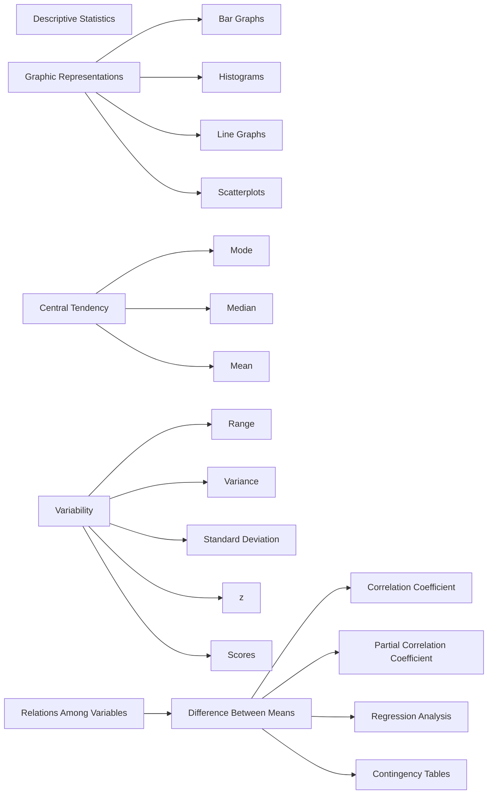

### Learning Objectives

🎯 **15.1** Describe the purpose of descriptive statistics.
🎯 **15.2** Explain the concept of a frequency distribution.
🎯 **15.3** Differentiate among the types of graphic representations of data and when they should be used.
🎯 **15.4** Calculate the mean, median, and mode of a data set.
🎯 **15.5** Calculate the variance and standard deviation of a data set.
🎯 **15.6** Summarize the techniques used to determine relationships among variables.

<!-- Page 2 -->
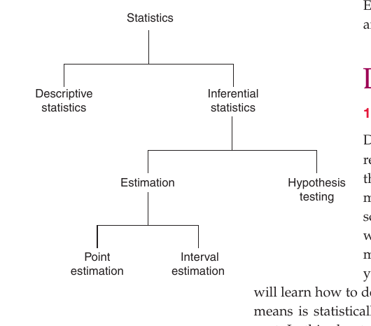

*Figure 15.1 Major divisions of the field of statistics.*

The field of statistics can be divided into the two broad categories called descriptive statistics and inferential statistics. In **descriptive statistics**, the goal is to describe or summarize your research data. This allows you to make sense of your set of data and to make the key characteristics easily understandable to others. In **inferential   statistics**, the goal is to go beyond the immediate set of data and to infer characteristics of populationons based on your sample data. As you can see in Figure 15.1, inferential statistics can be subdivided into estimation and hypothesis testing, and estimation can be subdivided into point estimation and interval estimation.

In this chapter, we will explain descriptive statistical analysis, and in Chapter 16, we will explain inferential statistical analysis. We assume no prior knowledge of the material, and both chapters are written so that everyone can understand the  material. Our discussion requires very little mathematical background, so don’t worry! We focus on showing you what  statistical procedures to select to understand your data and on how to interpret and communicate your results. Before moving to the next section, however, please read

> **Describe the purpose of descriptive statistics.**

### EXHIBIT 15.1 Simpson’s Paradox


In this exhibit, we demonstrate how statistical  analysis, if not conducted properly, can deceive people. Our example is based on a real case of purported gender discrimination at the University of California, Berkeley, several decades ago. The example is written up in

Science (Bickel, 1975). The data shown below refer to men and women admitted to graduate school in the Department of Psychology at a hypothetical university. Take a moment to

Combined or “Aggregated” Results

Number Applied

Men

180

Women

100

examine the data in the table (the combined or  aggregated

results). Notice that 55% of the men who applied to this

department were admitted to graduate school, but only

45% of the women who applied were admitted. Let’s

assume that their qualifications were the same. If this were

the case, you might conclude that gender discrimination

has occurred because men had a much higher rate of

acceptance than women.

Number Admitted

Percentage Admitted

99

55

45

45

<!-- Page 3 -->
### EXHIBIT (Continued)


Now, assume that the 280 students applying to the Psychology Department applied to two different graduate programs; each student applied either to the doctoral program in clinical psychology or the doctoral program in experimental psychology. The researcher decides to break down the data

Results Separated by Program (“Disaggregated Results”)

Clinical Psychology Program

Number

Number

Percentage

Applied

Admitted

Men

60

9

Women

60

12

The overall/combined data suggested one conclusion, but when the data were more carefully analyzed (they were “disaggregated” in the clinical and experimental program tables), a completely different conclusion became apparent. How could it be that opposite conclusions are suggested in the two exhibits based on the same data? The answer is that a statistical phenomenon known as

Simpson’s paradox has occurred. It happened because the women tended to

separately for each program and obtains the two tables

shown next. What do you see in these two program tables?

We now see that women (not men) had the higher acceptance

rates in both degree programs! If there is any discrimination, it

is in favor of the women applicants. What’s going on?

Experimental Psychology Program

Number

Number

Percentage Admitted

Applied

Admitted

Admitted 15

Men

120

90

75 20

Women

40

32

80

apply to the program that was harder to get into, but the

men tended to apply to the program that was easier to get

into. The aggregated data produced one conclusion, but the

disaggregated data produced the opposite and more  accurate

conclusion. The moral of this story is to be cautious when you

examine and interpret descriptive data and always look at the

data critically, and in multiple ways, until you are able to draw

the most warranted conclusion.

showing how to summarize the key characteristics of the data. Here is the key question in descriptive statistics: How can I communicate the important  characteristics of my data? One way would be to supply a printout of all of your data, but that would be very inefficient. We can communicate much better than that!

We have included a data set in Table 15.1 that we will use in several places in this chapter. We refer to this data set as the “college graduate data set.” We will hypothetically say that these data came from a survey research study that you conducted with 25 recent college graduates. In the questionnaire used to collect the data, you asked participants about their starting salaries, undergraduate GPA, college major (you only surveyed three majors), gender, the SAT scores they had when they entered college, and the number of days they believe they missed during college. The goal in this survey research study was to determine what variables predicted the starting salaries of psychology, philosophy, and business majors.

Please take a moment now to examine the data set shown in Table 15.1. Notice that it includes four quantitative variables (salary, GPA, SAT scores, and days of school missed) and two categorical variables (college major and gender). This data set is in the standard format—cases are shown in the rows and variables are shown in the columns. When you have data, you can enter them into a spreadsheet such as Excel (which can be used by a statistical program such as SPSS), or you can directly enter your data in the “spreadsheet” feature in SPSS. We used the popular statistical program SPSS for most of the analyses in this and the next chapter. Most universities provide access to SPSS or another statistical program in their computer labs.

> [!TIP] **Study Question 15.1**
> What is the purpose of descriptive statistics?

<!-- Page 4 -->
**Table 15.1** *Hypothetical Data Set for Nonexperimental Research for 25 Recent College Graduates*

2. 5 1 0 1,110 36 2 25,000
2. 5 1 0 1,100 26 3 27,500
3. 0 1 0 1,300 31 4 28,500
2. 4 2 1 1,100 18 5 30,500
3. 0 2 0 1,150 26 6 30,500
2. 9 2 1 1,130 18 7 31,000
3. 1 1 0 1,180 16 8 31,000
3. 3 1 0 1,160 11 9 31,500
2. 9 2 0 1,170 25 10 32,000
3. 6 1 0 1,250 12 11 32,000
2. 6 1 1 1,230 26 12 32,500
3. 1 2 0 1,130 21 13 32,500
3. 2 2 1 1,200 17 14 32,500
3. 0 3 1 1,150 14 15 33,000
3. 7 1 0 1,260 29 16 33,500
3. 1 2 1 1,170 21 17 33,500
2. 7 2 1 1,140 22 18 34,500
3. 0 3 0 1,240 14

**Person** **Salary**

1 24,000

19 35,500

20 36,500

21 37,500

22 38,500

23 38,500

24 40,500

25 41,500

**Days**

> **GPA** **Major** **Gender** **SAT** **Missed**

🎯 **3.1** 3 0 1,330 16

🎯 **3.5** 2 1 1,220 0

🎯 **3.4** 3 1 1,150 4

🎯 **3.2** 2 0 1,270 10

🎯 **3.0** 3 1 1,300 0

🎯 **3.3** 3 1 1,280 5

🎯 **3.5** 3 1 1,330 2

> *Note:* For the categorical variable “major,” 1 = psychology, 2 = philosophy, and 3 = business. For the  categorical variable  “gender,” 0 = male and 1 = female.

## Frequency Distributions

🎯 **15.2** Explain the concept of a frequency distribution.

> One basic way to display the data values for a variable is to use a frequency distribution. A **frequency distribution** is a systematic arrangement of data values in which the unique data values are rank-ordered and the frequencies are provided for each of these values. Oftentimes, the percentages for each frequency are also included in a frequency distribution. The first column shows the unique data values for the variable, the second column the frequencies for each of these values, and the third column the percentages.

> For example, look at Table 15.2. This is the frequency distribution of the variable *starting salary* from our college graduate data set. You can see that in column 1 the lowest salary is &#36;24,000 and the highest is &#36;41,500. The frequencies are shown in column

> 2. The most frequently occurring salary for our sample of recent college graduates was &#36;32,500; three of the 25 recent graduates had this starting salary. The third column shows the percentage distribution. Four percent of the 25 cases had a salary of &#36;24,000, and 8% of the cases had a salary of &#36;32,000.

<!-- Page 5 -->
**Table 15.2** *Frequency Distribution of Starting Salary*

<table class="textbook-table" style="width: auto; max-width: 100%; border-collapse: collapse; margin: 1.5em 0;">
  <thead>
    <tr>
      <th>(1) Starting Salary</th>
      <th>(2) Frequency</th>
      <th>(3) Percentage</th>
    </tr>
  </thead>
  <tbody>
    <tr>
      <td>24,000.00</td>
      <td>1</td>
      <td>4.0</td>
    </tr>
    <tr>
      <td>25,000.00</td>
      <td>1</td>
      <td>4.0</td>
    </tr>
    <tr>
      <td>27,500.00</td>
      <td>1</td>
      <td>4.0</td>
    </tr>
    <tr>
      <td>28,500.00</td>
      <td>1</td>
      <td>4.0</td>
    </tr>
    <tr>
      <td>30,500.00</td>
      <td>2</td>
      <td>8.0</td>
    </tr>
    <tr>
      <td>31,000.00</td>
      <td>2</td>
      <td>8.0</td>
    </tr>
    <tr>
      <td>31,500.00</td>
      <td>1</td>
      <td>4.0</td>
    </tr>
    <tr>
      <td>32,000.00</td>
      <td>2</td>
      <td>8.0</td>
    </tr>
    <tr>
      <td>32,500.00</td>
      <td>3</td>
      <td>12.0</td>
    </tr>
    <tr>
      <td>33,000.00</td>
      <td>1</td>
      <td>4.0</td>
    </tr>
    <tr>
      <td>33,500.00</td>
      <td>2</td>
      <td>8.0</td>
    </tr>
    <tr>
      <td>34,500.00</td>
      <td>1</td>
      <td>4.0</td>
    </tr>
    <tr>
      <td>35,500.00</td>
      <td>1</td>
      <td>4.0</td>
    </tr>
    <tr>
      <td>36,500.00</td>
      <td>1</td>
      <td>4.0</td>
    </tr>
    <tr>
      <td>37,500.00</td>
      <td>1</td>
      <td>4.0</td>
    </tr>
    <tr>
      <td>38,500.00</td>
      <td>2</td>
      <td>8.0</td>
    </tr>
    <tr>
      <td>40,500.00</td>
      <td>1</td>
      <td>4.0</td>
    </tr>
    <tr>
      <td>41,500.00</td>
      <td>1 N 25 =</td>
      <td>4.0 100.0%</td>
    </tr>
  </tbody>
</table>

*Note:* Column 2 shows the “frequency distribution,” and column 3 shows the “percentage distribution.”

> [!TIP] **Study Question 15.2**
> When would you want to use a frequency distribution?

## Graphic Representations of Data

🎯 **15.3** Differentiate among the types of graphic representations of data and when

**they should be used.**

Graphs are pictorial representations of data. Graphs can be used for one variable or for more than one variable. Some researchers like to use graphs to help communicate the nature of their data. For example, program evaluators often include graphs in their reports because their clients often like to see graphic representations of the data.

### Bar Graphs

One simple graph is a **bar graph**, which uses vertical bars to represent the data. Bar graphs are used with categorical variables. In Figure 15.2, you can see a bar graph of the categorical variable *college major* from our college graduate data set. Notice that the horizontal axis shows the three categories in the variable, and the frequencies of each category are shown on the vertical axis. The bars provide graphical representations of the frequencies of the three majors in our data set.

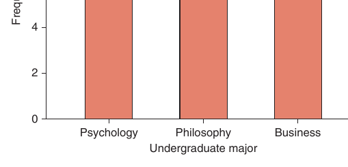

*Figure 15.2 A bar graph of undergraduate major.*

<!-- Page 6 -->
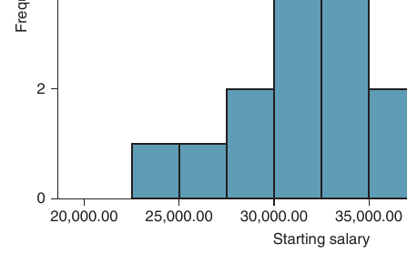

*Figure 15.3 Histogram of starting salary.*

Eight of the recent graduates were psychology majors, 10 were philosophy majors, and seven were business majors. You can easily convert these numbers into percentages if you so desire: 32% were psychology majors (8 divided by 25), 40% were philosophy majors (10 divided by 25), and 28% were business majors (7 divided by 25).

### Histograms

Bar graphs are used when you have a categorical variable. Histograms are used for quantitative variables. A **histogram** is a presentation of a frequency distribution in bar format. It has the advantage over a frequency distribution in that it more clearly shows the shape of the distribution of values. You can see the histogram for starting salary (from our college graduate data set) in Figure 15.3. Notice that, in contrast to bar graphs, the bars in histograms are placed next to each other with no space in between.

### Line Graphs

A useful way to graphically depict the distribution of a quantitative variable is to construct a line graph. A **line graph** is a graph that relies on the drawing of one or more lines. You can see the line graph of starting salary in Figure 15.4. Line graphs are also useful to visually show and aid in the interpretation of interaction effects.

Let’s say that you conducted an experiment to test a new social skills training program. You use a pretest–posttest control group design (i.e., you randomly assigned your participants to the treatment and control groups and measured the performance of both of these groups before and after the treatment group received social skills training). Your dependent variable is the number of appropriate social interactions the participants performed, which you measured at the pretest and again at the posttest. The independent variable is social skills training (training vs. no training). The data from your experiment are shown in Table 15.3.

Some of the results of this hypothetical experiment are shown in Figure 15.5. We have used a line graph to show what happened in your research study. Looking at the line graph you can see that both groups started low on the number of appropriate skills they exhibited. That is, everyone was low on the dependent variable at the start of the experiment. At the end of the study, after the treatment group received

<!-- Page 7 -->
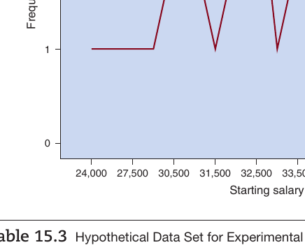

*Figure 15.4 Line graph of starting salary.*

social skills training, we see a very different result; the participants in the treatment group have higher scores than the participants in the control group. The graph shows that the number of appropriate social skills demonstrated increased for the treatment group, but not (or very little) for the control group. In short, this line graph is what you had hoped for because it shows that your treatment seems to work. Actually, there is one more step. You must also determine if the result is statistically significant. We will show you how to get this piece of information in the next chapter.

( *Continued on next page* )

**Table 15.3** *Hypothetical Data Set for Experimental Research Study Examining the Effectiveness of Social Skills Training*

<table class="textbook-table" style="width: auto; max-width: 100%; border-collapse: collapse; margin: 1.5em 0;">
  <thead>
    <tr>
      <th>Person</th>
      <th>Pretest Scores</th>
      <th>Treatment Condition</th>
      <th>Posttest Scores</th>
    </tr>
  </thead>
  <tbody>
    <tr>
      <td>1</td>
      <td>3</td>
      <td>1</td>
      <td>4</td>
    </tr>
    <tr>
      <td>2</td>
      <td>4</td>
      <td>1</td>
      <td>4</td>
    </tr>
    <tr>
      <td>3</td>
      <td>2</td>
      <td>1</td>
      <td>3</td>
    </tr>
    <tr>
      <td>4</td>
      <td>1</td>
      <td>1</td>
      <td>2</td>
    </tr>
    <tr>
      <td>5</td>
      <td>1</td>
      <td>1</td>
      <td>2</td>
    </tr>
    <tr>
      <td>6</td>
      <td>0</td>
      <td>1</td>
      <td>0</td>
    </tr>
    <tr>
      <td>7</td>
      <td>2</td>
      <td>1</td>
      <td>2</td>
    </tr>
    <tr>
      <td>8</td>
      <td>4</td>
      <td>1</td>
      <td>4</td>
    </tr>
    <tr>
      <td>9</td>
      <td>4</td>
      <td>1</td>
      <td>4</td>
    </tr>
    <tr>
      <td>10</td>
      <td>3</td>
      <td>1</td>
      <td>4</td>
    </tr>
    <tr>
      <td>11</td>
      <td>2</td>
      <td>1</td>
      <td>3</td>
    </tr>
    <tr>
      <td>12</td>
      <td>5</td>
      <td>1</td>
      <td>5</td>
    </tr>
    <tr>
      <td>13</td>
      <td>3</td>
      <td>1</td>
      <td>3</td>
    </tr>
    <tr>
      <td>14</td>
      <td>3</td>
      <td>1</td>
      <td>3</td>
    </tr>
    <tr>
      <td>15</td>
      <td>2</td>
      <td>2</td>
      <td>4</td>
    </tr>
    <tr>
      <td>16</td>
      <td>3</td>
      <td>2</td>
      <td>5</td>
    </tr>
    <tr>
      <td>17</td>
      <td>1</td>
      <td>2</td>
      <td>2</td>
    </tr>
    <tr>
      <td>18</td>
      <td>2</td>
      <td>2</td>
      <td>4</td>
    </tr>
  </tbody>
</table>

<!-- Page 8 -->
after the experimental intervention; treatment condition = 1 for control group (did not receive social skills training) and 2 for treatment group (did receive social skills training).

**Table 15.3** *Hypothetical Data Set for Experimental Research Study Examining the Effectiveness of Social Skills Training ( Continued )*

<table class="textbook-table" style="width: auto; max-width: 100%; border-collapse: collapse; margin: 1.5em 0;">
  <thead>
    <tr>
      <th>Person</th>
      <th>Pretest Scores</th>
      <th>Treatment Condition</th>
      <th>Posttest Scores</th>
    </tr>
  </thead>
  <tbody>
    <tr>
      <td>19</td>
      <td>1</td>
      <td>2</td>
      <td>2</td>
    </tr>
    <tr>
      <td>20</td>
      <td>2</td>
      <td>2</td>
      <td>4</td>
    </tr>
    <tr>
      <td>21</td>
      <td>2</td>
      <td>2</td>
      <td>3</td>
    </tr>
    <tr>
      <td>22</td>
      <td>3</td>
      <td>2</td>
      <td>5</td>
    </tr>
    <tr>
      <td>23</td>
      <td>5</td>
      <td>2</td>
      <td>6</td>
    </tr>
    <tr>
      <td>24</td>
      <td>2</td>
      <td>2</td>
      <td>4</td>
    </tr>
    <tr>
      <td>25</td>
      <td>4</td>
      <td>2</td>
      <td>2</td>
    </tr>
    <tr>
      <td>26</td>
      <td>4</td>
      <td>2</td>
      <td>5</td>
    </tr>
    <tr>
      <td>27</td>
      <td>2</td>
      <td>2</td>
      <td>4</td>
    </tr>
    <tr>
      <td>28</td>
      <td>5</td>
      <td>2</td>
      <td>6</td>
    </tr>
    <tr>
      <td>Pretest =</td>
      <td>number of appropriate interactions at the beginning of the experiment; posttest</td>
      <td></td>
      <td>= number of appropriate interactions</td>
    </tr>
  </tbody>
  <tfoot>
    <tr class="table-notes"><td colspan="4"><em>* Note:</em></td></tr>
  </tfoot>
</table>

### Scatterplots

A  **scatterplot** is a graph used to depict the relationship between two quantitative variables. By convention, we always put the dependent variable on the vertical axis and the independent or predictor variable on the horizontal axis. The dots within the graph represent the cases (i.e., participants) in the data set.

You can see a scatterplot of the two quantitative variables grade point average and starting salary in Figure 15.6. Following the agreed-upon convention in research, we put the independent (predictor) variable on the horizontal axis and the dependent variable on the vertical axis. You can see in the scatterplot that there appears to be a positive relationship between GPA and starting salary because as GPA increases, starting salary also increases. When you have a positive relationship, the data values tend to start at the bottom left side of the graph and end at the top right side.

The scatterplot of days of school missed during college and starting salary is shown in Figure 15.7. You can see in this scatterplot that there appears to be a

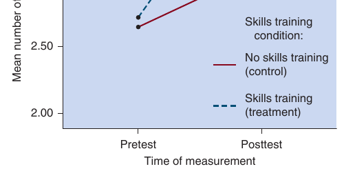

*Figure 15.5 Line graph of results from pretest–posttest control group design studying effectiveness of social skills treatment.*

<!-- Page 9 -->
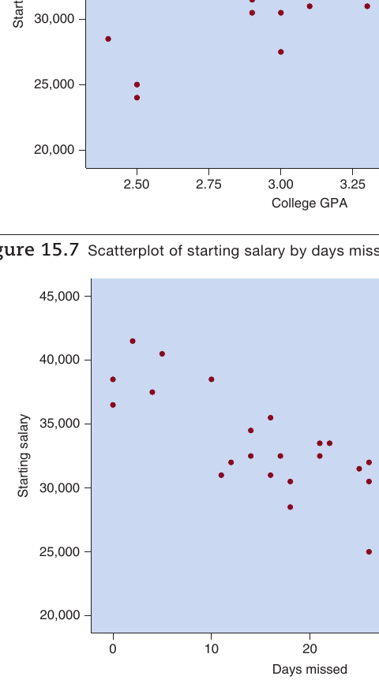

*Figure 15.6 Scatterplot of starting salary by college GPA (positive relationship).*

negative relationship between days missed and starting salary because as days missed increases starting salary decreases. With a negative relationship, the data values tend to start at the top left side of the graph and end at the lower right side.

> [!TIP] **Study Question 15.3**
> What are the graphic techniques (discussed thus far) for describing variables? When are these techniques used?

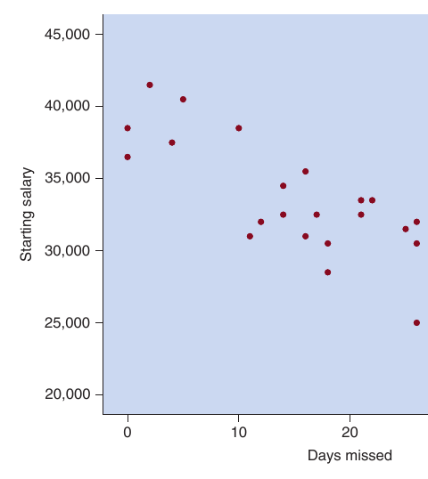

*Figure 15.7 Scatterplot of starting salary by days missed (negative relationship).*

<!-- Page 10 -->
## Measures of Central Tendency

🎯 **15.4** Calculate the mean, median, and mode of a data set.

One of the most important ways to describe and understand data is to obtain measures of central tendency. A **measure of central tendency** is the single numerical value that is considered most typical of the values of a quantitative variable. For example, your college GPA is the value expressing what is typical for your grades. It is based on all of your grades. The three most common measures of central tendency are the mode, the median, and the mean.

### Mode

The most basic, and the crudest, measure of central tendency is the mode. The **mode** is the most frequently occurring number for a variable. For example, in the following set of numbers

0, 2, 3, 4, 5, 5, 5, 7, 8, 8, 9, 10 the mode is 5 because 5 is the most frequently occurring number. Five occurs three times. If there is a tie for the most frequently occurring number, then you would need to report both and point out that the data for the variable are bimodal.

> For practice, determine the mode for the following set of numbers:

1, 2, 2, 5, 5, 7, 10, 10, 10

If you said 10, then you are right. Notice that the mode in this case is not a very good indicator of the central tendency of the data. If the data are normally distributed where most people fall toward the center of the distribution of numbers, then the mode works much better than in this case. In practice, research psychologists rarely use the mode.

### Median

The **median** is the center point in a set of numbers that has been arranged in ascending or descending order. If you have an odd number of numbers, the median is the middle number. For example, in the following numbers

1, 2, 3, 4, 5 the median is
3. If you have an even number of numbers, the median is the average of the two centermost numbers. (Remember, you must put the numbers in order before locating the center number of numbers.) For example, in the following numbers

1, 2, 3, 4 the median is 2.5 because 2.5 is the average of the two centermost numbers (i.e., the average of 2 and 3 is 2.5). An interesting property of the median is that it is not affected by the size of the highest and lowest numbers. For example, the median of 1, 2, 3, 4, 5 is the same as the median of 1, 2, 3, 4, 500. In both cases the median is 3!

### Mean

The **mean** is the name researchers use to refer to the arithmetic average. You already know how to calculate the mean (i.e., the average). The average of 1, 2, and 3 is 2, right? Here is what you actually did when you calculated the mean: (1 + 2 + 3)/3. Psychologists sometimes refer to the mean as *X* (called *X* bar). Here is our formula for getting the mean:

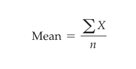

*Diagram*

<!-- Page 11 -->
The formula is easy if you note that *X* stands for the variable you are using, *n* is the number of numbers you have, and $\sum$ is a sum sign (it says to add up the numbers that follow it). In our simple case where the three values of our variable are 1, 2, and 3, the formula is applied as follows:

$\sum$ *X* 1 + 2 + 3

6

Mean = = =

- 2 *n* 3

3

Psychologists frequently calculate the means for the groups that they want to compare, such as the mean performance level for treatment and control groups. Take a moment to look again at Figure 15.5. Each of the four points in the graph is a group mean. The four points are the means for the treatment and the control groups at the pretest and the means for these two groups at the posttest. We plotted the means to help you interpret the results of the experiment. Those results suggest that the treatment worked: At the pretest the means for the treatment and the control groups were low, but following the intervention, the mean for the treatment group was much higher and the mean for the control group showed little change.

> [!TIP] **Study Question 15.4**
> Differentiate among mean, median, and mode.

## Measures of Variability

🎯 **15.5** Calculate the variance and standard deviation of a data set.

In the previous section, you learned about the measures of central tendency that tell you what is typical for a variable. However, it is also important to find out how much your data values are spread out (i.e., how different they are). That is, you want to know how much variability is present. A **measure of variability** is defined as a numerical index that provides information about how spread out or how much variation is present in a variable.

If all of the data values for a variable were the same, then there is no variability. For example, there is no variability in these numbers:

4, 4, 4, 4, 4, 4, 4, 4, 4, 4

There is variability in these numbers:

1, 2, 3, 3, 4, 4, 4, 6, 8, 10

The more different your numbers, the more variability you have.

Now, let’s test your understanding of variability. Which of the following sets of data have the most variability present?

> Data for group one: 44, 45, 45, 45, 46, 46, 47, 47, 48, 49 Data for group two: 34, 37, 45, 51, 58, 60, 77, 88, 90, 98

As you can see, the data for group two have more variability than group one. Sometimes when there is little variability in a group, we say that the scores are homogeneous. When the scores show a lot of variability, we say that the scores are heterogeneous.

Now we introduce you to three of the types of variability that psychologists might examine in their data. We examine the range, the variance, and the standard deviation.

<!-- Page 12 -->
### Range

> The simplest measure of variability, but also the most crude, is the range. The **range** is the highest (i.e., largest) number minus the lowest (i.e., smallest) number in a set of numbers. Here is the formula:

Range = *H* - *L* where

> *H* is the highest number, and *L* is the lowest number.

> For example, in the data for group one shown in the previous section, the range is equal to 5 (49 minus 44). Now take a moment and determine the range for the data for group two. If you said the range is 64, you are correct. The highest number is 98 and the lowest is 34, and the difference between these two numbers is
64. The range is a crude index of variability because it takes into account only two numbers (the highest and the lowest). Now we introduce you to the measures of variability that research psychologists more frequently use.

### Variance and Standard Deviation

> The two most popular measures of variability are the variance and the standard deviation. They are superior to the range because they take into account all of the data values for a variable. They both provide information about the dispersion or variation around the mean value of a variable.

> The  **variance** is the average deviation of the data values from their mean in

> “squared units.” The variance is popular because it has nice mathematical properties. To turn the variance into more meaningful units, you can obtain the **standard** **deviation**. To calculate the standard deviation, you take the square root of the variance (i.e., you put the value of the variance into your calculator and press the square root key). The standard deviation (i.e., the square root of the variance) is an approximate indicator of the average distance that your data values are from their mean. (If you have a mean of 5 and a standard deviation of 2, then the data values tend to be approximately 2 units above or below 5.) For the variance and the standard deviation, the larger the value, the greater the data are spread out; the smaller the value, the less the data are spread out.

> We show you how to calculate the variance and standard deviation in

> Table 15.4. We wanted the variance and standard deviation of the numbers 2, 4, 6, 8, and
10. As shown in Table 15.4, the variance of these five numbers is 8, and the standard deviation is 2.83. In other words, the average distance of the numbers from their mean in squared units is 8, and the approximate average distance of the numbers from their mean in regular units is 2.83. If the numbers would have been more spread out, the variance and standard deviations would have been bigger; if the numbers had been less spread out, the variance and standard deviations would have been smaller.

### Standard Deviation and the Normal Curve

🎯 **99.7** percent rule

If the data were fully normally distributed, the standard deviation would have addi**68, 95, 99.7 percent rule** Rule tional meaning. Examine the standard normal distribution in Figure 15.8, and you stating percentage of cases falling within 1, 2, and 3  standard devia- will see that the normal curve or **normal distribution** has a bell shape; it is high in tions from the mean on a normal the middle and it tapers off to the left and the right. If the data were fully normally distribution distributed, then you would be able to apply the **68, 95, 99.7 percent rule**. This rule

<!-- Page 13 -->
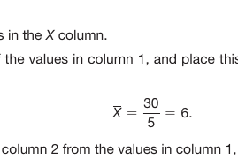

*Diagram*

**Table 15.4** *Calculating the Variance and Standard Deviation*

<table class="textbook-table" style="width: auto; max-width: 100%; border-collapse: collapse; margin: 1.5em 0;">
  <thead>
    <tr>
      <th></th>
      <th>(1)</th>
      <th>(2)</th>
      <th>(3)</th>
      <th>(4)</th>
    </tr>
  </thead>
  <tbody>
    <tr>
      <td>Sums</td>
      <td>X a</td>
      <td></td>
      <td></td>
      <td>2 ( X - X ) a</td>
    </tr>
    <tr class="category-header"><td colspan="5"><strong>Steps:</strong></td></tr>
  </tbody>
</table>

( *X* ) ( *X* ) ( *X* - *X* )

2 6 - 4

4 6 - 2


30 0 c

(1)  Insert your data values in the

( *X* - *X* ) 2

16

$4 0 4$16

40 c

(2)   Calculate the mean of the values in column 1, and place this value in column
2. In our example, the mean is 6.

(3)   Subtract the values in column 2 from the values in column 1, and place these into column 3.

(4)   Square the numbers in column 3 (i.e., multiply the number by itself), and place these in column 4.

> ( *Note:* You can ignore the minus signs in column 3 because a negative number multiplied by a negative number produces a positive number.)

(5)  Insert the appropriate values into the following formula for the variance: where

> $\sum$ ( *X* - *X* ) 2 is the sum of the numbers in column 4, and *n* is the number of numbers.

In this example, the variance

(6)   The standard deviation is the square root of the variance (SD

. In this example, the variance is 8 (see step 5), and the standard deviation is 2.83 (i.e., the square root of 8 = 2.83). says that 68% of the cases fall within one standard deviation from the mean, 95% fall within two standard deviations, and 99.7% fall within three standard deviations. Actually, the rule is a slight approximation because the more exact percentages are 68.26, 95.44, and 99.74, but the rule is easy to remember, and it is a very close approximation.

In practice, it is important to understand that sample data are never fully normally distributed in the sense of perfectly matchingg the normal distribution described here. That’s because we have described what also can be called the theoretical normal distribution. The theoretical normal distribution is what researchers are referring to when they report the degree to which their data are normally distributed. The normal distribution also has many applications in more advanced statistics courses. ***z*** **scores** The last concept covered in this section is that researchers sometimes like to convert their observed data into a type of standardized scores called ***z**scores**. These scores are the values for a variable that have been transformed from their original

“raw scores” into a new “standardized” metric that has a mean of zero and a standard deviation of one. This is convenient because the data values now can be interpreted in

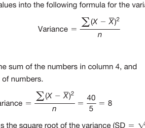

*Diagram*

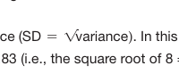

*Diagram*

<!-- Page 14 -->
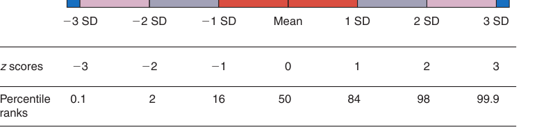

*Figure 15.8 Areas under the normal distribution.*

terms of how far they are from their mean. If a data value is + 1.00, we can say that this value falls one standard deviation above the mean, a value of + 2.00 falls two standard deviations above the mean, a value of - 1.5 falls one and a half standard deviations below the mean, and so on. “Standardized units” or “*z* scores” were used with the normal curve just shown in Figure 15.8.

> You can easily standardize your data using the following formula:

To use this formula, you need the raw scores that you wish to convert to *z* scores and you need to know the mean and standard deviation for the raw scores. For example, take the set of scores used in Table 15.4: 2, 4, 6, 8, 10. In Table 15.4, we showed that the mean of these five numbers was 6, and the standard deviation (which we calculated in the table) was 2.83. Therefore, we can convert any or all of these numbers into *z* scores. Here is the conversion of the last number, 10, to a *z* score: *z* score =

- = = 1.413 standard deviation 2.83 2.83

Therefore, the *z* score for the number 10 is 1.41; this says that the value of 10 falls 1.41 standard deviations above the mean of its variable. Here is the conversion of the first number, 2, to a *z* score: raw score - mean 2 - 6 - 4 *z* score =

> - = = - 1.413 standard deviation 2.83 2.83

Therefore, the number 2 is 1.413 standard deviations *below* the mean. The negative sign indicates that the number is below the mean.

You will recall that when we defined *z* scores, we stated that for any set of *z* scores the mean will always be zero and the standard deviation will be one. You can trust us or you can easily check us. Here are all of the *z* scores for our set of five numbers:

- 1.413, -.707, 0, +.707, + 1.413. You can see that the average of these numbers is zero. Next, to see if their standard deviation is equal to one, use the procedure shown in Table 15.4 and calculate the standard deviation of this set of *z* scores. By the way, we

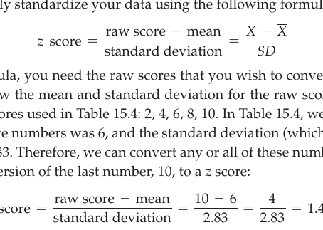

*Diagram*

<!-- Page 15 -->
checked, and yes, it worked. The key point here is that *you can take any set of  numbers,* *convert the numbers to z scores, and they will always have a mean of zero and a standard* *deviation of one*. This helps psychologists when they want to compare scores across different variables and different data sets and when they want to know how far a data value falls above or below the mean.

> [!TIP] **Study Question 15.5**
> What is variability? What are some measures of variability? What are their strengths and weaknesses?

## Examining Relationships Among Variables

🎯 **15.6** Summarize the techniques used to determine relationships

**among variables.**

Rarely is a psychologist interested in a single variable. Psychologists typically are interested in determining whether independent and dependent variables are related. They use independent (or predictor) variables to “explain variance” in dependent (or outcome) variables. Determining what independent variables predict or cause changes in dependent variables is perhaps the primary goal of science. Then practitioners can apply this knowledge to produce changes in the world such as use new psychotherapy techniques to reduce mental illness or to determine how to predict who is “at risk” for future problems so that early interventions can be started.

In this last section, we will describe several approaches used to examine relationships among two or more variables. The vast majority of the time, the dependent variable in psychological research is a quantitative variable (e.g., response time, performance level, level of stress). Therefore, most of the indexes of relationship described here are used for quantitative dependent variables. We will explain one exception in which you have a categorical dependent variable and a categorical  independent (or predictor variable).

### Unstandardized and Standardized Difference Between Group Means

When you have a quantitative dependent variable and a categorical independent variable, your first evidence on whether these variables are related is obtained by calculating the means on the dependent variable for each group making up the categorical variable and then comparing those means. The most direct and simplest way to determine the magnitude of difference between two means is to subtract one mean from another and examine the size of the difference. This is called the **unstandardized difference between means** because you use the natural units of the data. Then you make the decision about whether the difference between the means is large or small.

For example, in our college graduate data set, the mean (i.e., the average) starting salary for males is &#36;34,791.67, and the mean starting salary for females is &#36;31,269.23. Therefore, the unstandardized difference between these two means is &#36;34,791.67 minus &#36;31,269.23, which is &#36;3,522.44. This appears to us to be a sizable difference between the two means. Another way of making this point is to state that “there appears to be a sizable relationship between gender and starting salary such that males have higher salaries than females” in our data. In the next chapter, we will teach

<!-- Page 16 -->
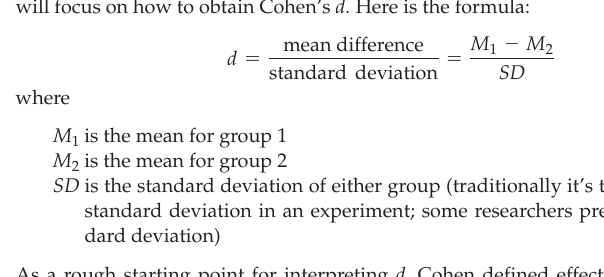

*Diagram*

> you how to determine if the difference between the means is “statistically significant”; for now, we are just interested in showing how to obtain descriptive information about your data.

To aid in deciding how different the group means are, the difference between the ** means is often transformed into a standardized measure. For group means, **Cohen’s** ***d*** is a popular standardized measure of the difference between the means. Cohen’s *d* is one of many effect size indicators that researchers use. An **effect size indicator** is a standardized measure of the magnitude or strength of a relationship between variables. We will tell you about some additional effect size indicators later; for now, we will focus on how to obtain Cohen’s *d.* Here is the formula: where is the mean for group 1 is the mean for group 2

> *SD*  is the standard deviation of either group (traditionally it’s the control group’s standard deviation in an experiment; some researchers prefer a pooled stan-

> As a rough starting point for interpreting *d*, Cohen defined effect sizes of $d = .2$ as “small,” $d = .5$ as “medium,” and $d = .8$ as “large.” When you first start interpreting the sizes of Cohen’s *d*, you can start with Cohen’s criteria of.2,.5, and.8, but with experience you will learn how to adjust your interpretation based on additional information, such as the size of differences provided in published research on your topic.

> Now let’s calculate Cohen’s *d* to compare the average male and female incomes from our college student data set. 1 Gender is the categorical independent or predictor variable, and starting salary is the quantitative dependent variable. The mean starting salary for males is &#36;34,791.67 and that for females is &#36;31,269.23. The unstandardized difference between the means is &#36;3,522.44. Using a statistical program (i.e., SPSS), we determined that the standard deviation for females is &#36;4,008.40. Now we have the three pieces of information needed to use the formula for Cohen’s *d.* We have the two group means, and we have the standard deviation for the group we chose as our comparison group (i.e., females). Here are the three pieces of information plugged into the formula.

*M* - *M* + 34,791.67 - + 31,269.23 + 3,522.44 $d = 1$ 2 = = =.88 *SD*

+ 4,008.40 + 4,008.40

> Cohen’s *d* is.88. This says that the mean starting salary for men is.88 standard deviations above the mean for females. Using Cohen’s criteria for interpretation, we would consider this a “large” difference between the means. It is important to note, however, that Cohen did not want researchers to mindlessly use his criteria. In some research studies, a smaller Cohen’s *d* would be considered a large or important effect. In this case, we agree that the value of.88 seems to be a large standardized difference between male and female salaries. For one more practice example, go to Exhibit 15.2, where we use Cohen’s *d* to interpret the means plotted in Figure 15.5 for our  experiment on the effectiveness of social skills training.

### Correlation Coefficient

> When you have a quantitative dependent variable and a quantitative independent variable, you need to either obtain a correlation coefficient or a regression coefficient. In this section, we explain the idea of a correlation coefficient. By definition,

[^1]: You can easily find a Cohen’s *d* calculator on the Internet. Here is one of several: https://memory. psych.mun.ca/models/stats/effect_size.shtml

<!-- Page 17 -->
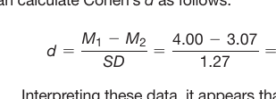

*Diagram*

### EXHIBIT 15.2 Using Cohen’s d in a Pretest–Posttest


Control-Group Experimental Research Design

Earlier we described an experiment where the researcher randomly assigned participants to the treatment and control groups. The levels of the independent variable were treatment condition and control condition. The purpose of the treatment was to improve the social skills of the participants. The dependent variable of social skills was operationalized as the number of appropriate interactions in a 1-hour observation session. The treatment and control group participants were measured on the dependent variable at the pretest and again at the posttest (i.e., after the treatment had been administered to the treatment group).

Figure 15.5 depicts a line graph of the pretest means for the treatment and control groups and the posttest means for the treatment and control groups. As you look at that line graph, it appears that the treatment worked because after the intervention the social skills performance of the treatment group improved quite a bit more than that for the control group. That is, at the pretest, the two groups’ means were similar, suggesting that random assignment to the groups worked well, but after the treatment, the two groups’ means became different. It appears that the treatment group did much better after social skills training, but the control group changed by only a small amount.

We now show how to calculate Cohen’s

d

for the two pretest means and for the two posttest means. First, using the statistical package SPSS to do our calculations, we found that at the pretest the mean social skills performance for the treatment group (

M

) was 2.71, the pretest mean for the

1 control group (

M

) was 2.64, and the standard deviation (

2 for the control group was 1.39. Using these three pieces of information, you can calculate Cohen’s

d

as follows:

M

M

2.71

2.64

.07

$1 2 d$.05

SD

1.39

1.39

Second, using SPSS at the posttest, we found that at the posttest the mean social skills performance for the treatment

group (

M

) was 4.00, the posttest mean for the control group

$1 ( M$) was 3.07, and the standard deviation (

SD

) for the control

2

group was 1.27. Using these three pieces of information, you

can calculate Cohen’s

d

as follows:

M

M

4.00

3.07

.93

$1 2 d$.73

SD

1.27

1.27

Interpreting these data, it appears that the difference

between the means was very small at the pretest. The

standardized mean difference measured by Cohen’s

d

was .05, which means the treatment group was only .05 of

a standard deviation larger than the control group mean.

Cohen defined .2 as a small difference, and our calculated

value of .05 is much smaller than .2. This supports our earlier

observation that the means were barely different at the pretest.

Conversely, at the posttest Cohen’s

d

was .73, which indicates

the treatment group mean was .73 standard deviation units

above the control group mean. Using Cohen’s criteria, .73 is a

moderately large difference (it is .73 standard deviations better

than the control group’s mean).

Although the results just presented appear to support

the efficacy of the social skills training, we still cannot

trust this experimental finding. The big problem is that the

observed differences between the means might represent

nothing more than random or chance fluctuation in the

data. In the next chapter on inferential statistics, we will

check to see if this difference is statistically significant.

If it is statistically significant, we will be able to conclude SD )

that difference between the posttest means (adjusting for

the small differences at the pretest) is real (i.e., not just

a random fluctuation but an actual difference that is due

to the treatment). For now, we can only state that based

on our descriptive analysis of the data, it appears that

the experimental treatment was successful in improving

participants’ social skills.

- =

-

- a  **correlation coefficient** is a numerical index ranging from cates the strength and direction of the linear relationship between two variables. The absolute size of the number indicates the strength of the correlation, and the sign (positive or negative) indicates the direction of relationship. The endpoints,

- 1.00 and + 1.00, stand for “perfect” correlations because they are the strongest possible correlations; zero indicates no correlation at all. Therefore, as you move away from zero in either direction, the correlation becomes stronger; stated differently, the closer you are to zero, the weaker the correlation. These ideas are depicted in

+.20 or

-.70 is farther away from zero.

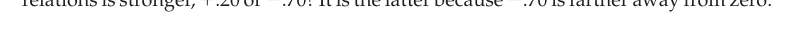

*Figure 15.9. Here is a quick test of your understanding: “Which correlation is stronger, + .70?” The latter is stronger because*

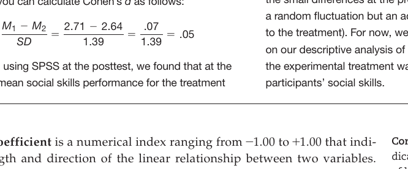

*Diagram*

<!-- Page 18 -->
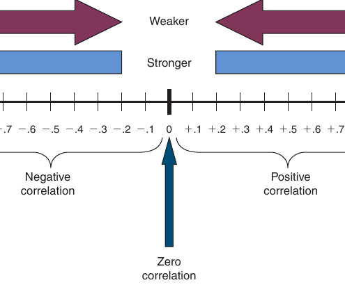

*Figure 15.9 Strength and direction of a correlation coefficient.*


Here’s a trick question: “Which correlation is stronger, +.50 or -.70?” It is the latter because -.70 is farther from zero. When judging the relative *strength* of two correlation coefficients, ignore the sign and determine which number is farther from zero. Another way of saying this is to take the absolute value of the number (i.e., if the sign is negative then change it to positive) and see which number is bigger.

You are probably wondering, “What is the difference between correlation coefficients that have a negative sign and those that have positive sign?” The issue here is that of the *direction* of relationship between the variables. When the sign is negative, you have a **negative correlation** (which means the values of the two variables tend to move in *opposite* directions); conversely, when the sign is positive, you have a  **positive   correlation** (which means the two variables tend to move in the *same* direction). You can see some diagrams of correlations of different strengths and directions in Figure 15.10.

Here is an example of a negative correlation: The more hours students spend partying the night before an exam, the lower their test grades tend to be. This correlation would be negative because as the values on hours spent partying go *up*, the values on test grades tend to go *down* (i.e., they move in opposite directions). As an example of a positive correlation, the more hours students spend studying for a test, the higher their test grades tend to be. This correlation would be positive because as the values on hours spent studying go *up*, test grades tend to go *up* (they move in the same direction).

In short, with a negative correlation the variables move in the opposite direction, and with a positive correlation the variables move in the same direction. Here is a checkpoint question: “Is the correlation between education and income positively or negatively correlated?” It is positive because the two variables tend to move in the same direction; as years of schooling increases, income also tends to increase. Here’s another checkpoint question: “Is the correlation between empathy and aggression positive or negative?” It’s negative because people with more empathy tend to be less aggressive.

One way to visually determine the direction of the relationship between two variables is to construct a scatterplot. Take a moment to examine Figure 15.6 (on page 303), and you will see the scatterplot of college GPA and starting salary. The scatterplot shows that as college GPA increases, starting salary also tends to increase. In this case, the correlation coefficient is +.61, which is a moderately strong positive correlation. Now examine Figure 15.7 (on page 303), and you will see the scatterplot of days

<!-- Page 19 -->
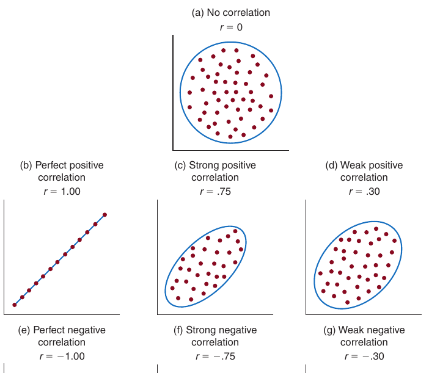

*Figure 15.10 Correlations of different strengths and directions.*

missed during college and starting salary. This scatterplot shows that as the number of days missed during college increases, starting salary tends to *decrease.* In this case, the correlation coefficient is -.81, which indicates a strong negative correlation.

An additional way to understand the concept of correlation is to examine one of the definitional formulas and to use the formula to calculate a correlation coefficient on a small set of data. To learn how to do this, read Exhibit 15.3.

### EXHIBIT 15.3 How to Calculate the Pearson Correlation


Coefficient

Earlier we showed how to obtain

z

scores and pointed out that a z score tells you how far a data value is from the mean of its variable. For example, you learned that a

z

score of says that the score is two standard deviations above the mean, and a

z

score of

2.00 says the score is two  standard deviations below the mean. To use the following formula for calculating the correlation coefficient, you need to first convert your independent variable (

X

) and dependent variable ( values to

z

scores. Then the following formula is straightforward because you just need to multiply the scores, add them up,

and divide them by the number of cases. By dividing the sum by

n

, you are obtaining the average of the multiplied

z

scores 2.00

Here’s the formula:

(

$$\displaystyle r = \dfrac{\text{sum of cross products of } z \text{ scores}}{n} = \dfrac{\sum(Z_X Z_Y)}{n}$$


where

tells you to sum what is on its right in the formula

$Z = z$score of the value of the

X

or independent variable Y ) data

$X Z = z$score of the value of the

Y

or dependent variable

Y

n

= number of cases

(

Continued

)

+

$\sum$

- 

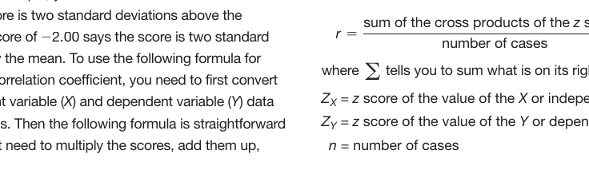

*Diagram*

<!-- Page 20 -->
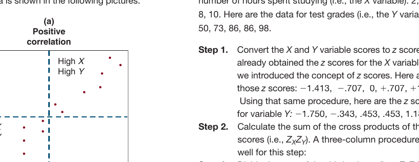

*Diagram*

### EXHIBIT 15.3 How to Calculate the Pearson Correlation Coefficient


(

Continued

)

With a positive relationship, some cases have low

X

and

feel for how the numerical value is produced. Therefore,

low

Y

values and some have high

X

and high

Y

values (see

below is a table showing how to calculate the correlation

picture “a”). This pattern provides a positive value for the

between two variables,

X

and

Y

, using the formula just

numerator of the formula, which tells you that the relationship

presented. Our

X

variable will be the same

X

variable used

is positive. With a negative relationship, some cases have low

earlier when we calculated

z

scores. We use a

Y

variable

X

and high

Y

values and some have high

X

and low

Y

values

that is strongly correlated. At the end of the chapter, we list

(see picture “b”). This pattern provides a negative value for the

a practice exercise where you can apply this procedure to

numerator of the formula, which tells you that the  relationship

obtain your own correlation coefficient. Here are the data for

**is negative. This idea is shown in the  following pictures:** number of hours spent studying (i.e., the

X

variable): 2, 4, 6,

8, 10. Here are the data for test grades (i.e., the

Y

**variable):** C

50, 73, 86, 86, 98.

2QUKVKXG

EQTTGNCVKQP

Step 1.

Convert  the

X

and

Y

variable scores to

z

scores. We

***KIJ:** already obtained the

z

scores for the

X

variable when

*KIJ;

we introduced the concept of

z

scores. Here are

those

z

**scores:** 1.413,

.707,  0,

.707,

1.413.

Using that same procedure, here are the

z

scores

for variable

**Y:** 1.750,

.343, .453, .453, 1.187.

;

Step 2.

Calculate the sum of the cross products of the

z

**.QY:** .QY;

scores (i.e.,

$Z_X Z_Y)$. A three-column procedure works

X

Y

**well for this step:** Step 3.

Divide the sum of the third column (i.e.,

$Z_X Z_Y)$ by

X

Y

the number of cases (i.e.,

n

).

**:** z

scores

z

scores for

Cross products

for variable

X

variable

Y

of

z

scores

D

0GICVKXG

$Z Z Z Z$EQTTGNCVKQP

$X X X Y$times

1. 413

1.750

equals

2.473

**.QY:** .707

.343

.243

*KIJ;

0

.453

0

.707

.453

.320

1.413

1.187

1.677

;

$Z Z 4$713

+ +

T

$\approx$

$\sum$ *X* *Y* =. c

> This is the sum you need for the formula.

-.943

> Although researchers do not calculate correlation

The correlation between hours spent studying ( *X* ) and coefficients by hand these days (because they use

.943. Therefore, the two variables are very computer programs such as SPSS), it is helpful to strongly correlated. As the number of hours spent studying calculate the correlation coefficient once to get a better increases, so do test grades.

> In this section, we have explained the *Pearson correlation coefficient*, and there is a caveat you need to know. The Pearson correlation coefficient works only if your data are linearly related. All of the depictions in Figure 15.10 were linear relationships. In contrast, Figure 15.11 shows a **curvilinear relationship** (i.e., a curved relationship). If you calculate the Pearson correlation coefficient on a curved relationship, it  generally will tell you that your variables are not related, when in fact they are related. You would draw an incorrect conclusion about the relationship. If your two

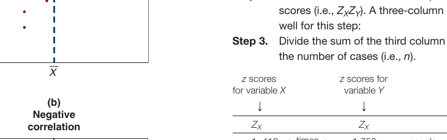

*Diagram*

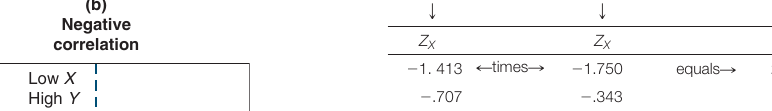

*Diagram*

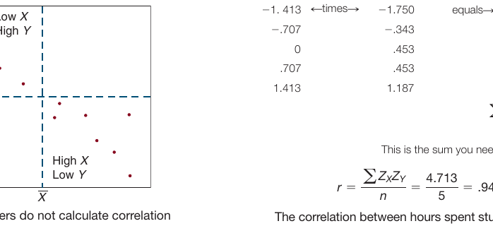

*Diagram*

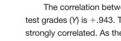

*Diagram*

<!-- Page 21 -->
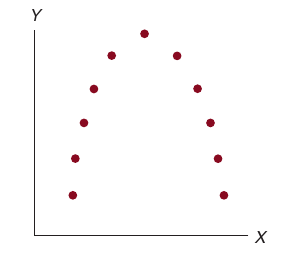

*Figure 15.11 A curvilinear relationship.*

variables result in a curved relationship, you need to use a technique called **curvilin-** **ear   regression** (see Keith, 2019, pp. 168–175). This technique fits the appropriate statistical model and indicates the strength of the relationship.

**Partial Correlation Coefficient** Partial correlation is a technique that is widely used in areas of psychology where the use of experiments for some research questions is difficult. Some of these fields are personality, social, and developmental psychology. Good, strong theory is required to use partial correlation analysis because the researcher must know the variable(s) that he or she needs to control for. For example, in applied social psychology the researcher might want to study the relationship between the number of hours spent viewing or playing violence (via television and other media such as movies and games) and the number of aggressive acts performed. In this case, the researcher would want to control for variables such as personality type, school grades, and exposure to violence in the family and neighborhood to make sure that the relationship between observed and performed violence was not due to those factors. This sort of nonexperimental research has built on Albert Bandura and his colleagues’ classic experimental research showing that children act aggressively after being exposed to an adult model acting aggressively (Bandura, Ross, &amp; Ross, 1963).

The value of the **partial correlation coefficient** indicates the strength and direction of relationship between two variables after controlling for the influence of one or more other variables. Just like with the Pearson correlation coefficient, the partial correlation coefficient has a range of - 1.00 to + 1.00, where zero indicates there is no relationship and the sign indicates the direction of the relationship (see Figure 15.9). The key difference is that the partial correlation coefficient indicates the linear relationship between two variables after controlling for another variable. Because researchers use statistical programs to calculate partial correlation coefficients, we will not provide a formula in this section. However, if you are curious how to calculate the partial correlation coefficient (or the regression coefficients discussed in the next section), we recommend these two excellent books: Cohen, Cohen, West, and Aiken (2003); and Keith (2019).

The correlation coefficient obtained in partial correlation is called the “partial” correlation coefficient because the technique statistically removes or “partials” out the influence of the other variables statistically controlled for. Although this technique of statistical control can be useful, it does not work perfectly. One of the most important points of this textbook that you must not forget is that *the best way (by far) to elimi-* *nate the influence of confounding variables in psychological research is to randomly assign* *participants to groups and conduct an experiment.*

### Regression Analysis

When all of your variables are quantitative, the technique called regression analysis is often appropriate. 2 **Regression analysis** is a set of statistical procedures used to explain or predict the values of a quantitative dependent variable based on the values of one or more independent or predictor variables. The two main types of regression analysis are called **simple regression**, in which there is a single independent or predictor variable, and **multiple regression**, in which there are two or more independent or predictor variables.

[^2]: Although categorical independent variables can be used in regression analysis, we (and many others) prefer to treat regression as the special case of the general linear model (GLM) where all of the inde- pendent variables (IVs) are quantitative; analysis of variance or ANOVA is the special case of the GLM where all of the independent variables are categorical; and analysis of covariance (or ANCOVA) is the special case of the GLM where there is a mixture of categorical and quantitative IVs. In all of these cases (regression, ANOVA, and ANCOVA), the dependent variable (DV) is quantitative.

<!-- Page 22 -->
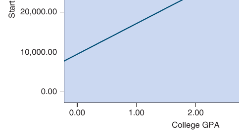

*Figure 15.12 Regression line showing the relationship between GPA and starting salary.*

The basic idea of regression analysis is to obtain the **regression equation**. This equation defines the **regression line** that best fits the pattern of observations in your data. Although regression analysis can be used with curvilinear data, we only discuss linear relationships in this text. You can see a regression line in Figure 15.12, which is the scatterplot of college GPA and starting salary with the regression line inserted.

```python
You might remember from your high school algebra class that the two important characteristics of a line are the slope and the *Y*-intercept. The slope tells you how steep the line is, and the *Y*-intercept tells you where the line crosses the *Y* axis (i.e., the vertical axis). The slope and the *Y*-intercept are two of the components of the regression equation for a regression line as follows: where

```
> (called *Y*-hat) is the predicted value of the dependent variable is the slope (it’s called the regression coefficient), and is the single independent variable.

Now we provide the regression equation for the regression line shown in Figure 15.12. The dependent variable (*Y*) is starting salary, and the independent or predictor variable (*X* ) is GPA. You will be glad to know that researchers rarely, if ever, calculate 1 the regression equation by hand! Instead, they use statistical programs such as SPSS or SAS (which is exactly what we did). Here is the regression equation:

***Y**-intercept** is defined as the point where the regression line crosses the *Y*-axis. In our regression equation, the *Y*-intercept is &#36;9,405.55. Therefore, the regression line shown in Figure 15.12 crosses the *Y*-axis at exactly &#36;9,405.55. This is the predicted starting salary if a person had a GPA of 0 (i.e., an *F* average).

The **regression coefficient** is defined as the predicted change in the dependent variable (*Y*), given a one-unit change in the independent variable (*X*). The regression coefficient or slope in our example is &#36;7,687.48. This regression coefficient says

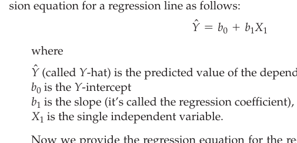

*Diagram*

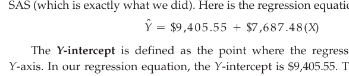

*Diagram*

<!-- Page 23 -->
that starting salary is expected to increase by &#36;7,687.48 for every one unit increase in GPA (or decrease by &#36;7,687.48 for every one unit decrease in GPA). For example, a student with a 3 on the GPA variable (i.e., a *B*) is predicted to start at a salary of &#36;7,687 *more* than a student with a 2 (i.e., a *C*). We used the traditional grading scale ( *A* = 4, *B* = 3, *C* = 2, *D* = 1, *F* = 0).

The regression equation can be used to obtain predicted values for the dependent variable for specific values of the independent variable. For example, let’s see what the predicted starting salary is for a student with a college GPA of 3 (i.e., a *B* average):

> *Y* n = + 9,405.55 + + 7,687.48(3.00)  We inserted the GPA value of 3.00

> *Y* n = + 9,405.55 + + 23,062.44 We multiplied &#36;7,687.48 by 3.00

> *Y* n = + 32,467.99 We added &#36;9,405.55 and &#36;23,062.44

The expected starting salary is &#36;32,467.99. As an exercise, you should use the equation and determine the predicted starting salary for someone with a *C* average (i.e., a GPA value of 2). Just insert a 2 into the equation and solve it. You will find that the predicted starting salary is &#36;24,780.51. Notice that the difference between the starting salary for someone with a *C* and a *B* is equal to the value of the regression coefficient (i.e., &#36;32,467.99 minus &#36;24,780.51 is &#36;7,687.48). That confirms our statement that the regression coefficient shows the change in the dependent variable, given a one unit change in the independent variable.

Multiple regression is similar to simple regression except that it uses *two or* *more* independent or predictor variables. A multiple regression equation includes one regression coefficient for each independent variable. An important and highly useful difference between the simple regression and multiple regression is that the multiple regression coefficient shows the relationship between the dependent variable and the independent variable *controlling for the other independent variable(s)* *in the equation*. This is analogous to the idea discussed earlier with partial correlation, and, not surprisingly, the multiple regression coefficient is called the **partial** **regression coefficient**.

In simple regression, the relationship examined via the regression coefficient is analogous to a Pearson correlation, which does not control for any confounding variables. In multiple regression, the relationship is analogous to partial correlation in which one or more variables are “partialled out” or “controlled for.” Therefore, multiple regression provides one way that you can control for one or more variables. The difference in the actual values of the correlation and regular (unstandardized) regression coefficients is that correlation coefficients are in standardized units that vary from - 1.00 to + 1.00, and regular regression coefficients are in natural units. For example, the partial correlation coefficient expressing the relationship between starting salary and GPA controlling for SAT scores is.413 (suggesting a moderately strong positive relationship), and the partial regression coefficient is &#36;4,788.90 (which says that controlling for SAT scores, each unit change in GPA is predicted to lead to a &#36;4,788.90 change in income).

Using the data from our hypothetical college student data set, we used SPSS to provide the following multiple regression equation that is based on the dependent variable of starting salary and the predictor variables of GPA and high school SAT:

*Y* n where

*X* is grade point average, and 1

*X* is high school SAT. 2

The first partial regression coefficient in the preceding regression equation is &#36;4,788.90, which says that after controlling for SAT scores, starting salary increases by &#36;4,788.90 for each one-unit increase in GPA. The second partial regression coefficient is

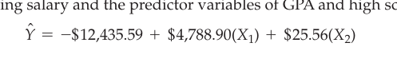

*Diagram*

<!-- Page 24 -->
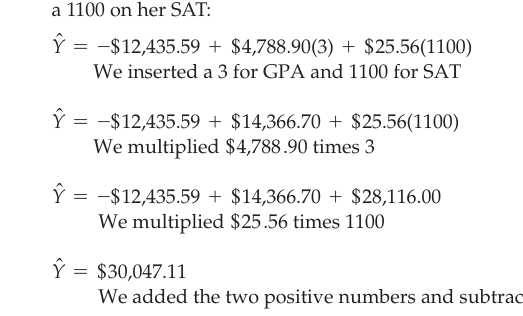

*Diagram*

> &#36;25.56, which says that after controlling for GPA, starting salary increases by &#36;25.56 for each one-unit increase in SAT. According to this equation, it is important to do well on your SATs and GPA!

> If you would like to obtain a predicted starting salary using our multiple regression equation, you insert the values for GPA and SAT and solve for *Y*-hat. Here is an example where we checked for the predicted starting salary for a B student who had a 1100 on her SAT:

We inserted a 3 for GPA and 1100 for SAT

> We added the two positive numbers and subtracted the negative number

> The predicted starting salary is &#36;30,047.11. You can put any other valid values into this regression equation for GPA and SAT and obtain the predicted starting salary.

### Contingency Tables

When you have a categorical dependent variable and a categorical independent variable, one basic technique is to construct a contingency table (also called Table used to cross-tabulation).  A  **contingency table** is a table displaying information in cells formed by the intersection of two or more categorical variables. In a two-dimension contingency table, which is what we explain here, there are only two variables; the rows represent the categories of one of the variables and the columns represent the categories of the other variable. Depending on your needs, various types of information can be placed into the cells of a contingency table, such as cell frequencies, cell percentages, row percentages, and column percentages. You can see a contingency table with cell frequencies in Table 15.5(a) and a contingency table with column percentages in the cells in Table 15.5(b). Remember, our data for this example (just like our other examples) are hypothetical; we constructed the data set to make the example instructive and interesting.

> Look at the contingency Table 15.5(a). You can see that the column variable is gender (i.e., female or male). The row variable is personality type. People with typeA personality are more likely to be impatient, competitive, irritable, high achieving, engage in multitasking, and feel a sense of urgency. People with type-B personality are more likely to be cooperative, less competitive, more relaxed, more patient, more satisfied, and easygoing. The research question is whether there is a relationship between gender and personality types. The cells in Table 15.5(a) contain cell frequencies. Do you think that you see a relationship between gender and personality type based on your examination of Table 15.5(a)? That is, does gender seem to predict

> 3 If you want to determine which of the variables in a multiple regression are more strongly related to starting salary (controlling for the other variables in the equation), take the values for “part correlation” for each independent/predictor variable from the SPSS printout and square them; then just see which one is the largest, second largest,... and smallest. This index is called the *semi-partial correlation squared*. It tells you the amount of variance or variation in the DV that is uniquely explained by each IV. The variable that explains the most variance is the most important  variable, and the variable that explains the least variance is the least important variable (statistically speaking).

<!-- Page 25 -->
(a) Contingency Table Showing Cell Frequencies (hypothetical data)

Female Personality Type A 2,972 Type Type B 1,921 4,893 (b) Contingency Table Showing Column Percentages (based on the data in part (a))

Female Personality Type A Gender Male 2,460 971 3,431

Gender Male percentage is 2,972 divided by 4,893, which is.607, or in percentage form it is 60.7%. The number of females in the other cell is 1,921; therefore, this percentage is 39.3%. Notice that these two column percentages add up to 100%. In the table, we also calculated the column percentages for men.

Now look at Table 15.5(b), and try to determine if gender and personality type are related. When we converted the raw numbers to column percentages, we obtained group **rates**. The correct way to read this table is to compare across the columns. On reading the table this way, one can see that 60.7% of females were type A, but 71.7% of the men were type A. In other words, men had a greater rate of type-A personality than women. Now let’s look at type-B personality. The rates for type-B personality are 39.3% for females and 28.3% for men; therefore, women have a higher rate of type-B personality than men. That’s how these two variables are related with our hypothetical  data.

**Table 15.5** *Personality Type by Gender Contingency Tables*

60. 7%
71. 7% Type Type B
39. 3%
28. 3% 100% 100% personality type? Do not look at Table 15.5(b) yet! Do you think that women tend to be type A more than men tend to be type A? Although it is important to report cell frequencies, it is very difficult to determine how the two variables are related based on cell frequencies alone. In Table 15.5(b), we have calculated what are called column percentages for females and males. To obtain a column percentage, divide the cell frequency by the total frequency for the column (and then move the decimal point so that you have a percentage). For example, there are 2,972 females in column one, and there are a total of 4,893 females. This column

Generally speaking, we recommend that you make your predictor variable the column variable and make your dependent variable the row variable. Then calculate column percentages and compare the rates across the rows. That’s what we did in Table 15.5(b). In order to correctly read a contingency table, you need to remember these two simple rules:

> - If the percentages are calculated down the columns, then compare across the rows.

- If the percentages are calculated across the rows, then compare down the columns.

These rules should come in handy because rates are frequently reported in the news and are frequently used in some types of research (e.g., epidemiology), and now you will know how rates are obtained and how the comparisons should be made. For more advanced research, you can extend the ideas presented by adding another (a third) independent or predictor variable. To do this you would construct the twoway table within the categories of the additional variable. But we will leave that for a more advanced course on data analysis.

<!-- Page 26 -->
> [!TIP] **Study Question 15.6**
> What are the techniques for describing relationships between variables? When is each technique used?

### Summary

The purpose of descriptive statistics is to describe and summarize the characteristics of a set of data. Many of the procedures in this chapter are demonstrated with the data set provided in Table 15.1. That data set includes four quantitative variables (starting sal- ary, GPA, SAT scores, and number of school days missed in college) and two categorical variables (college major and gender). Variables are often summarized one at a time, but multivariable descriptive analyses also are important. Descriptive procedures discussed in this chapter include frequency distributions, graphics (bar graphs, histograms, line graphs, and scatterplots), measures of central tendency (mean, median, and mode), measures of variability (range, variance, and standard deviation), and the analysis of relationships among two or more variables (unstandardized difference between two means, effect size indicators, correlation coefficients, partial correlation coefficients, sim- ple and multiple regression, and contingency tables). When your independent variable is categorical and your dependent variable is quantitative, group means are compared to see how the variables are related. When your independent and dependent variables are both categorical, use a contingency table to examine the relationship. When your independent and dependent variables are both quantitative, the data are plotted in a scatterplot, a correlation coefficient is computed, or a regression analysis is conducted.

## 🗂️ Chapter Key Terms & Active Recall

> 💡 **Learning tip:** Try to recall the definition of each term *before* clicking to reveal it.
> This active retrieval practice strengthens long-term memory far more than re-reading.

<details id="flashcard-descriptive-statistics">
<summary>📇 <b>Descriptive statistics</b> *(p. 2)*</summary>

> **Definition:** The type of statistical analysis focused on describing, summarizing, or explaining a set of data

</details>

<details id="flashcard-inferential-statistics">
<summary>📇 <b>Inferential statistics</b> *(p. 2)*</summary>

> **Definition:** The type of statistical analysis focused on making inferences about populationons based on sample data

</details>

<details id="flashcard-data-set">
<summary>📇 <b>Data set</b> *(p. 2)*</summary>

> **Definition:** A set of data, where the rows are “cases” and the columns are “variables”

</details>

<details id="flashcard-frequency-distribution">
<summary>📇 <b>Frequency distribution</b> *(p. 4)*</summary>

> **Definition:** Data arrangement in which the frequencies of each unique data value is shown

</details>

<details id="flashcard-bar-graph">
<summary>📇 <b>Bar graph</b> *(p. 5)*</summary>

> **Definition:** Graph that uses vertical bars to represent the data values of a categorical variable

</details>

<details id="flashcard-histogram">
<summary>📇 <b>Histogram</b> *(p. 6)*</summary>

> **Definition:** Graph depicting frequencies and distribution of a quantitative variable

</details>

<details id="flashcard-line-graph">
<summary>📇 <b>Line graph</b> *(p. 6)*</summary>

> **Definition:** A graph relying on the drawing of one or more lines connecting data points

</details>

<details id="flashcard-scatterplot">
<summary>📇 <b>Scatterplot</b> *(p. 8)*</summary>

> **Definition:** A graphical depiction of the relationship between two quantitative variables

</details>

<details id="flashcard-measure-of-central-tendency">
<summary>📇 <b>Measure of central tendency</b> *(p. 10)*</summary>

> **Definition:** Numerical value expressing what is typical of the values of a quantitative variable

</details>

<details id="flashcard-mode">
<summary>📇 <b>Mode</b> *(p. 10)*</summary>

> **Definition:** The most frequently occurring number

</details>

<details id="flashcard-median">
<summary>📇 <b>Median</b> *(p. 10)*</summary>

> **Definition:** The center point in an ordered set of numbers

</details>

<details id="flashcard-mean">
<summary>📇 <b>Mean</b> *(p. 10)*</summary>

> **Definition:** The arithmetic average

</details>

<details id="flashcard-measure-of-variability">
<summary>📇 <b>Measure of variability</b> *(p. 11)*</summary>

> **Definition:** Numerical value expressing how spread out or how much variation is present in the values of a quantitative variable

</details>

<details id="flashcard-range">
<summary>📇 <b>Range</b> *(p. 12)*</summary>

> **Definition:** The highest number minus the lowest number

</details>

<details id="flashcard-variance">
<summary>📇 <b>Variance</b> *(p. 12)*</summary>

> **Definition:** The average deviation of data values from their mean in squared units

</details>

<details id="flashcard-standard-deviation">
<summary>📇 <b>Standard deviation</b> *(p. 12)*</summary>

> **Definition:** The square root of the variance

</details>

<details id="flashcard-normal-distribution">
<summary>📇 <b>Normal distribution</b> *(p. 12)*</summary>

> **Definition:** A theoretical distribution that follows the 68, 95,

</details>

<details id="flashcard-score-z">
<summary>📇 <b>score z</b> *(p. 13)*</summary>

> **Definition:** A score that has been transformed into standard deviation units

</details>

<details id="flashcard-unstandardized-difference-between-means">
<summary>📇 <b>Unstandardized difference between  means</b> *(p. 15)*</summary>

> **Definition:** The difference between two means in the variables’ natural units

</details>

<details id="flashcard-cohen-s-d">
<summary>📇 <b>Cohen’s d</b> *(p. 16)*</summary>

> **Definition:** The difference between two means in standard deviation units

</details>

<details id="flashcard-effect-size-indicator">
<summary>📇 <b>Effect size indicator</b> *(p. 16)*</summary>

> **Definition:** Index of magnitude or strength of a relationship or difference between means

</details>

<details id="flashcard-correlation-coefficient">
<summary>📇 <b>Correlation coefficient</b> *(p. 17)*</summary>

> **Definition:** Index indicating the strength and direction of linear relationship between two quantitative variables

</details>

<details id="flashcard-negative-correlation">
<summary>📇 <b>Negative correlation</b> *(p. 18)*</summary>

> **Definition:** Correlation in which values of two variables tend to move in opposite directions

</details>

<details id="flashcard-positive-correlation">
<summary>📇 <b>Positive correlation</b> *(p. 18)*</summary>

> **Definition:** Correlation in which values of two variables tend to move in the same direction

</details>

<details id="flashcard-curvilinear-relationship">
<summary>📇 <b>Curvilinear relationship</b> *(p. 20)*</summary>

> **Definition:** A nonlinear (curved) relationship between two quantitative variables

</details>

<details id="flashcard-curvilinear-regression">
<summary>📇 <b>Curvilinear regression</b> *(p. 21)*</summary>

> **Definition:** The type of regression analysis that can accurately model curved relationships

</details>

<details id="flashcard-partial-correlation-coefficient">
<summary>📇 <b>Partial correlation coefficient</b> *(p. 21)*</summary>

> **Definition:** The correlation between two quantitative variables controlling for one or more variables

</details>

<details id="flashcard-regression-analysis">
<summary>📇 <b>Regression analysis</b> *(p. 21)*</summary>

> **Definition:** Use of one or more quantitative independent variables to explain or predict the values of a single quantitative dependent variable

</details>

<details id="flashcard-simple-regression">
<summary>📇 <b>Simple regression</b> *(p. 21)*</summary>

> **Definition:** Regression analysis with one dependent variable and one independent variable

</details>

<details id="flashcard-multiple-regression">
<summary>📇 <b>Multiple regression</b> *(p. 21)*</summary>

> **Definition:** Regression analysis with one dependent variable and two or more independent variables

</details>

<details id="flashcard-regression-equation">
<summary>📇 <b>Regression equation</b> *(p. 22)*</summary>

> **Definition:** The equation that defines a regression line

</details>

<details id="flashcard-regression-line">
<summary>📇 <b>Regression line</b> *(p. 22)*</summary>

> **Definition:** The line of “best fit” based on a regression equation

</details>

<details id="flashcard-y-intercept">
<summary>📇 <b>Y -intercept</b> *(p. 22)*</summary>

> **Definition:** The point at which a regression line crosses the (vertiY cal) axis

</details>

<details id="flashcard-regression-coefficient">
<summary>📇 <b>Regression coefficient</b> *(p. 22)*</summary>

> **Definition:** The slope or change in given a one unit Y change in X

</details>

<details id="flashcard-partial-regression-coefficient">
<summary>📇 <b>Partial regression coefficient</b> *(p. 23)*</summary>

> **Definition:** The regression coefficient in a multiple regression equation

</details>

<details id="flashcard-contingency-table">
<summary>📇 <b>Contingency table</b> *(p. 24)*</summary>

> **Definition:** examine the relationship between categorical variables

</details>

<details id="flashcard-rates">
<summary>📇 <b>Rates</b> *(p. 25)*</summary>

> **Definition:** The percentage of people in a group that have a particular characteristic

</details>


<a id="key-terms-and-concepts"></a>
### Key Terms and Concepts

| Term | Term | Term |
| --- | --- | --- |
| [68, 95, 99.7 percent rule *p. 306*](#term-68-95-99-7-percent-rule) | [Line graph *p. 300*](#term-line-graph) | [Rates *p. 319*](#term-rates) |
| [Bar graph *p. 299*](#term-bar-graph) | [Mean *p. 304*](#term-mean) | [Regression analysis *p. 315*](#term-regression-analysis) |
| [Cohen’s d *p. 310*](#term-cohen-s-d) | [Measure of central tendency *p. 304*](#term-measure-of-central-tendency) | [Regression coefficient *p. 316*](#term-regression-coefficient) |
| [Contingency table *p. 318*](#term-contingency-table) | [Measure of variability *p. 305*](#term-measure-of-variability) | [Regression equation *p. 316*](#term-regression-equation) |
| [Correlation coefficient *p. 311*](#term-correlation-coefficient) | [Median *p. 304*](#term-median) | [Regression line *p. 316*](#term-regression-line) |
| [Curvilinear regression *p. 315*](#term-curvilinear-regression) | [Mode *p. 304*](#term-mode) | [Scatterplot *p. 302*](#term-scatterplot) |
| [Curvilinear relationship *p. 314*](#term-curvilinear-relationship) | [Multiple regression *p. 315*](#term-multiple-regression) | [Simple regression *p. 315*](#term-simple-regression) |
| [Data set *p. 296*](#term-data-set) | [Negative correlation *p. 312*](#term-negative-correlation) | [Standard deviation *p. 306*](#term-standard-deviation) |
| [Descriptive statistics *p. 296*](#term-descriptive-statistics) | [Normal distribution *p. 306*](#term-normal-distribution) | Unstandardized difference |
| [Effect size indicator *p. 310*](#term-effect-size-indicator) | [Partial correlation coefficient *p. 315*](#term-partial-correlation-coefficient) | [between means *p. 309*](#term-between-means) |
| [Frequency distribution *p. 298*](#term-frequency-distribution) | [Partial regression coefficient *p. 317*](#term-partial-regression-coefficient) | [Variance *p. 306*](#term-variance) |
| [Histogram *p. 300*](#term-histogram) | [Positive correlation *p. 312*](#term-positive-correlation) | [Y-intercept *p. 316*](#term-y-intercept) |
| [Inferential statistics *p. 296*](#term-inferential-statistics) | [Range *p. 306*](#term-range) | [z score *p. 307*](#term-z-score) |

### Related Internet Sites

- <http://www.statsoft.com/textbook/>
  This is an online statistics book. You can also look up the concepts in this chapter.

- <http://wise.cgu.edu>
  This site includes lots of statistics-related learning materials, including “applets” that demonstrate statistics.

<!-- Page 27 -->
### Practice Test

*The answers to these questions can be found in the Appendix.*

**1.** What is the median of the following set of scores: 18,
11, 12, 10, 9?
a.  10
b.  11
c.  18
d.  12

**2.** The standard deviation is
a.  A measure of variability in squared units
b.  A measure of central tendency
c.  The square root of the variance
d.  All of the above

**3.** In a normal distribution, 99.7% of the scores fall be-
tween *z* scores of a. - 1 through + 1 b. - 2 through + 2 c. - 3 through + 3
d.  0 through
+ 3

**4.** On the normal curve, the mean, median, and mode
are __________.

a.  The same
b.  Different
c.  The mean is greater than the mode.
d.  The mean is less than the mode.

**5.** In a simple regression, the regression coefficient tells
you
a.  The mean of the variable
b.  The point where the regression line crosses the
*X*-axis
c.  The amount of change in the dependent variable
per unit change in the independent variable
d.  The amount of change in the independent variable
per one unit change in the dependent variable

**6.** A contingency table is
a.  A frequency distribution for a single variable
b.  A table displaying information in cells formed
by the intersection of two or more categorical variables.
c.  A table containing correlation coefficients
d.  A normal curve representation of two variables

### Challenge Exercises

1.  What is the standard deviation of the following data? Here is the information you will need: 2 (*X* -
*X* )
a Variance =
*n*
*Note*:
The standard deviation is the square root of the variance.
**X**
1 3 1 2 2 3
a.  1.67
b.  .67
c.  .82
d.  .89

2.  Let’s suppose we are predicting scores on a training posttest from number of years of education and the score on an aptitude test given before training. Here is the regression equation n
*Y*
25 + .5*X* + 10*X* = 1 2 where
*X*
= years of education 1
*X*
aptitude test score. = 2 What is the predicted score for someone with 10 years of education and an aptitude test score of 5?
a.  25
c.  35
d.  80
b.  50
3.  You will recall that we claimed that when you convert a set of numbers into *z* scores, the new converted set of numbers will have a mean of zero and a standard deviation of
1. Check to see if our claim was correct by converting the following scores into *z* scores: 1, 2, 21, 22, 48, 59, 91, 100.

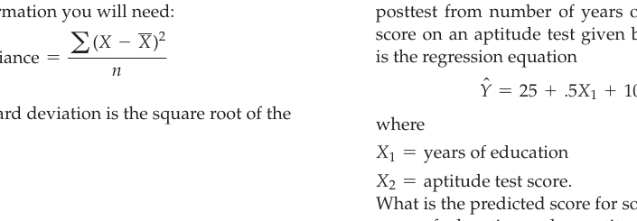

*Diagram*


<!-- OBSIDIAN_NAV_START -->
---

<div align="center">

← [[ch14_qualitative_and_mixed_methods_research|Ch14 Qualitative and Mixed Methods Research]] &nbsp;&nbsp;|&nbsp;&nbsp; [[ch16_inferential_statistics|Ch16 Inferential Statistics]] →

</div>
<!-- OBSIDIAN_NAV_END -->
