

📑 <b>Table of Contents</b>

- [Chapter 16 Inferential Statistics](#chapter-16-inferential-statistics)
  - [Learning Objectives](#learning-objectives)
- [Sampling Distributions](#sampling-distributions)
- [Estimation](#estimation)
- [Hypothesis Testing](#hypothesis-testing)
  - [Directional Alternative Hypotheses](#directional-alternative-hypotheses)
  - [Review of the Logic of Hypothesis Testing](#review-of-the-logic-of-hypothesis-testing)
  - [Hypothesis-Testing Errors](#hypothesis-testing-errors)
- [Hypothesis Testing in Practice](#hypothesis-testing-in-practice)
  - [The t Test for Correlation Coefficients](#the-t-test-for-correlation-coefficients)
  - [One-Way Analysis of Variance](#one-way-analysis-of-variance)
  - [Post Hoc Tests in Analysis of Variance](#post-hoc-tests-in-analysis-of-variance)
  - [Analysis of Covariance](#analysis-of-covariance)
  - [Two-Way Analysis of Variance](#two-way-analysis-of-variance)
  - [One-Way Repeated Measures Analysis of Variance](#one-way-repeated-measures-analysis-of-variance)
  - [The t Test for Regression Coefficients](#the-t-test-for-regression-coefficients)
- [Nonparametric Statistics](#nonparametric-statistics)
  - [Chi-Square Test for Independence](#chi-square-test-for-independence)
  - [Other Significance Tests](#other-significance-tests)
- [Hypothesis Testing and Research Design](#hypothesis-testing-and-research-design)
  - [Summary](#summary)
  - [Key Terms and Concepts](#key-terms-and-concepts)
  - [Related Internet Sites](#related-internet-sites)
  - [Practice Test](#practice-test)
  - [Challenge Exercises](#challenge-exercises)

<!-- Page 1 -->
## Chapter 16 Inferential Statistics

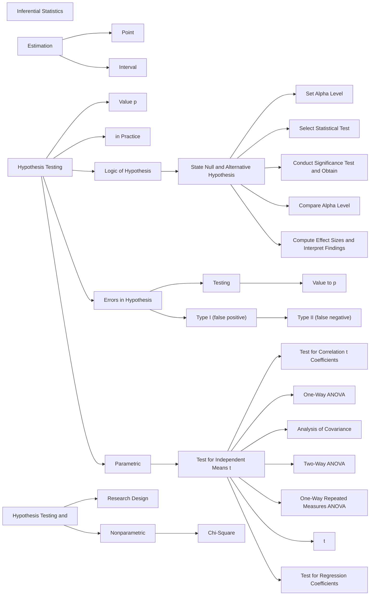

### Learning Objectives

🎯 **16.1** Summarize the purpose of a sampling distribution.
🎯 **16.2** Distinguish between the two types of statistical estimation.
🎯 **16.3** Describe the purpose and procedure of hypothesis testing.
🎯 **16.4** Use different statistical analysis techniques for hypothesis testing.
🎯 **16.5** Describe the purpose of nonparametric statistical tests.
🎯 **16.6** Identify the appropriate statistical analysis for each type of research design.

<!-- Page 2 -->
In Chapter 15, we discussed descriptive statistics, which are used to describe and summarize the numerical characteristics of a set of data. In inferential statistics (the topic of the current chapter), researchers attempt to go beyond their data. The two major divisions within inferential statistics are *estimation* and *hypothesis testing* (see Figure 15.1 on page 296). In estimation, the goal is to estimate the value of populationon parameters. In hypothesis testing, the goal is to test hypotheses about populationon parameters.

In inferential statistics, researchers use **sample** data to make generalizations about **populationons**. If you calculate a numerical index such as a mean or a correlation coefficient on sample data, it is called a **statistic**. If you were able to calculate a numerical index (such as a mean or a correlation coefficient) using the data from an entire populationon, it would be called a populationon **parameter**. The goal in inferential statistics is to understand populationon parameters. Researchers must use sample data to understand populationons because it is rarely feasible to collect data from everyone in the populationon of interest. Random sampling is assumed in inferential statistics because these samples follow the laws of probability and allow researchers to make warranted claims about populationon parameters. Researchers use different symbols to represent statistics and parameters. For example, if you calculated the mean annual income in a sample, the mean is symbolized with *X* (“*X* bar”), 1 but if you calculated the mean with the entire populationon, it is symbolized with the Greek letter $\mu$ (“mu”). Researchers use symbols like these to help them keep information about samples and populationons separate. Interestingly, the convention is to use Roman letters to represent sample statistics, but to use Greek letters to represent populationon parameters. Perhaps that’s why some students say “Statistics is like Greek to me!” In Table 16.1, we list several symbols commonly used in inferential statistics.

**Table 16.1** *Commonly Used Symbols for Sample Statistics and Their Associated Population Parameters*

<table class="textbook-table" style="width: auto; max-width: 100%; border-collapse: collapse; margin: 1.5em 0;">
  <thead>
    <tr>
      <th>Numerical Index</th>
      <th>Sample Statistic</th>
      <th>Population Parameter</th>
    </tr>
  </thead>
  <tbody>
    <tr>
      <td>Mean</td>
      <td>X ( X bar)</td>
      <td>(mu)</td>
    </tr>
    <tr>
      <td>Standard deviation</td>
      <td>SD (or s )</td>
      <td>$\sigma$ (sigma)</td>
    </tr>
    <tr>
      <td>Variance</td>
      <td>2 2 SD (or s )</td>
      <td>$\sigma^{2}$ (sigma squared)</td>
    </tr>
    <tr>
      <td>Correlation coefficient</td>
      <td>r</td>
      <td>$\rho$ (rho)</td>
    </tr>
    <tr>
      <td>Proportion</td>
      <td>p</td>
      <td>$\pi$ (pi)</td>
    </tr>
    <tr>
      <td>Regression coefficient</td>
      <td>b</td>
      <td>$\beta$ (beta)*</td>
    </tr>
    <tr>
      <td>coefficient for sample data, and 1</td>
      <td>$\beta$ - , which is used to symbolize the statistical power of a significance test. In 1</td>
      <td>$\beta$ - , beta refers to</td>
    </tr>
    <tr class="category-header"><td colspan="3"><strong>the probability of making a Type II error.</strong></td></tr>
    <tr class="category-header"><td colspan="3"><strong>1</strong></td></tr>
  </tbody>
  <tfoot>
    <tr class="table-notes"><td colspan="3"><em>* Beta has two other common uses not to be confused with the populationon regression coefficient, including the standardized regression</em></td></tr>
  </tfoot>
</table>

## Sampling Distributions

🎯 **16.1** Summarize the purpose of a sampling distribution.

Inferential statistics relies on “sampling distributions” for making probability statements about populationon parameters based on sample data. A sampling distribution is not something you would ever have to construct yourself, but it is important to understand the concept. A **sampling distribution** is the theoretical probability distribution of the values of a sample statistic that would result from all possible samples of a particular size drawn from a populationon.

To make this idea more concrete, here is how a **sampling distribution of the mean** could be constructed: Draw a random sample of a certain size from the populationon, calculate and write down the value of the income sample mean. Then, draw another random sample (of the same size), calculate and write down the value of this sample $\mu$

In APA writing style, the sample mean is referred to as “*M.*”

<!-- Page 3 -->
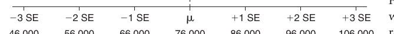

*Figure  16.1, where the mean income (i.e., X) was determined for an infinite number of random samples. First, the average of all the 1 1*

*Figure 16.1 Hypothetical sampling distribution of the mean for income variable. SE stands for standard error.*

mean. Continue this process an infinite number of times or until all possible samples of a particular size (e.g., 30 people per sample) have been recorded. Then display all of the sample means obtained. If you construct a line graph of all of these sample means, you will have a depiction of your sampling distribution of the mean. You can see the picture of a sampling distribution of the mean that we constructed in Figure 16.1. In our hypothetical *sampling distribution of the mean*, the average income is &#36;76,000 and the standard error (i.e., its standard deviation) is &#36;10,000.

You need to notice two key characteristics of the sampling distribution shown in bution of the mean is equal to the true populationon mean (i.e., $\mu$ ). This happens when random sampling, which is an “unbiased” sampling process, is used to obtain the participants for the samples. In this example, the average of all the sample means is &#36;76,000, which is also the true mean income in the entire populationon.

Second, notice that the sample value of the mean income (i.e., *X*) for a particular sample is rarely the exact same value as the populationon mean (i.e., $\mu$ ). The means of the samples vary around the true populationon mean. Moreover, you can see that these sample means follow a normal distribution, which indicates that most of the sample means are relatively close to the populationon mean and sample means with values very far from the populationon mean are uncommon. Because the sampling distribution of the mean is a normal distribution, the sample means follow the 68, 95, 99.7% rule (defined in Chapter 15). That is, 68% of the sample means in the sampling distribution of the mean are within one standard deviation of the true populationon mean, 95% are within two standard deviations, and 99.7% are within three standard deviations. Rather than using the term “standard deviation” like we just did, however, **standard** **error** is the term that is used to refer to the standard deviation of a sampling distribution. The standard error is a special kind of standard deviation; *it’s the standard* *deviation of a sampling distribution.* Now look at Figure 16.1 one more time. Because the populationon mean is &#36;76,000 and the standard error is &#36;10,000, you can see that 68% of the sample means fall between &#36;66,000 and &#36;86,000 (i.e., &#36;76,000 plus or minus one standard error, which is &#36;10,000), 95% fall between &#36;56,000 and &#36;96,000 (i.e., &#36;76,000 plus or minus two standard errors, which is &#36;20,000), and 99.7% fall between &#36;46,000 and &#36;106,000 (i.e., &#36;76,000 plus or minus three standard errors, which is &#36;30,000).

Although we have used the example of constructing a sampling distribution for sample means, a sampling distribution can be constructed for any sample statistic. For example, you could have a sampling distribution of the correlation coefficient and a sampling distribution of the regression coefficient. In hypothesis testing, discussed later, researchers rely on sampling distributions of “test statistics.” A **test statistic** is a sample statistic (e.g., difference between means, correlation coefficient, regression coefficient) that has been converted into a statistic that follows a known sampling distribution that is convenient to work with for obtaining probability values and testing hypotheses. Some commonly used sampling distributions for test statistics are the *z* distribution, *t* distributions, *F* distributions, and chi-square (i.e., $\chi^{2}$ ) distributions.

Fortunately, you will never have to construct a sampling distribution! In practice you select only one sample, and the computer package you use to analyze your data <!-- Page 4 -->
estimates the appropriate sampling distribution for you. The key point here is that the values of sample statistics such as means, percentages, correlation coefficients, and test statistics vary around the true populationon value in a known, probabilistic way. This is why empirical research claims are always probabilistic (i.e., statements of what is probably true) rather than certain or absolute.

> [!TIP] **Study Question 16.1**
> What is a sampling distribution?

## Estimation

🎯 **16.2** Distinguish between the two types of statistical estimation.

Estimation is one of the two major types of inferential statistics. In **estimation**, your goal is to answer this question: “Based on my random sample, what is my estimate of the populationon parameter?”

You can provide two kinds of “estimates” using your sample data. First, you can use the value of the statistic in your sample, such as the mean, to estimate the populationon value. For example, if you were estimating the mean income in a populationon, you would take the mean value of the participants’ income in your sample (e.g., perhaps it is &#36;50,000) and use it as your best guess of the populationon mean (i.e., the average income of everyone in the populationon). This is called point estimation because you use one number in your sample to estimate the one number (point) of interest in the populationon. In **point estimation**, researchers use the value of a sample statistic as the  estimate of the value of a populationon parameter.

You will recall from our discussion of sampling distributions that sample statistics (such as the mean) jump around from sample to sample and that the value of the sample statistic rarely is *exactly* the same as the value of the populationon parameter. Because of this probabilistic nature of sample statistics, researchers usually prefer to use interval estimation. In **interval estimation**, the researcher puts a confidence interval around the point estimates. For example, if the mean income in a sample is &#36;49,000, the researcher might use a statistical program (such as R, SPSS, or SAS) to obtain an interval estimate (also called a confidence interval) around the sample mean of &#36;49,000. Perhaps the “95% confidence interval” is “&#36;44,000 to &#36;54,000.”

A **confidence interval** is a range of numbers inferred from the sample that has a certain probability or chance of including the true populationon value. When the researcher uses a 95% confidence interval, he or she can be 95% confident that the interval includes the populationon parameter because this type of confidence interval will capture or include the true populationon parameter 95% of the time. This idea is demonstrated in Figure 16.2. Notice in the figure that 19 of the 20 (i.e., 95%) confidence intervals captured the true populationon mean, but one (i.e., 5%) missed the populationon mean. We set up the figure this way so that you can see that the confidence the researcher has is in the long-term process of constructing confidence intervals, not in a single interval.

We pointed out that 95% confidence intervals capture the true populationon value 95% of the time. If a researcher uses a 99% confidence interval, then this type of interval will include the true populationon value 99% of the time, and a 68% confidence interval will include the true value 68% of the time. You might wonder, why not just use a 99% confidence interval so that the researcher can be more confident. The answer is that this increased confidence (e.g., moving from 95% to 99% confident) comes with

<!-- Page 5 -->
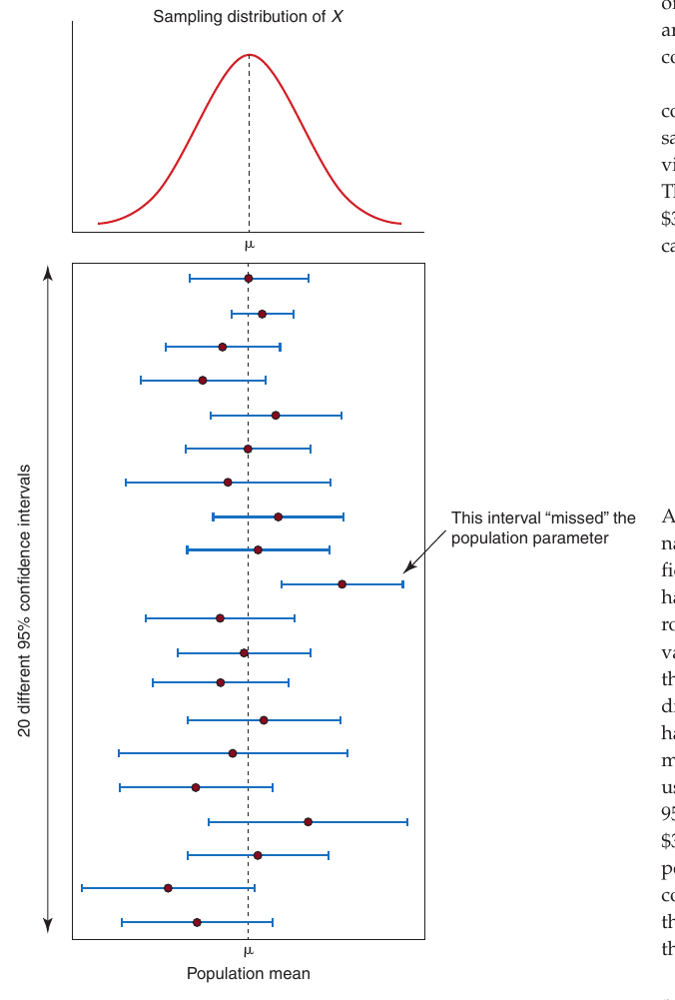

*Figure 16.2 Sampling distribution of the mean and illustration of the 95% confidence intervals for 20 samples.*

a cost. The 99% interval will have to be wider (i.e., less precise) than a 95% interval on a set

> For a concrete example, we calculated the

&#36;35,386.15 (the width is &#36;4,852.60)

&#36;34,750.29 (the width is &#36;3,580.58)

&#36;34,444.07 (the width is &#36;2,968.77)

&#36;33,840.87 (the width is &#36;1,761.74)

There is one additional factor that you fidence interval—it’s the sample size. The larger the sample size, the more precise (i.e., the narrower) your confidence interval. So if you need a precise (i.e., narrow) confidence interval, then make sure that you include many participants in your research study.

> [!TIP] **Study Questions 16.2**
> - What is statistical estimation?
>
> - What are the two types of estimation?
>
> - What is the difference between a 95% and a 99% confidence interval?

<!-- Page 6 -->
## Hypothesis Testing

🎯 **16.3** Describe the purpose and procedure of hypothesis testing.

**Hypothesis testing** is the branch of inferential statistics concerned with how well sample data support a null hypothesis and when the null hypothesis can be rejected. Unlike estimation, in which the researcher has no clear hypothesis about the populationon parameter, in hypothesis testing the researcher states the null and alternative hypotheses and then uses the data to determine what decision should be made about these hypotheses. The **null hypothesis** is a statement about a populationon parameter; typically, it states that there is no relationship between the independent and dependent variables in the populationon.[^2] The **alternative hypothesis** is the logical opposite of the null hypothesis (i.e., stating that there *is* a relationship between the independent and dependent variables in the populationon).

You can think of the null hypothesis as the hypothesis the researcher hopes to “nullify” because when you reject this hypothesis you conclude that there is a relationship or pattern in the world. A primary goal of science is to identify relationships and patterns in the natural world (especially causal relationships). Hypothesis testing is sometimes called “null hypothesis significance testing” (NHST) because it is the null hypothesis that is directly tested, not the alternative hypothesis. Although the null hypothesis is directly tested in hypothesis testing, your decision about the null hypothesis logically determines your decision about the alternative hypothesis because the alternative hypothesis is the logical opposite of the null hypothesis. If you reject the null hypothesis, you can claim that the data support the alternative hypothesis and claim that a pattern has been found in the world.

To make the concepts of null and alternative hypotheses more concrete, examine Table 16.2 where you can see several examples of research questions, null hypotheses, and alternative hypotheses. The table also shows how the statistical hypotheses are written using Greek symbols for the populationon parameters. The null and alternative hypotheses are written using populationon parameters because the researcher is interested in the populationon (not the sample) in inferential statistics. Later in this chapter, we test the null hypotheses shown in Table 16.2.

According to the *logic of hypothesis testing*, you start by assuming that an effect is  *not* present or that there is *no* true relationship between your independent and dependent variables, and then you determine whether the data warrant rejection of the null hypothesis. The data provide the evidence for evaluating the null hypothesis. Although the researcher states the null hypothesis, which can be tested via hypothesis testing, the researcher ultimately hopes to reject the null hypothesis and accept the alternative hypothesis. This might seem a little backward (i.e., testing a hypothesis that you hope to reject), but that’s how hypothesis testing works—we can only directly test the null hypothesis. Statements about the alternative hypothesis are made on the basis of logic—if the null is very likely *not* true, then the researcher logically concludes that the alternative very likely *is* true.

Here’s an example using the variables gender and starting salary from the data provided in Table 15.1. We will assume that the data make up a sample that was randomly selected from the populationon. In this example, we are interested in whether males or females have higher mean starting salaries in the populationons of male and female recent college graduates. Here are the null and alternative hypotheses:

> Null hypothesis: *H* Alternative hypothesis: *H*

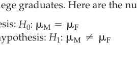

*Diagram*

[^2]: We focus only on the “nil” null hypothesis, which is the hypothesis of no difference between means or no relationship between variables. The nil null hypothesis is by far the most commonly tested null hypothesis. However, one does not have to test a “no difference” null hypothesis. For more information on this issue, see Cohen (1994) and Thompson (2006).

<!-- Page 7 -->
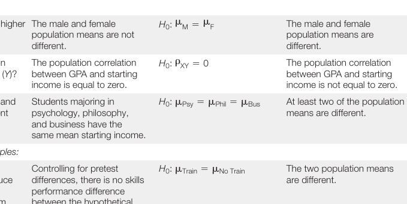

*Diagram*

**Table 16.2** *Examples of Null and Alternative Hypotheses in Inferential Statistics*

<table class="textbook-table" style="width: auto; max-width: 100%; border-collapse: collapse; margin: 1.5em 0;">
  <thead>
    <tr>
      <th></th>
      <th>Verbal Null (H0)</th>
      <th>SymbolicH0</th>
      <th>Verbal Alternative (H1)</th>
      <th>SymbolicH1</th>
    </tr>
  </thead>
  <tbody>
    <tr>
      <td>Research Question</td>
      <td>Hypothesis</td>
      <td>Hypothesis</td>
      <td>Hypothesis</td>
      <td>Hypothesis</td>
    </tr>
    <tr>
      <td>Survey research examples:</td>
      <td></td>
      <td>$\mu \mu$</td>
      <td></td>
      <td>$\mu \mu$</td>
    </tr>
    <tr>
      <td>Do males or females have a higher</td>
      <td>The male and female</td>
      <td>H : = 0 M F</td>
      <td>The male and female</td>
      <td>H : ∙ 1 M F</td>
    </tr>
    <tr>
      <td>starting salary?</td>
      <td>populationon means are not different.</td>
      <td>$\rho$</td>
      <td>populationon means are different.</td>
      <td>$\rho$</td>
    </tr>
    <tr>
      <td>Is there a correlation between</td>
      <td>The populationon correlation</td>
      <td>H : 0 = 0 XY</td>
      <td>The populationon correlation</td>
      <td>H : ∙ 0 1 XY</td>
    </tr>
    <tr>
      <td>GPA ( X ) and starting income (</td>
      <td>Y )? between GPA and starting income is equal to zero.</td>
      <td></td>
      <td>between GPA and starting income is not equal to zero.</td>
      <td></td>
    </tr>
    <tr>
      <td>Do psychology, philosophy, and</td>
      <td>Students majoring in</td>
      <td>$\mu \mu$ H : = 0 Psy Phil</td>
      <td>$\mu$ = At least two of the populationon Bus</td>
      <td>H : Not all equal 1</td>
    </tr>
    <tr>
      <td>business majors have different</td>
      <td>psychology, philosophy,</td>
      <td></td>
      <td>means are different.</td>
      <td></td>
    </tr>
    <tr>
      <td>starting incomes?</td>
      <td>and business have the same mean starting income.</td>
      <td></td>
      <td></td>
      <td></td>
    </tr>
    <tr class="category-header"><td colspan="5"><strong>Experimental research examples:</strong></td></tr>
    <tr>
      <td>Does participation in social</td>
      <td>Controlling for pretest</td>
      <td>$\mu \mu$ H : = 0 Train No Train</td>
      <td>The two populationon means</td>
      <td>$\mu \mu$ H : ∙ 1 Train No Train</td>
    </tr>
    <tr>
      <td>skills training condition produce</td>
      <td>differences, there is no skills</td>
      <td></td>
      <td>are different.</td>
      <td></td>
    </tr>
    <tr>
      <td>higher skills performance for</td>
      <td>performance difference</td>
      <td></td>
      <td></td>
      <td></td>
    </tr>
    <tr>
      <td>experimental training program</td>
      <td>between the hypothetical</td>
      <td></td>
      <td></td>
      <td></td>
    </tr>
    <tr>
      <td>participants compared to no</td>
      <td>populationons of people</td>
      <td></td>
      <td></td>
      <td></td>
    </tr>
    <tr>
      <td>treatment control participants?</td>
      <td>receiving the treatment and people not receiving the treatment.</td>
      <td></td>
      <td></td>
      <td></td>
    </tr>
    <tr>
      <td>Does participation in a health</td>
      <td>There is no difference in</td>
      <td>$\mu \mu$ H : = 0 Pretest</td>
      <td>The pretest and posttest Posttest</td>
      <td>$\mu \mu$ ∙ H : 1 Pretest Posttest</td>
    </tr>
    <tr>
      <td>program produce a reduction in</td>
      <td>weight for the hypothetical</td>
      <td></td>
      <td>populationon means are</td>
      <td></td>
    </tr>
    <tr>
      <td>participants’ weight?</td>
      <td>treatment populationon at pretest and posttest.</td>
      <td></td>
      <td>different.</td>
      <td></td>
    </tr>
  </tbody>
</table>

When you have a random sample and wish to engage in hypothesis testing, you will always know if your *sample* means differ (just calculate the means and see if they’re different), but the key question is whether the sample means are different enough for you to *reject* the null hypothesis (stating that the populationon means are equal) and conclude that the observed difference is *not just due to chance.* The goal in hypothesis testing is to make claims about *populationon parameters* based on sample data. The above null hypothesis says the average starting salaries for males and females are the same in their respective populationons. The alternative hypothesis says the male and female populationon means are *not* the same (i.e., they are different).

> Here are the sample means calculated from the data set provided in Table 15.1:

> The average starting salary for males (*X*

> The average starting salary for females (*X*

In the sample data, males earn more than females. However, when we discussed sampling distributions, you learned that the values of sample statistics (such as means and correlation coefficients) vary from sample to sample because of chance variation. In hypothesis testing, we are trying to determine whether the difference between the sample means should be viewed as random variation (i.e., “chance”), or if the difference is large enough, we should conclude that the difference is not likely due to chance variation. If you conclude that the difference is not a chance difference, you are concluding that there is a *real* or true difference in the populationons from which the data were selected.

You need to learn how to determine whether you can reject the null hypothesis and accept the alternative hypothesis. After stating the null and alternative hypotheses, you must decide what alpha level you want to use. The **alpha level** (also called the **level of significance**) is set by the researcher at some small value (typically.05), and it is the point at which the researcher would conclude that the observed value of the sample statistic is sufficiently rare *under the assumption of a true null hypoth-* *esis* that he or she would reject the null hypothesis. The alpha level is set by the

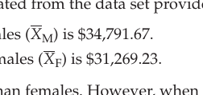

*Diagram*

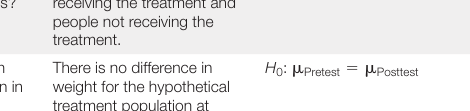

*Diagram*

<!-- Page 8 -->
researcher *before* he or she analyzes the data. By convention, alpha is usually set at.05. If you set alpha at.05, you will incorrectly reject the null hypothesis only 5% of the time or less. That is, you will only conclude 5% of the time that there is a relationship in the populationon, when there really is not a relationship. We will label this error a “Type I” error.

Next, you input the data into a statistical program such as R, SPSS, or SAS and run the appropriate statistical test. (Aren’t you glad you don’t have to do the mathematics by hand!) When the means for two groups of people are being compared, the most common statistical test is the **independent samples** ***t**test**. It’s called a *t* test because it relies on the *t* distribution as its sampling distribution. The *t* distribution serves as the sampling distribution for the *t* test *under the assumption that the null hypothesis is true*. As shown in Figure 16.3, the *t* distribution looks a lot like a normal curve; it’s just a little flatter and a little more spread out than the normal curve. Just like the normal curve, the *t* distribution has a mean of zero, is symmetrical, is higher in the center, and has a “left tail” and a “right tail” that represent rare events. In the figure, we have marked that area in the sampling distribution that would be rare (called the **critical region**) if we used an alpha level of.05. The critical region marks the 5% of the area in that sampling distribution that would be rare if the true difference between the means was zero. *If the null hypothesis is true*, the sample statistic value will only fall in the tails of the sampling distribution (in Figure 16.3) 5% of the time, and the sample statistic value will fall in the noncritical region of this sampling distribution 95% of the time. This knowledge is important, because if the value of your sample statistic falls in the critical region, you would claim that it is a rare event, and this would enable you to reject the null hypothesis. Generally speaking, *t* statistic values greater than + 2.00 or less than - 2.00 are rare events. The statistical program will determine the value of your *t* test statistic.

Rather than rely on the value of the *t* statistic, however, researchers use a more convenient indicator, called the **probability value** (or ***p**value**). The *p* value is a value between 0 and 1, and it indicates the proportion of the area in the sampling distribution that lies at or beyond the observed value of your test statistic value. The closer the *p* value is to zero, the less likely your test result would be *if the null hypothesis were* *true*. Therefore, a very small *p* value provides the evidence you need to reject the null hypothesis. A very small *p* value means that the value of your sample statistic would be a rare event if the null hypothesis were true. The exact point at which you will decide to reject the null hypothesis will be determined by the alpha level that you chose to use in your research study.

Putting these ideas together, here is the key hypothesis testing decision rule that you must remember: *If the p value is less than (or equal to) the alpha level, then reject the* *null hypothesis and tentatively accept the alternative hypothesis.* If you chose an alpha level of.05, then the rule takes this more precise form: *If the p value is less than (or* *equal to).05, then reject the null hypothesis and tentatively accept the alternative hypothesis.* sample size. The one shown here illustrates the typical shape and the critical region and noncritical regions.

*Figure 16.3 A t distribution of test statistic values for difference between two means. The critical region is darkened and is in the tails of the t distribution. The t distribution is a family of curves that depend on the*

<!-- Page 9 -->
When researchers reject the null hypothesis, they are warranted in making the claim that their research finding is **statistically significant**, which means the finding (e.g., such as an observed difference between two means) is very likely a real relationship (i.e., not due to chance). In inferential statistics, we make probability-based claims. We never make absolute claims.

Now (using the independent samples *t* test), we can complete our test of the null hypothesis about the starting salaries of male and female recent college graduates. We are using the independent samples *t* test. Following convention, we set our alpha level at.05. We entered the data into the statistical package SPSS, ran the independent samples *t* test, and found that the value on the *t* distribution for our test statistic was 2.18. More importantly, the *p* value was equal to.04. *This p value (.04) is less than our alpha* *level (.05), so we reject the null hypothesis and tentatively accept the alternative hypothesis.* The difference between the sample means (&#36;34,791.67 and &#36;31,269.23) is statistically significant. We conclude that the observed difference between the sample means is not merely the result of chance. We conclude that the two populationon means are different.

When you reject the null hypothesis and accept the alternative hypothesis, all you can claim is that the populationon means are not the same. Remember, the null hypothesis said that the populationon means were the same, and when you reject the null, you conclude that the populationon means are not equal and that the finding is statistically significant. Oftentimes we are also interested in whether the finding is practically significant. **Practical significance** (also called **clinical significance**) is a subjective but carefully considered decision made by the researcher about whether the difference between the means or the observed relationship is “big enough to matter” for practical decisions (e.g., to continue the line of research, to make policy decisions, or to make clinical recommendations).

To aid in making judgments about practical significance, researchers frequently use what are called **effect size indicators**. An effect size indicator is a measure of the magnitude or strength of a relationship. It tells you how big an effect or difference between means is present. There are many different effect size indicators, such as Cohen’s *d*, eta squared ( η 2 ), omega squared ( $\omega^{2}$ ), and the amount of variance explained by one or more independent variables. We touch on several of these in this chapter. For example, Cohen’s *d* for our two starting salaries of &#36;34,791.67 and &#36;31,269.23 is equal to.87, which is large using Cohen’s criteria provided in Chapter
15. The mean for males is.87 standard deviations higher than the mean for females. (Here is an easy-to-use Cohen’s *d* effect size calculator: https://www.socscistatistics.com/ effectsize/default3.aspx.) The **eta squared** effect size indicator tells you how much variance in the dependent variable is uniquely explained by the independent or predictor variable.[^3] In our example, eta squared is.17; therefore, 17% of the variance in starting salary is explained by the predictor variable gender.

The gender and income example just completed was a survey research example. Hypothesis testing is even more commonly used in experimental research. We now use the logic of hypothesis testing using part of a data set provided in Chapter 15 in Table 15.3 (pages 301–302). In this example, the researcher conducted an experiment to test a new social skills training program to determine if the program caused an improvement in the social skills of participants in the experimental condition. The independent variable is training (social skills training condition vs. no training control condition). The dependent variable is the number of appropriate social interactions the participants performed during the period of experimenter observation. For now, let’s assume the researcher used a *posttest-only control-group design*. That is, the researcher randomly assigned the participants to the experimental (training) and control (no training) groups, administered training to the participants in the experimental group, and then measured both groups on the dependent variable (number of appropriate social interactions). The data are provided in Table 15.3 in the columns labeled “treatment condition” and “posttest scores”; we are ignoring the “pretest scores” data column for now, but will use it in a later example.

<!-- Page 10 -->

[^3]: We recommend the use of eta squared when there are two or more independent variables instead of what SPSS labels “partial eta squared” because eta squared provides what the researcher needs and fits our definition. For additional information, see Levine and Hullett (2002).

At the posttest (i.e., after the treatment was administered to the experimental group, but not to the control group), the mean number of appropriate social interactions for the experimental-group participants was 4.00 and the mean for the control-group participants was 3.07. It would appear that the treatment was successful because the participants receiving the social skills training performed more appropriate interactions than the control participants. However, the question in an experiment is whether the difference between the groups is greater than would be expected based on chance. We want to know whether the difference between the means (4.00 and 3.07) is statistically significant.

Following convention, we set our alpha level at.05. We entered the data into the statistical package SPSS, ran the independent samples *t* test, and found that the value on the *t* distribution for our test statistic was 1.87. More importantly, the *p* value was equal to.073. *This p value (.073) is greater than our alpha level (.05), so we fail to reject the null hypothesis.* The difference between the experimental- and control-group means is not statistically significant. Because the difference was not statistically significant, we did not calculate a measure of effect size. We conclude that the observed difference between the means in our experimental research data is probably just a chance (i.e., random) variation. Even though we did not reject the null hypothesis, we can *not* conclude that the two populationon means are equal as stated in the null hypothesis. That’s because if a finding is *not statistically* *significant*, you do not claim that your data support the null hypothesis. You must simply state that you “failed to reject the null hypothesis” and move on to a new experiment.

### Directional Alternative Hypotheses

Sometimes a researcher will state an alternative hypothesis in a directional form rather than in a nondirectional form during statistical testing. That is, the researcher will want to test the hypothesis that one populationon mean is greater than (or less than) another. A **nondirectional alternative hypothesis** is an alternative hypothesis that includes a “not equal to” sign ( Z ). A **directional alternative hypothesis** contains either a greater than sign ( 7 ) or a less than sign ( 6 ).

For example, the researcher in the previous example used the following  traditional hypotheses for our testing procedure:

Null hypothesis: *H*: $\mu$ = $\mu^{0}$ Training No Training Alternative hypothesis: *H*: $\mu$ ∙ $\mu^{1}$ Training No Training 6 The researcher tested the null hypothesis, stating that the two populationon means are 7 equal, and used the nondirectional alternative hypothesis, stating that the means are not equal.

The researcher in the previous example could have used the following set of hypotheses:

> Null hypothesis: *H*: $\mu$ … $\mu^{0}$ Training No Training Alternative hypothesis: *H*: $\mu^{7}$ $\mu^{1}$ Training No Training

You can see that the alternative hypothesis says that skills training populationon mean is greater than the control-group populationon mean. In other words, a directional alternative hypothesis was stated. The null hypothesis also changes so that all possible outcomes were included in the two hypotheses. The null hypothesis still has the equality sign in it (i.e., the sign $\le$ means less than or *equal* to).

> The researcher could have also stated this set of hypotheses:

> Null hypothesis: *H*: $\mu$ Ú $\mu$ Alternative hypothesis: *H*: $\mu^{6}$ $\mu$ Training No Training

[^0]: Training No Training

<!-- Page 11 -->
Once again, a directional alternative hypothesis was given. This time, however, the alternative hypothesis states that the skills training populationon mean is less than the control-group populationon mean.

The use of directional alternative hypotheses is controversial. Although the use of directional alternative hypotheses slightly increases the **statistical power** of the hypothesis test (i.e., the researcher is slightly more likely to reject the null when it is false), this gain in sensitivity of the test comes with a serious drawback. If the researcher uses a directional alternative hypothesis and a large difference is found in the *opposite* direction, he or she can *not* conclude that a relationship exists in the populationon. That’s the rule of directional hypothesis testing—even if you find a large difference you must conclude that the difference is not statistically significant if it’s in the opposite direction from the one you hypothesized. This conclusion would appear to go against one of the major tenets of scientific research, which is to conduct scientific research that allows for the discovery of how the natural world operates. Directional alternative hypotheses in significance testing tend to suppress the discovery function of scientific research.

Because of this major drawback to using directional alternative hypotheses, most researchers use nondirectional alternative hypotheses in statistical testing, just as we did earlier when we conducted our *t* test. This is the case even if the researcher’s “research hypothesis” or actual theory-based prediction is directional (expects one group to be greater). In fact, if a researcher has used a *directional* alternative hypothesis in a statistical hypothesis testing procedure, he or she is required to tell you; if the researcher does not state the type of alternative hypothesis used, the reader will assume that it was a nondirectional alternative hypothesis.

### Review of the Logic of Hypothesis Testing

Hypothesis testing is a systematic activity. Every time you conduct a hypothesis test, you follow the steps summarized in Table 16.3. Perhaps the most important points in hypothesis testing are the two decision-making rules:

> - Rule 1: If the *p* value (which is obtained from the computer printout and is based on your empirical research results) is less than or equal to the alpha level (researchers usually select the.05 level), then reject the null hypothesis and tentatively accept the alternative hypothesis. Conclude that the finding is *statistically* *significant* (i.e., the observed difference between means or observed relationship is not likely due to chance fluctuations).

> - Rule 2: If the *p* value is greater than the alpha level, then the researcher cannot reject the null hypothesis. The researcher can only claim to “fail to reject” the null hypothesis and conclude that the finding is *not statistically significant.*

If you commit these two rules to memory, the rest of the material in this chapter will be easier than you might expect, because these rules are at the core of hypothesis testing. Now you should review the six steps in hypothesis testing summarized in Table 16.3. These steps form the **logic of hypothesis testing** (also called the *logic of* *significance testing*).

### Hypothesis-Testing Errors

Because samples rather than complete populationons are used in inferential statistics, hypothesis testing can sometimes provide the wrong answer. Hypothesis testing relies on sampling distributions in guiding decisions, and the resulting decisions reflect the laws of probability. The decisions made are usually correct, but sometimes they are incorrect. The four possible outcomes of hypothesis testing are shown in Table 16.4.

Across the top of Table 16.4, you can see the two possible conditions existing in the natural world—either the null hypothesis is true or it is false. Across the rows of the

<!-- Page 12 -->
**Table 16.3** *Steps in Hypothesis Testing with Decision-Making Rules*

Step
1. State the null and the alternative hypotheses.

Step
2. Set the alpha level (i.e., level of significance). (Psychologists usually set the alpha level at.05.)

Step
3. Select the statistical test to be used (e.g., *t* test, ANOVA, regression analysis).

Step
4. Conduct the statistical test and obtain the *p* value.

Step
5. Compare *p* value to the alpha level (i.e., level of significance), and apply either decision rule 1 or decision rule 2.

**Decision Rule 1:**

If: *p* value is $\le$ alpha level*

Then: Reject the null hypothesis and tentatively accept the alternative hypothesis.

Conclusion: The research finding is statistically significant.

**Decision Rule 2:**

If: *p* value is 7 alpha level

Then: Fail to reject the null hypothesis.

Conclusion: The research finding is not statistically significant.

Step
6. Compute effect size, interpret findings, and make judgment of practical significance of results.

*The issue of what to do when *p* = alpha is a matter of some controversy. We recommend the convention provided by the late Jacob Cohen that a *p* value of.00 to.050 is sufficiently small to reject the null, but values of.051 to 1.00 are not sufficiently small to reject the null. For example, using Cohen’s rule.0504 would be statistically significant because it rounds down to.05, but.0505 is not because it rounds up to.051. table, you can see the two possible decisions the researcher can make—the researcher can either reject or fail to reject the null hypothesis. Crossing these two dimensions produces the possible hypothesis testing outcomes. We are most concerned with the two errors that can occur. They are called Type I and Type II errors.

A **Type I error** occurs when the researcher rejects a true null hypothesis. If the null hypothesis is true (i.e., the independent and dependent variables are not related), then you do not want to reject it—if you do reject it, you have made a Type I error. A Type

I error is called a “false positive” because the researcher falsely concludes that there is a relationship in the world (i.e., in the populationon). The researcher makes an incorrect claim of statistical significance. Here’s an analogy. In medicine, the null hypothesis states that “the patient is well,” and the alternative hypothesis says the patient is not well (i.e., ill). A false-positive error would occur if the doctor concludes that a patient has the illness, when the patient really does not have the illness. The doctor has claimed that a well person is sick (although the doctor thinks the correct decision was made).

A **Type II error** occurs when the researcher fails to reject a false null hypothesis.

If the null hypothesis is false, then you want to reject it. This type of error is called a

“false negative” because the researcher falsely concludes that there is no relationship in the populationon when there *is* a relationship. The researcher makes an incorrect claim of statistical nonsignificance. The researcher should be claiming that the finding is statistically significant, but he or she concludes that the finding is not statistically significant. Continuing the medical analogy, a false-negative error occurs when the doctor concludes that the patient does not have the disease when the patient really does have it. The doctor has claimed that a sick person is well (although the doctor thinks the correct decision was made).

**Table 16.4** *The Four Possible Outcomes of Statistical Hypothesis Testing*

Actual status of the null hypothesis

Null is true

Null is false

Reject the null Type I error

Correct decision

Researcher’s (false positive)

Decision Fail to reject the null Correct

Type II error decision

(false negative)

<!-- Page 13 -->
Researchers want to avoid Type I and II errors. Researchers traditionally have been more concerned about avoiding Type I errors. You can make fewer Type I errors by using a more stringent alpha level. If you use an alpha level of.05, you are willing to make a false-positive (Type I) error 5% of the time. If you use the more stringent alpha level of.01, you will, at most, make a Type I error 1% of the time.

One might think, “Why not just use a more stringent alpha level so I can make fewer Type I errors?” The problem is that when you use a more stringent alpha level, you simultaneously increase your likelihood of making a Type II error, which you do not want. Because of this trade-off, we generally recommend using the.05 alpha level rather than a.01 or.001 level *unless you have a strong reason for needing* *to minimize risk of a Type I error in your particular research study*. The good news is that there is a way to reduce the likelihood of making a Type II error, and it does not increase the likelihood of making Type I errors—increase the number of participants in your research study. If you have more participants, you will make fewer Type II errors.

In Chapters 5 and 8, we explained how to determine the sample size that you will need for your research study.

> [!TIP] **Study Question 16.3**
> What is statistical “hypothesis testing”? When is it used? What is its logic?

## Hypothesis Testing in Practice

🎯 **16.4** Use different statistical analysis techniques for hypothesis testing.

In this section of the chapter, we do something very practical. We show you how to use several different statistical analysis techniques that will allow you to analyze data from most of the experimental and survey research designs discussed in this book. We already have discussed the *independent samples t test* for comparing two group means (see page 329). All of the examples in this section are different, but they have one important thing in common—in every case we will use the same logic of hypothesis testing shown in Table 16.3. In each case, we will show the null and alternative hypotheses, set the alpha level at.05, obtain the *p* value, and determine if the relationship is statistically significant. We will also provide an effect size indicator in each example to determine the strength of the relationship.

In short, we will be following the six steps in hypothesis testing summarized in Table 16.3. You should review the steps now and along the way, and convince yourself that we are doing the same process again and again. When writing up the results of your significance testing in a research report, you must tell the reader the alpha level used for each test. If you use one standard level (as is customary) for all of your tests, you simply need to make the following statement one time at the beginning of the analysis: An alpha level of.05 was used for all statistical tests. You can take that as our statement for all of our significance tests that follow.

In the following examples, notice that the type of statistical test varies for categorical and quantitative variables and for within-participants and between-participants variables. Remember from Chapter 2 (e.g., see Table 2.1 on page 20) that quantitative variables vary in amount and categorical variables vary in type or kind. For example, age (in years) is a quantitative variable and political party (Democrat, Republican, Independent) is a categorical variable.

<!-- Page 14 -->
### The t Test for Correlation Coefficients

Correlation coefficients show the strength and direction of the relationship between two quantitative variables. In Chapter 15, we examined the correlation between GPA and starting salary using the recent college graduates data set (Table 15.1), and we showed that the correlation was.61. This is a moderately strong positive correlation in the sample data. The scatterplot also suggested a moderately strong positive correlation (Figure 15.6, page 303). We know that there is a relationship in the sample data, but the key question is whether the observed relationship is big enough to reject the null hypothesis and conclude that the observed relationship is *not just due to chance*. The goal in hypothesis testing is to make a claim about the populationon parameter (i.e., the correlation in the populationon from which the sample data came) based on the sample data. We now determine whether we can conclude that the correlation of.61 between GPA and starting salary should be viewed as real relationship in the populationon or whether it should be viewed as nothing more than chance variation.

The ***t**test for correlation coefficients** is the statistical test used to determine whether an observed correlation coefficient is statistically significant. It’s called the “*t* test” for a correlation coefficient because the test statistic used follows the *t* distribution. Therefore, SPSS uses the appropriate *t* distribution as the sampling distribution to test the null hypothesis that there is no correlation present in the populationon from which the data came.

Here are the null and alternative hypotheses used to test our correlation  coefficient for statistical significance:

> Null hypothesis: *H* Alternative hypothesis:

Recall that $\rho$ is the Greek letter rho, and it refers to the populationon correlation coefficient. The null hypothesis says there is no correlation between GPA and starting salary in the populationon, and the alternative hypothesis says there is a correlation. For all of our significance tests, we set alpha at.05—that’s the point at which we will consider our sample statistic value rare if the null hypothesis were true.

We entered the data and ran the *t* test for correlation coefficients. The value of the *t* statistic was 3.69, and more importantly, the *p* value was.001. Because the *p* value is less than the alpha level, we use Rule 1 in Table 16.3—we reject the null hypothesis and tentatively accept the alternative hypothesis. The correlation between GPA and starting salary is statistically significant. We believe there is a real correlation between these variables in the populationon from which the sample data were selected.

> Using APA style, we could write up this result as follows:

> The moderately strong correlation between GPA and starting salary was statistically significant, $r(23) = .61$, $p = .001$.

The number in the parentheses is called the **degrees of freedom** (*df*) for the significance test. The degrees of freedom are obtained on the SPSS printout. For the correlation coefficient the degrees of freedom is the total number of cases minus two (i.e., *n* - 2). We had 25 cases, so the degrees of freedom was 23 (i.e., 25 - 2 = 23). The number after the first equals sign is the correlation coefficient, and the number after the second equals sign is the *p* value.

Because the correlation is positive, we conclude that as GPA goes up, starting salaries for recent college graduates tend to go up. Interestingly, a correlation coefficient can be viewed as an effect size indicator because it is a standardized measure of relationship, and a correlation of.61 suggests a moderately strong relationship. An additional effect size indicator can be obtained by *squaring the correlation coefficient*, which tells you how much variance in the dependent variable is explained by the

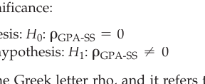

*Diagram*

<!-- Page 15 -->
independent or predictor variable. In this case,.61 squared (i.e.,.61 times.61) is equal to.37. Changing the proportion.37 to a percentage, you can conclude that 37% of the variance in starting salary is explained by GPA. This suggests a strong relationship, and we would be inclined to conclude that this relationship is practically significant in addition to statistically significant.

We are not convinced, however, that there are not additional variables that explain starting salary, and we would want to control for those variables before we conclude that GPA is important. Using our data set, we could obtain the correlation between GPA and starting salary, controlling for the other quantitative variables in our data set by calculating a partial correlation coefficient.

### One-Way Analysis of Variance

**One-way analysis of variance** (also called one-way **ANOVA**) is used to compare two or more group means for statistical significance. More specifically, it is used when you have one quantitative dependent variable and one categorical independent or predictor variable. (Two-way ANOVA is used when you have two categorical independent variables, three-way ANOVA is used when you have three categorical independent variables, and so forth.) The test statistic used in the analysis of variance follows the  *F* distribution, rather than the *t* distribution used in our previous tests. The *F* distribution is a probability distribution that is usually skewed to the right.

Once again we use data from the recent college graduate data set provided in Table 15.1. We use starting salary as the dependent variable and college major as the categorical independent/predictor variable. The three levels of college major were 1 = psychology, 2 = philosophy, and 3 = business. The research question is whether there is a statistically significant difference in the starting salaries of psychology, philosophy, and business students.

> Here are the statistical hypotheses under consideration:

> Null hypothesis: *H*: $\mu$ = $\mu$ = $\mu^{0}$ Psych Phil Bus

> Alternative hypothesis: *H*: Not all equal 1

The null hypothesis states that the psychology, philosophy, and business mean starting salaries are the same in their respective populationons of new college graduates. The alternative hypothesis states that the populationon means are not all the same; at least two of the means are different from one another. The alternative hypothesis does not state which two of the populationon means are different from one another.

We used the SPSS program to get our numerical results. The *F* value was equal to 11.05. When there is no difference between the means, the *F* value tends to be near the value of 1.00, so you can see that this *F* value seems large. Because the *F* distribution is skewed to the right, this value of 11.05 falls in the right tail of the distribution. When the calculated value of a test statistic falls in the far right tail of the sampling distribution, the *p* value will be small. Our *p* value was equal to.00048, which is indeed small. Because our *p* value of.00048 is less than our alpha level of.05, we reject the null hypothesis and tentatively accept the alternative hypothesis (i.e., we applied Rule 1 from Table 16.3). We conclude that the relationship between college major and starting salary is statistically significant. The effect size indicator eta squared was.50, which means 50% of the variance in starting salary is explained by college major. Because the effect size indicator is large, we conclude that the strength of the relationship is strong.

When you reject a null hypothesis in analysis of variance that has *three or more* means, you know that at least two of the means are different. You do not, however, know which means are significantly different. We conclude that at least two of the college major means are significantly different and that follow-up tests are needed to determine which means are significantly different. In the next section, we will determine which of the means are significantly different.

<!-- Page 16 -->
> Using APA style, you can write up the results as follows:

> A one-way analysis of variance was conducted to determine if the relationship between college major and starting salary was statistically significant. The ANOVA was statistically significant, $F(2, 22) = 11.05$, *p* 6.001, est η 2 =.50. The strength of the relationship, assessed with est η 2, was strong, with college majors accounting for 50% of the variance in starting salary. 4

All of the information in the write-up was available on the SPSS printout. The first number in the parentheses (i.e., 2) is the *between-groups degrees of freedom*, which is the number of groups minus one. Our independent variable (college major) had three groups; therefore, the *df* was equal to 3 minus 1, which is
2. The second number in the parentheses is the *error degrees of freedom*, which is the number of participants in the study minus the number of groups. We had 25 participants and three groups; therefore, this was equal to 25 minus 3, which is
22. Notice that we reported *p* 6.001 rather than giving an exact *p* value. *According to APA guidelines, researchers should report exact p values to two* *or three decimal places; the exception is when the p value is smaller than*.001 *in which case you* *would report p* 6 **.001. If your result is not statistically significant, you should report the *p* value for tests that you had predicted to be statistically significant. Furthermore, you should not omit results that you are uncomfortable with to make your report look good.

### Post Hoc Tests in Analysis of Variance

One-way analysis of variance tells the researcher whether the relationship between a categorical independent or predictor variable and a quantitative dependent variable is statistically significant. If your categorical variable has only two levels, then a statistically significant outcome is interpretable; just look to see which mean is larger and conclude that mean is significantly larger than the other mean. If you have three or more means, however, a statistically significant outcome for the one-way analysis of variance must be followed up with **post hoc tests** to determine which of the means are significantly different. College major was significantly related to starting salary; however, since college major has three levels, we conduct post hoc tests to determine which of the means are significantly different.

You might think that you could just do an independent samples *t* test for each pair of the means to determine which differences are statistically significant. Unfortunately, you can’t conduct multiple *t* tests like this because doing so would inflate the probability of making a Type I error (a false-positive error). Many post hoc tests are available in SPSS that control for this problem, and they will provide adjusted (i.e., corrected) *p* values for the researcher to use. Some popular post hoc tests are the Tukey test, the Sidak test, and the Bonferroni test. The researcher selects the test(s) he or she wants to use from a menu in SPSS. All of the tests just mentioned are fine, but they will give you slightly different *p* values. We will use the Bonferroni post hoc test procedure now. 5

Here are the three sample mean incomes for the three college majors from our previous one-way analysis of variance:

- Average starting salary for recent graduates majoring in psychology is &#36;29,437.50.

- Average starting salary for recent graduates majoring in philosophy is &#36;32,800.00.

- Average starting salary for recent graduates majoring in business is &#36;37,214.29.

We already know from the one-way analysis of variance that the difference between at least two of these means is statistically significant. The question in post hoc testing is

4 The letters “est” in front of η 2 indicate that we are using the sample or estimated value of η 2.

[^5]: When you have exactly 3 means, Fisher’s Least Significant Difference (LSD) test is the most statisti- cally powerful and is recommended. We used Bonferroni here because it is a more general test. Another very good test when you have four or more means is the Sidak adjustment.

<!-- Page 17 -->
which means are significantly different from each other (i.e., which difference between the means is not just due to chance)?

First, we checked to see whether the psychology and philosophy means were significantly different. The Bonferroni-adjusted *p* value (obtained from the SPSS printout) was.112. Our selected alpha level is.05. Our *p* value (.112) is greater than the alpha level (.05); therefore, we use Rule
2. We fail to reject the null hypothesis (that the populationon means are the same) and conclude that the observed difference between the two means is *not statistically significant*. We can’t say whether the psychology or philosophy mean is larger in the populationon. When we fail to reject the null hypothesis, we also cannot conclude that the populationon means are exactly the same.

Second, we checked to see whether the psychology and business major means were significantly different. The Bonferroni-adjusted *p* value (obtained from the SPSS printout) was.0003. Our selected alpha level is.05. Our *p* value (.0003) is less than the alpha level (.05); therefore, we use Rule
1. We reject the null hypothesis (that the populationon means are the same) and conclude that the difference between the two means is statistically significant. We are warranted in concluding that business majors have, on average, a higher starting salary than psychology majors in the populationon. Cohen’s *d* is 2.32, which is very large. The business major mean is 2.32 standard deviations higher than the psychology mean. If we found this result, we would conclude that it is practically significant in addition to being statistically significant.

Third, we checked to see whether the philosophy and business major means were significantly different. The “Bonferroni-adjusted” *p* value was.031. Our selected alpha level is.05. Our *p* value (.031) is less than the alpha level (.05); therefore, we use Rule
1. We reject the null hypothesis and conclude that the difference between the two means is statistically significant. We are warranted in concluding that business majors have, on average, a higher starting salary than philosophy majors in the populationon. The difference between the two means is &#36;4,414.29, and Cohen’s *d* is 1.42, which is very large. The business major mean is 1.42 standard deviations higher than the philosophy major mean. If we found this result, we would conclude that it is practically significant in addition to being statistically significant.

> Using APA style, you could write up the results as follows:

Follow-up tests were conducted to determine which of the means were significantly different. Bonferroni-adjusted *p* values were used to control for inflated Type I error rate. The difference between the starting salaries of psychology 3,458.30) and business (*M* = 3,251.37) graduates was statistically significant ( ence between the starting salaries of philosophy (

2.32). The differ-

- 2,945.81)

> 3,251.37) graduates also was statistically

> 1.42). The difference between the starting salaries of psychology and  philosophy graduates was not significant ( *p* 7.05).

### Analysis of Covariance

**Analysis of covariance** (also called **ANCOVA**) is used when you have a quantitative dependent variable and a mixture of categorical and quantitative independent variables. In the case discussed in this section, we have one categorical independent variable and one quantitative independent variable called a “covariate.” ANCOVA can be thought of as an extension of ANOVA in that like ANOVA, it has one or more categorical independent variables, but unlike ANOVA, it also has one or more covariates added into the analysis.

If you are able to add a covariate that is strongly related to your dependent variable to an analysis of variance model, then you will increase the sensitivity (i.e., statistical power) of the test of the categorical independent variable. This means you are less likely to make a Type II error when testing the effect of the categorical independent variable.

ANCOVA is the statistical test used for experimental designs that have pretests and more than one group, such as the pretest–posttest control-group design and the

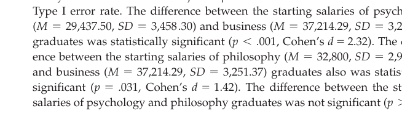

*Diagram*

<!-- Page 18 -->
nonequivalent comparison-group design. It is also used with the factorial design if you include a pretest in the design. The test statistic used in ANCOVA follows the *F* probability distribution just as was the case in ANOVA.

Now we will demonstrate ANCOVA by reanalyzing the social skills training experimental data that previously found a nonsignificant difference between the experimental and control groups. In that example, we did not include the pretest data and chose just to see if the skills training and control group means were significantly different at the posttest—using the independent samples *t* test, we found that the *p* value was.073, which was greater than the alpha level of.05, so we failed to reject the null hypothesis. (ANOVA can also be used to compare two posttest group means because ANOVA can be used for *two or more means*; in this case, it provided us with the equivalent nonsignificant *p* value (.073).) In this analysis that did not include the pretest, we were forced to conclude that the treatment was not effective.

Now we will include the pretest data and appropriately analyze all the data from the hypothetical pretest–posttest control-group design. The data for 28 cases are provided in Table 15.3 (pages 301–302). When we were ignoring the pretest data, the null hypothesis stated that the posttest means for the skills training and control groups were the same in the populationon. In ANCOVA, the null hypothesis is slightly different; it states that the posttest means that *have been adjusted for pretest differences* are the same. Here are the hypotheses tested in ANCOVA:

> Null hypothesis: *H*: $\mu$ = $\mu^{0}$ ADJ-Skills Training ADJ-No Training Alternative hypothesis: *H*: $\mu$ ∙ $\mu^{1}$ ADJ-Skills Training ADJ-No Training

The only new feature of these hypotheses is that we inserted “ADJ” to convey that we now are testing adjusted means rather than means unadjusted for pretest differences.

We used the SPSS computer program to obtain our results.[^6] The test statistic used in ANCOVA for the differences between the group means relies on the *F* distribution. The *F* value was 8.38, and more importantly, the *p* value was.008. Based on this *p* value, we apply Rule
1. Because the *p* value (.008) is less than the alpha level (.05), we reject the null hypothesis, tentatively accept the alternative hypothesis, and conclude that the difference between the social skills training and control-groups means is statistically significant. When we ran the ANCOVA analysis, we also calculated eta squared, and it was equal to.10; changing the proportion (.10) to a percentage (10%), we conclude that 10% of the variance in social skills performance is explained by the experimental treatment, which is fairly small. We conclude that social skills training causes a moderate increase in participants’ performance on the social skills test and that this effect is possibly practically significant.

> Using APA style, you could write up the results as follows:

We conducted a one-way analysis of covariance to determine whether the difference between the treatment and control-group posttest means was statistically significant after adjusting for pretest differences between the groups. The difference between the adjusted skills training mean ( the adjusted control-group mean (.21) was statistically significant *F* 1 1, 25 2 =.10. The strength of the relationship, assessed with est, was moderate, with the treatment variable accounting for 10% of the variance in social skills performance.

In this and a previous example, we have analyzed the data from our social skills experiment. When we did not include the pretest in the analysis, the *p* value was.073, and we failed to reject the null hypothesis. When we included the pretest and

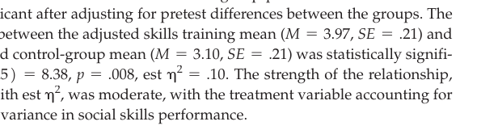

*Diagram*

[^6]: We first checked to make sure we had not violated the homogeneity of slopes assumption by checking the interaction between the categorical independent variable and the covariate. Because this *p* value was greater than .05, we did not violate the assumption; therefore, we dropped the interaction term and ran the standard ANCOVA.

<!-- Page 19 -->
conducted an ANCOVA, the *p* value was.008, and we rejected the null hypothesis. This makes a point we stated earlier: ANCOVA is usually more sensitive (i.e., has higher statistical power) in testing the difference between means. In this case, we conclude that the means are significantly different (based on the ANCOVA results) and that our earlier test, which resulted in the failure to reject the null hypothesis, was a Type II error. This is one reason we recommend including pretests in experimental designs. We list several reasons for including a pretest in Chapter 9.

### Two-Way Analysis of Variance

**Two-way analysis of variance** (also called two-way ANOVA) is used when you have a quantitative dependent variable and two categorical independent variables. We will demonstrate two-way ANOVA using the set of hypothetical data provided in Table 16.5. These data are for another experiment testing the effectiveness of our skills training program. These new data include the variable gender. Therefore, we have two categorical independent variables this time: treatment condition (skills training vs. control) and gender (male vs. female). We explained in Chapter 9 that a factorial experimental design includes at least two independent variables (at least one of which

**Table 16.5** *Hypothetical Data Set for Posttest-Only Factorial Design Featuring Social Skills Training by Gender*

<table class="textbook-table" style="width: auto; max-width: 100%; border-collapse: collapse; margin: 1.5em 0;">
  <thead>
    <tr>
      <th>Participant</th>
      <th>Posttest Scores</th>
      <th>Treatment Condition</th>
      <th>Gender</th>
    </tr>
  </thead>
  <tbody>
    <tr>
      <td>1</td>
      <td>2</td>
      <td>1</td>
      <td>1</td>
    </tr>
    <tr>
      <td>2</td>
      <td>4</td>
      <td>1</td>
      <td>1</td>
    </tr>
    <tr>
      <td>3</td>
      <td>3</td>
      <td>1</td>
      <td>1</td>
    </tr>
    <tr>
      <td>4</td>
      <td>2</td>
      <td>1</td>
      <td>1</td>
    </tr>
    <tr>
      <td>5</td>
      <td>2</td>
      <td>1</td>
      <td>1</td>
    </tr>
    <tr>
      <td>6</td>
      <td>0</td>
      <td>1</td>
      <td>1</td>
    </tr>
    <tr>
      <td>7</td>
      <td>2</td>
      <td>1</td>
      <td>1</td>
    </tr>
    <tr>
      <td>8</td>
      <td>4</td>
      <td>1</td>
      <td>2</td>
    </tr>
    <tr>
      <td>9</td>
      <td>4</td>
      <td>1</td>
      <td>2</td>
    </tr>
    <tr>
      <td>10</td>
      <td>4</td>
      <td>1</td>
      <td>2</td>
    </tr>
    <tr>
      <td>11</td>
      <td>3</td>
      <td>1</td>
      <td>2</td>
    </tr>
    <tr>
      <td>12</td>
      <td>5</td>
      <td>1</td>
      <td>2</td>
    </tr>
    <tr>
      <td>13</td>
      <td>2</td>
      <td>1</td>
      <td>2</td>
    </tr>
    <tr>
      <td>14</td>
      <td>2</td>
      <td>1</td>
      <td>2</td>
    </tr>
    <tr>
      <td>15</td>
      <td>8</td>
      <td>2</td>
      <td>1</td>
    </tr>
    <tr>
      <td>16</td>
      <td>6</td>
      <td>2</td>
      <td>1</td>
    </tr>
    <tr>
      <td>17</td>
      <td>6</td>
      <td>2</td>
      <td>1</td>
    </tr>
    <tr>
      <td>18</td>
      <td>6</td>
      <td>2</td>
      <td>1</td>
    </tr>
    <tr>
      <td>19</td>
      <td>4</td>
      <td>2</td>
      <td>1</td>
    </tr>
    <tr>
      <td>20</td>
      <td>5</td>
      <td>2</td>
      <td>1</td>
    </tr>
  </tbody>
</table>

[^4]: 2 2 26
[^3]: 2 2 27
[^3]: 2 2 28
[^5]: 2 2 *Note:* The dependent variable is number of appropriate social interactions measured at posttest; the manipulated independent variable is social skills training (1 = control vs. 2 = treatment); the nonmanipulated independent variable is gender (1 = male vs. 2 = female).

<!-- Page 20 -->
is manipulated), and participants are randomly assigned to the groups (on at least one IV). In our experiment, the training variable is the manipulated variable; obviously gender is not manipulated by the experimenter! Because the training independent variable is manipulated and participants were randomly assigned to the groups making up this variable, stronger cause and effect conclusions can be drawn about the treatment than about the nonmanipulated variable gender.

We explained in Chapter 9 that in a factorial experiment with two independent variables, you test for a main effect for each independent variable and you test for an interaction effect. A main effect is the separate effect of an independent variable, and an interaction effect is present when the effect of one independent variable varies at the different levels of the other independent variable.

To save space (and save you some reading), we will state the null hypotheses verbally rather than writing them out. The null hypothesis for treatment condition says that the populationon means of skills trained and the not-trained participants are equal. The null hypothesis for gender says that populationon means of males and females are the same. Last, the null for the interaction states that in the populationon there is no interaction between treatment condition and gender.

Here are the empirical results:

- Treatment condition main effect: *F* value = 15.51; *p* value =.001

- Gender main effect: *F* value =.021; *p* value =.885

- Interaction effect: *F* value = 7.68; *p* value =.011

Using an alpha level of.05, the treatment condition main effect is statistically significant, the gender main effect is not statistically significant, and the treatment-bygender interaction effect is statistically significant.

When the interaction effect is statistically significant, the rule is to focus interpretation on the interaction effect rather than main effects. To aid in interpreting this statistically significant interaction effect, we plotted the cell means in Figure 16.4. The interaction plot shown in Figure 16.4 suggests that the skills training program works better for males than for females. This observation was found to be warranted by the follow-up significance  tests.

> Here is an APA style presentation of the results:

> A 2: 2 ANOVA was conducted to evaluate the effects of skills training and gender. The analysis yielded a statistically significant skills training main effect, *F* 1 1, 24 2 = 15.51, $p = .001$, est η 2 =.329, and a statistically significant interaction between treatment and gender, *F* 1 1, 24 2 = 12.89,  $p = .011$,  est η 2 =.163. The gender main effect was not statistically significant ( *p* 7.05). Examination of the interaction plot suggested that the training program worked better for men than for women. Men had a mean performance of 2.14 in the control group and a mean of 5.43 in the social skills training condition, representing an unstandardized difference of 3.29 and a Cohen’s *d* of 2.3. This difference was large and statistically significant (*p* 6.001). Women had a mean performance of 3.43 in the control group and a mean of 4.00 in the social skills training condition, representing an unstandardized difference of.57 and a Cohen’s *d* of.50. This difference was not statistically significant (*p* 7.05). We conclude that the social skills training treatment worked for men but not for women.

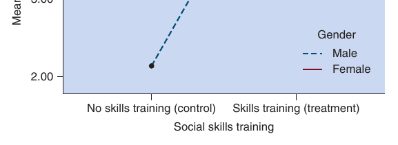

*Figure 16.4 Interaction plot for factorial skills training experiment.*

<!-- Page 21 -->
When you examine the interaction plot in Figure 16.4, you might see additional features that you want to check for statistical significance. That’s fine, but for each comparison between means, you will need to obtain the *p* value and determine if the difference is statistically significant. If the difference is not statistically significant, you are probably looking at chance variation, and no claim about the observed difference is warranted.

### One-Way Repeated Measures Analysis of Variance

**One-way repeated measures analysis of variance** (also called *one-way repeated  measures* ANOVA) is used when you have one quantitative dependent variable and one withinparticipants independent variable. With a within-participants independent variable, the same participants are measured more than once. This is the appropriate analytical procedure for a repeated measures design as well as for the one-group  pretest–posttest designs (and several variants of these designs) discussed in Chapter 9.

We demonstrate this analysis with a set of data from a one-group pretest– posttest design with two rather than the traditional one posttest. We call these posttests the immediate and delayed posttests. The treatment in our hypothetical experiment is a health program designed to reduce participants’ weight by participation in a structured diet program administered over a 1-month period. The participants meet with the researcher four times during the month-long program. The weight of all participants (the dependent variable) is measured at the beginning of the program (pretest), at the end of the program (immediate posttest), and again 1 month after completion of the program (delayed posttest). The data for this hypothetical experiment are  provided in Table 16.6.

**Table 16.6** *Hypothetical Data for One-Group Pretest–Posttest Design with Immediate and Delayed Posttest*

<table class="textbook-table" style="width: auto; max-width: 100%; border-collapse: collapse; margin: 1.5em 0;">
  <thead>
    <tr>
      <th>Participant</th>
      <th>Pretest</th>
      <th>Immediate Posttest</th>
      <th>Delayed Posttest</th>
    </tr>
  </thead>
  <tbody>
    <tr>
      <td>1</td>
      <td>222</td>
      <td>223</td>
      <td>222</td>
    </tr>
    <tr>
      <td>2</td>
      <td>156</td>
      <td>154</td>
      <td>153</td>
    </tr>
    <tr>
      <td>3</td>
      <td>142</td>
      <td>139</td>
      <td>138</td>
    </tr>
    <tr>
      <td>4</td>
      <td>225</td>
      <td>221</td>
      <td>220</td>
    </tr>
    <tr>
      <td>5</td>
      <td>159</td>
      <td>153</td>
      <td>155</td>
    </tr>
    <tr>
      <td>6</td>
      <td>275</td>
      <td>270</td>
      <td>269</td>
    </tr>
    <tr>
      <td>7</td>
      <td>301</td>
      <td>297</td>
      <td>294</td>
    </tr>
    <tr>
      <td>8</td>
      <td>268</td>
      <td>261</td>
      <td>258</td>
    </tr>
    <tr>
      <td>9</td>
      <td>212</td>
      <td>210</td>
      <td>209</td>
    </tr>
    <tr>
      <td>10</td>
      <td>189</td>
      <td>186</td>
      <td>185</td>
    </tr>
  </tbody>
  <tfoot>
    <tr class="table-notes"><td colspan="4"><em>* Note:</em></td></tr>
  </tfoot>
</table>

> Here are the null and alternative hypotheses:

> Null hypothesis: *H*: $\mu$ = $\mu$ = $\mu^{0}$ Pretest Immediate Posttest Delayed Posttest

> Alternative hypothesis: *H*: Not all equal 1

The null hypothesis says that the populationon means at the three different times for the group of participants are equal (i.e., the weight of the people is the same at all three times, which would suggest no program impact). The alternative hypothesis says that at least two of the means are significantly different.

We used SPSS to obtain the statistical results. The *F* value was 24.38, but more importantly, the *p* value was less than.001. Because the *p* value is less than the alpha level (of.05), we reject the null hypothesis and conclude that at least two of the means are significantly different. However, we don’t know which of the three means plotted

The within-participants independent variable is time (pretest, immediate posttest, and delayed posttest), and the dependent variable is weight.

<!-- Page 22 -->
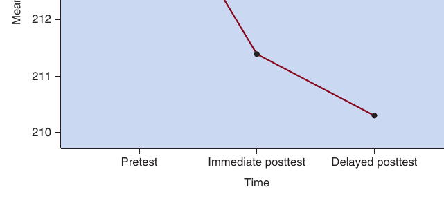

*Figure 16.5 Plot of means for one-group pretest–posttest design with immediate and delayed posttests.*

in Figure 16.5 are significantly different, so we conducted post hoc tests.

Here are the three sample means for weight in this study:

- Mean weight at pretest is 214.9 pounds.

- Mean weight at immediate posttest is

🎯 **211.4** pounds.

> - Mean weight at delayed posttest is 210.3 pounds.

When examining the three means, it appears that the program was successful, on average, in reducing participants’ weights. The immediate posttest suggests that the program was successful (it’s lower than the pretest), and the delayed posttest suggests that the program success continued 1 month later. These observations were tested via post hoc tests. First, the mean difference between the participants’ weight at pretest and immediate posttest is 3.5 (i.e., 214.9 – 211.4) pounds. The Bonferroni-adjusted *p* value for the significance test of this difference was.003. Because.003 is less than the alpha level (.05), we conclude that the difference between the participants’ pretest and immediate posttest weights is statistically significant. Second, the difference between the participants’ weight at pretest and delayed posttest is 4.6. The Bonferroni-adjusted *p* value for this difference was.001. Because.001 is less than the alpha level, we conclude that the difference between the participants’ pretest and delayed posttest weights is statistically significant. Third, the difference between the participants’ weight at immediate posttest and delayed posttest is 1.1. The Bonferroni-adjusted *p* value for this difference was.095. Because.095 is greater than the alpha level, we conclude that the difference between the participants’ immediate posttest and delayed posttest weights is not statistically significant.

> Here is an APA style presentation of the results:

> A one-way repeated measures ANOVA was conducted with weight as the dependent variable and time (pretest, immediate posttest, and delayed posttest) as the within-participants independent variable. The time main effect was statistically significant, this main effect, we conducted three post hoc tests and obtained Bonferroniadjusted  *p*  values. First, the difference between the pretest ( *SD* = 54.35) and immediate posttest (*M* statistically significant,.003, indicating a significant improvement from pretest to immediate posttest. Second, the difference between the pretest ( *M* = 214.90,  *SD* 54.35) and delayed posttest (*M* weights also was statistically significant, $p = .001$, indicating a significant improvement from pretest to delayed posttest. Third, the difference between the  immediate  posttest ( *M* = 211.40, *SD* = 53.79) and delayed posttest ( *M* = 210.30, *SD* = 52.88) weights was not significant, *p* 7.05. Overall, the results show that the statistically significant improvement in pretest weight found at the immediate  posttest continued to the delayed posttest measurement.

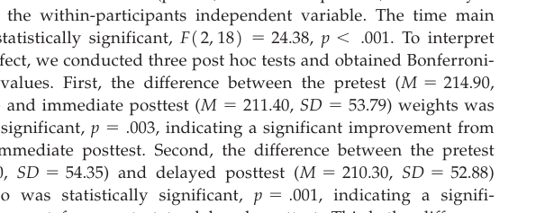

*Diagram*

<!-- Page 23 -->
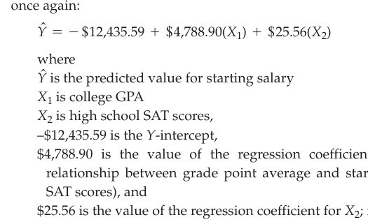

*Diagram*

### The t Test for Regression Coefficients

In Chapter 15, we introduced regression analysis. In *simple regression*, the researcher analyzes the relationship between one quantitative dependent variable and one quantitative independent or predictor variable.[^7] In *multiple regression*, the researcher analyzes the relationship between one quantitative dependent variable and two or more quantitative independent or predictor variables. The ***t**test for regression coefficients** uses the *t* distribution to test the significance of the regression coefficients obtained in regression analysis. Regression coefficients express the relationship between an independent variable and the dependent variable (controlling for any other independent variables included in the regression equation).

We will now take the multiple regression equation from Chapter 15 and test the two regression coefficients for statistical significance. Here is that regression equation once again: where is the predicted value for starting salary is high school SAT scores,

> –&#36;12,435.59 is the *Y*-intercept, &#36;4,788.90 is the value of the regression coefficient for *X*; it expresses the 1 relationship between grade point average and starting salary (controlling for

> &#36;25.56 is the value of the regression coefficient for *X*; it expresses the relationship 2 between high school SAT and starting salary (controlling for GPA).

Our goal is to see if these two regression coefficients are statistically significant. Before a researcher is justified in interpreting a regression coefficient from his or her data, it must be checked for statistical significance. That’s because the coefficient found on the sample data might simply be due to chance (i.e., sampling error). If a regression coefficient is statistically significant, the researcher can conclude that there is a high probability of a real relationship in the populationon and proceed to interpret the coefficient observed in the sample data.

> Our first research question is about the first regression coefficient (&#36;4,788.90):

> Research question 1: Is the relationship between GPA and starting salary (controlling for SAT) statistically significant?

Here are the statistical hypotheses for this research question:

Alternative hypothesis:

The null hypothesis says that the populationon regression coefficient is equal to zero (i.e., there is no relationship in the populationon). The alternative hypothesis says that the populationon coefficient is nonzero (i.e., there is a relationship in the populationon).

Using SPSS, we found that the *t* value was 2.13, and the *p* value was.045. Our *p* value (.045) was less than our alpha level (.05); therefore, we reject the null hypothesis, tentatively accept the alternative hypothesis, and conclude that the relationship

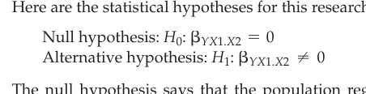

*Diagram*

[^7]: Although regression analysis can be used with categorical independent variables, we (and others) prefer to operationalize regression as working with quantitative independent variables, ANOVA as working with categorical independent variables, and ANCOVA as working with a mixture of categori- cal and quantitative independent variables. All of these analytic techniques are “special cases” of the general linear model (GLM).

<!-- Page 24 -->
expressed in this regression coefficient is statistically significant. The appropriate effect size indicator for a regression coefficient is called the **semi-partial correlation** **squared** (symbolized *sr* ); it is equal to.1024, which means 10.24% of the variance in starting salary is uniquely explained by GPA. We would conclude that this relationship between GPA and starting salary is statistically significant and practically significant.

> Our second research question is about the second regression coefficient (&#36;25.56):

> Research question 2: Is the relationship between SAT and starting salary (controlling for GPA) statistically significant?

Here are the statistical hypotheses for this research question:

> Null hypothesis: *H*: $\beta$ = 0 0 *YX*2.*X*1 Alternative hypothesis: *H*: $\beta$ ∙ 0 1 *YX*2.*X*1

Using SPSS, we found that the *t* value was 2.4, and the *p* value was.025. Our *p* value (.025) was less than our alpha level (.05); therefore, we reject the null hypothesis, tentatively accept the alternative hypothesis, and conclude that the relationship expressed in this second regression coefficient is statistically significant. The effect size indicator semi-partial correlation squared was equal to.1303, which means that 13.03% of the variance in starting salary is uniquely explained by SAT scores. We would conclude that this relationship between SAT and starting salary is statistically significant and practically significant.

We have concluded that both of the predictor variables are important predictors of starting salary. However, you might also want to compare the two predictor variables for relative importance (i.e., which variable is more important?). Because GPA uniquely explained 10.24% of the variance in starting salary and SAT explained 13.03%, we conclude that SAT is a more important variable than GPA for predicting starting college students’ starting salary.

> Here is a brief APA style write-up of the results of our regression analysis:

> A multiple regression was conducted to determine how well the starting salaries of recent college graduates is predicted by college GPA and high school SAT scores. The overall model including both predictor variables was statistically significant,.001. The multiple correlation squared ( *R* 2 ) for the full model was.50, indicating that 50% of the variance in starting salary was explained by the two predictor variables. Starting salary was significantly predicted by GPA ( College GPA uniquely accounted for 10.24% of the variance in starting salary ( *sr* 2 =.1024), and SAT uniquely accounted for 13.03% of the variance in starting salary (.1303). We conclude that both predictor variables were important, but SAT was a stronger predictor of starting salary than GPA.

Rather than using the regular (i.e., unstandardized) regression coefficients (i.e., &#36;4,788.90 for GPA and &#36;25.56 for SAT, which are symbolized by “b”), in the write-up we followed convention and used the standardized regression coefficients that are usually symbolized with the Greek letter beta (i.e., $\beta$ ). These values were available on the SPSS printout. When a regression equation has many predictor variables, the results are usually presented in tables.

> [!TIP] **Study Question 16.4**
> Describe the statistical analyses discussed.
>
> When should each be used?

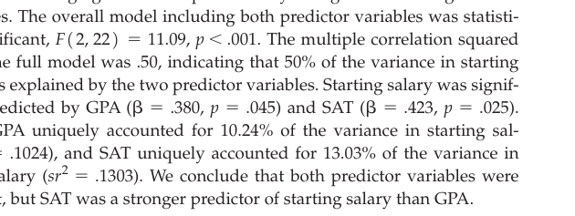

*Diagram*

<!-- Page 25 -->
## Nonparametric Statistics

🎯 **16.5** Describe the purpose of nonparametric statistical tests.

The statistical tests described thus far in this chapter are examples of parametric statistics. **Parametric statistics** procedures require that study samples come from populationons with particular characteristics such as normality, equal variances, and independence of observations. Technically, these three common assumptions are that at each level of the independent variable the values of the dependent variable are normally distributed (normality assumption), the variance of the dependent variable is the same at each category or level of the IV (equal variances assumption), and selection or assignment of one case is independent from the selection or assignment of another case (independence assumption). Independence can be achieved using  random selection or random assignment.

By far, most (but not all!) statistical analyses in psychology and related sciences are based on parametric statistics. Because parametric statistics are relatively robust to violations of normality and equal variances (e.g., Darlington &amp; Hayes, 2017; Howell, 2017; Keith, 2015), many researchers do not worry about minor violations, and they continue to use parametric statistics. They do this because parametric statistics take into account more numerical information in the data, are often easier to interpret, and are often more statistically powerful (i.e., it’s easier to obtain statistical significance) compared to nonparametric statistics.

If your data suggest that you have radically violated key parametric assumptions or when your dependent variable is categorical/nominal or ordinal, you might need to use nonparametric statistics. **Nonparametric statistics** are procedures that make fewer (or sometimes no) assumptions about populationons and allow the analysis of nominal or ordinal data. Notice that in all of the previous analyses in this chapter, the dependent variable was a quantitative variable (i.e., interval or ratio level of measurement). This requirement is relaxed in many nonparametric statistics. Please now examine Table 16.7, where we provide you brief explanations of common nonparametric statistical procedures. In the next section of this chapter we explain in-depth the nonparametric chi-square test of independence using two categorical variables from the data set we provided in the last chapter (in Table 15.1). 8

> [!TIP] **Study Questions 16.5**
> - What are nonparametric statistical tests?
>
> - When should they be used?

### Chi-Square Test for Independence

The **chi-square test for independence** is a nonparametric test used to determine whether a relationship observed in a contingency table is statistically significant. In Chapter 15, we explained that contingency tables are used for studying the relationship between two or more categorical variables. We also demonstrated “how to read a contingency table.” A key point was that you need to percentage your contingency table correctly if you hope to see a relationship in the table. We provided you with the following two rules:

- If the percentages are calculated down the columns, then compare across the rows.

- If the percentages are calculated across the rows, then compare down the columns.

[^8]: There are many additional nonparametric statistics, including nonparametric strategies for the remain- ing parametric approaches discussed in this chapter. Also, newer approaches such as resampling meth- ods are becoming popular (especially bootstrapping). Howell (2016) predicts somewhat of a paradigm change occurring with the use randomization procedures to obtain the relevant sampling distributions.

<!-- Page 26 -->
**Table 16.7** *Popular Nonparametric Statistical Procedures and Their Parametric Alternatives*

<table class="textbook-table" style="width: auto; max-width: 100%; border-collapse: collapse; margin: 1.5em 0;">
  <thead>
    <tr>
      <th>Nonparametric</th>
      <th>Parametric</th>
    </tr>
  </thead>
  <tbody>
    <tr>
      <td>Procedure Description</td>
      <td>Alternative Procedure</td>
    </tr>
    <tr>
      <td>Chi-square test for Used to determine whether two (or more)</td>
      <td>nominal variables are independent (not related) or dependent No parametric alternative</td>
    </tr>
    <tr class="category-header"><td colspan="2"><strong>independence.</strong></td></tr>
  </tbody>
</table>

> (related). For example, can we reject the null (independence) hypothesis that there no relationship between gender and personality type?

**Chi-square test for** Used to test a researcher’s hypothesized proportions/percentages within the categories of a

No parametric alternative **goodness of fit.** *nominal variable*. For example, you might test this hypothesis: 50% of college students self-identify with the Democratic party, 30% identify with the Republican party, and 20% are Independent.

**McNemar’s test.** Used to determine if a group of people in two conditions or at two time points has the same or different No parametric alternative percentages on a *nominal DV* (e.g., is the percentage of smokers in a group of people the same or different at time 1 and time 2 [i.e., before and after participation in a smoking cessation program]?).

**Cochran’s Q test.** Used to determine if a group of people in three or more conditions or at three or more times has

> No parametric alternative the same or significantly different percentages on a *nominal DV* (e.g., is the percentage of smokers in a group of people equal or not equal at three time points?). ( *Note:* McNemar’s test can also be used for post hoc comparisons between pairs of conditions or times.)

**Spearman rank-** Used to determine if there is a relationship between two *ordinal variables* or quantitative variables

Pearson correlation **order correlation** that have been converted to ranks. Is there a relationship between GPA and starting salary (where **(rho).** both of these quantitative variables are converted to rank order [i.e., ordinal] variables)?

**Mann-Whitney** Used to determine if two different groups of participants are different on an *ordinal DV* or a

Independent groups **U test.** quantitative DV that is converted to ranks. For example, do participants in the training group have *t* test a higher median performance than the participants in the non-training group?

**Wilcoxon signed** Used to determine if two related groups of participants are different on an *ordinal DV* or a

Dependent paired **rank test.** quantitative DV that is converted to ranks. For example, do participants in one group perform better samples *t* test and one at the posttest than at the pretest? sample *t* test

**Kruskal-Wallis test.** Used to determine if three or more groups constituting a categorical IV differ on an *ordinal DV*

> One-way between or a quantitative DV that has been converted to ranks. For example, do students majoring in groups ANOVA psychology, philosophy, and business have the same or different starting salaries.

**Friedman test.** Used to determine if there are differences on an *ordinal DV* for three or more conditions or times

> One-way repeated for a within-participants IV. For example, does a new anti-anxiety treatment decrease anxiety? The measures ANOVA researcher decides to measure anxiety before treatment and then immediately after the treatment and again one week later (i.e., compare the intervention group means at pretest, posttest, and delayed posttest).

We now construct a contingency table using the categorical variables gender and college major provided in the college student data set (Table 15.1). Our research question is whether gender is related to college major. The 3-by-2 contingency table produced by the statistical program SPSS is shown in Table 16.8. Take a moment to examine Table 16.8 and use the appropriate rule to determine if there appears to be a relationship—the percentages are calculated down the columns (because we made the DV the row variable and the IV the column variable); therefore, compare across the rows. Indeed, there appears to be a relationship. Looking at the first row, you will see that 53.8% of females, but only 8.3% of males, are psychology majors. Females are more than six times as likely

**Table 16.8** *Contingency Table of College Major by Gender*

53. 8%
8. 3%
32. 0% Philosophy Count 4 6 10 % within Gender
30. 8%
50. 0%
40. 0% Business Count 2 5 7 % within Gender
15. 4%
41. 7%
28. 0% Total Count 13 12 25 % within Gender
100. 0%
100. 0%
100. 0%

(53.8/8.3 = 6.5) to be psychology majors (i.e., females have a far higher rate than males

**Female**

Undergraduate major Psychology Count

% within Gender of majoring in psychology). Looking at the second row, 30.8% of females and 50% of males are philosophy majors. Males are more than one-and-a-half (50.0/30.8 = 1.6) times as likely as females to be philosophy majors. Looking at the third row, you will see that males are more than two-and-a-half (41.7/15.4 = 2.7) times as likely as females to be business majors. Clearly the variables gender and undergraduate major *appear* to be related in the sample data. But the key question before you that can justifiably interpret these results is this: “Is the observed relationship statistically significant?”

<!-- Page 27 -->

**Gender**

**Male** **Total**

The null hypothesis is that there is no relationship between gender and undergraduate major in the populationon from which the sample data were selected. The alternative hypothesis is that there *is* a relationship. The probability distribution used for contingency tables is the chi-square ( $\chi^{2}$ ) distribution. The computed value of the test statistic for our contingency table was 6.16, and the *p* value was.046. Our *p* value (.046) is less than our alpha level (.05); therefore, we conclude that the relationship is statistically significant. We used the effect size indicator called *Cramer’s V* to determine the strength of the relationship. The size of this effect size indicator can be interpreted like the size of a correlation coefficient. Our Cramer’s *V* was.496, which suggests that the relationship between gender and college major was moderately strong. We conclude that the relationship between gender and college major is statistically and practically significant.

> Here is a brief APA style write-up of the results of our chi-square analysis:

> A two-way chi square test for independence was conducted to determine whether gender and college major were related. These variables were found to be significantly related, Pearson $\chi^{2}$ (2, *N* = 25) = 6.16, $p = .046$, Cramer’s *V* =.50. Based on Cramer’s *V*, we conclude that the strength of relationship is moderately strong.

### Other Significance Tests

You have come a long way! There are additional significance tests that we could discuss, but the logic would be same as the logic of hypothesis testing that you now understand. The logic is summarized in Table 16.3, and you use this logic every time you want to determine if a relationship or difference between means is statistically significant. The key step is to obtain the *p* value and determine if it is less than (or equal to) or greater than the alpha level. If it’s the former, the finding is statistically significant, and the researcher concludes that he or she is very likely observing a real relationship. If it’s the latter, the finding is not statistically significant, and the researcher concludes that he or she is probably just observing chance variation. Remember to always obtain an effect size indicator to help determine how strong the effect or relationship is for statistically significant findings.

> [!TIP] **Study Questions 16.6**
> - What are the inferential statistical tests discussed thus far?
>
> - How do these statistical tests differ (in terms of the types of variables)?

## Hypothesis Testing and Research Design

🎯 **16.6** Identify the appropriate statistical analysis for each type of research design.

We have demonstrated null hypothesis significance testing with hypothetical survey research and experimental research data. In the following list, “IV” stands for independent or predictor variable and “DV” stands for dependent variable. We have demonstrated the following statistical tests:

<!-- Page 28 -->
- *t* test for independent samples (use with one categorical IV and one quantitative DV)

- *t* test for correlation coefficients (use with one quantitative IV and one quantitative DV)

- One-way ANOVA (use with one categorical IV and one quantitative DV)

- Post hoc tests for ANOVA (use with categorical IV(s) resulting in three or more groups, and one quantitative DV)

- ANCOVA (use with mixture of quantitative and categorical IVs and one quantitative DV)

- Two-way ANOVA (use with two categorical IVs and one quantitative DV)

- One-way repeated measures ANOVA (it’s like regular ANOVA except that the IV is a within-participants variable rather than a between-participants variable)

- *t* test for regression coefficients (use with quantitative IV(s) and one quantitative DV)

- Chi-square test for independence (use when all variables are categorical)

We used the same logic of hypothesis testing summarized in Table 16.3 with all of the tests. When you read about a finding being statistically significant in research articles assigned to you for class, you will know the logic that was used.

In earlier chapters, we covered several experimental research designs, and we want you to know what statistical test to use for each design. This chapter has demonstrated significance testing for the following experimental research designs:

- Posttest-only control-group design

- Pretest–posttest control-group design

- Factorial design

- One-group pretest–posttest design

In Tables 16.9, 16.10, and 16.11, we list the three major categories of experimental research designs along with the appropriate statistical procedures. This will enable you to connect the concepts of design and analysis.

Posttest-only design with nonequivalent groups (with two groups) Independent *t* test or one-way ANOVA

Posttest-only design with nonequivalent groups (with more than two groups) One-way ANOVA (with follow-up tests as needed)

Posttest-only control group design (with two groups)

Posttest-only control group design (with more than two groups)

Pretest–posttest control group design (with two groups)

Pretest–posttest control group design (with more than two groups)

> Independent samples *t* test or one-way ANOVA

One-way ANOVA (with post hoc tests)

One-way ANCOVA or mixed ANOVA

> One-way ANCOVA (with post hoc tests) or mixed ANOVA (with post hoc tests)

Between participants factorial design (with two independent variables and no pretest) Two-way ANOVA (with post hoc tests)

Between participants factorial design (with two independent variables and pretest)

**(b) Within-Participants Designs**

Within-participants posttest-only design (with two conditions)

Within-participants posttest-only design (with more than two conditions)

Two-way ANCOVA (with post hoc tests)

> Paired *t* test or one-way repeated measures ANOVA

> One-way repeated measures ANOVA (with post hoc tests)

Within-participants factorial design (with two within-participants independent variables) Two-way repeated measures ANOVA (with post hoc tests)

**(c) Factorial Design Based on a Mixed Model**

Factorial design based on a mixed model

> Two-way mixed ANOVA (with post hoc tests)

**Table 16.9** *Statistical Analysis for Weak Experimental Research Designs*

<table class="textbook-table" style="width: auto; max-width: 100%; border-collapse: collapse; margin: 1.5em 0;">
  <thead>
    <tr>
      <th>Design</th>
      <th>Analysis Procedure</th>
    </tr>
  </thead>
  <tbody>
    <tr>
      <td>One-group posttest-only design</td>
      <td>Descriptive and correlational statistics</td>
    </tr>
    <tr>
      <td>One-group pretest–posttest design</td>
      <td>Paired t test or one-way repeated measures ANOVA</td>
    </tr>
  </tbody>
</table>

**Table 16.10** *Statistical Analysis for Strong Experimental Research Designs*

<table class="textbook-table" style="width: auto; max-width: 100%; border-collapse: collapse; margin: 1.5em 0;">
  <thead>
    <tr>
      <th>Design</th>
      <th>Analysis Procedure</th>
    </tr>
  </thead>
  <tbody>
    <tr class="category-header"><td colspan="2"><strong>(a) Between-Participants Designs</strong></td></tr>
  </tbody>
</table>

<!-- Page 29 -->
**Table 16.11***Statistical Analysis for Quasi-Experimental Research Designs***Analysis Procedure**

> One-way ANCOVA, or reliability corrected ANCOVA, or mixed ANOVA

> One-way ANCOVA (with post hoc tests), or reliability corrected ANCOVA (with post hoc tests), or mixed ANOVA (with post hoc tests)

> Repeated measures ANOVA or autoregressive integrated moving average (ARIMA) model for long time series with 50 points or more. (For short series, see Bernal, Cummins, and Gasparrini, 2017; Bloom, 2003; and Crosbie,1993.) When you have multiple data at each time point, you can simply use repeated measures ANOVA comparing the group means across time.

Regression-discontinuity design ANCOVA on adjusted scores (Shadish, Cook, &amp; Campbell, 2002)

> [!TIP] **Study Question 16.7**
> Match the statistical analysis procedure to the appropriate research design.

### Summary

This chapter introduces readers to inferential statistics, which is the branch of statistics that focuses on making inferences about populationon parameters based on sample data. The theory of inferential statistics is based on the concept of sampling distributions. A sampling distribution is the theoretical probability distribution that would result if you took all possible samples of a particular size from a populationon and calculated the sample statistic (e.g., a mean, standard deviation, or correlation coefficient) value for each of the samples. That would result in a lot of values, but it would demonstrate that the values vary around the true populationon parameter and follow a known distributional form (such as a normal curve). In practice, you would never have to conduct this process, and you would select only one sample in your research study; statistical packages are used to estimate the values of the relevant sampling distributions for your analyses. Two major branches in the field of inferential statistics are *estimation* [in which you use your sample data value(s) to estimate the populationon data value(s)] and
*hypothesis testing* (in which you determine how likely your observed result such as a
difference between two group means would be if there were no difference between the group means in the populationon). The chapter goes into depth in explaining the logic of hypothesis testing (which is summarized into six key steps as shown in Table 16.3). Perhaps the most important idea in hypothesis testing is that you reject the null hypothesis (that there is no relationship in the populationon) when the *p* value (which is based on your sample data) is less than the alpha level. Psychologists typically set the alpha level (also called the level of significance) at .05; therefore, if the *p* value is less than (or equal to) .05, the researcher rejects the null hypothesis (of no relationship) and accepts the alternative hypothesis (that there *is* a relationship in the populationon). If the
*p* value is greater than .05, the researcher will “fail to reject” the null hypothesis.
The chapter demonstrates how to use the logic of hypothesis testing for each of the following statistical tests:

**1.** Independent samples *t* test—used when you have one quantitative DV and one
categorical IV with just two levels

<!-- Page 30 -->
**2.** *t* test for correlation coefficients—used when your IV and DV are both
quantitative

**3.** One-way ANOVA—used when you have one quantitative DV and one
categorical IV (with two or more levels)

**4.** Post hoc tests in one-way analysis of variance—used when the categorical IV
has three or more levels and you need to know which pairs of group means are significantly different

**5.** ANCOVA—used when you have one quantitative DV and a mixture of
categorical and quantitative IVs; in the traditional case of ANCOVA, you have one quantitative DV, one categorical IV, and one quantitative IV (which is called a covariate)

**6.** Two-way ANOVA—used when you have one quantitative DV and two
categorical IVs

**7.** One-way repeated measures ANOVA—used when you have one quantitative
DV and your one IV is a repeated measures variable (it’s also called a within- participants or within-subjects variable)

**8.** *t* test for regression coefficients—used when you have one quantitative DV and
one or more quantitative IVs

**9.** Chi-square test for independence—used when all of your variables are
categorical Understanding these parametric (1–8) and nonparametric (9) statistical analyses is simplified by realizing that *you follow the same six steps of hypothesis testing for all of the*
*tests.* Therefore, make sure that you understand and memorize the six steps (i.e., Table
16.3) and the concepts listed in the steps (i.e., null hypothesis, alternative hypothesis, alpha level, and *p* value). Tables 16.9, 16.10, and 16.11 list the appropriate statistical tests used with the research designs discussed in earlier chapters.

## 🗂️ Chapter Key Terms & Active Recall

> 💡 **Learning tip:** Try to recall the definition of each term *before* clicking to reveal it.
> This active retrieval practice strengthens long-term memory far more than re-reading.

📇 <b>Sample</b> *(p. 2)*

> **Definition:** A subset of the populationon; the set of cases or elements selected from the populationon

📇 <b>Population</b> *(p. 2)*

> **Definition:** The full group of interest to the researcher that the researcher wants to generalize to, and from which the sample is selected

📇 <b>Statistic</b> *(p. 2)*

> **Definition:** A numerical index based on sample data

📇 <b>Parameter</b> *(p. 2)*

> **Definition:** A numerical characteristic of a populationon

📇 <b>Sampling distribution</b> *(p. 2)*

> **Definition:** The theoretical probability distribution of the values of a statistic that would result if you selected all possible samples of a particular size from a populationon

📇 <b>Sampling distribution of the mean</b> *(p. 2)*

> **Definition:** The theoretical probability distribution of the means of all possible samples of a particular size selected from a populationon

📇 <b>Standard error</b> *(p. 3)*

> **Definition:** The standard deviation of a sampling distribution

📇 <b>Test statistic</b> *(p. 3)*

> **Definition:** A statistic that follows a known sampling distribution and is used in significance testing

📇 <b>Estimation</b> *(p. 4)*

> **Definition:** The branch of inferential statistics focused on obtaining estimates of the values of populationon parameters

📇 <b>Point estimation</b> *(p. 4)*

> **Definition:** Use of the value of a sample statistic as one’s estimate of the value of a populationon parameter

📇 <b>Interval estimation</b> *(p. 4)*

> **Definition:** Placement of a range of numbers around a point estimate

📇 <b>Confidence interval</b> *(p. 4)*

> **Definition:** An interval estimate inferred from sample data that has a certain probability of including the true populationon parameter

📇 <b>Hypothesis testing</b> *(p. 6)*

> **Definition:** The process of testing a predicted relationship or hypothesis by making observations and then comparing the observed facts with the hypothesis or predicted relationship; the branch of inferential statistics focused on determining when the null hypothesis can or cannot be rejected in favor of the alternative hypothesis

📇 <b>Null hypothesis</b> *(p. 6)*

> **Definition:** Typically, the hypothesis of no difference between means or no relationship in the populationon

📇 <b>Alternative hypothesis</b> *(p. 6)*

> **Definition:** The logical opposite of the null hypothesis

📇 <b>Alpha level</b> *(p. 7)*

> **Definition:** The point at which one would reject the null hypothesis and accept the alternative hypothesis

📇 <b>Level of significance</b> *(p. 7)*

> **Definition:** Another name for alpha level

📇 <b>Independent samples test t</b> *(p. 8)*

> **Definition:** The significance test of the difference between two means that uses the t probability distribution

📇 <b>Critical region</b> *(p. 8)*

> **Definition:** The area on a null hypothesis sampling distribution where the observed value of the statistic, if it fell in this area, would be considered a rare event

📇 <b>Probability value</b> *(p. 8)*

> **Definition:** The likelihood of the observed value (or a more extreme value) of a statistic, if the null hypothesis were true

📇 <b>p value</b> *(p. 8)*

> **Definition:** A shorter name for probability value in significance testing

📇 <b>Statistically significant</b> *(p. 9)*

> **Definition:** Conclusion that an observed finding would be very unlikely if the null hypothesis were true

📇 <b>Clinical significance</b> *(p. 9)*

> **Definition:** Treatment effect is of sufficient magnitude to affect real-life functioning; a type of practical significance

📇 <b>Practical significance</b> *(p. 9)*

> **Definition:** Claim made when a statistically significant finding seems large enough to be important

📇 <b>Effect size indicators</b> *(p. 9)*

> **Definition:** Index of magnitude or strength of a relationship or difference between means

📇 <b>Eta squared</b> *(p. 9)*

> **Definition:** The amount of variance in the dependent variable uniquely explained by a single independent variable

📇 <b>Nondirectional alternative hypothesis</b> *(p. 10)*

> **Definition:** An alternative hypothesis that includes the “not equal to sign” ( ) Z

📇 <b>Directional alternative hypothesis</b> *(p. 10)*

> **Definition:** An alternative hypothesis that includes a “less than sign” ( ) or a “greater than sign” ( )

📇 <b>Statistical power</b> *(p. 11)*

> **Definition:** The probability of correctly rejecting the null hypothesis when it is false

📇 <b>Logic of hypothesis testing</b> *(p. 11)*

> **Definition:** The six steps in the process of significance testing

📇 <b>Type I error</b> *(p. 12)*

> **Definition:** Rejection of a true null hypothesis

📇 <b>Type II error</b> *(p. 12)*

> **Definition:** Failure to reject a false null hypothesis

📇 <b>t test for correlation coefficient</b> *(p. 14)*

> **Definition:** Statistical test used to determine if a correlation coefficient is statistically significant

📇 <b>Degrees of freedom</b> *(p. 14)*

> **Definition:** The number of values that are “free to vary”; it’s used when computing a statistic to be used in inferential statistics

📇 <b>One-way analysis of variance</b> *(p. 15)*

> **Definition:** Statistical test used when you have one quantitative DV and one categorical IV

📇 <b>ANOVA</b> *(p. 15)*

> **Definition:** Abbreviation for analysis of variance.

📇 <b>Post hoc tests</b> *(p. 16)*

> **Definition:** Follow-up test to ANOVA when the categorical IV has three or more levels; used to determine which pairs of means are significantly different

📇 <b>Analysis of covariance</b> *(p. 17)*

> **Definition:** Statistical test used when you have one quantitative DV and a mixture of categorical and quantitative IVs (the quantitative IV is called a “covariate”)

📇 <b>ANCOVA</b> *(p. 17)*

> **Definition:** Abbreviation for analysis of covariance

📇 <b>Two-way analysis of variance</b> *(p. 19)*

> **Definition:** Statistical test used when you have one quantitative DV and two categorical IVs

📇 <b>One-way repeated measures analysis of variance</b> *(p. 21)*

> **Definition:** Statistical test used when you have one quantitative DV and one repeated measures IV

📇 <b>t test for regression coefficients</b> *(p. 23)*

> **Definition:** Statistical test used to determine if a regression coefficient is statistically significant

📇 <b>Semi-partial correlation squared</b> *(p. 24)*

> **Definition:** The amount of variance in the dependent variable uniquely explained by a single quantitative independent variable

📇 <b>Parametric statistics</b> *(p. 25)*

> **Definition:** Statistical analysis procedures that require many populationon assumptions

📇 <b>Nonparametric statistics</b> *(p. 25)*

> **Definition:** Procedures that make fewer (or sometimes no) assumptions about populationons and allow the analysis of nominal or ordinal data

📇 <b>Chi-square test for independence</b> *(p. 25)*

> **Definition:** Statistical test used to determine if a relationship observed in a contingency table is statistically significant

📇 <b>Design</b> *(p. 29)*

> **Definition:** Nonequivalent comparison-group design (with two groups) Nonequivalent comparison-group design (with more than two groups) Interrupted time-series design

### Key Terms and Concepts

| Term | Term | Term |
| --- | --- | --- |
| [Alpha level *p. 328*](#term-alpha-level) | [Interval estimation *p. 325*](#term-interval-estimation) | [Sample *p. 323*](#term-sample) |
| [Alternative hypothesis *p. 327*](#term-alternative-hypothesis) | [Level of significance *p. 328*](#term-level-of-significance) | [Sampling distribution *p. 323*](#term-sampling-distribution) |
| [Analysis of covariance *p. 338*](#term-analysis-of-covariance) | [Logic of hypothesis testing *p. 332*](#term-logic-of-hypothesis-testing) | Sampling distribution of |
| [ANCOVA *p. 338*](#term-ancova) | Nondirectional alternative | [the mean *p. 323*](#term-the-mean) |
| [ANOVA *p. 336*](#term-anova) | [hypothesis *p. 331*](#term-hypothesis) | Semi-partial correlation |
| Chi-square test for | [Nonparametric statistics *p. 346*](#term-nonparametric-statistics) | [squared *p. 345*](#term-squared) |
| [independence *p. 346*](#term-independence) | [Null hypothesis *p. 327*](#term-null-hypothesis) | [Standard error *p. 324*](#term-standard-error) |
| [Clinical significance *p. 330*](#term-clinical-significance) | [One-way analysis of variance *p. 336*](#term-one-way-analysis-of-variance) | [Statistic *p. 323*](#term-statistic) |
| [Confidence interval *p. 325*](#term-confidence-interval) | One-way repeated measures analysis | [Statistical power *p. 332*](#term-statistical-power) |
| [Critical region *p. 329*](#term-critical-region) | [of variance *p. 342*](#term-of-variance) | [Statistically significant *p. 330*](#term-statistically-significant) |
| [Degrees of freedom *p. 335*](#term-degrees-of-freedom) | [Parameter *p. 323*](#term-parameter) | t test for correlation |
| Directional alternative | [Parametric statistics *p. 346*](#term-parametric-statistics) | [coefficients *p. 335*](#term-coefficients) |
| [hypothesis *p. 331*](#term-hypothesis) | [Point estimation *p. 325*](#term-point-estimation) | t test for regression |
| [Effect size indicators *p. 330*](#term-effect-size-indicators) | [Population *p. 323*](#term-populationon) | [coefficients *p. 344*](#term-coefficients) |
| [Estimation *p. 325*](#term-estimation) | [Post hoc tests *p. 337*](#term-post-hoc-tests) | [Test statistic *p. 324*](#term-test-statistic) |
| [Eta squared *p. 330*](#term-eta-squared) | [Practical significance *p. 330*](#term-practical-significance) | [Two-way analysis of variance *p. 340*](#term-two-way-analysis-of-variance) |
| [Hypothesis testing *p. 327*](#term-hypothesis-testing) | [Probability value *p. 329*](#term-probability-value) | [Type I error *p. 333*](#term-type-i-error) |
| [Independent samples t test *p. 329*](#term-independent-samples-t-test) | [p value *p. 329*](#term-p-value) | [Type II error *p. 333*](#term-type-ii-error) |

<!-- Page 31 -->
### Related Internet Sites

- <https://memory.psych.mun.ca/models/stats/effect_size.shtml>
  This link provides a calculator for easily calculating the effect size indicator Cohen’s d.

- <http://www.sportsci.org/resource/stats/errors.html>
  This site gives a discussion of Type I and Type II errors.

- <http://onlinestatbook.com/stat_sim/>
  This site provides demonstrations of significance tests.

- <http://www.statsoft.com/textbook/>
  This is an online statistics book. You can also look up the concepts in this chapter.

- <http://statpages.org/>
  This is a link to many free statistical tools.

### Practice Test

*The answers to these questions can be found in the Appendix.*

**1.** If you conducted a study with two categorical
variables, which statistical test would you use to determine if the variables were related?
a.  *t* test for independent samples
b.  Two-way analysis of variance
c.  Simple regression
d.  Chi-square

**2.** If you conducted a study in which you randomly
assigned people to two groups and tested them on a measure of attention, which statistical test would you use to determine whether the two groups differed on the measure of attention?
a.  Two-way analysis of variance
b.  One-way analysis of variance
c.  Independent *t* test
d.  Simple regression
e.  Both b and c are true.

**3.** At a minimum, how many significance tests are
conducted for a standard two-way ANOVA?
a.  3
b.  2
c.  1
d.  4

**4.** In hypothesis testing, the “probability of the observed
result of your statistic or a more extreme result, if the null hypothesis were true” is called the ________, and the “cutoff the researcher uses to decide when to reject the null hypothesis” is called the ________.
a.  alpha level, *p* value
b.  *p* value, alpha level
c.  probability value, significance level
d.  Both b and c are true because the terms used are
synonyms.

**5.** If you have conducted your statistical analysis and
the results state that you can reject the null hypothesis but this, in fact, is incorrect, you have
a.  Made a Type I error
b.  Made a calculation error
c.  Made a Type II error
d.  Used the wrong statistical test
e.  Stated the wrong hypothesis

**6.** What significance level is most commonly used by
psychologists?
a.  .5
b.  .1
c.  .01
d.  .05

### Challenge Exercises

1.  The following data are from a hypothetical experi- ment in which independent variable *A* is some prior knowledge of statistics (where *A* =
*has prior knowledge*,
1
*A*
=
*does not have prior knowledge*) and independent
2 variable *B* is gender (where  *B* = females, *B* = males). 1 2 Twenty males are randomly assigned to the two condi- tions in variable *A*, and 20 females also are randomly assigned to the two conditions in variable *A.* There are

<!-- Page 32 -->
10 individuals in each cell of the table below, which shows the cell means. Graph (i.e., plot) the cell means from following data. (The cell means are 8, 6, 2, and 4.) *Assume that any differences in the means (for main effects* *or interaction effect) are statistically significant.*

*B* *B* 1 2

*A* 8 6 7 1

*A* 2 4 3 2

5 5 a.  Are there any main effects present? If yes, what main effect(s) is(are) present? b.  Is there a two-way interaction between independent variables *A* and *B*? If yes, what does this interaction mean (i.e., interpret the interaction).

2. What statistical analysis procedure would be appropriate in each of the following situations? Assume your independent variables are between-participants independent variables. a.  You have one quantitative dependent variable and one categorical independent variable. b.  You have one quantitative dependent variable and two categorical independent variables. c.  You have one quantitative dependent variable and three categorical independent variables. d.  You have one quantitative dependent variable and one categorical independent variable and one quantitative independent variable/covariate. e.  You have one quantitative dependent variable and one quantitative independent variable.
