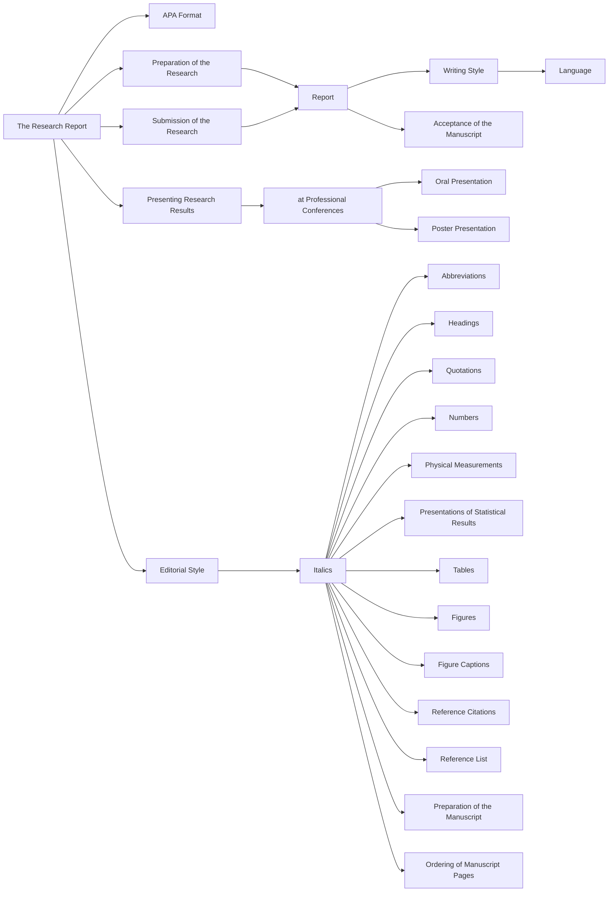
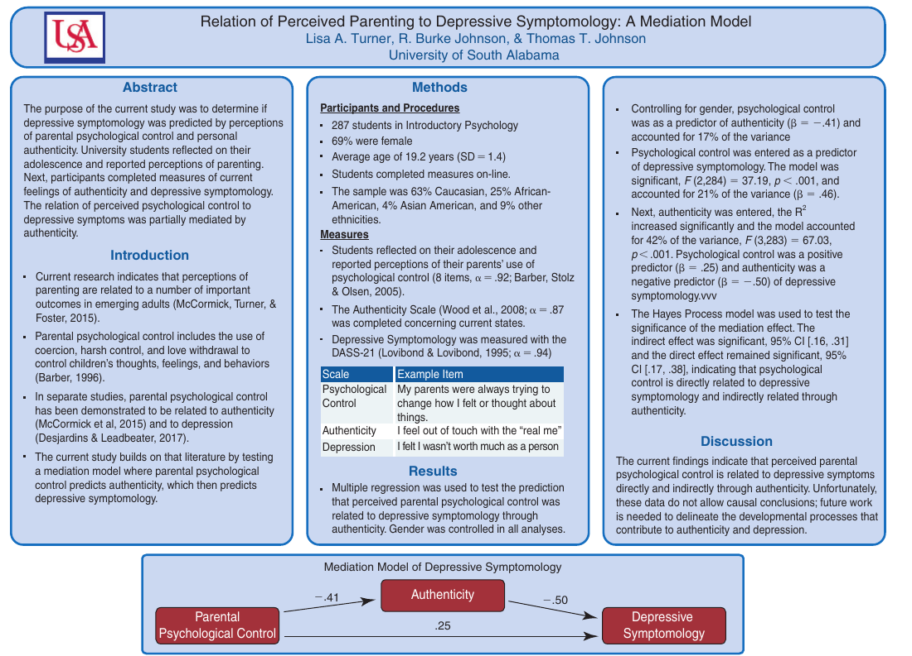

<style>
  /* Textbook typographic styling */
  p {
    text-align: justify;
    text-justify: inter-word;
  }
  h1, h2, h3, h4, h5, h6 { text-align: left; }
  blockquote { text-align: left; }

  /* Textbook Plum Table & Card Styling */
  .textbook-table-wrapper, .comparison-card, .framed-card {
    margin: 1.8em 0;
    border: 1px solid #e5cfdc;
    border-radius: 6px;
    overflow: hidden;
    background: #ffffff;
    box-shadow: 0 1px 3px rgba(0,0,0,0.05);
  }
  .table-caption, .card-caption, .framed-card-header {
    padding: 10px 14px;
    font-size: 0.95em;
    font-weight: 600;
    background: #ffffff;
    border-bottom: 2px solid #842959;
  }
  .textbook-table {
    width: auto;
    max-width: 100%;
    border-collapse: collapse;
    font-size: 0.9em;
  }
  .textbook-table th {
    background: #842959;
    color: #ffffff;
    font-weight: bold;
    padding: 10px 12px;
    text-align: left;
  }
  .textbook-table td {
    padding: 9px 12px;
    border-bottom: 1px solid #f0e6ec;
    vertical-align: top;
  }
  .textbook-table tr.category-header td {
    background: #f7f0f4;
    font-weight: bold;
    color: #842959;
    padding: 8px 12px;
    border-top: 1px solid #e5cfdc;
    border-bottom: 1px solid #e5cfdc;
  }
  .table-footer-notes td, tr.table-notes td {
    font-size: 0.85em;
    color: #666666;
    background: #fafafa;
    border-top: 1px solid #e5cfdc;
    padding: 8px 12px;
  }
  /* Comparison Card (Strengths & Weaknesses) */
  .banner-header {
    background: #842959;
    color: #ffffff;
    font-weight: bold;
    padding: 8px 14px;
    font-size: 0.9em;
    letter-spacing: 0.3px;
  }
  .banner-weaknesses .banner-header {
    background: #73224d;
  }
  .banner-list, .framed-card-body {
    margin: 0;
    padding: 12px 20px 16px 36px;
    background: #faf7f9;
  }
  .banner-list li, .framed-card-body li {
    margin-bottom: 6px;
    line-height: 1.5;
    color: #2b1b24;
  }
  /* Counseling Dialogue / Transcript Styling */
  .dialogue-block {
    margin: 1.4em 0;
    padding: 12px 18px;
    background: #fdfbf7;
    border-left: 4px solid #b38867;
    border-radius: 0 6px 6px 0;
  }
  .dialogue-speaker {
    font-weight: bold;
    color: #5c3d2e;
  }
</style>

<details open>
<summary>📑 <b>Table of Contents</b></summary>

- [PART VII Writing the Research Report](#part-vii-writing-the-research-report)
- [Chapter 17 Preparing the Research Report Using APA Style](#chapter-17-preparing-the-research-report-using-apa-style)
  - [Learning Objectives](#learning-objectives)
- [The APA Format](#the-apa-format)
  - [References](#references)
  - [References. When placed on a](#references-when-placed-on-a)
- [Preparation of the Research Report](#preparation-of-the-research-report)
  - [Writing Style](#writing-style)
  - [Language](#language)
  - [Editorial Style](#editorial-style)
- [Submission of the Research Report for Publication](#submission-of-the-research-report-for-publication)
  - [Acceptance of the Manuscript](#acceptance-of-the-manuscript)
- [Presenting Research Results at Professional Conferences](#presenting-research-results-at-professional-conferences)
  - [Oral Presentation](#oral-presentation)
  - [Poster Presentation](#poster-presentation)
  - [Summary](#summary)
  - [Key Terms and Concepts](#key-terms-and-concepts)
  - [Related Internet Sites](#related-internet-sites)
  - [Practice Test](#practice-test)
  - [Challenge Exercises](#challenge-exercises)

</details>


<!-- Page 1 -->
## PART VII Writing the Research Report

## Chapter 17 Preparing the Research Report Using APA Style



### Learning Objectives

🎯 **17.1** Describe the structure and format of an APA research report.
🎯 **17.2** Summarize the stylistic requirements to be used when preparing an APA research report.
🎯 **17.3** Describe the process involved in the submission of the research report.
🎯 **17.4** Summarize the recommendations for oral and poster presentations at professional conferences.

<!-- Page 2 -->
Throughout this text, we have presented the steps involved in the research process and discussed in detail the intricacies of each. A thorough presentation was made to enable you to conduct a sound scientific research study. As a scientist, however, you have a responsibility not only to conduct a well-designed and well-executed study, but also to communicate the results of the study to the rest of the scientific community. Your study might have answered a very significant research question, but the results are of limited value unless they are made public. The primary mechanism for communicating results is through professional journals. Within the field of psychology, the Association for

Association (APA) journal programs include 58 journals and a magazine. Table 17.1 highlights many of these journals and illustrates that these journals cover a wide variety of areas and provide an outlet for studies conducted within just about any field of interest. There are other journals that also publish the results of  psychological studies. In order to facilitate the clear communication of research results, the APA has pubformat for authors to follow when preparing research reports. Because many periodicals instruct their authors to prepare their manuscripts according to the style specified in the APA manual, this is the format we present here for writing a research report.

**Table 17.1** *American Psychological Association and Association for Psychological Science Journals*

<table class="textbook-table" style="width: auto; max-width: 100%; border-collapse: collapse; margin: 1.5em 0;">
  <thead>
    <tr>
      <th>Name of Journal</th>
      <th>Area Covered</th>
    </tr>
  </thead>
  <tbody>
  </tbody>
</table>

Prior to preparing a report on a study that you have completed, you must ask yourself if the study is important enough to justify publication. Would others be interested in it, and, more important, would it influence their work? As a general rule, you should never conduct a study you don’t think is publishable. If you think the study is significant, you must decide whether it is well designed. For example, you must ask yourself whether you have built in the controls needed to eliminate the influence of rival hypotheses. If you can satisfy yourself with regard to the quality of the research design and the significance of the results, then you should proceed with the  preparation of the research report.

*American Psychologist* Contains archival documents and articles focusing on current issues in psychology, issues relating to the science and practice of psychology, and the contribution psychology makes to public policy *Behavioral Neuroscience* Contains original studies in anatomy, chemistry, endocrinology, genetics, pharmacology, and physiology as they relate to behavioral neuroscience *Developmental Psychology* Publishes articles relating to human development across the life span *Emotion* Publishes articles on all aspects of emotional processes *Experimental and Clinical Psychopharmacology* Publishes research integrating pharmacology and behavior *Health Psychology* Devoted to furthering an understanding of the relationship between behavioral principles and physical health or illness *History of Psychology* Historical description and analysis of psychological systems and theories *Journal of Abnormal Psychology* Publishes articles relating to the determinants, theories, and correlates of abnormal behavior *Journal of Applied Psychology* Publishes articles that contribute to our understanding of any applied area of psychology except clinical and applied experimental or human factors psychology *Journal of Comparative Psychology* Contains behavioral studies that relate to evolution, development, ecology, control, and functional significance of various species *Journal of Consulting and Clinical Psychology* Contains research investigations pertaining to development, validity, and use of various techniques for diagnosing and treating disturbed behavior in all populationons *Journal of Counseling Psychology* Contains articles pertaining to evaluation, application, and theoretical issues related to counseling *Journal of Educational Psychology* Publishes studies and theoretical papers pertaining to education such as learning and cognition *Journal of Experimental Psychology: Animal* Publishes experimental and theoretical studies on animal behavior *Learning and Cognition* *Journal of Experimental Psychology: Applied* Focuses on studies that bridge practically oriented problems and psychological theory *Journal of Experimental Psychology: General* Publishes integrative articles of interest to all experimental psychologists ( *Continued* )

<!-- Page 3 -->
**Table 17.1** *American Psychological Association and Association for Psychological Science Journals ( Continued )*

<table class="textbook-table" style="width: auto; max-width: 100%; border-collapse: collapse; margin: 1.5em 0;">
  <thead>
    <tr>
      <th>Name of Journal</th>
      <th>Area Covered</th>
    </tr>
  </thead>
  <tbody>
  </tbody>
</table>

Focuses on perception, planning, and control of physical actions and related cognitive processes

Contains original studies on all cognitive processes

Focuses on the study of family systems and processes and on problems such as marital and family abuse

Contains articles on all areas of personality and social psychology

Publishes articles on the relation between the brain and human cognitive, emotional, and behavioral function

Focuses on the practice of psychology

Publishes articles on assessment techniques

Publishes evaluative and integrative reviews of substantive issues in scientific psychology

Devoted to the development and dissemination of methods for collecting, analyzing, understanding, and interpreting psychological data

Publishes articles that make a theoretical contribution to psychology

Publishes articles on the physiological and behavioral aspects of adult development and aging

Publishes articles on alcoholism, drug use and misuse, eating disorders, tobacco and nicotine addiction, and other compulsive behaviors

Focuses on the link between psychology as a science and public policy and legal issues

Publishes articles focusing on the psychological and behavioral aspects of rehabilitation

The flagship research journal of APS—publishes articles of interest across all areas of psychology

Contains reviews spanning all areas of psychology and its applications

Publishes definitive assessments of topics in which psychological science might have the potential to inform and improve the well-being of society

Publishes theoretical statements, literature reviews, viewpoints or opinions, research presentations, and scholarship

Publishes research on psychological health, and assessment, treatment, and prevention of mental illness

Publishes advances in methods and practices across multiple domains of psychology

## The APA Format

🎯 **17.1** Describe the structure and format of an APA research report.

The structure of the research report is very simple and tends to follow the steps one takes in conducting a research study. To illustrate the function and format of the research report, a short manuscript is reproduced on the following pages, using the format required when an article is submitted for publication. Each section of the research report also includes an explanation of the content that should be included in that section. This explanation might include some recommendations that are not illustrated in the research report, because each study will not include all the elements

When reading through each section of the research report and then when writing your own report, you should remember the purpose of a research report. The primary goal is to report as precisely as possible what you did, including a statement of the problem investigated, the methods used to investigate the problem, the results of your investigation, and any conclusions you might have reached. Is there any criterion you can use to determine whether you have clearly and explicitly reported your study?

The criterion of replication is probably the most important. If another investigator can read your research report and precisely replicate your study, then chances are good that you have written a clear and complete report.

The following sample research report was prepared according to the guidelines specified in the APA *Publication Manual*. This type of research report could be submitted to an APA journal.

<!-- Page 4 -->
Running head: RELATION OF PARENTING TO ACADEMIC ENTITLEMENT

**Running head** The running head is an abbreviated title typed flush left at the top of the first (title) page and on **Authors’ names and** all subsequent pages. It is typed in all uppercase letters. It **institutional affiliations** is not more than 50 characters in length, counting letters, The names of the authors punctuation, and spaces between words. in the order of their contribution to the study appear immediately below

The Relation of Perceived Parental Warmth and the title typed in upperand lowercase letters and Psychological Control to Academic Entitlement centered on the page. The preferred form is to list Tully Garner first name, middle initial, and last name, with titles and and degrees omitted. The

Lisa A. Turner institutional affiliation when the study was conducted is University of South Alabama centered under the author’s name on the next doublespaced line. Authors with no institutional affiliation should list the city and state of residence. Authors from different institutions should be typed on separate lines.

> Author Note **Title** The title should be centered on the upper half of the first page of the manuscript and typed in upper- and lowercase letters. It should state the main topic of the study and concisely identify the variables or theoretical issues under investigation. A typical title should be no more than 12 words long.

> **Author Note** The label “Author Note” is centered on the title page below the author affiliation and typed in upper- and lowercase letters. This note is used to identify each author’s institutional affiliation and to provide acknowledgments, disclaimers, and point of contact. Each paragraph should start with an indent. The first paragraph identifies the departmental affiliation of each author or the city and state if there is no institutional affiliation—country should be provided if outside the United States. The second paragraph states the author affiliation if subsequent to the time of study. The third paragraph identifies the grants or other support received for the study as well as any acknowledgments for assistance given in the conduct or completion of the study. The fourth and last paragraph identifies the person to contact for correspondence regarding the manuscript including the mailing address and e-mail of that person.

> Tully Garner, Department of Psychology, University of South Alabama; Lisa A. Turner, Department of

Psychology, University of South Alabama.

> Tully Garner is currently a doctoral student in Instructional Design and Development, University of

> RELATION OF PARENTING TO ACADEMIC ENTITLEMENT

2

South Alabama.

> This research was supported, in part, by a Johnson Foundation Award (TTJ0798) to the first author. Abstract

> Correspondence concerning this manuscript should be directed to Lisa A. Turner, Department of Academic entitlement refers to beliefs and attitudes indicating that one deserves special treatment in the

Psychology, University of South Alabama, Mobile, AL 36688, laturner@southalabama.edu academic environment. These beliefs undermine the student-teacher relationship and contribute to poor academic performance. The current study was designed to examine the relationship between perceived parenting and academic entitlement among emerging adults. College students completed questionnaires reporting perceptions of parental warmth and psychological control (Skinner, Johnson, &amp; Snyder, 2005) and current attitudes of academic entitlement (Chowning &amp; Campbell, 2009). In a multiple regression, gender, parental warmth and psychological control were entered as predictors of academic entitlement.

> The model was statistically significant $F(3, 273) = 12.79$, *p* 6.001 and accounted for 18.8% of the variance.

> Gender ( b = -.13, $p = .014$), parental warmth ( b = -.25, $p = .004$), and parental psychological control

> ( b =.29, $p = .002$) were statistically significant predictors of academic entitlement, indicating that males and students who reported lower rates of parental warmth and higher rates of parental psychological control reported higher rates of academic entitlement. These findings indicate the importance of family relationships in predicting important outcomes among emerging adults.

**Abstract** The abstract is a one-paragraph comprehensive summary of the contents of the research report typically ranging from 150 to 250 words in length. It is typed on a separate page, with the word “Abstract” centered at the top of the page in upper- and lowercase letters and no paragraph indentation for the first paragraph. The abstract of an empirical study should include a brief statement of the problem, a summary of the method used (including a description of the participants, instruments, or apparatus), the procedure, the results (including statistical significance levels), effect sizes, and any conclusions and implications.

<!-- Page 5 -->
> The Relation of Perceived Parental Warmth and

> Psychological Control to Academic Entitlement **Introduction** The text of the research report begins on a new page with the title of the paper typed at the top center of the page. The introductory text is not labeled because of its position in the paper. The introduction is funnel shaped in the sense that it is broad at the

Academic entitlement is a behavioral trait in which individuals believe they deserve acceptable grades and beginning and narrow at the end. test scores for little or no effort (Chowning &amp; Campbell, 2009). Academic entitlement beliefs affect many aspects It should begin with a very general introduction to the problem area of the student-teacher relationship in negative ways for both parties (Chowning &amp; Campbell, 2009). Greenburger, and then start to narrow by citing the results of prior works that Lessard, Chen, and Farruggia (2008) examined entitled attitudes and behaviors in college students and found have been conducted in the area that entitled attitudes were related to cheating, expecting easy grades, and immediate responses from teachers. and that bear on the specific issue that you are investigating, leading They concluded that academic entitlement is a predictor of these negative academic behaviors. into a statement of the variables to be investigated. In citing prior

```python
Academic entitlement can be divided into two main components: entitled expectations and externalized research, do not attempt to make responsibility (Chowning &amp; Campbell, 2009). Externalized responsibility consists of attributing outcomes to an exhaustive review of the literature. Cite only those studies factors outside of one’s control and expecting other forces to assume control. Externalized expectations are that are directly pertinent, and avoid tangential references. This defined as beliefs that affect how students perceive course requirements in relation to themselves (Taylor, pertinent literature should lead directly into your study and thereby Bailey, &amp; Barber, 2015). That is, they often perceive course requirements as unfair and do not see themselves show the continuity between what as responsible for meeting these unfair course requirements. Entitled expectations, the second component you are investigating and prior research. You should then state of academic entitlement, refers to the successful grades and test scores that one believes he/she deserves. the purpose of your study and your hypothesis. The introduction should Individuals with higher reports of entitled expectations believe that they deserve higher grades because they give the reader the rationale for attend class or pay for an education. the given investigation, explaining how it fits in with, and is a logical

```
> Academic entitlement has been studied in relation to the personality factors of the dark triad (Turnipseed extension of, prior research.

&amp; Cohen, 2015). Turnipseed and Cohen reported that externalized responsibility correlated with psychopathy and narcissism and that entitled expectations correlated with Machiavellianism and narcissism. Psychopathic personality traits of irresponsibility, interpersonal manipulation, and lack of empathy are consistent with RELATION OF PARENTING TO ACADEMIC ENTITLEMENT

4 externalized responsibility and correlate positively (Turnipseed &amp; Cohen, 2015). They concluded that narcissism

In addition, Hazel, Crandal, and Caputo (2014) reported that students who scored high on academic traits of superiority, dominance, and grandiosity were positively correlated with externalized responsibility. entitlement were much more likely to rate teachers as misbehaving or devious. Given the importance of

Numerous studies involving academic entitlement focus on a college populationon. Greenberger et al. (2008) academic entitlement beliefs, it seems pertinent to identify factors that may lead students to develop feelings of found that entitled attitudes were related to cheating, expecting easy grades, and expecting immediate responses academic entitlement. Although there are likely several important predictors of academic entitlement, the current from college teachers. investigation examines perceptions of parenting as it relates to academic entitlement.

<!-- Page 6 -->
The current study is designed to measure the relation between academic entitlement and perceptions of parental warmth and parental psychological control. Based on the research reviewed, it is hypothesized that parental warmth will negatively predict academic entitlement, and parental psychological control will positively predict academic entitlement.

**Method**

**Participants**

> The participants were volunteers from an online participant pool at a regional university in the

Southeastern United States. The participant pool included primarily psychology department students who participated in research as an option for course credit. Two hundred seventy-eight undergraduates participated.

In the current study, 70.9% of participants were female, and the average age was 18 years (*SD* = 1.13). For race/ ethnicity of the participants, 56.8% reported Caucasian, 29.9% reported African American, 4.7% Asian American, and 8.6% of participants reported other. When asked about their year in college, 63.7% of participants reported to be freshmen, 25.2% sophomore, 7.9% junior, and 3.2% seniors in college. Last, 64% of participants lived

**Participants or subjects**

> RELATION OF PARENTING TO ACADEMIC ENTITLEMENT

6 The participants subsection should identify the demographic characteristics of the research with both parents while growing up, 23.4% lived with only their mother, 6.1% lived with their mother and participants, such as their age, sex, and ethnic or racial group. stepfather, and the remaining 6.5% reported other family arrangements. Any other pertinent information regarding the participants

```python
**Materials** should also be included, such as eligibility and exclusion criteria, The study included two questionnaires: the Academic Entitlement Questionnaire (AEQ; Chowning &amp; the number of participants that were selected for the study Campbell, 2009) and the Parents as Social Context Scale (PSC; Skinner, Johnson, &amp; Snyder, 2005). The but did not complete it (and why), and any inducements Academic Entitlement Questionnaire includes two subscales: externalized responsibility and entitled that were given to encourage expectations. Externalized responsibility consists of 10 items and is defined as attributing responsibility participation. You should also state how the sample size for academic success to others, such as teachers and peers. An example item is “It is unnecessary for me was determined (e.g., power analysis). If animals were used, to participate in class when the professor is paid for teaching, not for asking questions.” Chowning and their genus, species, strain

```
Campbell report the internal consistency of the externalized responsibility scale to be.81. In the current number, and supplier should be specified, in addition to sample it was.85. The entitled expectations scale includes five items which address unusually high their gender, age, weight, and physiological condition. expectations of support, tools, and high grades provided from the professor in a class. An example item from the entitled expectations subscale is “My professors are obligated to help me prepare for exams.”

> Chowning and Campbell report the internal consistency of the entitled expectations scale to be

**Apparatus, materials, measures, and instruments** In this subsection, the reader can learn what apparatus or materials were used. Sufficient detail should be used to enable the reader to obtain comparable equipment. In addition, the reader should be told why the equipment was used. Any mention of commercially marketed equipment should be accompanied by the firm’s name and the model number or, in the case of a measuring instrument such as an anxiety scale, a reference that will enable the reader to obtain the same scale. Custom-made equipment should be described; in the case of complex equipment, a diagram or photograph might need to be included.

<!-- Page 7 -->
**Procedure** In the procedure subsection, the reader is told exactly how the study was executed, from the moment.62. In the current sample it was.65. These constructs are correlated with each other and were combined into the participant and the one scale. The internal consistency for the total scale was.83. Each item was answered on a 6-point scale experimenter came into contact to the moment their contact 1 1 = *strongly* *disagree* and 6 = *strongly* *agree* 2 where strongly agree reflects higher academic entitlement. was terminated. Consequently, this subsection represents a

The Parents as Social Context Scale (Skinner et al., 2005) was used to measure parental warmth and step-by-step account of what parental psychological control. The scale includes other constructs, but the current study is focused on perceived both the experimenter and the participant did during the study. parental warmth and psychological control. An example of parental warmth is “My parents think I’m special,” This subsection should include any instructions or stimulus and an example of psychological control is “My parents boss me.” The warmth and psychological control conditions presented to the scales each include four items. Skinner et al. (2005) report the internal consistency for warmth to be $\alpha$ =.88 participants and the responses that were required of them, as and the internal consistency for control to be $\alpha$ =.84. In the current study, the internal consistency for parental well as any control techniques used (such as randomization warmth was $\alpha$ =.93 and for parental psychological control was.85. Each question was answered on a 4-point or counterbalancing). In other words, you are to tell the reader scale 1 1 = *strongly* *disagree* and 4 = *strongly* *agree* 2 where high scores reflect greater warmth and greater exactly what both you and the psychological control. participants did and how you did it. After reading the procedure subsection, the reader should understand the research design used as well as how the research design was implemented to answer the research question.

8

**Results**

> To determine if males and females differed in academic entitlement, an ANOVA was conducted with gender as the independent variable and academic entitlement as the dependent variable. The gender effect was statistically significant $F(1, 275) = 8.46$, $p = .004$, est η 2 =.003. The mean for male participants (*M* = 2.59,

> *SD* =.78) was higher than female participants (*M* = 2.28, *SD* =.81).

> To determine if males and females differed in perceived parenting, a MANOVA was conducted with gender as the independent variable and parental warmth and parental psychological control as the dependent variables.

> The Wilks’s Lambda was statistically significant, $F(2, 276) = 4.78$, $p = .032$ *t* tests, *F* *p* value) should be reported. Sufficient descriptive statistics (e.g., means, standard

<!-- Page 8 -->
.009, est η 2 =.034. The univariate gender effect for parental warmth was statistically significant,

$F(1, 276) = 9.15$, $p = .003$, est η 2 =.032. The mean for male participants was 3.42 (*SD* =.40) and the mean for female participants was 3.66 (*SD* =.38). The gender effect on psychological control was not statistically significant.

To determine the relations among the variables, Pearson correlations were computed for academic entitlement, parental warmth, and psychological control. As predicted, parental warmth was negatively related to academic entitlement, $r(276) = -.27$, $p = .003$, and psychological control was positively correlated with academic entitlement, $r(276) = .30$, $p = .002$. The correlations can be found in Table 1.

We hypothesized that parental warmth would negatively predict academic entitlement and parental psychological control would positively predict academic entitlement. To investigate this hypothesis, a multiple regression was conducted. Gender, parental warmth, and parental psychological control were entered as RELATION OF ACADEMIC ENTITLEMENT TO PARENTING

10 predictors of academic entitlement. The model was statistically significant $F(3,273) = 12.79$, *p* 6.001 and

**Discussion** accounted for 18.8% of the variance. Gender ( The purpose of $\beta$ = -.13, $p = .014$), parental warmth ( $\beta$ **Discussion** = -.25, $p = .004$), the discussion section of the

The current study was designed to investigate the relationship of perceptions of parenting to academic research report is to interpret and and parental psychological control ( $\beta$ =.29, $p = .002$) were statistically significant predictors. 1 These findings evaluate the results obtained, entitlement among emerging adults. The findings indicated that students reporting greater parental warmth giving primary emphasis to the indicate that academic entitlement was higher among males, higher among those reporting less parental relationships between the results also reported lower academic entitlement. In contrast, students reporting greater parental psychological warmth, and higher among those reporting greater parental psychological control. See Figure 1. and the hypotheses of the study. control reported greater academic entitlement. These findings are worthy of attention because of the Begin the discussion by stating whether the hypothesis of the potential negative impact of academic entitlement in the lives of college students. Students who report high study was or was not supported. Following this statement, you academic entitlement also report less academic satisfaction, greater academic anxiety, and more negative should interpret the results, telling relations with faculty members (Chowning &amp; Campbell, 2009). Feelings of academic entitlement have the reader what you think they mean. In doing so, you should the potential to undermine growth and development. Therefore, it is important to consider the possible attempt to integrate your research findings with the results of prior developmental paths that may result in feelings of academic entitlement. research. This interpretation should include a consideration of In this investigation, parental warmth appears to be a protective factor. Prior research has documented potential bias, threats to internal that parental warmth is related to children’s internal locus of control and to higher self-esteem (Lowe &amp; validity, and other limitations and weaknesses. In general, the Dotterer, 2013). Perhaps a warm parental relationship communicates to the child that he/she is competent discussion should answer the following questions: (a) What does and is valued. Warm relationships also include involvement and support. This involvement may support the study contribute, (b) how has a sense of efficacy and protect the child from the type of external attributions that are associated with it helped solve the study problem, and (c) what conclusions and academic entitlement. In contrast, parental psychological control often communicates that the child is not theoretical implications can be drawn from the study? prepared to function independently. This lack of independence may contribute to the tendency to believe that others are responsible for one’s success which is a component of academic entitlement. The discussion section should also cover the weaknesses of the study. Limitations for this study were particularly potent. The internal consistency for the entitled

When discussing the shortcomings, expectations measure was low. The scale may need to be refined and may currently be a limitation to you should mention only the flaws that might have had a significant the study of academic entitlement. The current study is also limited by the use of a convenience sample influence on the results obtained. You should accept a negative of psychology college students only from the earlier stages of college and only taking an introduction to finding as such and offer a post hoc psychology course. This study was a one-time correlational study, so no conclusion of a causal relationship explanation. You should not attempt to explain it as being due to some can be made from these data. Clearly, an experimental design would be unethical because you cannot methodological flaw (unless, as might occasionally occur, there is a very randomly assign parents to using different levels of warmth and psychological control. However, good and documented reason why a flaw may have caused the negative longitudinal data would be useful because it would provide an examination of the temporal order of the finding). variables, that is, parenting and academic entitlement could be measured throughout development.

<!-- Page 9 -->
Additionally, there are likely many other family and social factors that contribute to academic entitlement that were not measured in this study. Even through the limitations of the current study, we have evidence that perceived parenting and academic entitlement are related. Notably these entitlement ideas are likely rooted in a long history of parent child relationships, so changing them in emerging adulthood may be difficult.

> RELATION OF ACADEMIC ENTITLEMENT TO PARENTING

12

### References

The purpose of Baumrind, D. (1966). Effects of authoritative parental control on child behavior. *Child Development, 37*, 887–907. the reference section, as you might expect, is to provide doi:10.1037/h0030372 an accurate and complete Carolan, B. V., &amp; Wasserman, S. J. (2015). Does parenting style matter? Concerted cultivation, educational list of all the references cited expectations, and the transmission of educational advantage. *Sociological Perspectives, 58*, 168–186. in the text of the report. All doi:10.1177/0731121414562967 the references in the text must be cited and presented Chowning, K., &amp; Campbell, N. J. (2009). Development and validation of a measure of academic entitlement: in alphabetical order using a Individual differences in students’ externalized responsibility and entitled expectations. *Journal of Educational* hanging indent format. This
*Psychology, 101*, 982–997. doi:10.1037/a0016351
means the first line of each Greenberger, E., Lessard, J., Chen, C., &amp; Farruggia, S. P. (2008). Self-entitled college students: Contributions of reference is set flush left and personality, parenting, and motivational factors. *Journal of Youth and Adolescence, 37*, 1193–1204. doi:10.1007/ subsequent lines are indented. a10964-008-9284-9 Hazel, M., Crandall, H. M., &amp; Caputo, J. S. (2014). The influence of instructor social presence and student
**Footnotes**
Footnotes are academic entitlement on teacher misbehaviors in online courses. *Southern Communication Journal, 79*, 311–326. numbered consecutively, with doi:10.1080/1041794X.2014.914563 a superscript Arabic numeral, in the order in which they Lowe, K., &amp; Dotterer, A. M. (2013). Parental monitoring, parental warmth, and minority youths’ academic appear in the text of the report. outcomes: Exploring the integrative model of parenting. *Journal of Youth and Adolescence, 42*(9), 1413–1425. Most footnotes are content http://doi.org/10.1007/s10964-013-9934-4 footnotes, containing material MacDonald, A. P. (1971). Internal-external locus of control: Parental antecedents. *Journal of Counseling and Clinical* needed to supplement the information provided in the
*Psychology, 37*, 141–147. doi:10.1037/h0031281
text. Footnotes are also used Robinson, O. C., Lopez, F. G., &amp; Ramos, K. (2013). Parental antipathy and neglect: Relations with big five to acknowledge copyright personality traits, cross-context trait variability, and authenticity. *Personality and Individual Differences, 56*, permission. Footnotes appear 180–185. doi:10.1016/j.paid.2013.09.004 at the bottom of the page on which they were discussed. Skinner, E., Johnson, S., &amp; Snyder, T. (2005). Six dimensions of parenting: A motivational model. *Parenting: Science* You can also place footnotes
*and Practice, 5*, 175–235. doi:10.1207/s15327922par0502_3
on a separate page after the Swartz, S. H., Cieciuch, J., Vecchione, M., Davidov, E., Fisher, R., Beierlein, C., . . . &amp; Konty, M. (2012). Refining

### References. When placed on a

the theory of basic individual values. *Journal of Personality and Social Psychology, 103*, 663–688. doi:10.1037/ separate page, type the word a0029393 “Footnotes” at the top of the page centered in upper- and Taylor, J. M., Bailey, S. F., &amp; Barber, L. K. (2015). Academic entitlement and counterproductive research behavior. lowercase letters. The first line
*Personality and Individual Differences, 85*, 13–18. doi:10.1016/j.paid.2015.04.024
of each footnote is indented Turner, L.A. &amp; McCormick, W.H. (2018). Academic entitlement: Relations to perceptions of parental warmth and five spaces or one-half inch, psychological control. *Educational Psychology, 38*, 248–260. doi:10.1080/01443410.2017.1328487 and the superscript numeral of the footnote should appear Turnipseed. D. L., &amp; Cohen, S. R. (2015). Academic entitlement and socially aversive personalities: Does the in the space just preceding dark triad predict academic entitlement? *Personality and Individual Differences, 82*, 72–75. doi:10.1016/j. the beginning of the footnote. paid.2015.03.003 Footnotes are typed in the Weiner, B. (1985). An attributional theory of achievement motivation and emotion.  *Psychological Review, 92*, order in which they are 548–573. doi:10.1037/0033-295X.92.4.548 mentioned in the text. RELATION OF ACADEMIC ENTITLEMENT TO PARENTING 13 Footnote 1 The analyses were also conducted without gender in the model and the findings remained unchanged.

<!-- Page 10 -->
**Table 1** *Relations among Academic Entitlement and Parental Warmth and Control*

<table class="textbook-table" style="width: auto; max-width: 100%; border-collapse: collapse; margin: 1.5em 0;">
  <thead>
    <tr>
      <th>Measure</th>
      <th>1</th>
      <th>2</th>
      <th>3</th>
      <th>M</th>
      <th>SD</th>
    </tr>
  </thead>
  <tbody>
    <tr>
      <td>1. Academic Entitlement</td>
      <td></td>
      <td>- .27</td>
      <td>.30</td>
      <td>2.49</td>
      <td>.81</td>
    </tr>
    <tr>
      <td>2. Parental Warmth</td>
      <td></td>
      <td></td>
      <td>- .41</td>
      <td>3.55</td>
      <td>.40</td>
    </tr>
    <tr>
      <td>3. Parental Psychological Control</td>
      <td>RELATION OF ACADEMIC ENTITLEMENT TO PARENTING</td>
      <td></td>
      <td></td>
      <td>2.43</td>
      <td>.60 15</td>
    </tr>
  </tbody>
</table>

2

2

> [!TIP] **Study Question 17.1**
> Describe the different parts of an APA article.

## Preparation of the Research Report

🎯 **17.2** Summarize the stylistic requirements to be used when preparing an APA

**research report.**

In the preceding section you saw an example of the way a research report must be prepared in order to be submitted for possible publication in a psychological journal. Although the essence of the report was discussed in the marginal notes, there are still many style rules that must be considered.

The APA *Publication Manual* presents the stylistic requirements authors must adhere to in the preparation of manuscripts submitted for possible publication in APA journals as well as many non-APA journals. These explicit stylistic requirements have gone through a number of changes to reflect the maturing nature of the language of psychology. As such, they have evolved along with psychology. The first set of requirements was published as a seven-page writer’s guide in the February 1929 issue of the *Psychological Bulletin.* This document was succeeded in 1944 by a 32-page document. In 1952, the 1944 document was expanded to 60 pages and carried the title *Publication Manual.* New revisions followed in 1957, 1967, 1974, 1983, 1994, and 2001. The current 2010 revision reflects updated information on manuscript preparation.


*Figure
1. Parental warmth, psychological control, and gender as predictors of academic entitlement*

<!-- Page 11 -->
Since the publication of the 2001 edition of the *Publication Manual*, many changes have been made in the publishing world, and the 2010 edition of the *Publication* *Manual* reflects not only the new standards in publishing, but also the new practices in information dissemination, which range from blogs and personal web postings to articles published in online databases. An additional change made in the 2010  edition of the *Publication Manual* was the decision to emphasize general principles that should be adhered to in the preparation of a manuscript because of the wide use of the *Publication Manual* in fields other than psychology.

In the following pages, we summarize the stylistic requirements that are most frequently used in preparing the research report. Space does not permit the presentation of all stylistic requirements, and the *Publication Manual* should be consulted for those requirements that are not presented here. The stylistic requirements presented here should allow you to prepare a research report for class.

### Writing Style

If you have decided that the study you have conducted is important enough to prepare a research report, you must prepare that research report in a manner that clearly communicates to the reader. Good writing is a craft and an art that requires thoughtful concern for the presentation and language used. Good writing is usually a developmental process that is acquired over time and requires continuous effort.

However, for the student who has difficulty with writing, we recommend an excellent book by Strunk, Jr., and White (2019), *The Elements of Style* (you can download a free copy on Amazon.com). This book is a classic and has the virtue of being short. For assistance in reasoning and writing clearly, we recommend Gage’s (2005) *The Shape of Reason*, and for additional assistance in preparing your research, Rosnow and Rosnow’s *Writing Papers in Psychology* (2011) is excellent. (See the References for bibliographic data on these titles.) Recently, the APA has provided explanations of APA Style writing in quantitative research (https://www.apastyle.org/jars/quantitative), qualitative research (https://www.apastyle.org/jars/qualitative), and mixed methods research (https://www.apastyle.org/jars/mixed-methods). We now provide some general principles elaborated on in more detail in the APA *Publication Manual* (2010).

To clearly communicate the essence of a research report, you must have an orderly presentation of ideas. There must be a continuity of words, concepts, and thematic development from the beginning to the end of the report. This continuity can be achieved by the use of punctuation marks to show the relationship between ideas and by the use of transitional words, such as *then, next, therefore*, and *however.* However, some transitional words (e.g., *while* and *since*) create confusion and should be used cautiously. *Since* is often incorrectly used in place of *because.* Scientific writing requires precision, and use of these transitional terms should be limited and correct.

The preparation of the research report requires a smoothness and economy of expression. Smoothness of expression is achieved by avoiding ambiguity and the insertion of the unexpected, shifting topics, tense, or person, all of which add to the confusion of the reader. By being consistent with verb tenses, smooth expression is enhanced. Economy of expression is achieved by being frugal with words. This means eliminating redundancy, wordiness, jargon, evasiveness, overuse of the passive voice, circumlocution, and clumsy prose.

With respect to writing, we want to make a number of points that might assist you. Some people have trouble getting started. They sit down at a computer or with a pencil and pad of paper, and the words or ideas just do not develop. In such instances you can use one of two approaches. Rosnow and Rosnow (2011) suggest that you begin with the section you feel will be easiest to write. For example, this might be the method section because you should already know details such as the characteristics of the research participants you tested and the procedure followed in testing them.

<!-- Page 12 -->
Once you have begun writing this section, you might find that other sections such as the introduction are easier to write. The other technique is to force yourself to begin writing a section even if you don’t like what you are saying. This technique has the advantage of getting something down on paper and giving you something to work with and revise. It also forces you to move beyond the beginning point, which might cause the ideas to begin flowing. To use this technique, you must accept the fact that your first draft is just that. Seldom, if ever, should you consider the first draft the final product. Rather, you should produce the first draft and then revise it. This process should continue until you are satisfied with the final product.

When you have completed the final product, you should let it rest for several days and then reread it. This rereading several days later should result in additional revisions, because the time lapse should allow you to approach the paper more  objectively and identify sections that need work.

In preparing the research report, make sure that you avoid plagiarism. **Plagiarism** means that you are using another person’s ideas or efforts and passing them off as your own. If you are using someone’s words, you need to use quotation marks for strings of 4 or more words and provide a reference and page number; if you do not, you have committed plagiarism which amounts to stealing from someone. For quotes of 40 or more words, use block quotations (explained below in section titled Quotations). In several sections of the research report, particularly the introduction, you must make use of others’ work. When you do so, make sure that you give them credit. Review Chapter 4 for more guidelines on citing and quoting authors.

### Language

The language used to communicate the results of research should be free of demeaning attitudes and biased assumptions. The APA *Publication Manual* provides three guidelines—specificity, sensitivity to labels, and acknowledging participation—that should be followed to achieve the goal of unbiased communication.

**Specificity** When referring to a person or people, you should choose accurate and clear words that are free from bias. When in doubt, err in the direction of being more rather than less specific. For example, if you are describing age groups, it is better to provide a specific age range (e.g., *ages 8 to 12*) instead of a broad category (e.g., *under 12*). The range of *people at risk* is too broad. It is preferable to identify the risk and the people involved (e.g., *children at risk for academic failure*). Similarly, *gender* is preferred when referring to men and women as a social or cultural group rather than *sex,* which refers to biological distinctions. Consider the option of treating gender identity as non-binary and the need to address the issue that individuals’ gender identity may not fit neatly into male and female categories.

**Labels** The preferences of the participants in any study must be respected, and they should be called what they prefer to be called. This means avoiding labels when possible and avoiding categorizing participants as objects (e.g., *the elderly*) or equating participants with their conditions (*depressives* or *stroke victims*). One way to avoid such labels is to use adjectival forms such as *gay men* or *stroke patients*. Another option is to place the person first followed by a descriptive phrase (e.g., *individuals with a* *diagnosis of major depression*). Similarly, sensitivity should be given to any suggestion that one group is better than or is the standard against which another is to be judged. For example, it would be inappropriate to contrast *depressed individuals* with *normal* *individuals*, thus stigmatizing the depressed people as not normal. A more appropriate contrast would be between *depressed* and *nondepressed* individuals.

<!-- Page 13 -->
**Participation** Writing about the research participants should be done in such a way that acknowledges their participation and conforms to the traditions of your field. Although a specific descriptive term such as *children* or *women* could and have been used to provide specific information about the research participants, most studies use the general term *participants* or *subjects.* When discussing actions taken by research participants, use the active voice to acknowledge the activity in which they engaged. For example, state that “the participants *completed* the MMPI” instead of “the MMPI was administered to the participants.” By using the active voice, you are acknowledging the individuals’ voluntary and active participation in the research study.

**Specific Issues** All research reports should avoid writing in a way that reflects demeaning attitudes and biased assumptions. Keeping these in mind, specific attention should be given to the following issues.

*Gender.* Participants should be described in such a way that avoids ambiguity in sex identity or gender role. This means that you should avoid using *he* to refer to both sexes or *man* or *mankind* to refer to people in general. The words *people, individuals*, or *persons* can be substituted without losing meaning or clarity of expression.

*Sexual Orientation.* Use the term *sexual orientation* rather than *sexual preference* to refer to sexual or romantic attraction. The term *homosexual* has been associated with negative stereotypes and should be replaced with terms such as *gay men, lesbians, bisexual* *men*, and *bisexual women* to reflect sexual orientation. Heterosexual bias should be avoided. Research and language should reflect the full range of sexual orientation.

*Racial and Ethnic Identity.* When referring to racial and ethnic groups, it is important to remember that designations can become dated and sometimes negative. Therefore, it is important to be sensitive to the participants’ preferred designation. For example, *Black* and *African American* are both acceptable terms, but the research participants might have a preference for one of these terms. In general, you should be more, versus less, specific with the term used to identify participants’ racial and ethnic identity. Precision or specificity seems to be particularly important when designating the ethnic group of participants because the acceptable designation might depend on where a person is from (e.g., *Hispanic, Latino/Latina*). If proper nouns are used to designate a racial or ethnic group (e.g., *Black* or *White*), make sure that they are capitalized.

*Disabilities.* When describing individuals with disabilities, it is important to maintain their integrity as human beings. This means that you should avoid language that equates them with their condition. Make sure that you do not focus on the person’s disability but instead use “person-first” language. For example, rather than using descriptors such as depressives, stroke victims, or brain damaged to describe research participants, identify them as “individuals with depression” or “persons with brain damage.” In general, do not reduce the study participants to deficient individuals.

*Age.* The general rule to follow regarding age is to be specific in describing the age of participants and avoid open-ended definitions, such as *over 65.* Individuals under the age of 12 can be referred to as *boys* and *girls*, and individuals aged 13 to 17 can be referred to as *young men* and *young women* or *female adolescents* or *male adoles-* *cents*. Persons 18 and older should be referred to as *men* and *women. Older adults* is an acceptable term, whereas *elderly* and *senior* are not.

The issues discussed in this section focus on ensuring that biased communication does not enter the research report. The *Publication Manual* also recognizes the need to avoid historical and interpretive inaccuracies. It is necessary to avoid misrepresenting past ideas in an effort to avoid language bias. This means that the original language contained in past manuscripts should be maintained with a comment regarding its prior use.

<!-- Page 14 -->
### Editorial Style

Editorial style refers to the rules or guidelines used by a publisher to ensure a clear, consistent presentation of published material. These rules specify the construction of many of the elements included in a research report such as tables and figures as well as the uniform use of punctuation and abbreviations. Here we list and discuss some of these rules. The *Publication Manual* lists many other rules and guidelines and should be consulted if you have questions about any other style issue not presented here.

**Italics** The general guideline is to use italics infrequently. Consult the *Publication* *Manual* if you think it would be appropriate to use italics.

**Abbreviations** Use abbreviations sparingly. Generally speaking, abbreviate only when the abbreviations are conventional and likely to be familiar to the reader (such as IQ) or if you can save considerable space and avoid cumbersome repetition. In all instances, the Latin abbreviations *cf.* (compare), *e.g.,* (for example), *etc.* (and so forth), *i.e.,* (that is), *viz.* (namely), and *vs.* (versus, against) are to be used only in parenthetical material. The exception to this rule is the Latin abbreviation *et al.,* which can be used in the text of the manuscript. The unit of time *second* is abbreviated *s* rather than *sec.* Units of time such as *day, week, month*, and *year* are never abbreviated. There are many other abbreviations that can be used in a research report. For many other abbreviations, you should consult the *Publication Manual* (2010).

**Headings** Headings serve to outline the manuscript and to indicate the importance of each topic. There are five different levels of headings that can be used in a manuscript. They have the following top–down progression: (level 1) boldface, centered main heading, in uppercase and lowercase letters; (level 2) boldface, flush left-side heading, upper- and lowercase letters; (level 3) boldface, indented heading, lowercase paragraph style heading ending that ends with a period; (level 4) boldface, indented, italicized, lowercase paragraph heading ending with a period; (level 5) italicized, indented, lowercase paragraph heading ending with a period. Perhaps this is more easily shown that stated in words:

**Level of heading** **Format of heading** 1 **Boldface, Centered Main Heading, in** **Uppercase and Lowercase** 2 **Boldface, Flush Left, in Uppercase and** **Lowercase** 3 **Boldface, paragraph indented, in** **lowercase, and ending with a period.** 4 ***Boldface, paragraph indented, italicized,*** ***lowercase, ending with a period.*** 5 *Italicized, paragraph indented, lowercase, ending* *with a period.*

If you need two levels of headings, use levels 1 and 2; if you need three levels of headings, use levels 1, 2, and 3; if you need four levels of headings, use levels 1, 2, 3, and 4; if you need five levels of headings, use levels 1, 2, 3, 4, and
5. For paragraph indented headings (i.e., levels 3, 4, and 5), *the written paragraph material starts* *on the same line as the heading*. Do not use numbers or letters to label your headings. Finally, remember that all headings are not used in every manuscript; the number of headings depends on the material, its complexity, and its levels of importance.

The number of levels needed will depend on the complexity and length of your manuscript. If you need only one level, then use a level 1 heading. If two levels are needed, then use a level 1 and level 2 heading, and so forth.

<!-- Page 15 -->
**Quotations** A quotation of fewer than 40 words should be inserted into the text and enclosed with double quotation marks. Quotations of 40 or more words should be displayed in a freestanding indented block of lines without quotation marks. The author, year, and page number from which the quotation is taken should always be included.

**Numbers** The general rule about expressing numbers in the text is to use words to express any number that begins a sentence as well as any number below
10. Use numerals to express all other numbers. There are several exceptions to this rule. For example, numerals should always be used to represent date, time, and age. The APA *Publication Manual* should be consulted for additional exceptions. A second rule to follow in stating numbers is to use Arabic, not Roman, numerals.

**Physical Measurements** All physical measurements are to be stated in metric units. If a measurement is expressed in nonmetric units, it must be accompanied, in parentheses, by its metric equivalent.

**Presentation of Statistical Results** When presenting the results of statistical tests in the text, provide enough information to allow the reader to corroborate the results. Although what counts as sufficient information depends on the statistical test and analysis selected, in general, when reporting inferential statistics, it means including information about the magnitude or value of the test, the degrees of freedom, the probability level, the direction of the effect and associated effect size, or  confidence intervals. For example, a *t* and *F* test could be reported as follows: $t(36) = 4.52$, $p = .041$, $d = .54$, 95, CI [0.29, 0.95]

$F(3, 52) = 17.35$, $p = .023$, est $\omega^{2}$ =.06

Such common statistical tests as *t* and *F* tests are not referenced, and the formulas are not included in the text. Referencing and formulas are included only when the statistical test is new, rare, or essential to the manuscript, as when the article concerns a given statistical test.

After the results of a statistical test are reported, descriptive statistical data such as means and standard deviations must be included to clarify the meaning of a statistically significant effect and to indicate the direction of the effect.

**Tables** Tables are expensive to publish and therefore should be used only when they can convey and summarize data more economically and clearly than can a lengthy discussion in text. Tables should be viewed as informative supplements to the text. Although each table should be intelligible by itself, it should also be an integral part of the text. As a supplement, only the table’s highlights should be discussed in text. If you decide to use tables, number them with Arabic numerals in the order in which they are mentioned in the text.

In preparing the table, you can use the table presented in the sample article as guides. Each table should have a brief title that clearly describes the data it contains. This title and the word *Table* and its number are typed flush with the left margin and at the top of the table. Each column and row of data within the table should be given a heading that identifies, as briefly as possible, the data contained in that row or column.

The *Publication Manual* provides additional detail regarding the heading that can be used in the construction of a table. You should consider the readability of the table when deciding on whether to single- or double-space the table content. When expressing numerical values in the table, carry each data point to the number of decimal places needed to express the precision of the measurement and place a dash to indicate missing data.

<!-- Page 16 -->
Tables can be used to present many different types of data. The *Publication Manual* discusses a large variety of different types of tables and gives illustrations of many of these tables. If you need help in organizing the table you wish to construct, you should consult the *Publication Manual.*

When writing the manuscript, you should refer to the table somewhere in the text. This reference should tell what data are presented in the table and briefly discuss the data. When referring to a table, identify it by name, as in *the data in Table 3.* Do not use a reference such as *the above table* or *the table on page 12.*

After you have constructed a table, use the following checklist to ensure that you have constructed it according to the specifications listed in the *Publication Manual.*

- Is the table necessary?

> - Does the table belong in the print version of the manuscript or can it be placed in an online supplemental file? There are times when it would be more appropriate to provide the data in a supplemental file and inform the reader as to where this file can be obtained.

- Are tables that present comparable data presented in a consistent manner?

- Is the title brief and explanatory?

- Does a column heading exist for each column?

> - Is there a note to explain all abbreviations and any special italics, dashes,  boldface, and special symbols?

- Do the notes have the appropriate order of (1) general note, (2) specific note, and

(3) probability note?

- Have all vertical rules (lines) been eliminated?

> - Do all major point estimates have confidence intervals reported, and is the same confidence level used for all tables?

> - Are all probability levels correctly identified for statistical significance tests conducted?

> - Has any copyrighted table reproduced been given full credit, and has permission been received from the copyright holder?

- Have you referred to the table in the text?

**Figures** Figures are any illustration other than a table and might be a chart, graph, photograph, drawing, or any other depiction. Although tables are preferred for the presentation of quantitative information, figures give an overall view of the pattern of results but require the reader to estimate values. There are, however, times when figures can convey a concept more effectively than a table, such as when an interaction is described. If you are considering using a figure, ask yourself the following questions:

- Will the figure add substantially to the understanding of the manuscript?

- Will a figure most efficiently present the information?

- What type of figure will most efficiently convey the information?

If you don’t think the figure would add substantially to the understanding of the manuscript but might enrich its understanding, you can place the figure in an online supplemental materials archive. Typically, a figure is included in a manuscript only when it is necessary to illustrate some complex theoretical formulation, the flow of participants in an experiment, or the representation of a complex empirical result.

When constructing a figure, you should aim for simplicity, clarity, continuity, and information value. This means that any figure should augment the text and present only essential facts that are easy to read and understand, with all elements of the figure clearly labeled and explained. When constructing a figure, remember to distinguish between error bars and confidence intervals when these are used.

<!-- Page 17 -->
**Figure Legends and Captions** Both legends and captions are included in any figure. Legends are used to explain the symbols in the figure and are, therefore, an integral part of the figure. All legends should be placed within the figure.

A figure caption is both an explanation of the figure and the figure title. The caption should be a brief descriptive phrase that is placed directly below the figure. This descriptive phrase should explain the figure. Following the descriptive phrase should be any additional information needed to clarify the figure such as an explanation of any symbols, error bars, or probability values.

**Figure Preparation** As a general rule, all figures should be computer generated using professional graphics software. Although the requirements might differ slightly from one publisher to another, make sure that the resolution used is sufficient to produce a high-quality image. In general, lettering should be no smaller than 8 points and no larger than 14 points. Preparation of some figures, such as electrophysiological, radiological, and other biological data, presents challenges because of the complexity of the data, and the lack of a single convention for presentation of these data. Again, the primary guideline to follow is to make sure the presentation is done clearly and completely. After completing the figure, you can use the following checklist to help ensure that it communicates effectively and adheres to APA style and formatting conventions.

- Is the figure necessary?

- Has it been presented in a clear, simple format free of extraneous detail?

- Is the title descriptive of the content?

- Have all components of the figure been clearly labeled?

- Are all figures mentioned in the manuscript?

- Has a sufficiently high resolution been used to permit accurate reproduction?

**Reference Citations** In the text of the research report, particularly in the introductory section, you should have placed your research study in the context of prior research by citing the researchers who have influenced you and the studies that suggest the need for the study you have conducted. In citing this work, you need to give these other individuals credit for the ideas that you have used. In doing so, you must avoid plagiarism or presenting others’ ideas as yours. This means that any paraphrasing, quoting, or describing another’s idea that might have influenced your thinking needs to receive credit. When quoting another source, you should always provide the author(s) name, year, and page or paragraph number (for nonpaginated material) of the quoted source. Quoted sources of fewer than 40 words should be inserted into the text of the manuscript enclosed by quotation marks as follows:

> Jones (2010) stated that “the way to handle missing data is to...” (p. 275), which is consistent with the recommendations of others.

Quotations for 40 or more words should be displayed in a block quotation indented an additional half inch. Author name appears in the lead-in sentence. There are no quotation marks on the indented block quotation as follows: According to Neuro (2019),

> The consumption of a carbohydrate-rich diet has an effect on the synthesis of central serotonin. Consumption of a carbohydrate-rich diet increases the ratio or tryptophan to the other large neutral amino acids resulting in more tryptophan crossing the blood–brain barrier increasing its availability for synthesis to central serotonin. (p. 547)

If you are quoting material without pagination as might exist in online material, provide the author, year, and number of the paragraph in which it appears (e.g., para. 4).

<!-- Page 18 -->
If you are paraphrasing material or referring to another’s idea, you must provide the author(s) name and the year of the source. In addition, the APA *Publication* *Manual* encourages you to provide a page or paragraph number to assist the reader in locating the relevant material. However, this is only a suggestion and not a firm style guideline.

When citing references in the text of a manuscript, the APA format uses the author–date citation method, which involves inserting the author’s surname and the publication date at the appropriate point, as follows:

Doe  (2018)  investigated  the... or

It has been demonstrated (Doe, 2018)... or

> A positive relationship was demonstrated (Doe, 2018).

With this information, the reader can turn to the reference list and locate complete information regarding the source. Multiple citations involving the same author are arranged in chronological order:

Doe (2014, 2015, 2016, 2017)

Multiple citations involving different authors are arranged alphabetically, as follows:

> Several studies (Doe, 2015; Kelly, 2017; Mills, 2013) revealed that...

If a citation includes more than two but fewer than six authors, all authors should be cited the first time the reference is used. Subsequent citations include only the name of the first author, followed by the words *et al.* and the year the article was published. If six or more authors are associated with a citation, only the surname of the first author followed by *et al.* is used for all citations.

You should consult the APA *Publication Manual* if you encounter references from other sources, such as works with no author, authors with the same surname, or personal  communications.

**Reference List** All citations in the text of the research report must be accurately and completely cited in the reference list so that it is possible for readers to locate the works. This means that each entry should include the name of the author, year of publication, title, publishing data, and any other information necessary to identify the reference. All references are to appear in alphabetical order, typed double-spaced with a hanging indent on a separate page with the word *References* centered at the top of the page in upper- and lowercase letters.

> The general form of a reference is as follows for a periodical book chapter, and book:

> Canned, I. B., &amp; Rad, U. B. (2002). Moderating violence in a peaceful society.

> *Journal of Violence and Peace Making, 32*, 231–234. doi:10.1543/0093

> Good, I. M. (2003). Moral development in violent children. In A. Writer &amp; N.

> Author (Eds.), *The anatomy of violent children* (pp. 134–187). Washington, DC: Killer Books.

> Wind, C. (2001). *Why children hurt*. New York, NY: Academic Publishers.

Electronic publishing is currently the rule rather than the exception. While it has increased the efficiency of the publication process and enhanced the sharing of research results, it has created some confusion or difficulty in establishing a specific method of referencing such material. This difficulty has been compounded by the fact that it is sometimes difficult to determine if an online version of an article is the final version or an advanced online version. As a general rule, the APA *Publication Manual* recommends that you reference online material as you would a fixed-media source <!-- Page 19 -->
and then add as much electronic retrieval information as you can to try to ensure that others can also locate the source you cited.

One fact about material appearing on the Internet is that it is prone to being moved, deleted, or restructured, resulting in a broken or nonworking address. In an attempt to solve this problem, publishers of scholarly material have begun using the digital object identifiers (DOI) system. The DOI system provides a persistent means of identifying and managing information placed on digital networks. This system, implemented by registering with agencies such as CrossRef, provides two critical functions. The first involves assigning each published manuscript a specific identifier and a corresponding routing system that will direct the reader to the content of the corresponding manuscript regardless of where it exists. The second function is to provide a linking mechanism that allows click-through access to each referenced manuscript.

To use this system, publishers assign a DOI to each published article. Once the DOI is assigned, you can use it to link to the content of the article. The DOI of an article is typically located on the first page of an electronic journal article and on the first page of an APA journal next to the copyright notice. The *Publication Manual* recommends that you include the DOI when providing references to citations that have this identifier as follows:

> Hammerstein, J. R. (2010). The effectiveness of fatigue in predicting depression relapse. *Journal of Significant Depression Research, 104*, 225–267. doi:10.1087/15836542880

If the source you are referencing does not have a doi, you naturally cannot include it in the reference. If you are referencing an online article that does not have a DOI, provide the home page URL of the source you are referencing as follows:

> Hammerstein, J. R. (2005). The effectiveness of fatigue in predicting depression relapse. *Journal of Significant Depression Research, 8*, 22–50. Retrieved from *http://* *jaba.lib.edu.au/articles.html*

Many other items could be included in a reference list such as book chapters, brochures, monographs, magazine articles, and many types of information retrieved from the Internet. If you have included a source not mentioned here or if you have a variation of a source mentioned here and are not sure how it should be presented, you should consult the APA *Publication Manual.*

**Preparation of the Manuscript for Submission** You should use a uniform typeface and font size to provide a readable manuscript and to allow the publisher to estimate its length. The APA *Publication Manual* recommends that you use a Times New Roman typeface with a 12-point font size. When preparing the text, double-space all material including title, headings, footnotes, author notes, references, and figure captions. Never use single or one-and-a-half spacing except in tables and figures. Margins should be at least 1 in. at the top, bottom, and both sides of each page and justify only the left side of the page with the right-side margin uneven or ragged.

**Ordering of Manuscript Pages** The pages of the manuscript should be arranged as follows:

**1.***Title page.*This is a separate page (numbered page 1) and includes the title, author’s name, institutional affiliation, running head, and author’s notes.

**2.***Abstract.*This is a separate page, numbered page 2.

**3.***Text of the manuscript.*The text begins on page 3 and continues on consecutive pages through the completion of the discussion section.

**4.***References.*References begin on a separate page.

<!-- Page 20 -->
**5.***Footnotes.*Footnotes also begin on a new page, unless they are placed at the bottom of the page on which they are discussed.

**6.***Tables.*Begin on a separate page.

**7.***Figures.*Begin on a separate page

> [!TIP] **Study Questions 17.2**
> - Summarize the APA style requirements.
>
> - Why is it important to follow these guidelines?

## Submission of the Research Report for Publication

🎯 **17.3** Describe the process involved in the submission of the research report.

If you have conducted an independent research project and completed the preparation of a research report (aside from the laboratory reports that you might have prepared in this class), you must now decide whether to submit it to a journal for possible publication. Earlier in this chapter, we stated that no study should be undertaken if you do not believe it is potentially worthy of publication. But even if at the outset you believe that the study you are conducting is worthy of publication, you might change your mind once the study is completed and you have prepared the research report. Therefore, at this stage you must make a final decision whether to submit the manuscript to a journal. This final decision should be based on your judgment of the significance and quality of the study. Frequently, it is valuable to have a colleague read and provide a critique of the article before you submit it for possible publication. A colleague presents a new perspective and can evaluate the worth of the article and its potential problems more critically and objectively.

If both you, as the author, and a colleague agree that the manuscript should be submitted for publication, you must select the journal to which you are going to submit the article. Journals vary both in the percentage of submitted manuscripts they accept and in the types of articles that they will publish. From Table 17.1, you can see that each journal focuses on a different subject area. You must select a journal that publishes articles on subjects similar to yours. In making this selection, you must also decide whether your manuscript makes a contribution significant enough to warrant possible publication in one of the most prestigious journals. In the field of psychology, the APA and APS journals are generally considered the most prestigious as well as some of the most difficult to get into. Many of these journals accept only about 15% of the manuscripts submitted to them.

Once you have selected the appropriate journal, consult it for submission instructions. Journals typically have a website that will explain the type of research they publish and the procedures for submitting a manuscript. When submitting a manuscript, you will often be asked to verify that the research you are reporting has not been published elsewhere and that ethical guidelines were followed. Once the journal editor receives the manuscript, he or she assigns it a number and sends an acknowledgment of receipt to the author.

At this point, the control of the manuscript is out of your hands and in the hands of the journal editor. The journal editor typically sends the manuscript to several individuals who are knowledgeable regarding the topic of your study, and they review the manuscript and reach a decision about its acceptability. Their comments are returned to the journal editor, who makes the final decision. This decision can be a rejection, an acceptance, or an acceptance pending approval of recommended revisions. This last is the most typical mode of acceptance. The whole review process typically takes several months.

<!-- Page 21 -->
If you get an outright acceptance—a very rare occurrence—you can celebrate. If you get a provisional acceptance—acceptance pending approval of recommended revisions—you can evaluate the recommendations and attempt to conform to them. Once the revisions have been made, you must resubmit the manuscript, which is then reevaluated by the journal editor. The editor might elect to accept the manuscript at this point, send it out for another review, or request additional revisions. If you get a rejection, try to evaluate the reviewers’ comments regarding their reasons for rejecting the manuscript. If you agree with the reviewers’ comments, you might reevaluate the manuscript and decide that it really was not worthy of publication. Alternatively, you might disagree with the reviewers’ comments and believe that the manuscript still warrants publication. In this case, you should find another journal that focuses on the subject matter of your study and then start the process over. As you can see, the process of getting an article published is time consuming, involves a lot of work, and is subject to the approval and recommendation of your peers. Many studies are never published. Although the procedure just outlined has its flaws, it is probably the best that can be established to ensure that only high-quality research is published.

### Acceptance of the Manuscript

After an article has been accepted for publication, the journal editor sends the corresponding authors two forms: a copyright transfer form that transfers the copyright of the published article to the journal and an author certification form with which authors accept responsibility for the contents of the published article and indicate agreement on the order of authorship.

The final version of the accepted manuscript will be edited by both the journal editor and a copy editor to correct any errors, to ensure conformation to APA stylistic requirements, or to clarify expression. After the manuscript is copyedited, it is sent back to the author for review. The author must review any changes to ensure that the meaning or content of the manuscript has not been altered. Typically, the author is requested to review and respond to the copyedited manuscript within 48 hours.

After you have returned the copyedited version of the manuscript, you will receive the article proofs to review. You are to read these proofs and make sure that they correspond to the copyedited version of the manuscript. At this stage, you cannot make any changes in the content of the manuscript. Any changes are limited to production errors and to updates of references, citations, or addresses. The original proofs and the manuscript are to be sent back to the Production Editor within 48 hours. Once you have sent the proofs back, you have completed your role in the publication process. The only thing you have to do is wait and see the manuscript in print, which typically takes about 4 to 6 months.

> [!TIP] **Study Question 17.3**
> What are the steps in getting a manuscript published?

## Presenting Research Results at Professional Conferences

🎯 **17.4** Summarize the recommendations for oral and poster presentations at

**professional conferences.**

The ultimate goal of a research study is to communicate the results by having the written report of the study published in a scholarly journal. However, many times the results of a research study are presented at one of the numerous conferences that are held each <!-- Page 22 -->
year. These conferences include the national meetings of the APA and the Association for Psychological Science, the regional meetings of various psychological associations (e.g., the Southeastern Psychological Association, SEPA), and various international meetings. Also, a number of colleges and universities host conferences that are geared toward undergraduate research. The common thread running through all these conferences is that their primary activity is the presentation of research conducted by psychologists. Typically, these conferences put out a call for submissions of research studies. Researchers who wish to present their findings submit a written report or an abstract of a report of their research study to the conference website. The selected reviewers review the submissions and recommend the acceptance or rejection of the submission. If the submission is accepted, it is placed on the program for the meeting, and the researcher who sent in the submission is obligated to attend the meeting and present the results of his or her research study. This presentation can take the form of an oral presentation or a poster presentation.

### Oral Presentation

If you are scheduled to make an oral presentation of your research at a professional conference, make sure that you read and follow the guidelines that you will receive because there are a number of restrictions that dictate what can be done during the oral presentation. Typically, the oral presentations by individuals conducting research on similar topical areas are grouped together for a session that usually lasts about 1  hour. Each person usually has 15 minutes to make his or her presentation and answer any questions. Because time has to be allowed for questions, you should make sure that your presentation does not exceed 12 minutes, and because you have only 12 minutes to present the results of your research, the preparation for the presentation differs from a written report that you would prepare for publication. Here are some recommendations for the preparation of an oral presentation:

> - Concentrate on only one or two points. Keep reminding the audience of the central theme by relating each section to that theme. In other words, tell the audience what you are going to say, and then say it.

- Focus on the following points:

**1.**State what you studied.

**2.**State why you studied it.

> **3.**State how you studied it—give a general description of your research design.

**4.**State what you found.

> **5.**State the implications of your results.

> - Do not read your presentation because this tends to be boring. Instead, talk to the audience as if you were having a conversation with them. This means that you must know your topic well and have the presentation rehearsed. It is better to have notes from which you can talk in a conversational tone than to read from a prepared document.

> - If you include audio visual content, make sure it is readable and comprehensible from a distance and works on varied computers.

> - Practice giving the presentation to others to ensure that you stay within your time limit and that everything flows smoothly.

> - Being prepared will make your presentation most informative to your audience and will allow you to feel most confident, especially if this is your first presentation.

### Poster Presentation

If you are scheduled to make a poster presentation of your research at a professional conference, you should read the directions that you will receive carefully because different associations have specific requirements, such as the size of the poster and the <!-- Page 23 -->
recommended font size. A poster presentation consists of presenting your research as a poster at a specific session on that topic or theme along with many other individuals at the same time. This means that you need to prepare a visual presentation of your research and present it as a poster that anyone can see and read. After you have placed the visual presentation of your research on the poster, you are to remain by the poster for the duration of the poster session, which is typically 1 hour. It is important that you bring a number of written copies of your research report to give to interested individuals. The advantage of this procedure is that you can discuss your research with interested individuals who walk by and read your poster, and they can get a copy of your research that they can take home with them. In this way, you increase your chances of finding other individuals with similar interests. As a result of these conversations, you might develop new research ideas and might even meet individuals with whom you will collaborate on subsequent research projects.

> Here are some tips that you can use in preparing your poster:

- The layout of the poster is important and should flow naturally from the introduction to the results and conclusion. Figure 17.1 presents one possible layout.

- When preparing the poster, use a typeface that is easy to read, such as Times New

> Roman. Do not try to get fancy because this will generally reduce readability.

> - Use a font size that is large enough to read from a distance of about 10 feet. A font size of 24 points or greater should be sufficient.

- Make your points with as few words as possible.

- Use graphs and tables to visually depict your data.


*Illustration*



*Figure 17.1 Template for a poster presentation.*

<!-- Page 24 -->
After you have mounted your poster to the available bulletin board, relax and enjoy the conversations with individuals who wish to discuss your research. Remember that you conducted the research, so you will have the most knowledge about it and will be the expert on this research study.

> [!TIP] **Study Question 17.4**
> What are the elements of an effective oral and poster presentation?

### Summary

After a research study is completed, it is the author’s responsibility to communicate the results of the study to the rest of the scientific community. The primary mechanism of communication is through professional journals. To facilitate clear communication of research results, the APA has published a manual that gives a standardized format for authors to follow when preparing their research reports. This manual details the specific sections of the research report and gives directions and suggestions for the type of material that is to be included in each section. The main sections of the research report are the title; abstract; introduction; method section, which includes a description of the participants, any materials or apparatus, and the procedure followed in collecting the data; results section; discussion section; and references. In preparing the research report, there are a number of stylistic requirements that should be adhered to. The writing style should clearly communicate the essence of the research report. In general, this means that there must be a smoothness and economy of expression. The language used should be free of bias, which means that the words chosen must be specific and generally free of labels. Any communication about the research partici- pants should be done in a way that acknowledges their participation. The writing should avoid demeaning attitudes and biased assumptions that can creep in when describing a person’s sex identity, sexual orientation, racial or ethnic identity, disability, or age. The APA *Publication Manual* specifies an editorial style, a set of rules or guidelines to ensure a clear, consistent presentation of published material. There are rules for when to use italics and abbreviations; how to list headings of various topics; how to present numbers, physical measurements, and statistical results; when to use quota- tions, tables, and figures; how to construct the tables and figures; and how to reference other works cited in the report. In general, there are rules and guidelines specifying the entire construction of the research report. In addition to reporting the results of research studies in professional journals, results are often reported at professional conferences. These reports are either oral or poster presentations. Oral presentations are short and should be focused on a few points so that the audience does not get overwhelmed with the specifics of the design or statistical analysis. Poster presentations should be prepared so that they are easily read from some distance, and the layout of the poster should naturally flow from the introduction to the conclusion.

## 🗂️ Chapter Key Terms & Active Recall

> 💡 **Learning tip:** Try to recall the definition of each term *before* clicking to reveal it.
> This active retrieval practice strengthens long-term memory far more than re-reading.

<details id="flashcard-american-psychological-association-journals">
<summary>📇 <b>American Psychological Association Journals</b> *(p. 3)*</summary>

> **Definition:** Journal of Experimental Psychology: Human Perception and Performance Journal of Experimental Psychology: Learning, Memory, and Cognition Journal of Family Psychology Journal of Personality and Social Psychology Neuropsychology Professional Psychology: Research and Practice Psychological Assessment Psychological Bulletin Psychological Methods Psychological Review Psychology and Aging Psychology of Addictive Behaviors Psychology, Public Policy, and Law Rehabilitation Psychology

</details>

<details id="flashcard-association-for-psychological-science-journals">
<summary>📇 <b>Association for Psychological Science Journals</b> *(p. 3)*</summary>

> **Definition:** Psychological Science Current Directions in Psychological Science Psychological Science in the Public Interest Perspectives on Psychological Science Clinical Psychological Science Advances in Methods and Practices in Psychological Science

</details>

<details id="flashcard-page-number">
<summary>📇 <b>Page number</b> *(p. 4)*</summary>

> **Definition:** The page number should appear in the upper right-hand corner of all manuscript pages. All pages should be numbered consecutively, beginning with the title page.

</details>

<details id="flashcard-parenting">
<summary>📇 <b>Parenting</b> *(p. 5)*</summary>

> **Definition:** Baumrind (1966) suggested that parenting can be understood by examining the two dimensions of responsiveness/warmth and control/demandingness. Parental warmth refers to affection and support that parents show children. Parental demandingness and control is defined as the restrictions that are imposed by the parent and the ways those restrictions are enforced. Based on Baumrind’s work, four styles of parenting are often discussed: authoritative, indulgent, authoritarian, and neglectful. Authoritative parents are appropriately demanding and responsive. Indulgent parents are warm and responsive but do not make demands on children. Authoritarian parents . . . [section continues.]

</details>

<details id="flashcard-method">
<summary>📇 <b>Method</b> *(p. 6)*</summary>

> **Definition:** The purpose of the method section is to tell the reader exactly how the study was conducted. This is the part of the research report that must directly satisfy the criterion of replication. If another investigator could read the method section and replicate the study you conducted, then you have adequately described it. Stating exactly how you conducted the study is necessary so that the reader can evaluate the adequacy of the research and the reliability and validity of the results. In order to facilitate communication, the method section is typically divided into three subsections: participants or subjects; apparatus or materials; and procedure. Deviation from this format might be necessary if the experiment is complex or a detailed description of the stimuli is called for. In such instances, additional subsections, might be required to help readers find specific information.

</details>

<details id="flashcard-procedure">
<summary>📇 <b>Procedure</b> *(p. 7)*</summary>

> **Definition:** As an option for course credit, students in Psychology courses participated in research. Research opportunities were managed through SONA systems where all Introductory Psychology students had an account. Students volunteered for studies on SONA. Study postings did not describe the nature of the study. Students participating in the current study followed a link that took them to the study materials on Qualtrics, a survey platform. RELATION OF ACADEMIC ENTITLEMENT TO PARENTING

</details>

<details id="flashcard-results">
<summary>📇 <b>Results</b> *(p. 7)*</summary>

> **Definition:** The purpose of the results section is to summarize the collected data and the analysis performed on these data. All APA journals expect, at minimum, a reporting of the hypotheses tested and their effect size and confidence intervals. Inferential tests (e.g., tests, and chi-square measures) should be accompanied by the value of the test statistic, the degrees of freedom, probability value, effect size, and direction of the effect. The exact probability ( deviation) should be included to ensure the understanding of the effect being reported. In illustrating the direction of a statistically significant effect (nonsignificant effects are not elaborated on for obvious reasons), you need to decide on the medium that will most clearly and economically serve your purpose. If a main effect consisting of three groups is statistically significant, your best approach is probably to incorporate the mean scores for each of these groups into the text of the report. If the significant effect is a complex interaction, the best approach is to summarize your data by means of a figure or a table, which is placed on a separate page at the end of the research report. If you do use a figure or table (a decision that you must make), be sure to tell the reader, in the text of the report, what data it depicts. Then give a sufficient explanation of the presented data to make sure that the reader interprets them correctly. When means are reported, always include an associated measure of variability, such as standard deviation or mean square error. In writing the results section, there are several things you should not include. Individual data are not included unless a single-case study is conducted. Statistical formulas are not included unless the statistical test is new, unique, or in some other way not standard or commonly used.

</details>

<details id="flashcard-references">
<summary>📇 <b>References</b> *(p. 9)*</summary>

> **Definition:** The purpose of Baumrind, D. (1966). Effects of authoritative parental control on child behavior. Child Development, 37, 887–907. the reference section, as you might expect, is to provide doi:10.1037/h0030372 an accurate and complete Carolan, B. V., & Wasserman, S. J. (2015). Does parenting style matter? Concerted cultivation, educational list of all the references cited expectations, and the transmission of educational advantage. Sociological Perspectives, 58, 168–186. in the text of the report. All doi:10.1177/0731121414562967 the references in the text must be cited and presented Chowning, K., & Campbell, N. J. (2009). Development and validation of a measure of academic entitlement: in alphabetical order using a Individual differences in students’ externalized responsibility and entitled expectations. Journal of Educational hanging indent format. This Psychology, 101, 982–997. doi:10.1037/a0016351 means the first line of each Greenberger, E., Lessard, J., Chen, C., & Farruggia, S. P. (2008). Self-entitled college students: Contributions of reference is set flush left and personality, parenting, and motivational factors. Journal of Youth and Adolescence, 37, 1193–1204. doi:10.1007/ subsequent lines are indented. a10964-008-9284-9 Hazel, M., Crandall, H. M., & Caputo, J. S. (2014). The influence of instructor social presence and student

</details>

<details id="flashcard-footnotes">
<summary>📇 <b>Footnotes</b> *(p. 9)*</summary>

> **Definition:** Footnotes are academic entitlement on teacher misbehaviors in online courses. Southern Communication Journal, 79, 311–326. numbered consecutively, with doi:10.1080/1041794X.2014.914563 a superscript Arabic numeral, in the order in which they Lowe, K., & Dotterer, A. M. (2013). Parental monitoring, parental warmth, and minority youths’ academic appear in the text of the report. outcomes: Exploring the integrative model of parenting. Journal of Youth and Adolescence, 42(9), 1413–1425. Most footnotes are content footnotes, containing material MacDonald, A. P. (1971). Internal-external locus of control: Parental antecedents. Journal of Counseling and Clinical needed to supplement the information provided in the Psychology, 37, 141–147. doi:10.1037/h0031281 text. Footnotes are also used Robinson, O. C., Lopez, F. G., & Ramos, K. (2013). Parental antipathy and neglect: Relations with big five to acknowledge copyright personality traits, cross-context trait variability, and authenticity. Personality and Individual Differences, 56, permission. Footnotes appear at the bottom of the page on which they were discussed. Skinner, E., Johnson, S., & Snyder, T. (2005). Six dimensions of parenting: A motivational model. Parenting: Science You can also place footnotes and Practice, 5, 175–235. doi:10.1207/s15327922par0502_3 on a separate page after the Swartz, S. H., Cieciuch, J., Vecchione, M., Davidov, E., Fisher, R., Beierlein, C., . . . & Konty, M. (2012). Refining References. When placed on a the theory of basic individual values. Journal of Personality and Social Psychology, 103, 663–688. doi:10.1037/ separate page, type the word a0029393 “Footnotes” at the top of the page centered in upperand Taylor, J. M., Bailey, S. F., & Barber, L. K. (2015). Academic entitlement and counterproductive research behavior. lowercase letters. The first line Personality and Individual Differences, 85, 13–18. doi:10.1016/j.paid.2015.04.024 of each footnote is indented Turner, L.A. & McCormick, W.H. (2018). Academic entitlement: Relations to perceptions of parental warmth and five spaces or one-half inch, psychological control. Educational Psychology, 38, 248–260. doi:10.1080/01443410.2017.1328487 and the superscript numeral of the footnote should appear Turnipseed. D. L., & Cohen, S. R. (2015). Academic entitlement and socially aversive personalities: Does the in the space just preceding dark triad predict academic entitlement? Personality and Individual Differences, 82, 72–75. doi:10.1016/j. the beginning of the footnote. paid.2015.03.003 Footnotes are typed in the Weiner, B. (1985). An attributional theory of achievement motivation and emotion. Psychological Review, 92, order in which they are mentioned in the text.

</details>

<details id="flashcard-plagiarism">
<summary>📇 <b>Plagiarism</b> *(p. 12)*</summary>

> **Definition:** Using work produced by someone else and calling it one’s own

</details>


<a id="key-terms-and-concepts"></a>
### Key Terms and Concepts

| Term | Term | Term |
| --- | --- | --- |
| [Abstract *p. 357*](#term-abstract) | [Author note *p. 357*](#term-author-note) | [Discussion *p. 361*](#term-discussion) |
| Apparatus, materials, measures, and | Authors’ names and institutional | [Footnotes *p. 362*](#term-footnotes) |
| [instruments *p. 359*](#term-instruments) | [affiliations *p. 357*](#term-affiliations) | [Introduction *p. 358*](#term-introduction) |

<!-- Page 25 -->
Method p. 359 Plagiarism p. 365

Results p. 360 Page number p. 357 Procedure p. 360

Running head p. 357 Participants p. 359

Title p. 357

### Related Internet Sites

- <http://www.apastyle.org>
  This is the site maintained by the American Psychological Association and contains information about the Publication Manual. It also has links to Style Tips, What’s New in the Publication Manual, and answers to some frequently asked questions.

- <http://www.apastyle.org/learn/>
  This website has links to tutorials focusing on the essential components required in writing a manuscript that corresponds to APA requirements.

- <http://blog.apastyle.org/apastyle/2011/01/have-you-found-some-apa-style-rules-more-challenging-to-learn-than-others.html>
  This is the link to the APA Style Blog of the American Psychological Association

- <https://www.apastyle.org/manual/related/sample-experiment-paper-1.pdf>

- <http://supp.apa.org/style/PM6E-Corrected-Sample-Papers.pdf>

- <https://owl.purdue.edu/owl/research_and_citation/apa_style/apa_formatting_and_style_guide/apa_sample_paper.html>
  These links show you some examples of reports using APA style

- <http://www.indiana.edu/~wts/pamphlets/plagiarism.shtml>

- <http://www.plagiarism.org/plagiarism-101/what-is-plagiarism/>

- <http://writingcenter.unc.edu/handouts/plagiarism/>
  These links provide information on plagiarism.

### Practice Test

*The answers to these questions can be found in the Appendix.*

**1.** The participants section should be included within
the larger section labeled
a.  Introduction
b.  Method
c.  Results
d.  Discussion

**2.** When writing a paper for a Psychology journal, you
should write in
a.  MLA style
b.  APA style
c.  Chicago style
d.  Any of the above

**3.** The Abstract is meant to
a.  Summarize the introduction only
b.  Explain the design c.  Briefly summarize the paper including the main
findings
d.  Summarize the procedure only

**4.** When submitting a paper for publication, you should
submit to two journals at the same time to try to get it published.
a.  True
b.  False

**5.** In a manuscript submitted for publication, the
Running Head is
a.  the name of the first author
b.  The date of the submission
c.  the names of all of the authors of the paper
d.  an abbreviated title

### Challenge Exercises

1.  Choose an empirical article and prepare a poster presentation. Make sure that your presentation is easy to read and comprehend.

2.  Interview a faculty member in your department that regularly publishes articles. What does he/she find most challenging? Most fun? Why does he/she publish?
