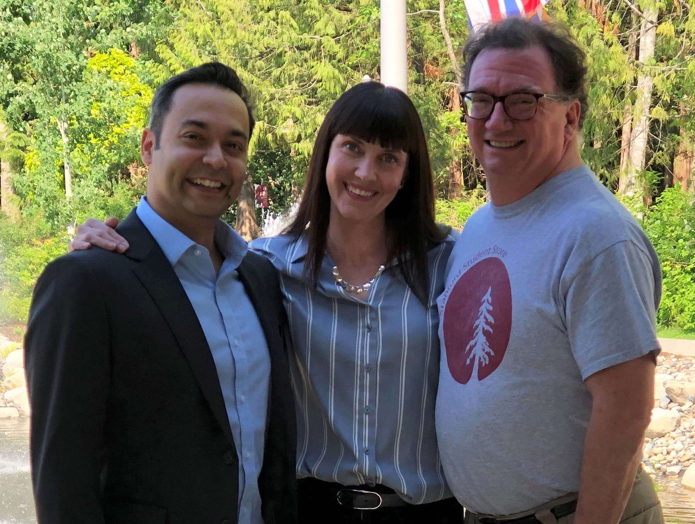

# Acknowledgements

Acknowledgements -- Research Methods in Psychology

1

# Acknowledgements

This textbook represents a labor of love and a deep commitment to students. Each of us had previously worked on adapting, updating, and refining successive editions of this textbook since its initial publication. In coming together to produce this fourth edition collaboratively, we were able to build on our own expertise and classroom experience as well as thoughtful feedback from several peer reviewers.

We would like to thank the Rebus Community, especially Zoe Wake Hyde and Apurva Ashok, for guiding and supporting us through the process of peer review and for building an intellectually supportive and encouraging community of authors and open educators.

We are immensely grateful to our peer reviewers Judy Grissett (Georgia Southwestern State University), Amy Nusbaum (Washington State University), and one additional anonymous reviewer, who volunteered their time and energy to provide valuable suggestions and feedback that improved the quality and consistency of the 4th edition of this book.

Finally, we are grateful to Lana Radomsky for her assistance with formatting and compiling the glossary and references.

Rajiv, Carrie, and Dana (May 2019)

Rajiv S. Jhangiani, Carrie Cuttler, & Dana C. Leighton
