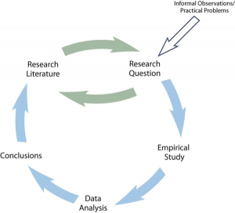
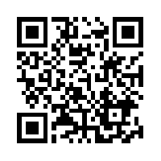

# A Model of Scientific Research in Psychology

A Model of Scientific Research in Psychology -- Research Methods in Psychology

7

# A Model of Scientific Research in Psychology

### Learning Objectives

- Review a general model of scientific research in psychology.

Figure 2.1 presents a simple model of scientific research in psychology. The researchers formulate a research question, conduct an empirical study designed to answer the question, analyze the resulting data, draw conclusions about the answer to the question, and publishes the results so that they become part of the research literature (i.e., all the published research in that field). Because the research literature is one of the primary sources of new research questions, this process can be thought of as a cycle. New research leads to new questions, which lead to new research, and so on. Figure 2.1 also indicates that research questions can originate outside of this cycle either with informal observations or with practical problems that need to be solved. But even in these cases, the researcher would start by checking the research literature to see if the question had already been answered and to refine it based on what previous research had already found.

Figure 2.1 A Simple Model of Scientific Research in Psychology

The research by Mehl and his colleagues is described nicely by this model. Their research question—whether women are more talkative than men—was suggested to them both by people’s stereotypes and by claims published in the research literature about the relative talkativeness of women and men. When they checked the research literature, however, they found that this question had not been adequately addressed in scientific studies. They then conducted a careful empirical study, analyzed the results (finding very little difference between women and men), formed their conclusions, and published their work so that it became part of the research literature. The publication of their article is not the end of the story, however, because their work suggests many new questions (about the reliability of the result, about potential cultural differences, etc.) that will likely be taken up by them and by other researchers inspired by their work.

One or more interactive elements has been excluded from this version of the text. You can view them online here: https://kpu.pressbooks.pub/psychmethods4e/?$p = 32$#oembed-1

Reading in print? Scan this QR code to view the video on your mobile device. Or go to youtu.be/XToWVxS_9lA

As another example, consider that as cell phones became more widespread during the 1990s, people began to wonder whether, and to what extent, cell phone use had a negative effect on driving. Many psychologists decided to tackle this question scientifically (e.g., Collet, Guillot, & Petit, 2010)[1]. It was clear from previously published research that engaging in a simple verbal task impairs performance on a perceptual or motor task carried out at the same time, but no one had studied the effect specifically of cell phone use on driving. Under carefully controlled conditions, these researchers compared people’s driving performance while using a cell phone with their performance while not using a cell phone, both in the lab and on the road. They found that people’s ability to detect road hazards, reaction time, and maintain control of the vehicle were all impaired by cell phone use. Each new study was published and became part of the growing research literature on this topic. For instance, other research teams subsequently demonstrated that cell phone conversations carry a greater risk than conversations with a passenger who is aware of driving conditions, which often become a point of conversation (e.g., Drews, Pasupathi, & Strayer, 2004)[2].

### Video Attributions

- “Understanding driver distraction” by American Psychological Association. Standard YouTube Licence.
- Collet, C., Guillot, A., & Petit, C. (2010). Phoning while driving I: A review of epidemiological, psychological, behavioral and physiological studies. *Ergonomics, 53*, 589–601. ↵
- Drews, F. A., Pasupathi, M., & Strayer, D. L. (2004). Passenger and cell-phone conversations in simulated driving. *Proceedings of the Human Factors and Ergonomics Society Annual Meeting, 48*, 2210–2212. ↵
