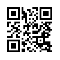

# Research Ethics

Research Ethics -- Research Methods in Psychology

III

# Research Ethics

In 1998 a medical journal called *The Lancet* published an article of interest to many psychologists. The researchers claimed to have shown a statistical relationship between receiving the combined measles, mumps, and rubella (MMR) vaccine and the development of autism—suggesting furthermore that the vaccine might even cause autism. One result of this report was that many parents decided not to have their children vaccinated, which of course put them at higher risk for measles, mumps, and rubella. However, follow-up studies by other researchers consistently failed to find a statistical relationship between the MMR vaccine and autism—and it is widely accepted now in the scientific community that there is no relationship. In addition, several more serious problems with the original research were uncovered. Among them were that the lead researcher stood to gain financially from his conclusions because he had patented a competing measles vaccine. He had also used biased methods to select and test his research participants and had used unapproved and medically unnecessary procedures on them. In 2010 *The Lancet* retracted the article, and the lead researcher’s right to practice medicine was revoked (Burns, 2010).[1]

In this chapter we explore the ethics of scientific research in psychology. We begin with a general framework for thinking about the ethics of scientific research in psychology. Then we look at some specific ethical codes for biomedical and behavioral researchers —focusing on the Ethics Code of the American Psychological Association. Finally, we consider some practical tips for conducting ethical research in psychology.

Reading in print? Scan this QR code to view the video on your mobile device. Or go to youtu.be/o65l1YAVaYc

One or more interactive elements has been excluded from this version of the text. You can view them online here: https://kpu.pressbooks.pub/psychmethods4e/?$p = 46$#oembed-1

### Media Attributions

Vaccines Don’t Cause Autism: Healthcare Triage #12 by Healthcare Triage licensed under a Standard YouTube Licence.

- Burns, J. F. (2010, May 24). British medical council bars doctor who linked vaccine to autism. The New York Times. Retrieved from: http://www.nytimes.com/2010/05/25/health/policy/25autism.html ↵
