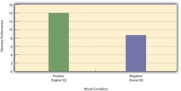
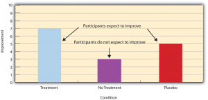

<style>
  /* Textbook typographic styling */
  p {
    text-align: justify;
    text-justify: inter-word;
  }
  h1, h2, h3, h4, h5, h6 { text-align: left; }
  blockquote { text-align: left; }
</style>

# Experiment Basics

Experiment Basics -- Research Methods in Psychology

23

# Experiment Basics

### Learning Objectives

- Explain what an experiment is and recognize examples of studies that are experiments and studies that are not experiments.
- Distinguish between the manipulation of the independent variable and control of extraneous variables and explain the importance of each.
- Recognize examples of confounding variables and explain how they affect the internal validity of a study.
- Define what a control condition is, explain its purpose in research on treatment effectiveness, and describe some alternative types of control conditions.

## What Is an Experiment?

As we saw earlier in the book, an **experiment** is a type of study designed specifically to answer the question of whether there is a causal relationship between two variables. In other words, whether changes in one variable (referred to as an **independent variable**) cause a change in another variable (referred to as a **dependent variable**). Experiments have two fundamental features. The first is that the researchers manipulate, or systematically vary, the level of the independent variable. The different levels of the independent variable are called **conditions**. For example, in Darley and Latané’s experiment, the independent variable was the number of witnesses that participants believed to be present. The researchers manipulated this independent variable by telling participants that there were either one, two, or five other students involved in the discussion, thereby creating three conditions. For a new researcher, it is easy to confuse these terms by believing there are three independent variables in this situation: one, two, or five students involved in the discussion, but there is actually only one independent variable (number of witnesses) with three different levels or conditions (one, two or five students). The second fundamental feature of an experiment is that the researcher exerts **control** over, or minimizes the variability in, variables other than the independent and dependent variable. These other variables are called **extraneous variables**. Darley and Latané tested all their participants in the same room, exposed them to the same emergency situation, and so on. They also randomly assigned their participants to conditions so that the three groups would be similar to each other to begin with. Notice that although the words manipulation and control have similar meanings in everyday language, researchers make a clear distinction between them. They manipulate the independent variable by systematically changing its levels and control other variables by holding them constant.

## Manipulation of the Independent Variable

Again, to **manipulate** an independent variable means to change its level systematically so that different groups of participants are exposed to different levels of that variable, or the same group of participants is exposed to different levels at different times. For example, to see whether expressive writing affects people’s health, a researcher might instruct some participants to write about traumatic experiences and others to write about neutral experiences. The different levels of the independent variable are referred to as conditions, and researchers often give the conditions short descriptive names to make it easy to talk and write about them. In this case, the conditions might be called the “traumatic condition” and the “neutral condition.”

Notice that the manipulation of an independent variable must involve the active intervention of the researcher. Comparing groups of people who differ on the independent variable before the study begins is not the same as manipulating that variable. For example, a researcher who compares the health of people who already keep a journal with the health of people who do not keep a journal has not manipulated this variable and therefore has not conducted an experiment. This distinction is important because groups that already differ in one way at the beginning of a study are likely to differ in other ways too. For example, people who choose to keep journals might also be more conscientious, more introverted, or less stressed than people who do not. Therefore, any observed difference between the two groups in terms of their health might have been caused by whether or not they keep a journal, or it might have been caused by any of the other differences between people who do and do not keep journals. Thus the active manipulation of the independent variable is crucial for eliminating potential alternative explanations for the results.

Of course, there are many situations in which the independent variable cannot be manipulated for practical or ethical reasons and therefore an experiment is not possible. For example, whether or not people have a significant early illness experience cannot be manipulated, making it impossible to conduct an experiment on the effect of early illness experiences on the development of hypochondriasis. This caveat does not mean it is impossible to study the relationship between early illness experiences and hypochondriasis—only that it must be done using nonexperimental approaches. We will discuss this type of methodology in detail later in the book.

Independent variables can be manipulated to create two conditions and experiments involving a single independent variable with two conditions are often referred to as a **single factor two-level design. **However, sometimes greater insights can be gained by adding more conditions to an experiment. When an experiment has one independent variable that is manipulated to produce more than two conditions it is referred to as a **single factor multi level design. **So rather than comparing a condition in which there was one witness to a condition in which there were five witnesses (which would represent a single-factor two-level design), Darley and Latané’s experiment used a single factor multi-level design, by manipulating the independent variable to produce three conditions (a one witness, a two witnesses, and a five witnesses condition).

## **Control of Extraneous Variables**

As we have seen previously in the chapter, an extraneous variable is anything that varies in the context of a study other than the independent and dependent variables. In an experiment on the effect of expressive writing on health, for example, extraneous variables would include participant variables (individual differences) such as their writing ability, their diet, and their gender. They would also include situational or task variables such as the time of day when participants write, whether they write by hand or on a computer, and the weather. Extraneous variables pose a problem because many of them are likely to have some effect on the dependent variable. For example, participants’ health will be affected by many things other than whether or not they engage in expressive writing. This influencing factor can make it difficult to separate the effect of the independent variable from the effects of the extraneous variables, which is why it is important to control extraneous variables by holding them constant.

## **Extraneous Variables as “Noise”**

Extraneous variables make it difficult to detect the effect of the independent variable in two ways. One is by adding variability or “noise” to the data. Imagine a simple experiment on the effect of mood (happy vs. sad) on the number of happy childhood events people are able to recall. Participants are put into a negative or positive mood (by showing them a happy or sad video clip) and then asked to recall as many happy childhood events as they can. The two leftmost columns of Table 5.1 show what the data might look like if there were no extraneous variables and the number of happy childhood events participants recalled was affected only by their moods. Every participant in the happy mood condition recalled exactly four happy childhood events, and every participant in the sad mood condition recalled exactly three. The effect of mood here is quite obvious. In reality, however, the data would probably look more like those in the two rightmost columns of Table 5.1. Even in the happy mood condition, some participants would recall fewer happy memories because they have fewer to draw on, use less effective recall strategies, or are less motivated. And even in the sad mood condition, some participants would recall more happy childhood memories because they have more happy memories to draw on, they use more effective recall strategies, or they are more motivated. Although the mean difference between the two groups is the same as in the idealized data, this difference is much less obvious in the context of the greater variability in the data. Thus one reason researchers try to control extraneous variables is so their data look more like the idealized data in Table 5.1, which makes the effect of the independent variable easier to detect (although real data never look quite *that* good).

 *Table 5.1 Hypothetical Noiseless Data and Realistic Noisy Data* **Idealized “noiseless” data** **Realistic “noisy” data**  **Happy mood** **Sad mood** **Happy mood** **Sad mood**  4 3 3 1  4 3 6 3  4 3 2 4  4 3 4 0  4 3 5 5  4 3 2 7  4 3 3 2  4 3 1 5  4 3 6 1  4 3 8 2  *M* = 4 *M* = 3 *M* = 4 *M* = 3

One way to control extraneous variables is to hold them constant. This technique can mean holding situation or task variables constant by testing all participants in the same location, giving them identical instructions, treating them in the same way, and so on. It can also mean holding participant variables constant. For example, many studies of language limit participants to right-handed people, who generally have their language areas isolated in their left cerebral hemispheres[1]. Left-handed people are more likely to have their language areas isolated in their right cerebral hemispheres or distributed across both hemispheres, which can change the way they process language and thereby add noise to the data.

In principle, researchers can control extraneous variables by limiting participants to one very specific category of person, such as 20-year-old, heterosexual, female, right-handed psychology majors. The obvious downside to this approach is that it would lower the external validity of the study—in particular, the extent to which the results can be generalized beyond the people actually studied. For example, it might be unclear whether results obtained with a sample of younger lesbian women would apply to older gay men. In many situations, the advantages of a diverse sample (increased external validity) outweigh the reduction in noise achieved by a homogeneous one.

## **Extraneous Variables as Confounding Variables**

The second way that extraneous variables can make it difficult to detect the effect of the independent variable is by becoming confounding variables. A **confounding variable** is an extraneous variable that differs on average *across* levels of the independent variable (i.e., it is an extraneous variable that varies systematically with the independent variable). For example, in almost all experiments, participants’ intelligence quotients (IQs) will be an extraneous variable. But as long as there are participants with lower and higher IQs in each condition so that the average IQ is roughly equal across the conditions, then this variation is probably acceptable (and may even be desirable). What would be bad, however, would be for participants in one condition to have substantially lower IQs on average and participants in another condition to have substantially higher IQs on average. In this case, IQ would be a confounding variable.

To confound means to confuse, and this effect is exactly why confounding variables are undesirable. Because they differ systematically across conditions—just like the independent variable—they provide an alternative explanation for any observed difference in the dependent variable. Figure 5.1 shows the results of a hypothetical study, in which participants in a positive mood condition scored higher on a memory task than participants in a negative mood condition. But if IQ is a confounding variable—with participants in the positive mood condition having higher IQs on average than participants in the negative mood condition—then it is unclear whether it was the positive moods or the higher IQs that caused participants in the first condition to score higher. One way to avoid confounding variables is by holding extraneous variables constant. For example, one could prevent IQ from becoming a confounding variable by limiting participants only to those with IQs of exactly 100. But this approach is not always desirable for reasons we have already discussed. A second and much more general approach—random assignment to conditions—will be discussed in detail shortly.



Figure 5.1 Hypothetical Results From a Study on the Effect of Mood on Memory. Because IQ also differs across conditions, it is a confounding variable.

**Treatment and Control Conditions**

In psychological research, a **treatment** is any intervention meant to change people’s behavior for the better. This intervention includes psychotherapies and medical treatments for psychological disorders but also interventions designed to improve learning, promote conservation, reduce prejudice, and so on. To determine whether a treatment works, participants are randomly assigned to either a **treatment condition**, in which they receive the treatment, or a **control condition**, in which they do not receive the treatment. If participants in the treatment condition end up better off than participants in the control condition—for example, they are less depressed, learn faster, conserve more, express less prejudice—then the researcher can conclude that the treatment works. In research on the effectiveness of psychotherapies and medical treatments, this type of experiment is often called a **randomized clinical trial**.

```python
There are different types of control conditions. In a **no-treatment control condition**, participants receive no treatment whatsoever. One problem with this approach, however, is the existence of placebo effects. A **placebo** is a simulated treatment that lacks any active ingredient or element that should make it effective, and a **placebo effect** is a positive effect of such a treatment. Many folk remedies that seem to work—such as eating chicken soup for a cold or placing soap under the bed sheets to stop nighttime leg cramps—are probably nothing more than placebos. Although placebo effects are not well understood, they are probably driven primarily by people’s expectations that they will improve. Having the expectation to improve can result in reduced stress, anxiety, and depression, which can alter perceptions and even improve immune system functioning (Price, Finniss, & Benedetti, 2008)[2].

```
Placebo effects are interesting in their own right (see Note “The Powerful Placebo”), but they also pose a serious problem for researchers who want to determine whether a treatment works. Figure 5.2 shows some hypothetical results in which participants in a treatment condition improved more on average than participants in a no-treatment control condition. If these conditions (the two leftmost bars in Figure 5.2) were the only conditions in this experiment, however, one could not conclude that the treatment worked. It could be instead that participants in the treatment group improved more because they expected to improve, while those in the no-treatment control condition did not.



Figure 5.2 Hypothetical Results From a Study Including Treatment, No-Treatment, and Placebo Conditions

Fortunately, there are several solutions to this problem. One is to include a **placebo control condition**, in which participants receive a placebo that looks much like the treatment but lacks the active ingredient or element thought to be responsible for the treatment’s effectiveness. When participants in a treatment condition take a pill, for example, then those in a placebo control condition would take an identical-looking pill that lacks the active ingredient in the treatment (a “sugar pill”). In research on psychotherapy effectiveness, the placebo might involve going to a psychotherapist and talking in an unstructured way about one’s problems. The idea is that if participants in both the treatment and the placebo control groups expect to improve, then any improvement in the treatment group over and above that in the placebo control group must have been caused by the treatment and not by participants’ expectations. This difference is what is shown by a comparison of the two outer bars in Figure 5.4.

Of course, the principle of informed consent requires that participants be told that they will be assigned to either a treatment or a placebo control condition—even though they cannot be told which until the experiment ends. In many cases the participants who had been in the control condition are then offered an opportunity to have the real treatment. An alternative approach is to use a **wait-list control condition**, in which participants are told that they will receive the treatment but must wait until the participants in the treatment condition have already received it. This disclosure allows researchers to compare participants who have received the treatment with participants who are not currently receiving it but who still expect to improve (eventually). A final solution to the problem of placebo effects is to leave out the control condition completely and compare any new treatment with the best available alternative treatment. For example, a new treatment for simple phobia could be compared with standard exposure therapy. Because participants in both conditions receive a treatment, their expectations about improvement should be similar. This approach also makes sense because once there is an effective treatment, the interesting question about a new treatment is not simply “Does it work?” but “Does it work better than what is already available?

#### The Powerful Placebo

Many people are not surprised that placebos can have a positive effect on disorders that seem fundamentally psychological, including depression, anxiety, and insomnia. However, placebos can also have a positive effect on disorders that most people think of as fundamentally physiological. These include asthma, ulcers, and warts (Shapiro & Shapiro, 1999)[3]. There is even evidence that placebo surgery—also called “sham surgery”—can be as effective as actual surgery.

Medical researcher J. Bruce Moseley and his colleagues conducted a study on the effectiveness of two arthroscopic surgery procedures for osteoarthritis of the knee (Moseley et al., 2002)[4]. The control participants in this study were prepped for surgery, received a tranquilizer, and even received three small incisions in their knees. But they did not receive the actual arthroscopic surgical procedure. Note that the IRB would have carefully considered the use of deception in this case and judged that the benefits of using it outweighed the risks and that there was no other way to answer the research question (about the effectiveness of a placebo procedure) without it. The surprising result was that all participants improved in terms of both knee pain and function, and the sham surgery group improved just as much as the treatment groups. According to the researchers, “This study provides strong evidence that arthroscopic lavage with or without débridement [the surgical procedures used] is not better than and appears to be equivalent to a placebo procedure in improving knee pain and self-reported function” (p. 85).

- Knecht, S., Dräger, B., Deppe, M., Bobe, L., Lohmann, H., Flöel, A., . . . Henningsen, H. (2000). Handedness and hemispheric language dominance in healthy humans. *Brain: A Journal of Neurology, 123*(12), 2512-2518. http://dx.doi.org/10.1093/brain/123.12.2512 ↵
- Price, D. D., Finniss, D. G., & Benedetti, F. (2008). A comprehensive review of the placebo effect: Recent advances and current thought. *Annual Review of Psychology, 59*, 565–590. ↵
- Shapiro, A. K., & Shapiro, E. (1999). *The powerful placebo: From ancient priest to modern physician*. Baltimore, MD: Johns Hopkins University Press. ↵
- Moseley, J. B., O’Malley, K., Petersen, N. J., Menke, T. J., Brody, B. A., Kuykendall, D. H., … Wray, N. P. (2002). A controlled trial of arthroscopic surgery for osteoarthritis of the knee. *The New England Journal of Medicine, 347*, 81–88. ↵
