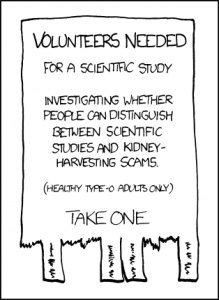
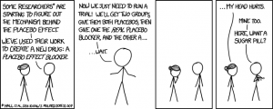

# Practical Considerations

Practical Considerations -- Research Methods in Psychology

26

# Practical Considerations

### Learning Objectives

- Describe several strategies for recruiting participants for an experiment.
- Explain why it is important to standardize the procedure of an experiment and several ways to do this.
- Explain what pilot testing is and why it is important.

The information presented so far in this chapter is enough to design a basic experiment. When it comes time to conduct that experiment, however, several additional practical issues arise. In this section, we consider some of these issues and how to deal with them. Much of this information applies to non-experimental studies as well as experimental ones.

## **Recruiting Participants**

Of course, at the start of any research project, you should be thinking about how you will obtain your participants. Unless you have access to people with schizophrenia or incarcerated juvenile offenders, for example, then there is no point designing a study that focuses on these populations. But even if you plan to use a convenience sample, you will have to recruit participants for your study.

There are several approaches to recruiting participants. One is to use participants from a formal **subject pool**—an established group of people who have agreed to be contacted about participating in research studies. For example, at many colleges and universities, there is a subject pool consisting of students enrolled in introductory psychology courses who must participate in a certain number of studies to meet a course requirement. Researchers post descriptions of their studies and students sign up to participate, usually via an online system. Participants who are not in subject pools can also be recruited by posting or publishing advertisements or making personal appeals to groups that represent the population of interest. For example, a researcher interested in studying older adults could arrange to speak at a meeting of the residents at a retirement community to explain the study and ask for volunteers.

“Study” Retrieved from http://imgs.xkcd.com/comics/study.png (CC-BY-NC 2.5)

#### **The Volunteer Subject**

Even if the participants in a study receive compensation in the form of course credit, a small amount of money, or a chance at being treated for a psychological problem, they are still essentially volunteers. This is worth considering because people who volunteer to participate in psychological research have been shown to differ in predictable ways from those who do not volunteer. Specifically, there is good evidence that on average, volunteers have the following characteristics compared with non-volunteers (Rosenthal & Rosnow, 1976)[1]:

- They are more interested in the topic of the research.
- They are more educated.
- They have a greater need for approval.
- They have higher IQ.
- They are more sociable.
- They are higher in social class.

This difference can be an issue of external validity if there is a reason to believe that participants with these characteristics are likely to behave differently than the general population. For example, in testing different methods of persuading people, a rational argument might work better on volunteers than it does on the general population because of their generally higher educational level and IQ.

In many field experiments, the task is not recruiting participants but selecting them. For example, researchers Nicolas Guéguen and Marie-Agnès de Gail conducted a field experiment on the effect of being smiled at on helping, in which the participants were shoppers at a supermarket. A confederate walking down a stairway gazed directly at a shopper walking up the stairway and either smiled or did not smile. Shortly afterward, the shopper encountered another confederate, who dropped some computer diskettes on the ground. The dependent variable was whether or not the shopper stopped to help pick up the diskettes (Guéguen & de Gail, 2003)[2]. There are two aspects of this study that are worth addressing here. First, notice that these participants were not “recruited,” which means that the IRB would have taken care to ensure that dispensing with informed consent in this case was acceptable (e.g., the situation would not have been expected to cause any harm and the study was conducted in the context of people’s ordinary activities). Second, even though informed consent was not necessary, the researchers still had to select participants from among all the shoppers taking the stairs that day. It is extremely important that this kind of selection be done according to a well-defined set of rules that are established before the data collection begins and can be explained clearly afterward. In this case, with each trip down the stairs, the confederate was instructed to gaze at the first person he encountered who appeared to be between the ages of 20 and
50. Only if the person gazed back did they become a participant in the study. The point of having a well-defined selection rule is to avoid bias in the selection of participants. For example, if the confederate was free to choose which shoppers he would gaze at, he might choose friendly-looking shoppers when he was set to smile and unfriendly-looking ones when he was not set to smile. As we will see shortly, such biases can be entirely unintentional.

## **Standardizing the Procedure**

It is surprisingly easy to introduce extraneous variables during the procedure. For example, the same experimenter might give clear instructions to one participant but vague instructions to another. Or one experimenter might greet participants warmly while another barely makes eye contact with them. To the extent that such variables affect participants’ behavior, they add noise to the data and make the effect of the independent variable more difficult to detect. If they vary systematically across conditions, they become confounding variables and provide alternative explanations for the results. For example, if participants in a treatment group are tested by a warm and friendly experimenter and participants in a control group are tested by a cold and unfriendly one, then what appears to be an effect of the treatment might actually be an effect of experimenter demeanor. When there are multiple experimenters, the possibility of introducing extraneous variables is even greater, but is often necessary for practical reasons.

#### Experimenter’s Sex as an Extraneous Variable

It is well known that whether research participants are male or female can affect the results of a study. But what about whether the experimenter is male or female? There is plenty of evidence that this matters too. Male and female experimenters have slightly different ways of interacting with their participants, and of course, participants also respond differently to male and female experimenters (Rosenthal, 1976)[3].

For example, in a recent study on pain perception, participants immersed their hands in icy water for as long as they could (Ibolya, Brake, & Voss, 2004)[4]. Male participants tolerated the pain longer when the experimenter was a woman, and female participants tolerated it longer when the experimenter was a man.

Researcher Robert Rosenthal has spent much of his career showing that this kind of unintended variation in the procedure does, in fact, affect participants’ behavior. Furthermore, one important source of such variation is the experimenter’s expectations about how participants “should” behave in the experiment. This outcome is referred to as an **experimenter expectancy effect** (Rosenthal, 1976)[5]. For example, if an experimenter expects participants in a treatment group to perform better on a task than participants in a control group, then they might unintentionally give the treatment group participants clearer instructions or more encouragement or allow them more time to complete the task. In a striking example, Rosenthal and Kermit Fode had several students in a laboratory course in psychology train rats to run through a maze. Although the rats were genetically similar, some of the students were told that they were working with “maze-bright” rats that had been bred to be good learners, and other students were told that they were working with “maze-dull” rats that had been bred to be poor learners. Sure enough, over five days of training, the “maze-bright” rats made more correct responses, made the correct response more quickly, and improved more steadily than the “maze-dull” rats (Rosenthal & Fode, 1963)[6]. Clearly, it had to have been the students’ expectations about how the rats would perform that made the difference. But how? Some clues come from data gathered at the end of the study, which showed that students who expected their rats to learn quickly felt more positively about their animals and reported behaving toward them in a more friendly manner (e.g., handling them more).

The way to minimize unintended variation in the procedure is to standardize it as much as possible so that it is carried out in the same way for all participants regardless of the condition they are in. Here are several ways to do this:

- Create a written protocol that specifies everything that the experimenters are to do and say from the time they greet participants to the time they dismiss them.
- Create standard instructions that participants read themselves or that are read to them word for word by the experimenter.
- Automate the rest of the procedure as much as possible by using software packages for this purpose or even simple computer slide shows.
- Anticipate participants’ questions and either raise and answer them in the instructions or develop standard answers for them.
- Train multiple experimenters on the protocol together and have them practice on each other.
- Be sure that each experimenter tests participants in all conditions.

Another good practice is to arrange for the experimenters to be “blind” to the research question or to the condition in which each participant is tested. The idea is to minimize experimenter expectancy effects by minimizing the experimenters’ expectations. For example, in a drug study in which each participant receives the drug or a placebo, it is often the case that neither the participants nor the experimenter who interacts with the participants knows which condition they have been assigned to complete. Because both the participants and the experimenters are blind to the condition, this technique is referred to as a **double-blind study**. (A single-blind study is one in which only the participant is blind to the condition.) Of course, there are many times this blinding is not possible. For example, if you are both the investigator and the only experimenter, it is not possible for you to remain blind to the research question. Also, in many studies, the experimenter must know the condition because they must carry out the procedure in a different way in the different conditions.

“Placebo Blocker” retrieved from http://imgs.xkcd.com/comics/placebo_blocker.png (CC-BY-NC 2.5). [Image description]

## **Record Keeping**

It is essential to keep good records when you conduct an experiment. As discussed earlier, it is typical for experimenters to generate a written sequence of conditions before the study begins and then to test each new participant in the next condition in the sequence. As you test them, it is a good idea to add to this list basic demographic information; the date, time, and place of testing; and the name of the experimenter who did the testing. It is also a good idea to have a place for the experimenter to write down comments about unusual occurrences (e.g., a confused or uncooperative participant) or questions that come up. This kind of information can be useful later if you decide to analyze sex differences or effects of different experimenters, or if a question arises about a particular participant or testing session.

Since participants’ identities should be kept as confidential (or anonymous) as possible, their names and other identifying information should not be included with their data. In order to identify individual participants, it can, therefore, be useful to assign an identification number to each participant as you test them. Simply numbering them consecutively beginning with 1 is usually sufficient. This number can then also be written on any response sheets or questionnaires that participants generate, making it easier to keep them together.

## **Manipulation Check**

In many experiments, the independent variable is a construct that can only be manipulated indirectly. For example, a researcher might try to manipulate participants’ stress levels indirectly by telling some of them that they have five minutes to prepare a short speech that they will then have to give to an audience of other participants. In such situations, researchers often include a **manipulation check** in their procedure. A manipulation check is a separate measure of the construct the researcher is trying to manipulate. The purpose of a manipulation check is to confirm that the independent variable was, in fact, successfully manipulated. For example, researchers trying to manipulate participants’ stress levels might give them a paper-and-pencil stress questionnaire or take their blood pressure—perhaps right after the manipulation or at the end of the procedure—to verify that they successfully manipulated this variable.

Manipulation checks are particularly important when the results of an experiment turn out null. In cases where the results show no significant effect of the manipulation of the independent variable on the dependent variable, a manipulation check can help the experimenter determine whether the null result is due to a real absence of an effect of the independent variable on the dependent variable or if it is due to a problem with the manipulation of the independent variable. Imagine, for example, that you exposed participants to happy or sad movie music—intending to put them in happy or sad moods—but you found that this had no effect on the number of happy or sad childhood events they recalled. This could be because being in a happy or sad mood has no effect on memories for childhood events. But it could also be that the music was ineffective at putting participants in happy or sad moods. A manipulation check—in this case, a measure of participants’ moods—would help resolve this uncertainty. If it showed that you had successfully manipulated participants’ moods, then it would appear that there is indeed no effect of mood on memory for childhood events. But if it showed that you did not successfully manipulate participants’ moods, then it would appear that you need a more effective manipulation to answer your research question.

Manipulation checks are usually done at the end of the procedure to be sure that the effect of the manipulation lasted throughout the entire procedure and to avoid calling unnecessary attention to the manipulation (to avoid a demand characteristic). However, researchers are wise to include a manipulation check in a pilot test of their experiment so that they avoid spending a lot of time and resources on an experiment that is doomed to fail and instead spend that time and energy finding a better manipulation of the independent variable.

## **Pilot Testing**

It is always a good idea to conduct a **pilot test** of your experiment. A pilot test is a small-scale study conducted to make sure that a new procedure works as planned. In a pilot test, you can recruit participants formally (e.g., from an established participant pool) or you can recruit them informally from among family, friends, classmates, and so on. The number of participants can be small, but it should be enough to give you confidence that your procedure works as planned. There are several important questions that you can answer by conducting a pilot test:

- Do participants understand the instructions?
- What kind of misunderstandings do participants have, what kind of mistakes do they make, and what kind of questions do they ask?
- Do participants become bored or frustrated?
- Is an indirect manipulation effective? (You will need to include a manipulation check.)
- Can participants guess the research question or hypothesis (are there demand characteristics)?
- How long does the procedure take?
- Are computer programs or other automated procedures working properly?
- Are data being recorded correctly?

Of course, to answer some of these questions you will need to observe participants carefully during the procedure and talk with them about it afterward. Participants are often hesitant to criticize a study in front of the researcher, so be sure they understand that their participation is part of a pilot test and you are genuinely interested in feedback that will help you improve the procedure. If the procedure works as planned, then you can proceed with the actual study. If there are problems to be solved, you can solve them, pilot test the new procedure, and continue with this process until you are ready to proceed.

### Image Descriptions

**Placebo blocker image description:** A comic of two stick figures talking.

Person 1: Some researchers are starting to figure out the mechanism behind the placebo effect. We’ve used their work to create a new drug: A placebo effect blocker. Now we just need to run a trial. We’ll get two groups, give them both placebos, then give one the REAL placebo blocker, and the other a…. wait.

[The two people scratch their heads]

Person 2: My head hurts.

Person 1: Mine too. Here, want a sugar pill?

[Return to Placebo blocker Image]

### Media Attributions

- Study by XKCD CC BY-NC (Attribution NonCommercial)
- Placebo blocker by XKCD CC BY-NC (Attribution NonCommercial)
- Rosenthal, R., & Rosnow, R. L. (1976). *The volunteer subject*. New York, NY: Wiley. ↵
- Guéguen, N., & de Gail, Marie-Agnès. (2003). The effect of smiling on helping behavior: Smiling and good Samaritan behavior. *Communication Reports, 16*, 133–140. ↵
- Rosenthal, R. (1976). *Experimenter effects in behavioral research* (enlarged ed.). New York, NY: Wiley. ↵
- Ibolya, K., Brake, A., & Voss, U. (2004). The effect of experimenter characteristics on pain reports in women and men. *Pain, 112*, 142–147. ↵
- Rosenthal, R. (1976). *Experimenter effects in behavioral research* (enlarged ed.). New York, NY: Wiley. ↵
- Rosenthal, R., & Fode, K. (1963). The effect of experimenter bias on performance of the albino rat. *Behavioral Science, 8*, 183-189. ↵
