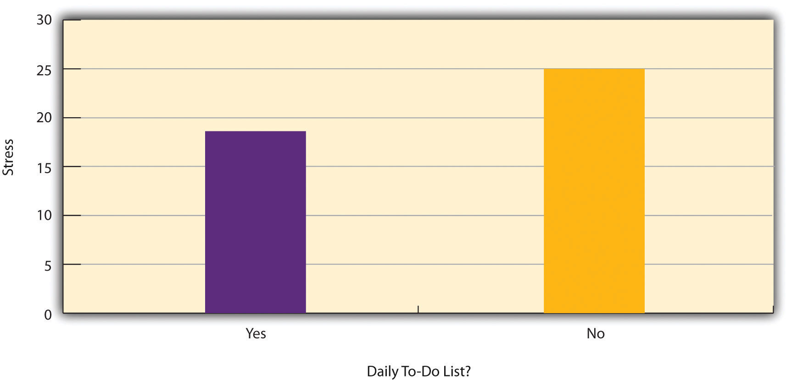
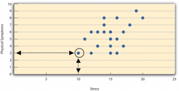
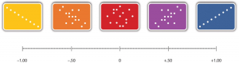
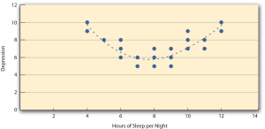
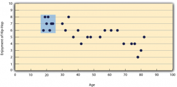
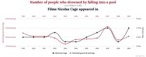

# Correlational Research

Correlational Research -- Research Methods in Psychology

29

# Correlational Research

### Learning Objectives

- Define correlational research and give several examples.
- Explain why a researcher might choose to conduct correlational research rather than experimental research or another type of non-experimental research.
- Interpret the strength and direction of different correlation coefficients.
- Explain why correlation does not imply causation.

## What Is Correlational Research?

Correlational research is a type of non-experimental research in which the researcher measures two variables (binary or continuous) and assesses the statistical relationship (i.e., the correlation) between them with little or no effort to control extraneous variables. There are many reasons that researchers interested in statistical relationships between variables would choose to conduct a correlational study rather than an experiment. The first is that they do not believe that the statistical relationship is a causal one or are not interested in causal relationships. Recall two goals of science are to describe and to predict and the correlational research strategy allows researchers to achieve both of these goals. Specifically, this strategy can be used to describe the strength and direction of the relationship between two variables and if there is a relationship between the variables then the researchers can use scores on one variable to predict scores on the other (using a statistical technique called regression, which is discussed further in the section on Complex Correlation in this chapter).

Another reason that researchers would choose to use a correlational study rather than an experiment is that the statistical relationship of interest is thought to be causal, but the researcher *cannot* manipulate the independent variable because it is impossible, impractical, or unethical. For example, while a researcher might be interested in the relationship between the frequency people use cannabis and their memory abilities they cannot ethically manipulate the frequency that people use cannabis. As such, they must rely on the correlational research strategy; they must simply measure the frequency that people use cannabis and measure their memory abilities using a standardized test of memory and then determine whether the frequency people use cannabis is statistically related to memory test performance.

Correlation is also used to establish the reliability and validity of measurements. For example, a researcher might evaluate the validity of a brief extraversion test by administering it to a large group of participants along with a longer extraversion test that has already been shown to be valid. This researcher might then check to see whether participants’ scores on the brief test are strongly correlated with their scores on the longer one. Neither test score is thought to cause the other, so there is no independent variable to manipulate. In fact, the terms *independent variable* and *dependent variabl*e do not apply to this kind of research.

Another strength of correlational research is that it is often higher in external validity than experimental research. Recall there is typically a trade-off between internal validity and external validity. As greater controls are added to experiments, internal validity is increased but often at the expense of external validity as artificial conditions are introduced that do not exist in reality. In contrast, correlational studies typically have low internal validity because nothing is manipulated or controlled but they often have high external validity. Since nothing is manipulated or controlled by the experimenter the results are more likely to reflect relationships that exist in the real world.

Finally, extending upon this trade-off between internal and external validity, correlational research can help to provide converging evidence for a theory. If a theory is supported by a true experiment that is high in internal validity as well as by a correlational study that is high in external validity then the researchers can have more confidence in the validity of their theory. As a concrete example, correlational studies establishing that there is a relationship between watching violent television and aggressive behavior have been complemented by experimental studies confirming that the relationship is a causal one (Bushman & Huesmann, 2001)[1].

### Does Correlational Research Always Involve Quantitative Variables?

A common misconception among beginning researchers is that correlational research must involve two quantitative variables, such as scores on two extraversion tests or the number of daily hassles and number of symptoms people have experienced. However, the defining feature of correlational research is that the two variables are measured—neither one is manipulated—and this is true regardless of whether the variables are quantitative or categorical. Imagine, for example, that a researcher administers the Rosenberg Self-Esteem Scale to 50 American college students and 50 Japanese college students. Although this “feels” like a between-subjects experiment, it is a correlational study because the researcher did not manipulate the students’ nationalities. The same is true of the study by Cacioppo and Petty comparing college faculty and factory workers in terms of their need for cognition. It is a correlational study because the researchers did not manipulate the participants’ occupations.

Figure 6.2 shows data from a hypothetical study on the relationship between whether people make a daily list of things to do (a “to-do list”) and stress. Notice that it is unclear whether this is an experiment or a correlational study because it is unclear whether the independent variable was manipulated. If the researcher randomly assigned some participants to make daily to-do lists and others not to, then it is an experiment. If the researcher simply asked participants whether they made daily to-do lists, then it is a correlational study. The distinction is important because if the study was an experiment, then it could be concluded that making the daily to-do lists reduced participants’ stress. But if it was a correlational study, it could only be concluded that these variables are statistically related. Perhaps being stressed has a negative effect on people’s ability to plan ahead (the directionality problem). Or perhaps people who are more conscientious are more likely to make to-do lists and less likely to be stressed (the third-variable problem). The crucial point is that what defines a study as experimental or correlational is not the variables being studied, nor whether the variables are quantitative or categorical, nor the type of graph or statistics used to analyze the data. What defines a study is *how* the study is conducted.

*Figure 6.2 Results of a Hypothetical Study on Whether People Who Make Daily To-Do Lists Experience Less Stress Than People Who Do Not Make Such Lists*

## **Data Collection in Correlational Research**

Again, the defining feature of correlational research is that neither variable is manipulated. It does not matter how or where the variables are measured. A researcher could have participants come to a laboratory to complete a computerized backward digit span task and a computerized risky decision-making task and then assess the relationship between participants’ scores on the two tasks. Or a researcher could go to a shopping mall to ask people about their attitudes toward the environment and their shopping habits and then assess the relationship between these two variables. Both of these studies would be correlational because no independent variable is manipulated.

## **Correlations Between Quantitative Variables**

Correlations between quantitative variables are often presented using **scatterplots**. Figure 6.3 shows some hypothetical data on the relationship between the amount of stress people are under and the number of physical symptoms they have. Each point in the scatterplot represents one person’s score on both variables. For example, the circled point in Figure 6.3 represents a person whose stress score was 10 and who had three physical symptoms. Taking all the points into account, one can see that people under more stress tend to have more physical symptoms. This is a good example of a **positive relationship**, in which higher scores on one variable tend to be associated with higher scores on the other. In other words, they move in the same direction, either both up or both down. A **negative relationship** is one in which higher scores on one variable tend to be associated with lower scores on the other. In other words, they move in opposite directions. There is a negative relationship between stress and immune system functioning, for example, because higher stress is associated with lower immune system functioning.

Figure 6.3 Scatterplot Showing a Hypothetical Positive Relationship Between Stress and Number of Physical Symptoms. The circled point represents a person whose stress score was 10 and who had three physical symptoms. Pearson’s r for these data is +.51.

The strength of a correlation between quantitative variables is typically measured using a statistic called **Pearson’s Correlation Coefficient (or Pearson's *r*)**. As Figure 6.4 shows, Pearson’s r ranges from −1.00 (the strongest possible negative relationship) to +1.00 (the strongest possible positive relationship). A value of 0 means there is no relationship between the two variables. When Pearson’s *r* is 0, the points on a scatterplot form a shapeless “cloud.” As its value moves toward −1.00 or +1.00, the points come closer and closer to falling on a single straight line. Correlation coefficients near $\pm$.10 are considered small, values near $\pm$ .30 are considered medium, and values near $\pm$.50 are considered large. Notice that the sign of Pearson’s *r* is unrelated to its strength. Pearson’s *r* values of +.30 and −.30, for example, are equally strong; it is just that one represents a moderate positive relationship and the other a moderate negative relationship. With the exception of reliability coefficients, most correlations that we find in Psychology are small or moderate in size. The website http://rpsychologist.com/d3/correlation/, created by Kristoffer Magnusson, provides an excellent interactive visualization of correlations that permits you to adjust the strength and direction of a correlation while witnessing the corresponding changes to the scatterplot.

Figure 6.4 Range of Pearson’s r, From −1.00 (Strongest Possible Negative Relationship), Through 0 (No Relationship), to +1.00 (Strongest Possible Positive Relationship)

There are two common situations in which the value of Pearson’s *r* can be misleading. Pearson’s *r* is a good measure only for linear relationships, in which the points are best approximated by a straight line. It is not a good measure for nonlinear relationships, in which the points are better approximated by a curved line. Figure 6.5, for example, shows a hypothetical relationship between the amount of sleep people get per night and their level of depression. In this example, the line that best approximates the points is a curve—a kind of upside-down “U”—because people who get about eight hours of sleep tend to be the least depressed. Those who get too little sleep and those who get too much sleep tend to be more depressed. Even though Figure 6.5 shows a fairly strong relationship between depression and sleep, Pearson’s *r* would be close to zero because the points in the scatterplot are not well fit by a single straight line. This means that it is important to make a scatterplot and confirm that a relationship is approximately linear before using Pearson’s *r*. Nonlinear relationships are fairly common in psychology, but measuring their strength is beyond the scope of this book.

Figure 6.5 Hypothetical Nonlinear Relationship Between Sleep and Depression

The other common situations in which the value of Pearson’s *r* can be misleading is when one or both of the variables have a limited range in the sample relative to the population. This problem is referred to as **restriction of range**. Assume, for example, that there is a strong negative correlation between people’s age and their enjoyment of hip hop music as shown by the scatterplot in Figure 6.6. Pearson’s *r* here is −.77. However, if we were to collect data only from 18- to 24-year-olds—represented by the shaded area of Figure 6.6—then the relationship would seem to be quite weak. In fact, Pearson’s *r* for this restricted range of ages is
0. It is a good idea, therefore, to design studies to avoid restriction of range. For example, if age is one of your primary variables, then you can plan to collect data from people of a wide range of ages. Because restriction of range is not always anticipated or easily avoidable, however, it is good practice to examine your data for possible restriction of range and to interpret Pearson’s *r* in light of it. (There are also statistical methods to correct Pearson’s *r* for restriction of range, but they are beyond the scope of this book).*
 *

Figure 6.6 Hypothetical Data Showing How a Strong Overall Correlation Can Appear to Be Weak When One Variable Has a Restricted Range. The overall correlation here is −.77, but the correlation for the 18- to 24-year-olds (in the blue box) is 0.

Correlation Does Not Imply Causation

You have probably heard repeatedly that “Correlation does not imply causation.” An amusing example of this comes from a 2012 study that showed a positive correlation (Pearson’s $r = 0.79$) between the per capita chocolate consumption of a nation and the number of Nobel prizes awarded to citizens of that nation[2]. It seems clear, however, that this does not mean that eating chocolate causes people to win Nobel prizes, and it would not make sense to try to increase the number of Nobel prizes won by recommending that parents feed their children more chocolate.

There are two reasons that correlation does not imply causation. The first is called the **directionality problem**. Two variables, *X* and *Y*, can be statistically related because *X* causes *Y* or because *Y* causes *X*. Consider, for example, a study showing that whether or not people exercise is statistically related to how happy they are—such that people who exercise are happier on average than people who do not. This statistical relationship is consistent with the idea that exercising causes happiness, but it is also consistent with the idea that happiness causes exercise. Perhaps being happy gives people more energy or leads them to seek opportunities to socialize with others by going to the gym. The second reason that correlation does not imply causation is called the **third-variable problem**. Two variables, *X* and *Y*, can be statistically related not because *X* causes *Y*, or because *Y* causes *X*, but because some third variable, *Z*, causes both *X* and *Y*. For example, the fact that nations that have won more Nobel prizes tend to have higher chocolate consumption probably reflects geography in that European countries tend to have higher rates of per capita chocolate consumption *and* invest more in education and technology (once again, per capita) than many other countries in the world. Similarly, the statistical relationship between exercise and happiness could mean that some third variable, such as physical health, causes both of the others. Being physically healthy could cause people to exercise and cause them to be happier. Correlations that are a result of a third-variable are often referred to as **spurious correlations.**

Some excellent and amusing examples of spurious correlations can be found at http://www.tylervigen.com (Figure 6.7  provides one such example).

Figure 6.7 Example of a Spurious Correlation. Source: http://tylervigen.com/spurious-correlations (CC-BY 4.0)

#### **“Lots of Candy Could Lead to Violence”**

Although researchers in psychology know that correlation does not imply causation, many journalists do not. One website about correlation and causation, http://jonathan.mueller.faculty.noctrl.edu/100/correlation_or_causation.htm, links to dozens of media reports about real biomedical and psychological research. Many of the headlines suggest that a causal relationship has been demonstrated when a careful reading of the articles shows that it has not because of the directionality and third-variable problems.

One such article is about a study showing that children who ate candy every day were more likely than other children to be arrested for a violent offense later in life. But could candy really “lead to” violence, as the headline suggests? What alternative explanations can you think of for this statistical relationship? How could the headline be rewritten so that it is not misleading?

As you have learned by reading this book, there are various ways that researchers address the directionality and third-variable problems. The most effective is to conduct an experiment. For example, instead of simply measuring how much people exercise, a researcher could bring people into a laboratory and randomly assign half of them to run on a treadmill for 15 minutes and the rest to sit on a couch for 15 minutes. Although this seems like a minor change to the research design, it is extremely important. Now if the exercisers end up in more positive moods than those who did not exercise, it cannot be because their moods affected how much they exercised (because it was the *researcher* who used random assignment to determine how much they exercised). Likewise, it cannot be because some third variable (e.g., physical health) affected both how much they exercised and what mood they were in. Thus experiments eliminate the directionality and third-variable problems and allow researchers to draw firm conclusions about causal relationships.

### Media Attributions

- Nicholas Cage and Pool Drownings © Tyler Viegen is licensed under a CC BY (Attribution) license
- Bushman, B. J., & Huesmann, L. R. (2001). Effects of televised violence on aggression. In D. Singer & J. Singer (Eds.), *Handbook of children and the media* (pp. 223–254). Thousand Oaks, CA: Sage. ↵
- Messerli, F. H. (2012). Chocolate consumption, cognitive function, and Nobel laureates. *New England Journal of Medicine, 367*, 1562-1564. ↵
