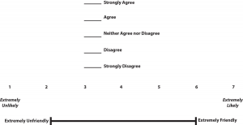
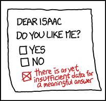

<style>
  /* Textbook typographic styling */
  p {
    text-align: justify;
    text-justify: inter-word;
  }
  h1, h2, h3, h4, h5, h6 { text-align: left; }
  blockquote { text-align: left; }
</style>

# Constructing Surveys

Constructing Surveys -- Research Methods in Psychology

35

# Constructing Surveys

### Learning Objectives

- Describe the cognitive processes involved in responding to a survey item.
- Explain what a context effect is and give some examples.
- Create a simple survey questionnaire based on principles of effective item writing and organization.

The heart of any survey research project is the survey itself. Although it is easy to think of interesting questions to ask people, constructing a good survey is not easy at all. The problem is that the answers people give can be influenced in unintended ways by the wording of the items, the order of the items, the response options provided, and many other factors. At best, these influences add noise to the data. At worst, they result in systematic biases and misleading results. In this section, therefore, we consider some principles for constructing surveys to minimize these unintended effects and thereby maximize the reliability and validity of respondents’ answers.

## **Survey Responding as a Psychological Process**

Before looking at specific principles of survey construction, it will help to consider survey responding as a psychological process.

### A Cognitive Model

Figure 7.1 presents a model of the cognitive processes that people engage in when responding to a survey item (Sudman, Bradburn, & Schwarz, 1996)[1]. Respondents must interpret the question, retrieve relevant information from memory, form a tentative judgment, convert the tentative judgment into one of the response options provided (e.g., a rating on a 1-to-7 scale), and finally edit their response as necessary.


Figure 7.1 Model of the Cognitive Processes Involved in Responding to a Survey Item. [Image description]

Consider, for example, the following questionnaire item:

How many alcoholic drinks do you consume in a typical day?

- _____ a lot more than average
- _____ somewhat more than average
- _____ average
- _____ somewhat fewer than average
- _____ a lot fewer than average

Although this item at first seems straightforward, it poses several difficulties for respondents. First, they must interpret the question. For example, they must decide whether “alcoholic drinks” include beer and wine (as opposed to just hard liquor) and whether a “typical day” is a typical weekday, typical weekend day, or both. Even though Chang and Krosnick (2003)[2] found that asking about “typical” behavior has been shown to be more valid than asking about “past” behavior, their study compared “typical week” to “past week” and may be different when considering typical weekdays or weekend days). Once respondents have interpreted the question, they must retrieve relevant information from memory to answer it. But what information should they retrieve, and how should they go about retrieving it? They might think vaguely about some recent occasions on which they drank alcohol, they might carefully try to recall and count the number of alcoholic drinks they consumed last week, or they might retrieve some existing beliefs that they have about themselves (e.g., “I am not much of a drinker”). Then they must use this information to arrive at a tentative judgment about how many alcoholic drinks they consume in a typical day. For example, this mental calculation might mean dividing the number of alcoholic drinks they consumed last week by seven to come up with an average number per day. Then they must format this tentative answer in terms of the response options actually provided. In this case, the options pose additional problems of interpretation. For example, what does “average” mean, and what would count as “somewhat more” than average? Finally, they must decide whether they want to report the response they have come up with or whether they want to edit it in some way. For example, if they believe that they drink a lot more than average, they might not want to report that for fear of looking bad in the eyes of the researcher, so instead, they may opt to select the “somewhat more than average” response option.

From this perspective, what at first appears to be a simple matter of asking people how much they drink (and receiving a straightforward answer from them) turns out to be much more complex.

### Context Effects on Survey Responses

Again, this complexity can lead to unintended influences on respondents’ answers. These are often referred to as **context effects **because they are not related to the content of the item but to the context in which the item appears (Schwarz & Strack, 1990)[3]. For example, there is an **item-order effect** when the order in which the items are presented affects people’s responses. One item can change how participants interpret a later item or change the information that they retrieve to respond to later items. For example, researcher Fritz Strack and his colleagues asked college students about both their general life satisfaction and their dating frequency (Strack, Martin, & Schwarz, 1988)[4]. When the life satisfaction item came first, the correlation between the two was only −.12, suggesting that the two variables are only weakly related. But when the dating frequency item came first, the correlation between the two was +.66, suggesting that those who date more have a strong tendency to be more satisfied with their lives. Reporting the dating frequency first made that information more accessible in memory so that they were more likely to base their life satisfaction rating on it.

The response options provided can also have unintended effects on people’s responses (Schwarz, 1999)[5]. For example, when people are asked how often they are “really irritated” and given response options ranging from “less than once a year” to “more than once a month,” they tend to think of major irritations and report being irritated infrequently. But when they are given response options ranging from “less than once a day” to “several times a month,” they tend to think of minor irritations and report being irritated frequently. People also tend to assume that middle response options represent what is normal or typical. So if they think of themselves as normal or typical, they tend to choose middle response options. For example, people are likely to report watching more television when the response options are centered on a middle option of 4 hours than when centered on a middle option of 2 hours. To mitigate against order effects, rotate questions and response items when there is no natural order. Counterbalancing or randomizing the order of presentation of the questions in online surveys are good practices for survey questions and can reduce response order effects that show that among undecided voters, the first candidate listed in a ballot receives a 2.5% boost simply by virtue of being listed first[6]!

## **Writing Survey Items**

### Types of Items

Questionnaire items can be either open-ended or closed-ended. **Open-ended items** simply ask a question and allow participants to answer in whatever way they choose. The following are examples of open-ended questionnaire items.

- “What is the most important thing to teach children to prepare them for life?”
- “Please describe a time when you were discriminated against because of your age.”
- “Is there anything else you would like to tell us about?”

Open-ended items are useful when researchers do not know how participants might respond or when they want to avoid influencing their responses. Open-ended items are more qualitative in nature, so they tend to be used when researchers have more vaguely defined research questions—often in the early stages of a research project. Open-ended items are relatively easy to write because there are no response options to worry about. However, they take more time and effort on the part of participants, and they are more difficult for the researcher to analyze because the answers must be transcribed, coded, and submitted to some form of qualitative analysis, such as content analysis. Another disadvantage is that respondents are more likely to skip open-ended items because they take longer to answer. It is best to use open-ended questions when the answer is unsure or for quantities which can easily be converted to categories later in the analysis.

**Closed-ended items** ask a question and provide a set of response options for participants to choose from. The alcohol item just mentioned is an example, as are the following:

How old are you?

- _____ Under 18
- _____ 18 to 34
- _____ 35 to 49
- _____ 50 to 70
- _____ Over 70

On a scale of 0 (no pain at all) to 10 (worst pain ever experienced), how much pain are you in right now?

Have you ever in your adult life been depressed for a period of 2 weeks or more? Yes    No

Closed-ended items are used when researchers have a good idea of the different responses that participants might make. They are more quantitative in nature, so they are also used when researchers are interested in a well-defined variable or construct such as participants’ level of agreement with some statement, perceptions of risk, or frequency of a particular behavior. Closed-ended items are more difficult to write because they must include an appropriate set of response options. However, they are relatively quick and easy for participants to complete. They are also much easier for researchers to analyze because the responses can be easily converted to numbers and entered into a spreadsheet. For these reasons, closed-ended items are much more common.

All closed-ended items include a set of response options from which a participant must choose. For categorical variables like sex, race, or political party preference, the categories are usually listed and participants choose the one (or ones) to which they belong. For quantitative variables, a rating scale is typically provided. A **rating scale** is an ordered set of responses that participants must choose from. Figure 7.2 shows several examples. The number of response options on a typical rating scale ranges from three to 11—although five and seven are probably most common. Five-point scales are best for unipolar scales where only one construct is tested, such as frequency (Never, Rarely, Sometimes, Often, Always). Seven-point scales are best for bipolar scales where there is a dichotomous spectrum, such as liking (Like very much, Like somewhat, Like slightly, Neither like nor dislike, Dislike slightly, Dislike somewhat, Dislike very much). For bipolar questions, it is useful to offer an earlier question that branches them into an area of the scale; if asking about liking ice cream, first ask “Do you generally like or dislike ice cream?” Once the respondent chooses like or dislike, refine it by offering them relevant choices from the seven-point scale.  Branching improves both reliability and validity (Krosnick & Berent, 1993)[7].  Although you often see scales with numerical labels, it is best to only present verbal labels to the respondents but convert them to numerical values in the analyses. Avoid partial labels or length or overly specific labels. In some cases, the verbal labels can be supplemented with (or even replaced by) meaningful graphics. The last rating scale shown in Figure 7.2 is a visual-analog scale, on which participants make a mark somewhere along the horizontal line to indicate the magnitude of their response.



Figure 7.2 Example Rating Scales for Closed-Ended Questionnaire Items. [Image description]

#### What Is a Likert Scale?

In reading about psychological research, you are likely to encounter the term *Likert scale*. Although this term is sometimes used to refer to almost any rating scale (e.g., a 0-to-10 life satisfaction scale), it has a much more precise meaning.

In the 1930s, researcher Rensis Likert (pronounced LICK-ert) created a new approach for measuring people’s attitudes (Likert, 1932)[8]. It involves presenting people with several statements—including both favorable and unfavorable statements—about some person, group, or idea. Respondents then express their agreement or disagreement with each statement on a 5-point scale: *Strongly Agree, Agree, Neither Agree nor Disagree, Disagree, Strongly Disagree*. Numbers are assigned to each response and then summed across all items to produce a score representing the attitude toward the person, group, or idea. For items that are phrased in an opposite direction (e.g., negatively worded statements instead of positively worded statements), reverse coding is used so that the numerical scoring of statements also runs in the opposite direction. The entire set of items came to be called a Likert scale.

Thus unless you are measuring people’s attitude toward something by assessing their level of agreement with several statements about it, it is best to avoid calling it a Likert scale. You are probably just using a “rating scale.”

### Writing Effective Items

We can now consider some principles of writing questionnaire items that minimize unintended context effects and maximize the reliability and validity of participants’ responses. A rough guideline for writing questionnaire items is provided by the BRUSO model (Peterson, 2000)[9]. An acronym, **BRUSO** stands for “brief,” “relevant,” “unambiguous,” “specific,” and “objective.” Effective questionnaire items are *brief* and to the point. They avoid long, overly technical, or unnecessary words. This brevity makes them easier for respondents to understand and faster for them to complete. Effective questionnaire items are also *relevant* to the research question. If a respondent’s sexual orientation, marital status, or income is not relevant, then items on them should probably not be included. Again, this makes the questionnaire faster to complete, but it also avoids annoying respondents with what they will rightly perceive as irrelevant or even “nosy” questions. Effective questionnaire items are also *unambiguous*; they can be interpreted in only one way. Part of the problem with the alcohol item presented earlier in this section is that different respondents might have different ideas about what constitutes “an alcoholic drink” or “a typical day.” Effective questionnaire items are also *specific* so that it is clear to respondents what their response *should* be about and clear to researchers what it *is* about. A common problem here is closed-ended items that are “double barrelled.” They ask about two conceptually separate issues but allow only one response. For example, “Please rate the extent to which you have been feeling anxious and depressed.” This item should probably be split into two separate items—one about anxiety and one about depression. Finally, effective questionnaire items are *objective* in the sense that they do not reveal the researcher’s own opinions or lead participants to answer in a particular way. Table 7.2 shows some examples of poor and effective questionnaire items based on the BRUSO criteria. The best way to know how people interpret the wording of the question is to conduct a pilot test and ask a few people to explain how they interpreted the question.

 *Table 7.2 BRUSO Model of Writing Effective Questionnaire Items, Plus Examples* **Criterion** **Poor** **Effective**  B—Brief “Are you now or have you ever been the possessor of a firearm?” “Have you ever owned a gun?”  R—Relevant “What is your sexual orientation?” Do not include this item unless it is clearly relevant to the research.  U—Unambiguous “Are you a gun person?” “Do you currently own a gun?”  S—Specific “How much have you read about the new gun control measure and sales tax?” “How much have you read about the new sales tax?”  O—Objective “How much do you support the new gun control measure?” “What is your view of the new gun control measure?”

For closed-ended items, it is also important to create an appropriate response scale. For categorical variables, the categories presented should generally be mutually exclusive and exhaustive. Mutually exclusive categories do not overlap. For a religion item, for example, the categories of *Christian* and *Catholic* are not mutually exclusive but *Protestant* and *Catholic* are mutually exclusive. Exhaustive categories cover all possible responses. Although *Protestant* and *Catholic* are mutually exclusive, they are not exhaustive because there are many other religious categories that a respondent might select: *Jewish*, *Hindu*, *Buddhist*, and so on. In many cases, it is not feasible to include every possible category, in which case an *Other* category, with a space for the respondent to fill in a more specific response, is a good solution. If respondents could belong to more than one category (e.g., race), they should be instructed to choose all categories that apply.

For rating scales, five or seven response options generally allow about as much precision as respondents are capable of. However, numerical scales with more options can sometimes be appropriate. For dimensions such as attractiveness, pain, and likelihood, a 0-to-10 scale will be familiar to many respondents and easy for them to use. Regardless of the number of response options, the most extreme ones should generally be “balanced” around a neutral or modal midpoint. An example of an unbalanced rating scale measuring perceived likelihood might look like this:

*Unlikely* | *Somewhat Likely* | *Likely* | *Very Likely* | *Extremely Likely*

A balanced version might look like this:

*Extremely Unlikely* | *Somewhat Unlikely* | *As Likely as Not* | *Somewhat Likely* |*Extremely Likely*

 Note, however, that a middle or neutral response option does not have to be included. Researchers sometimes choose to leave it out because they want to encourage respondents to think more deeply about their response and not simply choose the middle option by default. However, including middle alternatives on bipolar dimensions can be used to allow people to choose an option that is neither.



Figure 7.3 “Question” retrieved from http://imgs.xkcd.com/comics/question.png (CC-BY-NC 2.5). [Image description]

## **Formatting the Survey**

```python
Writing effective items is only one part of constructing a survey. For one thing, every survey should have a written or spoken introduction that serves two basic functions (Peterson, 2000)[10]. One is to encourage respondents to participate in the survey. In many types of research, such encouragement is not necessary either because participants do not know they are in a study (as in naturalistic observation) or because they are part of a subject pool and have already shown their willingness to participate by signing up and showing up for the study. Survey research usually catches respondents by surprise when they answer their phone, go to their mailbox, or check their e-mail—and the researcher must make a good case for why they should agree to participate. Thus the introduction should briefly explain the purpose of the survey and its importance, provide information about the sponsor of the survey (university-based surveys tend to generate higher response rates), acknowledge the importance of the respondent’s participation, and describe any incentives for participating.

```
The second function of the introduction is to establish informed consent. Remember that this involves describing to respondents everything that might affect their decision to participate. This includes the topics covered by the survey, the amount of time it is likely to take, the respondent’s option to withdraw at any time, confidentiality issues, and so on. Written consent forms are not always used in survey research (when the research is of minimal risk and completion of the survey instrument is often accepted by the IRB as evidence of consent to participate), so it is important that this part of the introduction be well documented and presented clearly and in its entirety to every respondent.

The introduction should be followed by the substantive questionnaire items. But first, it is important to present clear instructions for completing the questionnaire, including examples of how to use any unusual response scales. Remember that the introduction is the point at which respondents are usually most interested and least fatigued, so it is good practice to start with the most important items for purposes of the research and proceed to less important items. Items should also be grouped by topic or by type. For example, items using the same rating scale (e.g., a 5-point agreement scale) should be grouped together if possible to make things faster and easier for respondents. Demographic items are often presented last because they are least interesting to participants but also easy to answer in the event respondents have become tired or bored. Of course, any survey should end with an expression of appreciation to the respondent.

### Image Descriptions

**Figure 7.1 image description:** Flowchart modelling the cognitive processes involved in responding to a survey item. In order, these processes are:

- Question Interpretation
- Information Retrieval
- Judgment Formation
- Response Formatting
- Response Editing

[Return to Figure 7.1]

**Figure 7.2 image description:** Three different rating scales for survey questions. The first scale provides a choice between “strongly agree,” “agree,” “neither agree nor disagree,” “disagree,” and “strongly disagree.” The second is a scale from 1 to 7, with 1 being “extremely unlikely” and 7 being “extremely likely.” The third is a sliding scale, with one end marked “extremely unfriendly” and the other “extremely friendly.” [Return to Figure 7.2]

**Figure 7.3 image description: **A note reads, “Dear Isaac. Do you like me?” with two check boxes reading “yes” or “no.” Someone has added a third check box, which they’ve checked, that reads, “There is as yet insufficient data for a meaningful answer.” [Return to Figure 7.3]

### Media Attributions

- Question by XKCD license under CC BY-NC 2.5
- Sudman, S., Bradburn, N. M., & Schwarz, N. (1996). *Thinking about answers: The application of cognitive processes to survey methodology*. San Francisco, CA: Jossey-Bass. ↵
- Chang, L., & Krosnick, J.A. (2003). Measuring the frequency of regular behaviors: Comparing the ‘typical week’ to the ‘past week’. *Sociological Methodology, 33*, 55-80. ↵
- Schwarz, N., & Strack, F. (1990). Context effects in attitude surveys: Applying cognitive theory to social research. In W. Stroebe & M. Hewstone (Eds.), *European review of social psychology* (Vol. 2, pp. 31–50). Chichester, UK: Wiley. ↵
- Strack, F., Martin, L. L., & Schwarz, N. (1988). Priming and communication: The social determinants of information use in judgments of life satisfaction. *European Journal of Social Psychology, 18*, 429–442. ↵
- Schwarz, N. (1999). Self-reports: How the questions shape the answers. *American Psychologist, 54*, 93–105. ↵
- Miller, J.M. & Krosnick, J.A. (1998). The impact of candidate name order on election outcomes. *Public Opinion Quarterly, 62*(3), 291-330. ↵
- Krosnick, J.A. & Berent, M.K. (1993). Comparisons of party identification and policy preferences: The impact of survey question format. *American Journal of Political Science, 27*(3), 941-964. ↵
- Likert, R. (1932). A technique for the measurement of attitudes. *Archives of Psychology,140*, 1–55. ↵
- Peterson, R. A. (2000). *Constructing effective questionnaires*. Thousand Oaks, CA: Sage. ↵
- Peterson, R. A. (2000). *Constructing effective questionnaires*. Thousand Oaks, CA: Sage. ↵
