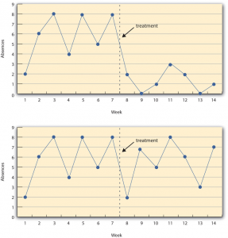

# One-Group Designs

One-Group Designs -- Research Methods in Psychology

38

# One-Group Designs

### Learning Objectives

- Explain what quasi-experimental research is and distinguish it clearly from both experimental and correlational research.
- Describe three different types of one-group quasi-experimental designs.
- Identify the threats to internal validity associated with each of these designs.

## One-Group Posttest Only Design

In a **one-group posttest only design, **a treatment is implemented (or an independent variable is manipulated) and then a dependent variable is measured once after the treatment is implemented. Imagine, for example, a researcher who is interested in the effectiveness of an anti-drug education program on elementary school students’ attitudes toward illegal drugs. The researcher could implement the anti-drug program, and then immediately after the program ends, the researcher could measure students’ attitudes toward illegal drugs.

This is the weakest type of quasi-experimental design. A major limitation to this design is the lack of a control or comparison group. There is no way to determine what the attitudes of these students would have been if they hadn’t completed the anti-drug program. Despite this major limitation, results from this design are frequently reported in the media and are often misinterpreted by the general population. For instance, advertisers might claim that 80% of women noticed their skin looked bright after using Brand X cleanser for a month. If there is no comparison group, then this statistic means little to nothing.

## **One-Group Pretest-Posttest Design**

In a **one-group** **pretest-posttest design**, the dependent variable is measured once before the treatment is implemented and once after it is implemented. Let’s return to the example of a researcher who is interested in the effectiveness of an anti-drug education program on elementary school students’ attitudes toward illegal drugs. The researcher could measure the attitudes of students at a particular elementary school during one week, implement the anti-drug program during the next week, and finally, measure their attitudes again the following week. The pretest-posttest design is much like a within-subjects experiment in which each participant is tested first under the control condition and then under the treatment condition. It is unlike a within-subjects experiment, however, in that the order of conditions is not counterbalanced because it typically is not possible for a participant to be tested in the treatment condition first and then in an “untreated” control condition.

If the average posttest score is better than the average pretest score (e.g., attitudes toward illegal drugs are more negative after the anti-drug educational program), then it makes sense to conclude that the treatment might be responsible for the improvement. Unfortunately, one often cannot conclude this with a high degree of certainty because there may be other explanations for why the posttest scores may have changed. These alternative explanations pose threats to internal validity.

One alternative explanation goes under the name of **history**. Other things might have happened between the pretest and the posttest that caused a change from pretest to posttest. Perhaps an anti-drug program aired on television and many of the students watched it, or perhaps a celebrity died of a drug overdose and many of the students heard about it.

Another alternative explanation goes under the name of **maturation**. Participants might have changed between the pretest and the posttest in ways that they were going to anyway because they are growing and learning. If it were a year long anti-drug program, participants might become less impulsive or better reasoners and this might be responsible for the change in their attitudes toward illegal drugs.

Another threat to the internal validity of one-group pretest-posttest designs is **testing**, which refers to when the act of measuring the dependent variable during the pretest affects participants’ responses at posttest. For instance, completing the measure of attitudes towards illegal drugs may have had an effect on those attitudes. Simply completing this measure may have inspired further thinking and conversations about illegal drugs that then produced a change in posttest scores.

Similarly, **instrumentation **can be a threat to the internal validity of studies using this design. Instrumentation refers to when the basic characteristics of the measuring instrument change over time. When human observers are used to measure behavior, they may over time gain skill, become fatigued, or change the standards on which observations are based. So participants may have taken the measure of attitudes toward illegal drugs very seriously during the pretest when it was novel but then they may have become bored with the measure at posttest and been less careful in considering their responses.

Another alternative explanation for a change in the dependent variable in a pretest-posttest design is **regression to the mean**. This refers to the statistical fact that an individual who scores extremely high or extremely low on a variable on one occasion will tend to score less extremely on the next occasion. For example, a bowler with a long-term average of 150 who suddenly bowls a 220 will almost certainly score lower in the next game. Her score will “regress” toward her mean score of 150. Regression to the mean can be a problem when participants are selected for further study *because* of their extreme scores. Imagine, for example, that only students who scored especially high on the test of attitudes toward illegal drugs (those with extremely favorable attitudes toward drugs) were given the anti-drug program and then were retested. Regression to the mean all but guarantees that their scores will be lower at the posttest even if the training program has no effect.

A closely related concept—and an extremely important one in psychological research—is **spontaneous remission**. This is the tendency for many medical and psychological problems to improve over time without any form of treatment. The common cold is a good example. If one were to measure symptom severity in 100 common cold sufferers today, give them a bowl of chicken soup every day, and then measure their symptom severity again in a week, they would probably be much improved. This does not mean that the chicken soup was responsible for the improvement, however, because they would have been much improved without any treatment at all. The same is true of many psychological problems. A group of severely depressed people today is likely to be less depressed on average in 6 months. In reviewing the results of several studies of treatments for depression, researchers Michael Posternak and Ivan Miller found that participants in waitlist control conditions improved an average of 10 to 15% before they received any treatment at all (Posternak & Miller, 2001)[1]. Thus one must generally be very cautious about inferring causality from pretest-posttest designs.

A common approach to ruling out the threats to internal validity described above is by revisiting the research design to include a control group, one that does not receive the treatment effect. A control group would be subject to the same threats from history, maturation, testing, instrumentation, regression to the mean, and spontaneous remission and so would allow the researcher to measure the actual effect of the treatment (if any). Of course, including a control group would mean that this is no longer a one-group design.

#### Does Psychotherapy Work?

Early studies on the effectiveness of psychotherapy tended to use pretest-posttest designs. In a classic 1952 article, researcher Hans Eysenck summarized the results of 24 such studies showing that about two thirds of patients improved between the pretest and the posttest (Eysenck, 1952)[2]. But Eysenck also compared these results with archival data from state hospital and insurance company records showing that similar patients recovered at about the same rate *without* receiving psychotherapy. This parallel suggested to Eysenck that the improvement that patients showed in the pretest-posttest studies might be no more than spontaneous remission. Note that Eysenck did not conclude that psychotherapy was ineffective. He merely concluded that there was no evidence that it was, and he wrote of “the necessity of properly planned and executed experimental studies into this important field” (p. 323). You can read the entire article here:

http://psychclassics.yorku.ca/Eysenck/psychotherapy.htm

Fortunately, many other researchers took up Eysenck’s challenge, and by 1980 hundreds of experiments had been conducted in which participants were randomly assigned to treatment and control conditions, and the results were summarized in a classic book by Mary Lee Smith, Gene Glass, and Thomas Miller (Smith, Glass, & Miller, 1980)[3]. They found that overall psychotherapy was quite effective, with about 80% of treatment participants improving more than the average control participant. Subsequent research has focused more on the conditions under which different types of psychotherapy are more or less effective.

## **Interrupted Time Series Design**

A variant of the pretest-posttest design is the **interrupted time-series design**. A time series is a set of measurements taken at intervals over a period of time. For example, a manufacturing company might measure its workers’ productivity each week for a year. In an interrupted time series-design, a time series like this one is “interrupted” by a treatment. In one classic example, the treatment was the reduction of the work shifts in a factory from 10 hours to 8 hours (Cook & Campbell, 1979)[4]. Because productivity increased rather quickly after the shortening of the work shifts, and because it remained elevated for many months afterward, the researcher concluded that the shortening of the shifts caused the increase in productivity. Notice that the interrupted time-series design is like a pretest-posttest design in that it includes measurements of the dependent variable both before and after the treatment. It is unlike the pretest-posttest design, however, in that it includes multiple pretest and posttest measurements.

Figure 8.1 shows data from a hypothetical interrupted time-series study. The dependent variable is the number of student absences per week in a research methods course. The treatment is that the instructor begins publicly taking attendance each day so that students know that the instructor is aware of who is present and who is absent. The top panel of Figure 8.1 shows how the data might look if this treatment worked. There is a consistently high number of absences before the treatment, and there is an immediate and sustained drop in absences after the treatment. The bottom panel of Figure 8.1 shows how the data might look if this treatment did not work. On average, the number of absences after the treatment is about the same as the number before. This figure also illustrates an advantage of the interrupted time-series design over a simpler pretest-posttest design. If there had been only one measurement of absences before the treatment at Week 7 and one afterward at Week 8, then it would have looked as though the treatment were responsible for the reduction. The multiple measurements both before and after the treatment suggest that the reduction between Weeks 7 and 8 is nothing more than normal week-to-week variation.

Figure 8.1 A Hypothetical Interrupted Time-Series Design. The top panel shows data that suggest that the treatment caused a reduction in absences. The bottom panel shows data that suggest that it did not. [Image description]

### Image Descriptions

**Figure 8.1 image description:** Two line graphs charting the number of absences per week over 14 weeks. The first 7 weeks are without treatment and the last 7 weeks are with treatment. In the first line graph, there are between 4 to 8 absences each week. After the treatment, the absences drop to 0 to 3 each week, which suggests the treatment worked. In the second line graph, there is no noticeable change in the number of absences per week after the treatment, which suggests the treatment did not work. [Return to Figure 8.1]

- Posternak, M. A., & Miller, I. (2001). Untreated short-term course of major depression: A meta-analysis of studies using outcomes from studies using wait-list control groups. *Journal of Affective Disorders, 66*, 139–146. ↵
- Eysenck, H. J. (1952). The effects of psychotherapy: An evaluation. *Journal of Consulting Psychology, 16*, 319–324. ↵
- Smith, M. L., Glass, G. V., & Miller, T. I. (1980). *The benefits of psychotherapy*. Baltimore, MD: Johns Hopkins University Press. ↵
- Cook, T. D., & Campbell, D. T. (1979). *Quasi-experimentation: Design & analysis issues in field settings*. Boston, MA: Houghton Mifflin. ↵
