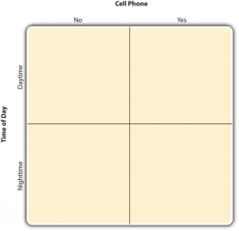
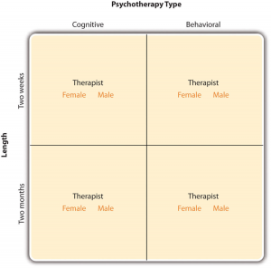

# Setting Up a Factorial Experiment

Setting Up a Factorial Experiment -- Research Methods in Psychology

41

# Setting Up a Factorial Experiment

### Learning Objectives

- Explain why researchers often include multiple independent variables in their studies.
- Define factorial design, and use a factorial design table to represent and interpret simple factorial designs.

Just as it is common for studies in psychology to include multiple levels of a single independent variable (placebo, new drug, old drug), it is also common for them to include multiple independent variables. Schnall and her colleagues studied the effect of both disgust and private body consciousness in the same study. Researchers’ inclusion of multiple independent variables in one experiment is further illustrated by the following actual titles from various professional journals:

- The Effects of Temporal Delay and Orientation on Haptic Object Recognition
- Opening Closed Minds: The Combined Effects of Intergroup Contact and Need for Closure on Prejudice
- Effects of Expectancies and Coping on Pain-Induced Intentions to Smoke
- The Effect of Age and Divided Attention on Spontaneous Recognition
- The Effects of Reduced Food Size and Package Size on the Consumption Behavior of Restrained and Unrestrained Eaters

Just as including multiple levels of a single independent variable allows one to answer more sophisticated research questions, so too does including multiple independent variables in the same experiment. For example, instead of conducting one study on the effect of disgust on moral judgment and another on the effect of private body consciousness on moral judgment, Schnall and colleagues were able to conduct one study that addressed both questions. But including multiple independent variables also allows the researcher to answer questions about whether the effect of one independent variable depends on the level of another. This is referred to as an interaction between the independent variables. Schnall and her colleagues, for example, observed an interaction between disgust and private body consciousness because the effect of disgust depended on whether participants were high or low in private body consciousness. As we will see, interactions are often among the most interesting results in psychological research.

## **Factorial Designs**

### Overview

By far the most common approach to including multiple independent variables (which are often called factors) in an experiment is the factorial design. In a **factorial design**, each level of one independent variable is combined with each level of the others to produce all possible combinations. Each combination, then, becomes a condition in the experiment. Imagine, for example, an experiment on the effect of cell phone use (yes vs. no) and time of day (day vs. night) on driving ability. This is shown in the **factorial design table** in Figure 9.1. The columns of the table represent cell phone use, and the rows represent time of day. The four cells of the table represent the four possible combinations or conditions: using a cell phone during the day, not using a cell phone during the day, using a cell phone at night, and not using a cell phone at night. This particular design is referred to as a 2 $\times^{2}$ (read “two-by-two”) factorial design because it combines two variables, each of which has two levels.

If one of the independent variables had a third level (e.g., using a handheld cell phone, using a hands-free cell phone, and not using a cell phone), then it would be a 3 $\times^{2}$ factorial design, and there would be six distinct conditions. Notice that the number of possible conditions is the product of the numbers of levels. A 2 $\times^{2}$ factorial design has four conditions, a 3 $\times^{2}$ factorial design has six conditions, a 4 $\times^{5}$ factorial design would have 20 conditions, and so on. Also notice that each number in the notation represents one factor, one independent variable. So by looking at how many numbers are in the notation, you can determine how many independent variables there are in the experiment. 2 x 2, 3 x 3, and 2 x 3 designs all have two numbers in the notation and therefore all have two independent variables. The numerical value of each of the numbers represents the number of levels of each independent variable. A 2 means that the independent variable has two levels, a 3 means that the independent variable has three levels, a 4 means it has four levels, etc. To illustrate a 3 x 3 design has two independent variables, each with three levels, while a 2 x 2 x 2 design has three independent variables, each with two levels.

Figure 9.1 Factorial Design Table Representing a 2 $\times^{2}$ Factorial Design

In principle, factorial designs can include any number of independent variables with any number of levels. For example, an experiment could include the type of psychotherapy (cognitive vs. behavioral), the length of the psychotherapy (2 weeks vs. 2 months), and the sex of the psychotherapist (female vs. male). This would be a 2 $\times^{2}$ $\times^{2}$ factorial design and would have eight conditions. Figure 9.2 shows one way to represent this design. In practice, it is unusual for there to be more than three independent variables with more than two or three levels each. This is for at least two reasons: For one, the number of conditions can quickly become unmanageable. For example, adding a fourth independent variable with three levels (e.g., therapist experience: low vs. medium vs. high) to the current example would make it a 2 $\times^{2}$ $\times^{2}$ $\times^{3}$ factorial design with 24 distinct conditions. Second, the number of participants required to populate all of these conditions (while maintaining a reasonable ability to detect a real underlying effect) can render the design unfeasible (for more information, see the discussion about the importance of adequate statistical power in Chapter 13). As a result, in the remainder of this section, we will focus on designs with two independent variables. The general principles discussed here extend in a straightforward way to more complex factorial designs.

Figure 9.2 Factorial Design Table Representing a 2 $\times^{2}$ $\times^{2}$ Factorial Design

Assigning Participants to Conditions

Recall that in a simple between-subjects design, each participant is tested in only one condition. In a simple within-subjects design, each participant is tested in all conditions. In a factorial experiment, the decision to take the between-subjects or within-subjects approach must be made separately for each independent variable. In a **between-subjects factorial design**, all of the independent variables are manipulated between subjects. For example, all participants could be tested either while using a cell phone *or* while not using a cell phone and either during the day *or* during the night. This would mean that each participant would be tested in one and only one condition. In a within-subjects factorial design, all of the independent variables are manipulated within subjects. All participants could be tested both while using a cell phone *and* while not using a cell phone and both during the day *and* during the night. This would mean that each participant would need to be tested in all four conditions. The advantages and disadvantages of these two approaches are the same as those discussed in Chapter
5. The between-subjects design is conceptually simpler, avoids order/carryover effects, and minimizes the time and effort of each participant. The within-subjects design is more efficient for the researcher and controls extraneous participant variables.

Since factorial designs have more than one independent variable, it is also possible to manipulate one independent variable between subjects and another within subjects. This is called a **mixed factorial design**. For example, a researcher might choose to treat cell phone use as a within-subjects factor by testing the same participants both while using a cell phone and while not using a cell phone (while counterbalancing the order of these two conditions). But they might choose to treat time of day as a between-subjects factor by testing each participant either during the day or during the night (perhaps because this only requires them to come in for testing once). Thus each participant in this mixed design would be tested in two of the four conditions.

Regardless of whether the design is between subjects, within subjects, or mixed, the actual assignment of participants to conditions or orders of conditions is typically done randomly.

## **Non-Manipulated Independent Variables**

In many factorial designs, one of the independent variables is a **non-manipulated independent variable**. The researcher measures it but does not manipulate it. The study by Schnall and colleagues is a good example. One independent variable was disgust, which the researchers manipulated by testing participants in a clean room or a messy room. The other was private body consciousness, a participant variable which the researchers simply measured. Another example is a study by Halle Brown and colleagues in which participants were exposed to several words that they were later asked to recall (Brown, Kosslyn, Delamater, Fama, & Barsky, 1999)[1]. The manipulated independent variable was the type of word. Some were negative health-related words (e.g., *tumor, coronary*), and others were not health related (e.g., *election, geometry*). The non-manipulated independent variable was whether participants were high or low in hypochondriasis (excessive concern with ordinary bodily symptoms). The result of this study was that the participants high in hypochondriasis were better than those low in hypochondriasis at recalling the health-related words, but they were no better at recalling the non-health-related words.

Such studies are extremely common, and there are several points worth making about them. First, non-manipulated independent variables are usually participant variables (private body consciousness, hypochondriasis, self-esteem, gender, and so on), and as such, they are by definition between-subjects factors. For example, people are either low in hypochondriasis or high in hypochondriasis; they cannot be tested in both of these conditions. Second, such studies are generally considered to be experiments as long as at least one independent variable is manipulated, regardless of how many non-manipulated independent variables are included. Third, it is important to remember that causal conclusions can only be drawn about the manipulated independent variable. For example, Schnall and her colleagues were justified in concluding that disgust affected the harshness of their participants’ moral judgments because they manipulated that variable and randomly assigned participants to the clean or messy room. But they would not have been justified in concluding that participants’ private body consciousness affected the harshness of their participants’ moral judgments because they did not manipulate that variable. It could be, for example, that having a strict moral code and a heightened awareness of one’s body are both caused by some third variable (e.g., neuroticism). Thus it is important to be aware of which variables in a study are manipulated and which are not.

## **Non-Experimental Studies With Factorial Designs**

Thus far we have seen that factorial experiments can include manipulated independent variables or a combination of manipulated and non-manipulated independent variables. But factorial designs can also include *only* non-manipulated independent variables, in which case they are no longer experiments but are instead non-experimental in nature. Consider a hypothetical study in which a researcher simply measures both the moods and the self-esteem of several participants—categorizing them as having either a positive or negative mood and as being either high or low in self-esteem—along with their willingness to have unprotected sexual intercourse. This can be conceptualized as a 2 $\times^{2}$ factorial design with mood (positive vs. negative) and self-esteem (high vs. low) as non-manipulated between-subjects factors. Willingness to have unprotected sex is the dependent variable.

Again, because neither independent variable in this example was manipulated, it is a non-experimental study rather than an experiment. (The similar study by MacDonald and Martineau [2002][2] was an experiment because they manipulated their participants’ moods.) This is important because, as always, one must be cautious about inferring causality from non-experimental studies because of the directionality and third-variable problems. For example, an effect of participants’ moods on their willingness to have unprotected sex might be caused by any other variable that happens to be correlated with their moods.

- Brown, H. D., Kosslyn, S. M., Delamater, B., Fama, A., & Barsky, A. J. (1999). Perceptual and memory biases for health-related information in hypochondriacal individuals. *Journal of Psychosomatic Research, 47*, 67–78. ↵
- MacDonald, T. K., & Martineau, A. M. (2002). Self-esteem, mood, and intentions to use condoms: When does low self-esteem lead to risky health behaviors? *Journal of Experimental Social Psychology, 38*, 299–306. ↵
