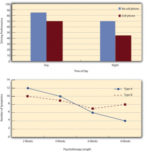
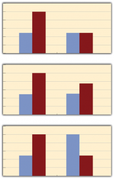
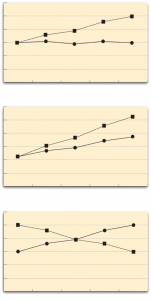

# Interpreting the Results of a Factorial Experiment

Interpreting the Results of a Factorial Experiment -- Research Methods in Psychology

42

# Interpreting the Results of a Factorial Experiment

### Learning Objectives

- Distinguish between main effects and interactions, and recognize and give examples of each.
- Sketch and interpret bar graphs and line graphs showing the results of studies with simple factorial designs.
- Distinguish between main effects and simple effects, and recognize when an analysis of simple effects is required.

## Graphing the Results of Factorial Experiments

The results of factorial experiments with two independent variables can be graphed by representing one independent variable on the *x*-axis and representing the other by using different colored bars or lines. (The *y*-axis is always reserved for the dependent variable.) Figure 9.3 shows results for two hypothetical factorial experiments. The top panel shows the results of a 2 $\times^{2}$ design. Time of day (day vs. night) is represented by different locations on the *x*-axis, and cell phone use (no vs. yes) is represented by different-colored bars. (It would also be possible to represent cell phone use on the *x*-axis and time of day as different-colored bars. The choice comes down to which way seems to communicate the results most clearly.) The bottom panel of Figure 9.3 shows the results of a 4 $\times^{2}$ design in which one of the variables is quantitative. This variable, psychotherapy length, is represented along the *x*-axis, and the other variable (psychotherapy type) is represented by differently formatted lines. This is a line graph rather than a bar graph because the variable on the x-axis is quantitative with a small number of distinct levels. Line graphs are also appropriate when representing measurements made over a time interval (also referred to as time series information) on the *x*-axis.

Figure 9.3 Two Ways to Plot the Results of a Factorial Experiment With Two Independent Variables

**Main Effects **

In factorial designs, there are three kinds of results that are of interest: main effects, interaction effects, and simple effects. A **main effect** is the effect of one independent variable on the dependent variable—averaging across the levels of the other independent variable. Thus there is one main effect to consider for each independent variable in the study. The top panel of Figure 9.3 shows a main effect of cell phone use because driving performance was better, on average, when participants were not using cell phones than when they were. The blue bars are, on average, higher than the red bars. It also shows a main effect of time of day because driving performance was better during the day than during the night—both when participants were using cell phones and when they were not. Main effects are independent of each other in the sense that whether or not there is a main effect of one independent variable says nothing about whether or not there is a main effect of the other. The bottom panel of Figure 9.3, for example, shows a clear main effect of psychotherapy length. The longer the psychotherapy, the better it worked.

## **Interactions**

There is an **interaction** effect (or just “interaction”) when the effect of one independent variable depends on the level of another. Although this might seem complicated, you already have an intuitive understanding of interactions. As an everyday example, assume your friend asks you to go to a movie with another friend. Your response to her is, “well it depends on which movie you are going to see and who else is coming.” You really want to see the big blockbuster summer hit but have little interest in seeing the cheesy romantic comedy. In other words, there is a main effect of type of movie on your decision. If your decision to go to see either of these movies further depends on who she is bringing with her then there is an interaction. For instance, if you will go to see the cheesy romantic comedy if she brings her hot friend you want to get to know better, but you will not go to this movie if she brings anyone else, then there is an interaction. Drug interactions are another good illustration of everyday interactions. Many older men take Viagara to assist them in the bedroom, and many men take nitrates to treat angina or chest pain. So each of these drugs is beneficial on its own (there are main effects of each on older men’s well-being). But the combination of these two drugs can be lethal. In other words, there is a very important interaction between Viagara and heart medication that older men need to be aware of to prevent their untimely demise.

Let’s now consider some examples of interactions from research. It probably would not surprise you to hear that the effect of receiving psychotherapy is stronger among people who are highly motivated to change than among people who are not motivated to change. This is an interaction because the effect of one independent variable (whether or not one receives psychotherapy) depends on the level of another (motivation to change). Schnall and her colleagues also demonstrated an interaction because the effect of whether the room was clean or messy on participants’ moral judgments depended on whether the participants were low or high in private body consciousness. If they were high in private body consciousness, then those in the messy room made harsher judgments. If they were low in private body consciousness, then whether the room was clean or messy did not matter.

In many studies, the primary research question is about an interaction. The study by Brown and her colleagues was inspired by the idea that people with hypochondriasis are especially attentive to any negative health-related information. This led to the hypothesis that people high in hypochondriasis would recall negative health-related words more accurately than people low in hypochondriasis but recall non-health-related words about the same as people low in hypochondriasis. And of course, this is exactly what happened in this study.

### Types of Interactions

The effect of one independent variable can depend on the level of the other in several different ways. First, there can be **spreading interactions**.** **Examples of spreading interactions are shown in the top two panels of Figure 9.4. In the top panel, independent variable “B” has an effect at level 1 of independent variable “A” (there is a difference in the height of the blue and red bars on the left side of the graph) but no effect at level 2 of independent variable “A.” (there is no difference in the height of the blue and red bars on the right side of the graph). This is much like the study of Schnall and her colleagues where there was an effect of disgust for those high in private body consciousness but not for those low in private body consciousness. In the middle panel, independent variable “B” has a stronger effect at level 1 of independent variable “A” than at level 2 (there is a larger difference in the height of the blue and red bars on the left side of the graph and a smaller difference in the height of the blue and red bars on the right side of the graph). This is like the hypothetical driving example where there was a strong effect of using a cell phone at night and a weaker effect of using a cell phone during the day. So to summarize, for spreading interactions there is an effect of one independent variable at one level of the other independent variable and there is either a weak effect or no effect of that independent variable at the other level of the other independent variable.

The second type of interaction that can be found is a **cross-over interaction. **A cross-over interaction is depicted in the bottom panel of Figure 9.4, independent variable “B” again has an effect at both levels of independent variable “A,” but the effects are in opposite directions. Another example of a crossover interaction comes from a study by Kathy Gilliland on the effect of caffeine on the verbal test scores of introverts and extraverts (Gilliland, 1980)[1]. Introverts perform better than extraverts when they have not ingested any caffeine. But extraverts perform better than introverts when they have ingested 4 mg of caffeine per kilogram of body weight.

Figure 9.4 Bar Graphs Showing Three Types of Interactions. In the top panel, one independent variable has an effect at one level of the second independent variable but not at the other. In the middle panel, one independent variable has a stronger effect at one level of the second independent variable than at the other. In the bottom panel, one independent variable has the opposite effect at one level of the second independent variable than at the other.

Figure 9.5 shows examples of these same kinds of interactions when one of the independent variables is quantitative and the results are plotted in a line graph. Note that the top two figures depict the two kinds of spreading interactions that can be found while the bottom figure depicts a crossover interaction (the two lines literally “cross over” each other).

Figure 9.5 Line Graphs Showing Different Types of Interactions. In the top panel, one independent variable has an effect at one level of the second independent variable but not at the other. In the middle panel, one independent variable has a stronger effect at one level of the second independent variable than at the other. In the bottom panel, one independent variable has the opposite effect at one level of the second independent variable than at the other. [Image description]

## Simple Effects

When researchers find an interaction it suggests that the main effects may be a bit misleading. Think of the example of a crossover interaction where introverts were found to perform better on a test of verbal test performance than extraverts when they had not ingested any caffeine, but extraverts were found to perform better than introverts when they had ingested 4 mg of caffeine per kilogram of body weight. To examine the main effect of caffeine consumption, the researchers would have averaged across introversion and extraversion and simply looked at whether overall those who ingested caffeine had better or worse verbal memory test performance. Because the positive effect of caffeine on extraverts would be wiped out by the negative effects of caffeine on the introverts, no main effect of caffeine consumption would have been found. Similarly, to examine the main effect of personality, the researchers would have averaged across the levels of the caffeine variable to look at the effects of personality (introversion vs. extraversion) independent of caffeine. In this case, the positive effects extraversion in the caffeine condition would be wiped out by the negative effects of extraversion in the no caffeine condition. Does the absence of any main effects mean that there is no effect of caffeine and no effect of personality? No of course not. The presence of the interaction indicates that the story is more complicated, that the effects of caffeine on verbal test performance depend on personality. This is where simple effects come into play. **Simple effects **are a way of breaking down the interaction to figure out precisely what is going on. An interaction simply informs us that the effects of at least one independent variable depend on the level of another independent variable. Whenever an interaction is detected, researchers need to conduct additional analyses to determine where that interaction is coming from. Of course one may be able to visualize and interpret the interaction on a graph but a simple effects analysis provides researchers with a more sophisticated means of breaking down the interaction. Specifically, a simple effects analysis allows researchers to determine the effects of each independent variable at each level of the other independent variable. So while the researchers would average across the two levels of the personality variable to examine the effects of caffeine on verbal test performance in a main effects analysis, for a simple effects analysis the researchers would examine the effects of caffeine in introverts and then examine the effects of caffeine in extraverts. As we saw previously, the researchers also examined the effects of personality in the no caffeine condition and found that in this condition introverts performed better than extraverts. Finally, they examined the effects of personality in the caffeine condition and found that extraverts performed better than introverts in this condition. For a 2 x 2 design like this, there will be two main effects the researchers can explore and four simple effects.

Schnall and colleagues found a main effect of disgust on moral judgments (those in a messy room made harsher moral judgments). However, they also discovered an interaction between private body consciousness and disgust. In other words, the effect of disgust depended on private body consciousness. The presence of this interaction suggests the main effect may be a bit misleading. That is, it is not entirely accurate to say that those in a messy room made harsher moral judgments because this was only true for half of the participants. Using simple effects analyses, they were able to further demonstrate that for people high in private body consciousness, there was an effect of disgust on moral judgments. Further, they found that for those low in private body consciousness there was no effect of disgust on moral judgments. By examining the effect of disgust at each level of body consciousness using simple effects analyses, Schnall and colleagues were able to better understand the nature of the interaction.

As described previously, Brown and colleagues found an interaction between type of words (health related or not health related) and hypochondriasis (high or low) on word recall. To break down this interaction using simple effects analyses they examined the effect of hypochondriasis at each level of word type. Specifically, they examined the effect of hypochondriasis on recall of health-related words and then they subsequently examined the effect of hypochondriasis on recall of non-health related words. They found that people high in hypochondriasis were able to recall more health-related words than people low in hypochondriasis. In contrast, there was no effect of hypochondriasis on the recall of non-health related words.

Once again examining simple effects provides a means of breaking down the interaction and therefore it is only necessary to conduct these analyses when an interaction is present. When there is no interaction then the main effects will tell the complete and accurate story. To summarize, rather than averaging across the levels of the other independent variable, as is done in a main effects analysis, simple effects analyses are used to examine the effects of each independent variable at each level of the other independent variable(s). So a researcher using a 2$\times^{2}$ design with four conditions would need to look at 2 main effects and 4 simple effects. A researcher using a 2$\times^{3}$ design with six conditions would need to look at 2 main effects and 5 simple effects, while a researcher using a 3$\times^{3}$ design with nine conditions would need to look at 2 main effects and 6 simple effects. As you can see, while the number of main effects depends simply on the number of independent variables included (one main effect can be explored for each independent variable), the number of simple effects analyses depends on the number of levels of the independent variables (because a separate analysis of each independent variable  is conducted at each level of the other independent variable).

### Image Descriptions

**Figure 9.5 image description:** Three panels, each showing a different line graph pattern. In the top panel, one line remains constant while the other goes up. In the middle panel, both lines go up but at different rates. In the bottom panel, one line goes down and the other goes up so they cross. [Return to Figure 9.5]

- Gilliland, K. (1980). The interactive effect of introversion-extraversion with caffeine induced arousal on verbal performance. *Journal of Research in Personality, 14*, 482–492. ↵
