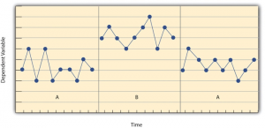
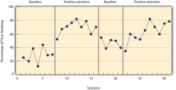
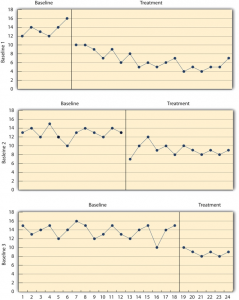
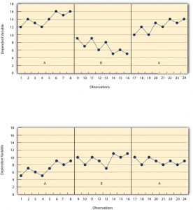

# Single-Subject Research Designs

Single-Subject Research Designs -- Research Methods in Psychology

45

# Single-Subject Research Designs

### Learning Objectives

- Describe the basic elements of a single-subject research design.
- Design simple single-subject studies using reversal and multiple-baseline designs.
- Explain how single-subject research designs address the issue of internal validity.
- Interpret the results of simple single-subject studies based on the visual inspection of graphed data.

## **General Features of Single-Subject Designs**

Before looking at any specific single-subject research designs, it will be helpful to consider some features that are common to most of them. Many of these features are illustrated in Figure 10.1, which shows the results of a generic single-subject study. First, the dependent variable (represented on the *y*-axis of the graph) is measured repeatedly over time (represented by the *x*-axis) at regular intervals. Second, the study is divided into distinct phases, and the participant is tested under one condition per phase. The conditions are often designated by capital letters: A, B, C, and so on. Thus Figure 10.1 represents a design in which the participant was tested first in one condition (A), then tested in another condition (B), and finally retested in the original condition (A). (This is called a reversal design and will be discussed in more detail shortly.)

Figure 10.1 Results of a Generic Single-Subject Study Illustrating Several Principles of Single-Subject Research

Another important aspect of single-subject research is that the change from one condition to the next does not usually occur after a fixed amount of time or number of observations. Instead, it depends on the participant’s behavior. Specifically, the researcher waits until the participant’s behavior in one condition becomes fairly consistent from observation to observation before changing conditions. This is sometimes referred to as the **steady state strategy** (Sidman, 1960)[1]. The idea is that when the dependent variable has reached a steady state, then any change across conditions will be relatively easy to detect. Recall that we encountered this same principle when discussing experimental research more generally. The effect of an independent variable is easier to detect when the “noise” in the data is minimized.

## **Reversal Designs**

The most basic single-subject research design is the **reversal design**, also called the **ABA design**. During the first phase, A, a **baseline** is established for the dependent variable. This is the level of responding before any treatment is introduced, and therefore the baseline phase is a kind of control condition. When steady state responding is reached, phase B begins as the researcher introduces the treatment. There may be a period of adjustment to the treatment during which the behavior of interest becomes more variable and begins to increase or decrease. Again, the researcher waits until that dependent variable reaches a steady state so that it is clear whether and how much it has changed. Finally, the researcher removes the treatment and again waits until the dependent variable reaches a steady state. This basic reversal design can also be extended with the reintroduction of the treatment (ABAB), another return to baseline (ABABA), and so on.

The study by Hall and his colleagues employed an ABAB reversal design. Figure 10.2 approximates the data for Robbie. The percentage of time he spent studying (the dependent variable) was low during the first baseline phase, increased during the first treatment phase until it leveled off, decreased during the second baseline phase, and again increased during the second treatment phase.

Figure 10.2 An Approximation of the Results for Hall and Colleagues’ Participant Robbie in Their ABAB Reversal Design. [Image description]

Why is the reversal—the removal of the treatment—considered to be necessary in this type of design? Why use an ABA design, for example, rather than a simpler AB design? Notice that an AB design is essentially an interrupted time-series design applied to an individual participant. Recall that one problem with that design is that if the dependent variable changes after the treatment is introduced, it is not always clear that the treatment was responsible for the change. It is possible that something else changed at around the same time and that this extraneous variable is responsible for the change in the dependent variable. But if the dependent variable changes with the introduction of the treatment and then changes *back* with the removal of the treatment (assuming that the treatment does not create a permanent effect), it is much clearer that the treatment (and removal of the treatment) is the cause. In other words, the reversal greatly increases the internal validity of the study.

There are close relatives of the basic reversal design that allow for the evaluation of more than one treatment. In a **multiple-treatment reversal design**, a baseline phase is followed by separate phases in which different treatments are introduced. For example, a researcher might establish a baseline of studying behavior for a disruptive student (A), then introduce a treatment involving positive attention from the teacher (B), and then switch to a treatment involving mild punishment for not studying (C). The participant could then be returned to a baseline phase before reintroducing each treatment—perhaps in the reverse order as a way of controlling for carryover effects. This particular multiple-treatment reversal design could also be referred to as an ABCACB design.

In an **alternating treatments design**, two or more treatments are alternated relatively quickly on a regular schedule. For example, positive attention for studying could be used one day and mild punishment for not studying the next, and so on. Or one treatment could be implemented in the morning and another in the afternoon. The alternating treatments design can be a quick and effective way of comparing treatments, but only when the treatments are fast acting.

## **Multiple-Baseline Designs**

There are two potential problems with the reversal design—both of which have to do with the removal of the treatment. One is that if a treatment is working, it may be unethical to remove it. For example, if a treatment seemed to reduce the incidence of self-injury in a child with an intellectual delay, it would be unethical to remove that treatment just to show that the incidence of self-injury increases. The second problem is that the dependent variable may not return to baseline when the treatment is removed. For example, when positive attention for studying is removed, a student might continue to study at an increased rate. This could mean that the positive attention had a lasting effect on the student’s studying, which of course would be good. But it could also mean that the positive attention was not really the cause of the increased studying in the first place. Perhaps something else happened at about the same time as the treatment—for example, the student’s parents might have started rewarding him for good grades. One solution to these problems is to use a **multiple-baseline design**, which is represented in Figure 10.3. There are three different types of multiple-baseline designs which we will now consider.

### Multiple-Baseline Design Across Participants

In one version of the design, a baseline is established for each of several participants, and the treatment is then introduced for each one. In essence, each participant is tested in an AB design. The key to this design is that the treatment is introduced at a different *time* for each participant. The idea is that if the dependent variable changes when the treatment is introduced for one participant, it might be a coincidence. But if the dependent variable changes when the treatment is introduced for multiple participants—especially when the treatment is introduced at different times for the different participants—then it is unlikely to be a coincidence.

Figure 10.3 Results of a Generic Multiple-Baseline Study. The multiple baselines can be for different participants, dependent variables, or settings. The treatment is introduced at a different time on each baseline. [Image description]

As an example, consider a study by Scott Ross and Robert Horner (Ross & Horner, 2009)[2]. They were interested in how a school-wide bullying prevention program affected the bullying behavior of particular problem students. At each of three different schools, the researchers studied two students who had regularly engaged in bullying. During the baseline phase, they observed the students for 10-minute periods each day during lunch recess and counted the number of aggressive behaviors they exhibited toward their peers. After 2 weeks, they implemented the program at one school. After 2 more weeks, they implemented it at the second school. And after 2 more weeks, they implemented it at the third school. They found that the number of aggressive behaviors exhibited by each student dropped shortly after the program was implemented at the student’s school. Notice that if the researchers had only studied one school or if they had introduced the treatment at the same time at all three schools, then it would be unclear whether the reduction in aggressive behaviors was due to the bullying program or something else that happened at about the same time it was introduced (e.g., a holiday, a television program, a change in the weather). But with their multiple-baseline design, this kind of coincidence would have to happen three separate times—a very unlikely occurrence—to explain their results.

### Multiple-Baseline Design Across Behaviors

In another version of the multiple-baseline design, multiple baselines are established for the same participant but for different dependent variables, and the treatment is introduced at a different time for each dependent variable. Imagine, for example, a study on the effect of setting clear goals on the productivity of an office worker who has two primary tasks: making sales calls and writing reports. Baselines for both tasks could be established. For example, the researcher could measure the number of sales calls made and reports written by the worker each week for several weeks. Then the goal-setting treatment could be introduced for *one* of these tasks, and at a later time the same treatment could be introduced for the other task. The logic is the same as before. If productivity increases on one task after the treatment is introduced, it is unclear whether the treatment caused the increase. But if productivity increases on both tasks after the treatment is introduced—especially when the treatment is introduced at two different times—then it seems much clearer that the treatment was responsible.

### Multiple-Baseline Design Across Settings

In yet a third version of the multiple-baseline design, multiple baselines are established for the same participant but in different settings. For example, a baseline might be established for the amount of time a child spends reading during his free time at school and during his free time at home. Then a treatment such as positive attention might be introduced first at school and later at home. Again, if the dependent variable changes after the treatment is introduced in each setting, then this gives the researcher confidence that the treatment is, in fact, responsible for the change.

## **Data Analysis in Single-Subject Research**

In addition to its focus on individual participants, single-subject research differs from group research in the way the data are typically analyzed. As we have seen throughout the book, group research involves combining data across participants. Group data are described using statistics such as means, standard deviations, correlation coefficients, and so on to detect general patterns. Finally, inferential statistics are used to help decide whether the result for the sample is likely to generalize to the population. Single-subject research, by contrast, relies heavily on a very different approach called **visual inspection**. This means plotting individual participants’ data as shown throughout this chapter, looking carefully at those data, and making judgments about whether and to what extent the independent variable had an effect on the dependent variable. Inferential statistics are typically not used.

In visually inspecting their data, single-subject researchers take several factors into account. One of them is changes in the **level **of the dependent variable from condition to condition. If the dependent variable is much higher or much lower in one condition than another, this suggests that the treatment had an effect. A second factor is **trend**, which refers to gradual increases or decreases in the dependent variable across observations. If the dependent variable begins increasing or decreasing with a change in conditions, then again this suggests that the treatment had an effect. It can be especially telling when a trend changes directions—for example, when an unwanted behavior is increasing during baseline but then begins to decrease with the introduction of the treatment. A third factor is **latency**, which is the time it takes for the dependent variable to begin changing after a change in conditions. In general, if a change in the dependent variable begins shortly after a change in conditions, this suggests that the treatment was responsible.

In the top panel of Figure 10.4, there are fairly obvious changes in the level and trend of the dependent variable from condition to condition. Furthermore, the latencies of these changes are short; the change happens immediately. This pattern of results strongly suggests that the treatment was responsible for the changes in the dependent variable. In the bottom panel of Figure 10.4, however, the changes in level are fairly small. And although there appears to be an increasing trend in the treatment condition, it looks as though it might be a continuation of a trend that had already begun during baseline. This pattern of results strongly suggests that the treatment was not responsible for any changes in the dependent variable—at least not to the extent that single-subject researchers typically hope to see.

Figure 10.4 Results of a Generic Single-Subject Study Illustrating Level, Trend, and Latency. Visual inspection of the data suggests an effective treatment in the top panel but an ineffective treatment in the bottom panel. [Image description]

The results of single-subject research can also be analyzed using statistical procedures—and this is becoming more common. There are many different approaches, and single-subject researchers continue to debate which are the most useful. One approach parallels what is typically done in group research. The mean and standard deviation of each participant’s responses under each condition are computed and compared, and inferential statistical tests such as the *t* test or analysis of variance are applied (Fisch, 2001)[3]. (Note that averaging *across* participants is less common.) Another approach is to compute the **percentage of non-overlapping data** (PND) for each participant (Scruggs & Mastropieri, 2001)[4]. This is the percentage of responses in the treatment condition that are more extreme than the most extreme response in a relevant control condition. In the study of Hall and his colleagues, for example, all measures of Robbie’s study time in the first treatment condition were greater than the highest measure in the first baseline, for a PND of 100%. The greater the percentage of non-overlapping data, the stronger the treatment effect. Still, formal statistical approaches to data analysis in single-subject research are generally considered a supplement to visual inspection, not a replacement for it.

### Image Description

**Figure 10.2 long description:** Line graph showing the results of a study with an ABAB reversal design. The dependent variable was low during first baseline phase; increased during the first treatment; decreased during the second baseline, but was still higher than during the first baseline; and was highest during the second treatment phase. [Return to Figure 10.2]

**Figure 10.3 long description:** Three line graphs showing the results of a generic multiple-baseline study, in which different baselines are established and treatment is introduced to participants at different times.

For Baseline 1, treatment is introduced one-quarter of the way into the study. The dependent variable ranges between 12 and 16 units during the baseline, but drops down to 10 units with treatment and mostly decreases until the end of the study, ranging between 4 and 10 units.

For Baseline 2, treatment is introduced halfway through the study. The dependent variable ranges between 10 and 15 units during the baseline, then has a sharp decrease to 7 units when treatment is introduced. However, the dependent variable increases to 12 units soon after the drop and ranges between 8 and 10 units until the end of the study.

For Baseline 3, treatment is introduced three-quarters of the way into the study. The dependent variable ranges between 12 and 16 units for the most part during the baseline, with one drop down to 10 units. When treatment is introduced, the dependent variable drops down to 10 units and then ranges between 8 and 9 units until the end of the study. [Return to Figure 10.3]

**Figure 10.4 long description:** Two graphs showing the results of a generic single-subject study with an ABA design. In the first graph, under condition A, level is high and the trend is increasing. Under condition B, level is much lower than under condition A and the trend is decreasing. Under condition A again, level is about as high as the first time and the trend is increasing. For each change, latency is short, suggesting that the treatment is the reason for the change.

In the second graph, under condition A, level is relatively low and the trend is increasing. Under condition B, level is a little higher than during condition A and the trend is increasing slightly. Under condition A again, level is a little lower than during condition B and the trend is decreasing slightly. It is difficult to determine the latency of these changes, since each change is rather minute, which suggests that the treatment is ineffective. [Return to Figure 10.4]

- Sidman, M. (1960). *Tactics of scientific research: Evaluating experimental data in psychology*. Boston, MA: Authors Cooperative. ↵
- Ross, S. W., & Horner, R. H. (2009). Bully prevention in positive behavior support. *Journal of Applied Behavior Analysis, 42*, 747–759. ↵
- Fisch, G. S. (2001). Evaluating data from behavioral analysis: Visual inspection or statistical models. *Behavioral Processes, 54*, 137–154. ↵
- Scruggs, T. E., & Mastropieri, M. A. (2001). How to summarize single-participant research: Ideas and applications. *Exceptionality, 9*, 227–244. ↵
