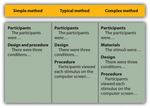
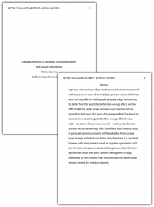
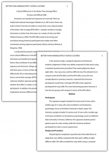
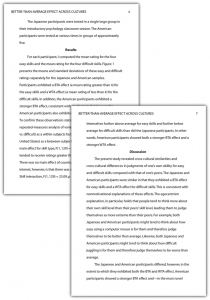
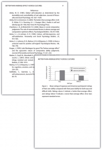

# Writing a Research Report in American Psychological Association (APA) Style

Writing a Research Report in American Psychological Association (APA) Style -- Research Methods in Psychology

49

# Writing a Research Report in American Psychological Association (APA) Style

### Learning Objectives

- Identify the major sections of an APA-style research report and the basic contents of each section.
- Plan and write an effective APA-style research report.

In this section, we look at how to write an APA-style **empirical research report**, an article that presents the results of one or more new studies. Recall that the standard sections of an empirical research report provide a kind of outline. Here we consider each of these sections in detail, including what information it contains, how that information is formatted and organized, and tips for writing each section. At the end of this section is a sample APA-style research report that illustrates many of these principles.

## **Sections of a Research Report**

### Title Page and Abstract

An APA-style research report begins with a **title page**. The title is centered in the upper half of the page, with each important word capitalized. The title should clearly and concisely (in about 12 words or fewer) communicate the primary variables and research questions. This sometimes requires a main title followed by a subtitle that elaborates on the main title, in which case the main title and subtitle are separated by a colon. Here are some titles from recent issues of professional journals published by the American Psychological Association.

- Sex Differences in Coping Styles and Implications for Depressed Mood
- Effects of Aging and Divided Attention on Memory for Items and Their Contexts
- Computer-Assisted Cognitive Behavioral Therapy for Child Anxiety: Results of a Randomized Clinical Trial
- Virtual Driving and Risk Taking: Do Racing Games Increase Risk-Taking Cognitions, Affect, and Behavior?

Below the title are the authors’ names and, on the next line, their institutional affiliation—the university or other institution where the authors worked when they conducted the research. As we have already seen, the authors are listed in an order that reflects their contribution to the research. When multiple authors have made equal contributions to the research, they often list their names alphabetically or in a randomly determined order.

#### **It’s ****Soooo**** Cute! **How Informal Should an Article Title Be?

In some areas of psychology, the titles of many empirical research reports are informal in a way that is perhaps best described as “cute.” They usually take the form of a play on words or a well-known expression that relates to the topic under study. Here are some examples from recent issues of the Journal *Psychological Science*.

- “Smells Like Clean Spirit: Nonconscious Effects of Scent on Cognition and Behavior”
- “Time Crawls: The Temporal Resolution of Infants’ Visual Attention”
- “Scent of a Woman: Men’s Testosterone Responses to Olfactory Ovulation Cues”
- “Apocalypse Soon?: Dire Messages Reduce Belief in Global Warming by Contradicting Just-World Beliefs”
- “Serial vs. Parallel Processing: Sometimes They Look Like Tweedledum and Tweedledee but They Can (and Should) Be Distinguished”
- “How Do I Love Thee? Let Me Count the Words: The Social Effects of Expressive Writing”

Individual researchers differ quite a bit in their preference for such titles. Some use them regularly, while others never use them. What might be some of the pros and cons of using cute article titles?

For articles that are being submitted for publication, the title page also includes an author note that lists the authors’ full institutional affiliations, any acknowledgments the authors wish to make to agencies that funded the research or to colleagues who commented on it, and contact information for the authors. For student papers that are not being submitted for publication—including theses—author notes are generally not necessary.

The **abstract** is a summary of the study. It is the second page of the manuscript and is headed with the word *Abstract*. The first line is not indented. The abstract presents the research question, a summary of the method, the basic results, and the most important conclusions. Because the abstract is usually limited to about 200 words, it can be a challenge to write a good one.

### Introduction

The **introduction** begins on the third page of the manuscript. The heading at the top of this page is the full title of the manuscript, with each important word capitalized as on the title page. The introduction includes three distinct subsections, although these are typically not identified by separate headings. The opening introduces the research question and explains why it is interesting, the literature review discusses relevant previous research, and the closing restates the research question and comments on the method used to answer it.

#### **The Opening**

The **opening**, which is usually a paragraph or two in length, introduces the research question and explains why it is interesting. To capture the reader’s attention, researcher Daryl Bem recommends starting with general observations about the topic under study, expressed in ordinary language (not technical jargon)—observations that are about people and their behavior (not about researchers or their research; Bem, 2003[1]). Concrete examples are often very useful here. According to Bem, this would be a poor way to begin a research report:

Festinger’s theory of cognitive dissonance received a great deal of attention during the latter part of the 20th century (p. 191)

The following would be much better:

The individual who holds two beliefs that are inconsistent with one another may feel uncomfortable. For example, the person who knows that they enjoy smoking but believes it to be unhealthy may experience discomfort arising from the inconsistency or disharmony between these two thoughts or cognitions. This feeling of discomfort was called cognitive dissonance by social psychologist Leon Festinger (1957), who suggested that individuals will be motivated to remove this dissonance in whatever way they can (p. 191).

After capturing the reader’s attention, the opening should go on to introduce the research question and explain why it is interesting. Will the answer fill a gap in the literature? Will it provide a test of an important theory? Does it have practical implications? Giving readers a clear sense of what the research is about and why they should care about it will motivate them to continue reading the literature review—and will help them make sense of it.

#### **Breaking the Rules**

Researcher Larry Jacoby reported several studies showing that a word that people see or hear repeatedly can seem more familiar even when they do not recall the repetitions—and that this tendency is especially pronounced among older adults. He opened his article with the following humorous anecdote:

A friend whose mother is suffering symptoms of Alzheimer’s disease (AD) tells the story of taking her mother to visit a nursing home, preliminary to her mother’s moving there. During an orientation meeting at the nursing home, the rules and regulations were explained, one of which regarded the dining room. The dining room was described as similar to a fine restaurant except that tipping was not required. The absence of tipping was a central theme in the orientation lecture, mentioned frequently to emphasize the quality of care along with the advantages of having paid in advance. At the end of the meeting, the friend’s mother was asked whether she had any questions. She replied that she only had one question: “Should I tip?” (Jacoby, 1999, p. 3)

Although both humor and personal anecdotes are generally discouraged in APA-style writing, this example is a highly effective way to start because it both engages the reader and provides an excellent real-world example of the topic under study.

#### **The Literature Review**

Immediately after the opening comes the **literature review**, which describes relevant previous research on the topic and can be anywhere from several paragraphs to several pages in length. However, the literature review is not simply a list of past studies. Instead, it constitutes a kind of argument for why the research question is worth addressing. By the end of the literature review, readers should be convinced that the research question makes sense and that the present study is a logical next step in the ongoing research process.

Like any effective argument, the literature review must have some kind of structure. For example, it might begin by describing a phenomenon in a general way along with several studies that demonstrate it, then describing two or more competing theories of the phenomenon, and finally presenting a hypothesis to test one or more of the theories. Or it might describe one phenomenon, then describe another phenomenon that seems inconsistent with the first one, then propose a theory that resolves the inconsistency, and finally present a hypothesis to test that theory. In applied research, it might describe a phenomenon or theory, then describe how that phenomenon or theory applies to some important real-world situation, and finally suggest a way to test whether it does, in fact, apply to that situation.

Looking at the literature review in this way emphasizes a few things. First, it is extremely important to start with an outline of the main points that you want to make, organized in the order that you want to make them. The basic structure of your argument, then, should be apparent from the outline itself. Second, it is important to emphasize the structure of your argument in your writing. One way to do this is to begin the literature review by summarizing your argument even before you begin to make it. “In this article, I will describe two apparently contradictory phenomena, present a new theory that has the potential to resolve the apparent contradiction, and finally present a novel hypothesis to test the theory.” Another way is to open each paragraph with a sentence that summarizes the main point of the paragraph and links it to the preceding points. These opening sentences provide the “transitions” that many beginning researchers have difficulty with. Instead of beginning a paragraph by launching into a description of a previous study, such as “Williams (2004) found that…,” it is better to start by indicating something about why you are describing this particular study. Here are some simple examples:

Another example of this phenomenon comes from the work of Williams (2004).

Williams (2004) offers one explanation of this phenomenon.

An alternative perspective has been provided by Williams (2004).

We used a method based on the one used by Williams (2004).

Finally, remember that your goal is to construct an argument for why your research question is interesting and worth addressing—not necessarily why your favorite answer to it is correct. In other words, your literature review must be balanced. If you want to emphasize the generality of a phenomenon, then of course you should discuss various studies that have demonstrated it. However, if there are other studies that have failed to demonstrate it, you should discuss them too. Or if you are proposing a new theory, then of course you should discuss findings that are consistent with that theory. However, if there are other findings that are inconsistent with it, again, you should discuss them too. It is acceptable to argue that the *balance* of the research supports the existence of a phenomenon or is consistent with a theory (and that is usually the best that researchers in psychology can hope for), but it is not acceptable to *ignore *contradictory evidence. Besides, a large part of what makes a research question interesting is uncertainty about its answer.

#### **The Closing**

The **closing** of the introduction—typically the final paragraph or two—usually includes two important elements. The first is a clear statement of the main research question and hypothesis. This statement tends to be more formal and precise than in the opening and is often expressed in terms of operational definitions of the key variables. The second is a brief overview of the method and some comment on its appropriateness. Here, for example, is how Darley and Latané (1968)[2] concluded the introduction to their classic article on the bystander effect:

These considerations lead to the hypothesis that the more bystanders to an emergency, the less likely, or the more slowly, any one bystander will intervene to provide aid. To test this proposition it would be necessary to create a situation in which a realistic “emergency” could plausibly occur. Each subject should also be blocked from communicating with others to prevent his getting information about their behavior during the emergency. Finally, the experimental situation should allow for the assessment of the speed and frequency of the subjects’ reaction to the emergency. The experiment reported below attempted to fulfill these conditions. (p. 378)

Thus the introduction leads smoothly into the next major section of the article—the method section.

### Method

The **method section** is where you describe how you conducted your study. An important principle for writing a method section is that it should be clear and detailed enough that other researchers could replicate the study by following your “recipe.” This means that it must describe all the important elements of the study—basic demographic characteristics of the participants, how they were recruited, whether they were randomly assigned to conditions, how the variables were manipulated or measured, how counterbalancing was accomplished, and so on. At the same time, it should avoid irrelevant details such as the fact that the study was conducted in Classroom 37B of the Industrial Technology Building or that the questionnaire was double-sided and completed using pencils.

The method section begins immediately after the introduction ends with the heading “Method” (not “Methods”) centered on the page. Immediately after this is the subheading “Participants,” left justified and in italics. The participants subsection indicates how many participants there were, the number of women and men, some indication of their age, other demographics that may be relevant to the study, and how they were recruited, including any incentives given for participation.

Figure 11.1 Three Ways of Organizing an APA-Style Method. [Image description]

After the participants section, the structure can vary a bit. Figure 11.1 shows three common approaches. In the first, the participants section is followed by a design and procedure subsection, which describes the rest of the method. This works well for methods that are relatively simple and can be described adequately in a few paragraphs. In the second approach, the participants section is followed by separate design and procedure subsections. This works well when both the design and the procedure are relatively complicated and each requires multiple paragraphs.

What is the difference between design and procedure? The design of a study is its overall structure. What were the independent and dependent variables? Was the independent variable manipulated, and if so, was it manipulated between or within subjects? How were the variables operationally defined? The procedure is how the study was carried out. It often works well to describe the procedure in terms of what the participants did rather than what the researchers did. For example, the participants gave their informed consent, read a set of instructions, completed a block of four practice trials, completed a block of 20 test trials, completed two questionnaires, and were debriefed and excused.

In the third basic way to organize a method section, the participants subsection is followed by a materials subsection before the design and procedure subsections. This works well when there are complicated materials to describe. This might mean multiple questionnaires, written vignettes that participants read and respond to, perceptual stimuli, and so on. The heading of this subsection can be modified to reflect its content. Instead of “Materials,” it can be “Questionnaires,” “Stimuli,” and so on. The materials subsection is also a good place to refer to the reliability and/or validity of the measures. This is where you would present test-retest correlations, Cronbach’s $\alpha$, or other statistics to show that the measures are consistent across time and across items and that they accurately measure what they are intended to measure.

### Results

The **results section** is where you present the main results of the study, including the results of the statistical analyses. Although it does not include the raw data—individual participants’ responses or scores—researchers should save their raw data and make them available to other researchers who request them. Many journals encourage the open sharing of raw data online, and some now require open data and materials before publication.

Although there are no standard subsections, it is still important for the results section to be logically organized. Typically it begins with certain preliminary issues. One is whether any participants or responses were excluded from the analyses and why. The rationale for excluding data should be described clearly so that other researchers can decide whether it is appropriate. A second preliminary issue is how multiple responses were combined to produce the primary variables in the analyses. For example, if participants rated the attractiveness of 20 stimulus people, you might have to explain that you began by computing the mean attractiveness rating for each participant. Or if they recalled as many items as they could from study list of 20 words, did you count the number correctly recalled, compute the percentage correctly recalled, or perhaps compute the number correct minus the number incorrect? A final preliminary issue is whether the manipulation was successful. This is where you would report the results of any manipulation checks.

The results section should then tackle the primary research questions, one at a time. Again, there should be a clear organization. One approach would be to answer the most general questions and then proceed to answer more specific ones. Another would be to answer the main question first and then to answer secondary ones. Regardless, Bem (2003)[3] suggests the following basic structure for discussing each new result:

- Remind the reader of the research question.
- Give the answer to the research question in words.
- Present the relevant statistics.
- Qualify the answer if necessary.
- Summarize the result.

Notice that only Step 3 necessarily involves numbers. The rest of the steps involve presenting the research question and the answer to it in words. In fact, the basic results should be clear even to a reader who skips over the numbers.

### Discussion

The **discussion** is the last major section of the research report. Discussions usually consist of some combination of the following elements:

- Summary of the research
- Theoretical implications
- Practical implications
- Limitations
- Suggestions for future research

The discussion typically begins with a summary of the study that provides a clear answer to the research question. In a short report with a single study, this might require no more than a sentence. In a longer report with multiple studies, it might require a paragraph or even two. The summary is often followed by a discussion of the theoretical implications of the research. Do the results provide support for any existing theories? If not, how *can* they be explained? Although you do not have to provide a definitive explanation or detailed theory for your results, you at least need to outline one or more possible explanations. In applied research—and often in basic research—there is also some discussion of the practical implications of the research. How can the results be used, and by whom, to accomplish some real-world goal?

The theoretical and practical implications are often followed by a discussion of the study’s limitations. Perhaps there are problems with its internal or external validity. Perhaps the manipulation was not very effective or the measures not very reliable. Perhaps there is some evidence that participants did not fully understand their task or that they were suspicious of the intent of the researchers. Now is the time to discuss these issues and how they might have affected the results. But do not overdo it. All studies have limitations, and most readers will understand that a different sample or different measures might have produced different results. Unless there is good reason to think they *would* have, however, there is no reason to mention these routine issues. Instead, pick two or three limitations that seem like they could have influenced the results, explain how they could have influenced the results, and suggest ways to deal with them.

Most discussions end with some suggestions for future research. If the study did not satisfactorily answer the original research question, what will it take to do so? What *new* research questions has the study raised? This part of the discussion, however, is not just a list of new questions. It is a discussion of two or three of the most important unresolved issues. This means identifying and clarifying each question, suggesting some alternative answers, and even suggesting ways they could be studied.

Finally, some researchers are quite good at ending their articles with a sweeping or thought-provoking conclusion. Darley and Latané (1968)[4], for example, ended their article on the bystander effect by discussing the idea that whether people help others may depend more on the situation than on their personalities. Their final sentence is, “If people understand the situational forces that can make them hesitate to intervene, they may better overcome them” (p. 383). However, this kind of ending can be difficult to pull off. It can sound overreaching or just banal and end up detracting from the overall impact of the article. It is often better simply to end by returning to the problem or issue introduced in your opening paragraph and clearly stating how your research has addressed that issue or problem.

### References

The references section begins on a new page with the heading “References” centered at the top of the page. All references cited in the text are then listed in the format presented earlier. They are listed alphabetically by the last name of the first author. If two sources have the same first author, they are listed alphabetically by the last name of the second author. If all the authors are the same, then they are listed chronologically by the year of publication. Everything in the reference list is double-spaced both within and between references.

### Appendices, Tables, and Figures

Appendices, tables, and figures come after the references. An **appendix** is appropriate for supplemental material that would interrupt the flow of the research report if it were presented within any of the major sections. An appendix could be used to present lists of stimulus words, questionnaire items, detailed descriptions of special equipment or unusual statistical analyses, or references to the studies that are included in a meta-analysis. Each appendix begins on a new page. If there is only one, the heading is “Appendix,” centered at the top of the page. If there is more than one, the headings are “Appendix A,” “Appendix B,” and so on, and they appear in the order they were first mentioned in the text of the report.

After any appendices come tables and then figures. Tables and figures are both used to present results. Figures can also be used to display graphs, illustrate theories (e.g., in the form of a flowchart), display stimuli, outline procedures, and present many other kinds of information. Each table and figure appears on its own page. Tables are numbered in the order that they are first mentioned in the text (“Table 1,” “Table 2,” and so on). Figures are numbered the same way (“Figure 1,” “Figure 2,” and so on). A brief explanatory title, with the important words capitalized, appears above each table. Each figure is given a brief explanatory caption, where (aside from proper nouns or names) only the first word of each sentence is capitalized. More details on preparing APA-style tables and figures are presented later in the book.

### Sample APA-Style Research Report

Figures 11.2, 11.3, 11.4, and 11.5 show some sample pages from an APA-style empirical research report originally written by undergraduate student Tomoe Suyama at California State University, Fresno. The main purpose of these figures is to illustrate the basic organization and formatting of an APA-style empirical research report, although many high-level and low-level style conventions can be seen here too.

Figure 11.2 Title Page and Abstract. This student paper does not include the author note on the title page. The abstract appears on its own page.

Figure 11.3 Introduction and Method. Note that the introduction is headed with the full title, and the method section begins immediately after the introduction ends.

Figure 11.4 Results and Discussion The discussion begins immediately after the results section ends.

Figure 11.5 References and Figure. If there were appendices or tables, they would come before the figure.

### Image Description

**Figure 11.1 image description:** Table showing three ways of organizing an APA-style method section.

In the simple method, there are two subheadings: “Participants” (which might begin “The participants were…”) and “Design and procedure” (which might begin “There were three conditions…”).

In the typical method, there are three subheadings: “Participants” (“The participants were…”), “Design” (“There were three conditions…”), and “Procedure” (“Participants viewed each stimulus on the computer screen…”).

In the complex method, there are four subheadings: “Participants” (“The participants were…”), “Materials” (“The stimuli were…”), “Design” (“There were three conditions…”), and “Procedure” (“Participants viewed each stimulus on the computer screen…”). [Return to Figure 11.1]

- Bem, D. J. (2003). Writing the empirical journal article. In J. M. Darley, M. P. Zanna, & H. R. Roediger III (Eds.), *The complete academic: A practical guide for the beginning social scientist* (2nd ed.). Washington, DC: American Psychological Association. ↵
- Darley, J. M., & Latané, B. (1968). Bystander intervention in emergencies: Diffusion of responsibility. *Journal of Personality and Social Psychology, 4*, 377–383. ↵
- Bem, D. J. (2003). Writing the empirical journal article. In J. M. Darley, M. P. Zanna, & H. R. Roediger III (Eds.), *The complete academic: A practical guide for the beginning social scientist* (2nd ed.). Washington, DC: American Psychological Association. ↵
- Darley, J. M., & Latané, B. (1968). Bystander intervention in emergencies: Diffusion of responsibility. *Journal of Personality and Social Psychology, 4*, 377–383. ↵
