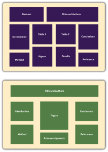

# Other Presentation Formats

Other Presentation Formats -- Research Methods in Psychology

50

# Other Presentation Formats

### Learning Objectives

- List several ways that researchers in psychology can present their research and the situations in which they might use them.
- Describe how final manuscripts differ from copy manuscripts in American Psychological Association (APA) style.
- Describe the purpose of talks and posters at professional conferences.
- Prepare a short conference-style talk and simple poster presentation.

Writing an empirical research report in American Psychological Association (APA) style is only one way to present new research in psychology. In this section, we look at several other important ways.

## Other Types of Manuscripts

The previous section focused on writing empirical research reports to be submitted for publication in a professional journal. However, there are other kinds of manuscripts that are written in APA style, many of which will not be submitted for publication elsewhere. Here we look at a few of them.

### Review and Theoretical Articles

Recall that **review articles** summarize research on a particular topic without presenting new empirical results. When these articles present a new theory, they are often called **theoretical articles**. Review and theoretical articles are structured much like empirical research reports, with a title page, an abstract, references, appendixes, tables, and figures, and they are written in the same high-level and low-level style. Because they do not report the results of new empirical research, however, there is no method or results section. Of course, the body of the manuscript should still have a logical organization and include an opening that identifies the topic and explains its importance, a literature review that organizes previous research (identifying important relationships among concepts or gaps in the literature), and a closing or conclusion that summarizes the main conclusions and suggests directions for further research or discusses theoretical and practical implications. In a theoretical article, of course, much of the body of the manuscript is devoted to presenting the new theory. Theoretical and review articles are usually divided into sections, each with a heading that is appropriate to that section. The sections and headings can vary considerably from article to article (unlike in an empirical research report). But whatever they are, they should help organize the manuscript and make the argument clear.

### Final Manuscripts

Until now, we have focused on the formatting of manuscripts that will be submitted to a professional journal for publication. In contrast, other types of manuscripts are prepared by the author in their final form with no intention of submitting them for publication elsewhere. These are called **final manuscripts** and include dissertations, theses, and other student papers. These manuscripts may look different from strictly APA style manuscripts in ways that make them easier to read, such as putting tables and figures close to where they are discussed so that the reader does not have to flip to the back of the manuscript to see them. If you read a dissertation or thesis, for example, you might notice it does not adhere strictly to APA style formatting. For student papers, it is important to check with the course instructor about formatting specifics. In a research methods course, papers are usually required to be written as though they were manuscripts being submitted for publication.

## **Conference Presentations**

One of the ways that researchers in psychology share their research with each other is by presenting it at **professional conferences**. (Although some professional conferences in psychology are devoted mainly to issues of clinical practice, we are concerned here with those that focus on research.) Professional conferences can range from small-scale events involving a dozen researchers who get together for an afternoon to large-scale events involving thousands of researchers who meet for several days. Although researchers attending a professional conference are likely to discuss their work with each other informally, there are two more formal types of presentation: oral presentations (“talks”) and posters. Presenting a talk or poster at a conference usually requires submitting an abstract of the research to the conference organizers in advance and having it accepted for presentation—although the peer review process is typically not as rigorous as it is for manuscripts submitted to a professional journal.

## **Oral Presentations**

In an **oral presentation**, or “talk,” the presenter stands in front of an audience of other researchers and tells them about their research—usually with the help of a slide show. Talks usually last from 10 to 20 minutes, with the last few minutes reserved for questions from the audience. At larger conferences, talks are typically grouped into sessions lasting an hour or two in which all the talks are on the same general topic.

In preparing a talk, presenters should keep several general principles in mind. The first is that the number of slides should be no more than about one per minute of the talk. The second is that talks are generally structured like an APA-style research report. There is a slide with the title and authors, a few slides to help provide the background, a few more to help describe the method, a few for the results, and a few for the conclusions. The third is that the presenter should look at the audience members and speak to them in a conversational tone that is less formal than APA-style writing but more formal than a conversation with a friend. The slides should not be the focus of the presentation; they should act as visual aids. As such, they should present the main points in bulleted lists or simple tables and figures.

### Posters

Another way to present research at a conference is in the form of a **poster**. A poster is typically presented during a one- to two-hour **poster session** that takes place in a large room at the conference site. Presenters set up their posters on bulletin boards arranged around the room and stand near them. Other researchers then circulate through the room, read the posters, and talk to the presenters. In essence, poster sessions are a grown-up version of the school science fair. But there is nothing childish about them. Posters are used by professional researchers in all scientific disciplines and they are becoming increasingly common. At a recent American Psychological Association Conference, nearly 2,000 posters were presented across 16 separate poster sessions. Among the reasons posters are so popular is that they encourage meaningful interaction among researchers.

Posters are typically a large size, maybe four feet wide and three feet high. The poster’s information is organized into distinct sections, including a title, author names and affiliations, an introduction, a method section, a results section, a discussion or conclusions section, references, and acknowledgments. Although posters can include an abstract, this may not be necessary because the poster itself is already a brief summary of the research. Figure 11.6 shows two different ways that the information on a poster might be organized.

Figure 11.6 Two Possible Ways to Organize the Information on a Poster. [Image description]

Given the conditions under which posters are often presented—for example, in crowded ballrooms where people are also eating, drinking, and socializing—they should be constructed so that they present the main ideas behind the research in as simple and clear a way as possible. The font sizes on a poster should be large—perhaps 72 points for the title and authors’ names and 28 points for the main text. The information should be organized into sections with clear headings, and text should be blocked into sentences or bulleted points rather than paragraphs. It is also better for it to be organized in columns and flow from top to bottom rather than to be organized in rows that flow across the poster. This makes it easier for multiple people to read at the same time without bumping into each other. Posters often include elements that add visual interest. Figures can be more colorful than those in an APA-style manuscript. Posters can also include copies of visual stimuli, photographs of the apparatus, or a simulation of participants being tested. They can also include purely decorative elements, although it is best not to overdo these.

Again, a primary reason that posters are becoming such a popular way to present research is that they facilitate interaction among researchers. Many presenters immediately offer to describe their research to visitors and use the poster as a visual aid. At the very least, it is important for presenters to stand by their posters, greet visitors, offer to answer questions, and be prepared for questions and even the occasional critical comment. It is generally a good idea to have a more detailed write-up of the research available for visitors who want more information, to offer to send them a detailed write-up, or to provide contact information so that they can request more information later.

For more information on preparing and presenting both talks and posters, see the website of the Undergraduate Advising and Research Office at Dartmouth College: http://www.dartmouth.edu/~ugar/undergrad/posterinstructions.html

#### Professional Conferences

Following are links to the websites for several large national conferences in North America and also for several conferences that feature the work of undergraduate students. For a comprehensive list of psychology conferences worldwide, see the following website.

http://www.conferencealerts.com/psychology.htm

###### *Large Conferences*

Canadian Psychological Association Convention: http://www.cpa.ca/convention

American Psychological Association Convention: http://www.apa.org/convention

Association for Psychological Science Conference: http://www.psychologicalscience.org/index.php/convention

Canadian Society for Brain, Behavior, and Cognitive Science Annual Meeting: https://www.csbbcs.org/meetings

Society for Personality and Social Psychology Conference: http://meeting.spsp.org/

Psychonomic Society Annual Meeting: http://www.psychonomic.org/annual-meeting

###### U.S. Regional conferences where undergraduate researchers frequently present

Eastern Psychological Association (EPA): http://www.easternpsychological.org

Midwestern Psychological Association (MPA): http://www.midwesternpsych.org/

New England Psychological Association (NEPA): http://www.newenglandpsychological.org/

Rocky Mountain Psychological Association (RMPA): http://www.rockymountainpsych.com/

Southeastern Psychological Association (SEPA): http://www.sepaonline.com/

Southwestern Psychological Association (SWPA): http://www.swpsych.org/

Western Psychological Association (WPA): http://westernpsych.org/

###### *Canadian Undergraduate Conferences*

Connecting Minds Undergraduate Research Conference: http://www.connectingminds.ca

Science Atlantic Psychology Conference: https://scienceatlantic.ca/conferences/

### Image Description

**Figure 11.6 image description:** Two graphics depicting ways to organize the information on a poster.

In the first graphic, the abstract and the title and authors appear along the top of the poster. Below the abstract and title are four columns. From top to bottom, left to right, the columns contain the introduction and method; Table 1 and a figure; Table 2 and the results; and the conclusions and reference section.

In the second graphic, the title and authors appear along the top of the poster. Below the title are three columns. From top to bottom, left to right, the columns contain the introduction and method; a figure and acknowledgments; and the conclusions and references. [Return to Figure 11.6]
