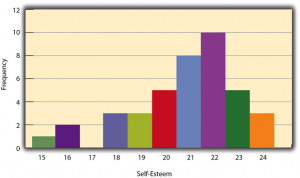
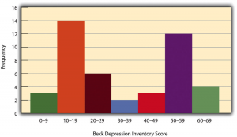
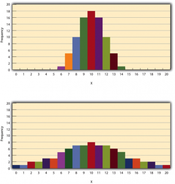

# Describing Single Variables

Describing Single Variables -- Research Methods in Psychology

52

# Describing Single Variables

### Learning Objectives

- Use frequency tables and histograms to display and interpret the distribution of a variable.
- Compute and interpret the mean, median, and mode of a distribution and identify situations in which the mean, median, or mode is the most appropriate measure of central tendency.
- Compute and interpret the range and standard deviation of a distribution.
- Compute and interpret percentile ranks and *z* scores.

**Descriptive statistics** refers to a set of techniques for summarizing and displaying data. Let us assume here that the data are quantitative and consist of scores on one or more variables for each of several study participants. Although in most cases the primary research question will be about one or more statistical relationships between variables, it is also important to describe each variable individually. For this reason, we begin by looking at some of the most common techniques for describing single variables.

## The Distribution of a Variable

Every variable has a **distribution**, which is the way the scores are distributed across the levels of that variable. For example, in a sample of 100 university students, the distribution of the variable “number of siblings” might be such that 10 of them have no siblings, 30 have one sibling, 40 have two siblings, and so on. In the same sample, the distribution of the variable “sex” might be such that 44 have a score of “male” and 56 have a score of “female.”

## **Frequency Tables**

One way to display the distribution of a variable is in a **frequency table**. Table 12.1, for example, is a frequency table showing a hypothetical distribution of scores on the Rosenberg Self-Esteem Scale for a sample of 40 college students. The first column lists the values of the variable—the possible scores on the Rosenberg scale—and the second column lists the frequency of each score. This table shows that there were three students who had self-esteem scores of 24, five who had self-esteem scores of 23, and so on. From a frequency table like this, one can quickly see several important aspects of a distribution, including the range of scores (from 15 to 24), the most and least common scores (22 and 17, respectively), and any extreme scores that stand out from the rest.

 *Table 12.1 Frequency Table Showing a Hypothetical Distribution of Scores on the Rosenberg Self-Esteem Scale* **Self-esteem** **Frequency**  24 3  23 5  22 10  21 8  20 5  19 3  18 3  17 0  16 2  15 1

There are a few other points worth noting about frequency tables. First, the levels listed in the first column usually go from the highest at the top to the lowest at the bottom, and they usually do not extend beyond the highest and lowest scores in the data. For example, although scores on the Rosenberg scale can vary from a high of 30 to a low of 0, Table 12.1 only includes levels from 24 to 15 because that range includes all the scores in this particular data set. Second, when there are many different scores across a wide range of values, it is often better to create a grouped frequency table, in which the first column lists ranges of values and the second column lists the frequency of scores in each range. Table 12.2, for example, is a grouped frequency table showing a hypothetical distribution of simple reaction times for a sample of 20 participants. In a grouped frequency table, the ranges must all be of equal width, and there are usually between five and 15 of them. Finally, frequency tables can also be used for categorical variables, in which case the levels are category labels. The order of the category labels is somewhat arbitrary, but they are often listed from the most frequent at the top to the least frequent at the bottom.

 *Table 12.2 A Grouped Frequency Table Showing a Hypothetical Distribution of Reaction Times* **Reaction time (ms)** **Frequency**  241–260 1  221–240 2  201–220 2  181–200 9  161–180 4  141–160 2

## **Histograms**

A **histogram** is a graphical display of a distribution. It presents the same information as a frequency table but in a way that is even quicker and easier to grasp. The histogram in Figure 12.1 presents the distribution of self-esteem scores in Table 12.1. The *x-*axis of the histogram represents the variable and the *y-*axis represents frequency. Above each level of the variable on the *x-*axis is a vertical bar that represents the number of individuals with that score. When the variable is quantitative, as in this example, there is usually no gap between the bars. When the variable is categorical, however, there is usually a small gap between them. (The gap at 17 in this histogram reflects the fact that there were no scores of 17 in this data set.)

Figure 12.1 Histogram Showing the Distribution of Self-Esteem Scores Presented in Table 12.1

## **Distribution Shapes**

When the distribution of a quantitative variable is displayed in a histogram, it has a shape. The shape of the distribution of self-esteem scores in Figure 12.1 is typical. There is a peak somewhere near the middle of the distribution and “tails” that taper in either direction from the peak. The distribution of Figure 12.1 is unimodal, meaning it has one distinct peak, but distributions can also be bimodal, meaning they have two distinct peaks. Figure 12.2, for example, shows a hypothetical bimodal distribution of scores on the Beck Depression Inventory. Distributions can also have more than two distinct peaks, but these are relatively rare in psychological research.

Figure 12.2 Histogram Showing a Hypothetical Bimodal Distribution of Scores on the Beck Depression Inventory. [Image description]

Another characteristic of the shape of a distribution is whether it is symmetrical or skewed. The distribution in the center of Figure 12.3 is **symmetrical**. Its left and right halves are mirror images of each other. The distribution on the left is negatively **skewed**, with its peak shifted toward the upper end of its range and a relatively long negative tail. The distribution on the right is positively skewed, with its peak toward the lower end of its range and a relatively long positive tail.

Figure 12.3 Histograms Showing Negatively Skewed, Symmetrical, and Positively Skewed Distributions

An **outlier** is an extreme score that is much higher or lower than the rest of the scores in the distribution. Sometimes outliers represent truly extreme scores on the variable of interest. For example, on the Beck Depression Inventory, a single clinically depressed person might be an outlier in a sample of otherwise happy and high-functioning peers. However, outliers can also represent errors or misunderstandings on the part of the researcher or participant, equipment malfunctions, or similar problems. We will say more about how to interpret outliers and what to do about them later in this chapter.

## **Measures of Central Tendency and Variability**

It is also useful to be able to describe the characteristics of a distribution more precisely. Here we look at how to do this in terms of two important characteristics: their central tendency and their variability.

## **Central Tendency**

The **central tendency** of a distribution is its middle—the point around which the scores in the distribution tend to cluster. (Another term for central tendency is *average*.) Looking back at Figure 12.1, for example, we can see that the self-esteem scores tend to cluster around the values of 20 to
22. Here we will consider the three most common measures of central tendency: the mean, the median, and the mode.

The **mean** of a distribution (symbolized *M*) is the sum of the scores divided by the number of scores. It is an average. As a formula, it looks like this:

*M*=*$\Sigma$X**/**N*

In this formula, the symbol $\Sigma$ (the Greek letter sigma) is the summation sign and means to sum across the values of the variable *X*. *N* represents the number of scores. The mean is by far the most common measure of central tendency, and there are some good reasons for this. It usually provides a good indication of the central tendency of a distribution, and it is easily understood by most people. In addition, the mean has statistical properties that make it especially useful in doing inferential statistics.

An alternative to the mean is the **median**. The median is the middle score in the sense that half the scores in the distribution are less than it and half are greater than it. The simplest way to find the median is to organize the scores from lowest to highest and locate the score in the middle. Consider, for example, the following set of seven scores:

8 4 12 14 3 2 3

To find the median, simply rearrange the scores from lowest to highest and locate the one in the middle.

2 3 3 **4** 8 12 14

In this case, the median is 4 because there are three scores lower than 4 and three scores higher than
4. When there is an even number of scores, there are two scores in the middle of the distribution, in which case the median is the value halfway between them. For example, if we were to add a score of 15 to the preceding data set, there would be two scores (both 4 and 8) in the middle of the distribution, and the median would be halfway between them (6).

One final measure of central tendency is the mode. The **mode** is the most frequent score in a distribution. In the self-esteem distribution presented in Table 12.1 and Figure 12.1, for example, the mode is
22. More students had that score than any other. The mode is the only measure of central tendency that can also be used for categorical variables.

In a distribution that is both unimodal and symmetrical, the mean, median, and mode will be very close to each other at the peak of the distribution. In a bimodal or asymmetrical distribution, the mean, median, and mode can be quite different. In a bimodal distribution, the mean and median will tend to be between the peaks, while the mode will be at the tallest peak. In a skewed distribution, the mean will differ from the median in the direction of the skew (i.e., the direction of the longer tail). For highly skewed distributions, the mean can be pulled so far in the direction of the skew that it is no longer a good measure of the central tendency of that distribution. Imagine, for example, a set of four simple reaction times of 200, 250, 280, and 250 milliseconds (ms). The mean is 245 ms. But the addition of one more score of 5,000 ms—perhaps because the participant was not paying attention—would raise the mean to 1,445 ms. Not only is this measure of central tendency greater than 80% of the scores in the distribution, but it also does not seem to represent the behavior of anyone in the distribution very well. This is why researchers often prefer the median for highly skewed distributions (such as distributions of reaction times).

Keep in mind, though, that you are not required to choose a single measure of central tendency in analyzing your data. Each one provides slightly different information, and all of them can be useful.

## **Measures of Variability**

The **variability** of a distribution is the extent to which the scores vary around their central tendency. Consider the two distributions in Figure 12.4, both of which have the same central tendency. The mean, median, and mode of each distribution are
10. Notice, however, that the two distributions differ in terms of their variability. The top one has relatively low variability, with all the scores relatively close to the center. The bottom one has relatively high variability, with the scores are spread across a much greater range.

Figure 12.4 Histograms Showing Hypothetical Distributions With the Same Mean, Median, and Mode (10) but With Low Variability (Top) and High Variability (Bottom). [Image description]

One simple measure of variability is the **range**, which is simply the difference between the highest and lowest scores in the distribution. The range of the self-esteem scores in Table 12.1, for example, is the difference between the highest score (24) and the lowest score (15). That is, the range is 24 − 15 = 9. Although the range is easy to compute and understand, it can be misleading when there are outliers. Imagine, for example, an exam on which all the students scored between 90 and 100. It has a range of
10. But if there was a single student who scored 20, the range would increase to 80—giving the impression that the scores were quite variable when in fact only one student differed substantially from the rest.

By far the most common measure of variability is the standard deviation. The **standard deviation** of a distribution is the average distance between the scores and the mean. For example, the standard deviations of the distributions in Figure 12.4 are 1.69 for the top distribution and 4.30 for the bottom one. That is, while the scores in the top distribution differ from the mean by about 1.69 units on average, the scores in the bottom distribution differ from the mean by about 4.30 units on average.

Computing the standard deviation involves a slight complication. Specifically, it involves finding the difference between each score and the mean, squaring each difference, finding the mean of these squared differences, and finally finding the square root of that mean. The formula looks like this:

The computations for the standard deviation are illustrated for a small set of data in Table 12.3. The first column is a set of eight scores that has a mean of
5. The second column is the difference between each score and the mean. The third column is the square of each of these differences. Notice that although the differences can be negative, the squared differences are always positive—meaning that the standard deviation is always positive. At the bottom of the third column is the mean of the squared differences, which is also called the **variance** (symbolized *SD*2). Although the variance is itself a measure of variability, it generally plays a larger role in inferential statistics than in descriptive statistics. Finally, below the variance is the square root of the variance, which is the standard deviation.

 *Table 12.3 Computations for the Standard Deviation* X X** – **M **(**X** − **M**)**2  3 −2 4  5 0 0  4 −1 1  2 −3 9  7 2 4  6 1 1  5 0 0  8 3 9  *M* = 5  *SD*2=28/8=3.50    *SD*=$\sqrt^{3}$.50=1.87

#### ***N**** *****or***** ****N**** *****− 1**

If you have already taken a statistics course, you may have learned to divide the sum of the squared differences by *N* − 1 rather than by *N* when you compute the variance and standard deviation. Why is this?

By definition, the standard deviation is the square root of the mean of the squared differences. This implies dividing the sum of squared differences by *N*, as in the formula just presented. Computing the standard deviation this way is appropriate when your goal is simply to describe the variability in a sample. And learning it this way emphasizes that the variance is in fact the *mean* of the squared differences—and the standard deviation is the square root of this *mean*.

However, most calculators and software packages divide the sum of squared differences by *N* − 1. This is because the standard deviation of a sample tends to be a bit lower than the standard deviation of the population the sample was selected from. Dividing the sum of squares by *N* − 1 corrects for this tendency and results in a better estimate of the population standard deviation. Because researchers generally think of their data as representing a sample selected from a larger population—and because they are generally interested in drawing conclusions about the population—it makes sense to routinely apply this correction.

## **Percentile Ranks and ****z**** Scores**

In many situations, it is useful to have a way to describe the location of an individual score within its distribution. One approach is the percentile rank. The **percentile rank** of a score is the percentage of scores in the distribution that are lower than that score. Consider, for example, the distribution in Table 12.1. For any score in the distribution, we can find its percentile rank by counting the number of scores in the distribution that are lower than that score and converting that number to a percentage of the total number of scores. Notice, for example, that five of the students represented by the data in Table 12.1 had self-esteem scores of
23. In this distribution, 32 of the 40 scores (80%) are lower than
23. Thus each of these students has a percentile rank of 80. (It can also be said that they scored “at the 80th percentile.”) Percentile ranks are often used to report the results of standardized tests of ability or achievement. If your percentile rank on a test of verbal ability were 40, for example, this would mean that you scored higher than 40% of the people who took the test.

Another approach is the *z* score. The **z score **for a particular individual is the difference between that individual’s score and the mean of the distribution, divided by the standard deviation of the distribution:

*z* **= (*X*−*M**)**/**SD*

A *z* score indicates how far above or below the mean a raw score is, but it expresses this in terms of the standard deviation. For example, in a distribution of intelligence quotient (IQ) scores with a mean of 100 and a standard deviation of 15, an IQ score of 110 would have a *z* score of (110 − 100) / 15 = +0.67. In other words, a score of 110 is 0.67 standard deviations (approximately two thirds of a standard deviation) above the mean. Similarly, a raw score of 85 would have a *z* score of (85 − 100) / 15 = −1.00. In other words, a score of 85 is one standard deviation below the mean.

There are several reasons that *z* scores are important. Again, they provide a way of describing where an individual’s score is located within a distribution and are sometimes used to report the results of standardized tests. They also provide one way of defining outliers. For example, outliers are sometimes defined as scores that have *z* scores less than −3.00 or greater than +3.00. In other words, they are defined as scores that are more than three standard deviations from the mean. Finally, *z* scores play an important role in understanding and computing other statistics, as we will see shortly.

#### **Online Descriptive Statistics**

Although many researchers use commercially available software such as SPSS and Excel to analyze their data, there are several free online analysis tools that can also be extremely useful. Many allow you to enter or upload your data and then make one click to conduct several descriptive statistical analyses. Among them are the following.

Rice Virtual Lab in Statistics

http://onlinestatbook.com/stat_analysis/index.html

VassarStats

http://faculty.vassar.edu/lowry/VassarStats.html

Bright Stat

http://www.brightstat.com

For a more complete list, see http://statpages.org/index.html.

### Image Description

**Figure 12.2 long description:** A histogram showing a bimodal distribution of scores on the Beck Depression Inventory. The horizontal axis is labelled “Beck Depression Inventory Score,” and the vertical axis is labelled “Frequency.” The data is as such:

- BDI: 0–9, Frequency: 3
- BDI: 10–19, Frequency: 14
- BDI: 20–29, Frequency: 6
- BDI: 30–39, Frequency: 2
- BDI: 40–49, Frequency: 3
- BDI: 50–59, Frequency: 12
- BDI: 60–69, Frequency: 4

The two distinct peaks are the 10–19 range and the 50–59 range. [Return to Figure 12.2]

**Figure 12.4 long description:** Two histograms with the same central tendency but different variability. Each horizontal axis is labelled “X” and has values from 1 to 20, and each vertical axis is labelled “Frequency” and has values from 1 to
20. Each histogram also has a mean, median, mode, and central tendency of 10.

In the first histogram, variability is relatively low. The data is as such:

- X: 6, Frequency: 1
- X: 7, Frequency: 5
- X: 8, Frequency: 10
- X: 9, Frequency: 16
- X: 10, Frequency: 18
- X: 11, Frequency: 16
- X: 12, Frequency: 10
- X: 13, Frequency: 5
- X: 14, Frequency: 1

In the second histogram, variability is relatively high. The data is as such:

- X: 0, Frequency: 1
- X: 1, Frequency: 1
- X: 2, Frequency: 2
- X: 3, Frequency: 2
- X: 4, Frequency: 3
- X: 5, Frequency: 3
- X: 6, Frequency: 5
- X: 7, Frequency: 6
- X: 8, Frequency: 7
- X: 9, Frequency: 7
- X: 10, Frequency: 8
- X: 11, Frequency: 7
- X: 12, Frequency: 7
- X: 13, Frequency: 6
- X: 14, Frequency: 5
- X: 15, Frequency: 3
- X: 16, Frequency: 3
- X: 17, Frequency: 2
- X: 18, Frequency: 2
- X: 19, Frequency: 1
- X: 20, Frequency: 1

[Return to Figure 12.4]
