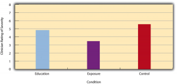
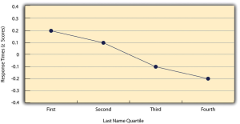
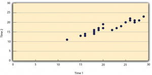
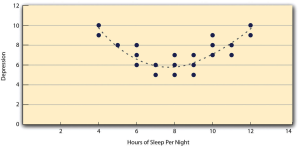
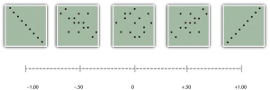

# Describing Statistical Relationships

Describing Statistical Relationships -- Research Methods in Psychology

53

# Describing Statistical Relationships

### Learning Objectives

- Describe differences between groups in terms of their means and standard deviations, and in terms of Cohen’s *d*.
- Describe correlations between quantitative variables in terms of Pearson’s *r*.

As we have seen throughout this book, most interesting research questions in psychology are about statistical relationships between variables. In this section, we revisit the two basic forms of statistical relationship introduced earlier in the book—differences between groups or conditions and relationships between quantitative variables—and we consider how to describe them in more detail.

## Differences Between Groups or Conditions

Differences between groups or conditions are usually described in terms of the mean and standard deviation of each group or condition. For example, Thomas Ollendick and his colleagues conducted a study in which they evaluated two one-session treatments for simple phobias in children (Ollendick et al., 2009)[1]. They randomly assigned children with an intense fear (e.g., to dogs) to one of three conditions. In the exposure condition, the children actually confronted the object of their fear under the guidance of a trained therapist. In the education condition, they learned about phobias and some strategies for coping with them. In the wait-list control condition, they were waiting to receive a treatment after the study was over. The severity of each child’s phobia was then rated on a 1-to-8 scale by a clinician who did not know which treatment the child had received. (This was one of several dependent variables.) The mean fear rating in the education condition was 4.83 with a standard deviation of 1.52, while the mean fear rating in the exposure condition was 3.47 with a standard deviation of 1.77. The mean fear rating in the control condition was 5.56 with a standard deviation of 1.21. In other words, both treatments worked, but the exposure treatment worked better than the education treatment. As we have seen, differences between group or condition means can be presented in a bar graph like that in Figure 12.5, where the heights of the bars represent the group or condition means. We will look more closely at creating American Psychological Association (APA)-style bar graphs shortly.

Figure 12.5 Bar Graph Showing Mean Clinician Phobia Ratings for Children in Two Treatment Conditions. [Image description]

It is also important to be able to describe the strength of a statistical relationship, which is often referred to as the **effect size**. The most widely used measure of effect size for differences between group or condition means is called **Cohen’s *****d***, which is the difference between the two means divided by the standard deviation:

*d* **= (*M*1 −*M*2)/*SD*

In this formula, it does not really matter which mean is *M*1 and which is *M*2. If there is a treatment group and a control group, the treatment group mean is usually *M*1 and the control group mean is *M*2. Otherwise, the larger mean is usually *M*1 and the smaller mean *M*2 so that Cohen’s *d* turns out to be positive. Indeed Cohen’s *d* values should always be positive so it is the absolute difference between the means that is considered in the numerator. The standard deviation in this formula is usually a kind of average of the two group standard deviations called the pooled-within groups standard deviation. To compute the pooled within-groups standard deviation, add the sum of the squared differences for Group 1 to the sum of squared differences for Group 2, divide this by the sum of the two sample sizes, and then take the square root of that. Informally, however, the standard deviation of either group can be used instead.

Conceptually, Cohen’s *d* is the difference between the two means expressed in standard deviation units. (Notice its similarity to a *z* score, which expresses the difference between an individual score and a mean in standard deviation units.) A Cohen’s *d* of 0.50 means that the two group means differ by 0.50 standard deviations (half a standard deviation). A Cohen’s *d* of 1.20 means that they differ by 1.20 standard deviations. But how should we interpret these values in terms of the strength of the relationship or the size of the difference between the means? Table 12.4 presents some guidelines for interpreting Cohen’s *d* values in psychological research (Cohen, 1992)[2]. Values near 0.20 are considered small, values near 0.50 are considered medium, and values near 0.80 are considered large. Thus a Cohen’s *d* value of 0.50 represents a medium-sized difference between two means, and a Cohen’s *d* value of 1.20 represents a very large difference in the context of psychological research. In the research by Ollendick and his colleagues, there was a large difference ($d = 0.82$) between the exposure and education conditions.

 *Table 12.4 Guidelines for Referring to Cohen’s d and Pearson’s r Values as “Strong,” “Medium,” or “Weak”* **Relationship strength** **Cohen’s **d **Pearson’s **r  Strong/large 0.80 $\pm^{0}$.50  Medium 0.50 $\pm^{0}$.30  Weak/small 0.20 $\pm^{0}$.10

Cohen’s *d* is useful because it has the same meaning regardless of the variable being compared or the scale it was measured on. A Cohen’s *d* of 0.20 means that the two group means differ by 0.20 standard deviations whether we are talking about scores on the Rosenberg Self-Esteem scale, reaction time measured in milliseconds, number of siblings, or diastolic blood pressure measured in millimeters of mercury. Not only does this make it easier for researchers to communicate with each other about their results, it also makes it possible to combine and compare results across different studies using different measures.

Be aware that the term *effect size* can be misleading because it suggests a causal relationship—that the difference between the two means is an “effect” of being in one group or condition as opposed to another. Imagine, for example, a study showing that a group of exercisers is happier on average than a group of nonexercisers, with an “effect size” of $d = 0.35$. If the study was an experiment—with participants randomly assigned to exercise and no-exercise conditions—then one could conclude that exercising caused a small to medium-sized increase in happiness. If the study was cross-sectional, however, then one could conclude only that the exercisers were happier than the nonexercisers by a small to medium-sized amount. In other words, simply calling the difference an “effect size” does not make the relationship a causal one.

#### **Sex Differences Expressed as Cohen’s *****d***

Researcher Janet Shibley Hyde has looked at the results of numerous studies on psychological sex differences and expressed the results in terms of Cohen’s *d* (Hyde, 2007)[3]. Following are a few of the values she has found, averaging across several studies in each case. (Note that because she always treats the mean for men as *M*1 and the mean for women as *M*2, positive values indicate that men score higher and negative values indicate that women score higher.)

 Mathematical problem solving +0.08  Reading comprehension −0.09  Smiling −0.40  Aggression +0.50  Attitudes toward casual sex +0.81  Leadership effectiveness −0.02

Hyde points out that although men and women differ by a large amount on some variables (e.g., attitudes toward casual sex), they differ by only a small amount on the vast majority. In many cases, Cohen’s *d* is less than 0.10, which she terms a “trivial” difference. (The difference in talkativeness discussed in Chapter 1 was also trivial: $d = 0.06$.) Although researchers and non-researchers alike often emphasize sex *differences*, Hyde has argued that it makes at least as much sense to think of men and women as fundamentally *similar*. She refers to this as the “gender similarities hypothesis.”

## Correlations Between Quantitative Variables

As we have seen throughout the book, many interesting statistical relationships take the form of correlations between quantitative variables. For example, researchers Kurt Carlson and Jacqueline Conard conducted a study on the relationship between the alphabetical position of the first letter of people’s last names (from A = 1 to Z = 26) and how quickly those people responded to consumer appeals (Carlson & Conard, 2011)[4]. In one study, they sent emails to a large group of MBA students, offering free basketball tickets from a limited supply. The result was that the further toward the end of the alphabet students’ last names were, the faster they tended to respond. These results are summarized in Figure 12.6.

Figure 12.6 Line Graph Showing the Relationship Between the Alphabetical Position of People’s Last Names and How Quickly Those People Respond to Offers of Consumer Goods. [Image description]

Such relationships are often presented using line graphs or scatterplots, which show how the level of one variable differs across the range of the other. In the line graph in Figure 12.6, for example, each point represents the mean response time for participants with last names in the first, second, third, and fourth quartiles (or quarters) of the name distribution. It clearly shows how response time tends to decline as people’s last names get closer to the end of the alphabet. The scatterplot in Figure 12.7, shows the relationship between 25 research methods students’ scores on the Rosenberg Self-Esteem Scale given on two occasions a week apart. Here the points represent individuals, and we can see that the higher students scored on the first occasion, the higher they tended to score on the second occasion. In general, line graphs are used when the variable on the *x-*axis has (or is organized into) a small number of distinct values, such as the four quartiles of the name distribution. Scatterplots are used when the variable on the *x-*axis has a large number of values, such as the different possible self-esteem scores.

Figure 12.7 Statistical Relationship Between Several University Students’ Scores on the Rosenberg Self-Esteem Scale Given on Two Occasions a Week Apart. [Image description]

The data presented in Figure 12.7 provide a good example of a positive relationship, in which higher scores on one variable tend to be associated with higher scores on the other (so that the points go from the lower left to the upper right of the graph). The data presented in Figure 12.6 provide a good example of a negative relationship, in which higher scores on one variable tend to be associated with lower scores on the other (so that the points go from the upper left to the lower right).

Both of these examples are also **linear relationships**, in which the points are reasonably well fit by a single straight line. **Nonlinear relationships** are those in which the points are better fit by a curved line. Figure 12.8, for example, shows a hypothetical relationship between the amount of sleep people get per night and their level of depression. In this example, the line that best fits the points is a curve—a kind of upside down “U”—because people who get about eight hours of sleep tend to be the least depressed, while those who get too little sleep and those who get too much sleep tend to be more depressed. Nonlinear relationships are not uncommon in psychology, but a detailed discussion of them is beyond the scope of this book.

Figure 12.8 A Hypothetical Nonlinear Relationship Between How Much Sleep People Get per Night and How Depressed They Are. [Image description]

As we saw earlier in the book, the strength of a correlation between quantitative variables is typically measured using a statistic called Pearson’s *r*. As Figure 12.9 shows, its possible values range from −1.00, through zero, to +1.00. A value of 0 means there is no relationship between the two variables. In addition to his guidelines for interpreting Cohen’s *d*, Cohen offered guidelines for interpreting Pearson’s *r* in psychological research (see Table 12.4). Values near $\pm$.10 are considered small, values near $\pm$ .30 are considered medium, and values near $\pm$.50 are considered large. Notice that the sign of Pearson’s *r* is unrelated to its strength. Pearson’s *r* values of +.30 and −.30, for example, are equally strong; it is just that one represents a moderate positive relationship and the other a moderate negative relationship. Like Cohen’s *d*, Pearson’s *r* is also referred to as a measure of “effect size” even though the relationship may not be a causal one.

Figure 12.9 Pearson’s r Ranges From −1.00 (Representing the Strongest Possible Negative Relationship), Through 0 (Representing No Relationship), to +1.00 (Representing the Strongest Possible Positive Relationship). [Image description]

The computations for Pearson’s *r* are more complicated than those for Cohen’s *d*. Although you may never have to do them by hand, it is still instructive to see how. Computationally, Pearson’s *r* is the “mean cross-product of *z* scores.” To compute it, one starts by transforming all the scores to *z* scores. For the *X *variable, subtract the mean of *X* from each score and divide each difference by the standard deviation of *X*. For the *Y* variable, subtract the mean of *Y* from each score and divide each difference by the standard deviation of *Y*. Then, for each individual, multiply the two *z* scores together to form a cross-product. Finally, take the mean of the cross-products. The formula looks like this:

Table 12.5 illustrates these computations for a small set of data. The first column lists the scores for the *X* variable, which has a mean of 4.00 and a standard deviation of 1.90. The second column is the *z-*score for each of these raw scores. The third and fourth columns list the raw scores for the *Y* variable, which has a mean of 40 and a standard deviation of 11.78, and the corresponding *z* scores. The fifth column lists the cross-products. For example, the first one is 0.00 multiplied by −0.85, which is equal to 0.00. The second is 1.58 multiplied by 1.19, which is equal to 1.88. The mean of these cross-products, shown at the bottom of that column, is Pearson’s *r*, which in this case is +.53. There are other formulas for computing Pearson’s *r* by hand that may be quicker. This approach, however, is much clearer in terms of communicating conceptually what Pearson’s *r* is.

 *Table 12.5 Sample Computations for Pearson’s r* X z**x** Y z**y** z**x**z**y**  4 0.00 30 −0.85 0.00  7 1.58 54 1.19 1.88  2 −1.05 23 −1.44 1.52  5 0.53 43 0.26 0.13  2 −1.05 50 0.85 −0.89  *M**x* = 4.00  *M**y* = 40.00  $r = 0.53$  *SD**x* = 1.90  *SD**y* = 11.78

As we saw earlier, there are two common situations in which the value of Pearson’s *r* can be misleading. One is when the relationship under study is nonlinear. Even though Figure 12.8 shows a fairly strong relationship between depression and sleep, Pearson’s *r* would be close to zero because the points in the scatterplot are not well fit by a single straight line. This means that it is important to make a scatterplot and confirm that a relationship is approximately linear before using Pearson’s *r*. The other is when one or both of the variables have a limited range in the sample relative to the population. This problem is referred to as **restriction of range**. Assume, for example, that there is a strong negative correlation between people’s age and their enjoyment of hip hop music as shown by the scatterplot in Figure 12.10. Pearson’s *r* here is −.77. However, if we were to collect data only from 18- to 24-year-olds—represented by the shaded area of Figure 12.11—then the relationship would seem to be quite weak. In fact, Pearson’s *r* for this restricted range of ages is
0. It is a good idea, therefore, to design studies to avoid restriction of range. For example, if age is one of your primary variables, then you can plan to collect data from people of a wide range of ages. Because restriction of range is not always anticipated or easily avoidable, however, it is good practice to examine your data for possible restriction of range and to interpret Pearson’s *r* in light of it. (There are also statistical methods to correct Pearson’s *r* for restriction of range, but they are beyond the scope of this book).*
 *

Figure 12.10 Hypothetical Data Showing How a Strong Overall Correlation Can Appear to Be Weak When One Variable Has a Restricted Range. The overall correlation here is −.77, but the correlation for the 18- to 24-year-olds (in the blue box) is 0. [Image description]

### Image Descriptions

**Figure 12.5 long description:** Bar graph. The horizontal axis is labelled “Condition,” and the vertical axis is labelled “Clinician Rating of Severity.” The data is as follows:

- Condition: Education. Clinician Rating of Severity: 4.83
- Condition: Exposure. Clinician Rating of Severity: 3.47
- Condition: Control. Clinician Rating of Severity: 5.56

[Return to Figure 12.5]

**Figure 12.6 long description:** Line graph. The horizontal axis is labelled “Last Name Quartile,” and the vertical axis is labelled “Response Times (z Scores)” and ranges from −0.4 to 0.4. The data is as such:

- Last Name Quartile: First. Response Time: 0.2
- Last Name Quartile: Second. Response Time: 0.1
- Last Name Quartile: Third. Response Time: −0.1
- Last Name Quartile: Fourth. Response Time: −0.2

[Return to Figure 12.6]

**Figure 12.7 long description:** Scatterplot showing students’ scores on the Rosenberg Self-Esteem Scale when scored twice in one week. The horizontal axis of the scatterplot is labelled “Time 1,” and the vertical axis is labelled “Time 2.” Each dot represents the two scores of a student. For example, one dot is at 25, 20, meaning that the student scored 25 the first time and 20 the second time. The dots range from about 12, 11 to 28, 23. [Return to Figure 12.7]

**Figure 12.8 long description:** Scatterplot showing the hypothetical relationship between the number of hours of sleep people get per night and their level of depression. The horizontal axis is labelled “Hours of Sleep Per Night” and has values ranging from 0 to 14, and the vertical axis is labelled “Depression” and has values ranging from 0 to 12. A U-shaped dotted line traces the approximate shape of the data points. Two people who get 4 hours of sleep per night scored 9 and 10 on the depression scale, which is what two people who get 12 hours of sleep also scored. The people who get 4 and 12 hours scored the highest on the depression scale, and these data points form the extreme ends of the U. Three people who get 8 hours of sleep scored 5, 6, and 7 on the depression scale. The data points for people who get 8 hours of sleep fall in the middle of the U. [Return to Figure 12.8]

**Figure 12.9 long description:** Five scatterplots representing the different values of Pearson’s *r.*

The first scatterplot represents Pearson’s* r* with a value of −1.00. The scatterplot shows a diagonal line of points that extends from the top left corner to the bottom right corner. The higher the value of the variable on the x-axis, the lower the value of the variable on the y-axis. This is the strongest possible negative relationship.

The second scatterplot represents Pearson’s *r* with a value of −0.50. It depicts a slightly negative relationship between the variables on the x- and y-axes. Points are plotted loosely around an invisible line going from the top left corner to the bottom right corner.

The third scatterplot represents Pearson’s *r* with a value of
0. Points appear randomly; there is no relationship between the x- and y-axes.

The fourth scatterplot represents Pearson’s *r* with a value of +0.50. It depicts a slightly positive relationship between the variables on the x- and y-axes. The points are loosely plotted around an invisible line from the bottom left to the top right corner.

The fifth scatterplot represents Pearson’s *r* with a value of +1.00. The scatterplot shows a diagonal line of points from the bottom left corner to the top right corner. The higher the value of the variable on the x-axis, the higher the value of the variable on the y-axis. This is the strongest possible positive relationship. [Return to Figure 12.9]

**Figure 12.10 long description:** Scatterplot with a horizontal axis labelled “Age” with values from 0 to 100 and a vertical axis labelled “Enjoyment of Hip-Hop” with values from 0 to
10. Pearson’s *r* in this scatterplot is −0.77. There is a strong negative relationship between age and enjoyment of hip-hop, as evidenced by these ordered pairs: (20, 8), (40, 6), (69, 4), (80, 3). But if you restrict age to examine only the 18- to 24-year-olds, this relationship is much less clear. Each of the seven subjects in this range rate their enjoyment of hip-hop as either 6, 7, or
8. The youngest subject rates a 6, whereas the oldest rates a 7, and some subjects in between rate an
8. Since there is no clear pattern, the correlation for 18- to 24-year-olds is 0. [Return to Figure 12.10]

- Ollendick, T. H., Öst, L.-G., Reuterskiöld, L., Costa, N., Cederlund, R., Sirbu, C.,…Jarrett, M. A. (2009). One-session treatments of specific phobias in youth: A randomized clinical trial in the United States and Sweden. *Journal of Consulting and Clinical Psychology, 77*, 504–516. ↵
- Cohen, J. (1992). A power primer. *Psychological Bulletin, 112*, 155–159. ↵
- Hyde, J. S. (2007). New directions in the study of gender similarities and differences. *Current Directions in Psychological Science, 16*, 259–263. ↵
- Carlson, K. A., & Conard, J. M. (2011). The last name effect: How last name influences acquisition timing. *Journal of Consumer Research, 38*(2), 300-307. doi: 10.1086/658470 ↵
