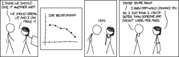
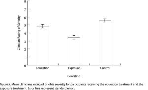
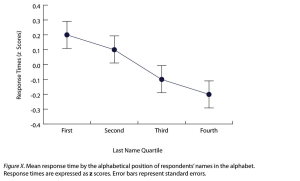
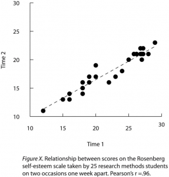
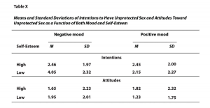
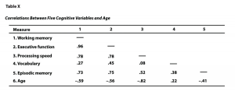

# Expressing Your Results

Expressing Your Results -- Research Methods in Psychology

54

# Expressing Your Results

### Learning Objectives

- Write out simple descriptive statistics in American Psychological Association (APA) style.
- Interpret and create simple APA-style figures—including bar graphs, line graphs, and scatterplots.
- Interpret and create simple APA-style tables—including tables of group or condition means and correlation matrices.

Once you have conducted your descriptive statistical analyses, you will need to present them to others. In this section, we focus on presenting descriptive statistical results in writing, in figures, and in tables—following American Psychological Association (APA) guidelines for written research reports. These principles can be adapted easily to other presentation formats such as posters and slide show presentations.

## **Presenting Descriptive Statistics in Writing**

Recall that APA style includes several rules for presenting numerical results in the text (see 4.31–4.34 in the APA *Publication Manual*) . These include using words only for numbers less than 10 that do not represent precise statistical results and using numerals for numbers 10 and higher. However, statistical results are always presented in the form of numerals rather than words and are usually rounded to two decimal places (e.g., “2.00” rather than “two” or “2”). They can be presented either in the narrative description of the results or parenthetically—much like reference citations. When you have a small number of results to report, it is often most efficient to write them out. Here are some examples:

The mean age of the participants was 22.43 years with a standard deviation of 2.34.

Among the participants with low self-esteem, those in a negative mood expressed stronger intentions to have unprotected sex (*M* = 4.05, *SD* = 2.32) than those in a positive mood (*M* = 2.15, *SD* = 2.27).

The treatment group had a mean of 23.40 (*SD* = 9.33), while the control group had a mean of 20.87 (*SD* = 8.45).

The test-retest correlation was .96.

There was a moderate negative correlation between the alphabetical position of respondents’ last names and their response time (*r* = −.27).

Notice that when presented in the narrative, the terms *mean* and *standard deviation* are written out, but when presented parenthetically, the symbols *M *and *SD* are used instead. Notice also that it is especially important to use parallel construction to express similar or comparable results in similar ways. The third example is *much* better than the following nonparallel alternative:

The treatment group had a mean of 23.40 (*SD* = 9.33), while 20.87 was the mean of the control group, which had a standard deviation of 8.45.

## **Presenting Descriptive Statistics in Figures**

When you have a large number of results to report, you can often do it more clearly and efficiently with a graphical depiction of the data, such as pie charts, bar graphs, or scatterplots. In an APA style research report, these graphs are presented as **figures**. When you prepare figures for an APA-style research report, there are some general guidelines that you should keep in mind. First, the figure should always add important information rather than repeat information that already appears in the text or in a table (if a figure presents information more clearly or efficiently, then you should keep the figure and eliminate the text or table.) Second, figures should be as simple as possible. For example, the *Publication Manual* discourages the use of color unless it is absolutely necessary (although color can still be an effective element in posters, slide show presentations, or textbooks.) Third, figures should be interpretable on their own. A reader should be able to understand the basic result based only on the figure and its caption and should not have to refer to the text for an explanation.

There are also several more technical guidelines for presentation of figures that include the following (see the APA Publication Manual section 5.20 through 5.30):

- Layout of graphs
- In general, scatterplots, bar graphs, and line graphs should be slightly wider than they are tall.
- The independent variable should be plotted on the *x-*axis and the dependent variable on the *y-*axis.
- Values should increase from left to right on the *x-*axis and from bottom to top on the *y-*axis.
- The *x*-axis and *y*-axis should begin with the value zero.
- Axis Labels and Legends
- Axis labels should be clear and concise and include the units of measurement if they do not appear in the caption.
- Axis labels should be parallel to the axis.
- Legends should appear within the figure.
- Text should be in the same simple font throughout and no smaller than 8 point and no larger than 14 point.
- Captions
- Captions are titled with the word “Figure”, followed by the figure number in the order in which it appears in the text, and terminated with a period. This title is italicized.
- After the title is a brief description of the figure terminated with a period (e.g., “Reaction times of the control versus experimental group.”)
- Following the description, include any information needed to interpret the figure, such as any abbreviations, units of measurement (if not in the axis label), units of error bars, etc.

“Convincing” retrieved from http://imgs.xkcd.com/comics/convincing.png (CC-BY-NC 2.5) [Image description]

## **Bar Graphs**

As we have seen throughout this book, **bar graphs** are generally used to present and compare the mean scores for two or more groups or conditions. The bar graph in Figure 12.11 is an APA-style version of Figure 12.4. Notice that it conforms to all the guidelines listed. A new element in Figure 12.11 is the smaller vertical bars that extend both upward and downward from the top of each main bar. These are **error bars**, and they represent the variability in each group or condition. Although they sometimes extend one standard *deviation* in each direction, they are more likely to extend one standard *error* in each direction (as in Figure 12.11). The **standard error** is the standard deviation of the group divided by the square root of the sample size of the group. The standard error is used because, in general, a difference between group means that is greater than two standard errors is statistically significant. Thus one can “see” whether a difference is statistically significant based on a bar graph with error bars.

Figure 12.11 Sample APA-Style Bar Graph, With Error Bars Representing the Standard Errors, Based on Research by Ollendick and Colleagues. [Image description]

**Line Graphs**

**Line graphs** are used when the independent variable is measured in a more continuous manner (e.g., time) or to present correlations between quantitative variables when the independent variable has, or is organized into, a relatively small number of distinct levels. Each point in a line graph represents the mean score on the dependent variable for participants at one level of the independent variable. Figure 12.12 is an APA-style version of the results of Carlson and Conard. Notice that it includes error bars representing the standard error and conforms to all the stated guidelines.

Figure 12.12 Sample APA-Style Line Graph Based on Research by Carlson and Conard. [Image description]

In most cases, the information in a line graph could just as easily be presented in a bar graph. In Figure 12.12, for example, one could replace each point with a bar that reaches up to the same level and leave the error bars right where they are. This emphasizes the fundamental similarity of the two types of statistical relationship. Both are differences in the average score on one variable across levels of another. The convention followed by most researchers, however, is to use a bar graph when the variable plotted on the *x-*axis is categorical and a line graph when it is quantitative.

## **Scatterplots**

**Scatterplots** are used to present correlations and relationships between quantitative variables when the variable on the *x-*axis (typically the independent variable) has a large number of levels. Each point in a scatterplot represents an individual rather than the mean for a group of individuals, and there are no lines connecting the points. The graph in Figure 12.13 is an APA-style version of Figure 12.7, which illustrates a few additional points. First, when the variables on the *x-*axis and *y*-axis are conceptually similar and measured on the same scale—as here, where they are measures of the same variable on two different occasions—this can be emphasized by making the axes the same length. Second, when two or more individuals fall at exactly the same point on the graph, one way this can be indicated is by offsetting the points slightly along the *x-*axis. Other ways are by displaying the number of individuals in parentheses next to the point or by making the point larger or darker in proportion to the number of individuals. Finally, the straight line that best fits the points in the scatterplot, which is called the regression line, can also be included.

Figure 12.13 Sample APA-Style Scatterplot. [Image description]

**Expressing Descriptive Statistics in Tables**

Like graphs, tables can be used to present large amounts of information clearly and efficiently. The same general principles apply to tables as apply to graphs. They should add important information to the presentation of your results, be as simple as possible, and be interpretable on their own. Again, we focus here on tables for an APA-style manuscript.

The most common use of tables is to present several means and standard deviations—usually for complex research designs with multiple independent and dependent variables. Figure 12.14, for example, shows the results of a hypothetical study similar to the one by MacDonald and Martineau (2002)[1] (The means in Figure 12.14 are the means reported by MacDonald and Martineau, but the standard errors are not). Recall that these researchers categorized participants as having low or high self-esteem, put them into a negative or positive mood, and measured their intentions to have unprotected sex. They also measured participants’ attitudes toward unprotected sex. Notice that the table includes horizontal lines spanning the entire table at the top and bottom, and just beneath the column headings. Furthermore, every column has a heading—including the leftmost column—and there are additional headings that span two or more columns that help to organize the information and present it more efficiently. Finally, notice that APA-style tables are numbered consecutively starting at 1 (Table 1, Table 2, and so on) and given a brief but clear and descriptive title.

Figure 12.14 Sample APA-Style Table Presenting Means and Standard Deviations. [Image description]

Another common use of tables is to present correlations—usually measured by Pearson’s *r*—among several variables. This kind of table is called a **correlation matrix**. Figure 12.15 is a correlation matrix based on a study by David McCabe and colleagues (McCabe, Roediger, McDaniel, Balota, & Hambrick, 2010)[2]. They were interested in the relationships between working memory and several other variables. We can see from the table that the correlation between working memory and executive function, for example, was an extremely strong .96, that the correlation between working memory and vocabulary was a medium .27, and that all the measures except vocabulary tend to decline with age. Notice here that only half the table is filled in because the other half would have identical values. For example, the Pearson’s *r* value in the upper right corner (working memory and age) would be the same as the one in the lower left corner (age and working memory). The correlation of a variable with itself is always 1.00, so these values are replaced by dashes to make the table easier to read.

Figure 12.15 Sample APA-Style Table (Correlation Matrix) Based on Research by McCabe and Colleagues. [Image description]

As with graphs, precise statistical results that appear in a table do not need to be repeated in the text. Instead, the writer can note major trends and alert the reader to details (e.g., specific correlations) that are of particular interest.

### Image Description

**“Convincing” long description:** A four-panel comic strip. In the first panel, a man says to a woman, “I think we should give it another shot.” The woman says, “We should break up, and I can prove it.”

In the second panel, there is a line graph with a downward trend titled “Our Relationship.”

In the third panel, the man, bent over and looking at the graph in the woman’s hands, says, “Huh.”

In the fourth panel, the man says, “Maybe you’re right.” The woman says, “I knew data would convince you.” The man replies, “No, I just think I can do better than someone who doesn’t label her axes.” [Return to “Convincing”]

**Figure 12.11 long description:** A sample APA-style bar graph, with a horizontal axis labelled “Condition” and a vertical axis labelled “Clinician Rating of Severity.” The caption of the graph says, “Figure X. Mean clinician’s rating of phobia severity for participants receiving the education treatment and the exposure treatment. Error bars represent standard errors.” At the top of each data bar is an error bar, which look likes a capital I: a vertical line with short horizontal lines attached to its top and bottom. The bottom half of each error bar hangs over the top of the data bar, while each top half sticks out the top of the data bar. [Return to Figure 12.11]

**Figure 12.12 long description:** A sample APA-style line graph with a horizontal axis labelled “Last Name Quartile” and a vertical axis labelled “Response Times (z Scores).” The caption of the graph says, “Figure X. Mean response time by the alphabetical position of respondents’ names in the alphabet. Response times are expressed as z scores. Error bars represent standard errors.” Each data point has an error bar sticking out of its top and bottom. [Return to Figure 12.12]

**Figure 12.13 long description:** Sample APA-style scatterplot with a horizontal axis labelled “Time 1” and a vertical axis labelled “Time 2.” Each axis has values from 10 to
30. The caption of the scatterplot says, “Figure X. Relationship between scores on the Rosenberg self-esteem scale taken by 25 research methods students on two occasions one week apart. Pearson’s $r = .96$.” Most of the data points are clustered around the dashed regression line that extends from approximately (12, 11) to (29, 22). [Return to Figure 12.13]

**Figure 12.14 long description:** Sample APA-style table presenting means and standard deviations. The table is titled “Table X” and is captioned, “Means and Standard Deviations of Intentions to Have Unprotected Sex and Attitudes Toward Unprotected Sex as a Function of Both Mood and Self-Esteem.” The data is organized into negative and positive mood and details intentions and attitudes toward unprotected sex.

Negative mood:

- Intentions
- High—Mean, 2.46
- High—Standard Deviation, 1.97
- Low—Mean, 4.05
- Low—Standard Deviation, 2.32
- Attitudes
- High—Mean, 1.65
- High—Standard Deviation, 2.23
- Low—Mean, 1.95
- Low—Standard Deviation, 2.01

Positive mood:

- Intentions
- High—Mean, 2.45
- High—Standard Deviation, 2.00
- Low—Mean, 2.15
- Low—Standard Deviation, 2.27
- Attitudes
- High—Mean, 1.82
- High—Standard Deviation, 2.32
- Low—Mean, 1.23
- Low—Standard Deviation, 1.75

[Return to Figure 12.14]

**Figure 12.15 long description:** Sample APA-style correlation matrix, titled “Table X: Correlations Between Five Cognitive Variables and Age.” The five cognitive variables are:

- Working memory
- Executive function
- Processing speed
- Vocabulary
- Episodic memory

The data is as such:
 Table X: Correlations Between Five Cognitive Variables and Age Measure 1 2 3 4 5
- Working memory   —
- Executive function   .96 —
- Processing speed   .78 .78 —
- Vocabulary   .27 .45 .08 —
- Episodic memory   .73 .75 .52 .38 —
- Age   −.59 −.56 −.82 .22 −.41

[Return to Figure 12.15]

### Media attributions

- Convincing by XKCD CC BY-NC (Attribution NonCommercial)
- MacDonald, T. K., & Martineau, A. M. (2002). Self-esteem, mood, and intentions to use condoms: When does low self-esteem lead to risky health behaviors? *Journal of Experimental Social Psychology, 38*, 299–306. ↵
- McCabe, D. P., Roediger, H. L., McDaniel, M. A., Balota, D. A., & Hambrick, D. Z. (2010). The relationship between working memory capacity and executive functioning. *Neuropsychology, 24*(2), 222–243. doi:10.1037/a0017619 ↵
