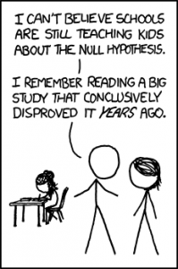
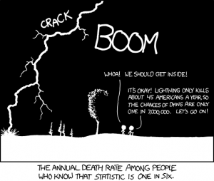

# Understanding Null Hypothesis Testing

Understanding Null Hypothesis Testing -- Research Methods in Psychology

57

# Understanding Null Hypothesis Testing

### Learning Objectives

- Explain the purpose of null hypothesis testing, including the role of sampling error.
- Describe the basic logic of null hypothesis testing.
- Describe the role of relationship strength and sample size in determining statistical significance and make reasonable judgments about statistical significance based on these two factors.

##  The Purpose of Null Hypothesis Testing

As we have seen, psychological research typically involves measuring one or more variables in a sample and computing descriptive summary data (e.g., means, correlation coefficients) for those variables. These descriptive data for the sample are called **statistics**.  In general, however, the researcher’s goal is not to draw conclusions about that *sample* but to draw conclusions about the *population* that the sample was selected from. Thus researchers must use sample statistics to draw conclusions about the corresponding values in the population. These corresponding values in the population are called **parameters**. Imagine, for example, that a researcher measures the number of depressive symptoms exhibited by each of 50 adults with clinical depression and computes the mean number of symptoms. The researcher probably wants to use this sample statistic (the mean number of symptoms for the sample) to draw conclusions about the corresponding population parameter (the mean number of symptoms for adults with clinical depression).

Unfortunately, sample statistics are not perfect estimates of their corresponding population parameters. This is because there is a certain amount of random variability in any statistic from sample to sample. The mean number of depressive symptoms might be 8.73 in one sample of adults with clinical depression, 6.45 in a second sample, and 9.44 in a third—even though these samples are selected randomly from the same population. Similarly, the correlation (Pearson’s *r*) between two variables might be +.24 in one sample, −.04 in a second sample, and +.15 in a third—again, even though these samples are selected randomly from the same population. This random variability in a statistic from sample to sample is called **sampling error**. (Note that the term *error* here refers to random variability and does not imply that anyone has made a mistake. No one “commits a sampling error.”)

One implication of this is that when there is a statistical relationship in a sample, it is not always clear that there is a statistical relationship in the population. A small difference between two group means in a sample might indicate that there is a small difference between the two group means in the population. But it could also be that there is no difference between the means in the population and that the difference in the sample is just a matter of sampling error. Similarly, a Pearson’s *r* value of −.29 in a sample might mean that there is a negative relationship in the population. But it could also be that there is no relationship in the population and that the relationship in the sample is just a matter of sampling error.

In fact, any statistical relationship in a sample can be interpreted in two ways:

- There is a relationship in the population, and the relationship in the sample reflects this.
- There is no relationship in the population, and the relationship in the sample reflects only sampling error.

The purpose of null hypothesis testing is simply to help researchers decide between these two interpretations.

## **The Logic of Null Hypothesis Testing**

**Null hypothesis testing** (often called null hypothesis significance testing or NHST) is a formal approach to deciding between two interpretations of a statistical relationship in a sample. One interpretation is called the** null hypothesis** (often symbolized *H*0 and read as “H-zero”). This is the idea that there is no relationship in the population and that the relationship in the sample reflects only sampling error. Informally, the null hypothesis is that the sample relationship “occurred by chance.” The other interpretation is called the **alternative hypothesis** (often symbolized as *H*1). This is the idea that there is a relationship in the population and that the relationship in the sample reflects this relationship in the population.

Again, every statistical relationship in a sample can be interpreted in either of these two ways: It might have occurred by chance, or it might reflect a relationship in the population. So researchers need a way to decide between them. Although there are many specific null hypothesis testing techniques, they are all based on the same general logic. The steps are as follows:

- Assume for the moment that the null hypothesis is true. There is no relationship between the variables in the population.
- Determine how likely the sample relationship would be if the null hypothesis were true.
- If the sample relationship would be extremely unlikely, then **reject the null hypothesis** in favor of the alternative hypothesis. If it would not be extremely unlikely, then **retain the null hypothesis**.

Following this logic, we can begin to understand why Mehl and his colleagues concluded that there is no difference in talkativeness between women and men in the population. In essence, they asked the following question: “If there were no difference in the population, how likely is it that we would find a small difference of $d = 0.06$ in our sample?” Their answer to this question was that this sample relationship would be fairly likely if the null hypothesis were true. Therefore, they retained the null hypothesis—concluding that there is no evidence of a sex difference in the population. We can also see why Kanner and his colleagues concluded that there is a correlation between hassles and symptoms in the population. They asked, “If the null hypothesis were true, how likely is it that we would find a strong correlation of +.60 in our sample?” Their answer to this question was that this sample relationship would be fairly unlikely if the null hypothesis were true. Therefore, they rejected the null hypothesis in favor of the alternative hypothesis—concluding that there is a positive correlation between these variables in the population.

A crucial step in null hypothesis testing is finding the probability of the sample result or a more extreme result if the null hypothesis were true (Lakens, 2017).[1] This probability is called the ***p*** **value**. A low *p* value means that the sample or more extreme result would be unlikely if the null hypothesis were true and leads to the rejection of the null hypothesis. A *p* value that is not low means that the sample or more extreme result would be likely if the null hypothesis were true and leads to the retention of the null hypothesis. But how low must the *p* value criterion be before the sample result is considered unlikely enough to reject the null hypothesis? In null hypothesis testing, this criterion is called **$\alpha$ (alpha)** and is almost always set to .05. If there is a 5% chance or less of a result at least as extreme as the sample result if the null hypothesis were true, then the null hypothesis is rejected. When this happens, the result is said to be **statistically significant**. If there is greater than a 5% chance of a result as extreme as the sample result when the null hypothesis is true, then the null hypothesis is retained. This does not necessarily mean that the researcher *accepts* the null hypothesis as true—only that there is not *currently* enough evidence to reject it. Researchers often use the expression “fail to reject the null hypothesis” rather than “retain the null hypothesis,” but they never use the expression “accept the null hypothesis.”

#### **The Misunderstood *****p***** Value**

The *p* value is one of the most misunderstood quantities in psychological research (Cohen, 1994)[2]. Even professional researchers misinterpret it, and it is not unusual for such misinterpretations to appear in statistics textbooks!

The most common misinterpretation is that the *p* value is the probability that the null hypothesis is true—that the sample result occurred by chance. For example, a misguided researcher might say that because the *p* value is .02, there is only a 2% chance that the result is due to chance and a 98% chance that it reflects a real relationship in the population. But this is *incorrect*. The *p* value is really the probability of a result at least as extreme as the sample result *if* the null hypothesis *were* true. So a *p* value of .02 means that if the null hypothesis were true, a sample result this extreme would occur only 2% of the time.

You can avoid this misunderstanding by remembering that the *p* value is not the probability that any particular *hypothesis* is true or false. Instead, it is the probability of obtaining the *sample result* if the null hypothesis were true.

“Null Hypothesis” retrieved from http://imgs.xkcd.com/comics/null_hypothesis.png (CC-BY-NC 2.5). [Image description]

## **Role of Sample Size and Relationship Strength**

Recall that null hypothesis testing involves answering the question, “If the null hypothesis were true, what is the probability of a sample result as extreme as this one?” In other words, “What is the *p* value?” It can be helpful to see that the answer to this question depends on just two considerations: the strength of the relationship and the size of the sample. Specifically, the stronger the sample relationship and the larger the sample, the less likely the result would be if the null hypothesis were true. That is, the lower the *p* value. This should make sense. Imagine a study in which a sample of 500 women is compared with a sample of 500 men in terms of some psychological characteristic, and Cohen’s *d* is a strong 0.50. If there were really no sex difference in the population, then a result this strong based on such a large sample should seem highly unlikely. Now imagine a similar study in which a sample of three women is compared with a sample of three men, and Cohen’s *d* is a weak 0.10. If there were no sex difference in the population, then a relationship this weak based on such a small sample should seem likely. And this is precisely why the null hypothesis would be rejected in the first example and retained in the second.

Of course, sometimes the result can be weak and the sample large, or the result can be strong and the sample small. In these cases, the two considerations trade off against each other so that a weak result can be statistically significant if the sample is large enough and a strong relationship can be statistically significant even if the sample is small. Table 13.1 shows roughly how relationship strength and sample size combine to determine whether a sample result is statistically significant. The columns of the table represent the three levels of relationship strength: weak, medium, and strong. The rows represent four sample sizes that can be considered small, medium, large, and extra large in the context of psychological research. Thus each cell in the table represents a combination of relationship strength and sample size. If a cell contains the word *Yes*, then this combination would be statistically significant for both Cohen’s *d* and Pearson’s *r*. If it contains the word *No*, then it would not be statistically significant for either. There is one cell where the decision for *d* and *r* would be different and another where it might be different depending on some additional considerations, which are discussed in Section 13.2 “Some Basic Null Hypothesis Tests”

 *Table 13.1 How Relationship Strength and Sample Size Combine to Determine Whether a Result Is Statistically Significant*  **Relationship strength**  Sample Size Weak Medium Strong  Small (*N* = 20) No No *d* = Maybe

*r* = Yes
  Medium (*N* = 50) No Yes Yes  Large (*N* = 100) *d* = Yes

*r* = No
 Yes Yes  Extra large (*N* = 500) Yes Yes Yes

Although Table 13.1 provides only a rough guideline, it shows very clearly that weak relationships based on medium or small samples are never statistically significant and that strong relationships based on medium or larger samples are always statistically significant. If you keep this lesson in mind, you will often know whether a result is statistically significant based on the descriptive statistics alone. It is extremely useful to be able to develop this kind of intuitive judgment. One reason is that it allows you to develop expectations about how your formal null hypothesis tests are going to come out, which in turn allows you to detect problems in your analyses. For example, if your sample relationship is strong and your sample is medium, then you would expect to reject the null hypothesis. If for some reason your formal null hypothesis test indicates otherwise, then you need to double-check your computations and interpretations. A second reason is that the ability to make this kind of intuitive judgment is an indication that you understand the basic logic of this approach in addition to being able to do the computations.

## **Statistical Significance Versus Practical Significance**

Table 13.1 illustrates another extremely important point. A statistically significant result is not necessarily a strong one. Even a very weak result can be statistically significant if it is based on a large enough sample. This is closely related to Janet Shibley Hyde’s argument about sex differences (Hyde, 2007)[3]. The differences between women and men in mathematical problem solving and leadership ability are statistically significant. But the word *significant* can cause people to interpret these differences as strong and important—perhaps even important enough to influence the college courses they take or even who they vote for. As we have seen, however, these statistically significant differences are actually quite weak—perhaps even “trivial.”

This is why it is important to distinguish between the *statistical* significance of a result and the *practical* significance of that result. **Practical significance** refers to the importance or usefulness of the result in some real-world context. Many sex differences are statistically significant—and may even be interesting for purely scientific reasons—but they are not practically significant. In clinical practice, this same concept is often referred to as “clinical significance.” For example, a study on a new treatment for social phobia might show that it produces a statistically significant positive effect. Yet this effect still might not be strong enough to justify the time, effort, and other costs of putting it into practice—especially if easier and cheaper treatments that work almost as well already exist. Although statistically significant, this result would be said to lack practical or clinical significance.

“Conditional Risk” retrieved from http://imgs.xkcd.com/comics/conditional_risk.png (CC-BY-NC 2.5). [Image description]

### Image Description

**“Null Hypothesis” long description:** A comic depicting a man and a woman talking in the foreground. In the background is a child working at a desk. The man says to the woman, “I can’t believe schools are still teaching kids about the null hypothesis. I remember reading a big study that conclusively disproved it *years* ago.” [Return to “Null Hypothesis”]

**“Conditional Risk” long description:** A comic depicting two hikers beside a tree during a thunderstorm. A bolt of lightning goes “crack” in the dark sky as thunder booms. One of the hikers says, “Whoa! We should get inside!” The other hiker says, “It’s okay! Lightning only kills about 45 Americans a year, so the chances of dying are only one in 7,000,000. Let’s go on!” The comic’s caption says, “The annual death rate among people who know that statistic is one in six.” [Return to “Conditional Risk”]

### Media Attributions

- Null Hypothesis by XKCD CC BY-NC (Attribution NonCommercial)
- Conditional Risk by XKCD CC BY-NC (Attribution NonCommercial)
- Lakens, D. (2017, December 25). About *p*-values: Understanding common misconceptions. [Blog post] Retrieved from https://correlaid.org/en/blog/understand-p-values/ ↵
- Cohen, J. (1994). The world is round: $p < .05$. *American Psychologist, 49*, 997–1003. ↵
- Hyde, J. S. (2007). New directions in the study of gender similarities and differences. *Current Directions in Psychological Science, 16*, 259–263. ↵
