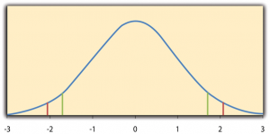
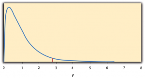

# Some Basic Null Hypothesis Tests

Some Basic Null Hypothesis Tests -- Research Methods in Psychology

58

# Some Basic Null Hypothesis Tests

### Learning Objectives

- Conduct and interpret one-sample, dependent-samples, and independent-samples *t-* tests.
- Interpret the results of one-way, repeated measures, and factorial ANOVAs.
- Conduct and interpret null hypothesis tests of Pearson’s *r*.

In this section, we look at several common null hypothesis testing procedures. The emphasis here is on providing enough information to allow you to conduct and interpret the most basic versions. In most cases, the online statistical analysis tools mentioned in Chapter 12 will handle the computations—as will programs such as Microsoft Excel and SPSS.

## **The *****t-*****Test**

As we have seen throughout this book, many studies in psychology focus on the difference between two means. The most common null hypothesis test for this type of statistical relationship is the ***t-* test**. In this section, we look at three types of *t* tests that are used for slightly different research designs: the one-sample *t-*test, the dependent-samples *t-* test, and the independent-samples *t-* test. You may have already taken a course in statistics, but we will refresh your statistical

## **One-Sample *****t-*****Test**

The **one-sample *t-*test** is used to compare a sample mean (*M*) with a hypothetical population mean ($\mu^{0}$) that provides some interesting standard of comparison. The null hypothesis is that the mean for the population (µ) is equal to the hypothetical population mean: $\mu$ = $\mu^{0}$. The alternative hypothesis is that the mean for the population is different from the hypothetical population mean: $\mu$ $\neq$ $\mu^{0}$. To decide between these two hypotheses, we need to find the probability of obtaining the sample mean (or one more extreme) if the null hypothesis were true. But finding this *p* value requires first computing a test statistic called *t*. (A **test statistic** is a statistic that is computed only to help find the *p* value.) The formula for *t* is as follows:

Again, *M* is the sample mean and µ0 is the hypothetical population mean of interest. *SD* is the sample standard deviation and *N* is the sample size.

The reason the *t* statistic (or any test statistic) is useful is that we know how it is distributed when the null hypothesis is true. As shown in Figure 13.1, this distribution is unimodal and symmetrical, and it has a mean of
0. Its precise shape depends on a statistical concept called the degrees of freedom, which for a one-sample *t*-test is *N* − 1. (There are 24 degrees of freedom for the distribution shown in Figure 13.1.) The important point is that knowing this distribution makes it possible to find the *p *value for any *t* score. Consider, for example, a *t* score of 1.50 based on a sample of
25. The probability of a *t* score at least this extreme is given by the proportion of *t* scores in the distribution that are at least this extreme. For now, let us define *extreme* as being far from zero in either direction. Thus the *p* value is the proportion of *t* scores that are 1.50 or above *or* that are −1.50 or below—a value that turns out to be .14.

Figure 13.1 Distribution of t Scores (With 24 Degrees of Freedom) When the Null Hypothesis Is True. The red vertical lines represent the two-tailed critical values, and the green vertical lines the one-tailed critical values when $\alpha$ = .05.

Fortunately, we do not have to deal directly with the distribution of *t* scores. If we were to enter our sample data and hypothetical mean of interest into one of the online statistical tools in Chapter 12 or into a program like SPSS (Excel does not have a one-sample *t-*test function), the output would include both the *t* score and the *p* value. At this point, the rest of the procedure is simple. If *p* is equal to or less than .05, we reject the null hypothesis and conclude that the population mean differs from the hypothetical mean of interest. If *p* is greater than .05, we retain the null hypothesis and conclude that there is not enough evidence to say that the population mean differs from the hypothetical mean of interest. (Again, technically, we conclude only that we do not have enough evidence to conclude that it *does* differ.)

If we were to compute the *t* score by hand, we could use a table like Table 13.2 to make the decision. This table does not provide actual *p* values. Instead, it provides the **critical values** of *t* for different degrees of freedom (*df)* when $\alpha$ is .05. For now, let us focus on the two-tailed critical values in the last column of the table. Each of these values should be interpreted as a pair of values: one positive and one negative. For example, the two-tailed critical values when there are 24 degrees of freedom are 2.064 and −2.064. These are represented by the red vertical lines in Figure 13.1. The idea is that any *t* score below the lower critical value (the left-hand red line in Figure 13.1) is in the lowest 2.5% of the distribution, while any *t* score above the upper critical value (the right-hand red line) is in the highest 2.5% of the distribution. Therefore any *t* score beyond the critical value in *either* direction is in the most extreme 5% of *t* scores when the null hypothesis is true and has a *p* value less than .05. Thus if the *t* score we compute is beyond the critical value in either direction, then we reject the null hypothesis. If the *t* score we compute is between the upper and lower critical values, then we retain the null hypothesis.

 *Table 13.2 Table of Critical Values of t When $\alpha$ = .05*  **Critical value**  *df* One-tailed Two-tailed  3 2.353 3.182  4 2.132 2.776  5 2.015 2.571  6 1.943 2.447  7 1.895 2.365  8 1.860 2.306  9 1.833 2.262  10 1.812 2.228  11 1.796 2.201  12 1.782 2.179  13 1.771 2.160  14 1.761 2.145  15 1.753 2.131  16 1.746 2.120  17 1.740 2.110  18 1.734 2.101  19 1.729 2.093  20 1.725 2.086  21 1.721 2.080  22 1.717 2.074  23 1.714 2.069  24 1.711 2.064  25 1.708 2.060  30 1.697 2.042  35 1.690 2.030  40 1.684 2.021  45 1.679 2.014  50 1.676 2.009  60 1.671 2.000  70 1.667 1.994  80 1.664 1.990  90 1.662 1.987  100 1.660 1.984

Thus far, we have considered what is called a **two-tailed test**, where we reject the null hypothesis if the *t* score for the sample is extreme in either direction. This test makes sense when we believe that the sample mean might differ from the hypothetical population mean but we do not have good reason to expect the difference to go in a particular direction. But it is also possible to do a **one-tailed test**, where we reject the null hypothesis only if the *t* score for the sample is extreme in one direction that we specify before collecting the data. This test makes sense when we have good reason to expect the sample mean will differ from the hypothetical population mean in a particular direction.

Here is how it works. Each one-tailed critical value in Table 13.2 can again be interpreted as a pair of values: one positive and one negative. A *t* score below the lower critical value is in the lowest 5% of the distribution, and a *t* score above the upper critical value is in the highest 5% of the distribution. For 24 degrees of freedom, these values are −1.711 and 1.711. (These are represented by the green vertical lines in Figure 13.1.) However, for a one-tailed test, we must decide before collecting data whether we expect the sample mean to be lower than the hypothetical population mean, in which case we would use only the lower critical value, or we expect the sample mean to be greater than the hypothetical population mean, in which case we would use only the upper critical value. Notice that we still reject the null hypothesis when the *t* score for our sample is in the most extreme 5% of the t scores we would expect if the null hypothesis were true—so $\alpha$ remains at .05. We have simply redefined *extreme* to refer only to one tail of the distribution. The advantage of the one-tailed test is that critical values are less extreme. If the sample mean differs from the hypothetical population mean in the expected direction, then we have a better chance of rejecting the null hypothesis. The disadvantage is that if the sample mean differs from the hypothetical population mean in the unexpected direction, then there is no chance at all of rejecting the null hypothesis.

## **Example One-Sample *****t*–****Test**

Imagine that a health psychologist is interested in the accuracy of university students’ estimates of the number of calories in a chocolate chip cookie. He shows the cookie to a sample of 10 students and asks each one to estimate the number of calories in it. Because the actual number of calories in the cookie is 250, this is the hypothetical population mean of interest (µ0). The null hypothesis is that the mean estimate for the population ($\mu$) is 250. Because he has no real sense of whether the students will underestimate or overestimate the number of calories, he decides to do a two-tailed test. Now imagine further that the participants’ actual estimates are as follows:

250, 280, 200, 150, 175, 200, 200, 220, 180, 250.

The mean estimate for the sample (*M*) is 212.00 calories and the standard deviation (*SD*) is 39.17. The health psychologist can now compute the *t* score for his sample:

If he enters the data into one of the online analysis tools or uses SPSS, it would also tell him that the two-tailed *p* value for this *t* score (with 10 − 1 = 9 degrees of freedom) is .013. Because this is less than .05, the health psychologist would reject the null hypothesis and conclude that university students tend to underestimate the number of calories in a chocolate chip cookie. If he computes the *t* score by hand, he could look at Table 13.2 and see that the critical value of *t* for a two-tailed test with 9 degrees of freedom is $\pm^{2}$.262. The fact that his *t* score was more extreme than this critical value would tell him that his *p* value is less than .05 and that he should reject the null hypothesis. Using APA style, these results would be reported as follows: $t(9) = -3.07$, *p *= .01. Note that the *t *and *p *are italicized, the degrees of freedom appear in brackets with no decimal remainder, and the values of *t *and *p *are rounded to two decimal places.

Finally, if this researcher had gone into this study with good reason to expect that university students underestimate the number of calories, then he could have done a one-tailed test instead of a two-tailed test. The only thing this decision would change is the critical value, which would be −1.833. This slightly less extreme value would make it a bit easier to reject the null hypothesis. However, if it turned out that university students overestimate the number of calories—no matter how much they overestimate it—the researcher would not have been able to reject the null hypothesis.

## **The Dependent-Samples *****t*–****Test**

The **dependent-samples *t*-test** (sometimes called the paired-samples *t-*test) is used to compare two means for the same sample tested at two different times or under two different conditions. This comparison is appropriate for pretest-posttest designs or within-subjects experiments. The null hypothesis is that the means at the two times or under the two conditions are the same in the population. The alternative hypothesis is that they are not the same. This test can also be one-tailed if the researcher has good reason to expect the difference goes in a particular direction.

It helps to think of the dependent-samples *t-*test as a special case of the one-sample *t-*test. However, the first step in the dependent-samples *t-*test is to reduce the two scores for each participant to a single **difference score** by taking the difference between them. At this point, the dependent-samples *t-*test becomes a one-sample *t-*test on the difference scores. The hypothetical population mean (µ0) of interest is 0 because this is what the mean difference score would be if there were no difference on average between the two times or two conditions. We can now think of the null hypothesis as being that the mean difference score in the population is 0 (µ0 = 0) and the alternative hypothesis as being that the mean difference score in the population is not 0 (µ0 $\neq^{0}$).

## **Example Dependent-Samples *****t*–****Test**

Imagine that the health psychologist now knows that people tend to underestimate the number of calories in junk food and has developed a short training program to improve their estimates. To test the effectiveness of this program, he conducts a pretest-posttest study in which 10 participants estimate the number of calories in a chocolate chip cookie before the training program and then again afterward. Because he expects the program to increase the participants’ estimates, he decides to do a one-tailed test. Now imagine further that the pretest estimates are

230, 250, 280, 175, 150, 200, 180, 210, 220, 190

and that the posttest estimates (for the same participants in the same order) are

250, 260, 250, 200, 160, 200, 200, 180, 230, 240.

The difference scores, then, are as follows:

20, 10, −30, 25, 10, 0, 20, −30, 10, 50.

Note that it does not matter whether the first set of scores is subtracted from the second or the second from the first as long as it is done the same way for all participants. In this example, it makes sense to subtract the pretest estimates from the posttest estimates so that positive difference scores mean that the estimates went up after the training and negative difference scores mean the estimates went down.

The mean of the difference scores is 8.50 with a standard deviation of 27.27. The health psychologist can now compute the *t* score for his sample as follows:

If he enters the data into one of the online analysis tools or uses Excel or SPSS, it would tell him that the one-tailed *p* value for this *t* score (again with 10 − 1 = 9 degrees of freedom) is .148. Because this is greater than .05, he would retain the null hypothesis and conclude that the training program does not significantly increase people’s calorie estimates. If he were to compute the *t* score by hand, he could look at Table 13.2 and see that the critical value of *t *for a one-tailed test with 9 degrees of freedom is 1.833. (It is positive this time because he was expecting a positive mean difference score.) The fact that his *t *score was less extreme than this critical value would tell him that his *p* value is greater than .05 and that he should fail to reject the null hypothesis.

## **The Independent-Samples *****t-*****Test**

The **independent-samples *t-*test** is used to compare the means of two separate samples (*M**1* and *M**2*). The two samples might have been tested under different conditions in a between-subjects experiment, or they could be pre-existing groups in a cross-sectional design (e.g., women and men, extraverts and introverts). The null hypothesis is that the means of the two populations are the same: µ1 = µ2. The alternative hypothesis is that they are not the same: µ1 $\neq$ µ2. Again, the test can be one-tailed if the researcher has good reason to expect the difference goes in a particular direction.

The *t* statistic here is a bit more complicated because it must take into account two sample means, two standard deviations, and two sample sizes. The formula is as follows:

Notice that this formula includes squared standard deviations (the variances) that appear inside the square root symbol. Also, lowercase *n**1* and *n**2* refer to the sample sizes in the two groups or condition (as opposed to capital *N*, which generally refers to the total sample size). The only additional thing to know here is that there are *N* − 2 degrees of freedom for the independent-samples *t-* test.

## **Example Independent-Samples *****t*–****Test**

Now the health psychologist wants to compare the calorie estimates of people who regularly eat junk food with the estimates of people who rarely eat junk food. He believes the difference could come out in either direction so he decides to conduct a two-tailed test. He collects data from a sample of eight participants who eat junk food regularly and seven participants who rarely eat junk food. The data are as follows:

Junk food eaters: 180, 220, 150, 85, 200, 170, 150, 190

Non–junk food eaters: 200, 240, 190, 175, 200, 300, 240

The mean for the non-junk food eaters is 220.71 with a standard deviation of 41.23. The mean for the junk food eaters is 168.12 with a standard deviation of 42.66. He can now compute his *t* score as follows:

If he enters the data into one of the online analysis tools or uses Excel or SPSS, it would tell him that the two-tailed *p* value for this *t* score (with 15 − 2 = 13 degrees of freedom) is .015. Because this *p* value is less than .05, the health psychologist would reject the null hypothesis and conclude that people who eat junk food regularly make lower calorie estimates than people who eat it rarely. If he were to compute the *t* score by hand, he could look at Table 13.2 and see that the critical value of *t* for a two-tailed test with 13 degrees of freedom is $\pm^{2}$.160. The fact that his *t* score was more extreme than this critical value would tell him that his *p* value is less than .05 and that he should reject the null hypothesis.

## **The Analysis of Variance**

*T*-tests are used to compare two means (a sample mean with a population mean, the means of two conditions or two groups). When there are more than two groups or condition means to be compared, the most common null hypothesis test is the **analysis of variance (ANOVA)**. In this section, we look primarily at the **one-way ANOVA**, which is used for between-subjects designs with a single independent variable. We then briefly consider some other versions of the ANOVA that are used for within-subjects and factorial research designs.

## **One-Way ANOVA**

The one-way ANOVA is used to compare the means of more than two samples (*M1*, *M**2*…*M**G*) in a between-subjects design. The null hypothesis is that all the means are equal in the population: µ1= µ2 =…= µG. The alternative hypothesis is that not all the means in the population are equal.

The test statistic for the ANOVA is called *F*. It is a ratio of two estimates of the population variance based on the sample data. One estimate of the population variance is called the **mean squares between groups (MSB)** and is based on the differences among the sample means. The other is called the **mean squares within groups (MSW)** and is based on the differences among the scores within each group. The *F* statistic is the ratio of the *MS**B* to the *MS**W *and can, therefore, be expressed as follows:

*F* **= *MS**B**/**MS**W*

Again, the reason that *F* is useful is that we know how it is distributed when the null hypothesis is true. As shown in Figure 13.2, this distribution is unimodal and positively skewed with values that cluster around
1. The precise shape of the distribution depends on both the number of groups and the sample size, and there are degrees of freedom values associated with each of these. The between-groups degrees of freedom is the number of groups minus one: *df**B* = (*G* − 1). The within-groups degrees of freedom is the total sample size minus the number of groups: *df**W* = *N* − *G*. Again, knowing the distribution of *F *when the null hypothesis is true allows us to find the *p* value.

Figure 13.2 Distribution of the F Ratio With 2 and 37 Degrees of Freedom When the Null Hypothesis Is True. The red vertical line represents the critical value when $\alpha$ is .05.

The online tools in Chapter 12 and statistical software such as Excel and SPSS will compute *F* and find the *p* value. If *p* is equal to or less than .05, then we reject the null hypothesis and conclude that there are differences among the group means in the population. If *p* is greater than .05, then we retain the null hypothesis and conclude that there is not enough evidence to say that there are differences. In the unlikely event that we would compute *F* by hand, we can use a table of critical values like Table 13.3 “Table of Critical Values of ” to make the decision. The idea is that any *F* ratio greater than the critical value has a *p *value of less than .05. Thus if the *F* ratio we compute is beyond the critical value, then we reject the null hypothesis. If the *F* ratio we compute is less than the critical value, then we retain the null hypothesis.

 *Table 13.3 Table of Critical Values of F When $\alpha$ = .05* ***dfB***  ***df**W*** 2 3 4  8 4.459 4.066 3.838  9 4.256 3.863 3.633  10 4.103 3.708 3.478  11 3.982 3.587 3.357  12 3.885 3.490 3.259  13 3.806 3.411 3.179  14 3.739 3.344 3.112  15 3.682 3.287 3.056  16 3.634 3.239 3.007  17 3.592 3.197 2.965  18 3.555 3.160 2.928  19 3.522 3.127 2.895  20 3.493 3.098 2.866  21 3.467 3.072 2.840  22 3.443 3.049 2.817  23 3.422 3.028 2.796  24 3.403 3.009 2.776  25 3.385 2.991 2.759  30 3.316 2.922 2.690  35 3.267 2.874 2.641  40 3.232 2.839 2.606  45 3.204 2.812 2.579  50 3.183 2.790 2.557  55 3.165 2.773 2.540  60 3.150 2.758 2.525  65 3.138 2.746 2.513  70 3.128 2.736 2.503  75 3.119 2.727 2.494  80 3.111 2.719 2.486  85 3.104 2.712 2.479  90 3.098 2.706 2.473  95 3.092 2.700 2.467  100 3.087 2.696 2.463

## **Example One-Way ANOVA**

Imagine that the health psychologist wants to compare the calorie estimates of psychology majors, nutrition majors, and professional dieticians. He collects the following data:

Psych majors: 200, 180, 220, 160, 150, 200, 190, 200

Nutrition majors: 190, 220, 200, 230, 160, 150, 200, 210, 195

Dieticians: 220, 250, 240, 275, 250, 230, 200, 240

The means are 187.50 (*SD* = 23.14), 195.00 (*SD* = 27.77), and 238.13 (*SD* = 22.35), respectively. So it appears that dieticians made substantially more accurate estimates on average. The researcher would almost certainly enter these data into a program such as Excel or SPSS, which would compute *F* for him or her and find the *p* value. Table 13.4 shows the output of the one-way ANOVA function in Excel for these data. This table is referred to as an ANOVA table. It shows that *MS**B* is 5,971.88, *MS**W* is 602.23, and their ratio, *F*, is 9.92. The *p* value is .0009. Because this value is below .05, the researcher would reject the null hypothesis and conclude that the mean calorie estimates for the three groups are not the same in the population. Notice that the ANOVA table also includes the “sum of squares” (*SS*) for between groups and for within groups. These values are computed on the way to finding *MS**B* and *MS**W* but are not typically reported by the researcher. Finally, if the researcher were to compute the *F* ratio by hand, he could look at Table 13.3 and see that the critical value of *F* with 2 and 21 degrees of freedom is 3.467 (the same value in Table 13.4 under *F*crit). The fact that his *F* score was more extreme than this critical value would tell him that his *p* value is less than .05 and that he should reject the null hypothesis.

 *Table 13.4 Typical One-Way ANOVA Output From Excel* **ANOVA**  *Source of variation* *SS* *df* *MS* *F* *p-value* *F*crit  Between groups 11,943.75 2 5,971.875 9.916234 0.000928 3.4668  Within groups 12,646.88 21 602.2321     Total 24,590.63 23

## **ANOVA Elaborations**

## **Post Hoc Comparisons**

When we reject the null hypothesis in a one-way ANOVA, we conclude that the group means are not all the same in the population. But this can indicate different things. With three groups, it can indicate that all three means are significantly different from each other. Or it can indicate that one of the means is significantly different from the other two, but the other two are not significantly different from each other. It could be, for example, that the mean calorie estimates of psychology majors, nutrition majors, and dieticians are all significantly different from each other. Or it could be that the mean for dieticians is significantly different from the means for psychology and nutrition majors, but the means for psychology and nutrition majors are not significantly different from each other. For this reason, statistically significant one-way ANOVA results are typically followed up with a series of **post hoc comparisons** of selected pairs of group means to determine which are different from which others.

One approach to post hoc comparisons would be to conduct a series of independent-samples *t-*tests comparing each group mean to each of the other group means. But there is a problem with this approach. In general, if we conduct a *t*-test when the null hypothesis is true, we have a 5% chance of mistakenly rejecting the null hypothesis (see Section 13.3 “Additional Considerations” for more on such Type I errors). If we conduct several *t-*tests when the null hypothesis is true, the chance of mistakenly rejecting *at least one *null hypothesis increases with each test we conduct. Thus researchers do not usually make post hoc comparisons using standard *t-*tests because there is too great a chance that they will mistakenly reject at least one null hypothesis. Instead, they use one of several modified *t*-test procedures—among them the Bonferonni procedure, Fisher’s least significant difference (LSD) test, and Tukey’s honestly significant difference (HSD) test. The details of these approaches are beyond the scope of this book, but it is important to understand their purpose. It is to keep the risk of mistakenly rejecting a true null hypothesis to an acceptable level (close to 5%).

## **Repeated-Measures ANOVA**

Recall that the one-way ANOVA is appropriate for between-subjects designs in which the means being compared come from separate groups of participants. It is not appropriate for within-subjects designs in which the means being compared come from the same participants tested under different conditions or at different times. This requires a slightly different approach, called the **repeated-measures ANOVA**. The basics of the repeated-measures ANOVA are the same as for the one-way ANOVA. The main difference is that measuring the dependent variable multiple times for each participant allows for a more refined measure of *MS**W*. Imagine, for example, that the dependent variable in a study is a measure of reaction time. Some participants will be faster or slower than others because of stable individual differences in their nervous systems, muscles, and other factors. In a between-subjects design, these stable individual differences would simply add to the variability within the groups and increase the value of *MS**W* (which would, in turn, decrease the value of F). In a within-subjects design, however, these stable individual differences can be measured and subtracted from the value of *MS**W*. This lower value of *MS**W* means a higher value of *F* and a more sensitive test.

## **Factorial ANOVA**

When more than one independent variable is included in a factorial design, the appropriate approach is the **factorial ANOVA**. Again, the basics of the factorial ANOVA are the same as for the one-way and repeated-measures ANOVAs. The main difference is that it produces an *F* ratio and *p* value for each main effect and for each interaction. Returning to our calorie estimation example, imagine that the health psychologist tests the effect of participant major (psychology vs. nutrition) and food type (cookie vs. hamburger) in a factorial design. A factorial ANOVA would produce separate *F* ratios and *p *values for the main effect of major, the main effect of food type, and the interaction between major and food. Appropriate modifications must be made depending on whether the design is between-subjects, within-subjects, or mixed.

## **Testing Correlation Coefficients**

For relationships between quantitative variables, where Pearson’s *r *(the correlation coefficient)* *is used to describe the strength of those relationships, the appropriate null hypothesis test is a test of the correlation coefficient. The basic logic is exactly the same as for other null hypothesis tests. In this case, the null hypothesis is that there is no relationship in the population. We can use the Greek lowercase rho ($\rho$) to represent the relevant parameter: $\rho$ = 0. The alternative hypothesis is that there is a relationship in the population: $\rho \neq$ 0. As with the *t-* test, this test can be two-tailed if the researcher has no expectation about the direction of the relationship or one-tailed if the researcher expects the relationship to go in a particular direction.

It is possible to use the correlation coefficient for the sample to compute a *t* score with *N* − 2 degrees of freedom and then to proceed as for a *t-*test. However, because of the way it is computed, the correlation coefficient can also be treated as its own test statistic. The online statistical tools and statistical software such as Excel and SPSS generally compute the correlation coefficient and provide the *p* value associated with that value. As always, if the *p* value is equal to or less than .05, we reject the null hypothesis and conclude that there is a relationship between the variables in the population. If the *p* value is greater than .05, we retain the null hypothesis and conclude that there is not enough evidence to say there is a relationship in the population. If we compute the correlation coefficient by hand, we can use a table like Table 13.5, which shows the critical values of *r* for various samples sizes when $\alpha$ is .05. A sample value of the correlation coefficient that is more extreme than the critical value is statistically significant.

 *Table 13.5 Table of Critical Values of Pearson’s r When $\alpha$ = .05*  **Critical value of***** r***  *N* One-tailed Two-tailed  5 .805 .878  10 .549 .632  15 .441 .514  20 .378 .444  25 .337 .396  30 .306 .361  35 .283 .334  40 .264 .312  45 .248 .294  50 .235 .279  55 .224 .266  60 .214 .254  65 .206 .244  70 .198 .235  75 .191 .227  80 .185 .220  85 .180 .213  90 .174 .207  95 .170 .202  100 .165 .197

## **Example Test of a Correlation Coefficient**

Imagine that the health psychologist is interested in the correlation between people’s calorie estimates and their weight. She has no expectation about the direction of the relationship, so she decides to conduct a two-tailed test. She computes the correlation coefficient for a sample of 22 university students and finds that Pearson’s *r* is −.21. The statistical software she uses tells her that the *p* value is .348. It is greater than .05, so she retains the null hypothesis and concludes that there is no relationship between people’s calorie estimates and their weight. If she were to compute the correlation coefficient by hand, she could look at Table 13.5 and see that the critical value for 22 − 2 = 20 degrees of freedom is .444. The fact that the correlation coefficient for her sample is less extreme than this critical value tells her that the *p* value is greater than .05 and that she should retain the null hypothesis.
