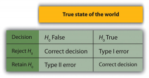

# Additional Considerations

Additional Considerations -- Research Methods in Psychology

59

# Additional Considerations

### Learning Objectives

- Define Type I and Type II errors, explain why they occur, and identify some steps that can be taken to minimize their likelihood.
- Define statistical power, explain its role in the planning of new studies, and use online tools to compute the statistical power of simple research designs.
- List some criticisms of conventional null hypothesis testing, along with some ways of dealing with these criticisms.

In this section, we consider a few other issues related to null hypothesis testing, including some that are useful in planning studies and interpreting results. We even consider some long-standing criticisms of null hypothesis testing, along with some steps that researchers in psychology have taken to address them.

## **Errors in Null Hypothesis Testing**

In null hypothesis testing, the researcher tries to draw a reasonable conclusion about the population based on the sample. Unfortunately, this conclusion is not guaranteed to be correct. This discrepancy is illustrated by Figure 13.3. The rows of this table represent the two possible decisions that researchers can make in null hypothesis testing: to reject or retain the null hypothesis. The columns represent the two possible states of the world: the null hypothesis is false or it is true. The four cells of the table, then, represent the four distinct outcomes of a null hypothesis test. Two of the outcomes—rejecting the null hypothesis when it is false and retaining it when it is true—are correct decisions. The other two—rejecting the null hypothesis when it is true and retaining it when it is false—are errors.

Figure 13.3 Two Types of Correct Decisions and Two Types of Errors in Null Hypothesis Testing. [Image description]

Rejecting the null hypothesis when it is true is called a **Type I error**. This error means that we have concluded that there is a relationship in the population when in fact there is not. Type I errors occur because even when there is no relationship in the population, sampling error alone will occasionally produce an extreme result. In fact, when the null hypothesis is true and $\alpha$ is .05, we will mistakenly reject the null hypothesis 5% of the time. (This possibility is why $\alpha$ is sometimes referred to as the “Type I error rate.”) Retaining the null hypothesis when it is false is called a **Type II error**. This error means that we have concluded that there is no relationship in the population when in fact there is a relationship. In practice, Type II errors occur primarily because the research design lacks adequate statistical power to detect the relationship (e.g., the sample is too small). We will have more to say about statistical power shortly.

In principle, it is possible to reduce the chance of a Type I error by setting $\alpha$ to something less than .05. Setting it to .01, for example, would mean that if the null hypothesis is true, then there is only a 1% chance of mistakenly rejecting it. But making it harder to reject true null hypotheses also makes it harder to reject false ones and therefore increases the chance of a Type II error. Similarly, it is possible to reduce the chance of a Type II error by setting $\alpha$ to something greater than .05 (e.g., .10). But making it easier to reject false null hypotheses also makes it easier to reject true ones and therefore increases the chance of a Type I error. This provides some insight into why the convention is to set $\alpha$ to .05. There is some agreement among researchers that the .05 level of $\alpha$ keeps the rates of both Type I and Type II errors at acceptable levels.

The possibility of committing Type I and Type II errors has several important implications for interpreting the results of our own and others’ research. One is that we should be cautious about interpreting the results of any individual study because there is a chance that it reflects a Type I or Type II error. This possibility is why researchers consider it important to replicate their studies. Each time researchers replicate a study and find a similar result, they rightly become more confident that the result represents a real phenomenon and not just a Type I or Type II error.

Figure 13.4 A Humorous Example of How Type I and Type II Errors Could Play out in Pregnancy Exams. [Image description]

Another issue related to Type I errors is the so-called **file drawer problem** (Rosenthal, 1979)[1]. The idea is that when researchers obtain statistically significant results, they tend to submit them for publication, and journal editors and reviewers tend to accept them. But when researchers obtain non-significant results, they tend not to submit them for publication, or if they do submit them, journal editors and reviewers tend not to accept them. Researchers end up putting these non-significant results away in a file drawer (or nowadays, in a folder on their hard drive). One effect of this tendency is that the published literature probably contains a higher proportion of Type I errors than we might expect on the basis of statistical considerations alone. Even when there is a relationship between two variables in the population, the published research literature is likely to overstate the strength of that relationship. Imagine, for example, that the relationship between two variables in the population is positive but weak (e.g., $\rho$ = +.10). If several researchers conduct studies on this relationship, then sampling error is likely to produce results ranging from weak negative relationships (e.g., *r* = −.10) to moderately strong positive ones (e.g., $r = +.40$). But because of the file drawer problem, it is likely that only those studies producing moderate to strong positive relationships are published. The result is that the effect reported in the published literature tends to be stronger than it really is in the population.

The file drawer problem is a difficult one because it is a product of the way scientific research has traditionally been conducted and published. One solution is registered reports, whereby journal editors and reviewers evaluate research submitted for publication without knowing the results of that research (see https://cos.io/rr/). The idea is that if the research question is judged to be interesting and the method judged to be sound, then a non-significant result should be just as important and worthy of publication as a significant one. Short of such a radical change in how research is evaluated for publication, researchers can still take pains to keep their non-significant results and share them as widely as possible (e.g., in publicly available repositories and at professional conferences). Many scientific disciplines now have journals devoted to publishing non-significant results. In psychology, for example, there is the *Journal of Articles in Support of the Null Hypothesis* (http://www.jasnh.com).

In 2014, Uri Simonsohn, Leif Nelson, and Joseph Simmons published an article (Simonsohn, Nelson, & Simmons, 2014)[2] accusing psychology researchers of creating too many Type I errors in psychology by engaging in research practices they called ***p*-hacking**. Researchers who *p*-hack make various decisions in the research process to increase their chance of a statistically significant result (and type I error) by arbitrarily removing outliers, selectively choosing to report dependent variables, only presenting significant results, etc. until their results yield a desirable *p* value. Their groundbreaking paper contributed to a major conversation in the field about publishing standards and improving the reliability of our results that continues today.

## **Statistical Power**

The **statistical power** of a research design is the probability of rejecting the null hypothesis given the sample size and expected relationship strength. For example, the statistical power of a study with 50 participants and an expected Pearson’s *r* of +.30 in the population is .59. That is, there is a 59% chance of rejecting the null hypothesis if indeed the population correlation is +.30. Statistical power is the complement of the probability of committing a Type II error. So in this example, the probability of committing a Type II error would be 1 − .59 = .41. Clearly, researchers should be interested in the power of their research designs if they want to avoid making Type II errors. In particular, they should make sure their research design has adequate power before collecting data. A common guideline is that a power of .80 is adequate. This guideline means that there is an 80% chance of rejecting the null hypothesis for the expected relationship strength.

The topic of how to compute power for various research designs and null hypothesis tests is beyond the scope of this book. However, there are online tools that allow you to do this by entering your sample size, expected relationship strength, and $\alpha$ level for various hypothesis tests (see “Computing Power Online”). In addition, Table 13.6 shows the sample size needed to achieve a power of .80 for weak, medium, and strong relationships for a two-tailed independent-samples *t-*test and for a two-tailed test of Pearson’s *r*. Notice that this table amplifies the point made earlier about relationship strength, sample size, and statistical significance. In particular, weak relationships require very large samples to provide adequate statistical power.

 *Table 13.6 Sample Sizes Needed to Achieve Statistical Power of .80 for Different Expected Relationship Strengths for an Independent-Samples t Test and a Test of Pearson’s r* **Null Hypothesis Test**  Relationship Strength Independent-Samples *t-*Test Test of Pearson’s *r*  Strong ($d = .80$, $r = .50$) 52 28  Medium ($d = .50$, $r = .30$) 128 84  Weak ($d = .20$, $r = .10$) 788 782

What should you do if you discover that your research design does not have adequate power? Imagine, for example, that you are conducting a between-subjects experiment with 20 participants in each of two conditions and that you expect a medium difference ($d = .50$) in the population. The statistical power of this design is only .34. That is, even if there is a medium difference in the population, there is only about a one in three chance of rejecting the null hypothesis and about a two in three chance of committing a Type II error. Given the time and effort involved in conducting the study, this probably seems like an unacceptably low chance of rejecting the null hypothesis and an unacceptably high chance of committing a Type II error.

Given that statistical power depends primarily on relationship strength and sample size, there are essentially two steps you can take to increase statistical power: increase the strength of the relationship or increase the sample size. Increasing the strength of the relationship can sometimes be accomplished by using a stronger manipulation or by more carefully controlling extraneous variables to reduce the amount of noise in the data (e.g., by using a within-subjects design rather than a between-subjects design). The usual strategy, however, is to increase the sample size. For any expected relationship strength, there will always be some sample large enough to achieve adequate power.

#### **Computing Power Online**

The following links are to tools that allow you to compute statistical power for various research designs and null hypothesis tests by entering information about the expected relationship strength, the sample size, and the $\alpha$ level. They also allow you to compute the sample size necessary to achieve your desired level of power (e.g., .80). The first is an online tool. The second is a free downloadable program called G*Power.

- Russ Lenth’s Power and Sample Size Page: http://www.stat.uiowa.edu/~rlenth/Power/index.html
- G*Power: http://www.gpower.hhu.de

## **Problems With Null Hypothesis Testing, and Some Solutions**

Again, null hypothesis testing is the most common approach to inferential statistics in psychology. It is not without its critics, however. In fact, in recent years the criticisms have become so prominent that the American Psychological Association convened a task force to make recommendations about how to deal with them (Wilkinson & Task Force on Statistical Inference, 1999)[3]. In this section, we consider some of the criticisms and some of the recommendations.

## **Criticisms of Null Hypothesis Testing**

Some criticisms of null hypothesis testing focus on researchers’ misunderstanding of it. We have already seen, for example, that the *p* value is widely misinterpreted as the probability that the null hypothesis is true. (Recall that it is really the probability of the sample result *if* the null hypothesis were true.) A closely related misinterpretation is that 1 − *p* equals the probability of replicating a statistically significant result. In one study, 60% of a sample of professional researchers thought that a *p* value of .01—for an independent-samples *t-*test with 20 participants in each sample—meant there was a 99% chance of replicating the statistically significant result (Oakes, 1986)[4]. Our earlier discussion of power should make it clear that this figure is far too optimistic. As Table 13.5 shows, even if there were a large difference between means in the population, it would require 26 participants per sample to achieve a power of .80. And the program G*Power shows that it would require 59 participants per sample to achieve a power of .99.

Another set of criticisms focuses on the logic of null hypothesis testing. To many, the strict convention of rejecting the null hypothesis when *p* is less than .05 and retaining it when *p* is greater than .05 makes little sense. This criticism does not have to do with the specific value of .05 but with the idea that there should be any rigid dividing line between results that are considered significant and results that are not. Imagine two studies on the same statistical relationship with similar sample sizes. One has a *p* value of .04 and the other a *p* value of .06. Although the two studies have produced essentially the same result, the former is likely to be considered interesting and worthy of publication and the latter simply not significant. This convention is likely to prevent good research from being published and to contribute to the file drawer problem.

Yet another set of criticisms focus on the idea that null hypothesis testing—even when understood and carried out correctly—is simply not very informative. Recall that the null hypothesis is that there is no relationship between variables in the population (e.g., Cohen’s *d* or Pearson’s *r* is precisely 0). So to reject the null hypothesis is simply to say that there is *some* nonzero relationship in the population. But this assertion is not really saying very much. Imagine if chemistry could tell us only that there is *some* relationship between the temperature of a gas and its volume—as opposed to providing a precise equation to describe that relationship. Some critics even argue that the relationship between two variables in the population is never precisely 0 if it is carried out to enough decimal places. In other words, the null hypothesis is never literally true. So rejecting it does not tell us anything we did not already know!

To be fair, many researchers have come to the defense of null hypothesis testing. One of them, Robert Abelson, has argued that when it is correctly understood and carried out, null hypothesis testing does serve an important purpose (Abelson, 1995)[5]. Especially when dealing with new phenomena, it gives researchers a principled way to convince others that their results should not be dismissed as mere chance occurrences.

#### The End of *p*-Values?

In 2015, the editors of *Basic and Applied Social Psychology* announced a ban on the use of null hypothesis testing and related statistical procedures (Tramimow & Marks, 2015)[6]. Authors are welcome to submit papers with *p*-values, but the editors will remove them before publication. Although they did not propose a better statistical test to replace null hypothesis testing, the editors emphasized the importance of descriptive statistics and effect sizes. Although not widely adopted, this rejection of the “gold standard” of statistical validity has continued the conversation in psychology, of questioning exactly what we know and how we know it.

## **What to Do?**

Even those who defend null hypothesis testing recognize many of the problems with it. But what should be done? Some suggestions now appear in the *APA* *Publication Manual*. One is that each null hypothesis test should be accompanied by an effect size measure such as Cohen’s *d* or Pearson’s *r*. By doing so, the researcher provides an estimate of how strong the relationship in the population is—not just whether there is one or not. (Remember that the *p *value cannot substitute as a measure of relationship strength because it also depends on the sample size. Even a very weak result can be statistically significant if the sample is large enough.)

Another suggestion is to use **confidence intervals** rather than null hypothesis tests. A confidence interval around a statistic is a range of values that is computed in such a way that some percentage of the time (usually 95%) the population parameter will lie within that range. For example, a sample of 20 university students might have a mean calorie estimate for a chocolate chip cookie of 200 with a 95% confidence interval of 160 to 240. In other words, there is a very good (95%) chance that the mean calorie estimate for the population of university students lies between 160 and 240. Advocates of confidence intervals argue that they are much easier to interpret than null hypothesis tests. Another advantage of confidence intervals is that they provide the information necessary to do null hypothesis tests should anyone want to. In this example, the sample mean of 200 is significantly different at the .05 level from any hypothetical population mean that lies outside the confidence interval. So the confidence interval of 160 to 240 tells us that the sample mean is statistically significantly different from a hypothetical population mean of 250 (because the confidence interval does not include the value of 250).

Finally, there are more radical solutions to the problems of null hypothesis testing that involve using very different approaches to inferential statistics. **Bayesian statistics**, for example, is an approach in which the researcher specifies the probability that the null hypothesis and any important alternative hypotheses are true before conducting the study, conducts the study, and then updates the probabilities based on the data. It is too early to say whether this approach will become common in psychological research. For now, null hypothesis testing—supported by effect size measures and confidence intervals—remains the dominant approach.

### Image Descriptions

**Figure 13.3 long description:** Table detailing the two types of errors in null hypothesis testing. Table looks like the following:
 True state of the world Decision *H*0 False *H*0 True  Reject *H*0 Correct decision Type I error  Retain *H*0 Type II error Correct decision

[Return to Figure 13.3]

**Figure 13.4 long description:** A depiction of a Type I error (false positive) and a Type II error (false negative).

In the Type I error, a doctor presses a stethoscope to the abdomen of a male patient and says, “You’re pregnant.”

In the Type II error, a doctor presses a stethoscope to the swollen abdomen of a female patient and says, “You’re not pregnant.” [Return to Figure 13.4]

- Rosenthal, R. (1979). The file drawer problem and tolerance for null results. *Psychological Bulletin, 83*, 638–641. ↵
- Simonsohn U., Nelson L. D., & Simmons J. P. (2014). P-Curve: a key to the file drawer. *Journal of Experimental Psychology: General, 143*(2), 534–547. doi: 10.1037/a0033242 ↵
- Wilkinson, L., & Task Force on Statistical Inference. (1999). Statistical methods in psychology journals: Guidelines and explanations. *American Psychologist, 54*, 594–604. ↵
- Oakes, M. (1986). *Statistical inference: A commentary for the social and behavioral sciences*. Chichester, UK: Wiley. ↵
- Abelson, R. P. (1995). *Statistics as principled argument*. Mahwah, NJ: Erlbaum. ↵
- Tramimow, D. & Marks, M. (2015). Editorial. *Basic and Applied Social Psychology, 37*, 1–2. https://dx.doi.org/10.1080/01973533.2015.1012991 ↵
