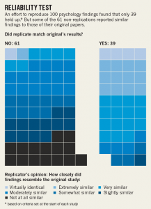

# From the “Replicability Crisis” to Open Science Practices

From the “Replicability Crisis” to Open Science Practices -- Research Methods in Psychology

60

# From the “Replicability Crisis” to Open Science Practices

### Learning Objectives

- Describe what is meant by the “replicability crisis” in psychology.
- Describe some questionable research practices.
- Identify some ways in which scientific rigor may be increased.
- Understand the importance of openness in psychological science.

At the start of this book we discussed the “Many Labs Replication Project,” which failed to replicate the original finding by Simone Schnall and her colleagues that washing one’s hands leads people to view moral transgressions as less wrong (Schnall, Benton, & Harvey, 2008)[1]. Although this project is a good illustration of the collaborative and self-correcting nature of science, it also represents one specific response to psychology’s recent “**replicability crisis,**” a phrase that refers to the inability of researchers to replicate earlier research findings. Consider for example the results of the Reproducibility Project, which involved over 270 psychologists around the world coordinating their efforts to test the reliability of 100 previously published psychological experiments (Aarts et al., 2015)[2]. Although 97 of the original 100 studies had found statistically significant effects, only 36 of the replications did! Moreover, even the effect sizes of the replications were, on average, half of those found in the original studies (see Figure 13.5). Of course, a failure to replicate a result by itself does not necessarily discredit the original study as differences in the statistical power, populations sampled, and procedures used, or even the effects of moderating variables could explain the different results (Yong, 2015)[3].

Figure 13.5 Summary of the Results of the Reproducibility Project Reprinted by permission from Macmillan Publishers Ltd: Nature [Baker, M. (30 April, 2015). First results from psychology’s largest reproducibility test. Nature News. Retrieved from http://www.nature.com/news/first-results-from-psychology-s-largest-reproducibility-test-1.17433], copyright 2015. [Image description]

Although many believe that the failure to replicate research results is an expected characteristic of cumulative scientific progress, others have interpreted this situation as evidence of systematic problems with conventional scholarship in psychology, including a publication bias that favors the discovery and publication of counter-intuitive but statistically significant findings instead of the duller (but incredibly vital) process of replicating previous findings to test their robustness (Aschwanden, 2015[4]; Frank, 2015[5]; Pashler & Harris, 2012[6]; Scherer, 2015[7]). Worse still is the suggestion that the low replicability of many studies is evidence of the widespread use of questionable research practices by psychological researchers. These may include:

- The selective deletion of outliers in order to influence (usually by artificially inflating) statistical relationships among the measured variables.
- The selective reporting of results, cherry-picking only those findings that support one’s hypotheses.
- Mining the data without an *a priori* hypothesis, only to claim that a statistically significant result had been originally predicted, a practice referred to as “**HARKing**” or hypothesizing after the results are known (Kerr, 1998[8]).
- A practice colloquially known as “***p*-hacking**” (briefly discussed in the previous section), in which a researcher might perform inferential statistical calculations to see if a result was significant before deciding whether to recruit additional participants and collect more data (Head, Holman, Lanfear, Kahn, & Jennions, 2015)[9]. As you have learned, the probability of finding a statistically significant result is influenced by the number of participants in the study.
- Outright fabrication of data (as in the case of Diederik Stapel, described at the start of Chapter 3), although this would be a case of fraud rather than a “research practice.”

It is important to shed light on these questionable research practices to ensure that current and future researchers (such as yourself) understand the damage they wreak to the integrity and reputation of our discipline (see, for example, the “Replication Index,” a statistical “doping test” developed by Ulrich Schimmack in 2014 for estimating the replicability of studies, journals, and even specific researchers). However, in addition to highlighting *what not to do*, this so-called “crisis” has also highlighted the importance of enhancing scientific rigor by:

- Designing and conducting studies that have sufficient statistical power, in order to increase the reliability of findings.
- Publishing both null and significant findings (thereby counteracting the publication bias and reducing the file drawer problem).
- Describing one’s research designs in sufficient detail to enable other researchers to replicate your study using an identical or at least very similar procedure.
- Conducting high-quality replications and publishing these results (Brandt et al., 2014)[10].

One particularly promising response to the replicability crisis has been the emergence of **open science practices** that increase the transparency and openness of the scientific enterprise. For example, *Psychological Science* (the flagship journal of the Association for Psychological Science) and other journals now issue digital badges to researchers who pre-registered their hypotheses and data analysis plans, openly shared their research materials with other researchers (e.g., to enable attempts at replication), or made available their raw data with other researchers (see Figure 13.6).

Figure 13.6 Digital Badges from the Center for Open Science

These initiatives, which have been spearheaded by the Center for Open Science, have led to the development of “Transparency and Openness Promotion guidelines” (see Table 13.7) that have since been formally adopted by more than 500 journals and 50 organizations, a list that grows each week. When you add to this the requirements recently imposed by federal funding agencies in Canada (the Tri-Council) and the United States (National Science Foundation) concerning the publication of publicly-funded research in open access journals, it certainly appears that the future of science and psychology will be one that embraces greater “openness” (Nosek et al., 2015)[11].

**Table 13.7 Transparency and Openness Promotion (TOP) Guidelines Reproduced with permission**
 **Criteria** **Level 0** **Level 1** **Level 2** **Level 3**  **Citation Standards** Journal encourages citation of data, code, and materials, or says nothing Journal describes citation of data in guidelines to authors with clear rules and examples. Article provides appropriate citation for data and materials used consistent with journal’s author guidelines. Article is not published until providing appropriate citation for data and materials following journal’s author guidelines.  **Data Transparency** Journal encourages data sharing, or says nothing Article states whether data are available, and, if so, where to access them. Data must be posted to a trusted repository. Exceptions must be identified at article submission. Data must be posted to a trusted repository, and reported analyses will be reproduced independently prior to publication.  **Analytic Methods (Code) Transparency** Journal encourages code sharing, or says nothing Article states whether code is available, and, if so, where to access them. Code must be posted to a trusted repository. Exceptions must be identified at article submission. Code must be posted to a trusted repository, and reported analyses will be reproduced independently prior to publication.  **Research Materials Transparency** Journal encourages materials sharing, or says nothing Article states whether materials are available, and, if so, where to access them. Materials must be posted to a trusted repository. Exceptions must be identified at article submission. Materials must be posted to a trusted repository, and reported analyses will be reproduced independently prior to publication.  **Design and Analysis Transparency** Journal encourages design and analysis transparency, or says nothing Journal articulates design transparency standards Journal requires adherence to design transparency standards for review and publication Journal requires and enforces adherence to design transparency standards for review and publication  **Preregistration of studies** Journal says nothing Journal encourages preregistration of studies and provides link in article to preregistration if it exists Journal encourages preregistration of studies and provides link in article and certification of meeting preregistration badge requirements Journal requires preregistration of studies and provides link and badge in article to meeting requirements.  **Preregistration of analysis plans** Journal says nothing Journal encourages preanalysis plans and provides link in article to registered analysis plan if it exists Journal encourages preanalysis plans and provides link in article and certification of meeting registered analysis plan badge requirements Journal requires preregistration of studies with analysis plans and provides link and badge in article to meeting requirements.  **Replication** Journal discourages submission of replication studies, or says nothing Journal encourages submission of replication studies Journal encourages submission of replication studies and conducts results blind review Journal uses Registered Reports as a submission option for replication studies with peer review prior to observing the study outcomes.

Image Descriptions

**Figure 13.5 long description:** Infographic titled “Reliability Test.” It says, “An effort to reproduce 100 psychology findings found that only 39 held up (based on criteria set at the start of each study). But some of the 61 non-replications reported similar findings to those of their original papers.”

There is a graphic representing these 100 reproductions as squares of various shades of blue and black. The graphic answers the question, “Did replicate match original’s results?” There are 61 squares on the “No” side and 39 on the “Yes” side.

Each square’s colour is determined by how closely the findings of the experiment it represents resemble the original study. The ratings are:

- Virtually identical
- Extremely similar
- Very similar
- Moderately similar
- Somewhat similar
- Slightly similar
- Not at all similar

For the “No” side, the results break down as such:

- Virtually identical: 1
- Extremely similar: 1
- Very similar: 6
- Moderately similar: 16
- Somewhat similar: 10
- Slightly similar: 12
- Not at all similar: 15

For the “Yes” side, the results break down as such:

- Virtually identical: 4
- Extremely similar: 12
- Very similar: 15
- Moderately similar: 4
- Somewhat similar: 3
- Slightly similar: 1

[Return to Figure 13.5]

### Media Attribution

- Summary of the Results of the Reproducibility Project. Reprinted by permission from Macmillan Publishers Ltd: Nature [Baker, M. (30 April, 2015). First results from psychology’s largest reproducibility test. Nature News], copyright 2015.
- Transparency and Openness Promotion (TOP) Guidelines. Reproduced with permission
- Schnall, S., Benton, J., & Harvey, S. (2008). With a clean conscience: Cleanliness reduces the severity of moral judgments. *Psychological Science, 19*(12), 1219-1222. doi: 10.1111/j.1467-9280.2008.02227.x ↵
- Aarts, A. A., Anderson, C. J., Anderson, J., van Assen, M. A. L. M., Attridge, P. R., Attwood, A. S., … Zuni, K. (2015, September 21). *Reproducibility Project: Psychology.* Retrieved from osf.io/ezcuj ↵
- Yong, E. (August 27, 2015). How reliable are psychology studies? Retrieved from http://www.theatlantic.com/science/archive/2015/08/psychology-studies-reliability-reproducability-nosek/402466/ ↵
- Aschwanden, C. (2015, August 19). Science isn't broken: It's just a hell of a lot harder than we give it credit for. *Fivethirtyeight*. Retrieved from http://fivethirtyeight.com/features/science-isnt-broken/ ↵
- Frank, M. (2015, August 31). *The slower, harder ways to increase reproducibility*. Retrieved from http://babieslearninglanguage.blogspot.ie/2015/08/the-slower-harder-ways-to-increase.html ↵
- Pashler, H., & Harris, C. R. (2012). Is the replicability crisis overblown? Three arguments explained. *Perspectives on Psychological Science, 7*(6), 531-536. doi:10.1177/1745691612463401 ↵
- Scherer, L. (2015, September). *Guest post by Laura Scherer.* Retrieved from http://sometimesimwrong.typepad.com/wrong/2015/09/guest-post-by-laura-scherer.html ↵
- Kerr, N. L. (1998). HARKing: Hypothesizing after the results are known. *Personality and Social Psychology Review, 2*(3), 196-217. doi:10.1207/s15327957pspr0203_4 ↵
- Head M. L., Holman, L., Lanfear, R., Kahn, A. T., & Jennions, M. D. (2015). The extent and consequences of *p*-hacking in science. *PLoS Biol, 13*(3): e1002106. doi:10.1371/journal.pbio.1002106 ↵
- Brandt, M. J., IJzerman, H., Dijksterhuis, A., Farach, F. J., Geller, J., Giner-Sorolla, R., … can’t Veer, A. (2014). The replication recipe: What makes for a convincing replication? *Journal of Experimental Social Psychology, 50,* 217-224. doi:10.1016/j.jesp.2013.10.005 ↵
- Nosek, B. A., Alter, G., Banks, G. C., Borsboom, D., Bowman, S. D., Breckler, S. J., … Yarkoni, T. (2015). Promoting an open research culture. *Science, 348*(6242), 1422-1425. doi: 10.1126/science.aab2374 ↵
