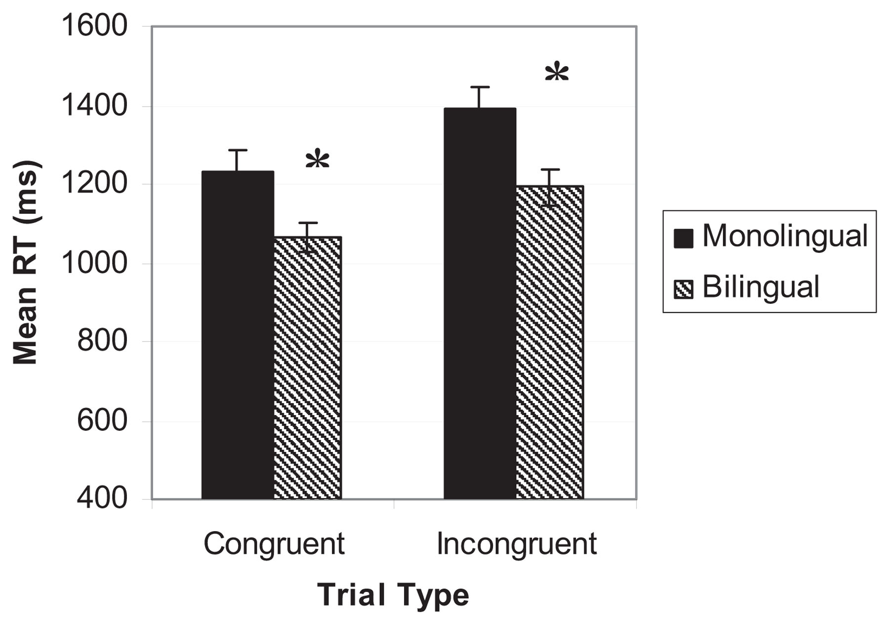
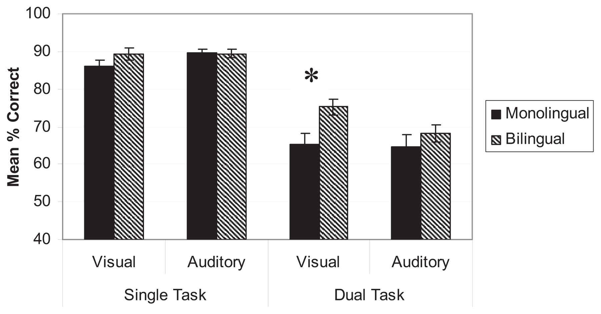
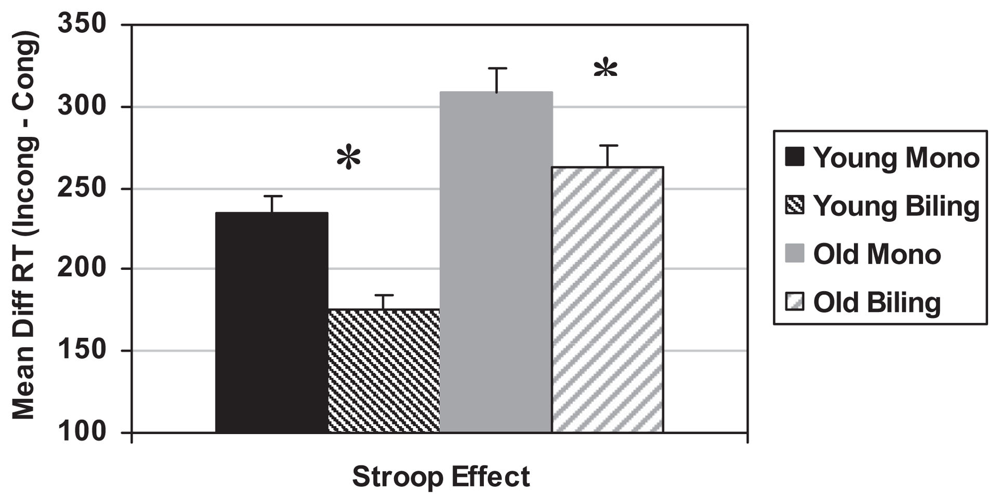
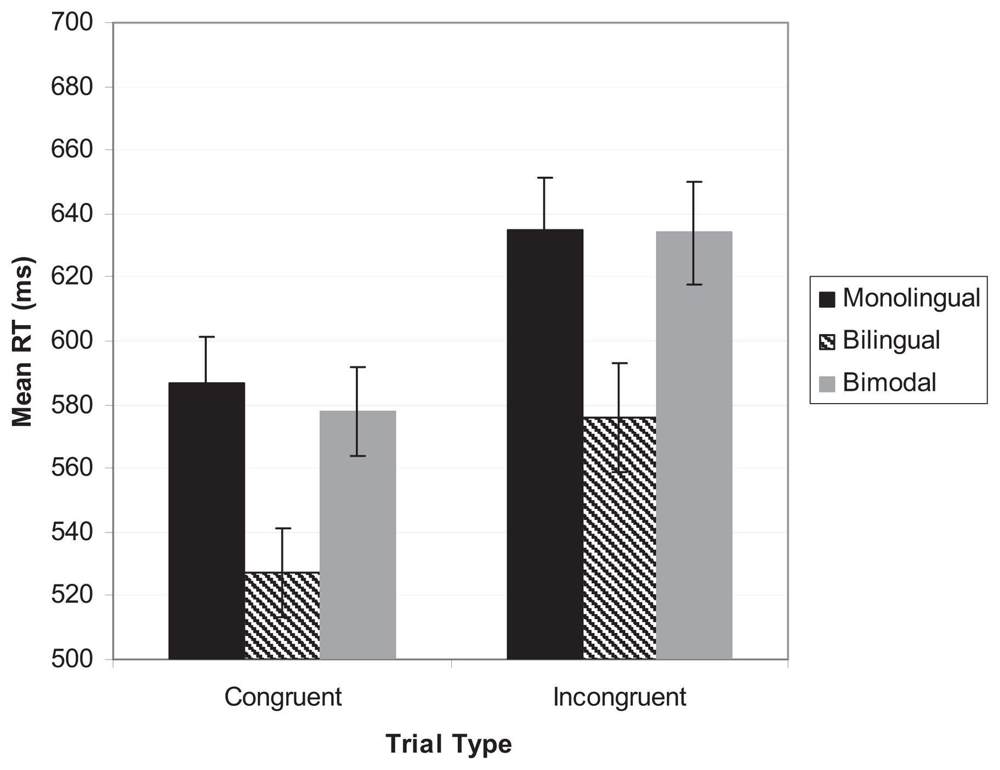

  <strong>Can J Exp Psychol</strong> 
  2011 December; 65(4): 229-235 
  © 2011 Canadian Psychological Association 
  DOI: <a href="https://doi.org/10.1037/a0025406">10.1037/a0025406</a>

# Reshaping the Mind: The Benefits of Bilingualism Ellen Bialystok

  
York University

📑 <b>Table of Contents</b>

- [Abstract](#abstract)
- [Author Note & Acknowledgments](#author-note--acknowledgments)
- [References](#references)

---

## Abstract

> Studies have shown that bilingual individuals consistently outperform their monolingual counterparts on tasks involving executive control. The present paper reviews some of the evidence for this conclusion and relates the findings to the effect of bilingualism on cognitive organisation and to conceptual issues in the structure of executive control. Evidence for the protective effect of bilingualism against Alzheimer’s disease is presented with some speculation about the reason for that protection.
>
> **Keywords** bilingualism; executive control; cognitive development; aging
>
> All experiences leave their mark—they change how we respond to a similar situation in the future, create knowledge or expertise in particular areas, a change we usually call “learning,” and as it is increasingly becoming apparent, change our brains. It follows, then, that experience has great potential for explaining the way that basic cognitive abilities develop, function, and change throughout the life span. Researchers have reported dramatic effects on brain structure and function following short intensive experiences, such as juggling (Draganski et al., 2004) or video-game playing (Green & Bavelier, 2008), and longterm experiences, such as careers in architecture (Salthouse & Mitchell, 1990) or taxidriving (Maguire et al., 2000). Bilingualism is different from all of these: like juggling and playing video games it is intense, and like careers in architecture and driving taxis in London, it is sustained over a long period of time. However, unlike all these examples, bilinguals are typically not selected for a preexisting talent or interest, confusing the direction of cause and effect in the previous literature. In the vast majority of cases, individuals become bilingual through life circumstances.
>
> The main empirical finding for the effect of bilingualism on cognition is in the evidence for enhanced executive control in bilingual speakers (review in Bialystok, Craik, Green, & Gollan, 2009). These effects have been found at all stages across the life span beginning in infancy (Kovács & Mehler, 2009) and toddler-hood (Poulin-Dubois, Blaye, Coutya, & Bialystok, 2011), continuing through young (Carlson & Meltzoff, 2008) and middle
>
>

---

<figure>
>   
>   <figcaption>Illustration</figcaption>
> </figure>

<figure>
- 
- <figcaption><strong>Figure 1.</strong> Mean reaction time and standard error on congruent and incongruent trials in the global- local task, adapted from Bialystok (2010), Study 1.</figcaption>
- </figure>

<figure>
- 
- <figcaption><strong>Figure 2.</strong> Mean percent accuracy and standard error for classifying visual or auditory stimuli in either the single task or dual task conditions, adapted from Bialystok (2011).</figcaption>
- </figure>

<figure>
- 
- <figcaption><strong>Figure 3.</strong> Mean reaction time cost and standard error for incongruent items (Stroop effect) in Stroop task by younger and older monolingual and bilingual participants, adapted from Bialystok et</figcaption>
- </figure>

<figure>
- 
- <figcaption><strong>Figure 4.</strong> Mean RT (and standard error) on congruent and incongruent trials in flanker task by monolinguals, bilinguals, and bimodal speech-sign bilinguals, adapted from Emmorey et al.</figcaption>
- </figure>

## Author Note & Acknowledgments

© 2011 Canadian Psychological Association Correspondence concerning this article should be addressed to Ellen Bialystok, Department of Psychology, York University, 4700 Keele Street, Toronto, Ontario M3P 1J3, Canada. ellenb@yorku.ca. Ellen Bialystok, Department of Psychology, York University.

---

## References

- Abutalebi J, Green DW. Bilingual language production: The neurocognition of language representation and control. Journal of Neurolinguistics. 2007; 20:242-275.10.1016/j.jneuroling. 2006.10.003 Beauvillain C, Grainger J. Accessing interlexical homographs: Some limitations of a languageselective access. Journal of Memory and Language. 1987; 26:658- 672.10.1016/0749-596X(87)90108-2 Bialystok E. Global-local and trail-making tasks by monolingual and bilingual children: Beyond inhibition. Developmental Psychology. 2010; 46:93-105.10.1037/a0015466 [PubMed: 20053009] Bialystok E. Coordination of executive functions in monolingual and bilingual children. Journal of Experimental Child Psychology. 2011; 110:461-468.10.1016/j.jecp.2011.05.005 [PubMed: 21683958] Bialystok E, Craik FIM, Freedman M. Bilingualism as a protection against the onset of symptoms of dementia. Neuropsychologia. 2007; 45:459-464.10.1016/j.neuropsychologia.2006.10.009 [PubMed: 17125807] Bialystok E, Craik FIM, Grady C, Chau W, Ishii R, Gunji A, Pantev C. Effects of bilingualism on cognitive control in the Simon task: Evidence from MEG. NeuroImage. 2005; 24:40-49.10.1016/ j.neuroimage.2004.09.044 [PubMed: 15588595] Bialystok E, Craik FIM, Green DW, Gollan TH. Bilingual minds. Psychological Science in the Public Interest. 2009; 10:89-129.10.1177/1529100610387084 Bialystok E, Craik FIM, Klein R, Viswanathan M. Bilingualism, aging, and cognitive control: Evidence from the Simon task. Psychology and Aging. 2004; 19:290- 303.10.1037/0882-7974.19.2.290 [PubMed: 15222822] Bialystok E, Craik FIM, Luk G. Cognitive control and lexical access in younger and older bilinguals. Journal of Experimental Psychology: Learning, Memory, and Cognition. 2008; 34:859- 873.10.1037/0278-7393.34.4.859 Bialystok E, Luk G. Receptive vocabulary differences in monolingual and bilingual adults.
- Bilingualism: Language and Cognition. (in press). Bialystok E, Luk G, Peets KF, Yang S. Receptive vocabulary differences in monolingual and bilingual children. Bilingualism: Language and Cognition. 2011; 13:525-531.10.1017/S1366728909990423 Carlson SM, Meltzoff AN. Bilingual experience and executive functioning in young children.
- Developmental Science. 2008; 11:282-298.10.1111/j.1467-7687.2008.00675.x [PubMed: 18333982] Chertkow H, Whitehead V, Phillips N, Wolfson C, Atherton J, Bergman H. Multilingualism (but not always bilingualism) delays the onset of Alzheimer’s disease: Evidence from a bilingual community. Alzheimer Disease and Associated Disorders. 2010; 24:118-125.10.1097/WAD. 0b013e3181ca1221 [PubMed: 20505429] Colomé A. Lexical activation in bilinguals’ speech production: Language-specific or languageindependent? Journal of Memory and Language. 2001; 45:721-736.10.1006/jmla.2001.2793 Costa A, Hernández M, Costa-Faidella J, Sebastian-Galles N. On the bilingual advantage in conflict processing: Now you see it, now you don’t. Cognition. 2009; 113:135-149.10.1016/j.cognition. 2009.08.001 [PubMed: 19729156] Costa A, Hernández M, Sebastián-Gallés N. Bilingualism aids conflict resolution: Evidence from the
- ANT task. Cognition. 2008; 106:59-86.10.1016/j.cognition.2006.12.013 [PubMed: 17275801] Craik FIM, Bialystok E, Freedman M. Delaying the onset of Alzheimer disease: Bilingualism as a form of cognitive reserve. Neurology. 2010; 75:1717-1725.10.1212/WNL.0b013e3181fc2a1c [PubMed: 21060094]
- *Can J Exp Psychol*. Author manuscript; available in PMC 2015 February 26.
- Page 10 editors. Lifespan cognition: Mechanisms of change. New York, NY: Oxford University Press; 2006. p. 96-111. Delis, DC.; Kaplan, E.; Kramer, JH. Verbal fluency subtest of the Delis-Kaplan Executive Function
- System. San Antonio, TX: The Psychological Corporation; 2001. Draganski B, Gaser C, Busch V, Schuierer G, Bogdahn U, May A. Neuroplasticity: Changes in grey matter induced by training. Nature. 2004; 427:311-312.10.1038/427311a [PubMed: 14737157] Emmorey K, Borinstein HB, Thompson R, Gollan TH. Bimodal bilingualism. Bilingualism: Language and Cognition. 2008a; 11:43-61.10.1017/S1366728907003203 Emmorey K, Luk G, Pyers J, Bialystok E. The source of enhanced cognitive control in bilinguals:
- Evidence from bimodal bilinguals. Psychological Science. 2008b; 19:1201-1206.10.1111/j. 1467-9280.2008.02224.x [PubMed: 19121123] Fabbro F, Skrap M, Aglioti S. Pathological switching between languages following frontal lesion in a bilingual patient. Journal of Neurology, Neurosurgery, and Psychiatry. 2000; 68:650-652.10.1136/ jnnp.68.5.650 Folstein MF, Folstein SE, McHugh PR. “Mini-mental state.” A practical method for grading the cognitive state of patients for the clinician. Journal of Psychiatric Research. 1975; 12:189- 198.10.1016/0022-3956(75)90026-6 [PubMed: 1202204] Francis WS. Analogical transfer of problem solutions within and between languages in Spanish-
- English bilinguals. Journal of Memory and Language. 1999; 40:301-329.10.1006/jmla.1998.2610 Frisoni G, Rossi R, Beltramello A. The radial width of the temporal horn in mild cognitive impairment. Journal of Neuroimaging. 2002; 12:351-354.10.1111/j.1552-6569.2002.tb00143.x [PubMed: 12380482] Grainger, J. Visual word lexicon in bilinguals. In: Schreuder, R.; Weltens, B., editors. The bilingual lexicon. Amsterdam, The Netherlands: John Benjamins; 1993. p. 11-25. Green CS, Bavelier D. Exercising your brain: A review of human brain plasticity and training induced learning. Psychology and Aging. 2008; 23:692-701.10.1037/a0014345 [PubMed: 19140641] Green DW. Mental control of the bilingual lexico-semantic system. Bilingualism: Language and
- Cognition. 1998; 1:67-81.10.1017/S1366728998000133 Hebb, DO. The organization of behavior. New York, NY: Wiley; 1949. Hernandez AE, Bates E, Avila LX. Processing across the language boundary: A cross-modal priming study of Spanish-English bilinguals. Journal of Experimental Psychology: Learning, Memory, and Cognition. 1996; 22:846-864.10.1037/0278-7393.22.4.846 Kovács ÁM, Mehler J. Cognitive gains in 7-month-old bilingual infants. Proceedings of the National
- Academy of Sciences, USA. 2009; 106:6556-6560.10.1073/pnas.0811323106 Kroll, JF.; de Groot, AMB. Lexical and conceptual memory in the bilingual: Mapping form to meaning in two languages. In: de Groot, AMB.; Kroll, JF., editors. Tutorials in bilingualism. Mahwah, NJ: Erlbaum; 1997. p. 169-199. Luk G, Anderson JAE, Craik FIM, Grady C, Bialystok E. Distinct neural correlates for two types of inhibition in bilinguals: Response inhibition versus interference suppression. Brain and Cognition. 2010; 74:347-357.10.1016/j.bandc.2010.09.004 [PubMed: 20965635] Luk G, Green DW, Abutalebi J, Grady C. Cognitive control for language switching in bilinguals: A quantitative meta-analysis of functional neuroimaging studies. Language and Cognitive Processes. (in press). Maguire EA, Gadian DG, Johnsrude IS, Good CD, Ashburner J, Frackowiak RS, Frith CD.
- Navigation-related structural change in the hippocampi of taxi drivers. Proceedings of the National Academy of Sciences, USA. 2000; 97:4398-4403.10.1073/pnas.070039597 Marian V, Spivey M, Hirsch J. Shared and separate systems in bilingual language processing:
- Converging evidence from eyetracking and brain imaging. Brain and Language. 2003; 86:70- 82.10.1016/S0093-934X(02)00535-7 [PubMed: 12821416] Martin CD, Dering B, Thomas EM, Thierry G. Brain potentials reveal semantic priming in both the
- “active” and the “non-attended” language of early bilinguals. NeuroImage. 2009; 47:326- 333.10.1016/j.neuroimage.2009.04.025 [PubMed: 19374949]
- *Can J Exp Psychol*. Author manuscript; available in PMC 2015 February 26.
- Page 11
- Miyake A, Freidman NP, Emerson MJ, Witzki AH, Howerter A, Wager TD. The unity and diversity of executive functions and their contributions to complex “frontal lobe” tasks: A latent variable analysis. Cognitive Psychology. 2000; 41:49-100.10.1006/cogp.1999.0734 [PubMed: 10945922] Navon D. Forest before trees: The precedence of global features in visual perception. Cognitive
- Psychology. 1977; 9:358-383.10.1016/0010-0285(77)90012-3 Poulin-Dubois D, Blaye A, Coutya J, Bialystok E. The effects of bilingualism on toddlers’ executive functioning. Journal of Experimental Child Psychology. 2011; 108:567-579.10.1016/j.j-ecp. 2010.10.009 [PubMed: 21122877] Rodriguez-Fornells A, Rotte M, Heinze HJ, Nosselt TM, Munte TF. Brain potential and functional
- MRI evidence for how to handle two languages with one brain. Nature. 2002; 415:1026- 1029.10.1038/4151026a [PubMed: 11875570] Salthouse TA, Mitchell DRD. Effects of age and naturally occurring experience on spatial visualization performance. Developmental Psychology. 1990; 26:845- 854.10.1037/0012-1649.26.5.845 Scarmeas N, Levy G, Tang MX, Manly J, Stern Y. Influence of leisure activity on the incidence of
- Alzheimer’s disease. Neurology. 2001; 57:2236-2242. [PubMed: 11756603] Schweizer T, Ware J, Fischer CE, Craik FIM, Bialystok E. Bilingualism as a contributor to cognitive reserve: Evidence from brain atrophy in Alzheimer’s disease. Cortex. (in press). Stern Y. Cognitive reserve. Neuropsychologia. 2009; 47:2015-2028.10.1016/j.neuropsychologia.
- 2009.03.004 [PubMed: 19467352] Valenzuela MJ, Sachdev P. Brain reserve and dementia: A systematic review. Psychological Medicine.
- 2006a; 36:441-454.10.1017/S0033291705006264 [PubMed: 16207391] Valenzuela MJ, Sachdev P. Brain reserve and cognitive decline: A non-parametric systematic review.
- Psychological Medicine. 2006b; 36:1065-1073.10.1017/S0033291706007744 [PubMed: 16650343]
- *Can J Exp Psychol*. Author manuscript; available in PMC 2015 February 26.
- Page 12
- *Can J Exp Psychol*. Author manuscript; available in PMC 2015 February 26.
-

- Page 13
- *Can J Exp Psychol*. Author manuscript; available in PMC 2015 February 26.
-

- Page 14 al. (2008).
- *Can J Exp Psychol*. Author manuscript; available in PMC 2015 February 26.
-

- Page 15
- (2008b).
- *Can J Exp Psychol*. Author manuscript; available in PMC 2015 February 26.
-
