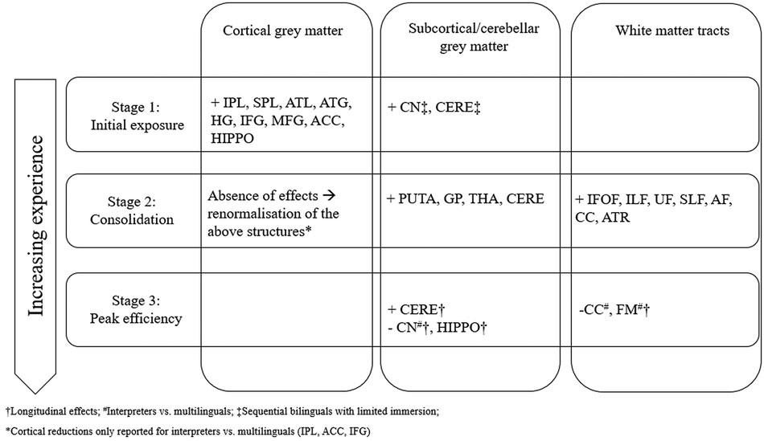

<style>
  /* Academic Literature Typographic Styling */
  p {
    text-align: justify;
    text-justify: inter-word;
    line-height: 1.65;
    margin-bottom: 1em;
  }
  h1, h2, h3, h4, h5, h6 {
    text-align: left;
    font-weight: 700;
  }
  h1 { margin-top: 1.2em; margin-bottom: 0.6em; }
  h2 { margin-top: 1.6em; margin-bottom: 0.6em; border-bottom: 1px solid #eaecef; padding-bottom: 0.3em; }
  h3 { margin-top: 1.3em; margin-bottom: 0.5em; }
  h4 { margin-top: 1.1em; margin-bottom: 0.4em; }
  blockquote {
    border-left: 4px solid #842959;
    padding: 10px 18px;
    margin: 1.4em 0;
    background: #fbf8fa;
    color: #333;
  }
  .article-meta {
    font-size: 0.9em;
    color: #555;
    margin-bottom: 1.5em;
  }
  .author-block {
    margin: 1.2em 0 1.8em 0;
    line-height: 1.5;
  }
  .author-name {
    font-weight: bold;
    font-size: 1.05em;
  }
  .author-affiliation {
    font-size: 0.92em;
    color: #555;
    margin-bottom: 0.6em;
  }
  .author-note {
    font-size: 0.88em;
    color: #555;
    border-top: 1px solid #e1e4e8;
    margin-top: 2.5em;
    padding-top: 1.2em;
  }
  table {
    width: auto;
    max-width: 100%;
    border-collapse: collapse;
    margin: 1.8em 0;
    font-size: 0.88em;
  }
  th, td {
    padding: 8px 10px;
    border-bottom: 1px solid #ddd;
    text-align: left;
  }
  th {
    border-top: 2px solid #333;
    border-bottom: 1px solid #333;
    font-weight: bold;
    background: #f9f9f9;
  }
  tr.table-bottom-rule td {
    border-bottom: 2px solid #333;
  }
  .table-caption {
    font-weight: bold;
    margin-top: 1.8em;
    margin-bottom: 0.3em;
  }
  .table-subtitle {
    font-style: italic;
    margin-bottom: 0.6em;
  }
  .table-notes {
    font-size: 0.84em;
    color: #666;
    margin-top: 0.4em;
    margin-bottom: 1.8em;
  }
  figure {
    margin: 2em 0;
    text-align: center;
  }
  figcaption {
    font-size: 0.9em;
    color: #444;
    margin-top: 0.6em;
    text-align: justify;
  }
  .instruction-quote {
    background-color: #f6f8fa;
    border-left: 3px solid #0366d6;
    padding: 12px 18px;
    margin: 1.2em 0;
    font-style: normal;
  }
</style>

<div class="article-meta">
  <strong>Bilingualism: Language and</strong><br>
  2020, Vol. 23, No. 2, 459 - 471<br>
  © The Author(s) 2019. This is an Open Access<br>
  DOI: <a href="https://doi.org/10.1017/S1366728919000130">10.1017/S1366728919000130</a>
</div>

# Understanding structural plasticity in the bilingual brain: The Dynamic Restructuring Model

<div class="author-block">
  <div class="author-name">Christos Pliatsikas</div>
  <div class="author-affiliation">School of Psychology and Clinical Language Sciences, University of Reading, Reading, UK and Facultad de Lenguas y Educación, Universidad Nebrija, Madrid, Spain</div>

</div>

<details open>
<summary>📑 <b>Table of Contents</b></summary>

- [Abstract](#abstract)
- [Introduction](#introduction)
- [References](#references)

</details>

---

## Abstract

> Research on the effects of bi- and multi-lingualism on brain structure has so far yielded variable patterns. Although it cannot be disputed that learning and using additional languages restructures grey (cortical, subcortical and cerebellar) and white matter in the brain, both increases and reductions in regional volume and diffusivity have been reported. This paper revisits the available evidence from simultaneous and sequential bilinguals, multilinguals, interpreters, bimodal bilinguals, children, patients and healthy older adults from the perspective of experience-based neuroplasticity. The Dynamic Restructuring Model (DRM) is then presented: a three-stage model accounting for, and reinterpreting, all the available evidence by proposing a time-course for the reported structural adaptations, and by suggesting that these adaptations are dynamic and depend on the quantity and quality of the language learning and switching experience. This is followed by suggestions for future directions for the emerging field of bilingualism-induced neuroplasticity.

---

## Introduction

Introduction: Experience-dependent brain plasticity

```python
Research in the past 20 years has convincingly demonstrated that the structure of the human brain is far from static. Beyond natural maturational processes, such as cortical thinning and increases in myelination (Muftuler, Davis, Buss, Solodkin, Su, Head, Hasso & Sandman, 2012; Tamnes, Østby, Fjell, Westlye, Due-Tønnessen & Walhovd, 2010 ), it is now well documented that the acquisition and usage of a new skill can be accompanied by structural adaptations in brain regions that subserve that particular skill. For example, taxi drivers have been shown to have increased volume of the hippocampus, a structure which is involved in navigation, among other functions (Maguire, Gadian, Johnsrude, Good, Ashburner, Frackowiak & Frith, 2000 ). Similarly, learning to juggle induces rapid changes in both grey and white matter structure in motor and visual regions of the cortex (Draganski, Gaser, Busch, Schuierer, Bogdahn & May, 2004; Scholz, Klein, Behrens & Johansen-berg,

```
2010 ), and professional basketball players have been documented to have increased volume in a wide network of cortical regions (Tan, Pi, Wang, Li, Zhang, Dai, Zhu, Ni, Zhang & Wu, 2017 ), while it has also been shown that learning a complex balancing task causes grey matter adaptations which are later followed by white matter adaptations (Taubert, Draganski, Anwander, Muller, Horstmann, Villringer & Ragert, 2010 ). What is of particular interest is that experience-dependent structural changes in the brain have been reported even for higher cognitive functions. For example, both expert mathematicians (Aydin, Ucar, Oguz, Okur, Agayev, Unal, Yilmaz & Ozturk, 2007 ) and expert musicians (Bermudez, Lerch, Evans & Zatorre, 2009 ) have shown local increases in grey matter volume compared to controls; in the domain of language, the size of vocabulary in one ’ s native language has been shown to relate to the volume of several language-related regions (Lee, Devlin, Shakeshaft, Stewart, Brennan, Glensman, Pitcher, Crinion, Mechelli, Frackowiak, Green & Price, 2007 ). A full review of the available evidence on experience-dependent neuroplasticity is beyond the scope of this paper. However, it is important to note that, when tested, this restructuring was maintained only if the skill was continuously practiced - if not, the brain © The Author(s) 2019. This is an Open Access often appeared to return to its baseline structure (Boyke, Driemeyer, Gaser, Buchel & May, article, distributed under the terms of the 2008; Draganski et al., 2004 ), highlighting the dynamic nature of these effects. Creative Commons Attribution licence ( http://

The growing literature on experience-related plasticity in the human brain has its roots in the creativecommons.org/licenses/by/4.0/ ), which permits unrestricted re-use, distribution, and fundamental work by Diamond and colleagues, who showed learning- and experience-related reproduction in any medium, provided the grey matter adaptations in the brains of rats, which depended on the complexity and novelty original work is properly cited. of different types of training (Diamond, Krech & Rosenzweig,

1964; Rosenzweig, Krech,

Bennett & Diamond, 1962

). Crucially, research on the human brain has been complemented and corroborated by research on other primates. For example, Quallo, Price, Ueno, Asamizuya, Cheng, Lemon and Iriki (

) trained macaque monkeys in using a rake in order to get food. They reported that learning to use the rake induced significant increases cortical regions

Published online by Cambridge University Press related to tool use throughout the training, and especially at the initial stages; interestingly, after the end of the training the same regions started showing a in volume (which however did not reach baseline levels), but without the loss of the skill. In other words, it appears that cortical volumetric increase was only one step in the process of learning and consolidating a new skill. Based on this and similar findings (e.g., Reed, Riley, Carraway, Carrasco, Perez, Jakkamsetti & Kilgard, 2011 ), Lövdén, Wenger, Mårtensson, Lindenberger and Bäckman ( 2013 ) proposed the expansion-partial renormalization hypothesis (EPH). According to this approach, learning of a skill leads to local generation of new dendritic spines in the region that undertakes the skill learning, which in turn provide an increased number of neural pathways compared to pre-training. This is in order for the most efficient circuits to be identified and utilised to accommodate the newly learnt skill. This initial increase of local tissue is followed by a decrease because of the process of PRUNING: once the most efficient networks have been identified and (continuously) utilised, both pre-training spines and under-utilised post-training spines are eliminated.

This theory seems to adequately explain local grey matter changes. What remains to be explained is experience-related restructuring of the white matter, usually reported as changes in its diffusivity, as estimated by measurements such as Fractional Anisotropy and Mean, Axonal and Radial Diffusivities (Smith, Jenkinson, Johansen-Berg, Rueckert, Nichols, Mackay, Watkins, Ciccarelli, Zaheer Cader, Matthews & Behrens, 2006 ), which are commonly treated as indices of the amount of myelin. Increases in the availability of myelin might be provided by several mechanisms, including changes in axon myelination, axon diameter or number of myelinated axons within a tract (Scholz et al., 2010 ), but the precise mechanisms are rarely identified in studies looking at the living human brain. What is important to understand are the mechanisms that lead to these adaptations; in the context of learning literature, improvements in behaviour have their biological bases in changes in the conduction velocity and synchronisation of nervous signals, and consolidation of new information is subject to concurrent firing of related neurons (Fields, 2008 ). Since the electrical activity of any axon can regulate its myelination even over short periods of time (Ishibashi, Dakin, Stevens, Lee, Kozlov, Stewart & Fields, 2006 ), it can be assumed that changes in myelination are a direct outcome of the acquisition and consolidation of a new skill. At the same time, since myelin promotes efficient structural connectivity, observed fluctuations in diffusivity can be assumed to be commensurate to the needs for efficient connectivity, in that when a skill has been firmly established (or completely abandoned), maximum efficiency becomes irrelevant, and so is increased myelination. In other words, the reported changes in diffusivity are subject to the individual ’ s experience and can be assumed to depend on, and to regulate, the velocities of impulse conductions (Zatorre, Fields & Johansen-Berg, 2013 ).

Brain restructuring and additional language learning

It is possible that the above predictions of experience-related grey and white matter adaptations have an application to how the brain reacts to the complex and cognitively demanding process of learning and using additional languages. An experience-based approach might also provide an explanation for the diverse, and sometimes contradictory, evidence that has been presented so far (García-Pentón, García, Costello, Duñabeitia & Carreiras, Li, Legault & Litcofsky,; Luk & Pliatsikas,; Pliatsikas,

; Stein, Winkler, Kaiser & Dierks, ). Therefore, the next

Published online by Cambridge University Press

Christos Pliatsikas section of this paper will revisit the available findings on the basis of the language experiences of the tested populations. Specifically, evidence from cortical, subcortical and cerebellar grey and white matter adaptations will be presented, divided into sections separating the populations based on the quantity and type of their language learning and switching experiences. It is worth noting here that this review will not attempt to differentiate between different indices of plasticity; in other words, evidence from methods looking at cortical thickness, volume and surface extent will be presented and treated equally as evidence for structural adaptations (for a discussion on the differences between these approaches, see Li, Abutalebi, Emmorey, Gong, Yan, Feng, Zou & Ding, 2017 ). None of these methods can confidently describe the changes that happen at the microstructural level though, so any suggestions will remain speculative based on the predictions by models such as the EPH. Similarly, for white matter, the indices that signify reduced diffusivity (Fractional Anisotropy, Axial Diffusivity) will be treated as indices of more efficient structural connectivity, in contrast to those signifying increased diffusivity (Mean Diffusivity, Radial Diffusivity) (for a more detailed discussion of these indices, see Singh, Rajan, Malagi, Ramanujan, Canini, Della Rosa, Raghunathan, Weekes & Abutalebi, 2018 ). Similar to grey matter, none of the four major white matter indices informs whether the effects are due to changes in myelination or axonal density or any other mechanism at the microstructural level, so no strong claims will be made to that end.

Longitudinal training studies: investigating the trajectory of bilingualism-induced changes

Understandably, the best evidence that additional language learning affects brain structure and connectivity is provided by training studies, where participants in language training programmes are typically scanned before and after the programme, and in some cases at further time points after the programme has concluded (for a review of high-demand interpreter training studies, see relevant section below). For example, training in a non-native language has been shown to increase the volume of grey matter regions including, but not limited to, regions related to language learning (mostly) in the left hemisphere (Bellander, Berggren, Mårtensson, Brehmer, Wenger, Li, Bodammer, Shing, Werkle-Bergner & Lövdén, 2016; Della Rosa, Videsott, Borsa, Canini, Weekes, Franceschini & Abutalebi, 2013; Hosoda, Tanaka, Nariai, Honda & Hanakawa, 2013; Mårtensson, Eriksson, Bodammer, Lindgren, Johansson, Nyberg & Lövdén, 2012; Osterhout, Poliakov, Inoue, McLaughlin, Valentine, Pitkanen, Frenck-Mestre & Hirschensohn, 2008; Stein, Federspiel, Koenig, Wirth, Strik, Wiest, Brandeis & Dierks, 2012 ). These include the supramarginal gyrus (SMG), part of the Inferior Parietal Lobule (IPL) which is thought to be essential for the integration of semantics and phonology of newly acquired words (Richardson, Thomas, Filippi, Harth & Price, 2010 ), the Inferior Frontal Gyrus (IFG), the middle frontal gyrus (MFG) and the Anterior Cingulate Cortex (ACC), a cluster of prefrontal regions related to switching between and controlling the production of the available languages in bi-/multilinguals (Abutalebi & Green, 2016 ), and the left anterior temporal lobe (ATL) and the bilateral hippocampus, both regions related to vocabulary acquisition (Li et al., 2017 ). Recent evidence has also suggested that the regions affected by language training might depend on the specific learning context; (Legault, Fang, Lan & Li, ). Notably, a study even showed restructuring of a non-typical language regions in the visual cortex for training of colour words in a non-native language (Kwok, Niu,

<!-- Page 3 -->
Kay, Zhou, Mo, Jin, So & Tan, ). It therefore appears that the additional cognitive burden to regions that are related to vocabulary acquisition is addressed by significant increase in their local volume (Lee et al., 2007 ). Note that no changes are usually reported in any subcortical structures or the cerebellum in these studies.

In terms of effects in the white matter, it appears that additional language training increases white matter integrity by means of decreasing its isotropic diffusivity in tracts that provide connectivity between frontal, parietal, temporal and subcortical language-related regions, and in both hemispheres (Hosoda et al., 2013; Mamiya, Richards, Coe, Eichler, Kuhl, Geschwind & Paus, 2016; Schlegel, Rudelson & Tse, 2012; Xiang, van Leeuwen, Dediu, Roberts, Norris & Hagoort, 2015 ). These primarily include tracts connecting frontal to temporal and/or parietal regions, both ventral tracts implicated in semantic and syntactic processing (Inferior Fronto-Occipital Fasciculus - IFOF, Inferior Longitudinal Fasciculus - ILF, Uncinate Fasciculus - UF), and dorsal tracts implicated in the processing of phonology and complex syntax (Arcuate Fasciculus - AF, Superior Longitudinal Fasciculus - SLF) (Friederici & Gierhan, 2013 ), but also the Corpus Callosum (CC), which is crucial for interhemispheric communication and cognitive control (Felton, Vazquez, Ramos Nuñez, Greene, Macbeth & Hernandez, 2017 ). While in the majority of these studies several months of training were required before these effects are reported, it is worth noting that vocabulary training has been documented to decrease regional diffusivity even after one hour of vocabulary training (Hofstetter, Friedmann & Assaf, 2017 ). Since decreased diffusivity in the white matter is thought to signify more efficient communication between brain regions, it appears that language learning ‘ forces the entire system to reorganise in order to accommodate the task of controlling for the selection of lexical, semantic and phonological alternatives during production.

It is therefore interesting to examine whether the effects of bilingualism on brain structure are static end-products of the training course, or whether their maintenance is somehow linked to the continuous experience of the learner. Notably, the few studies that retested their participants several months after the completion of the training course reported a reduction of the initially observed restructuring in both grey and white matter, while in some cases the effects had disappeared, suggesting that without continuous training the brain structure had reverted back to the pre-training baseline (Hosoda et al., 2013; Mamiya et al., 2016 ). This echoes the predictions of the EPH, at least as far as cortical grey matter is concerned. In other words, it appears that initial learning of an additional language induced local cortical expansion, which renormalized after the acquisition of the skill. With respect to white matter though, it might be that it was THE LACK OF CONTINUOUS EXPOSURE to the additional language that reverted those changes. Consequently, it might be the case that continuous exposure to a non-native language is a prerequisite for this ‘ enhancement ’ of structural connectivity in the brain, a suggestion that is akin to what has been proposed for the acquisition of other skills, including cognitive and motor skills. It is less understood what happens to subcortical nuclei, such as the basal ganglia and the thalamus, as well as the cerebellum, as no effects in these structures are typically reported in the training studies. However, a recent longitudinal study on highly immersed and proficient bilinguals that were not enrolled in any language training revealed significant restructuring in these regions, which in the case of the cerebellum was predicted by the amount of time the bilinguals had been using their language prior to their being

Published online by Cambridge University Press immersed, as well as by their amount of experience in an immersive environment (DeLuca, Rothman & Pliatsikas, ). In other words, immersion in a bilingual environment made the cerebellum more plastic, i.e., more responsive to experience-based restructuring. Given the scarcity of the longitudinal studies, it is understandably difficult to parse the full extent and pattern of these changes over time. Nevertheless, and irrespective of the underlying mechanisms, these are the first pieces of evidence showing that the effects of language learning on the brain are dynamic and tightly linked to the bilingual experience.

Cross-sectional studies in young adults: a snapshot in time of a continuous experience

While evidence from training studies clearly demonstrates that additional language learning and control is a form of skill acquisition that can result in structural changes in a similar way that other skills do (e.g., taxi driving, juggling), the bulk of the available evidence of bilingualism-induced brain plasticity has been provided by crosssectional studies comparing bilingual and monolingual samples that are otherwise matched on factors such as age, gender, educational level, etc, so that any structural differences can be attributed to bilingualism. In general, the affected grey matter regions and white matter tracts reported in these studies overlap to a great degree with those reported in the longitudinal studies, and mainly include regions related to language acquisition and control. However, replicability among the cross-sectional studies remains low, and the patterns of results seem to vary a lot, with some studies only reporting cortical or subcortical grey matter effects, and some ’ others only white matter effects. Several reasons for these have been proposed, including the lack of consistency in the chosen MRI methods, demographics that are not well-controlled, and others (García-Pentón et al., 2016; Luk & Pliatsikas, 2016 ). Nevertheless, if bilingualism is viewed as a long-term dynamic experience, rather than a static binary variable (yes/no), as the majority of these studies have treated it, we might be able to provide an explanation for the otherwise blurred picture. To do this, the available evidence needs to be viewed from a different perspective, one that accounts for the EXPERIENCES of the bilinguals in each of these studies. One way to do this is by looking at the opportunities that bilinguals had to use their available languages, which can be interpreted as proxies of where in the long-term experience of bilingualism they can be placed.

The majority of the available cross-sectional studies have looked at sequential learners of one or more additional languages, i.e., bi-/multilinguals that started learning and using an additional language later than their native language, and they usually had no or limited opportunities of continuous active usage of their languages, e.g., by means of long-term residence in an L2-speaking country. These samples are usually reported to show volumetric increases in a series of cortical regions when compared to monolinguals (Klein, Mok, Chen & Watkins, 2014; Mechelli, Crinion, Noppeney, O ’ Doherty, Ashburner, Frackowiak & Price, 2004; Olulade, Jamal, Koo, Perfetti, LaSasso & Eden, 2016; Ressel, Pallier, Ventura-Campos, Díaz, Roessler, Ávila & SebastiánGallés, 2012 ). These include regions also reported in the longitudinal studies, e.g., the ACC, IPL, ATL, IFG and MFG, and some additional regions, such as the Heschl ’ s gyrus (HG), which is related to the ability to learn and perceive non-native sounds (Wong, Warrier, Penhune, Roy, Sadehh, Parrish & Zatorre,

), the Superior Temporal gyrus (STG), related to low-level phonological processing (Golestani, ), and the Superior

<!-- Page 4 -->
Parietal Lobule (SPL), which is linked to lexicosemantic processing (Richardson et al., ). Limited evidence is available for effects on the cerebellum (Filippi, Richardson, Dick, Leech, Green, Thomas & Price, 2011; Pliatsikas, Johnstone & Marinis, 2014 ), which is implicated in phonological and grammatical acquisition and language control (Abutalebi & Green, 2016; De Smet, Paquier, Verhoeven & Mariën, 2013 ), and the left caudate (Pliatsikas, DeLuca, Moschopoulou & Saddy, 2017 ) and putamen (Abutalebi, Della Rosa, Gonzaga, Keim, Costa & Perani, 2013 ), both structures related to fluency and articulatory control (Green & Abutalebi, 2013 ); it is worth noting though that the cerebellar and subcortical effects are reported in groups with at least some limited residence in their L2-speaking country. Notably, some of the reported grey matter effects appear to be modulated by the Age of Acquisition (AoA) of the language, which, in the majority of the studies where this was tested, appeared to correlate negatively with those cortical effects, in that the earlier the L2 AoA, the smaller the cortical differences between bilinguals and monolinguals (Klein et al., 2014; Wei, Joshi, Zhang, Mei, Manis, He, Beattie, Xue, Shattuck, Leahy, Xue, Houston, Chen, Dong & Lu, 2015 ). Conversely, and when this was tested, white matter effects have been limited in comparable groups; notably, and in contrast to the longitudinal studies, the reported effects suggest increased diffusivity (manifested as decreased FA and/or increased RD and MD) in several tracts including the IFOF and the Anterior Thalamic Radiation (ATR) (Cummine & Boliek, 2013; Kuhl, Stevenson, Corrigan, van den Bosch, Can & Richards, 2016; Mamiya et al., 2016 ), although in some cases increased FA or decreased MD have also been reported (Cummine & Boliek, 2013; Rossi, Cheng, Kroll, Diaz & Newman, 2017 ). Similarly to grey matter effects, AoA seems to modulate the white matter effects in several studies, although the reported effects vary by tract and point towards both positive and negative correlations with AoA (Kuhl et al., 2016; Nichols & Joanisse, 2016; Rossi et al., 2017 ) (see also Berken, Gracco & Klein, 2017 ).

In sharp contrast to sequential bilinguals, studies on simultaneous bilinguals, i.e., people that have learnt their languages concurrently, have reported a very different pattern of effects, when compared to monolinguals; specifically, they have shown expansion of a series of subcortical structures, such as the putamen, caudate nucleus, thalamus and globus pallidus (Berken, Gracco, Chen & Klein, 2016; Burgaleta, Sanjuán, Ventura-Campos, Sebastián-Gallés & Ávila, 2016 ), and the cerebellum (Burgaleta et al., 2016 ), increased AD (but accompanied by increased MD and RD) in the right SLF (Singh et al., 2018 ), and increased white matter connectivity between several frontal, temporal and parietal regions in the left hemisphere (García-Pentón, Pérez Fernández, Iturria-Medina, Gillon-Dowens & Carreiras, 2014 ). Notably, there usually is an absence on cortical grey matter effects in these studies.

Viewed from an experience-based perspective, the main difference between simultaneous and sequential bilinguals is the amount of time they have had at their disposal to use their two languages and switch between them. Recall that the simultaneous bilinguals in the available studies were recruited from bi-/multilingual societies with considerable, but not necessarily comparable in nature, quantity and quality, opportunities for language switching, such as Quebec (Berken et al., 2016 ), Spain (Burgaleta et al.,

; García-Pentón et al., ), Finland (Hämäläinen, Sairanen, Leminen & Lehtonen, ), and India (Singh et al., ). These observations beg the question of whether the actual continuous

Published online by Cambridge University Press

Christos Pliatsikas language use (of which AoA can be considered as a proxy) is the defining factor for the observed effects. An answer to this can be provided by looking at immersed sequential bilinguals, i.e., participants that have spent a considerable amount of time switching between languages, for example by means of residing in a country that speaks their non-native language. Indeed, immersed bilinguals have shown increased FA values in several white matter tracts that have also been reported in longitudinal studies, notably the IFOF, SLF, IF and UF (Pliatsikas, Moschopoulou & Saddy, 2015 ), with some of these effects positively correlating with the length of immersion in the non-native speaking country (Rahmani, Sobhani & Aarabi, 2017 ), but also expansion of subcortical structures similar to those reported in simultaneous bilinguals, with some effects also positively correlating with the amount of immersion (Pliatsikas et al., 2017 ). In the same vein, studies on long-term, but not immersed, users of a second language have shown decreased diffusivity in the CC (Coggins, Kennedy & Armstrong, 2004; Felton et al., 2017 ). Interestingly, it is very rare that experienced sequential bilinguals demonstrate any CORTICAL changes compared to monolinguals. In all, an interesting pattern seems to emerge: when using monolinguals as the baseline comparison, IMMERSED SEQUENTIAL bilinguals appear very similar to SIMULTANEOUS ones, but not to SEQUENTIAL BILINGUALS WITH LIMITED EXPERIENCE in using the non-native language. Still, this is not to suggest that simultaneous and immersed sequential bilinguals are identical; the only available study that compares them directly has shown increased volume in the left putamen, insula and the right prefrontal cortex, and decreased volume in the premotor cortex for simultaneous bilinguals, possibly reflecting the differences in their language experiences (Berken et al., 2016 ).

The much smaller literature looking at sequential multilinguals, i.e., individuals that learned a third or more languages later in life, has also yielded comparable patterns. For example, Kaiser, Eppenberger, Smieskova, Borgwardt, Kuenzli, Radue, Nitsch and Bendfeldt ( 2015 ) compared two groups of trilinguals: a group that learnt two languages simultaneously early in life and the third one later, and a group with two sequentially acquired additional languages and limited immersion to bi-/trilingual environments. They reported cortical grey matter expansions in several frontal, temporal and parietal regions for the latter group. Bearing in mind that both groups were trilinguals, this pattern suggests that successive acquisition of additional languages causes additive effects in regions commonly affected by sequential language learning. A similar pattern was reported by Grogan, Parker Jones, Ali, Crinion, Orabona, Mechias, Ramsden, Green and Price ( 2012 ), who reported greater GM density in the right IPL for sequential multilinguals vs. bilinguals. In a different group of studies, Hämäläinen and colleagues (Hämäläinen, Joutsa, Sihvonen, Leminen & Lehtonen, 2018; Hämäläinen et al., 2017 ) also showed that acquiring a third language sequentially after two languages have already been acquired leads to increased GM in the left IFG and STG, and increased FA and decreased MD in the IFOF, compared to trilinguals with two sequentially acquired languages. Therefore, it appears that sequential acquisition of a third language or beyond follows a pattern of structural changes similar to those caused by sequential acquisition of a second language, suggesting that previously modulated regions need to re-adapt in order to accommodate the additional language(s).

Taking all the evidence from cross-sectional studies together, it appears that sequential acquisition and usage of a new language <!-- Page 5 -->
has an immediate effect in local cortical grey matter volume, but these effects tend to disappear and be replaced by white matter and subcortical restructuring with increased experience. It also seems that the same cycle of events is repeated every time a new language is acquired. If the same effects apply to simultaneous bilinguals, the cortical adaptations should only take place very early in life and would not be observed in adult populations.

Bilingualism across the lifespan- looking at the young and the old

If the above hypothesis is correct, it should be expected that lifelong bilinguals would show patterns similar to those in simultaneous and experienced sequential bilinguals, and that the bilingualism-induced restructuring would interact with the expected maturation of the brain (Berken et al., 2017 ). One way to look at this is by studying the brain development of bilingual children. To date, only a handful of studies have looked at the effect of bilingualism on the developing brain. Notably, simultaneous bilingual children have demonstrated increased FA in the left IFOF compared to both sequential bilingual and monolingual children (Mohades, Struys, Van Schuerbeek, Mondt, Van De Craen & Luypaert, 2012 ); interestingly, when the same groups were tested three years later, FA increased in the sequential group only, and the increase was predicted by the amount of years of using two languages (Mohades, Van Schuerbeek, Rosseel, Van De Craen, Luypaert & Baeken, 2015 ). A recent study also reported thinner cortex in frontal and temporal regions and greater volume of the putamen in simultaneous bilingual children with balanced proficiencies compared to children with unbalanced proficiencies, who produced the opposite pattern (Archila-Suerte, Woods, Chiarello & Hernandez, 2018 ). If balanced proficiency is thought of as an outcome of regular usage of two languages, and therefore more opportunities for switching, then the observed pattern signifies a shift from recruiting cortical regions to subcortical regions for more balanced bilinguals, similar to what has been proposed for immersed sequential bilinguals. A more recent study also showed that bilingualism interacts with typical cortical thinning in children and adolescence by delaying in it, compared to monolinguals (Pliatsikas, DeLuca, Meteyard & Ullman, 2018 ), recalling early suggestions for slower synaptic pruning in bilinguals during development (de Bot, 2006 ). Notably, this was not a global effect, but it applied to regions reported to be modulated in bilingual adults, such as the IFG, MFG, SFG and IPL. Another recent study has suggested that the effects of bilingualism on the cortex might be more pronounced in children from low socioeconomic backgrounds (Brito & Noble, 2018 ).

Moreover, the few available studies looking at heathy ageing bilinguals point to a similar direction regarding the importance of language experiences for brain restructuring. Indeed, elderly lifelong users of two languages show a pattern of white matter effects comparable to that reported in younger immersed bilinguals (Anderson, Grundy, De Frutos, Barker, Grady & Bialystok, 2018 Luk, Bialystok, Craik & Grady, 2011; Olsen, Pangelinan, Bogulski, Chakravarty, Luk, Grady & Bialystok, 2015 ), notably decreased diffusivity in tracts such as the IFOF, SLF, ILF, and UF. However, and perhaps muddling the picture, it is in older life-long bilinguals where the effects on cortical GM re-emerge, with increased volumes in regions such as the IPL, ATL, hippocampus and the ACC (Abutalebi, Canini, Della Rosa, Sheung, Green & Weekes,

; Abutalebi, Guidi, Borsa, Canini, Della Rosa, Parris &

Published online by Cambridge University Press

Weekes,; Abutalebi, Canini, Della Rosa, Green & Weekes,

; Del Maschio, Sulpizio, Gallo, Fedeli, Weekes & Abutalebi,; Li et al.,; Olsen et al., ), i.e., regions typically related to lexical, semantic and phonological processing and usually reported affected in younger unimmersed bilinguals (but see also Prehn, Taud, Reifergerste, Clahsen & Floel, 2018, for absence of volumetric differences between older monolinguals and sequential bilinguals with a great range of their L2 AoA). Interestingly, in the majority of these studies the effects are not interpreted as INCREASED grey matter volume for bilinguals but as DECREASED volume for monolinguals. This intriguing hypothesis is compatible with recent suggestions for a neuroprotective effect of bilingualism in older age (Gold, 2015, 2016; Perani & Abutalebi, 2015 ), which is interpreted as increased resistance to age-related grey matter loss. Indeed, even a recent study that failed to show between-groups differences between lifelong bilinguals and monolinguals reported age-related grey matter decline in fewer regions in the bilingual group, notably the left IFG and IPL and not their right hemisphere homologues, as for the monolingual group (Borsa, Perani, Della Rosa, Videsott, Guidi, Weekes, Franceschini & Abutalebi, 2018 ). It remains to be seen how these patterns are linked with findings from younger groups or from groups with a variety of linguistic profiles.

Bilingualism and disease-related neurodegeneration

More evidence for bilingualism-induced neuroprotection is provided by the handful of available studies on patient populations, particularly those diagnosed with Mild Cognitive Impairment (MCI) or Alzheimer ’ s Disease (AD). Despite the fact that all to monolinguals, both in terms of grey and white matter structure (Duncan, Nikelski, Pilon, Steffener, Chertkow & Phillips, 2018; Gold, Kim, Johnson, Kryscio & Smith, 2013; Schweizer, Ware, Fischer, Craik & Bialystok, 2012 ), in all cases the bilingual groups matched or even outperformed the monolingual groups in cognitive tests, suggesting more efficient recruitment of the spared brain tissue in the former group. It is worth mentioning that a similar pattern (i.e., higher diffusivity but equal cognitive abilities) has also been reported in bilingual patients with temporal lobe epilepsy when compared to monolinguals matched on diagnosis (Reyes, Paul, Marshall, Chang, Bahrami, Kansal, Iragui, Tecoma, Gollan & McDonald, 2018 ). However, and despite some behavioural evidence, little is known about how bilingualism interacts with other neurodegenerative diseases, such as Parkinson ’ s, Huntington ’ s, Primary Progressive Aphasia and Multiple Sclerosis (for a review, see Voits, Robson, Rothman & Pliatsikas, in preparation ); for example, a recent study with bilingual patients with Huntington ’ s disease showed that the amount of usage of two languages predicted higher GM volume in the right IFG, although in the absence of a control group it is hard to tell whether this is a generic effect of bilingualism or an effect specific to this patient group (Martínez-Horta, Moreu, Perez-Perez, Sampedro, Horta-Barba, Pagonabarraga, Gomez-Anson, Lozano-Martinez, Lopez-Mora,; Camacho, Fernández-León, Carrió & Kulisevsky, 2018 ).

Bilingualism for a living: studying interpreters

The review of the literature above suggests that the effects of bilingualism in the brain cannot be viewed independently of the opportunities that bilinguals get to use their languages and switch between them. It would therefore make sense to look for similar supporting evidence in cases that presuppose increased, if not <!-- Page 6 -->
extreme, needs for language switching and control. A good example is interpreters, i.e., professionals who speak several languages and are required to switch between them rapidly and in real-time. This task understandably imposes greater cognitive demands than everyday code-switching in regular bilinguals, and it should be expected that its effects on brain structure should be quite distinct (and hence these populations should be studied separately). The literature remains limited and at first glance not compatible with what has been proposed for regular bi-/multilinguals. For example, interpreters have been reported to have

GM volume in regions related to language acquisition REDUCED and control, including the left IPL, ACC, IFG and the bilateral caudate nucleus, as well as REDUCED FA in several tracts, including the CC, compared to non-immersed multilingual controls (Elmer, Hänggi & Jäncke, 2014; Elmer, Hänggi, Meyer & Jäncke, 2011 ), but also INCREASED GM volume in the left frontal pole when compared to other professional multilinguals (e.g., translators) (Becker, Schubert, Strobach, Gallinat & Kühn, 2016 ). All findings have been interpreted as indications of increased efficiency in language switching for the interpreters. This suggestion, taken together with what has been shown for regular bilinguals, presupposes some sort of ‘ renormalisation ’ at least for those regions where grey matter volume/FA decreases have been reported (which are otherwise shown to be affected by bilingualism) in individuals with extreme language switching needs. Indeed, it has been shown that initial interpreter training increases thickness in several cortical regions, particularly parietal and temporal ones, as well as connectivity between frontal, temporal and subcortical regions and the cerebellum, compared to multilinguals (Hervais-Adelman, Moser-Mercer, Murray & Golestani, 2017; Van de Putte, De Baene, García-Pentón, Woumans, Dijkgraaf & Duyck, 2018 ) and monolingual controls (Mårtensson et al., 2012 ). Notably, these regions overlap with and extend those reported in the previous training studies, with the differences possibly reflecting the additional demands of rapid interpreter training.

Switching languages and modalities: the case of bimodal bilingualism

This review would be incomplete without an overview of the effects on the brain of bilingualism across two modalities (spoken and sign), i.e., bimodal bilingualism. A unique property of bimodal bilingualism, compared to unimodal bilingualism, is the ability of individuals to ‘ code-blend ’, i.e., produce and comprehend both their languages (sign and spoken) at the same time. This experience brings about particular implications for language (co-) activation and control, as well as domain-general cognition (for a review, see Emmorey, Giezen & Gollan, 2016 ). The literature on the structural effects of bimodal bilingualism remains limited and inconclusive but seems to draw some parallels with findings from unimodal bilinguals. For example, Allen, Emmorey, Bruss and Damasio ( 2008 ) reported increased white matter volume in the right insula of bimodal bilinguals of spoken English and American Sign Language (ASL) compared to hearing controls, which they interpreted as enhanced connectivity related to the increased needs for cross-modal sensory integration during signing. However, since this pattern was also observed in deaf ASL signers, it can be more safely attributed to acquisition and use of a sign language rather than bimodal bilingualism. Moreover, while Allen, Emmorey, Bruss and Damasio ( ) reported bimodal bilinguals to have reduced

Published online by Cambridge University Press

Christos Pliatsikas volume in bilateral IFG compared to deaf signers, the same pattern also applied to hearing monolinguals, suggesting that these effects were probably related to hearing deprivation in the deaf participants. Some structural adaptations that have been attributed to long-term bimodal bilingualism include those reported by Zou, Ding, Abutalebi, Shu and Peng ( 2012 ), who found increased volume of the head of the left caudate compared to monolingual controls, and by Olulade et al. ( 2016 ), who found decreased grey matter volume in the right precentral and postcentral gyri in bimodal bilinguals compared to monolingual controls. Still, it is hard to know whether these effects are specific to bimodal bilingualism or are more general effects of bilingualism. This was tested more recently by Li and colleagues ( 2017 in elderly bimodal bilinguals compared to monolinguals in the left insula and ATL, but no differences to unimodal agematched bilinguals, pointing towards a more general effect of bilingualism that is independent of modality.

Bilingualism as an experience: Is it a form of continuous long-term training?

The above detailed overview of the available findings serves to highlight two important points, beyond the already documented variability of the results. First, that the available evidence seems more coherent if viewed under the prism of the language experiences of the bilinguals; indeed, not only bilinguals with different amounts of experience show different patterns of structural adaptations, but some adaptations are significantly predicted by factors such as age of acquisition and immersion. Second, similar to the studies in primates, it also seems that the combined skill of learning an additional language, and controlling between language alternatives, is a dynamic process that causes both increases and decreases is grey matter volume and white matter integrity, which seem to be closely related to the quantity of the bilingual experience. Learning and actively using an additional language in immersive environments imposes (a) constant LEARNING needs, (b) constant (and possibly increasing) needs for CONTROLLING of the newly learnt semantic, phonological and grammatical alternatives, and (c) constant SWITCHING needs, which however will understandably depend on the bilingual reality of the immersive environment, and might also vary significantly between comprehension and production, even to the extent the two might recruit (and train) different brain networks. To that end, the experience of being a bi- or multi-lingual is akin to lifelong training in learning and cognitive control, and, similar to other forms of skills, is subject to dynamic adaptations of the brain, expressed as constant restructuring, itself subject to continuous usage of multiple languages (see also Li et al., 2014, Fig. 3).

The Dynamic Restructuring Model

The above observations suggest that the seemingly random and noisy findings on brain restructuring as an effect of bilingualism might follow a specific trajectory, which is based on, and reflects, the experiences of a bilingual. Based on this, and on previous suggestions of the transient nature of experience-based neuroplasticity, the Dynamic Restructuring Model is now presented, a three-stage theoretical model that aims to explain the available evidence on the basis of a continuum closely tied to the quality and quantity of exposure to bilingual settings ( Fig. 1 ).

<!-- Page 7 -->
− ) in grey and white matter integrity as predicted by the Dynamic Restructuring Model. All effects apply to bilinguals compared

Stage 1: Initial exposure

It appears that initial exposure to a language primarily causes cortical grey matter changes, and especially in a network of parietal and temporal regions related to vocabulary, semantic and phonological learning (IPL, SPL, ATL, ATG, HG), as well as several anterior regions related to executive control (IFG, MFG, ACC). These effects are typically documented in non-immersed sequential bilinguals, including children, as well as in participants enrolled in intensive language training studies, including interpreters. It could be argued that the regional grey matter changes reflect the additional needs imposed by learning and/or controlling between lexical alternatives for the same concepts. In other words, the reported adaptations reflect acquisition of two skills: RAPID LEARNING OF VOCABULARY and CONTROLLING BETWEEN LEXICAL

. In a smaller number of studies, participants with a ALTERNATIVES limited amount of immersion in a bilingual environment also show adaptations in regions such as the cerebellum and the caudate nucleus. Increases in cerebellar volume have been correlated both to efficient processing of grammatical rules in L2 (Pliatsikas et al., 2014 ) and to increased efficiency in suppressing L1 interference when processing in L2 (Filippi et al., 2011 ), while the caudate (especially the left) has been implicated in language control (Abutalebi & Green, 2016 ). Therefore, the reported effects in these populations signify the gradual acquisition of L2 grammar along with better control between languages as a result of newly applied linguistic immersion, with the sudden and increased learning and controlling needs it introduces. It is worth noting that in the same populations hardly any adaptations in white matter diffusivity are reported; when they are, this is usually in intensive training studies (Hofstetter et al., 2017; Hosoda et al., ), suggesting that white matter adaptations might be related to the intensity and continuity of the language learning and switching experience.

Published online by Cambridge University Press Stage 2: Consolidation

With increased immersion/experience, different patterns emerge in the restructuring of the bilingual brain. The absence of cortical grey matter adaptations in highly immersed bilinguals, along with the reductions in interpreters and the reversing of the effects in training studies, points towards a return to baseline volume for regions that were initially adapted at Stage
1. One potential mechanism behind this effect is pruning: the initial increase in local tissue for the acquisition of the novel skills is followed by gradual elimination of the superfluous local connections that were originally formed, leaving the most efficient ones intact. This echoes the patterns observed in primates: although the initial increase in tissue disappears after training, the related skill (in this case the bilinguals ’ ability to learn new words and to control between lexical alternatives) has survived, as it could be easily argued that immersed bilinguals continuously learn new words. Crucially, it is possible that these efficient connections that survive pruning are also the ones that resist age-related decline. This suggestion not only accounts for the reported slower cortical thinning in bilingual children (Pliatsikas et al., 2018 ) but it also explains why a ‘ brain reserve ’ is usually documented in frontal and temporal regions in older bilinguals (Abutalebi et al., 2014; Del Maschio et al., 2018; Olsen et al., 2015 ).

While the above interpretation suggests that the immersed bilingual brain has optimised the mechanisms that undertake lexical learning and control, the next major task is to control between the available semantic, phonological and grammatical alternatives in an environment where it is necessary to continuously ‘ inhibit ’ the non-target language in order to use the target one, or where there are increasing needs to code-switch between languages. This is vividly reflected in the adaptations of the cerebellum and, more consistently, subcortical structures that deliver cognitive control, such as the basal ganglia and the thalamus. Specifically, it is worth noting that the effects in the caudate reported in the previous stage are replaced by effects in the neighbouring putamen and globus pallidus, i.e., different parts of the striatum. The putamen is crucial for language production as it controls motor programmes related to articulation (Abutalebi et al., 2013 ); therefore, volumetric increases in experienced bilinguals may signify increased recruitment of the structure as a result of increased need to control motor programmes that are not appropriate for the target language and/or environment (Mink, 1996 ), a task that immersed bilinguals need to continuously perform. For sequential immersed bilinguals, this also suggests that the L2 motor programmes have been acquired via immersion (Flege, 2009 ) and compete with the native language ones in a similar way as for the simultaneous bilinguals. Although less is known about the role of the globus pallidus in language processing and control, it is thought to be involved in production tasks in L2 (Liu, Hu, Guo & Peng, 2010; Stein, Federspiel, Koenig, Wirth, Lehmann, Wiest, Strik, Brandeis & Dierks, 2009

) and, more generally, in coordinating motor routines, along with the thalamus (Grillner & Robertson, 2016 ), so the volumetric increases observed in this structure may be related to the gradual acquisition of motor programmes related to the non-native language, especially since these adaptations are predicted by the amount of immersion (Pliatsikas et al., 2017

). Finally, of similar importance are the observed adaptations in the thalamus, a structure sitting on the crossroads between the cerebellum, the frontal cortex and the basal ganglia, and thought to play an important role in bilingual language production, in that it underlies constant selection of lexical/semantic interpretations (Abutalebi & Green, 2016

). These adaptations suggest that linguistic immersion exerts greater needs for lexical selection during production, possibly a direct outcome of the vocabulary expansion observed in the first stage, which themselves lead to thalamic adaptations that provide more efficient selection mechanisms.

It therefore seems that grey matter adaptations at this stage primarily lead to more efficient control of lexical and phonological alternatives. The increased efficiency characterising this stage is also reflected in the white matter adaptations that emerge, usually expressed as reductions in diffusivity in tracts that provide intrahemispheric communication and are involved in semantic, syntactic and phonological processing, both ventral (IFOF, ILF and UF), and dorsal (SLF, AF); notably, these tracts provide connectivity between some of the major grey matter regions affected in Stage 1 but show no increases in Stage 2, including frontal (IFG, MFG), temporal (STG, MTG) and parietal (SMG, AG) regions. The same observation applies to the CC and the ATR, both tracts involved in cognitive control and strongly connected to the ACC, which does not show adaptations at this stage, and the thalamus, which does. Notably, some of these adaptations are predicted by the amount of immersion in an L2 speaking environment in sequential bilinguals (Kuhl et al., 2016; Mamiya et al., 2016; Mohades et al., 2012; Rahmani et al., 2017 ).

All these effects are observed in highly experienced groups, such as immersed sequential bilingual children and adults (young and old), simultaneous bilinguals (adults and children), but also non-immersed sequential bilinguals at intermediate to late stages of intensive training studies (see Stage 1 above). In sum, findings from populations at this stage suggest that with increased experience, the weight shifts from lexical acquisition, as provided by cortical regions, to language control, subserved by the subcortical structures and the cerebellum and facilitated by efficient long-distance connectivity as provided by the implicated white matter tracts.

Published online by Cambridge University Press

Christos Pliatsikas

Stage 3: Peak efficiency

If linguistic immersion is responsible for this rather clear pattern of adaptations in the two stages described above, it is then reasonable to wonder whether the effects found in highly experienced bilinguals represent the end products of the consolidation stage and do not vary with additional experience. This is the less well-researched stage, as it requires comparisons of bilinguals to themselves over time. Although it can be safely assumed that bilinguals that terminate their immersion might experience reversal of any adaptations (Hosoda et al., 2013 ), it is not well studied whether the bilingual brain keeps on adapting in response to changing demands or as a result of accumulated experience. The only available longitudinal nontraining study (DeLuca et al., 2018 ) has reported a gradual renormalisation of frontal diffusivity, increases in the cerebellar grey matter, which are furthermore predicted by the amount of immersion and the age of second language acquisition, and reductions in the volume of the caudate nucleus, a key structure involved in cognitive control. These effects were interpreted as indications of more efficient and automatic language control as a result of immersion, which has led to maximally efficient connectivity and a shift from anterior to posterior and subcortical networks (Grundy, Anderson & Bialystok, 2017 ). However, the existence of a peak efficiency stage is perhaps further corroborated by the results reported for the most efficient language switchers, the interpreters, which furthermore appear to largely follow a similar pattern (reduced subcortical volumes and increased frontal white matter diffusivity). Although these effects are not longitudinal, which would more confidently strengthen the argument, recall that they emerged from comparisons between interpreters and non-immersed multilinguals of similar proficiency and language backgrounds, i.e., a control group with potentially similar linguistic knowledge and abilities but smaller needs for efficient language control. In other words, if it is assumed that both groups reached Stage 2, interpreters appear to have renormalized drastically any prior enhancements, further corroborating the suggestion that continuous usage delivers additional effects that contribute towards optimal language control. The reported (and concurrent) cortical renormalisation in interpreters compared to multilinguals might mean that intensity of interpreter experience leads Stages 2 and 3 to somehow ‘ fuse ’, i.e., that subcortical and white matter renormalisation related to Stage 3 is initiated before Stage 2-related cortical renormalisation is complete.

It is worth reiterating that, due to the scarcity of the appropriate evidence, the Peak Efficiency stage is the most difficult to describe. However, the necessity of a distinct peak efficiency stage emerges not just from the subcortical and cerebellar grey matter effects, which in themselves appear to be a continuation of the Consolidation stage (to a certain extent at least), but from their combination with increases in anterior white matter diffusivity, which have only been reported in the most experienced bilingual groups. Based on the Bilingual Anterior to Posterior and Subcortical Shift (BAPSS) model (Grundy et al., 2017 ), it could be predicted that even more experienced bilinguals would exhibit further anterior increases and posterior reductions in white matter diffusivity, possibly accompanied by further cerebellar enhancement up to a maximum limit, full renormalisation of the caudate, and fairly stable volume in the putamen and the globus pallidus; however, these predictions require further testing with longer-term longitudinal designs.

<!-- Page 9 -->
neuroplasticity

The DRM aspires to be the first attempt to integrate and reconcile all the seemingly contradictory findings in the literature on bilingualism-induced structural neuroplasticity. In doing so, it complements, rather than contradicts, existing models on language and cognitive control in bilinguals that account for structural brain adaptations, by adding a more explicit experience-based perspective and a time-course to those adaptations in order to explain their variability and dynamicity. As such, the DRM is compatible with earlier suggestions by Li and colleagues that structural adaptations induced by bilingualism depend on three important dimensions: the nature of language learning/experience in terms of its intensity, the extent of language input, in terms of the available opportunities to use the two languages, and the timing of the acquisition of the second language with respect to the first (Li et al., 2014 ). The DRM uses these dimensions by integrating them in a continuum accounting for the bilingual experience in a unified manner. Similarly, the DRM is compatible with neuroemergentist approaches suggesting that bilingualism-induced neuroplasticity is determined by the linguistic environment, but might also interact with genetic factors (Hernandez, Greene, Vaughn, Francis & Grigorenko, 2015 ), a suggestion that has only recently received attention (e.g., see Mamiya et al., 2016 ). Moreover, while the Adaptive Control Hypothesis (ACH) (Abutalebi & Green, 2016 ) describes the different demands that different domains place on the bilingual brain, the DRM describes the trajectory of the related adaptations, even when the domain demands stay the same over extended periods of time. Moreover, the DRM also accounts for the wide range of white matter findings that emerged since the ACH was first published. Similarly, the DRM is in accordance with the basic premise of the BAPSS model (Grundy et al., 2017 ), i.e., that bilingual experience leads to increased reliance on posterior and subcortical regions and networks; at the same time, it accounts for findings such as reductions in the anterior regions and the connecting white matter, which are now attributed to increased automaticity/efficiency as an effect of extensive experience. A full description of these models is beyond the scope of this paper, but the converging argument from all of them and the DRM is that structural adaptations related to bilingualism cannot be viewed independently of the quality and quantity of the bilingual experience.

New directions: Treating bilingualism as a continuum of experiences, and looking at the biological bases of the reported adaptations

In all, the DRM emerges as a valid candidate to explain the variability in the relevant literature, suggesting that bilingualism should be viewed as a dynamic experience that causes continuous adaptations in brain structure, which themselves depend on the language learning and switching needs as imposed by the particular linguistic environment, as well as the amount of experience bilinguals have in dealing with these needs. However, these suggestions are mainly based on observations from crosssectional comparisons between bilinguals and monolinguals, which may not be ideal in unveiling the exact time course of these neural adaptations. One way to further study this is by longitudinal studies, especially those that don ’ t involve any linguistic training, which at the moment remain scarce (DeLuca et al.,

). Another way is via treating language experience factors (e.g., amount of immersion or degree of language switching) as

Published online by Cambridge University Press predictors of neural adaptations groups of bilinguals and/or multilinguals. Two recent studies have followed this direction: Hervais-Adelman, Egorova and Golestani ( ) looked at a group of multilinguals and showed adaptations in the shape and volume of the caudate bilaterally that were predicted by a measure of language experience accounting for the AoA and proficiency level of each of the languages that the participants spoke. Similarly, DeLuca, Rothman, Bialystok and Pliatsikas ( 2019 ) used an array of measures of bilingual experience (AoA, Immersion, amount of switching in social and home settings etc) as predictors of structural adaptations in a group of bilinguals. They reported a complex pattern of distinct structural adaptations caused by each of these predictors, encompassing both increases and decreases in cortical and subcortical structures, further highlighting the dynamicity of those effects. Notably, these adaptations were accompanied by effects in resting-state functional connectivity which were also modulated by the same experience-based factors. These findings highlight two main issues: that the direct bilingual vs. monolingual comparisons may obscure effects pertaining to the bilingual experience, and that the field should move towards a more global view of the bilingual experience, by devising designs incorporating functional and structural brain data, along with more traditional behavioural data.

A final point of this section concerns the biological bases of these adaptations, which should also be examined alongside the brain and behaviour outputs as described above, and which can only be speculated about at the moment. This is because the most commonly used methods in the field are appropriate to show changes at the macroscopic level (e.g., gross regional shape or volume changes), but not to describe effects at the cellular level (e.g., modulations in the size and/or number of brain cells, or changes in myelination). Therefore, future investigations should consider utilising state-of-the-art neuroimaging techniques such as NODDI (Neurite Orientation Dispersion and Density Imaging), which can measure neurite density within grey matter tissue (Zhang, Schneider, Wheeler-Kingshott & Alexander, 2012 ). Furthermore, only a handful of studies have looked the BIOLOGICAL CORRELATES of bilingualism-induced neuroplasticity and neural reserve in older populations; for example, Perani and colleagues (Perani, Farsad, Ballarini, Lubian, Malpetti, Fracchetti, Magnani, March & Abutalebi, 2017 ) used Positron Emission Tomography (PET) to report higher cerebral hypometabolism in bilingual patients with AD, compared to monolingual patients, which was however contrasted with better performance by the bilingual group in cognitive tasks, suggesting a compensatory mechanism in the face of more severe neurodegeneration. Moreover, Estanga and colleagues (Estanga, Ecay-Torres, Ibañez, Izagirre, Villanua, Garcia-Sebastian, Iglesias Gaspar, Otaegui-Arrazola, Iriondo, Clerigue & Martinez-Lage, 2017 ) reported lower levels of total-tau, a biomarker in the cerebrospinal fluid related to AD, in bilinguals that learned their L2 early in life, compared to both monolinguals and late bilinguals. Finally, Weekes and colleagues (Weekes, Abutalebi, Mak, Borsa, Soares & Zhang, 2018 ) recently tested ageing bilinguals and monolinguals with Magnetic Resonance Spectroscopy (MRS), and reported significant bilingualism-induced modulations in the ACC of the levels of metabolites such as choline, creatine, and N-acetyl-aspartate. Such modulations are usually linked to cell adaptations at the microscopic level (e.g., glial proliferation and/or neuronal hypertrophy) (Chiu, Mak, Yau, Chan, Chang & Chu, ); in the case of ageing bilinguals, these adaptations might act as a compensatory mechanism in <!-- Page 10 -->
demand for sustained efficient language control, which requires energy that cannot be supported by the regional blood flow of the ageing brain. In doing so, this process might result in the observed structural adaptations, providing the biological basis of the observed bilingualism-induced regional neuroplasticity.

Conclusion: the dynamic nature of bilingualism-induced brain adaptations

Research in the past 15 years has decisively demonstrated that the experience of learning and using additional languages leads to structural adaptations in the brain. These adaptations are not dissimilar, both in terms of localisation and time-course, to those reported in humans and primates for the acquisition and consolidation of a new skill. The DRM describes this time-course by bringing together evidence from populations with different language learning and switching experiences, highlighting the dynamicity and temporality of these effects. This theoretical suggestion should be followed up with more nuanced descriptions of these adaptations, with the aim of building a more wholesome theoretical framework, integrating evidence from the micro- to the macrostructure of the brain, its function, as well as the behavioural correlates of these adaptations.

Author ORCIDs. Christos Pliatsikas, 0000-0001-7093-1773

<figure>
  
  <figcaption>Illustration</figcaption>
</figure>

<figure>
  
  <figcaption>Illustration</figcaption>
</figure>

<figure>
  
  <figcaption>Fig.

1. Increases (+) and decreases ( to monolingual controls, unless indicated otherwise. See text for abbreviations.</figcaption>
</figure>

<figure>
- 
- <figcaption>Illustration</figcaption>
- </figure>

## References

- Abutalebi J, Canini M, Della Rosa PA, Green DW and Weekes BS (2015) The neuroprotective effects of bilingualism upon the inferior parietal lobule: a structural neuroimaging study in aging Chinese bilinguals. Journal of Neurolinguistics 33, 3 - 13. https://doi.org/10.1016/j.jneuroling. 2014.09.008 Abutalebi J, Canini M, Della Rosa PA, Sheung LP, Green DW and Weekes BS (2014) Bilingualism protects anterior temporal lobe integrity in aging. Neurobiology of Aging 35 (9), 2126 - 2133. https://doi.org/10.1016/ j.neurobiolaging.2014.03.010 Abutalebi J, Della Rosa PA, Gonzaga AKC, Keim R, Costa A and Perani D (2013) The role of the left putamen in multilingual language production. Brain and Language 125 (3), 307 - 315. https://doi.org/10.1016/j.bandl.2012. 03.009 Abutalebi J and Green DW (2016) Neuroimaging of language control in bilinguals: neural adaptation and reserve.
- Bilingualism: Language and Cognition 19 (04), 1 - 10. https://doi.org/10.1017/S1366728916000225 Abutalebi J, Guidi L, Borsa V, Canini M, Della Rosa PA, Parris BA and Weekes BS (2015) Bilingualism provides a neural reserve for aging populations. Neuropsychologia 69, 201 - 210. https://doi.org/10.1016/j.neuropsychologia.2015.01.040 Allen JS, Emmorey K, Bruss J and Damasio H (2008) Morphology of the insula in relation to hearing status and sign language experience. The Journal of Neuroscience 28 (46), 11900 - 11905. https://doi.org/10.1523/ JNEUROSCI.3141-08.2008 Allen JS, Emmorey K, Bruss J and Damasio H (2013) Neuroanatomical differences in visual, motor, and language cortices between congenitally deaf signers, hearing signers, and hearing non-signers. Frontiers in Neuroanatomy 7, 1 - 10. https://doi.org/10.3389/fnana.2013.00026 Anderson JAE, Grundy JG, De Frutos J, Barker RM, Grady C and Bialystok E (2018) Effects of bilingualism on white matter integrity in older adults. NeuroImage 167, 143 - 150. https://doi.org/10.1016/j.neuroimage.2017.11.038 Archila-Suerte P, Woods EA, Chiarello C and Hernandez AE (2018) Neuroanatomical profiles of bilingual children. Developmental Science 21 (5), e12654. Aydin K, Ucar A, Oguz KK, Okur OO, Agayev A, Unal Z, Yilmaz S and Ozturk C (2007) Increased gray matter density in the parietal cortex of
- Published online by Cambridge University Press Christos Pliatsikas mathematicians: A voxel-based morphometry study. American Journal of Neuroradiology (10), 1859 - 1864. https://doi.org/10.3174/ajnr.A0696 Becker M, Schubert T, Strobach T, Gallinat J and Kühn S (2016) Simultaneous interpreters vs. professional multilingual controls: Group differences in cognitive control as well as brain structure and function. NeuroImage 134, 250 - 260. https://doi.org/10.1016/j.neuroimage. 2016.03.079 Bellander M, Berggren R, Mårtensson J, Brehmer Y, Wenger E, Li TQ, Bodammer NC, Shing Y-L, Werkle-Bergner M and Lövdén M (2016) Behavioral correlates of changes in hippocampal gray matter structure during acquisition of foreign vocabulary. NeuroImage 131, 205 - 213. https://doi. org/10.1016/j.neuroimage.2015.10.020 Berken JA, Gracco VL, Chen J-K and Klein D (2016) The timing of language learning shapes brain structure associated with articulation. Brain Structure and Function 221 (7), 3591 - 3600. https://doi.org/10.1007/ s00429-015-1121-9 Berken JA, Gracco VL and Klein D (2017) Early bilingualism, language attainment, and brain development. Neuropsychologia 98, 220 - 227. https://doi.org/10.1016/j.neuropsychologia.2016.08.031 Bermudez P, Lerch JP, Evans AC and Zatorre RJ (2009) Neuroanatomical correlates of musicianship as revealed by cortical thickness and voxel-based morphometry. Cerebral Cortex 19 (7), 1583 - 1596. https://doi.org/10.1093/ cercor/bhn196 Borsa VM, Perani D, Della Rosa PA, Videsott G, Guidi L, Weekes BS, Franceschini R and Abutalebi J (2018) Bilingualism and healthy aging: Aging effects and neural maintenance. Neuropsychologia 111, 51 - 61. https://doi.org/10.1016/j.neuropsychologia.2018.01.012 Boyke J, Driemeyer J, Gaser C, Buchel C and May A (2008) Training-induced brain structure changes in the elderly. Journal of Neuroscience 28 (28), 7031 - 7035. https://doi.org/10.1523/JNEUROSCI. 0742-08.2008 Brito NH and Noble KG (2018) The independent and interacting effects of socioeconomic status and dual-language use on brain structure and cognition. Developmental Science 21 (6), e12688. https://doi.org/10.1111/desc. 12688 Burgaleta M, Sanjuán A, Ventura-Campos N, Sebastián-Gallés N and Ávila C (2016) Bilingualism at the core of the brain. Structural differences between bilinguals and monolinguals revealed by subcortical shape analysis. NeuroImage 125, 437 - 445. https://doi.org/10.1016/j.neuroimage. 2015.09.073 Chiu P-W, Mak HK-F, Yau KK-W, Chan Q, Chang RC-C and Chu L-W (2014) Metabolic changes in the anterior and posterior cingulate cortices of the normal aging brain: proton magnetic resonance spectroscopy study at 3 T. Age 36 (1), 251 - 264. https://doi.org/10.1007/s11357-013-9545-8 Coggins PE, Kennedy TJ and Armstrong TA (2004) Bilingual corpus callosum variability. Brain and Language 89 (1), 69 - 75. https://doi.org/10.1016/ S0093-934X(03)00299-2 Cummine J and Boliek CA (2013) Understanding white matter integrity stability for bilinguals on language status and reading performance. Brain Structure & Function 218 (2), 595 - 601. https://doi.org/10.1007/s00429012-0466-6 de Bot K (2006) The plastic bilingual brain: synaptic pruning or growth? Commentary on Green, et al. Language Learning 56 (SUPPL. 1), 127 - 132. https://doi.org/10.1111/j.1467-9922.2006.00358.x De Smet HJ, Paquier PF, Verhoeven J and Mariën P (2013) The cerebellum: its role in language and related cognitive and affective functions. Brain and Language 127 (3), 334 - 42. https://doi.org/10.1016/j.bandl.2012.11.001 Del Maschio N, Sulpizio S, Gallo F, Fedeli D, Weekes BS and Abutalebi J (2018) Neuroplasticity across the lifespan and aging effects in bilinguals and monolinguals. Brain and Cognition 125, 118 - 126. https://doi.org/10. 1016/j.bandc.2018.06.007 Della Rosa PA, Videsott G, Borsa VM, Canini M, Weekes BS, Franceschini R and Abutalebi J (2013) A neural interactive location for multilingual talent. Cortex 49 (2), 605 - 8. https://doi.org/10.1016/j.cortex. 2012.12.001 DeLuca V, Rothman J, Bialystok E and Pliatsikas C (2019) Redefining bilingualism as a spectrum of experiences that differentially affect brain structure and function To appear in the Proceedings of the National Academy of Sciences
-

- DeLuca V, Rothman J and Pliatsikas C (2018) Linguistic immersion and structural effects on the bilingual brain: a longitudinal study. Language and Cognition - 16. https://doi.org/10.1017/S1366728918000883 Diamond MC, Krech D and Rosenzweig MR
- (1964) The effects of an enriched environment on the histology of the rat cerebral cortex. The Journal of Comparative Neurology 123 (1), 111 - 119. https://doi.org/doi. org/10.1002/cne.901230110 Draganski B, Gaser C, Busch V, Schuierer G, Bogdahn U and May A (2004) Neuroplasticity: Changes in grey matter induced by training. Nature 427 (6972), 311 - 312. https://doi.org/10.1038/427311a Duncan HD, Nikelski J, Pilon R, Steffener J, Chertkow H and Phillips NA (2018) Structural brain differences between monolingual and multilingual patients with mild cognitive impairment and Alzheimer disease: Evidence for cognitive reserve. Neuropsychologia 109, 270 - 282. https://doi.org/10. 1016/j.neuropsychologia.2017.12.036 Elmer S, Hänggi J and Jäncke L
- (2014) Processing demands upon cognitive, linguistic, and articulatory functions promote grey matter plasticity in the adult multilingual brain: Insights from simultaneous interpreters. Cortex 54, 179 - 89. https://doi.org/10.1016/j.cortex.2014.02.014 Elmer S, Hänggi J, Meyer M and Jäncke L (2011) Differential language expertise related to white matter architecture in regions subserving sensorymotor coupling, articulation, and interhemispheric transfer. Human Brain Mapping 32 (12), 2064 - 74. https://doi.org/10.1002/hbm.21169 Emmorey K, Giezen MR and Gollan TH (2016) Psycholinguistic, cognitive, and neural implications of bimodal bilingualism. Bilingualism: Language and Cognition 19 (2), 223 - 242. https://doi.org/10.1017/S1366728915000085 Estanga A, Ecay-Torres M, Ibañez A, Izagirre A, Villanua J, Garcia-Sebastian M, Iglesias Gaspar MT, Otaegui-Arrazola A, Iriondo A, Clerigue M and Martinez-Lage P (2017) Beneficial effect of bilingualism on Alzheimer ’ s disease CSF biomarkers and cognition. Neurobiology of Aging 50, 144 - 151. https://doi.org/10.1016/j.neurobiolaging.2016.10.013 Felton A, Vazquez D, Ramos Nuñez AI, Greene MR, Macbeth A, Hernandez AE and Chiarello C (2017) Bilingualism influences structural indices of interhemispheric organization. Journal of Neurolinguistics 42, 1 - 11. https://doi.org/10.1016/j.jneuroling.2016.10.004 Fields RD (2008) White matter in learning, cognition and psychiatric disorders. Trends in Neurosciences 31 (7), 361 - 370. https://doi.org/10.1016/j. tins.2008.04.001 Filippi R, Richardson FM, Dick F, Leech R, Green DW, Thomas MSC and Price CJ (2011) The right posterior paravermis and the control of language interference. Journal of Neuroscience 31 (29), 10732 - 10740. https://doi.org/ 10.1523/JNEUROSCI.1783-11.2011 Flege JE
- (2009) Give input a chance. In Piske T and Young-Scholten M (eds), Input matters in SLA.Bristol: Multilingual Matters, pp. 175 - 190. Friederici AD and Gierhan SME (2013) The language network. Current Opinion in Neurobiology 23 (2), 250 - 254. https://doi.org/10.1016/j.conb. 2012.10.002 García-Pentón L, García YF, Costello B, Duñabeitia A and Carreiras M (2016) The neuroanatomy of bilingualism: how to turn a hazy view into the full picture. Language, Cognition and Neuroscience 3798 (3), 303 - 327. https://doi.org/10.1080/23273798.2015.1068944 García-Pentón L, Pérez Fernández A, Iturria-Medina Y, Gillon-Dowens M and Carreiras M (2014) Anatomical connectivity changes in the bilingual brain. NeuroImage 84, 495 - 504. https://doi.org/10.1016/j.neuroimage. 2013.08.064
- (2015) Lifelong bilingualism and neural reserve against Alzheimer ’ s Gold BT disease: A review of findings and potential mechanisms. Behavioural Brain Research 281, 9 - 15. https://doi.org/10.1016/j.bbr.2014.12.006 Gold BT (2016) Lifelong bilingualism, cognitive reserve and Alzheimer ’ s disease: A review of findings. Linguistic Approaches to Bilingualism 6 (1 - 2), approaches to imaging research. (1), 6 - 34. https://doi.org/10.1177/1367006912456585 Green DW and Abutalebi J (2013) Language control in bilinguals: The adaptive control hypothesis. Journal of Cognitive Psychology 25 (5), 515 - 530. https://doi.org/10.1080/20445911.2013.796377 Grillner S and Robertson B (2016) The basal ganglia over 500 million years. Current Biology 26 (20), R1088 - R1100. https://doi.org/10.1016/j.cub.2016. 06.041 Grogan A, Parker Jones O, Ali N, Crinion JT, Orabona S, Mechias ML, Ramsden S, Green DW and Price CJ (2012) Structural correlates for lexical efficiency and number of languages in non-native speakers of English. Neuropsychologia 50 (7), 1347 - 52. https://doi.org/10.1016/j.neuropsychologia.2012.02.019 Grundy JG, Anderson JAE and Bialystok E (2017) Neural correlates of cognitive processing in monolinguals and bilinguals. Annals of the New York Academy of Sciences 1396 (1), 183 - 201. https://doi.org/10.1111/nyas.13333 Hämäläinen S, Joutsa J, Sihvonen AJ, Leminen A and Lehtonen M (2018) Beyond volume: A surface-based approach to bilingualism-induced grey matter changes. Neuropsychologia 117, 1 - 7. https://doi.org/10.1016/j.neuropsychologia.2018.04.038 Hämäläinen S, Sairanen V, Leminen A and Lehtonen M (2017) Bilingualism modulates the white matter structure of language-related pathways. NeuroImage 152, 249 - 257. https://doi.org/10.1016/j.neuroimage.2017.02.081 Hernandez AE, Greene MR, Vaughn KA, Francis DJ and Grigorenko EL (2015) Beyond the bilingual advantage: The potential role of genes and environment on the development of cognitive control. Journal of Neurolinguistics 35, 109 - 119. http://dx.doi.org/10.1016/j.jneuroling.2015. 04.002 Hervais-Adelman A, Egorova N and Golestani N (2018) Beyond bilingualism: multilingual experience correlates with caudate volume. Brain Structure and Function 223 (7), 3495 - 3502. https://doi.org/10. 1007/s00429-018-1695-0 Hervais-Adelman A, Moser-Mercer B, Murray MM and Golestani N (2017) Cortical thickness increases after simultaneous interpretation training. Neuropsychologia 98, 212 - 219. https://doi.org/10.1016/j.neuropsychologia. 2017.01.008 Hofstetter S, Friedmann N and Assaf Y (2017) Rapid language-related plasticity: microstructural changes in the cortex after a short session of new word learning. Brain Structure and Function 222 (3), 1231 - 1241. https:// doi.org/10.1007/s00429-016-1273-2 Hosoda C, Tanaka K, Nariai T, Honda M and Hanakawa T (2013) Dynamic neural network reorganization associated with second language vocabulary acquisition: a multimodal imaging study. The Journal of Neuroscience 33 (34), 13663 - 72. https://doi.org/10.1523/JNEUROSCI.0410-13.2013 Ishibashi T, Dakin KA, Stevens B, Lee PR, Kozlov SV, Stewart CL and Fields RD (2006) Astrocytes promote myelination in response to electrical impulses. Neuron 49 (6), 823 - 832. https://doi.org/10.1016/j.neuron.2006.02.006 Kaiser A, Eppenberger LS, Smieskova R, Borgwardt S, Kuenzli E, Radue E-W, Nitsch C and Bendfeldt K (2015) Age of second language acquisition in multilinguals has an impact on gray matter volume in language-associated brain areas. Frontiers in Psychology 6, 1 - 9. https://doi. org/10.3389/fpsyg.2015.00638 Klein D, Mok K, Chen J-K and Watkins KE (2014) Age of language learning shapes brain structure: a cortical thickness study of bilingual and monolingual individuals. Brain and Language 131, 20 - 4. https://doi.org/10.1016/j. bandl.2013.05.014 Kuhl PK, Stevenson J, Corrigan NM, van den Bosch JJF, Can DD and Richards T (2016) Neuroimaging of the bilingual brain: Structural brain correlates of listening and speaking in a second language. Brain and Language 162, 1 - 9. https://doi.org/10.1016/j.bandl.2016.07.004 Kwok V, Niu Z, Kay P, Zhou K, Mo L, Jin Z, So K-F and Tan LH (2011)
- [^171]: - 189. https://doi.org/10.1075/lab.14028.gol Learning new color names produces rapid increase in gray matter in the Gold BT, Kim C, Johnson NF, Kryscio RJ and Smith CD (2013) Lifelong intact adult human cortex. Proceedings of the National Academy of Bilingualism Maintains Neural Efficiency for Cognitive Control in Aging. Sciences of the United States of America 108 (16), 6686 - 8. https://doi.org/ Journal of Neuroscience 33 (2), 387 - 396. https://doi.org/10.1523/JNEUROSCI. 10.1073/pnas.1103217108 3837-12.2013 Lee H, Devlin JT, Shakeshaft C, Stewart LH, Brennan A, Glensman J, Golestani N (2012) Brain structural correlates of individual differences at Pitcher K, Crinion J, Mechelli A, Frackowiak RSJ, Green D and low-to high-levels of the language processing hierarchy: A review of new Price CJ (2007) Anatomical Traces of Vocabulary Acquisition in the Published online by Cambridge University Press
- Adolescent Brain. (5), 1184 - 1189. https://doi.org/
- Legault J, Fang SY, Lan YJ and Li P
- . (2018) Structural brain changes as a function of second language vocabulary training: Effects of learning context. Brain and Cognition. https://doi.org/10.1016/j.bandc.2018.09.004 Li P. (2015) Bilingualism as a dynamic process. In MacWhinney B. and O ’ Grady W (eds), The Handbook of Language Emergence. Wiley-Blackwell, pp. 511 - 536. Li L, Abutalebi J, Emmorey K, Gong G, Yan X, Feng X, Zou L and Ding G (2017) How bilingualism protects the brain from aging: Insights from bimodal bilinguals. Human Brain Mapping 38 (8), 4109 - 4124. https://doi. org/10.1002/hbm.23652 Li P, Legault J and Litcofsky KA. (2014) Neuroplasticity as a function of second language learning: anatomical changes in the human brain. Cortex, 58, 301 - 324. https://doi.org/10.1016/j.cortex.2014.05.001 Liu H, Hu Z, Guo T and Peng D (2010) Speaking words in two languages with one brain: Neural overlap and dissociation. Brain Research 1316, 75 - 82. https://doi.org/10.1016/j.brainres.2009.12.030 Lövdén M, Wenger E, Mårtensson J, Lindenberger U and Bäckman L (2013) Structural brain plasticity in adult learning and development. Neuroscience and Biobehavioral Reviews 37 (9), 2296 - 2310. https://doi.org/10.1016/j.neubiorev.2013.02.014 Luk G, Bialystok E, Craik FIM and Grady CL (2011) Lifelong bilingualism maintains white matter integrity in older adults. The Journal of Neuroscience 31 (46), 16808 - 13. https://doi.org/10.1523/JNEUROSCI.456311.2011 Luk G and Pliatsikas C (2016) Converging diversity to unity: commentary on The neuroanatomy of bilingualism. Language, Cognition and Neuroscience 31 (3), 1 - 4. https://doi.org/10.1080/23273798.2015.1119289 Maguire E, Gadian DG, Johnsrude IS, Good CD, Ashburner J, Frackowiak RSJ and Frith CD (2000) Navigation-related structural change in the hippocampi of taxi drivers. Proceedings of the National Academy of Sciences of the United States of America 97 (8), 4398 - 403. https://doi.org/ 10.1073/pnas.070039597 Mamiya PC, Richards TL, Coe BP, Eichler EE, Kuhl PK, Geschwind DH and Paus T (2016) Brain white matter structure and COMT gene are linked to second-language learning in adults.
- Proceedings of the National Academy of Sciences 113 (26), 7249 - 7254. https://doi.org/10.1073/pnas. 1606602113 Mårtensson J, Eriksson J, Bodammer NC, Lindgren M, Johansson M, Nyberg L and Lövdén M (2012) Growth of language-related brain areas after foreign language learning. NeuroImage 63 (1), 240 - 4. https://doi.org/ 10.1016/j.neuroimage.2012.06.043 Martínez-Horta S, Moreu A, Perez-Perez J, Sampedro F, Horta-Barba A, Pagonabarraga J, Gomez-Anson B, Lozano-Martinez G-A, Lopez-Mora D-A, Camacho V, Fernández-León A, Carrió I and Kulisevsky J (2018) The impact of bilingualism on brain structure and function in Huntington ’ s disease. Parkinsonism & Related Disorders https://doi.org/10.1016/j.parkreldis.2018.09.017 Mechelli A, Crinion JT, Noppeney U, O ’ Doherty J, Ashburner J, Frackowiak RSJ and Price CJ (2004) Neurolinguistics: Structural plasticity in the bilingual brain. Nature 431 (7010), 757 - 757. https://doi.org/10.1038/ 431757a Mink JW (1996) The basal ganglia: Focused selection and inhibition of competing motor programs. Progress in Neurobiology 50 (4), 381 - 425. https:// doi.org/10.1016/S0301-0082(96)00042-1 Mohades SG, Struys E, Van Schuerbeek P, Mondt K, Van De Craen P and Luypaert R (2012) DTI reveals structural differences in white matter tracts between bilingual and monolingual children. Brain Research 1435, 72 - 80. https://doi.org/10.1016/j.brainres.2011.12.005 Mohades SG, Van Schuerbeek P, Rosseel Y, Van De Craen P, Luypaert R and Baeken C (2015) White-matter development is different in bilingual and monolingual children: a longitudinal DTI study. Plos One 10 e0117968. https://doi.org/10.1371/journal.pone.0117968 Muftuler LT, Davis EP, Buss C, Solodkin A, Su MY, Head KM, Hasso A.N. and Sandman CA (2012) Development of white matter pathways in typically developing preadolescent children. Brain Research, 33 - 43. https://
- Published online by Cambridge University Press Christos Pliatsikas
- Nichols ES and Joanisse MF (2016) Functional activity and white matter microstructure reveal the independent effects of age of acquisition and proficiency on second-language learning. NeuroImage, 15 - 25. https://doi. org/10.1016/j.neuroimage.2016.08.053
- Olsen RK, Pangelinan MM, Bogulski C, Chakravarty MM, Luk G, Grady CL and Bialystok E (2015) The effect of lifelong bilingualism on regional grey and white matter volume. Brain Research 1612, 128 - 139. https://doi.org/10. 1016/j.brainres.2015.02.034
- Olulade OA, Jamal NI, Koo DS, Perfetti CA, LaSasso C and Eden GF (2016)
- Neuroanatomical evidence in support of the bilingual advantage theory. Cerebral Cortex 26 (7), 3196 - 3204. https://doi.org/10.1093/cercor/bhv152
- Osterhout L, Poliakov A, Inoue K, McLaughlin J, Valentine G, Pitkanen I,
- Frenck-Mestre C and Hirschensohn J (2008) Second-language learning and changes in the brain. Journal of Neurolinguistics 21 (6), 509 - 521. https://doi.org/10.1016/j.jneuroling.2008.01.001
- Perani D and Abutalebi J (2015) Bilingualism, dementia, cognitive and neural reserve. Current Opinion in Neurology 28 (6), 618 - 625. https://doi.org/10. 1097/WCO.0000000000000267
- Perani D, Farsad M, Ballarini T, Lubian F, Malpetti M, Fracchetti A,
- Magnani G, March A and Abutalebi J (2017) The impact of bilingualism on brain reserve and metabolic connectivity in Alzheimer ’ s dementia. Proceedings of the National Academy of Sciences 114 (7), 1690 - 1695. https://doi.org/10.1073/pnas.1610909114
- Pliatsikas C. (2019) Multilingualism and brain plasticity. In J. W. Schweiter
- (Ed.), The Handbook of the Neuroscience of Multilingualism (pp. 230 - 251). Wiley-Blackwell.
- Pliatsikas C, DeLuca V, Meteyard L and Ullman MT (2018) Bilingualism interacts with age-related cortical thinning in children and adolescents. In Poster presented at the Society for the Neurobiology of Language annual meeting 2018.
- Pliatsikas C, DeLuca V, Moschopoulou E and Saddy JD (2017) Immersive bilingualism reshapes the core of the brain. Brain Structure and Function 222 (4), 1785 - 1795. https://doi.org/10.1007/s00429-016-1307-9
- Pliatsikas C, Johnstone T and Marinis T (2014) Grey Matter Volume in the
- Cerebellum is Related to the Processing of Grammatical Rules in a Second Language: A Structural Voxel-based Morphometry Study. The Cerebellum 13 (1), 55 - 63. https://doi.org/10.1007/s12311-013-0515-6
- Pliatsikas C, Moschopoulou E and Saddy JD (2015) The effects of bilingualism on the white matter structure of the brain. Proceedings of the National Academy of Sciences 112 (5), 1334 - 1337. https://doi.org/10.1073/pnas.1414183112
- Prehn K, Taud B, Reifergerste J, Clahsen H and Floel A (2018) Neural correlates of grammatical inflection in older native and second-language speakers. Bilingualism: Language and Cognition 21 (01), 1 - 12. https://doi.org/10.
- 1017/S1366728916001206
- Quallo MM, Price CJ, Ueno K, Asamizuya T, Cheng K, Lemon RN and
- Iriki A (2009) Gray and white matter changes associated with tool-use learning in macaque monkeys. Proceedings of the National Academy of. Sciences 106 (43), 18379 - 18384. https://doi.org/10.1073/pnas.0909751106
- Rahmani F, Sobhani S and Aarabi MH (2017) Sequential language learning and language immersion in bilingualism: diffusion MRI connectometry reveals microstructural evidence. Experimental Brain Research 235 (10), 2935 - 2945. https://doi.org/10.1007/s00221-017-5029-x
- Reed A, Riley J, Carraway R, Carrasco A, Perez C, Jakkamsetti V and
- Kilgard MP (2011) Cortical map plasticity improves learning but is not necessary for improved performance. Neuron 70 (1), 121 - 131. https://doi. org/10.1016/j.neuron.2011.02.038
- Ressel V, Pallier C, Ventura-Campos N, Díaz B, Roessler A, Ávila C and
- Sebastián-Gallés N (2012) An effect of bilingualism on the auditory cortex. The Journal of Neuroscience 32 (47), 16597 - 601. https://doi.org/10.1523/ JNEUROSCI.1996-12.2012
- Reyes A, Paul BM, Marshall A, Chang Y-HA, Bahrami N, Kansal L,
- Iragui VJ, Tecoma ES, Gollan TH and McDonald CR (2018) Does bilin, gualism increase brain or cognitive reserve in patients with temporal lobe epilepsy? Epilepsia 59 (5), 1037 - 1047. https://doi.org/10.1111/epi.14072
- Richardson FM, Thomas MSC, Filippi R, Harth H and Price CJ (2010)
- Contrasting effects of vocabulary knowledge on temporal and parietal brain structure across lifespan. Journal of Cognitive Neuroscience (5),
- - 954.
- Rosenzweig MR, Krech D, Bennett EL and Diamond MC (1962) Effects of environmental complexity and training on brain chemistry and anatomy: a replication and extension. Psychology 55 (4), 429. Rossi E, Cheng H, Kroll JF, Diaz MT and Newman SD (2017) Changes in white-matter connectivity in late second language learners: Evidence from diffusion tensor imaging. Frontiers in Psychology 8 (2040), 1 - 15. https:// doi.org/10.3389/fpsyg.2017.02040 Schlegel AA, Rudelson JJ and Tse PU (2012) White matter structure changes as adults learn a second language. Journal of Cognitive Neuroscience 24 (8), 1664 - 70. https://doi.org/10.1162/jocn_a_00240 Scholz J, Klein MC, Behrens TEJ and Johansen-berg H (2010) Training induces changes in white matter architecture. Nature Neuroscience 12 (11), 1370 - 1371. https://doi.org/10.1038/nn.2412.Training Schweizer TA, Ware J, Fischer CE, Craik FIM and Bialystok E (2012) Bilingualism as a contributor to cognitive reserve: evidence from brain atrophy in Alzheimer ’ s disease. Cortex 48 (8), 991 - 6. https://doi.org/10.1016/j. cortex.2011.04.009 Singh NC, Rajan A, Malagi A, Ramanujan K, Canini M, Della Rosa PA, Raghunathan P, Weekes B and Abutalebi J (2018) Microstructural anatomical differences between bilinguals and monolinguals. Bilingualism: Language and Cognition 21 (5), 995 - 1008. https://doi.org/10.1017/ S1366728917000438 Smith SM, Jenkinson M, Johansen-Berg H, Rueckert D, Nichols TE, Mackay CE, Watkins KE, Ciccarelli O, Zaheer Cader M, Matthews PM and Behrens TEJ (2006) Tract-based spatial statistics: voxelwise analysis of multi-subject diffusion data. NeuroImage 31 (4), 1487 - 505. https://doi. org/10.1016/j.neuroimage.2006.02.024 Stein M, Federspiel A, Koenig T, Wirth M, Lehmann C, Wiest R, Strik W, Brandeis D and Dierks T (2009) Reduced frontal activation with increasing 2nd language proficiency. Neuropsychologia 47 (13), 2712 - 20. https://doi. org/10.1016/j.neuropsychologia.2009.05.023 Stein M, Federspiel A, Koenig T, Wirth M, Strik W, Wiest R, Brandeis D and Dierks T (2012) Structural plasticity in the language system related to increased second language proficiency. Cortex 48 (4), 458 - 65. https:// doi.org/10.1016/j.cortex.2010.10.007 Stein M, Winkler C, Kaiser A and Dierks T (2014) Structural brain changes related to bilingualism: does immersion make a difference? Frontiers in Psychology, 5, 1116. https://doi.org/10.3389/fpsyg.2014.01116 Tamnes CK, Østby Y, Fjell AM, Westlye LT, Due-Tønnessen P and Walhovd KB
- (2010) Brain maturation in adolescence and young adulthood: Regional age-related changes in cortical thickness and white matter volume
- Published online by Cambridge University Press and microstructure. Cerebral Cortex (3), 534 - 548. https://doi.org/10. 1093/cercor/bhp118 Tan X-Y, Pi Y-L, Wang J, Li X-P, Zhang L-L, Dai W, Zhu H, Ni Z, Zhang J and Wu Y (2017) Morphological and functional differences between athletes and novices in cortical neuronal networks. Frontiers in Human Neuroscience 10. https://doi.org/10.3389/fnhum.2016.00660 Taubert M, Draganski B, Anwander A, Muller K, Horstmann A, Villringer A and Ragert P (2010) Dynamic properties of human brain structure: Learning-related changes in cortical areas and associated fiber connections. Journal of Neuroscience 30 (35), 11670 - 11677. https://doi.org/ 10.1523/JNEUROSCI.2567-10.2010 Van de Putte E, De Baene W, García-Pentón L, Woumans E, Dijkgraaf A and Duyck W (2018) Anatomical and functional changes in the brain after simultaneous interpreting training: A longitudinal study. Cortex 99, 243 - 257. https://doi.org/10.1016/j.cortex.2017.11.024 Voits T, Robson H, Rothman J and Pliatsikas C (in preparation) Beyond Alzheimer ’ s: Bilingualism and other types of neurodegeneration. Weekes BS, Abutalebi J, Mak HK, Borsa V, Soares SMP and Zhang L (2018) Effect of monolingualism and bilingualism in the anterior cingulate cortex: a proton magnetic resonance spectroscopy study in two centers. Letras de Hoje 53 (1), 5 - 12. https://doi.org/dx.doi.org/10.15448/1984-7726.2018.1.30954 Wei M, Joshi AA, Zhang M, Mei L, Manis FR, He Q, Beattie RL, Xue G, Shattuck DW, Leahy RM, Xue F, Houston SM, Chen C, Dong Q, Lu Z-L (2015) How age of acquisition influences brain architecture in bilinguals. Journal of Neurolinguistics 36, 35 - 55. https://doi.org/10.1016/j.jneuroling.2015.05.001 Wong PCM, Warrier CM, Penhune VB, Roy AK, Sadehh A, Parrish TB and Zatorre RJ (2008) Volume of left Heschl ’ s Gyrus and linguistic pitch learning. Cerebral Cortex 18 (4), 828 - 36. https://doi.org/10.1093/cercor/bhm115 Xiang H, van Leeuwen TM, Dediu D, Roberts L, Norris DG and Hagoort P (2015) L2-proficiency-dependent laterality shift in structural connectivity of brain language pathways. Brain Connectivity 5 (6), 349 - 361. Zatorre RJ, Fields R and Johansen-Berg H (2013) Plasticity in Gray and White: Neuroimaging changes in brain structure during learning. Nature Neuroscience 15 (4), 528 - 536. https://doi.org/10.1038/nn.3045.Plasticity Zhang H, Schneider T, Wheeler-Kingshott CA and Alexander DC (2012) NODDI: Practical in vivo neurite orientation dispersion and density imaging of the human brain. NeuroImage 61 (4), 1000 - 1016. https://doi. org/10.1016/j.neuroimage.2012.03.072 Zou L, Ding G, Abutalebi J, Shu H and Peng D (2012) Structural plasticity of the left caudate in bimodal bilinguals. Cortex 48 (9), 1197 - 206. https://doi. org/10.1016/j.cortex.2011.05.022
