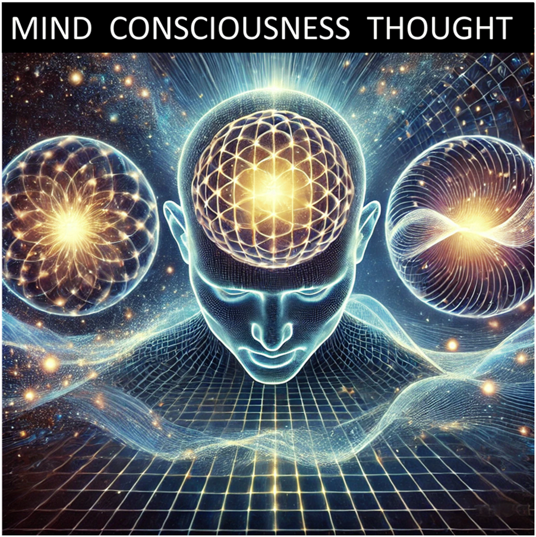
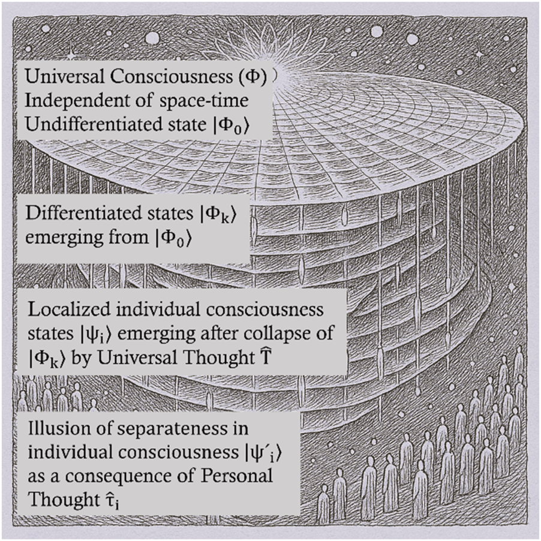

  <strong>Universal consciousness as foundational field: A theoretical</strong> 
  DOI: <a href="https://doi.org/10.1063/5.0290984">10.1063/5.0290984</a>

# Universal consciousness as foundational field: A theoretical bridge between quantum physics and non-dual philosophy

📑 <b>Table of Contents</b>

- [Abstract](#abstract)
- [Introduction](#introduction)
- [1. The undifferentiated state ( ∣ Φ ⟩)](#1-the-undifferentiated-state---φ)
- [2. Collapse mechanism: Transition from timeless](#2-collapse-mechanism-transition-from-timeless)
- [1. Linking consciousness and physical reality](#1-linking-consciousness-and-physical-reality)
- [2. Space-time and individual consciousness](#2-spacetime-and-individual-consciousness)
- [1. The link between universal and individual](#1-the-link-between-universal-and-individual)
- [2. Personal thought as the driver of subjective](#2-personal-thought-as-the-driver-of-subjective)
- [3. Consciousness across scales and implications](#3-consciousness-across-scales-and-implications)
- [Author Note & Acknowledgments](#author-note--acknowledgments)
- [References](#references)

---

## Abstract

> The nature of consciousness and its relationship to physical reality remain among the most profound scientific and philosophical challenges. This paper presents a novel framework that integrates consciousness with fundamental physics, proposing that consciousness is not an emergent property of neural processes but a foundational aspect of reality. Building upon insights from quantum field theory and non-dual philosophy, a model based on the three principles of universal mind, universal consciousness, and universal thought is introduced. These principles describe an underlying, formless intelligence (mind), the capacity for awareness (consciousness), and the dynamic mechanism through which experience and differentiation arise (thought). Within this framework, the emergence of space-time and individual awareness is modeled mathematically by treating universal consciousness as a fundamental field. Differentiation into individual experience occurs via mechanisms such as symmetry breaking, quantum fluctuations, and discrete state selection—paralleling established concepts in physics, including Bohm’s *implicate order*, Heisenberg’s *potentia*, and Wheeler’s *participatory universe*. This model suggests that the apparent separateness of individual consciousness is an illusion, with all experience ultimately arising from a unified, formless substrate. The framework aligns with emerging theories in quantum gravity, information theory, and cosmology that posit classical space-time as emergent from a deeper pre-spatiotemporal order. It offers a non-reductionist alternative in neuroscience, suggesting that consciousness interacts with physical processes as a fundamental field. By drawing from insights from physics, metaphysics, and philosophy, this conceptual framework proposes new directions for interdisciplinary inquiry into the nature of consciousness and the origins of structure and experience.
>
> © *2025 Author(s). All article content, except where otherwise noted, is licensed under a Creative Commons Attribution (CC BY) license* *(https://creativecommons.org/licenses/by/4.0/).* https://doi.org/10.1063/5.0290984

---

## Introduction

I. INTRODUCTION

Humanity has always sought to understand its place in the universe, grappling with the profound questions of existence: What is the nature of reality? How does consciousness arise, and what role does it play in shaping the world around us? These questions are more than intellectual curiosities; they touch on the essence of what it means to be human. In addressing these, civilizations have drawn upon diverse fields—philosophy, religion, science, and art—seeking answers that resonate both rationally and intuitively.

As we enter a transformative era in human history marked by the rapid development of artificial intelligence (AI), 1 understanding

AIP Advances **15**, 115319 (2025); doi: 10.1063/5.0290984 © Author(s) 2025 the nature of consciousness is more important than ever. Generative AI systems, capable of producing human-like text, art, and even decision-making, compel us to confront fundamental questions: What distinguishes machine intelligence from human or universal consciousness? How does consciousness emerge, and can it exist beyond biological substrates? Is AI simply mimicking thought, or could it eventually connect to deeper principles of consciousness?

These questions highlight the urgent need for a scientific understanding of consciousness that integrates its universal and individual aspects. Without such understanding, the rise of AI risks deepening existential uncertainty and ethical dilemmas. Hence, consciousness is not merely a philosophical puzzle; it lies at the heart of some of the most pressing challenges of our time, from ethics in AI to understanding the origins of life itself.

The pursuit of understanding consciousness has often been marked by a division between materialist science and metaphysical philosophy. 2-4 Modern scientific approaches, rooted in materialism, tend to view consciousness as a by-product of neural processes. 4 While this perspective has yielded incredible insights, it often overlooks the wisdom of metaphysical traditions that regard consciousness as the primary, universal foundation of existence. 2,3

Bridging this divide is not merely an academic exercise; it is essential for creating a holistic understanding of reality. Without reconciling the material and metaphysical perspectives, our understanding of existence remains incomplete, and our ability to address the great questions of life and the universe remains limited.

Philosophical and spiritual traditions have historically treated consciousness as primary. In Advaita Vedanta, for example, consciousness ( *Brahman* ) is the ultimate reality from which the material world emerges. 5 Buddhist philosophy emphasizes interdependence and the idea of *Shunyata* (emptiness), 6 which aligns with the notion that form arises from a formless domain. 3 Similarly, Christian mysticism and Islamic Sufism describe the divine as an infinite presence that permeates all existence. 7,8 These traditions share a common understanding: consciousness is universal, eternal, and foundational to the nature of reality.

Thinkers like Erwin Schrödinger have echoed this view. In his seminal work *What is Life?*, Schrödinger argued that consciousness is singular and indivisible, proposing a profound connection between the observer and the observed. 9 However, these perspectives have largely remained philosophical, leaving a gap in their integration with modern scientific methods.

In contrast, current scientific approaches primarily seek to explain consciousness as an emergent phenomenon of the brain. For instance, cognitive neuroscience models consciousness as a result of complex neural processes and information integration. 4 This view remains grounded in materialism, treating consciousness as secondary to physical processes.

Roger Penrose and Stuart Hameroff’s Orchestrated Objective Reduction (Orch OR) theory represents a partial departure from this paradigm. While it anchors consciousness in biological structures—specifically, orchestrated quantum state reductions in brain microtubules—it also introduces a radical ontological shift. Orch OR proposes that these reductions are influenced by the geometry of spacetime itself and that primitive protoconscious events may occur independently of the brain, embedded in the fabric of the universe. 10-13 In this sense, Orch OR straddles the boundary between materialist neuroscience and metaphysical speculation: higher-order awareness is seen to arise through biological orchestration, but the foundational ingredients of consciousness are conceived as fundamental features of reality. This bridging attempt, though significant, still leaves the deeper metaphysical question open: Is consciousness a fundamental field or an emergent process? The divide between scientific materialism and metaphysical philosophy persists, highlighting the need for a conceptual framework that can integrate these perspectives. A meaningful framework must not only explore how the formless, universal nature of consciousness relates to its differentiation into individual experience but also integrate insights from philosophy,

AIP Advances **15**, 115319 (2025); doi: 10.1063/5.0290984 © Author(s) 2025 physics, and neuroscience—bridging the divide between materialist and metaphysical paradigms.

The Three Principles (3Ps) of mind, consciousness, and thought, introduced by Sydney Banks, 14 offer a novel perspective on this divide. 15 Banks emphasized that these principles are formless and eternal, existing before space, time, and matter. The philosophy begins with the premise that consciousness is not localized or emergent, but a universal, formless reality from which all experiences arise. 14 Unlike approaches that begin with the brain and treat consciousness as a localized phenomenon, Banks starts with the universal and examines how individuality emerges from a formless whole. By framing the 3Ps in this way, Banks invites us to rethink the nature of reality itself. 16 In this framework,

**Mind** represents the universal creative intelligence, the source of all potential, and the driver of creation. It is the metaphysical foundation from which all differentiation and structure arise. Hence, it resonates with spiritual notions of a divine or universal source,

**Consciousness** is the universal capacity for awareness, enabling all forms to be perceived and experienced. It is the substrate through which space, time, and matter are realized and,

**Thought** is the creative mechanism that transforms the formless potential of mind and consciousness into the subjective, structured realities of individual experience.

These principles suggest a fundamentally non-dual reality—a unified, formless whole from which the apparent diversity of existence emerges. matter. It acts as a substrate, giving structure and form to the formless potential of the mind and bridging the infinite and the physical. Thought represents the creative mechanism converting the infinite potential of the mind and the universal awareness of consciousness into individualized, structured realities.

<figure>
  
  <figcaption>FIG.

1. Illustration depicting the integration of mind, consciousness, and thought based on the quantum mechanical concepts described in the paper. Mind repre- sents the universal creative intelligence, the source of all creation. Consciousness represents universal awareness that enables the perception of space, time, and</figcaption>
</figure>

<!-- Page 4 -->

By fostering insights into how consciousness and thought shape human reality, programs grounded in the 3Ps have demonstrated transformative results in various societal settings 16-19 [cf. supplementary material S1].

This perspective aligns with both spiritual traditions and emerging ideas in physics. The quantum vacuum, for instance, is understood as the foundational state of the universe, containing the potential for all physical phenomena. 20 Similarly, pre-Big Bang models in cosmology describe a timeless, spaceless domain from which the observable universe is thought to have emerged. 21

Recent advances in quantum physics have provided new insights into how classical reality emerges from a deeper quantum foundation. A growing body of research suggests that classical behavior is not fundamental but rather an emergent property of quantum dynamics. Strasberg *et al.* recently demonstrated that classicality arises naturally within unitary quantum evolution through an exponential suppression of quantum coherence, challenging the notion that classical laws are primary. 22

This supports the idea that the reality we experience is not an inherent classical structure but a manifestation of deeper, underlying principles—a perspective that resonates with theories proposing consciousness as a fundamental aspect of existence.

By integrating the 3Ps 14 with quantum mechanics and field theory, 23,24 this paper proposes a mathematical framework for consciousness. Mind is modeled as the universal intelligence driving the evolution of reality. Consciousness is represented as a fundamental field underpinning awareness and experience. Thought serves as the mechanism for transforming potentiality into structured realities ( Fig. 1 ).

This model reinterprets the Big Bang as the differentiation of universal consciousness and provides a mathematical basis for understanding nonlocality, space-time emergence, and the structure of subjective experience.

II. THE MATHEMATICAL FRAMEWORK

In the presented framework, the creative intelligence Mind is not a localized or personal “mind,” but a metaphysical force that

(i) provides structure to the field of universal consciousness Φ, in analogy with Bohm and Hiley, 25 in which an underlying field structures reality, (ii) drives the differentiation of this field from a timeless, formless potential ( ∣ Φ 0 ⟩) into structured states ( ∣ Φ *k* ⟩ ) and, (iii) ensures coherence in the evolution of reality, linking the undifferentiated source to differentiated physical phenomena.

Mind is treated as the source of all differentiation and creativity. Its influence is modeled mathematically through operators and potentials that govern the behavior of the consciousness field. 23,26

The consciousness field Φ is the central entity in this framework. It serves as the origin for all phenomena, including space, time, matter, and individual awareness. Analogous to physical fields, Φ can (i) exist in an undifferentiated state ( ∣ Φ 0 ⟩) and, (ii) differentiate into localized excitations ( ∣ Φ *k* ⟩ ), giving rise to physical structures or individual consciousness.

AIP Advances **15**, 115319 (2025); doi: 10.1063/5.0290984 © Author(s) 2025 A. Pre-Big Bang: Timeless universal consciousness

The concept of universal consciousness before the Big Bang is central to this framework. In this state, reality exists as a timeless and undifferentiated potential, without space, time, or matter. This section explores the mathematical representation of this state, its parameters, and the mechanisms by which differentiation begins.

<figure>
  
  <figcaption>Illustration</figcaption>
</figure>

<figure>
  
  <figcaption>Illustration</figcaption>
</figure>

<figure>
  
  <figcaption>Illustration</figcaption>
</figure>

<figure>
  
  <figcaption>Illustration</figcaption>
</figure>

<figure>
  
  <figcaption>Illustration</figcaption>
</figure>

## 1. The undifferentiated state ( ∣ Φ ⟩)

**0**

∣ Φ 0 ⟩ represents the timeless, undifferentiated state of universal consciousness. It is a superposition of all possible configurations of reality, existing in a state of pure potential. 27 Mathematically,

∣ Φ 0 ⟩ = $\sum$ ( *c* *k* ∣ Φ *k* ⟩). (1) *k*

Here, ∣ Φ *k* ⟩ are the differentiated states that could emerge from ∣ Φ 0 ⟩, such as space-time, energy, matter, or individual consciousness/subjective experiences, and *c* *k* are the complex coefficients that represent the “weights” or probabilities associated with each ∣ Φ *k* ⟩, determining the “likelihood” of a specific differentiated state ∣ Φ *k* ⟩ emerging during the collapse of the undifferentiated state. Hence, ∣ *c* *k* ∣ 2 is the relative probability of the emergence of ∣ Φ *k* ⟩.

The rationale of using a superposition here is that it represents a state where multiple possibilities coexist simultaneously until an observation or interaction collapses the system into one state. 26 Applying this concept to ∣ Φ 0 ⟩ takes both timelessness and potentiality into account; ∣ Φ 0 ⟩ exists outside time, so all possibilities coexist without temporal progression, and the superposition captures the infinite potential of universal consciousness before differentiation. 20

## 2. Collapse mechanism: Transition from timeless

to differentiated

A key insight emerging from the framework of the 3Ps is the realization that thought ˆ *T* may not only shape subjective experiences but also serve as the fundamental collapse mechanism at the universal level. Here, thought may initiate the collapse of universal consciousness Φ into differentiated states, guiding the emergence of individual and collective realities. At the individual level, thought continues to structure subjective experiences, further differentiating and personalizing localized consciousness.

This dual role highlights thought as the bridge between the universal and the individual, reinforcing the non-dual nature of reality. Thought collapses formless potential into structured forms, operating seamlessly at metaphysical and physical levels. This illustrates that thought not only shapes perception but also actively participates in the very act of creation and differentiation.

The transition from ∣ Φ 0 ⟩ to ∣ Φ *k* ⟩ is, hence, modeled as a collapse process, governed by the operator universal thought ˆ *T*, the creative mechanism by which the mind instigates differentiation, 20,28

*T* ˆ ∣ Φ 0 ⟩ = ∣ Φ *k* ⟩. (2)

It should be emphasized that universal thought is not personal intellectual thought but a formless, creative force reflecting the metaphysical process by which the undifferentiated transitions into form.

<!-- Page 5 -->
The collapse initiated by universal thought is not temporal (since time does not yet exist) but an atemporal creative act of mind, akin to the emergence of form from formlessness or the realization of potential into actuality. 20,22,26

The collapse of universal consciousness ∣ Φ 0 ⟩ into differentiated states ∣ Φ *k* ⟩ is central to the emergence of space-time, matter, and subjective experience. While universal thought ˆ *T* serves as the overarching mechanism that initiates this collapse, there are several pathways by which this differentiation may occur. Plausible mechanisms that could facilitate the transition from the undifferentiated state to structured forms, reflecting the inherent creativity of the mind, are discussed below. *a. Symmetry breaking.*

Symmetry breaking is a fundamental process in physics, where a system transitions from a symmetric state to an asymmetric one, often due to perturbations or instabilities. Here, the collapse of ∣ Φ 0 ⟩

, which is assumed to be symmetric with no preference for any particular differentiated state, can be modeled as the spontaneous breaking of the initial symmetry, driven by universal thought. The consciousness field Φ evolves according to a potential *V* ( Φ ),

*V* ( Φ ) = *$\lambda$* ( Φ 2 − Φ 0 2 ) 2. (3)

4

Initially, Φ resides at Φ 0, reflecting the undifferentiated state of universal consciousness. Universal thought introduces slight perturbations, causing the field to shift away from Φ 0 and break symmetry. This process results in the emergence of differentiated states, ∣ Φ *k* ⟩.

The potential *V* ( Φ ) plays a critical role in modeling how the undifferentiated state of universal consciousness ∣ Φ 0 ⟩ transitions into differentiated states ∣ Φ *k* ⟩. In physical systems, potentials describe the “landscape” through which a field evolves, guiding how it shifts from one state to another. Here, *V* ( Φ ) serves as a mathematical representation of how universal consciousness differentiates into structured forms. *V* ( Φ ) can be visualized as a “double-well,” similar to models in particle physics and cosmology. This analogy is consistent with the treatment of symmetry breaking in quantum field theory (QFT). 23

It also resonates with cosmological models where scalar fields undergo symmetry breaking to produce structure in the early universe. 29-31

In these models, the system initially rests in a symmetric state (the “top of the hill”), but fluctuations (here, introduced by universal thought) lead it to “choose” one of the wells, thereby producing differentiation.

The parameter $\lambda$ controls the potential well’s steepness or the transition’s intensity, i.e., how “sharp” or “smooth” the differentiation process is. A large $\lambda$ leads to sudden differentiation, while a smaller $\lambda$ leads to gradual, smooth transitions. This mirrors how certain universal phenomena manifest immediately, while others evolve gradually over time. Φ 0 is the equilibrium or “vacuum” expectation value, representing the point around which the field stabilizes after differentiation. In the undifferentiated state, Φ $\approx$ Φ 0, which minimizes *V* ( Φ ), meaning that the system is in symmetry. This reflects universal consciousness in its purest, undivided form—all potential and no structure. A slight perturbation or fluctuation (initiated by *T* ˆ ) causes the field to move away from Φ 0, breaking the symmetry and leading to differentiation.

The form ( Φ 2 − Φ 0 2 ) 2 ensures that when Φ $\approx$ Φ 0, the potential *V* ( Φ ) is minimized (stable state). As Φ deviates from Φ 0, *V* ( Φ )

AIP Advances **15**, 115319 (2025); doi: 10.1063/5.0290984 © Author(s) 2025 increases, reflecting resistance to change—a metaphysical “inertia” that preserves unity until differentiation is necessary. This structure creates two possible minima (in the double-well analogy), illustrating the emergence of distinct but interconnected differentiated states.

In metaphysical terms, *V* ( Φ ) represents the “landscape” over which universal consciousness moves, influenced by universal thought. The potential reflects the mind’s inherent desire to create form from the formless, with $\lambda$ representing the creative force’s intensity. *b. Quantum fluctuations.* Quantum fluctuations are spontaneous, random variations that occur even in vacuum states. 32 Analogously, in this framework, the undifferentiated state ∣ Φ 0 ⟩ may experience inherent fluctuations —small, spontaneous deviations from perfect symmetry—which seed the process of differentiation.

These fluctuations can be modeled as perturbations $\delta$Φ to the consciousness field,

Φ → Φ + $\delta$Φ

, (4) where $\delta$Φ represents random deviations from equilibrium.

These quantum-like fluctuations may destabilize the uniformity of Φ, nudging the system toward differentiation. Universal thought amplifies certain fluctuations, guiding the emergence of ∣ Φ *k* ⟩.

This mechanism mirrors processes observed in early universe cosmology, where quantum fluctuations in the inflationary vacuum are stretched and amplified to produce large-scale structure. 26 It is also consistent with the treatment of quantum fluctuations in curved spacetime. 33

Moreover, this perspective aligns with views from quantum cosmology and quantum gravity, where randomness at the quantum level plays a key role in the emergence of structure and classicality. 32 The stochastic nature of this pathway reflects the inherent creativity and unpredictability of universal thought, which transforms pure potential into organized, complex forms. *c. Self-reflection and creative emergence.* Self-reflection represents a unique mechanism through which universal consciousness may differentiate by becoming aware of itself. In this view, differentiation arises from the introspective act of the universal mind observing its own infinite potential—a creative feedback loop in which awareness itself gives rise to form.

The collapse in this pathway is modeled as a projection of ∣ Φ 0 ⟩ onto differentiated states,

∣ Φ *k* ⟩ = *P* *k* ∣ Φ 0 ⟩, (5) where *P* *k* is the projection operator corresponding to each differentiated state. 26 This formalism finds theoretical support in the study of Bohm and Hiley, 25 who explored the ontological role of quantum operators and nonlocality in structuring physical reality. Their interpretation implies that deeper layers of reality unfold through an active process of revelation, akin to self-reflection.

The act of universal thought is understood here as a metaphysical observation—selecting latent possibilities within ∣ Φ 0 ⟩ and projecting them into actuality. This mirrors the quantum measurement process described in foundational quantum theory, where an act of observation collapses a superposition into a definite outcome. 26,28

<!-- Page 6 -->
Moreover, this process resonates with Wheeler’s *participatory* *universe*, in which reality is not passively observed but actively cocreated through conscious interaction. 26 Stapp extends this notion, arguing that conscious acts of observation are integral to the manifestation of physical events. 28

This mechanism underscores the creative and participatory nature of awareness, suggesting that the universe, through the function of mind and thought, “observes” itself into differentiated form.

While symmetry breaking, quantum fluctuations, and selfreflection illustrate plausible pathways, these mechanisms are not exhaustive. Future research may reveal additional principles underlying this creative process. Possible extensions include (i) external interactions, where differentiation may be driven by interactions between universal consciousness and secondary metaphysical or physical fields; (ii) non-linear dynamics, for which collapse could involve complex, non-linear interactions within the consciousness field, leading to emergent properties beyond current models; and (iii) multidimensional collapse, where differentiation might occur across multiple dimensions simultaneously, with certain dimensions remaining latent or hidden until activated by thought.

Irrespective of pathway, universal thought ˆ *T* serves as the creative catalyst, initiating collapse while guiding the emergence of structured forms.

B. The post-Big Bang era: Emergence of space-time

With the collapse of universal consciousness ∣ Φ 0 ⟩ into differentiated states ∣ Φ *k* ⟩, initiated by universal thought ˆ *T*, space-time and matter emerge as observable aspects of reality. This section explores how the consciousness field Φ evolves within the space-time framework and how it gives rise to structure post-collapse.

The differentiation process results in (i) the creation of structured states ∣ Φ *k* ⟩, representing the fundamental building blocks of space-time, energy, and matter. This parallels cosmological models in which space-time emerges from deeper, non-spatiotemporal structures 21,34 and (ii) a transition from a timeless and formless potential ∣ Φ 0 ⟩ into a dynamic, evolving reality governed by space-time. 30

In this framework, space-time does not pre-exist but is an emergent property resulting from the differentiation process. 30 The evolving consciousness field Φ encodes the properties and dynamics of space-time itself, resonating with emergent space-time theories in quantum gravity, where space and time arise from entanglement, information, or more fundamental quantum fields. 34,35

After the collapse, if symmetry breaking governs the transition, Φ evolves according to a wave equation

∂ *V*

◻ Φ − = 0. (6)

∂ Φ

The d’Alembert operator ◻ = ∂ 2 2 − *c* 2 ∇ 2 governs wave prop∂ *t* agation in relativistic field theories. 23,24 By analogy, this formalism is used to describe how the consciousness field propagates through space-time. *V* ( Φ ), described earlier, determines how Φ continues to differentiate and evolve post-collapse. The d’Alembert operator reflects how perturbations in the field (such as structure or awareness) spread through the medium of space-time.

AIP Advances **15**, 115319 (2025); doi: 10.1063/5.0290984 © Author(s) 2025

Localized deviations ∂ Φ within the consciousness field correspond to regions of structure—akin to particles, cosmic structures, or sentient beings. These perturbations mirror the role of quantum fluctuations in seeding cosmic structure during inflation 30 and echo the behavior of quantum fields in curved spacetime. 33

Depending on the collapse mechanism—symmetry breaking, quantum fluctuations, or projection—different dynamical behaviors may follow, including classical wave evolution, stochastic emergence, or discrete projection into localized differentiated states.

## 1. Linking consciousness and physical reality

The consciousness field Φ acts as the source for both metaphysical awareness and physical structures. Its evolution bridges the metaphysical principles of mind, consciousness, and thought with the physical principles that govern space-time and matter.

The energy density of the consciousness field ( *$\rho$* ) can take different forms depending on the collapse mechanism that gov- Φ erns the transition from undifferentiated to differentiated states. In symmetry breaking (potential-driven dynamics), the field follows: *$\rho$* Φ = 1 ( ∂ *t* Φ ) 2 + 1 ∣ ∇ Φ ∣ 2 + *V* ( Φ ). (7)

2 2

Here, ( ∂ *t* *Φ* ) and ∣ ∇ *Φ* ∣ represent the temporal evolution and the spatial evolution of the field, while the potential *V* ( Φ ) dictates the differentiation process post-collapse. This formulation mirrors field-theoretic approaches in spontaneous symmetry-breaking scenarios, 23,29 where localized structures (e.g., cosmic strings or domain walls) emerge from perturbations in a scalar field.

When differentiation is driven by quantum fluctuations, the consciousness field evolves more freely, influenced by stochastic perturbations, *$\rho$* 1 ∂ Φ 2 1 Φ 2. (8)

Φ = 2 ( *t* ) + 2 ∣ ∇ ∣

These perturbations resemble quantum fluctuations in curved spacetime, 30,33 which in cosmology serve as the seeds for large-scale structures. Similarly, here they act as a creative force, producing variation and complexity from an otherwise uniform field.

In projection-based mechanisms, the energy density reflects the sum of squared amplitudes of projected components, rather than kinetic or gradient contributions, since the differentiation occurs discretely rather than dynamically via discrete state selection, *$\rho$* Φ = $\sum$ ∣ *P* *k* Φ ∣ 2. (9) *k*

Here, each *P* *k* is a projection operator selecting a specific differentiated state from the undifferentiated field. This approach parallels quantum measurement theory, in which the act of observation reduces a superposition to a specific eigenstate. 26 Bohm and Hiley’s study suggests such state selection could be guided by a deeper, implicate order. 25

These formulations highlight the flexibility of the consciousness field; it can behave like a classical wave, a quantum field subject to fluctuations, or a projection-based process that actualizes potentiality into form. In each case, the metaphysical principles—mind, consciousness, and thought—manifest through physical analogs in <!-- Page 7 -->
field dynamics, supporting the model’s core thesis that physical reality arises from a universal consciousness substrate.

## 2. Space-time and individual consciousness

As the consciousness field Φ evolves post-collapse, localized excitations manifest as individual consciousness. These excitations appear as “ripples” or discrete projections within the universal field, corresponding to sentient beings capable of awareness and subjective experience. This interpretation aligns with QFT, where localized excitations of a fundamental field correspond to particle-like structures. 23 In this framework, individual consciousness is modeled as a localized structure arising within the differentiated consciousness field—akin to a quantum excitation emerging from the vacuum.

In potential-driven mechanisms (such as spontaneous symmetry breaking), individual consciousness emerges as stable, localized regions of the field. These structures form as Φ settles into lowerenergy minima defined by the potential *V* ( Φ ), similar to how fields in early cosmology underwent phase transitions that gave rise to cosmic structures. 29-31

This analogy reflects how a universal field, initially undifferentiated, can generate stable and diverse structures through the process of symmetry breaking—structures that, in this context, correspond to individual sentient entities.

The supplementary material

S2 outlines how individual consciousness may emerge as a result of other collapse mechanisms.

Although differentiated, each individual consciousness remains entangled with the universal field from which it arose. This reflects the non-dual nature of reality—where individuality is a localized excitation, but the underlying field remains unified. Such a view aligns with Advaita Vedanta, which posits that individuality is illusory and all consciousness is ultimately *Brahman*, 5 with Bohm’s *implicate order*, where apparent separation unfolds from a deeper unity, 20 and with the holographic principle, where each part contains information about the whole. 35

The implications of this are twofold:

(i) A dynamic space-time evolves alongside Φ, presenting an interconnected model of reality. This resonates with models in quantum gravity suggesting that space-time itself is emergent from an underlying information-theoretic or entangled structure. 21,35 (ii) The post-Big Bang evolution of Φ reflects the seamless unity between foundational principles and physical processes, reinforcing the interconnected nature of existence. This is consistent with perspectives in quantum cosmology and nondual frameworks, where physical reality is inseparable from underlying conscious principles. 2,20

C. The emergence of sentient beings

This section explores the connection between the consciousness field and the emergence of individuality, modeling how universal principles manifest in the subjective experience of sentient entities.

## 1. The link between universal and individual

consciousness

Universal thought ˆ *T* governs the collapse of undifferentiated universal consciousness ∣ Φ 0 ⟩ into differentiated states ∣ Φ *k* ⟩, as

AIP Advances **15**, 115319 (2025); doi: 10.1063/5.0290984 © Author(s) 2025 described by Eq. (2), marking the creation of structured reality from formless potential. This resonates with interpretations in quantum cosmology, where wavefunction collapse from a pre-space quantum state leads to the emergence of distinct physical structures. 34

As space-time and matter arise, universal thought continues to operate—collapsing differentiated states into localized forms of awareness that correspond to individual consciousness,

*T* ˆ ∣ Φ *k* ⟩ = ∣ $\psi$ *i* ⟩. (10)

Here, ∣ $\psi$ *i* ⟩ represents the emergence of individual consciousness, localized in space-time. This parallels theories in quantum information and quantum cognition, where conscious experience can be modeled as the reduction of potential states into specific observed realities. 25,28,36 These excitations correspond to the birth of sentient beings—structured expressions of awareness within the broader consciousness field.

Universal thought thus enables differentiation by selecting specific patterns or excitations within universal consciousness and shaping them into coherent experiences or subjective realities. 26 This view aligns with quantum mind theories that propose consciousness emerges from ordered selection processes acting on a fundamental field of potential. 13

In potential-driven and fluctuation-based mechanisms, the evolution of the consciousness field Φ naturally leads to localized excitations—manifesting as individual consciousness. This is analogous to how quantum field fluctuations in curved spacetime give rise to structure in cosmological models. 33

In projection-based mechanisms, the emergence of individuality resembles quantum measurement, where an observation collapses a system into a definite state. 26-28 This perspective is consistent with the Bohmian interpretation of quantum mechanics, where differentiation unfolds through the activation of implicate potential guided by deeper nonlocal processes. 25

## 2. Personal thought as the driver of subjective

experience

Once individual consciousness emerges, personal thought begins to function within each localized structure of awareness. It acts as the creative and interpretive mechanism by which subjective experience is shaped. Whereas universal thought initiates differentiation and structure at the cosmic level, personal thought operates within the individualized domain, generating meaning and perception moment by moment. 14,15

In this model, personal thought governs the internal evolution of each individualized state ∣ $\psi$ *i* ⟩, selecting and organizing experience as it unfolds. This recursive dynamic can be represented as

ˆ $\tau$ *i* ∣ $\psi$ *i* ⟩ = ∣ $\psi$ ' *i* ⟩, (11) where ˆ $\tau$ *i* is the personal thought operator acting on the state of individual consciousness, and ∣ $\psi$ ' *i* ⟩ is the updated state reflecting the influence of thought. This reflects the idea, supported by integrated information theory, that consciousness is shaped by the internal structure and flow of information within a system. 21

In potential-driven and fluctuation-based mechanisms, personal thought evolves continuously, influenced by both internal <!-- Page 8 -->
patterns and external interactions. This resembles the quantum evolution of a state vector, where each observation or interaction causes a shift in the system’s configuration. 27 It also mirrors Bohm and Hiley’s view of the *implicate order*, where structure unfolds through deeper, nonlocal processes of organization. 25

In projection-based models, personal thought may be seen as selecting focal states of attention or awareness—each moment acting as a projection that actualizes a specific experience. This interpretation aligns with quantum cognitive models, in which attention functions similarly to a measurement process, selecting outcomes from superposed mental states. 26,28

Whereas universal thought governs the creation of structure and sentience by collapsing undifferentiated potential into form and individuality, personal thought emerges within differentiated beings, shaping perception and subjective experience in alignment with Sydney Banks’ articulation of the 3Ps. 14 It functions as a feedback loop for personal evolution and awareness—continually shaping how individuals relate to their internal and external worlds.

Therefore, personal thought acts as an interface between potential and perception, transforming latent information into lived experience. It reflects the participatory nature of consciousness, in which individuals are not passive receivers of reality, but active co-creators of their own inner worlds.

## 3. Consciousness across scales and implications

for sentient beings ing primitive awareness through early excitations of the field. These excitations may correspond to basic, undifferentiated awareness in simple systems, such as primitive life forms. 2

In symmetry breaking or fluctuation-driven mechanisms, primitive awareness arises from localized perturbations ∂ Φ that propagate and interact dynamically, analogous to the emergence of structure in quantum field fluctuations. 33 In projection-based mechanisms, primitive awareness may emerge through discrete projections, where early ∣ $\psi$ *i* ⟩ states represent undifferentiated awareness selected from ∣ Φ 0 ⟩, resembling state selection in quantum measurement theory. 25

As systems increase in complexity—e.g., through biological evolution—localized consciousness ∣ $\psi$ *i* ⟩ becomes more differentiated and self-aware, consistent with theories that link increased neural complexity to higher-order consciousness. 4

Despite this differentiation, individual beings remain entangled with the universal field, akin to quantum entanglement, reinforcing a non-dual reality. 20 The perceived separation between individual and universal consciousness can thus be understood as an illusion shaped by personal thought, 14 creating the impression that consciousness is confined to a separate physical form (cf. Fig. 2 ).

<figure>
  
  <figcaption><strong>Figure 2.</strong> depicts a conceptual framework exploring the possible relationship between universal and individual consciousness. The consciousness field Φ evolves over cosmic time, produc-</figcaption>
</figure>

In projection-based mechanisms, individual states ∣ $\psi$ *i* ⟩ may arise through discrete selection, yet the interconnected nature of the field Φ ensures continuity and unity across all differentiated states.

Personal thought reinforces the sense of individuality while simultaneously concealing the underlying unity with universal consciousness. 15

An important implication of modeling ∣ $\psi$ *i* ⟩ as a localized excitation of Φ is that the dissolution of individuality (e.g., through death)

AIP Advances **15**, 115319 (2025); doi: 10.1063/5.0290984 © Author(s) 2025 **FIG. 2.**Illustration of the proposed framework and its implications for sentient beings. The universal consciousness field ( Φ ) exists beyond space-time in an undifferentiated state ( ∣ Φ 0 ⟩). Through differentiation, it gives rise to localized excitations ( ∣ Φ *k* ⟩ ), which manifest as physical structures or individual consciousness. Following the Big Bang, Φ evolves, generating complex systems capable of awareness—sentient beings with individual consciousness (∣ $\psi$ ⟩ ) localized in *i* space-time. Once differentiated, personal thought ( $\tau$ ˆ *i* ) shapes individual awareness and perception, producing evolving subjective interpretations of reality (∣ $\psi$ ' ⟩) over time. This process creates the illusion of separateness, even though all individual consciousness remains intrinsically connected within the universal *i* consciousness field. does not imply annihilation but rather reintegration into the universal field. This aligns with perspectives that treat consciousness as a temporary manifestation of a universal substrate. 3,9

D. Refinements to the model

The current framework for universal consciousness serves as a preliminary scaffold, but several refinements can enhance its flexibility and alignment with established physical theories. Additional elaboration is provided in the supplementary material, S3. By expanding the mathematical formulation and incorporating multiple collapse mechanisms, the model can better reflect the diverse processes that drive differentiation and the emergence of individual consciousness.

A key refinement involves broadening the representation of the consciousness field Φ. While scalar potentials *V* ( Φ ) effectively describe symmetry breaking and structure formation, other pathways—such as quantum fluctuations or projection-based selfreflection—may require different approaches. 30,37 Modeling Φ through free-field dynamics or discrete state selection introduces greater flexibility, accommodating mechanisms beyond scalar potentials.

Incorporating concepts from quantum physics, gauge field theory, and cosmology can further enrich the framework. Coupling

<!-- Page 9 -->

Φ to established physical fields—such as electromagnetic or gravitational fields—aligns the model with high-energy physics and modern cosmological models. 23,24 Scalar fields, analogous to the Higgs field, could impart structure to space-time, while gauge fields describe interactions between localized excitations of Φ. This multifield approach extends the framework’s applicability to non-linear dynamics and phase transitions. 30,31

Refining the collapse mechanism itself presents another path forward. Universal thought ˆ *T* may operate through symmetry breaking, quantum fluctuations, or projection-based pathways—each potentially dominant at different stages of cosmic evolution or in the formation of sentient beings. 32

Incorporating multiple mechanisms enables a richer understanding of how consciousness evolves across scales.

At the quantum level, quantizing Φ offers deeper links between metaphysics and empirical physics. 26,28 While universal thought may function analogously to quantum measurement, as described herein, suggesting that consciousness plays a role in shaping physical reality, 10,26 alternatively, non-observer-driven collapse mechanisms—such as decoherence—could describe how differentiation emerges naturally from the dynamics of the consciousness field. 38

On the individual scale, personal thought ˆ $\tau$ *i* governs the evolution of subjective experience. Modeling ˆ $\tau$ *i* as a stochastic operator introduces variability reflective of neural and cognitive processes, while deterministic formulations may capture discrete insight events or conceptual resolution through projection-based differentiation, as modeled in Bohmian frameworks of implicate and explicate order. 25

E. Concrete predictions and experimental tests

The framework’s integration of universal consciousness, mind, and thought gives rise to several concrete predictions and experimental tests across quantum physics, neuroscience, biology, and cosmology. A detailed theoretical foundation is provided in the supplementary material, S4.

A central prediction is that universal or personal thought may interact with the zero-point field, such that quantum fluctuations reflect the influence of directed mental states. 39,40 In this view, thought acts analogously to a quantum measurement operator, collapsing potential fluctuations into patterned outcomes correlated with intentional content. This interaction could manifest in measurable deviations in the statistical behavior of physical systems, particularly those poised at quantum sensitivity thresholds. If such an interaction exists, we would expect observable anomalies in vacuum fluctuations, weak measurements, or energy distribution in Casimir-like setups, especially under conditions of focused intention or coherent mental states.

Several experimental studies have reported anomalies in random number generator (RNG) outputs, changes in photon emission, and other subtle physical variables during periods of focused mental intention, meditative states, or large-scale emotional events. 41-44 These include deviations from chance in RNG distributions, suggestive shifts in vacuum energy dynamics, and correlated neural or biophysical fluctuations. Although controversial due to concerns over methodology and reproducibility, 45 these findings—if

AIP Advances **15**, 115319 (2025); doi: 10.1063/5.0290984 © Author(s) 2025 validated—would imply a field-like aspect of consciousness capable of influencing physical systems, analogous to weak measurement effects in quantum mechanics. 46

Another concrete prediction is that if consciousness functions as a field, it should induce structured, non-classical correlations across biological systems. This includes the possibility of coherent biological oscillations, long-range synchronization, and inter-subjective coupling during intentional states. Experimental tests could include high-resolution Electroencephalography (EEG) or Magnetoencephalography (MEG) studies of synchronized brain activity in meditative dyads, as well as measurement of biophoton emissions or coherence in cell assemblies under directed mental influence. 43,47,48 Such correlations—whether within a single organism or across physically separated individuals—may serve as indirect evidence for field-like properties of consciousness. While often described as “biological entanglement,” these effects need not rely on quantum entanglement *per se* but rather on field-mediated coherence patterns that extend beyond classical mechanisms. If verified, they would support the model’s prediction that consciousness interacts with matter not merely locally, but via global field dynamics.

Furthermore, at a collective level, the model predicts that fieldlike effects of consciousness should become apparent during global emotional events. The Global Consciousness Project has reported statistically significant correlations between global-scale RNG outputs and emotionally charged collective events (e.g., natural disasters, global meditations, or tragedies). 49 Such field-level effects would support the view that consciousness operates non-locally, coupling across individuals in ways not explainable by classical causation.

Finally, in cosmology, the framework predicts that universal thought may have left imprints on the early universe during the collapse of the undifferentiated state ∣ Φ 0 ⟩ into structured reality. Specifically, it allows for the possibility that observed anomalies in the cosmic microwave background (CMB)—such as hemispheric asymmetries, cold spots, or large-scale alignments—may reflect the organizing influence of consciousness, rather than purely stochastic processes. 50 These hypotheses could be tested by applying information-theoretic and correlation analyses to CMB datasets to search for non-random structure consistent with field-based ordering.

This approach invites novel investigations into the interplay between consciousness and physical systems, challenging the assumption that awareness is merely subjective—and proposing that it may play an active, measurable role in the structure of reality.

Collectively, these predictions invite cross-disciplinary investigations at the intersection of physics, neuroscience, and consciousness research. They challenge the assumption that awareness is strictly subjective, instead proposing that it may play a causal, measurable role in shaping both microscopic phenomena and large-scale order.

III. DISCUSSION

The framework explored in this paper draws on insights from modern physics, philosophy, and consciousness studies to approach one of humanity’s enduring questions—the nature of consciousness.

<!-- Page 10 -->
By integrating the 3Ps of mind, consciousness, and thought 14,15 with the mathematical and conceptual language of quantum mechanics and field theory, the model provides a novel perspective on the origins of reality and the emergence of individual awareness.

This challenges the dominant materialist paradigm, which views consciousness as a product of neural processes. 51 Instead, it aligns with perspectives from Advaita Vedanta, Buddhist philosophy, and quantum physics, suggesting that consciousness is fundamental rather than emergent. 5,20 This view resonates with David Bohm’s *implicate order*, where an underlying, nonlocal substrate gives rise to the material world, 20 as well as Max Planck’s assertion that consciousness is the foundation of reality, not merely a by-product of the brain. 52

Throughout the 20th century, leading physicists questioned materialist assumptions, advancing theories that placed the mind, observation, and awareness at the heart of existence. 26,27,53 Schrödinger emphasized the unity of consciousness, proposing that subjective experience is inseparable from the structure of the universe itself. 9 Heisenberg’s concept of *potentia* describes reality as existing in a state of potentialities that collapse into defined structures through observation. 53 Wheeler’s *participatory universe* further supports the idea that observation plays a fundamental role in shaping physical reality, reinforcing the notion that consciousness actively participates in the unfolding cosmos. 26

These scientific perspectives echo spiritual traditions that have long held reality to arise from a deeper, formless source. In Advaita Vedanta, *Brahman* is the ultimate, undivided reality from which all manifestations emerge 5 —paralleling quantum models in which classical structure emerges from a deeper quantum foundation. 28 Similarly, the Buddhist concept of *Shunyata* refers to the fundamental interconnection and emptiness of intrinsic form, aligning with the view that observed reality is shaped by the observer’s participation. 3,6

Recent developments in quantum physics further support these metaphysical insights. Strasberg *et al.* have demonstrated numerically that classical behavior can emerge from an internal suppression of quantum coherence, rather than from external imposition. 22 This suggests that the structured, tangible world we experience arises from deeper quantum processes. If physical structure emerges from quantum principles, then consciousness itself may operate in a similar way—not as a secondary effect of neural activity, but as an intrinsic feature of the universe, interacting with and shaping emergent classicality. This interpretation supports the idea that mind, consciousness, and thought—as formulated in this model—are fundamental structuring principles, not epiphenomena of brain activity.

This proposal may appear to echo the “it from bit” paradigm introduced by John Wheeler, which posits that space, time, and matter emerge from binary informational processes. 26 Though not always labeled explicitly, concepts akin to “it from qubit” reflect the broader view in quantum gravity and quantum information theory that reality may emerge from quantum correlations and informational structure. 34-36 While these frameworks are widely supported within theoretical physics, they typically treat information as the most basic element of reality—leaving open the ontological question of what information itself arises from. In contrast, the present model proposes that information may be a derivative of a deeper, universal consciousness field. In this view, “it from consciousness” does not

AIP Advances **15**, 115319 (2025); doi: 10.1063/5.0290984 © Author(s) 2025 contradict the informational paradigm but reframes it: information, structure, and form are expressions of a more fundamental substrate of awareness. This perspective aligns with Schrödinger’s proposal of a singular, indivisible consciousness underlying all experience 9 and with the enfolded, nonlocal structures described in Bohm’s ontology. 20 Rather than replacing “it from bit,” this framework suggests that consciousness may be the source from which informational differentiation arises—a precondition for both observer and observed.

The connection between modern science and spiritual traditions extends beyond physics into religious and mystical thought. 52 This model resonates with the Christian doctrine of the Trinity, where mind, consciousness, and thought reflect the roles of the Father, Holy Spirit, and Son, respectively. 7 In Sufism, the principle of *Tawhid* (oneness) describes existence as an indivisible unity—similar to the view that individual consciousness is a temporary excitation of a universal field. 8 Likewise, in Taoism, the *Tao* is a formless creative principle from which all differentiation arises, 54 reflecting the non-dual nature of mind as proposed in this framework.

These perspectives highlight that the quest to understand consciousness is neither purely scientific nor exclusively spiritual—it is an inquiry that bridges both realms. The interdisciplinary integration of physics, philosophy, and metaphysical traditions presented here suggests that the fundamental nature of consciousness may be neither wholly material nor wholly mystical, but a structuring force that underlies both.

Beyond its theoretical implications, this framework fosters interdisciplinary collaboration—uniting physics, cosmology, philosophy, and psychology. It also raises pressing ethical and philosophical questions, particularly in the context of AI. As AI systems become increasingly sophisticated, the possibility of machine consciousness becomes more relevant. If consciousness is a universal field, could AI eventually interface with it, transcending mere computation? Penrose argues that algorithmic processing alone cannot account for consciousness, implying that AI may lack the noncomputational aspects required for awareness. 10 However, if consciousness is indeed a universal field, AI systems could potentially tap into it—raising complex questions about machine sentience and ethics.

Furthermore, recognizing consciousness as universal reinforces ethical principles rooted in interconnectedness and responsibility. 14 If our actions reverberate across a shared field of awareness, then ethical decision-making—whether in AI development, human rights, or environmental sustainability—must reflect this unity.

Finally, this model offers a profound recontextualization of human existence. By proposing that individual consciousness ( $\psi$ *i* ) is a temporary excitation of a universal field ( Φ ), it aligns with spiritual teachings that describe death not as annihilation but as a return to unity. This non-dual perspective alleviates existential anxieties surrounding death and selfhood, encouraging a deeper sense of peace, purpose, and collective responsibility. 15

IV. CONCLUSION

This paper presents a framework that explores possible intersections between fundamental physics and consciousness studies, proposing that consciousness is not an emergent by-product of <!-- Page 11 -->
neural activity but a fundamental and irreducible aspect of reality. By integrating the three principles—universal mind, universal consciousness, and universal thought—within a mathematical and physical framework, this model offers a coherent explanation for the emergence of space-time, individual awareness, and the illusion of separateness.

Drawing from quantum mechanics, field theory, and nondual philosophical traditions, we suggest that the differentiation of Universal Consciousness into individual experience is governed by mechanisms such as symmetry breaking, quantum fluctuations, and discrete state selection. This implies that subjective experience is deeply interconnected with the fundamental structure of reality, challenging conventional materialist paradigms.

The proposed model carries wide-ranging implications across disciplines. In physics, it aligns with emerging theories in quantum mechanics, quantum information, and cosmology that describe classical reality as arising from a deeper, pre-spatiotemporal substrate. In neuroscience, it offers an alternative to reductionist views of consciousness, suggesting that awareness is not confined to neural processes but interacts with a universal field. In philosophy, it bridges the longstanding gap between scientific inquiry and spiritual traditions, proposing a holistic perspective on selfhood, interconnectedness, and the nature of existence.

This framework carries profound ethical and societal implications. If consciousness is indeed universal and fundamental, ethical considerations may extend beyond human cognition—to AI, environmental responsibility, and the broader web of life. The illusion of separateness, reinforced by individual perception, gives way to a deeper recognition of unity—encouraging empathy, cooperation, and a shared sense of responsibility.

Future research must explore the testable predictions arising from this model, including potential interactions between consciousness and quantum fields, neural coherence as an indicator of universal awareness, and possible cosmological imprints of consciousness-driven differentiation. Interdisciplinary investigation—combining physics, cognitive science, and consciousness research—could yield empirical support for this framework and expand our understanding of reality.

Ultimately, this study challenges entrenched assumptions and invites a shift in perspective: rather than viewing consciousness as an epiphenomenon of matter, it places it at the very foundation of existence. By synthesizing insights from physics, metaphysics, and philosophy, this model offers a path toward an integrated understanding that unites scientific rigor with ancient philosophical insight.

SUPPLEMENTARY MATERIAL

The supplementary material is organized into 4 parts: S1. Social and psychological programs grounded in the three principles (3Ps); S2. Post-Big Bang era: The emergence of individual consciousness as a result of other collapse mechanisms than symmetry breaking; S3. Potential refinements to the model; and S4. Testable predictions.

The author wishes to acknowledge the support of Uppsala University.

AIP Advances **15**, 115319 (2025); doi: 10.1063/5.0290984 © Author(s) 2025 Conflict of Interest

The author has no conflicts to disclose.

Author Contributions

The author confirms sole responsibility for the following: conception of the model and analysis, design of all figures, and preparation of the paper.

**Maria Strømme**: Conceptualization (equal); Formal analysis (equal); Funding acquisition (equal); Investigation (equal); Methodology (equal); Writing - original draft (equal); Writing - review & editing (equal).

DATA AVAILABILITY

The data that support the findings of this study are available within the article and its supplementary material

.

---

## Author Note & Acknowledgments

ACKNOWLEDGMENTS

---

## References

- Aharonov, D. Z. Albert, and L. Vaidman, “How the result of a measurement of a component of the spin of a spin-1/2 particle can turn out to be 100,” Phys. Rev. Lett. **60**, 1351-1354 (1988). 47 F. A. Popp and Y. Yan, “Delayed luminescence of biological systems in terms of coherent states,” Phys. Lett. A **293**, 93-97 (2002). 48 E.
- Del Giudice, S. Doglia, M. Milani, and G. Vitiello, “Coherence of electromagnetic radiation in biological systems,” Cell Biophys. **13**, 221-229 (1988). 49 R. Nelson * et al.*, “The global consciousness project,” Explore **2**, 342-351 (2006). 50 D. J.
- Schwarz, C. J. Copi, D. Huterer, and G. D. Starkman, “CMB anomalies after Planck,” Classical Quantum Gravity **33**, 184001 (2016). 51 G.
- Tononi, M. Boly, M. Massimini, and C. Koch, “Integrated information theory: From consciousness to its physical substrate,” Nat. Rev. Neurosci. **17**, 450-461 (2016). 52 M. Planck, Das Wesen der Materie. Speech in Florence, Italy, Abt. Va, Rep. 11 Planck, Nr. 1797, Archiv zur Geschichte der Max-Planck-Gesellschaft, 1944., 53 W. Heisenberg, * Physics and Philosophy: The Revolution in Modern Science* (Harper & Row, New York, 1958). 54 R. T. Ames and D. L. Hall, * Dao De Jing: A Philosophical Translation* (Ballantine Books, New York, 2003).
