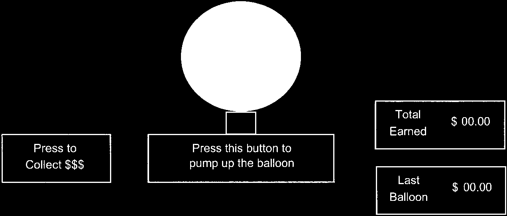
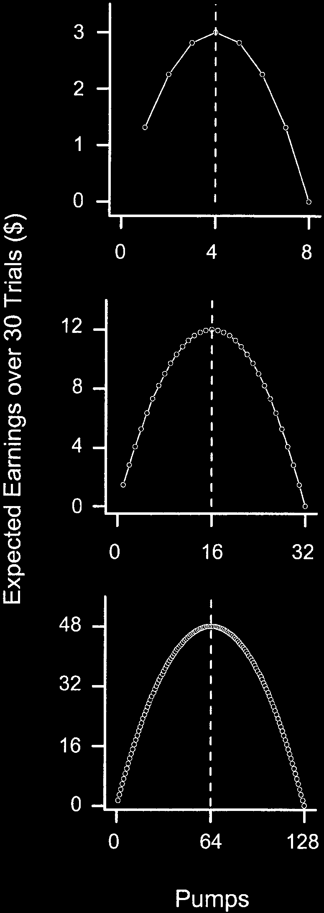

  <strong>Journal of Experimental Psychology: Applied</strong> 
  2002, Vol. 8, No. 2, 75-84 
  Copyright 2002 by the American Psychological Association, Inc. 
  DOI: <a href="https://doi.org/10.1037//1076-898X.8.2.75">10.1037//1076-898X.8.2.75</a>

# Evaluation of a Behavioral Measure of Risk Taking: The Balloon Analogue Risk Task (BART)

  
C. W. Lejuez

  
University of Maryland

  
Jennifer P. Read and Christopher W. Kahler

  
Brown University

  
Jerry B. Richards

  
University at Buffalo, The State University of New York

  
Susan E. Ramsey, Gregory L. Stuart, David R. Strong, and Richard A. Brown

  
Brown University School of Medicine and Butler Hospital

📑 <b>Table of Contents</b>

- [Abstract](#abstract)
- [Introduction](#introduction)
- [Method](#method)
  - [Participants](#participants)
  - [Materials and Apparatus](#materials-and-apparatus)
    - [Measure of intelligence (IQ)](#measure-of-intelligence-iq)
    - [Measures of risk-related constructs and discriminant validity](#measures-of-risk-related-constructs-and-discriminant-validity)
    - [Risk behaviors](#risk-behaviors)
    - [The BART](#the-bart)
  - [Procedure](#procedure)
- [Results](#results)
  - [Experimental Properties of the BART](#experimental-properties-of-the-bart)
  - [Relationship of the BART With Measures of Risk-Related Constructs and Individual Risk Behaviors](#relationship-of-the-bart-with-measures-of-risk-related-constructs-and-individual-risk-behaviors)
- [Discussion](#discussion)
- [Author Note & Acknowledgments](#author-note--acknowledgments)
- [References](#references)

---

## Abstract

> The present study ($N = 86$) sought to evaluate a laboratory-based behavioral measure of risk taking (the Balloon Analogue Risk Task; BART) and to test associations between this measure and self-report measures of risk-related constructs as well as self-reported real-world risk behaviors. The BART evidenced sound experimental properties, and riskiness on the BART was correlated with scores on measures of sensation seeking, impulsivity, and deficiencies in behavioral constraint. Also, riskiness on the BART was correlated with the self-reported occurrence of addictive, health, and safety risk behaviors, with the task accounting for variance in these behaviors beyond that accounted for by demographics and self-report measures of risk-related constructs. These results indicate that the BART may be a useful tool in the assessment of risk taking.

---

## Introduction

Risk-taking behaviors are those that involve some potential for danger or harm while also providing an opportunity to obtain some form of reward (Leigh, 1999). Although risk taking encompasses a broad range of behaviors that fall along both positive and negative dimensions (Byrnes, Miller, & Schafer, 1999; Foersterling, 1980; Leigh, 1999), those that place an individual at risk for deleterious health or safety outcomes (e.g., sexually transmitted diseases, alcohol or drug dependence, cancer) have received particular attention in the literature (e.g., DiClemente, Hansen, & Ponton, 1995; Zuckerman, Ball, & Black, 1990). To prevent or ameliorate potential negative outcomes associated with risk taking, researchers have attempted to better understand this behavioral phenomenon. Accordingly, there has been much focus on the development of reliable and accurate assessment approaches for measuring such patterns of behavior. The assessment of risk taking has relied heavily, although not exclusively, on the use of self-report instruments measuring constructs such as sensation seeking (Zuckerman, Eysenck, & Eysenck, 1978), venturesomeness (Eysenck, Pearson, Easting, & Allsopp, 1985), impulsivity (Barratt, 1985; Eysenck et al., 1985), and deficits in behavioral constraint (Tellegen, 1982). Although these constructs clearly overlap with risk taking, none capture fully its broad, multidimensional nature, and currently there exists no universally accepted measure for the assessment of risk taking. Furthermore, reliance solely on self-report measures presents other limitations as well. First, the veracity of self-report may be limited by any perceived negative consequences of reporting risky behavior. In addition, some respondents may lack the insight or ability to provide an accurate report of their own behavior (e.g., Ladouceur et al., 2000). Finally, because these instruments often rely on questions that directly inquire about the behavior under question, such measures are considerably less useful in a prevention context when one is attempting to predict the emergence of new risk behaviors (Andrew & Cronin, 1997; Greene et al., 2000). Given the shortcomings of relying solely on self-report measures, there is great potential utility in the use of a behavioral measure of risk taking to be used within a multimethod approach to maximize the breadth of risk-taking assessment. Although a number of behavioral risk tasks have been developed (e.g., Bechara, Damasio, Damasio, & Anderson, 1994; Grant, Contoreggi, & London, 2000; Mitchell, 1999; Petry, 2001; Rogers et al., 1999), several shortcomings of these tasks are evident. First, existing behavioral risk tasks consistently have been shown to demonstrate poor convergent validity with self-report measures of risk-related constructs (Bentler & McCain, 1976; Mitchell, 1999; Petry, 2001; Stuart, 1998; White et al., 1994). Furthermore, there is limited evidence of riskiness on these tasks showing a relationship with the range of risk behaviors occurring outside the laboratory (cf. Gullone & Moore, 2000; Jessor & Jessor, 1977; Pack, Crosby, & St. Lawrence, 2001). To address these issues, we developed the Balloon Analogue Risk Task (BART). The BART is a computerized, <!-- Page 2 -->
laboratory-based measure that involves actual risky behavior for which, similar to real-world situations, riskiness is rewarded up until a point at which further riskiness results in poorer outcomes. In this study we examined this measure in relation to both self-report measures of risk-related constructs and a range of self-reported real-world addictive, health, and safety risk behaviors. Because previous studies have reported difficulty in recruiting participants in the upper range of risky behavior, we limited our sample to individuals between the ages of 18 and 25 to increase the likelihood of recruiting a sample across the entire range of risky behavior. The development and validation of this measure represent a first step in the establishment of a behavioral task that can be used as part of a multimethod assessment of risk-taking propensity. Accordingly, we sought to establish the experimental properties of the BART and to examine how riskiness on the task is related to scores on self-reported risk-related constructs and the self-reported occurrence of real-world risk behaviors. Specifically, we hypothesized that riskiness on the BART would be significantly and positively associated with self-reported risk-related constructs such as impulsivity, sensation seeking, and deficits in behavioral constraint. We also hypothesized that riskiness on the BART would significantly predict the self-reported occurrence of addictive, health, and safety risk behaviors in addition to that predicted with demographics and self-report measures of risk-related constructs.

## Method

### Participants

Participants were 86 individuals (43 men and 43 women) between the ages of 18 and 25 ($M = 20.9$, $SD = 2.1$), who were recruited through advertisements in community newspapers as well as in four local college newspapers. Although the advertisement invited individuals at all levels of risk, we also used the phrase “Are you a risk taker?” to increase the likelihood of recruiting a representative number of individuals at the upper end of the risk-taking continuum. Of 103 individuals who responded to recruitment ads, 12 declined to participate when given further information over the phone, and an additional 5 did not attend their scheduled experimental session, resulting in an 84% recruitment rate. Seventy-five percent of the participants were Caucasian, and 92% had completed at least some college.

### Materials and Apparatus

Materials used in the experimental session consisted of a self-report battery and the BART. The self-report battery was administered in a private waiting room and took approximately 90 min to complete. The BART was conducted in a 10 ft. $\times$ 10 ft. (3 m $\times$ 3 m) experimental room including a desk supporting a Dell Pentium computer, a 13-in. (33-cm) color monitor, and a mouse. The experimenters sat in an adjacent room containing all other experimental equipment. A one-way mirror allowed the experimenters to observe BART administration. To limit the influence of order effects, questionnaire presentation order was randomized, with the BART occurring at some randomly determined point during this questionnairecompletion period. The experimenter administering the BART was blind to participant responses on the self-report battery. 

#### Measure of intelligence (IQ)

To examine the extent to which participant behavior on the BART was influenced by IQ, we administered the original version of the vocabulary section of the Shipley Institute of Living Scale (Shipley, 1940; Shipley & Burlingame, 1941). This section consists of 40 multiple-choice items for each of which the respondent must choose the best synonym for a word. Scores on this measure are significantly correlated with the Wechsler Adult Intelligence Scale—Revised (WAIS-R; Wechsler, 1981), a standardized test of IQ. For example, Zachary, Crumpton, and Spiegel (1985) found a correlation of.87 with the full-scale WAIS-R and Weiss and Schell (1991) found a correlation of.86. Test-retest reliability for this measure over a 2-week period has been established ($r = .77$; Ruiz & Krauss, 1967). 

#### Measures of risk-related constructs and discriminant validity

As noted previously, because no single measure has been shown to capture risk taking fully, we used the following measures to determine various aspects of the riskiness construct. To examine sensation seeking, we used the 40-item Sensation Seeking Scale (Zuckerman et al., 1978), which includes questions focusing on thrill and adventure seeking, experience seeking, disinhibition, and boredom susceptibility. Zuckerman et al. (1978; Zuckerman, 1979) has provided data supporting the internal consistency of the measure, with alpha coefficients ranging from.83 to.86. The alpha coefficient for the current sample was.83. Test-retest reliability over a 3-week period also has been established ($r = .92$).

To measure impulsivity, we used the 34-item Barratt Impulsiveness Scale—Version 1.0 (Barratt, 1985; Patton, Stanford, & Barratt, 1995), which includes questions focusing on motor impulsivity (acting without thinking), cognitive impulsivity (making quick cognitive decisions), and future-planning impulsivity (lack of concern about the future). Barratt (1985) provided data supporting the internal consistency with alpha coefficients ranging from.89 to.92; the alpha coefficient for the current sample was.86. Similar versions of the task have shown test-retest correlations at 2 months to be above.8 (e.g., Fossatti, Ceglie, Acqarini, & Barratt, 2001). To measure both venturesomeness and impulsivity, we used the Eysenck Impulsiveness Scale (Eysenck et al., 1985). The 54-item scale contains three subscales: Impulsivity, Venturesomeness (similar to sensation seeking), and Empathy. The Empathy subscale consists of items unrelated to risk and thus was examined in the present study only as an index of discriminant validity. Eysenck et al. (1985) provided data regarding the internal consistency of the subscales with alpha coefficients equaling.84,.85, and.69 for Impulsivity, Venturesomeness, and Empathy, respectively. In the current sample, alpha coefficients equaled.83,.81, and.61, respectively. To measure a combination of the above constructs in one measure, we used the Behavioral Constraint superfactor of the Multidimensional Personality Questionnaire (MPQ; Tellegen, 1982). This superfactor consists of the Control, Harm Avoidance, and Traditionalism scales, which are 3 of the 11 primary scales within the MPQ. Internal consistency data for the superfactor indicate alpha coefficients ranging from.79 to.85. In the current sample, the alpha coefficient for the superfactor was.81. Test- retest reliability over 2 weeks also has been established, with correlations ranging from.82 to.90 (Tellegen & Waller, 1982). In addition to the Eysenck Empathy subscale score, we used the Center for Epidemiological Studies Depression Scale (CES-D; Radloff, 1977) and the Anxiety Sensitivity Index (ASI; Reiss, Peterson, Gursky, & McNally, 1986) as measures of discriminant validity. The CES-D is a screening measure for depressive symptoms that is designed to be used in community samples, and the ASI measures fear of anxiety-related symptoms. Alpha coefficients indicating the internal consistency of the measures within the current sample were.88 and.89, respectively. Test-retest correlations for the CES-D were as high as.70 over shorter periods (i.e., 2 weeks) and as low as.45 over longer periods. For the ASI, test-retest correlations were.75 over a 2-week period and.70 over a 3-year period (Peterson & Reiss, 1992). 

#### Risk behaviors

We used a variety of self-report measures to assess both addictive behaviors as well as nonaddictive health and safety risk behaviors.

<!-- Page 3 -->
To assess smoking status, we asked participants to report the average number of cigarettes they smoked daily. We measured potential problem drinking using the Alcohol Use Disorders Identification test (AUDIT; Saunders, Aasland, Babor, de la Fuente, & Grant, 1993), a 10-item measure recommended by the World Health Organization as a brief screening instrument for the detection of hazardous or harmful alcohol consumption. The AUDIT assesses quantity and frequency of drinking, drinking intensity, symptoms of dependence and tolerance, and alcohol-related negative consequences over the past 12 months. Alpha coefficients indicating internal consistency across several studies have been shown to be approximately.80 (cf. Allen, Litten, Fertig, & Babor, 1997). In the current sample, the alpha coefficient was.86 for this measure. Concurrent and content validity also have been demonstrated (Bohn, Babor, & Kranzler, 1995; Hays et al., 1993; Saunders, et al., 1993). As a measure of risk propensity regarding drug use, we examined *polydrug use*(e.g., Babor et al., 1992; Grant et al., 2000), defined as the number of drug classes tried over the past 12 months across the following categories: (a) marijuana, (b) stimulants, (c) cocaine, (d) hallucinogens, (e) opiates, (f) sedatives, and (g) other. We assessed gambling consequences over the past 12 months using the South Oaks Gambling Screen (SOGS; Lesieur & Blume, 1986), with a cutoff score of 5 or above indicating pathological gambling status. Ninety-eight percent of members of Gamblers Anonymous scored 5 or greater on the SOGS (Lesieur & Blume, 1986). Because there is mixed evidence regarding the utility of the SOGS for describing the continuum of gambling problems in nonpathological gamblers (e.g., Strong, Breen, Lesieur, & Lejuez, in press), we also used the Gambling Attitudes and Beliefs Scale (GABS; Breen & Zuckerman, 1994, 1999), a 35-item measure that assesses interest in gambling on a 4-point Likert scale. It has been shown to consist of one factor (i.e., Gambling Affinity; Strong, Breen, & Lejuez, 2001). Alpha coefficients of internal consistency have been shown to equal.89 in pathological gamblers and.92 in nonclinical student gamblers (Strong et al., 2001), and the alpha coefficient with the current sample was.91. Furthermore, the GABS has been shown to effectively identify problem gamblers across the full continuum of gambling (Breen, Kruedelbach, & Walker, 2001; Strong et al., 2001). In addition to the above addictive risk behaviors, we used single-item queries to assess other risk behaviors. These included unsafe sexual practices, infrequent stealing, and infrequent seatbelt use. Participants were asked (a) “Over the past 12 months, with how many different people have you had sexual intercourse without a condom?”; (b) “Over the past 12 months, how many times have you stolen something from a store?”; and (c) “What percentage of the time do you wear a seatbelt while driving in a car?” 

#### The BART

The BART was designed to provide a context in which actual risky behavior could be examined. The BART was presented on the computer in the experimental room. Specifically, the computer screen showed a small simulated balloon accompanied by a balloon pump, a reset button labeled *“Collect &#36;&#36;&#36;”*, a permanent money-earned display labeled *Total Earned*, and a second display listing the money earned on the last balloon and labeled *Last Balloon*(see Figure 1).

<figure>
  
  <figcaption><strong>Figure 1.</strong> Diagram of the Balloon Analogue Risk Task.</figcaption>
</figure>

Each click on the pump inflated the balloon 1° (about 0.125 in. [0.3 cm] in all directions). With each pump, 5 cents were accrued in a temporary reserve (the amount of money in this reserve is never indicated to the participant). When a balloon was pumped past its individual explosion point, a “pop” sound effect was generated from the computer. When a balloon exploded, all money in the temporary bank was lost, and the next uninflated balloon appeared on the screen. At any point during each balloon trial, the participant could stop pumping the balloon and click the *“Collect &#36;&#36;&#36;”*button. Clicking this button would transfer all money from the temporary bank to the permanent bank, during which the new total earned would be incrementally updated cent by cent while a slot machine payoff sound effect played. After each balloon explosion or money collection, the participant’s exposure to that balloon ended, and a new balloon appeared until a total of 90 balloons (i.e., trials) had been completed. These 90 trials comprised 3 different balloon types (i.e., blue, yellow, and orange). Each balloon color had a different probability of exploding. Participants were given no detailed information about the probability of an explosion, and they were not informed that different balloon colors had different probabilities of exploding. They were told that at some point each balloon would explode and that this explosion could occur as early as the first pump all the way up to the point at which the balloon had expanded to fill the entire computer screen (see instructions below). The probability that a balloon would explode was arranged by constructing an array of *N*numbers. The number 1 was designated as indicating a balloon explosion. On each pump of the balloon, a number was selected without replacement from the array. The balloon exploded if the number 1 was selected. For example, the array for blue balloons contained the integers 1-128. Thus, the probability that a blue balloon would explode on the first pump was 1/128. If the balloon did not explode after the first pump, the probability that the balloon would explode was 1/127 on the second pump, 1/126 on the third pump, and so on up until the 128th pump, at which the probability of an explosion was 1/1 (i.e., 100%). According to this algorithm, the average break point would be 64 pumps. Modeling real-world situations in which excessive risk often results in diminishing returns and increasing health and safety threats, each successive pump on any particular balloon trial (a) increased the amount to be lost because of an explosion and (b) decreased the relative gain of any additional pump. For example, after the first pump the next pump risks only the 5 cents accrued in the temporary bank and would increase the possible earnings on that balloon by 100%, yet after the 60th pump the next pump risks &#36;3 accrued in the temporary bank and would increase possible earnings on that balloon trial only by 1.6%.

<!-- Page 4 -->

Primarily as a means to establish that the number of pumps was sensitive to the probability of an explosion, we also used an orange balloon with an average break point of 4 pumps (containing the integers 1- 8) and a yellow balloon with an average break point of 16 pumps (containing the integers 1-32). Although these balloon colors had the potential to be related to the risk-related constructs and self-reported real-world risk behaviors, the restricted range in the possible number of pumps limited this likelihood. Thus, as the blue balloon allowed the widest range of possible number of pumps and therefore was likely to capture the greatest amount of individual variability in task performance, the number of pumps on this balloon served as the primary dependent measure. Instead of using an absolute average number of pumps, however, we decided a priori to use only adjusted values for all analyses. These adjusted values, defined as the average number of pumps excluding balloons that exploded (i.e., the average number of pumps on each balloon prior to money collection), were preferable because the number of pumps was necessarily constrained on balloons that exploded, thereby limiting between subjects variability in the absolute averages. Figure 2 shows the expected amount of money earned as a function of the number of pumps across 30 trials. These plots show that on average, money earned would be maximized with a strategy of 4 pumps on the orange balloon, 16 pumps on the yellow balloon, and 64 pumps on the blue balloon, all of which are the average break points for their respective balloons and would result in an explosion on 15 of 30 trials. To preserve these averages, we generated randomly selected collections of break points until one produced an average break point of 4 for the orange balloon, 16 for the yellow balloon, and 64 for the blue balloon across all 30 balloon trials of each color as well as across each block of 10 balloon trials within a particular balloon color. For example, the average break point for the blue balloon was 64 across the first block of 10 blue balloons, the second block of 10 blue balloons, and the final block of 10 blue balloons. Furthermore, the selected sequence was used for each participant to limit extraneous variability across participants. The first 30 trials were presented to participants in a random mix of balloon colors. Over the final 60 trials, balloons were presented in 3 groups of 20 containing the same color, with break points selected in the same manner as that for the first 30 trials. Balloons were blocked by color over these trials to more clearly differentiate the different contingencies associated with each color and to prevent the minimization of the lesser valued yellow and orange balloons if they were occurring intermixed with the more valuable blue balloons.

<figure>
  
  <figcaption><strong>Figure 2.</strong> The three plots show the expected amount of money earned across 30 trials as a function of the number of pumps before stopping. The top row is for the orange balloon, the middle row is for the yellow balloon, and the bottom row is for the blue balloon. The vertical dashed lines</figcaption>
</figure>

### Procedure

Participants who responded to recruitment ads were contacted by telephone, at which time age was confirmed, study procedures were described, and an experimental session was scheduled. At the experimental session, participants provided informed consent and then completed the battery of self-report assessment measures. Before starting the BART, the task was thoroughly explained with a visual depiction of the task accompanied by the following instructions.

Throughout the task, you will be presented with 90 balloons, one at a time. For each balloon you can click on the button labeled “Press This Button to Pump Up the Balloon” to increase the size of the balloon. You will accumulate 5 cents in a temporary bank for each pump. You will not be shown the amount you have accumulated in your temporary bank. At any point, you can stop pumping up the balloon and click on the button labeled “Collect &#36;&#36;&#36;”.” Clicking this button will start you on the next balloon and will transfer the accumulated money from your temporary bank to your permanent bank labeled “Total Earned.” The amount you earned on the previous balloon is shown in the box labeled “Last Balloon.” It is your choice to determine how much to pump up the balloon, but be aware that at some point the balloon will explode. The explosion point varies across balloons, indicate both the average number of pumps that would maximize earnings and the average explosion point for that balloon color. ranging from the first pump to enough pumps to make the balloon fill the entire computer screen. If the balloon explodes before you click on “Collect &#36;&#36;&#36;”,” then you move on to the next balloon and all money in your temporary bank is lost. Exploded balloons do not affect the money accumulated in your permanent bank. At the end of the task, you will receive gift certificates in the amount earned in your permanent bank.

Once the participant pressed a button indicating that he or she understood the procedure, the task began. At the conclusion of the task, participants were given gift certificates for the amount earned (rounded up to the nearest &#36;5) to their choice of the local mall or grocery store.

## Results

### Experimental Properties of the BART

To reduce the number of analyses conducted and the possibility of Type 1 error, we decided a priori to investigate only adjusted number of pumps as the index of riskiness; however, other potential dependent variables, such as number of explosions and unadjusted number of pumps, produced almost identical results. Correlations indicated that the adjusted number of pumps was not related to age or IQ for any of the balloon colors ($p\text{s} > .05$). Although the adjusted number of pumps did not vary as a function of gender for the orange or yellow balloons, the adjusted average number of pumps on the blue balloon was higher for men than for women, $F(1, 84) = 8.4$, $p < .01$. Given the gender difference for the blue balloons, Table 1 indicates earnings, number of explosions, and adjusted number of pumps across each of the balloon colors as a function of gender. For each of the balloon colors, the numbers of pumps were less than the average number of pumps that would produce maximal earnings, with the disparity being the greatest for the blue balloon. Regarding the blue balloon, the number of pumps differed across the 3 sets of 10 trials, $F(2, 82) = 19.2$, $p < .01$, with no difference between the first and second set of 10 trials and an increase from the first set to the third set, $t(85) = 3.9$, $p < .01$, as well as from the second set to the third set, $t(85) = 6.1$, $p < .01$. However, the relative degree of riskiness among participants remained somewhat constant over time, as indicated by the high average correlation of adjusted number of pumps on each set of 10 balloons with total number of adjusted pumps (average $r = .82$). Indeed, using the first 10 pumps or last 10 pumps does not change any of the conclusions that were determined using an overall average in the analyses presented below. In contrast to the blue balloons, a difference across the three sets of trials was not found for either the orange, $F(2, 82) = 1.3$, *ns*, or yellow, $F(2, 82) = 0.6$, *ns*, balloons. As discussed in the Method section, the restricted range on the orange and yellow balloons produced limited variability across participants, and therefore it is not surprising that the adjusted number of pumps on these balloons was not related to the riskrelated constructs or self-reported real-world risk behaviors. As a result, the following analyses would index riskiness on the BART using the number of adjusted pumps on the blue balloon (Adj BART).

Table 1

Earnings, Explosions, and Average Number of Pumps for Each Balloon Color

<table style="width: auto; max-width: 100%; border-collapse: collapse; margin-top: 1em; margin-bottom: 1.5em;">
  <thead>
    <tr>
      <th rowspan="3" style="vertical-align:bottom;">Dependent measure</th>
      <th colspan="2" style="text-align:center;">Earnings</th>
      <th colspan="2" style="text-align:center;">Explosions</th>
      <th colspan="8" style="text-align:center;">Average adjusted pumps</th>
    </tr>
    <tr>
      <th rowspan="2" style="text-align:center; vertical-align:bottom;">M</th>
      <th rowspan="2" style="text-align:center; vertical-align:bottom;">SD</th>
      <th rowspan="2" style="text-align:center; vertical-align:bottom;">M</th>
      <th rowspan="2" style="text-align:center; vertical-align:bottom;">SD</th>
      <th colspan="2" style="text-align:center;">Total</th>
      <th colspan="2" style="text-align:center;">First 10</th>
      <th colspan="2" style="text-align:center;">Middle 10</th>
      <th colspan="2" style="text-align:center;">Last 10</th>
    </tr>
    <tr>
      <th style="text-align:center;">M</th>
      <th style="text-align:center;">SD</th>
      <th style="text-align:center;">M</th>
      <th style="text-align:center;">SD</th>
      <th style="text-align:center;">M</th>
      <th style="text-align:center;">SD</th>
      <th style="text-align:center;">M</th>
      <th style="text-align:center;">SD</th>
    </tr>
  </thead>
  <tbody>
    <tr style="background:#f7f0f4; font-weight:bold;"><td colspan="13">Blue</td></tr>
    <tr>
      <td>&nbsp;&nbsp;Men</td>
      <td>32.20</td><td>7.7</td>
      <td>9.1</td><td>4.5</td>
      <td>30.5</td><td>10.1</td>
      <td>28.5</td><td>12.0</td>
      <td>28.5</td><td>10.6</td>
      <td>34.5</td><td>11.5</td>
    </tr>
    <tr>
      <td>&nbsp;&nbsp;Women</td>
      <td>26.40</td><td>7.1</td>
      <td>7.6</td><td>4.5</td>
      <td>25.0</td><td>9.6</td>
      <td>23.7</td><td>11.2</td>
      <td>23.5</td><td>10.5</td>
      <td>28.0</td><td>11.0</td>
    </tr>
    <tr style="background:#f7f0f4; font-weight:bold;"><td colspan="13">Adjusted blue</td></tr>
    <tr>
      <td>&nbsp;&nbsp;Men</td>
      <td></td><td></td>
      <td></td><td></td>
      <td>33.3</td><td>13.2</td>
      <td>30.9</td><td>15.7</td>
      <td>30.8</td><td>14.8</td>
      <td>39.3</td><td>15.8</td>
    </tr>
    <tr>
      <td>&nbsp;&nbsp;Women</td>
      <td></td><td></td>
      <td></td><td></td>
      <td>25.5</td><td>11.5</td>
      <td>24.8</td><td>13.5</td>
      <td>24.2</td><td>12.9</td>
      <td>30.2</td><td>13.7</td>
    </tr>
    <tr style="background:#f7f0f4; font-weight:bold;"><td colspan="13">Yellow</td></tr>
    <tr>
      <td>&nbsp;&nbsp;Men</td>
      <td>7.60</td><td>2.0</td>
      <td>16.5</td><td>5.1</td>
      <td>11.1</td><td>2.6</td>
      <td>11.9</td><td>2.9</td>
      <td>10.4</td><td>3.0</td>
      <td>11.1</td><td>2.9</td>
    </tr>
    <tr>
      <td>&nbsp;&nbsp;Women</td>
      <td>8.00</td><td>1.8</td>
      <td>15.0</td><td>4.5</td>
      <td>10.3</td><td>2.5</td>
      <td>11.5</td><td>2.9</td>
      <td>9.4</td><td>3.0</td>
      <td>10.4</td><td>2.8</td>
    </tr>
    <tr style="background:#f7f0f4; font-weight:bold;"><td colspan="13">Adjusted yellow</td></tr>
    <tr>
      <td>&nbsp;&nbsp;Men</td>
      <td></td><td></td>
      <td></td><td></td>
      <td>12.3</td><td>3.8</td>
      <td>12.2</td><td>5.8</td>
      <td>12.5</td><td>4.4</td>
      <td>13.2</td><td>4.5</td>
    </tr>
    <tr>
      <td>&nbsp;&nbsp;Women</td>
      <td></td><td></td>
      <td></td><td></td>
      <td>11.4</td><td>3.8</td>
      <td>11.8</td><td>4.5</td>
      <td>10.9</td><td>4.6</td>
      <td>11.6</td><td>4.0</td>
    </tr>
    <tr style="background:#f7f0f4; font-weight:bold;"><td colspan="13">Orange</td></tr>
    <tr>
      <td>&nbsp;&nbsp;Men</td>
      <td>1.20</td><td>0.6</td>
      <td>22.2</td><td>4.5</td>
      <td>3.6</td><td>0.6</td>
      <td>3.9</td><td>0.5</td>
      <td>3.6</td><td>0.7</td>
      <td>3.3</td><td>0.7</td>
    </tr>
    <tr>
      <td>&nbsp;&nbsp;Women</td>
      <td>1.40</td><td>0.5</td>
      <td>21.7</td><td>4.0</td>
      <td>3.6</td><td>0.6</td>
      <td>4.0</td><td>0.4</td>
      <td>3.5</td><td>0.8</td>
      <td>3.3</td><td>0.7</td>
    </tr>
    <tr style="background:#f7f0f4; font-weight:bold;"><td colspan="13">Adjusted orange</td></tr>
    <tr>
      <td>&nbsp;&nbsp;Men</td>
      <td></td><td></td>
      <td></td><td></td>
      <td>3.5</td><td>1.1</td>
      <td>3.3</td><td>1.5</td>
      <td>3.4</td><td>1.2</td>
      <td>3.6</td><td>1.2</td>
    </tr>
    <tr class="table-bottom-rule">
      <td>&nbsp;&nbsp;Women</td>
      <td></td><td></td>
      <td></td><td></td>
      <td>3.5</td><td>1.0</td>
      <td>3.5</td><td>1.6</td>
      <td>3.4</td><td>1.2</td>
      <td>3.6</td><td>1.2</td>
    </tr>
  </tbody>
</table>

  <em>Note.</em> Blue indicates balloons with a range of 1–128 and an average explosion point of 64; Yellow indicates balloons with a range of 1–32 and an average explosion point of 16; Orange indicates balloons with a range of 1–8 and an average explosion point of 4; adjusted values for each balloon color include only those balloons in which an explosion did not occur.

### Relationship of the BART With Measures of Risk-Related Constructs and Individual Risk Behaviors

Correlations among Adj BART and the risk-related constructs are shown in Table 2. With the exception of Eysenck Venturesome subscale score, Adj BART score was significantly correlated with each of the relevant measures of risk-related constructs, including Barratt Impulsiveness total score, Eysenck Impulsivity subscale score, MPQ Behavioral Constraint superfactor score, and Sensation Seeking total score. Also shown in Table 2, Adj BART and the risk-related constructs were significantly correlated with the self-reported occurrence of the individual self-reported real-world risk behaviors. Conversely, Adj BART score was not significantly correlated with scores on the Eysenck Empathy subscale, the CES-D, or the ASI. Because gender was correlated with several variables in Table 2, we also calculated partial correlations controlling for gender. When controlling for gender, we did not find a change in the nature of the relationships among the BART, risk constructs, and risk behaviors. Consequently, these partial correlations are not presented. Although significantly correlated with far fewer variables than gender, we also examined partial correlations controlling for age and IQ. Again, associations were not affected by controlling for these variables, and thus these results are not presented. 

Table 2

Means, Standard Deviations, and Intercorrelations Among Each of the Independent and Dependent Variables

<table style="width: auto; max-width: 100%; border-collapse: collapse; margin-top: 1em; margin-bottom: 1.5em;">
  <thead>
    <tr>
      <th>Variable</th><th>M</th><th>SD</th><th>1</th><th>2</th><th>3</th><th>4</th><th>5</th><th>6</th><th>7</th><th>8</th><th>9</th><th>10</th><th>11</th><th>12</th><th>13</th><th>14</th><th>15</th><th>16</th><th>17</th><th>18</th>
    </tr>
  </thead>
  <tbody>
    <tr style="background:#f7f0f4; font-weight:bold;"><td colspan="21">Demographic</td></tr>
    <tr><td>1. Age</td><td>20.8</td><td>2.1</td><td>—</td><td></td><td></td><td></td><td></td><td></td><td></td><td></td><td></td><td></td><td></td><td></td><td></td><td></td><td></td><td></td><td></td><td></td></tr>
    <tr><td>2. Gender</td><td>—</td><td>—</td><td>-.11</td><td>—</td><td></td><td></td><td></td><td></td><td></td><td></td><td></td><td></td><td></td><td></td><td></td><td></td><td></td><td></td><td></td><td></td></tr>
    <tr><td>3. IQ</td><td>9.3</td><td>5.0</td><td>-.10</td><td>.10</td><td>—</td><td></td><td></td><td></td><td></td><td></td><td></td><td></td><td></td><td></td><td></td><td></td><td></td><td></td><td></td><td></td></tr>
    <tr style="background:#f7f0f4; font-weight:bold;"><td colspan="21">Predictor</td></tr>
    <tr><td>4. BART</td><td>29.4</td><td>13.0</td><td>.07</td><td>.30**</td><td>-.15</td><td>—</td><td></td><td></td><td></td><td></td><td></td><td></td><td></td><td></td><td></td><td></td><td></td><td></td><td></td><td></td></tr>
    <tr><td>5. BIS–T</td><td>64.1</td><td>17.0</td><td>-.20</td><td>.25*</td><td>.19</td><td>.28**</td><td>—</td><td></td><td></td><td></td><td></td><td></td><td></td><td></td><td></td><td></td><td></td><td></td><td></td><td></td></tr>
    <tr><td>6. E–I</td><td>10.1</td><td>4.6</td><td>-.19</td><td>.21</td><td>.31**</td><td>.24*</td><td>.82**</td><td>—</td><td></td><td></td><td></td><td></td><td></td><td></td><td></td><td></td><td></td><td></td><td></td><td></td></tr>
    <tr><td>7. E–V</td><td>11.2</td><td>3.6</td><td>.01</td><td>.33**</td><td>.14</td><td>.20</td><td>.29**</td><td>.39**</td><td>—</td><td></td><td></td><td></td><td></td><td></td><td></td><td></td><td></td><td></td><td></td><td></td></tr>
    <tr><td>8. BC</td><td>0.6</td><td>0.1</td><td>-.09</td><td>.33**</td><td>-.03</td><td>.36**</td><td>.66**</td><td>.62**</td><td>.61**</td><td>—</td><td></td><td></td><td></td><td></td><td></td><td></td><td></td><td></td><td></td><td></td></tr>
    <tr><td>9. SSS–T</td><td>24.7</td><td>7.0</td><td>-.06</td><td>.41**</td><td>.06</td><td>.35**</td><td>.43**</td><td>.51**</td><td>.72**</td><td>.71**</td><td>—</td><td></td><td></td><td></td><td></td><td></td><td></td><td></td><td></td><td></td></tr>
    <tr style="background:#f7f0f4; font-weight:bold;"><td colspan="21">Discriminant validity</td></tr>
    <tr><td>10. ASI</td><td>18.4</td><td>10.6</td><td>-.24*</td><td>.17</td><td>.07</td><td>.01</td><td>.04</td><td>-.01</td><td>-.30**</td><td>-.21</td><td>-.19</td><td>—</td><td></td><td></td><td></td><td></td><td></td><td></td><td></td><td></td></tr>
    <tr><td>11. CES–D</td><td>16.6</td><td>9.8</td><td>-.21</td><td>.11</td><td>-.09</td><td>.16</td><td>.11</td><td>.05</td><td>-.18</td><td>-.02</td><td>-.12</td><td>.45**</td><td>—</td><td></td><td></td><td></td><td></td><td></td><td></td><td></td></tr>
    <tr><td>12. E–E</td><td>13.7</td><td>2.8</td><td>-.08</td><td>-.20</td><td>-.24*</td><td>.07</td><td>-.28**</td><td>-.31**</td><td>-.40**</td><td>-.27*</td><td>-.39**</td><td>.13</td><td>.07</td><td>—</td><td></td><td></td><td></td><td></td><td></td><td></td></tr>
    <tr style="background:#f7f0f4; font-weight:bold;"><td colspan="21">Risk behavior</td></tr>
    <tr><td>13. Alcohol</td><td>7.9</td><td>5.7</td><td>-.12</td><td>.27*</td><td>.00</td><td>.28**</td><td>.41**</td><td>.36**</td><td>.32**</td><td>.49**</td><td>.58**</td><td>-.05</td><td>.13</td><td>-.15</td><td>—</td><td></td><td></td><td></td><td></td><td></td></tr>
    <tr><td>14. Cig.</td><td>4.6</td><td>7.5</td><td>.26*</td><td>.03</td><td>.07</td><td>.36**</td><td>.18</td><td>.22</td><td>.17</td><td>.28**</td><td>.19</td><td>-.11</td><td>.08</td><td>.04</td><td>.36**</td><td>—</td><td></td><td></td><td></td><td></td></tr>
    <tr><td>15. Drug #</td><td>2.1</td><td>2.1</td><td>-.15</td><td>.33**</td><td>.21</td><td>.28**</td><td>.38**</td><td>.43**</td><td>.36**</td><td>.49**</td><td>.48**</td><td>.14</td><td>.19</td><td>-.10</td><td>.58**</td><td>.54**</td><td>—</td><td></td><td></td><td></td></tr>
    <tr><td>16. Gamb.</td><td>76.4</td><td>12.8</td><td>-.09</td><td>.38**</td><td>.00</td><td>.44**</td><td>.30**</td><td>.31**</td><td>.41**</td><td>.40**</td><td>.43**</td><td>.06</td><td>-.05</td><td>-.02</td><td>.25*</td><td>.21</td><td>.17</td><td>—</td><td></td><td></td></tr>
    <tr><td>17. SB</td><td>21.7</td><td>27.1</td><td>.11</td><td>.05</td><td>.08</td><td>.25*</td><td>.13</td><td>.16</td><td>.12</td><td>.24*</td><td>.21</td><td>-.11</td><td>-.08</td><td>-.07</td><td>.14</td><td>.23</td><td>.13</td><td>.18</td><td>—</td><td></td></tr>
    <tr><td>18. Sex–UP</td><td>0.9</td><td>1.4</td><td>.13</td><td>.15</td><td>-.04</td><td>.25*</td><td>.24*</td><td>.13</td><td>.28**</td><td>.37**</td><td>.31**</td><td>-.20</td><td>-.05</td><td>-.17</td><td>.36**</td><td>.30**</td><td>.22</td><td>.18</td><td>.16</td><td>—</td></tr>
    <tr class="table-bottom-rule">
      <td>19. Steal</td><td>0.9</td><td>2.1</td><td>-.22*</td><td>.22*</td><td>.11</td><td>.25*</td><td>.19</td><td>.24*</td><td>.25*</td><td>.17</td><td>.20</td><td>.16</td><td>.09</td><td>-.10</td><td>.33**</td><td>-.05</td><td>.14</td><td>.24*</td><td>.01</td><td>.09</td>
    </tr>
  </tbody>
</table>

  <em>Note.</em> IQ = number correct on the Shipley Vocabulary Test; BART = the average number of pumps on the blue balloon during the Balloon Analogue Risk Task, excluding balloons that exploded; BIS–T = total score on the Barratt Impulsiveness Scale; E–I, E–V, and E–E = Impulsivity, Venturesomeness, and Empathy subscale scores on the Eysenck Impulsiveness Scale; BC = Behavioral Constraint superfactor score on the Multidimensional Personality Questionnaire; SSS–T = total score on the Sensation Seeking Scale; ASI = total score on the Anxiety Sensitivity Index; CES–D = total score on the Center for Epidemiological Studies Depression Scale; Alcohol = total score on the Alcohol Use Disorders Identification Test; Cig. = average number of cigarettes smoked each day; Drug # = number of drug classes tried at least once in the past year; Gamb. = total score on the Gambling Attitudes and Beliefs Scale; SB = percentage of times a seatbelt was not worn while driving in a car; Sex–UP = number of different partners with whom sexual intercourse occurred without the use of a condom in the past year; Steal = number of items stolen from a store in the past year. Gender coded 1 = men, 0 = women. 
  *<em>p</em> &lt; .05. **<em>p</em> &lt; .01.

We used regression analyses to examine the incremental validity of the BART in accounting for variance in risk behaviors beyond that accounted for by gender and by self-report measures of risk-related traits. To reduce the number of independent and dependent variables, we conducted a principal-axis factor analysis with squared multiple correlations as initial estimates of communalities. We then conducted a Humphrey’s-Montanelli parallel analysis (Humphreys & Montanelli, 1975), with an initial rotation to normal varimax criterion for each set to determine the number of latent factors. For the independent variables (risk-related constructs), the presence of two latent factors were indicated. As shown in Table 3, the first factor (Impulsivity) included the Barratt Impulsiveness total score and the Eysenck Impulsivity subscale score, whereas the second factor (Arousal Seeking) included the Eysenck Venturesomeness subscale score, the MPQ Behavioral Constraint superfactor score, and the Sensation Seeking Scale total score. 

Table 3

Factor Loadings for the Risk-Related Constructs

<table style="width: auto; max-width: 100%; border-collapse: collapse; margin-top: 1em; margin-bottom: 1.5em;">
  <thead>
    <tr>
      <th rowspan="2">Risk-related construct</th>
      <th colspan="2" style="text-align:center;">Factor</th>
    </tr>
    <tr>
      <th style="text-align:center;">Impulsivity</th>
      <th style="text-align:center;">Arousal Seeking</th>
    </tr>
  </thead>
  <tbody>
    <tr><td>BIS–T</td><td style="text-align:center;"><strong>.867</strong></td><td style="text-align:center;">.220</td></tr>
    <tr><td>E–I</td><td style="text-align:center;"><strong>.806</strong></td><td style="text-align:center;">.313</td></tr>
    <tr><td>E–V</td><td style="text-align:center;">.168</td><td style="text-align:center;"><strong>.769</strong></td></tr>
    <tr><td>BC</td><td style="text-align:center;">.546</td><td style="text-align:center;"><strong>.658</strong></td></tr>
    <tr class="table-bottom-rule"><td>SSS–T</td><td style="text-align:center;">.304</td><td style="text-align:center;"><strong>.791</strong></td></tr>
  </tbody>
</table>

  <em>Note.</em> Inclusion within a factor (as determined by highest loading) is indicated by boldface type. BIS–T = total score on the Barratt Impulsiveness Scale; E–I and E–V = Impulsivity and Venturesomeness subscale scores on the Eysenck Impulsiveness Scale; BC = Behavioral Constraint superfactor score on the Multidimensional Personality Questionnaire; SSS–T = total score on the Sensation Seeking Scale.

For the dependent variables (self-reported risk behaviors), the presence of two latent factors also was indicated. As shown in Table 4, the first factor (Delinquent Risk Behaviors) included AUDIT score (alcohol), GABS score (gambling), and the number of stealing occasions in the past year. The second factor (Substance Use and Sexual Risk Behaviors) included average number of daily cigarettes, number of drug classes tried at least once in the past year, and number of different partners with whom sexual intercourse occurred without the use of a condom in the past year. In addition, although AUDIT score loaded slightly higher on the first factor, we included it on the second factor as well given the magnitude of its loading and its theoretical link to the factor. Seatbelt use did load on either factor and therefore was not considered in the resulting analyses.

Table 4

Factor Loadings for the Self-Reported Real-World Risk Behaviors

<table style="width: auto; max-width: 100%; border-collapse: collapse; margin-top: 1em; margin-bottom: 1.5em;">
  <thead>
    <tr>
      <th rowspan="2">Risk behavior</th>
      <th colspan="2" style="text-align:center;">Factor</th>
    </tr>
    <tr>
      <th style="text-align:center;">Delinquency Risk Behaviors</th>
      <th style="text-align:center;">Substance Use and Sexual Risk Behaviors</th>
    </tr>
  </thead>
  <tbody>
    <tr><td>Alcohol</td><td style="text-align:center;"><strong>.584</strong></td><td style="text-align:center;"><strong>.547</strong></td></tr>
    <tr><td>Cig.</td><td style="text-align:center;">-.056</td><td style="text-align:center;"><strong>.814</strong></td></tr>
    <tr><td>Drug #</td><td style="text-align:center;">.228</td><td style="text-align:center;"><strong>.679</strong></td></tr>
    <tr><td>Gamb.</td><td style="text-align:center;"><strong>.311</strong></td><td style="text-align:center;">.232</td></tr>
    <tr><td>SB</td><td style="text-align:center;">.055</td><td style="text-align:center;">.261</td></tr>
    <tr><td>Steal</td><td style="text-align:center;"><strong>.632</strong></td><td style="text-align:center;">-.044</td></tr>
    <tr class="table-bottom-rule"><td>Sex–UP</td><td style="text-align:center;">.212</td><td style="text-align:center;"><strong>.364</strong></td></tr>
  </tbody>
</table>

  <em>Note.</em> Inclusion within a factor (as determined by highest loading) is indicated by boldface type, with the exception of alcohol, which was included on both factors. Alcohol = total score on the Alcohol Use Disorders Identification Test; Cig. = average number of cigarettes smoked each day; Drug # = number of drug classes tried at least once in the past year; Gamb. = total score on the Gambling Attitudes and Beliefs Scale; SB = percentage of times a seatbelt was not worn while driving in a car; Steal = number of items stolen from a store in the past year; Sex–UP = number of different partners with whom sexual intercourse occurred without the use of a condom in the past year.

We acknowledge several limitations of the factor analyses presented above. In addition to interpretation problems caused by modest intercorrelations among several of the dependent variables and the inclusion of the AUDIT score in both factors, the modest size of the sample used for the analyses and the limited number of variables within the resulting factors limit the generalizability beyond the current sample. Consequently, these analyses do not provide any definitive answer about the manner in which clustering occurs among risk-related constructs or among risk-taking behaviors, and a future replication is clearly needed to answer such questions. However, this strategy allows for a convenient characterization of the data and provides a rough estimate of overlap among risk-related constructs as well as in self-reported real-world risk behaviors in our sample. We converted all scales to *Z*scores to ensure equal weighting of scales when indexing the latent factors (Gorsuch, 1983). Using the factors outlined earlier, we proceeded to conduct hierarchical linear multiple regression analyses with demographics (gender, age, and IQ), the Impulsivity factor, and the Arousal-Seeking factor entered in a first step, followed by the entry of Adj BART in the second step. With the Delinquent Risk Behaviors factor as the dependent variable, the initial step accounted for 39.1% of the variance ( $p < .01$), and the addition of the Adj BART in the second step accounts for an additional 5.7% of the variance ( $p < .01$; see Table 5 for further details regarding the regression analysis). 

Table 5

Summary of the Hierarchical Linear Regression Analysis Examining the Incremental Validity of the Balloon Analogue Risk Task (BART) Predicting a Composite Factor of Delinquency Risk Behaviors

<table style="width: auto; max-width: 100%; border-collapse: collapse; margin-top: 1em; margin-bottom: 1.5em;">
  <thead>
    <tr>
      <th rowspan="2">Independent variable</th>
      <th colspan="5" style="text-align:center;">Regression statistic</th>
    </tr>
    <tr>
      <th style="text-align:center;">$R^2$</th>
      <th style="text-align:center;">Adj $R^2$</th>
      <th style="text-align:center;">$\Delta R^2$</th>
      <th style="text-align:center;">$df$</th>
      <th style="text-align:center;">$p$</th>
    </tr>
  </thead>
  <tbody>
    <tr>
      <td style="vertical-align:middle;"><strong>Step 1</strong> &nbsp;&nbsp;Demographics (age, gender, & IQ) &nbsp;&nbsp;Impulsivity factor &nbsp;&nbsp;Arousal Seeking factor</td>
      <td style="text-align:center;">.391</td>
      <td style="text-align:center;">.353</td>
      <td style="text-align:center;">.391</td>
      <td style="text-align:center;">5, 79</td>
      <td style="text-align:center;">&lt; .01</td>
    </tr>
    <tr class="table-bottom-rule">
      <td><strong>Step 2</strong> &nbsp;&nbsp;Adj BART</td>
      <td style="text-align:center;">.448</td>
      <td style="text-align:center;">.406</td>
      <td style="text-align:center;">.057</td>
      <td style="text-align:center;">1, 78</td>
      <td style="text-align:center;">&lt; .05</td>
    </tr>
  </tbody>
</table>

  <em>Note.</em> Adj = adjusted.

In the regression model using the Substance Use and Sexual Risk Behaviors factors as dependent variables, the initial step accounted for 33.1% of the variance ( $p < .01$), and the addition of the Adj BART in the second step accounted for an additional 4.0% of the variance ( $p < .05$; see Table 6 for further details regarding the regression analysis).

Table 6

Summary of the Hierarchical Linear Regression Analysis Examining the Incremental Validity of the Balloon Analogue Risk Task (BART) Predicting a Composite Factor of Substance Use and Sexual Risk Behaviors

<table style="width: auto; max-width: 100%; border-collapse: collapse; margin-top: 1em; margin-bottom: 1.5em;">
  <thead>
    <tr>
      <th rowspan="2">Independent variable</th>
      <th colspan="5" style="text-align:center;">Regression statistic</th>
    </tr>
    <tr>
      <th style="text-align:center;">$R^2$</th>
      <th style="text-align:center;">Adj $R^2$</th>
      <th style="text-align:center;">$\Delta R^2$</th>
      <th style="text-align:center;">$df$</th>
      <th style="text-align:center;">$p$</th>
    </tr>
  </thead>
  <tbody>
    <tr>
      <td style="vertical-align:middle;"><strong>Step 1</strong> &nbsp;&nbsp;Demographics (age, gender, & IQ) &nbsp;&nbsp;Impulsivity factor &nbsp;&nbsp;Arousal Seeking factor</td>
      <td style="text-align:center;">.330</td>
      <td style="text-align:center;">.289</td>
      <td style="text-align:center;">.330</td>
      <td style="text-align:center;">5, 79</td>
      <td style="text-align:center;">&lt; .01</td>
    </tr>
    <tr class="table-bottom-rule">
      <td><strong>Step 2</strong> &nbsp;&nbsp;Adj BART</td>
      <td style="text-align:center;">.370</td>
      <td style="text-align:center;">.322</td>
      <td style="text-align:center;">.040</td>
      <td style="text-align:center;">1, 78</td>
      <td style="text-align:center;">&lt; .05</td>
    </tr>
  </tbody>
</table>

  <em>Note.</em> Adj = adjusted.

<!-- Page 8 -->
## Discussion

In the present study, we provide data supporting the validation of a behavioral measure of risk taking (i.e., BART). Specifically, riskiness on the BART was significantly correlated with scores on self-report measures of risk-related constructs and with the selfreported occurrence of real-world risk behaviors. In addition, riskiness on the BART accounted for significant variance in composites of self-reported risk behaviors beyond that accounted for by demographics and the self-reported measures of risk-related constructs. In light of the historically poor convergent validity of behavioral measures with self-report measures of risk taking, our data suggest that the BART shows particular promise as a behavioral index of risk taking, as it correlated consistently with selfreport measures of risk taking. Thus, these data suggest that the BART may be used in combination with paper-and-pencil measures of risk-related constructs to improve the assessment of a broad range of real-world risk behaviors. Although the data presented in the current study suggest the utility of BART in the assessment of risk taking, it is an initial investigation, and several limitations should be considered. First, the sociodemographic homogeneity of our sample potentially limits the generalizability of the present findings. Although we purposely limited our sample to an age group that most likely engages in risk behaviors, we did attempt to obtain an otherwise demographically heterogeneous sample. However, the individuals who answered our recruitment ad and attended experimental sessions were primarily White (75%) and were highly educated, thereby precluding inferences regarding associations between the BART and risky behavior in more heterogeneous samples. Second, although our assessment of risk-related constructs was broad and included several widely used measures, our assessment of actual risk behaviors was less comprehensive, often relying on only a single measure or even on a single item (e.g., number of unprotected sexual encounters). Although this manner of assessing risk behavior has been used successfully in several studies (e.g., Greene et al., 2000), standardized measures likely would afford a more detailed picture of real-world risk behavior. Such enhanced precision might thereby also improve the prediction of such behavior by using the BART and self-report measures of risk related constructs. A third limitation of our study is that individuals behaved cautiously on the task. As discussed earlier, the strategy that would consistently provide the greatest earnings on the task would be to pump each balloon 64 times, with both a lesser and greater number of pumps producing a systematic decrease in earnings. Despite earning less money in doing so, most participants fell below an average number of pumps of
64. Although other laboratory studies of risk taking have found a similar risk-averse strategy, particular aspects of the BART and the current study could have contributed to this result. First, it may be that participants took some time to determine the number of pumps that would produce maximal earnings, a determination that may have been adversely affected by the presence of the lower threshold balloons (i.e., orange and yellow). It is not possible to test this hypothesis with the current data; however, we are currently conducting a follow-up study using only one threshold and varying the payout across balloons. For example, all balloons would have an average explosion point of 64, but 33% of the balloons would pay 0.5 cent per pump, 33% of the balloons would payout 1 cent per pump, and the remaining 33% of the balloons would pay 5 cents per pump. Alternatively, despite our use of a young adult sample to increase the likelihood of capturing risk behavior at the upper end of the continuum, other sample characteristics, such as high levels of education and a lack of ethnic diversity—factors that have been shown to be associated with lower levels of risk taking (cf. Kar, 1999)—may have contributed and therefore necessitate future studies with a less homogenous sample. Finally, demand characteristics may have resulted in the risk-averse strategy. Specifically, participants were aware that this was a study of risk taking and therefore may have intentionally limited their riskiness on the task, the self-report measures, or both. Finally, the association of the BART with the risk-related constructs and self-reported real-world risk behaviors occurred only with data from the blue balloons. As presented earlier, the restricted range inherent in the yellow and orange balloons may have influenced this result, yet this lack of findings suggests the need for further experimentation. In addition to simple replications with the blue balloons used in the current study, researchers could use systematic replications to examine whether the relations of the BART with self-reported risk behavior and risk-related constructs remain constant or improve when using balloons with even greater average explosion points. Furthermore, the manipulation of variables other than average explosion point (e.g., payout per pump across balloons) could help identify the conditions under which the BART would perform best. Despite these limitations, the data from this investigation suggest that the BART is a useful and potentially promising instrument for examining risk taking. Although no laboratory analogue can perfectly model naturally occurring behaviors, the BART uses contingencies that simulate risk situations in the natural environment to identify an overall propensity for risk taking rather than a unique likelihood of engaging in a particular type of risk behavior. These results, however, should be considered in light of the fact that the self-report measures of risk-related constructs also were shown to correlate well with the occurrence of the risk behaviors in the current study as well as in several previous studies (e.g., Luengo, Carrillo-de-la-Pena, & Otero, 1991; McCormick, 1993; Miller & Byrnes, 1997; Mitchell, 1999; Sheer & Cline, 1995; Sher, Bartholow, & Wood, 2000; Vitaro, Arsenault, & Tremblay, 1999; Zuckerman et al., 1990). Thus, a primary contribution of the BART lies less in replacing existing self-report assessment measures and more in tapping unique aspects of risk and thereby contributing to a more comprehensive multimethod assessment of risk taking.

---

## Author Note & Acknowledgments

C. W. Lejuez, Department of Psychology, University of Maryland, College Park; Jennifer P. Read and Christopher W. Kahler, Center for Alcohol and Addiction Studies, Brown University; Jerry B. Richards, Department of Pediatrics, University at Buffalo, The State University of New York; Susan E. Ramsey, Gregory L. Stuart, David R. Strong, and Richard A. Brown, Department of Psychiatry, Brown University School of Medicine and Butler Hospital, Providence, Rhode Island. We thank Will M. Aklin, H. deWit, Sharone Dvir, K. Fossa, Harold Sigall, Thomas Wallsten, and Tara White for helpful comments on the BART and earlier versions of this article. Correspondence concerning this article should be addressed to C. W. Lejuez, Department of Psychology, University of Maryland, College Park, Maryland 20742. E-mail: clejuez@psyc.umd.edu

*Received September 14, 2001*  
*Revision received January 25, 2002*  
*Accepted January 28, 2002*

---

## References

- Allen, J. P., Litten, R. Z., Fertig, J. B., & Babor, T. (1997). A review of research on the Alcohol Use Disorders Identification Test (AUDIT). *Alcoholism: Clinical & Experimental Research*, 21, 613-619.
- Andrew, M., & Cronin, C. (1997). Two measures of sensation seeking as predictors of alcohol use among high school males. *Personality and* * Individual Differences*, 22, 393-401.
- Babor, T. F., Hofmann, M., DelBoca, F. K., Hasselbeck, V., Meyer, R., Dolinsky, Z. S., & Rounsaville, B. (1992). Types of alcoholics: I. Evidence for an empirically derived typology based on indicators of vulnerability and severity. *Archives of General Psychiatry*, 49, 599-608.
- Barratt, E. S. (1985). Impulsiveness subtraits: Arousal and information processing. In J. T. Spence & C. E. Itard (Eds.), *Motivation, emotion,* * and personality*(pp. 137-146). Amsterdam: Elsevier.
- Bechara, A., Damasio, A. R., Damasio, H., & Anderson, S. W. (1994). Insensitivity to future consequences following damage to human prefrontal cortex. *Cognition*, 50, 7-15.
- Bentler, P. M., & McCain, J. (1976). A multitrait-multimethod analysis of reflection-impulsivity. *Child Development*, 47, 218-226.
- Bohn, M. J., Babor, T. F., & Kranzler, H. R. (1995). The Alcohol Use Disorders Identification Test (AUDIT): Validation of a screening instrument for use in medical settings. *Journal of Studies on Alcohol, 56,* 423-432.
- Breen, R. B., Kruedelbach, N., & Walker, H. (2001). Cognitive changes in pathological gamblers following a 28-day inpatient program. *Psychology of Addictive Behaviors*, 15, 246-248.
- Breen, R. B., & Zuckerman, M. (1994). *The Gambling Beliefs and Attitudes Survey.* Unpublished instrument, University of Delaware.
- Breen, R. B., & Zuckerman, M. (1999). ‘Chasing’ in gambling behavior: Personality and cognitive determinants. *Personality and Individual Differences*, 27, 1097-1111.
- Byrnes, J. P., Miller, D. C., & Schafer, W. D. (1999). Gender differences in risk taking: A meta-analysis. *Psychological Bulletin*, 125, 367-383.
- DiClemente, R. J., Hansen, W. B., & Ponton, L. E. (1995). *Handbook of* * adolescent health risk behavior.*New York: Plenum.
- Eysenck, S. B. G., Pearson, P. R., Easting, G., & Allsopp, J. F. (1985). Age norms for impulsiveness, venturesomeness, and empathy in adults. *Personality and Individual Differences*, 6, 613-619.
- Foersterling, F. (1980). Sex differences in risk taking: Effects of subjective and objective probability of success. *Personality and Social Psychology* * Bulletin*, 6, 149-152.
- Fossati, A., Ceglie, A. D., Acqarini, E., & Barratt, E. S. (2001). Psychometric properties of an Italian version of the Barratt Impulsiveness Scale—11 (BIS-11) in nonclinical subjects. *Journal of Clinical Psychology*, 57, 815-828.
- Gorsuch, R. L. (1983). *Factor analysis*(2nd ed.). Hillsdale, NJ: Erlbaum.
- Grant, S., Contoreggi, C., & London, E. D. (2000). Drug abusers show impaired performance in a laboratory test of decision making. *Neuropsychologia*, 38, 1180-1187.
- Greene, K., Krcmar, M., Walters, L. H., Rubin, D. L., Hale, J., & Hale, L. (2000). Targeting adolescent risk-taking behaviors: The contributions of egocentricism and sensation-seeking. *Journal of Adolescence*, 23, 439-461.
- Gullone, E., & Moore, S. (2000). Adolescent risk-taking and the five-factor model of personality. *Journal of Adolescence*, 23, 393-407.
- Hays, R. D., Hill, L., Gillogoly, J. J., Lewis, M. W., Bell, R. M., & Nicholas, R. (1993). Response times for the CAGE, Short-MAST, AUDIT, and JELLINEK alcohol scales. *Behavior Research Methods,* * Instruments, and Computers*, 25, 304-307.
- Humphreys, L. G., & Montanelli, R. G., Jr. (1975). An investigation of the parallel analysis criterion for determining the number of common factors. *Multivariate Behavioral Research*, 10, 193-206.
- Jessor, S. L., & Jessor, R. (1977). *Problem behavior and psychosocial* * development: A longitudinal study of youth.*New York: Academic Press.
- Kar, S. B. (1999). *Substance use prevention: A multicultural perspective.* Amityville, NY: Baywood.
- Ladouceur, R., Bouchard, C., Rheaume, N., Jacques, C., Ferland, F., Leblond, J., & Walker, M. (2000). Is the SOGS an accurate measure of pathological gambling among children, adolescents and adults? *Journal* * of Gambling Studies*, 16, 1-24.
- Leigh, B. C. (1999). Peril, chance, and adventure: Concepts of risk, alcohol use and risky behavior in young adults. *Addiction*, 94, 371-383.
- Lesieur, H. R., & Blume, S. B. (1986). The South Oaks Gambling Screen (SOGS): A new instrument for the identification of pathological gamblers. *American Journal of Psychiatry*, 144, 1184-1188.
- Luengo, M. A., Carrillo-de-la-Pena, M. T., & Otero, J. M. (1991). The components of impulsiveness: A comparison of the I-7 Impulsiveness Questionnaire and the Barratt Impulsiveness Scale. *Personality and* * Individual Differences*, 12, 657-667.
- McCormick, R. A. (1993). Disinhibition and negative affectivity in substance abusers with and without a gambling problem. *Addictive Behaviors*, 18, 331-336.
- Miller, D. C., & Byrnes, J. P. (1997). The role of contextual and personal factors in children’s risk taking. *Developmental Psychology*, 33, 814-823.
- Mitchell, S. H. (1999). Measures of impulsivity in cigarette smokers and nonsmokers. *Psychopharmacology*, 146, 455-464.
- Pack, R. P., Crosby, R. A., & St. Lawrence, J. S. (2001). Associations between adolescents’ sexual risk behavior and scores on six psychometric scales: Impulsivity predicts risk. *Journal of HIV/AIDS Prevention &* * Education for Adolescents and Children*, 4, 33-47.
- Patton, J. H., Stanford, M. S., & Barratt, E. S. (1995). Factor structure of the Barratt Impulsiveness Scale. *Journal of Clinical Psychology, 51,* 768-774.
- Peterson, R. A., & Reiss, S. (1992). *Anxiety sensitivity manual*(2nd ed.). Worthington, OH: International Diagnostic Systems.
- Petry, N. (2001). Substance abuse, pathological gambling, and impulsiveness. *Drug and Alcohol Dependence*, 63, 29-38.
- Radloff, L. S. (1977). The CES-D: A new self-report depression scale for research in the general population. *Applied Psychological Measurement*, 1, 385-401.
- Reiss, S., Peterson, R. A., Gursky, D. M., & McNally, R. J. (1986). Anxiety sensitivity, anxiety frequency, and the prediction of fearfulness. *Behaviour Research and Therapy*, 24, 1-8.
- Rogers, R. D., Owen, A. M., Middleton, H. C., Williams, E. J., Pickard, J. D., Sahakian, B. J., & Robbins, T. W. (1999). Choosing between small, likely rewards and large, unlikely rewards activates inferior and orbital prefrontal cortex. *Journal of Neuroscience*, 19, 9029-9038.
- Ruiz, R. A., & Krauss, H. H. (1967). Test-retest reliability and practice effect with the Shipley Institute of Living Scale. *Psychological Reports*, 20, 1085-1086.
- Saunders, J. B., Aasland, O. G., Babor, T. F., de la Fuente, J. R., & Grant, M. (1993). Development of the Alcohol Use Disorders Screening Test (AUDIT): WHO collaborative project on early detection of persons with harmful alcohol consumption. *Addiction*, 88, 791-804.
- Sheer, V. C., & Cline, R. J. W. (1995). Individual differences in sensation seeking and sexual behavior: Implications for communication intervention for HIV/AIDS prevention among college students. *Health Communication*, 7, 205-223.
- Sher, K. J., Bartholow, B. D., & Wood, M. D. (2000). Personality and substance use disorders: A prospective study. *Journal of Consulting and* * Counseling Psychology*, 68, 818-829.
- Shipley, W. C. (1940). A self-administering scale for measuring intellectual impairment and deterioration. *Journal of Psychology*, 9, 371-377.
- Shipley, W. C., & Burlingame, C. C. (1941). A convenient selfadministering scale for measuring intellectual impairment in psychotics. *American Journal of Psychiatry*, 97, 1313-1325.
- Strong, D. R., Breen, R. B., & Lejuez, C. W. (2001). *Using item response* * theory to examine gambling affinity as an underlying vulnerability* * across a continuum of gambling involvement.*Unpublished manuscript. Strong, D. R., Breen, R. B., Lesieur, H. R., & Lejuez, C. W. (in press). Using the Rasch model to evaluate the South Oaks Gambling Screen for use with nonpathological gamblers. * Addictive Behaviors.*
- Stuart, G. L. (1998). *Impulsivity as a predictor of marital violence.* Ann Arbor, MI: UMI Dissertation Services.
- Tellegen, A. (1982). *Brief manual for the Multidimensional Personality* * Questionnaire.*Unpublished manuscript, University of Minnesota, Minneapolis.
- Tellegen, A., & Waller, N. G. (1982). *Exploring personality through test* * construction: Development of the Multidimensional Personality Questionnaire.*Minneapolis: University of Minnesota Press.
- Vitaro, F., Arsenault, L., & Tremblay, R. E. (1999). Impulsivity predicts problem gambling in low SES adolescent males. *Addiction*, 94, 565-575.
- Wechsler, D. (1981). *Manual for the Wechsler Adult Intelligence Scale—* * Revised.*New York: Psychological Corporation.
- Weiss, J. L., & Schell, R. E. (1991). Estimating WAIS-R IQ from the Shipley Institute of Living Scale: A replication. *Journal of Clinical* * Psychology*, 47, 558-562.
- White, J. L., Moffitt, T. E., Caspi, A., Bartusch, D. J., Needles, D. J., & Stouthamer-Loeber, M. (1994). Measuring impulsivity and examining its relationship to delinquency. *Journal of Abnormal Psychology, 103,* 192-205.
- Zachary, R. A., Crumpton, E., & Spiegel, D. E. (1985). Estimating WAIS-R IQ from the Shipley Institute of Living Scale. *Journal of* * Clinical Psychology*, 41, 532-540.
- Zuckerman, M. (1979). *Sensation seeking: Beyond the optimal level of* * arousal.*Hillsdale, NJ: Erlbaum.
- Zuckerman, M., Ball, S., & Black, J. (1990). Influences of sensation seeking, gender, risk appraisal, and situational motivation on smoking. *Addictive Behaviors*, 15, 209-220.
- Zuckerman, M., Eysenck, S., & Eysenck, H. J. (1978). Sensation seeking in England and America: Cross-cultural, age, and sex comparisons. *Journal of Consulting and Clinical Psychology*, 46, 139-149.
