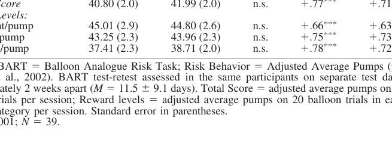

<!-- Page 1 -->
2008, Vol. 16, No. 6, 565-570 1064-1297/08/&#36;12.00 DOI: 10.1037/a0014083

# Test-Retest Characteristics of the Balloon Analogue Risk Task (BART)

Tara L. White Brown University

Harriet de Wit The University of Chicago C. W. Lejuez

University of Maryland

The Balloon Analogue Risk Task (BART) is a computerized decision-making task that provides a test of behavioral risk taking. The task is increasingly used in laboratory settings and in the field with young adults and adolescents. However, there are currently no published data about the test-retest characteristics of the task when it is administered on separate days. The current paper addresses this gap. Risky behavior on the BART (adjusted average pumps) showed acceptable test-retest reliability across days ($$r = +.77$$, $p < .001$). The data indicate that risk behavior on the BART has adequate test-retest stability and therefore performance on the task on a single occasion is likely to be representative of an individual’s performance on other occasions.

*Keywords:* test-retest validity, test-retest reliability, repeated measures, individual differences, risk behavior

The Balloon Analogue Risk Task (BART) is a computerized measure of risk-taking behavior (Lejuez et al., 2002). Risk behavior on the BART correlates with real-world risk behavior such as alcohol use, cigarette and drug use, gambling, stealing, unsafe sex (Lejuez et al., 2002; 2003a, Lejuez, Aklin, Zvolensky, &amp; Pedulla, 2003b), and trait measures of risk-taking propensity (e.g., sensation seeking and trait impulsivity, Lejuez et al., 2002; trait psychopathy, Hunt, Hopko, Bare, Lejuez, &amp; Robinson, 2005). These data suggest that the BART could be useful in studies that assess risk taking behavior over time, for instance, drug treatments, interventions, or events that could phasically alter risk taking on different days of study. Utility of the BART for such purposes, however, is predicated on its test-retest reliability. Toward this end, there are thus far few reports about the test-retest reliability of risk behavior on the BART. Lejuez and colleagues assessed risk behavior on the BART in

- = undergraduate smokers ( *n* 26) and nonsmokers ( *n* 34), by administering the test three times on a single test day (2003a). They found that risk behavior on the BART (adjusted average pumps) was correlated +.62 to +.82 across the three administrations within the single day, with small but significant increases in risk behavior between administrations (Lejuez et al., 2003a). However, these data obtained on a single day cannot speak to test-retest reliability across days. There is, in general, a lack of data on the reliability of computerized tasks of decision-making and behavioral control, such as go/no go, probability discounting, and delay discounting tasks (see Langenecker, Zubieta, &amp; Young,, 2007; Ohmura, Takahashi, Kitamura, 2006). The goals of this analysis are threefold: (1) to document the stability of mean BART risk behavior on separate test days, (2) to provide preliminary data regarding the test- retest reliability of BART risk behavior, and (3) to document the stability of individual differences in BART risk behavior. The first goal is important because it provides information about the ways that mean risk behavior on the task may vary on separate study days in a given sample, which could occur through a number of mechanisms including novelty effects, learning, or habituation to the task. The second goal helps mitigate the current dearth of test-retest information for the BART. The third goal— determining the relative stability of BART risk behavior—is important because 1.) there are individual differences in BART risk behavior as measured on a single study day in healthy volunteers (Lejuez et al., 2002), 2.) these individual differences are correlated with personality traits which are themselves stable upon repeat assessment (see Lejeuz et al., 2002), and 3.) while it is therefore reasonable to expect individual differences in BART risk behavior to be reproducible, this has not yet been documented for this task. Relative stability (also termed “differential stability”) has

## Author Note & Acknowledgments

Tara L. White, Center for Alcohol and Addiction Studies, Brown University; C. W. Lejuez, Department of Psychology, University of Maryland; Harriet de Wit, Department of Psychiatry, The University of Chicago. We thank Vandana Grover, Jen McDonald, and Justin Engasser of the Human Behavioral Pharmacology Laboratory for their as- sistance. This research was supported by USPHS grant DA09133 and training grant T32 DA07255. Correspondence concerning this article should be addressed to Tara L. White, Center for Alcohol and Addiction Studies, Depart- ment of Community Health, Box G-S121-4, Brown University, Providence, RI 02912. E-mail: Tara_White@Brown.edu <!-- Page 2 -->
been recently documented for delay discounting in alcoholics (Takahashi, Furukawa. Miyakawa, Maesato, Higuchi, 2007) and for delay and probability discounting in young adults (Ohmura et al., 2006), and is important to document because it speaks to the ability of a task to index individual differences in risky behavior on separate study days in the same participants, in the absence of other experimental manipulation. The present paper aims to fill these gaps, and provides preliminary data about mean behavior on the task over time, preliminary estimates of BART test-retest stability, and data about the relative stability of individual differences in BART risk behavior.

## Method

### Participants

Participants completed the BART risk task as a part of a larger, multisession repeated measures study (White, Lejuez, &amp; de Wit, 2007), which involved an orientation session and three study sessions, one with a placebo capsule treatment and two with drug capsules. BART data used for the present analysis were obtained on the orientation session and up to approximately 2 weeks later on the placebo session. The current test-retest data have not been previously reported. Participants were 40 healthy volunteers (19 female), aged 18 to 35 who were free of major medical conditions, Axis I psychiatric disorder, and a history of drug or alcohol problems. They also had at least a high school education, were fluent in English and not working night shift (White, et al, 2007). One subject missing BART data on the orientation session was excluded from the analyses (final *n* = 39). Participants were drug-free at the time of testing. This sample is smaller than sample sizes used to investigate test-retest characteristics of self-report measures (e.g., personality trait measures of impulsivity; see Yao et al., 2007), is larger than samples used to establish external validity of the BART in nonsmokers (e.g., *N* = 26, Lejuez et al., 2003a), and is comparable to samples used in testretest studies of behavior and risk-taking (e.g., computerized behavioral tests, *N* = 35, Sakong et al., 2007; go/no go, *N* = 28, Langenecker et al., 2007; probability discounting, *N* = 18, Ohmura et al., 2006; delay discounting, *N* = 22, Ohmura et al., 2006; personal safety, *N* = 29, Punakallio, 2004; gambling, *N* = 34, Weinstock, Whelan, &amp; Meyers, 2004; empathy, *N* = 24, Lawrence, Shaw, Baker, BaronCohen, &amp; David, 2004; self-harm, *N* = 38, Fliege et al., 2006), several of which relate to performance on the BART (see Lejuez et al., 2002; 2003a; 2003b). The present sample size is adequate for preliminary data on test-retest characteristics of the BART.

### Procedure

Before the first session subjects signed their informed consent. The studies were approved by the Institutional Review Board at The University of Chicago in accordance with the Code of Federal Regulations (Title 45, Part 46) “Protection of Human Subjects” adopted by the National Institutes of Health and the Office for Protection from Research Risks, and were conducted ethically in accordance with the Helsinki Declaration of 1964 (revised 1989). Participants completed the task on the orientation session (Session A) and the placebo session (Session B), separated by approximately 2 weeks (mean: 11.5 days \pm  9.1). This interval is similar to that used in other studies that assess test-retest stability of risk-taking or behavior, including test-retest assessment of measures of physical activity (14 days; Hardy, Booth, &amp; Okely, 2007; 22 days; Yore et al., 2007); compulsive exercise (14 days; Griffiths, Szabo, &amp; Terry, 2005); sexual risk behavior (6 days; Troped et al., 2007; 17 days, Schrimshaw, Rosario, Meyer-Bahlburg, &amp; Scharf-Matlick, 2006; 21 days, Hearn, O’Sullivan, &amp; Dudley, 2003), smoking and drinking behavior (14 days; Chor, Faerstein, Alves, &amp; de Souza Lopes, 2003; 2-30 days; Bell, Williams, Senier, Strowman, &amp; Amoroso, 2003); HIV risk behavior (6 -11 days; Fry &amp; Lintzeris, 2003; 30 days, Sherman et al., 2003); risky drug behavior (7 days; Hubley, Russell, &amp; Palepu, 2005); and substance use, abuse, and suicidality (8 days; Shaffer et al., 2004; 10 -14 days, Flisher, Evans, Muller, &amp; Lombard, 2004).

*Behavioral Assessment: BART*

The BART is a computerized task on which participants have the opportunity to win or lose potential earnings, where persistent responding increases gains but also increases the risk of loss on each trial. The BART task consisted of 60 balloon trials, one third of which were Low, Medium, or High payoff value (0.5 cents, 1.0 cents, and 5.0 cents per pump). Participants are presented with “balloons” on a screen, and subjects are given the opportunity to “pump” the balloon to earn monetary rewards. On each trial the computer screen displays a small balloon, a balloon pump, a reset button labeled “Collect &#36;&#36;&#36;,” a box displaying the amount of money earned on the previous trial, a box displaying the total amount of money earned, and a box showing how much the balloon currently displayed would pay off (Lejuez et al., 2002). The number of points that can be earned per pump varies across trials, with 20 balloons having low value (0.5 cents per pump), 20 balloons having medium value (1.0 cents per pump), and 20 balloons having high value (5.0 cents per pump). On each trial, the number of cents earned increases with each pump until either a). the balloon “pops” and participants lose their earnings for that trial, or b). the subject collects the accumulated earnings for that trial. On each trial, each individual click on the pump inflates the balloon one degree (about.125” in all directions), and each balloon is programmed to pop between 1 and 128 pumps, with an average breakpoint of 64 pumps. Specific information regarding the balloon breakpoint determination is not provided to the participants, who are simply informed that the balloon can break anywhere from the 1st pump all the way through enough pumps to make the balloon fill the screen. At any point during each trial, the participants can stop pumping the balloon and click the “Collect &#36;&#36;&#36;” button, which transfers money accumulated from that balloon to the permanent bank, updates the <!-- Page 3 -->
permanent bank amount on the display, and produces a slot machine payoff sound. In contrast, when a balloon explodes, a “pop” sound is heard, the balloon disappears, the money in the temporary bank is lost for that trial, and the next trial begins. The dependent variable is adjusted average pumps, that is, pumps on the balloons which did not explode (Lejuez et al., 2002).

### Data Analysis

*Test-retest.* Test-retest characteristics of the BART risk task were assessed using (1) paired comparisons of mean risk behavior on the BART across days, to provide information about potential novelty, habituation, and learning effects on BART risk behavior across sessions; (2) Pearson correlations of BART risk behavior, to provide information about test-retest reliability across sessions; and (3) Spearman rank-order correlations, to provide information about the stability of individuals’ ranked riskiness of behavior on the task compared to the rest of the sample. Some change in mean risk behavior could be expected from novelty effects upon initial exposure to the task (Session A), or to learning, boredom or habituation upon subsequent exposure to the task (Session B). We expected test-retest reliability to be high on both sessions, and expected individual differences in participants’ relative riskiness of behavior on the task to be conserved across test days. Paired-samples *t* tests, pearson and spearman correlations were also conducted separately for males and females, to assess potential gender differences in test-retest patterns for the BART in this sample. *Cumulative exposure.* Participants in the parent study completed the BART a total of four times (orientation [OR], placebo session [PL], two drug sessions). Therefore, it was important to determine whether performance on the task changed as a function of repeated administrations. Mean risk behavior and test-retest correlations were assessed for differences between two groups: (i) those who received *two expo-* *sures of the BART by Session B* ( *n* = 14; OR-PL order; i.e., no intervening study days); and (ii) those who received *more than* *two exposures of the BART by Session B* ( *n* = 25; OR - 10 mg - PL order, OR - 20 mg - PL order; OR - 10 mg - 20 mg - PL order, OR - 20 mg - 10 mg - PL order; i.e., up to two intervening study days) in the larger parent study. Correlation coefficients were normalized using Fisher’s *r* -to- *z* transformation and z-scores were compared between groups. Mean risk behaviors were compared across groups using *t* tests for independent samples. Alpha was set at.05, 2-tailed for all tests.

## Results

*Mean risk behavior.* Mean risk behavior on the BART (adjusted average pumps; see Lejuez et al., 2002) did not change over time, $t(1, 38) = 0.85$, *ns* (see Total Score, Table 1). *Test-Retest reliability.* Pearson correlations for BART risk behavior between sessions were moderate to high ($$r = +.66$$ to +.78; $p < .001$). Correlations did not differ between the three BART reward conditions (low, medium, and high BART; Z < |1.6|, *ns* ). *Stability of individual differences.* Spearman rank-order correlations for BART risk behavior between sessions were also moderate to high ( $\rho = +.63$ to +.73; $p < .001$). Correlations did not differ between the three BART reward conditions (low, medium, and high BART; Z < |1.2|, *ns* ). *Impact of cumulative exposure.* Mean risk behavior on Session B did not differ between groups receiving two or more than two exposures to the BART (means ( *SE*, n) = 43.6 (3.1, *n* = 14), 41.1 (2.8, *n* = 25), respectively; $t(1, 37) = 0.59$, *ns* ). Test-retest correlations did not differ between groups (Z = 1.08; *ns* ), though there was a nonsignificant trend toward increased test-retest reliability in subjects who had more than two exposures to the BART by the second session, $r = .64$ ( *n* = 14); vs. $r = .82$ ( *n* = 25). *Gender differences.* Mean risk behavior on the BART did not change over time for either males or females ( *males:* all *t* (1, 20) < 0.9, *ns*; *females:* all *t* (1, 17) < |1.8|, *ns* ). Pearson correlations indicated that test-retest stability was moderate to high in both sexes ( *males/females: total score:* $$r = +.74$$/ +.81; *1/2 cent BART:* $$r = +.66$$/ +.70; *1 cent* *BART:* $$r = +.73$$/ +.78; *5 cent BART:* $$r = +.84$$/ +.72; all *p* \le.001), and the magnitude of test-retest correlations did not differ by gender (Z < |.9|, *ns* ). Spearman rank-order correlations were moderate to high for both groups [ *males/* *females: total score:* $\rho = +.67$ ( *p* \le.001)/ +.72 ( *p* \le.001); *1/2 cent BART:* $\rho = +.65$ ( *p* \le.001)/ +.53 ( $p < .05$); *1* *cent BART:* $\rho = +.71$ ( *p* \le.001)/ +.68 ( $p < .005$); *5 cent*

### Table 1 Test-Retest of BART Risk Behavior

<table class="textbook-table" style="width: auto; max-width: 100%; border-collapse: collapse; margin: 1.5em 0;">
  <thead>
    <tr>
      <th></th>
      <th>Session A</th>
      <th>Session B</th>
      <th>t</th>
      <th>r</th>
      <th>rho</th>
    </tr>
  </thead>
  <tbody>
    <tr>
      <td>BART Risk Behavior</td>
      <td></td>
      <td></td>
      <td></td>
      <td>$***$</td>
      <td>$***$</td>
    </tr>
    <tr>
      <td>Total Score</td>
      <td>40.80 (2.0)</td>
      <td>41.99 (2.0)</td>
      <td>n.s.</td>
      <td>$+$ .77</td>
      <td>$+$ .71</td>
    </tr>
    <tr>
      <td>Reward Levels:</td>
      <td></td>
      <td></td>
      <td></td>
      <td>$***$</td>
      <td>$***$</td>
    </tr>
    <tr>
      <td>1/2 cent/pump</td>
      <td>45.01 (2.9)</td>
      <td>44.80 (2.6)</td>
      <td>n.s.</td>
      <td>$+$ .66 $+ ***$</td>
      <td>$+$ .63 $+ ***$</td>
    </tr>
    <tr>
      <td>1 cent/pump</td>
      <td>43.25 (2.3)</td>
      <td>43.96 (2.3)</td>
      <td>n.s.</td>
      <td>.75 $***$</td>
      <td>.73 $***$</td>
    </tr>
    <tr>
      <td>5 cents/pump</td>
      <td>37.41 (2.3) $=$</td>
      <td>38.71 (2.0)</td>
      <td>n.s. $=$</td>
      <td>$+$ .78</td>
      <td>$+$ .72</td>
    </tr>
    <tr>
      <td>Legend: BART</td>
      <td>Balloon Analogue Risk Task; Risk Behavior</td>
      <td></td>
      <td>Adjusted Average Pumps (per</td>
      <td></td>
      <td></td>
    </tr>
  </tbody>
</table>

Lejuez et al., 2002). BART test-retest assessed in the same participants on separate test days, approximately 2 weeks apart ( 9.1 days). Total Score adjusted average pumps on 60 balloon trials per session; Reward levels adjusted average pumps on 20 balloon trials in each reward category per session. Standard error in parentheses. *** $p < .001$;

*Diagram*

<!-- Page 4 -->
*BART:* $\rho = +.78$ ( *p* \le.001)/ +.76 ( *p* \le.001)], and did not differ in magnitude (Z < |.54|, *ns* ).

## Discussion

There were three main findings: (i) mean risk behavior on the BART did not differ across test days; (ii) test-retest correlations across sessions were relatively high ($$r = +.77$$); and (iii) rank-order correlations across sessions were relatively high ( $\rho = +.71$). Cumulative experience with the task did not alter task performance, and test-retest characteristics did not differ by gender. The findings and their implications are discussed below. First, risk behavior on the BART did not differ across sessions (see Table 1); average behavior on the task assessed in the same participants on two separate study days did not differ despite intervening time, exposure to two low doses of amphetamine, and cumulative experience on the task. This finding is important because it indicates that the BART risk task could be relatively resilient to novelty effects, learning effects, and habituation. This finding assists in the evaluation of changes in BART risk behavior in response to interventions in withinsubject designs, such as consumption of moderate doses of psychostimulants (e.g., White et al, 2007), and acute episodes of sleep deprivation (Killgore, 2007; Acheson, Richards, &amp; de Wit, 2007), and is similar to other measures relevant to risktaking, such as probability and delay discounting, which also have stable mean performance when tested between 2 to 5 days ( *t* (1, 23) < |1.7|, *ns*; based on data from Appendix A, Richards, Zhang, Mitchell, &amp; de Wit, 1999), and 3 months apart (Ohmura et al., 2006). Second, risk behavior on the BART showed adequate test- retest reliability ($$r = +.77$$) over a period of approximately 2 weeks. This finding extends the time window on which test- retest reliability of the BART is known (see Lejuez et al., 2003a). The magnitude of the test-retest estimate compares favorably with other tasks, such as delay discounting and probability discounting, which have test-retest correlations of +.52 to +.62 ( $p < .01$; k-values), and +.76 to +.94 ( $p < .001$; h-values), respectively over a shorter time period (i.e., 2-5 days; for data see Appendix A, Richards et al., 1999). The present BART estimates are also within the published range of 2-week test-retest reliability estimates for various *self-report* measures of risk-taking proclivity or behavior (e.g., 2-week retest ( +.75) for self-reports of risk-taking tendency, Meertens &amp; Lion, 2008; 2-week retest ( +.73 to +.96) for self-reported gambling, Weinstock et al., 2004); 2-week retest ( ⬎ +.7) for self-reported sedentary activity, Hardy et al., 2007; 2-week retest ( +.61 to +.95) for self-reported smoking, Chor et al., 2003). Third, spearman rank-order correlations were acceptably high, indicating that between-subjects differences in rankordering of risky behavior on the task are likely to be stable over the time period studied. This finding is important because behavior on the BART correlates with scores on personality traits of impulsivity and psychopathy (e.g., Hunt et al., 2005; Lejuez et al., 2002), which are themselves stable. Other behavioral tasks relevant to risk-taking, such as probability and delay discounting, also show stability of individual differences over time periods both shorter (2-5 days; \rho ⬎ +.89, p’s <.001; for data see Appendix A, Richards et al., 1999) and longer than studied here (2-3 months; Ohmura et al., 2006; Takahashi et al., 2007). The present results suggest that rank-ordered *individual differ-* *ences* in risk behavior on the BART are likely to be both stable and reproducible, a result that has obtained for other behavioral tasks. The present, preliminary findings provide new information about the stability and test-retest reliability of the BART, which is necessary given the dearth of published test-retest information on the BART and laboratory tests of decision-making and behavioral control (for discussion, see Langenecker et al., 2007; Ohmura et al., 2006). The present analysis has several limitations. The main limitation is the assessment of test-retest characteristics over a range of time (approximately 2 weeks; see Methods), rather than using a fixed, a priori test-retest interval. Interval range approaches have however been used in a number of published test-retest studies of other measures of risk-taking and potentially injurious behavior (e.g., interval of 2 to 30 days for alcohol-related behavior, Bell et al., 2003; interval of 7 to 150 days for self-harm behavior, Fliege et al., 2006; interval of 6 to 11 days for HIV, HBV, and HCV risk behavior, Fry &amp; Lintzeris, 2003; interval of 10 to 14 days for substance use, violent behavior, suicidality, and sexuality, Flisher et al., 2004). Future studies using fixed test-retest intervals, such as fixed 2-week, 3-week, 2-month, and 3-month retest intervals, would be valuable to assess the long-term stability of the behavior. The 2-week interval would replicate and extend the present findings; 3-week, two- and 3-month intervals have been used for evaluation of test-retest reliability of other relevant tasks (e.g., 3 week interval for go/no go, Langenecker et al., 2007; 2 month interval for delay discounting, Takahashi et al., 2007; 3 month interval for delay and probability discounting, Ohmura et al., 2006), and would permit systematic comparison between findings in this small literature on test-retest characteristics of behavioral tasks. Other limitations include low statistical power to detect potential gender differences in test-retest patterns in the current sample. Despite these limitations, the present findings nevertheless provide necessary preliminary data about the test-retest characteristics of the BART in young adult samples. Strengths of the current study include use of multiple, commonly used levels of reward (1/2, 1, and 5 cents per pump), an explosion break-point of 64 pumps, and assessment of risk responses using 60 balloons total (20 balloons per subcondition) on each study day. These features make the present BART findings highly generalizable to the other versions of the task. The BART is currently deployed in multiple versions, which vary in: (1) pump reward value; (2) number of balloons assessed; and (3) break-points for explosions. *Regarding pump reward values*, the present study used the most commonly used reward value for pumps, that is, 5 cents per pump (e.g., Killgore, 2007; Benjamin &amp; Robbins, 2007; White et al, 2007; Hunt et al., 2005; Aklin, Lejuez, Zvolensky, Kahler, &amp; Gwadz, 2005; Lejuez et al., 2003a,b; Lejeuz, Aklin, Bornovalova, &amp; Moolchan, 2005; Hopko et al., 2006; Bornovalova, Daughters, Hernandez, Richards, &amp; Lejuez, 2005); and used several additional reward values (1/2 and 1 cent per pump) which are also in wide use (for instance, 1 cent per pump, Crowley, <!-- Page 5 -->
Raymond, Mikulich-Gilbertson, Thompson, &amp; Lejuez, 2006; ⁄ 2, 1, and 5 cents per pump, White et al, 2007; Reynolds, Richards, Dassinger, &amp; de Wit 2004, Reynolds, Ortengren, Richards, &amp; de Wit, 2006b; 1, 5, and 25 cents per pump, Acheson et al., 2007, Acheson &amp; de Wit, 2008; Hamidovic, Kang, &amp; de Wit, 2008), though other reward levels have also been used, which are not addressed here (i.e., 1 point per pump, redeemable for prizes, Lejuez et al., 2007; 10, 25, and 50 cents per pump, Reynolds, Richards, &amp; de Wit, 2006a; and an escalating reward of 50 cents per pump with 2 cent increases; Fein &amp; Chang, 2008). *Regard-* *ing number of balloons,* the study estimated test-retest reliability using a moderate to high number of balloons (20 balloons per condition; 60 balloons total per assessment); this exceeds the 10-balloon minimum required for the task (see Lejeuz et al., 2002; Aklin et al., 2005), and places the current study in the middle of the range of trials typically used for the task, which varies from 10 balloons total (Bornovalova et al., 2005; Hopko et al., 2006); to 10 balloons per condition (Acheson et al, 2007; Acheson &amp; de Wit, 2008; Hamidovic et al., 2008; Reynolds et al., 2004, 2006a, 2006b); 20 balloons total (Benjamin &amp; Robbins, 2007); to 20 balloons per condition (Benjamin &amp; Robbins, 2007; White et al, 2007); 30 balloons total (Aklin et al., 2005; Crowley et al., 2006; Hunt et al., 2005; Killgore, 2007; Lejuez et al., 2003a,b, 2005, 2007; Skeel, Neudecker, Pilarski, &amp; Pytlak, 2007); to 30 balloons per condition (Lejuez et al., 2002); and 40 balloons total (Benjamin &amp; Robbins, 2007), 60 balloons total (Fein &amp; Chang, 2008; White et al, 2007); and 90 balloons total (Lejuez et al., 2002); with a recent novel variant (the 2BIT; Mitchell, Schoel, &amp; Stevens, 2008) topping out at 300 total balloons (150 balloons per condition; Mitchell et al., 2008). Thus the present data correspond favorably to the majority of studies using the BART in terms of numbers of balloon trials assessed. The present study used the *most common break-* *point for explosions*, that is, 64 pumps out of a possible 128 (see Lejuez et al., 2002; Killgore, 2007; Lejuez et al., 2002, 2003a, 2007; White et al, 2007; Hunt et al., 2005; Lejuez et al., 2005; Hopko et al., 2006; Bornovalova et al., 2005; Lejuez et al., 2005; though instances of lower break-points can also be found; for instance 4 &amp; 16 pumps, Lejuez et al., 2002; 20 pumps, Fein &amp; Chang, 2008; 63 pumps, Benjamin &amp; Robbins, 2007). The results also provide test-retest information about the *most widely used summary metric* of risk behavior on the task (i.e., adjusted average pumps; Lejuez et al., 2002). Because of these features, the present study provides highly generalizable test-retest information and does so using an appropriately high number of balloons ( ⬎ 20 per condition; 60 total; see Aklin et al., 2005; Lejuez et al., 2007). The present test-retest information is relevant to the large number of BART versions currently in use, due to the above overlaps between this version and the original version (Lejuez et al., 2002); EEG versions (Fein &amp; Chang, 2008); youth versions (BART-Y; Lejuez et al., 2007); versions that assess responses to win gains or prevent losses (LBART, GBART; Benjamin &amp; Robbins, 2007), and versions that involve multiple and alternate levels of reward (Acheson et al., 2007, 2008; Crowley et al., 2006; Hamidovic et al., 2008; Reynolds et al., 2004, 2006b; White et al, 2007).

## References

Acheson, A., &amp; de Wit, H. (2008). Bupropion improves attention but does not affect impulsive behavior in healthy young adults. *Experimental and Clinical Psychopharmacology, 16,* 113-123.

Acheson, A., Richards, J., &amp; de Wit, H. (2007). Effects of sleep deprivation on impulsive behaviors in men and women. *Physiology &amp; Behavior, 91,* 579 -587.

Aklin, W., Lejuez, C., Zvolensky, M., Kahler, C., &amp; Gwadz, M. (2005). Evaluation of behavioral measures of risk taking propensity with inner city adolescents. *Behaviour Research and* *Therapy, 43,* 215-228.

Bell, N. S., Williams, J. O., Senier, L., Strowman, S. R., &amp; Amoroso, P. J. (2003). The reliability and validity of the self-reported drinking measures in the Army’s Health Risk Appraisal survey. *Alcoholism: Clinical and Experimental Research, 27,* 826 - 834.

Benjamin, A., &amp; Robbins, S. (2007). The role of framing effects in performance on the Balloon Analogue Risk Task (BART). *Personality and Individual Differences, 43,* 221-230.

Bornovalova, M., Daughters, S., Hernandez, G., Richards, J., &amp; Lejuez, C. (2005). Differences in impulsivity and risk-taking propensity between primary users of crack cocaine and primary users of heroin in a residential substance-use program. *Experimental and Clinical Psychopharmacology, 13,* 311-318.

Chor, D., Faerstein, E., Alves, M. G., &amp; de Souza Lopes, C. (2003). How reproducible is self-reported information on exposure to smoking, drinking, and dietary patterns? Evidence among Brazilian adults in the Pro´-Sau´de Study. *Sao Paulo* *Medical Journal, 121,* 63- 66.

Crowley, T., Raymond, K., Mikulich-Gilbertson, S., Thompson, L., &amp; Lejuez, C. (2006). A risk-taking ‘set’ in a novel task among adolescents with serious conduct and substance problems. *Journal of the American Academy of Child &amp; Adolescent* *Psychiatry, 45,* 175-183.

Fein, G., &amp; Chang, M. (2008). Smaller feedback ERN amplitudes during the BART are associated with a greater family history density of alcohol problems in treatment-naı¨ve alcoholics. *Drug* *and Alcohol Dependence, 92,* 141-148.

Fliege, H., Kocalevent, R. D., Walter, O. B., Beck, S., Gratz, K. L., Gutierrez, P. M., et al. (2006). Three assessment tools for deliberate self-harm and suicide behavior: Valuation and psychopathological correlates. *Journal of Psychosomatic Research, 61,* 113-121.

Flisher, A. J., Evans, J., Muller, M., &amp; Lombard, C. (2004). Brief report: Test-retest reliability of self-reported adolescent risk behaviour. *Journal of Adolescence, 27,* 207-212.

Fry, C. L., &amp; Lintzeris, N. (2003). Psychometric properties of the Blood-borne Virus Transmission Risk Assessment Questionnaire (BBV-TRAQ). *Addiction, 98,* 171-178.

Griffiths, M. D., Szabo, A., &amp; Terry, A. (2005). The exercise addiction inventory: A quick and easy screening tool for health practitioners. *British Journal of Sports Medicine, 39,* e30.

Hamidovic, A., Kang, U., &amp; de Wit, H. (2008). Effects of low to moderate acute doses of pramipexole on impulsivity and cognition in healthy volunteers. *Journal of Clinical Psychopharmacology, 28,* 45-51.

Hardy, L. L., Booth, M. L., &amp; Okely, A. D. (2007). The reliability of the Adolescent Sedentary Activity Questionnaire (ASAQ). *Preventative Medicine, 45,* 71-74.

Hearn, K. D., O’Sullivan, L. F., &amp; Dudley, C. D. (2003). Assessing reliability of early adolescent girls’ reports of romantic and sexual behavior. *Archives of Sexual Behavior, 32,* 513-521. Hopko, D., Lejuez, C., Daughters, S., Aklin, W., Osborne, A., Simmons, B., et al. (2006). Construct validity of the Balloon Analogue Risk Task (BART); Relationship with MDMA use by inner-city drug users in residential treatment. *Journal of Psychopathology and Behavioral Assessment, 28,* 95-101.

Hubley, A. M., Russell, L. B., &amp; Palepu, A. (2005). Injection Drug Use Quality of Life scale (IDUQOL): A validation study. *Health* *Quality of Life Outcomes, 3,* 43.

Hunt, M., Hopko, D., Bare, R., Lejuez, C., &amp; Robinson, E. (2005). Construct validity of the Balloon Analog Risk Task (BART): Associations with psychopathy and impulsivity. *Assessment, 12,* 416 - 428.

Killgore, W. (2007). Effects of sleep deprivation and morningnesseveningness traits on risk-taking. *Psychological Reports, 100,* 613- 626.

Langenecker, S. A., Zubieta, J. K., &amp; Young, E. A. (2007). A task to manipulate attentional load, set-shifting, and inhibitory control: Convergent validity and test-retest reliability of the Parametric Go/No-Go Test. *Journal of Clinical and Experimental* *Neuropsychology, 29,* 842- 853.

Lawrence, E. J., Shaw, P., Baker, D., Baron-Cohen, S., &amp; David, A. S. (2004). Measuring empathy: Reliability and validity of the Empathy Quotient. *Psychological Medicine, 34,* 911-919.

Lejuez, C., Aklin, W., Bornovalova, M., &amp; Moolchan, E. (2005). Differences in risk-taking propensity across inner-city adolescent everand never-smokers. *Nicotine &amp; Tobacco Research, 7,* 71-79.

Lejuez, C., Aklin, W., Daughters, S., Zvolensky, M., Kahler, C., &amp; Gwadz, M. (2007). Reliability and validity of the Youth Version of the Balloon Analogue Risk Task (BART-Y) in the assessment of risk-taking behavior among inner-city adolescents. *Journal of Clinical Child and Adolescent Psychology, 36,* 106 -111.

Lejuez, C. W., Aklin, W. M., Jones, H. A., Richards, J. B., Strong, D. R., Kahler, C. W., et al. (2003a). The Balloon Analogue Risk Task (BART) differentiates smokers and nonsmokers. *Experimental and Clinical Psychopharmacology, 11,* 26 -33.

Lejuez, C. W., Aklin, W. M., Zvolensky, M. J., &amp; Pedulla, C. M. (2003b). Evaluation of the Balloon Analogue Risk Task (BART) as a predictor of adolescent real-world risk-taking behaviours. *Journal of Adolescence, 26,* 475- 479.

Lejuez, C. W., Read, J. P., Kahler, C. W., Richards, J. B., Ramsey, S. E., Stuart, G. L., et al. (2002). Evaluation of a behavioral measure of risk taking: The Balloon Analogue Risk Task (BART). *Journal of Experimental Psychology, 8,* 75- 84.

Meertens, R. M., &amp; Lion, R. (2008). Measuring an individual’s tendency to take risks: The risk propensity scale. *Journal of* *Applied Social Psychology, 38,* 1506 -1520.

Mitchell, S., Schoel, C., &amp; Stevens, A. (2008). Mechanisms underlying heightened risk taking in adolescents as compared with adults. *Psychonomic Bulletin &amp; Review, 15,* 272-277.

Ohmura, Y. Takahashi, T. Kitamura, N. (2006). Three-month stability of delay and probability discounting measures. *Experimental and Clinical Psychopharmacology, 14,* 318 -328.

Punakallio, A. (2004). Trial-to-trial reproducibility and test-retest stability of two dynamic balance tests among male firefighters. *International Journal of Sports Medicine, 25,* 163-169.

Reynolds, B., Ortengren, A., Richards, J., &amp; de Wit, H. (2006b). Dimensions of impulsive behavior: Personality and behavioral measures. *Personality and Individual Differences, 40,* 305-15.

Reynolds, B., Richards, J., Dassinger, M., &amp; de Wit, H. (2004). Therapeutic doses of diazepam do not alter impulsive behavior in humans. *Pharmacology, Biochemistry and Behavior, 79,* 17-24.

Reynolds, B., Richards, J., &amp; de Wit, H. (2006a). Acute-alcohol effects on the Experiential Discounting Task (EDT) and a question-based measure of delay discounting. *Pharmacology, Biochemistry and Behavior, 83,* 194 -202.

Richards, J. B., Zhang, L., Mitchell, S. H., &amp; de Wit, H. (1999). Delay or probability discounting in a model of impulsive behavior: Effect of alcohol. *Journal of Experimental Analysis of* *Behavior, 71,* 121-143.

Sakong, J., Kang, P. S., Kim, C. Y., Hwang, T. Y., Jeon, M. J., Park, S. Y., et al. (2007). Evaluation of reliability of traditional and computerized neurobehavioral tests. *Neurotoxicology, 28,* 235- 239.

Schrimshaw, E. W., Rosario, M., Meyer-Bahlburg, H. F., &amp; Scharf-Matlick, A. A. (2006). Test-retest reliability of selfreported sexual behavior, sexual orientation, and psychosexual milestones among gay, lesbian, and bisexual youths. *Archives of* *Sexual Behavior, 35,* 225-234.

Shaffer, D., Scott, M., Wilcox, H., Maslow, C., Hicks, R., Lucas, C. P., et al. (2004). The Columbia Suicide Screen: Validity and reliability of a screen for youth suicide and depression. *Journal of the American* *Academy of Child &amp; Adolescent Psychiatry, 43,* 71-79.

Sherman, S. G., Celentano, D. A., McGrath, J. W., Chard, S. E., Gangakhedkar, R. R., Joglekar, N., et al. (2003). The reliability and validity of the Modified Condom Outcome Expectancy Scale (MCOES) among an international sample of HIV-negative partners of people living with HIV/AIDS. *AIDS Care, 15,* 359 -366.

Skeel, R., Neudecker, J., Pilarski, C., &amp; Pytlak, K. (2007). The utility of personality variables and behaviorally-based measures in the prediction of risk-taking behavior. *Personality and Individual Differences, 43,* 203-214.

Takahashi, T., Furukawa, A. Miyakawa, T., Maesato, H., &amp; Higuchi, S. (2007). Two-month stability of hyperbolic discount rates for delayed monetary gains in abstinent inpatient alcoholics. *Neuro Endocrinol Letters, 28,* 131-136.

Troped, P. J., Wiecha, J. L., Fragala, M. S., Matthews, C. E., Finkelstein, D. M., Kim, J., et al. (2007). Reliability and validity of YRBS physical activity items among middle school students. *Medicine Science Sports Exercise, 39,* 416 - 425.

Weinstock, J., Whelan, J. P., &amp; Meyers, A. W. (2004). Behavioral assessment of gambling: An application of the timeline followback method. *Psychological Assessment, 16,* 72- 80.

White, T., Lejuez, C., &amp; de Wit, H. (2007). Personality and gender differences in effects of d-amphetamine on risk taking. *Experimental and Clinical Psychopharmacology, 15,* 599 - 609.

Yao, S., Yang, H., Zhu, X., Auerbach, R. P., Abela, J. R., Pulleyblank, R. W., et al. (2007). An examination of the psychometric properties of the Chinese version of the Barratt Impulsiveness Scale, 11th version in a sample of Chinese adolescents. *Perceptual and Motor Skills, 104,* 1169 -1182.

Yore, M. M., Ham, S. A., Ainsworth, B. E., Kruger, J., Reis, J. P., Kohl, H. W. 3rd, et al. (2007). Reliability and validity of the instrument used in BRFSS to assess physical activity. *Medicine* *Science Sports Exercise, 39,* 1267-1274.

Received July 2, 2008

### History & Received Dates

Revision received September 15, 2008

Accepted September 17, 2008 䡲
