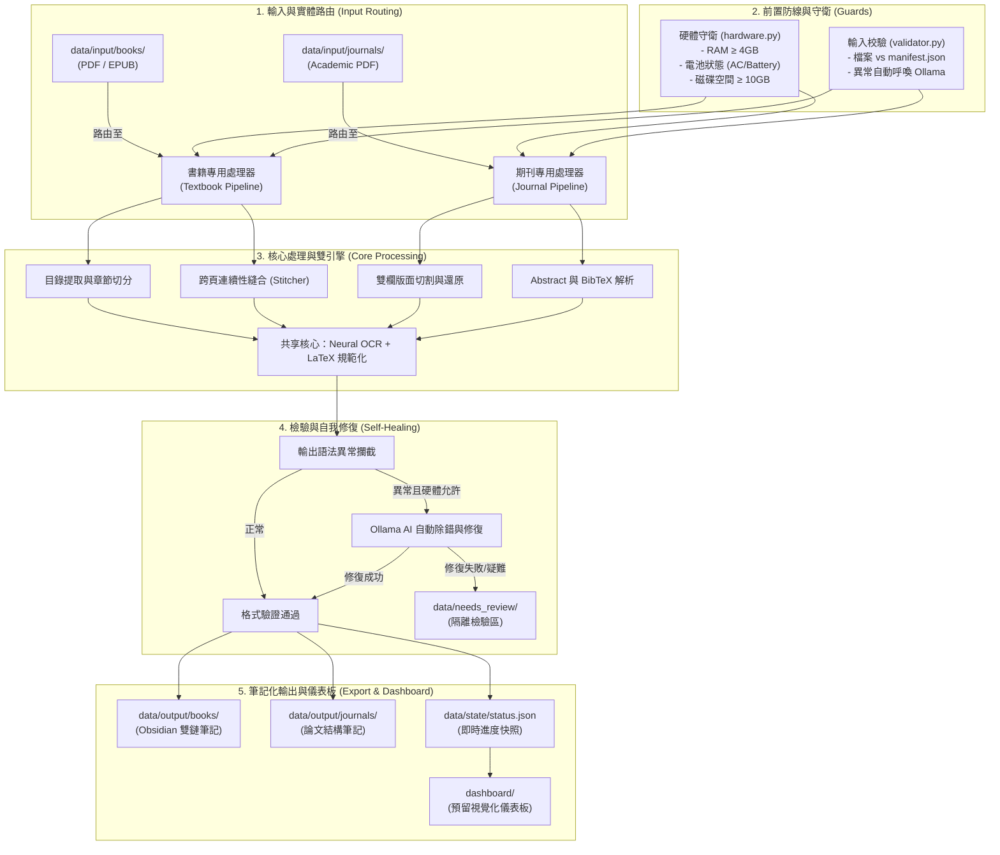

# 🏗️ docs/ARCHITECTURE.md (系統架構與數據流向)

---

## 系統總體架構圖

本系統採用 **管道-過濾器架構 (Pipes and Filters)** 結合 **領域策略模式 (Domain Strategy Pattern)**，將「輸入轉換」、「領域解析」、「AI 增強」與「筆記匯出」徹底解耦。

---

## 核心設計原則

1. **路徑即路由 (Path-as-Routing)**：
   - 書籍放在 `data/input/books/`，期刊放在 `data/input/journals/`。由路徑直接決定調用哪個 Pipeline，完全免除 AI 猜測的誤差與 Token 浪費。
2. **優雅降級 (Graceful Degradation)**：
   - 系統依賴 Ollama 進行自我除錯，但在無 Ollama、無 GPU 加速或低電量情況下，自動退化為純規則檢驗，保證主轉檔流程絕不崩潰。
3. **人機隔離防呆 (Human-in-the-Loop Quarantine)**：
   - 遇到難啃的異常公式或版面，自動丟入 `data/needs_review/`，避免讓 AI 無限重試耗盡電力與記憶體。
4. **狀態解耦 (Stateless Core, Stateful State)**：
   - 核心處理器不維護全域動態變數，所有狀態（如當前處理到第幾頁、進度百分比）集中寫入 `data/state/`，支援隨時中斷、隨時恢復（斷點續傳），並為未來的 `dashboard/` 奠定資料基礎。
