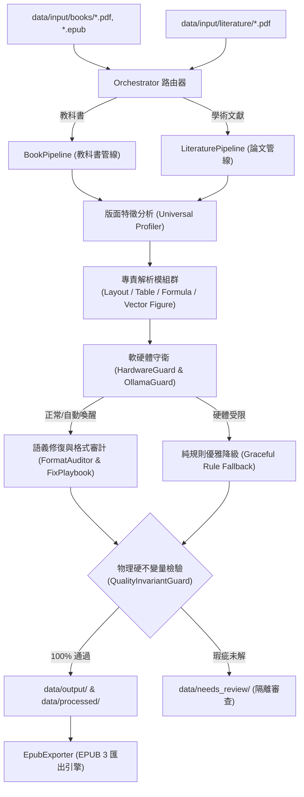

# 系統全域背景 (docs/CONTEXT.md)

## 1. 專案願景與核心使命 (Project Mission)
**Book & Literature Processor** 是一套專為學術書籍（Textbooks）與學術論文（Academic Literature）打造的高保真度數位化與結構化轉換引擎。

本系統的核心使命是：
1. **無損語意轉換**：將版面複雜的 PDF（包含單雙欄混排、多欄條幅、複雜表格、向量圖形、行內與獨立數學公式）精準轉換為語意結構清晰的 Markdown 與 EPUB 3 標準電子書。
2. **教科書深度數位化 (Book Pipeline)**：支援目錄導航解析、章節智慧切分、跨頁文意斷詞縫合、專用章末練習題提取與 Anki 記憶卡片自動生成。
3. **學術文獻專業排版 (Literature Pipeline)**：支援雙欄帶狀閱讀流動（Two-Column Band Flow）、標題作者機構階層化抽取、Abstract 區塊格式化、APA/IEEE 參考文獻結構化解析，以及圖表首引後放置（Semantic Placement）。
4. **離線主權與本地智慧 (Local-First Sovereign AI)**：優先調用本地 Apple Silicon 原生框架（Apple Vision OCR、Core Graphics、Metal）與本地大模型（Ollama），全流程離線運行，杜絕機密外洩與昂貴 API 成本。

---

## 2. 系統架構邊界與資料流 (System Boundaries & Data Flow)

---

## 3. 領域解耦：兩大業務管線 (Two Decoupled Pipelines)

| 評估維度 | 教科書管線 (`BookPipeline`) | 學術文獻管線 (`LiteraturePipeline`) |
| :--- | :--- | :--- |
| **輸入格式** | 長篇 PDF、EPUB（數百頁） | 短篇/中篇 PDF（數頁至數十頁） |
| **輸入路徑** | `data/input/books/` | `data/input/literature/` |
| **輸出路徑** | `data/output/books/<book_title>/chapters/` | `data/output/literature/<paper_id>/` |
| **版面特徵** | 單欄主文、穿插側邊欄、提示框、章末練習 | 單/雙欄切換、頁首出版資訊、摘要區塊、雙欄正文 |
| **排版流動** | 跨頁斷句縫合、頁碼校正、TOC 摺疊注入 | 雙欄帶狀閱讀流動、跨欄圖表展延 |
| **圖表處置** | 向量圖轉 SVG/PNG、圖片去重與圖說綁定 | 圖表延後至首次內文提及處之完整段落後 |
| **參考資料** | 章末詞彙索引 (Glossary)、延伸閱讀 | APA/IEEE 參考文獻結構化條目解析 |
| **附加產出** | Anki 記憶卡 (Flashcards)、Obsidian 雙向鏈結 | EPUB 3 文獻單本、MathML 公式支援 |

---

## 4. 品質保證：零容忍物理硬不變量 (Invariant Gates)
系統全面屏除「流於形式的假通過」，實施 7 大物理不變量門禁（`QualityInvariantGuard`）：
1. **標題非空性 (H1 Presence)**：產出文檔必須具備明確的主標題。
2. **摘要完整性 (Abstract Integrity)**：學術論文必須具備獨立格式化之 Abstract 區塊。
3. **參考文獻獨立性 (Reference Boundary)**：References 必須獨立於正文，不得與正文末段混雜。
4. **LaTeX 括號閉合性 (Math Bracket Balance)**：所有行內 `$ ... $` 與獨立 `$$ ... $$` 括號必須完全閉合。
5. **表格語法完整性 (Table Syntax Integrity)**：不得存在殘破的 raw OCR 字串或未閉合 HTML 表格標籤。
6. **無孤立頁碼 (No Orphan Page Numbers)**：過濾版面邊界之頁碼殘留。
7. **非空白檔案 (Non-Empty Content)**：產出文檔字元數必須大於門檻值。
