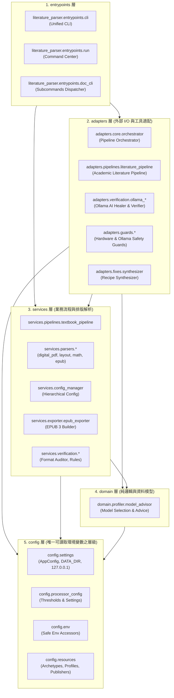

# 系統架構說明 (ARCHITECTURE)

> 本系統採用標準分層架構（Layered Architecture）結合管道-過濾器架構（Pipes and Filters）與策略模式（Strategy Pattern）。
> 分層由上而下：`entrypoints ➔ adapters ➔ services ➔ domain ➔ config`，上層可依賴下層，嚴禁逆向依賴。

---

## 1. 系統分層架構圖

---

## 2. 核心處理管道與數據流向

1. **實體路由與前置檢查 (Pre-flight & Routing)**：
   - 使用者透過 CLI 輸入 PDF/EPUB 檔案。
   - `adapters.guards.hardware` 進行記憶體 (RAM)、電源 (AC/Battery) 與硬碟空間檢查。
   - 根據文檔類型自動分流至書籍管道 (`TextbookPipeline`) 或期刊文獻管道 (`LiteraturePipeline`)。

2. **核心解析與版面偵測 (Layout Detection & Parsing)**：
   - `services.parsers.digital_pdf` 與 `layout_detector` 提取文字區塊、頁首頁尾雜訊過濾。
   - 識別雙欄文字流向（Two-Column Gutter Detection）、表格邊界 (`table_parser`) 與數學公式 (`math_latex`)。
   - 提取教科書學習目標、專有名詞邊欄，或文獻之 IMRAD 結構與作者註記。

3. **自我修復與驗證 (Verification & Self-Healing)**：
   - 輸出前經過 `services.verification.format_auditor` 與 `rules.py` 檢查連續性、表格對齊與 LaTeX 語法。
   - 遇到低信心度或排版破損時，若本地硬體允許，喚醒本地 Ollama 模型進行自我修復 (`ollama_healer`)。
   - 異常或需人工覆核段落隔離至 `DATA_DIR/needs_review/`，避免阻塞批次轉檔。

4. **筆記連結與多格式發布 (Export & Linking)**：
   - 產出標準 Markdown，並由 `obsidian_linker` 生成雙向導航雙鏈與全書 `index.md`。
   - 支援透過 `epub_exporter` 打包成現代化、含 MathML / LaTeX 樣式之標準 EPUB 3 電子書。

---

## 3. 資料與程式碼分離 (Data Isolation)
專案所有運算資料均存放在專案外的 `DATA_DIR`：
- `input/`：原始輸入檔案（只讀）
- `output/`：轉換產物（Markdown、影像、EPUB）
- `needs_review/`：隔離待覆核內容
- `state/`：斷點清單與進度快照
- `logs/`：結構化日誌（`process.log`）
