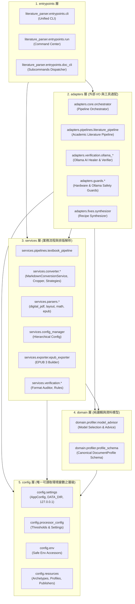
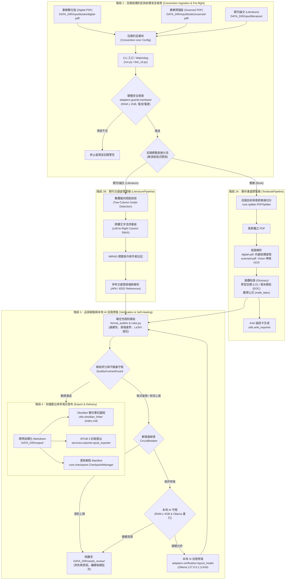

# 系統架構說明 (ARCHITECTURE)

> 本系統採用標準分層架構（Layered Architecture）結合管道-過濾器架構（Pipes and Filters）與策略模式（Strategy Pattern）。
> 分層由上而下：`entrypoints ➔ adapters ➔ services ➔ domain ➔ config`，上層可依賴下層，嚴禁逆向依賴。

---

## 1. 系統分層架構圖



---

## 2. 核心處理管道與數據流向



1. **實體路由與前置檢查 (Pre-flight & Routing)**：
   - 使用者透過 CLI 輸入 PDF/EPUB 檔案。
   - `adapters.guards.hardware` 進行記憶體 (RAM)、電源 (AC/Battery) 與硬碟空間檢查。
   - 根據文檔類型自動分流至書籍管道 (`TextbookPipeline`) 或期刊文獻管道 (`LiteraturePipeline`)。

2. **核心解析與版面偵測 (Layout Detection & Parsing)**：
   - `services.parsers.digital_pdf` 與 `layout_detector` 提取文字區塊、頁首頁尾雜訊過濾。
   - 識別雙欄文字流向（Two-Column Gutter Detection）、表格邊界 (`table_parser`) 與數學公式 (`math_latex`)。
   - 提取教科書學習目標、專有名詞邊欄，或文獻之 IMRAD 結構與作者註記。

3. **自我修復與驗證 (Verification & Self-Healing)**：
   - 輸出前經過 `services.verification.format_auditor` 與 `rules.py` 檢查連續性、表格對齊與 LaTeX 語法。
   - 遇到低信心度或排版破損時，若本地硬體允許，喚醒本地 Ollama 模型進行自我修復 (`ollama_healer`)。
   - 異常或需人工覆核段落隔離至 `DATA_DIR/needs_review/`，避免阻塞批次轉檔。

4. **筆記連結與多格式發布 (Export & Linking)**：
   - 產出標準 Markdown，並由 `obsidian_linker` 生成雙向導航雙鏈與全書 `index.md`。
   - 支援透過 `epub_exporter` 打包成現代化、含 MathML / LaTeX 樣式之標準 EPUB 3 電子書。

---

## 3. 資料與程式碼分離 (Data Isolation)
專案所有運算資料均存放在專案外的 `DATA_DIR`：
- `input/`：原始輸入檔案（只讀，目錄結構即配置）：
  - `books/digital-pdf/`：數位向量教科書（直接調用 XML 樣式提取，不跑 OCR）。
  - `books/scanned-pdf/`：掃描版教科書（直接調用 Vision 神經 OCR 解析）。
  - `books/`（根目錄）：未分流時相容備援（自動執行抽樣檢測）。
  - `literature/`：期刊文獻論文（預設雙欄數位論文，亦相容 `scanned-pdf/` 子目錄）。
- `output/`：轉換產物（資料夾一律禁用底線 `_`，統一以連字號 `-` 取代空格）：
  - `books/<Book-Title-With-Hyphens>/`：章節 Markdown、抽像影像、EPUB 3 與 Obsidian 雙鏈。
  - `literature/<Paper-Title-With-Hyphens>/`：結構化論文 Markdown、圖表與 EPUB 3。
- `needs_review/`：隔離待覆核內容（格式損壞且無法自我修復之頁面）
- `state/`：斷點清單與進度快照
- `logs/`：結構化日誌（`process.log`）

---

## 4. 四階設定階層與統一 Profile 規格 (Hierarchical Profiles & Schema)

本專案採四層式由粗至精的幾何與版面樣式繼承模型，並統一以強型別 `DocumentProfile` 作為領域層資料載體：

```mermaid
flowchart TD
    L1["階層 1：全局原形基準 (Archetype Defaults)<br>config/resources/archetypes/{textbook,literature}.json"]
    L2["階層 2：出版社模板與噪音規則 (Publisher Rules)<br>config/resources/publishers/{pub}.json + profiles/literature_{pub}.json"]
    L3["階層 3：跨文件共享知識 (Shared Knowledge Repository)<br>config/resources/shared_knowledge/{literature_sections,front_matter_taxonomy,pedagogical_blocks,symbol_mappings}.json"]
    L4["階層 4：個別文件實例 Profile (Instance Canonical Profile)<br>DATA_DIR/output/.../profile.json (鏡像相容 book_profile.json / document_profile.json)"]

    L1 -->|基礎排版參數| L2
    L2 -->|合併覆寫樣式| L3
    L3 -->|累積全域規則與結構分類| L4
    Auditor["格式品質稽核器 (Format Auditor)"] -.->|閉環幾何修正 (Closed-Loop Healing)<br>LEAKED_HEADER / LEAKED_FOOTER| L4
```

1. **統一檔名與向後相容**：
   - 實例輸出目錄一律將主 Profile 命名為標準 `profile.json`。
   - `ConfigManager` 與各 Parser 具備自動向後相容，讀取時優先查找 `profile.json`，缺失時自動降級讀取 `document_profile.json` 或 `book_profile.json`。
   - 寫入時同時儲存規範之 `profile.json`，並為舊有工具維護相容之鏡像檔案。

2. **強型別領域模型與排版細節 (`DocumentProfile`)**：
   - `meta` (`ProfileMetadata`)：文件分類 (`book` / `literature`)、模式 (`digital` / `scanned`)、標題、出版社與前置頁結構清單 (`front_matter_sections`)。
   - `geometry` (`ProfileGeometry`)：頁面尺寸、`header_cutoff_y`、`footer_cutoff_y`、雙欄中縫 (`gutter_split_x`)、奇偶頁非對稱結構（`PageAsymmetry`，左頁偶數頁邊欄在左、右頁奇數頁邊欄在右）與雙欄跨欄橫幅（`has_spanning_boxes`）。
   - `typography` (`ProfileTypography`)：H1/H2/H3 字級閾值、內文字級、Unicode-LaTeX 對照、首字下沉（`has_drop_caps`）與圖表標題正則（`caption_patterns`）。
   - `special_blocks` (`ProfileSpecialBlocks`)：動態教學區塊清單（`active_blocks`，如 `margin_glossary`, `dialogue`, `worked_example`, `case_study`）與對應樣式正則規則（`block_rules`）。

3. **Front Matter 獨立切分與純淨 Chapter 1 保證**：
   - 書籍大綱自動將 Cover、Title-Page、Publish/Copyright、Dedication、TOC、About-Authors、Preface 等切分出獨立 PDF（`00-01-Cover`、`00-02-Publish`、`00-07-TOC` 等）。
   - 自動向後探測並校驗真實 Chapter 1 起始頁，徹底杜絕 Chapter 1 吸收前置頁面；所有 Front Matter 均會產出獨立 `.md` 並無縫接入 Obsidian 雙鏈與 EPUB 3 目錄。
   - 全書 `profile.json` 在切分後由主進程單執行緒建立（`ensure_book_profile`），嚴格排除 `00-*` 前置頁面作為幾何樣本，消除多核心並發爭用。

4. **閉環自我修復 (Closed-Loop Layout Healing)**：
   - 當後期 Format Auditor 或本地 AI 驗證器偵測到頁首殘留 (`LEAKED_HEADER`) 或頁尾殘留 (`LEAKED_FOOTER`) 時，呼叫 `CoordinateCalibrator.adjust_geometry_from_feedback()`。
   - 動態計算並修正幾何截止線，同步重寫本機之 `profile.json` 與鏡像檔案，實現「偵測到一次排版雜訊，即全本自動校正」之閉環自我修復。
