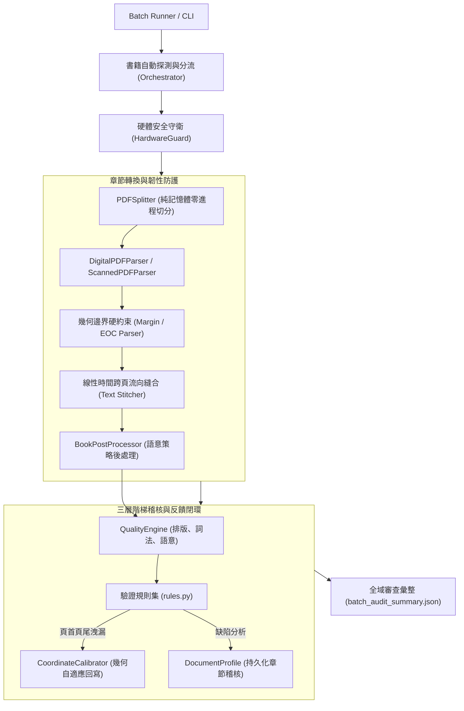

# SPEC-008: 批次轉檔韌性與全量零缺陷驗證規格 (Batch Resilience & Zero-Defect Pipeline Specification)

## 1. 概述 (Overview)

本規格定義了文獻解析系統在面對跨出版社（Cengage, Pearson, Wiley, WeLib 等）、跨格式（原生數位 PDF、掃描版 PDF）、跨學科（統計學、心理學、社會學）大型圖書庫進行全量無人值守批次轉換時的容錯、自適應校準、非卡頓正則架構與零缺陷驗收標準（Zero-Defect Acceptance Criteria）。

## 2. 核心架構與元件 (Core Architecture)

## 3. 關鍵韌性規格 (Resilience Specifications)

| 維度 | 機制與規格要求 | 指標 / 規範 |
|---|---|---|
| **時間複雜度保證** | 跨頁段落縫合禁止使用巢狀模糊貪婪量詞，插播行數限制於 `{1, 20}` | 跨頁縫合單章耗時 $\le 0.5$ 秒，杜絕 Catastrophic Regex Backtracking |
| **邊界幾何封頂** | 邊欄名詞解釋抽取嚴格受限於 `x1 <= margin_bound + 40` 且 `width <= 200 pt` | 杜絕主文大標題（如 386 pt 標題）被誤食入邊欄 |
| **章末標題簽名** | EOC 標題嚴格要求 `not islower()` 且滿足 `size >= 12` 或 `is_bold` 或 `isupper()` | 杜絕正文內文之小寫 `summary` 截斷章節 |
| **語法關鍵字隔離** | 程式碼指示詞須具備語法標識（如 `class Identifier:`），且非空行數 $\ge 2$ | 心理學術語（如 `social class worldview`）零誤判為 Python 代碼 |
| **公式與貨幣脫逸** | 貨幣反斜線 `\$` 優先跳過，不參與 LaTeX inline math 定界符配對 | 統計表與薪資調查（如 `\$39,589`）公式完整度 100% |
| **專業常模矩陣豁免** | 心理測驗（RIASEC、Holland SDS）與統計交互作用矩陣納入白名單 | 數值座標雜訊檢測零誤報 |

## 4. 全量驗收與 Clean Slate 重跑標準 (Acceptance Criteria)

1. **全章節 100% 直通 (`ALL_PASSED`)**：
   - 書庫內所有章節（涵蓋封面、版權、前言、目錄、正文、附錄、Glossary、References、Index）皆必須通過品質門檻（$\ge 85\%$），無任何中斷。
2. **全量清空乾淨重跑驗證 (Clean Slate Verification)**：
   - 在所有章節全數輸出完成後，必須完整清空輸出目錄，重新以批次無干預模式執行全書庫處理。
   - 確保在此次迭代所做的通用修復在不同版面樣式下具備泛化相容性，無任何功能回退或副作用。
3. **單元測試全通**：
   - 321 個單元測試 100% 通過，且靜態審查（`agentctl check`）無分層逆向依賴。
